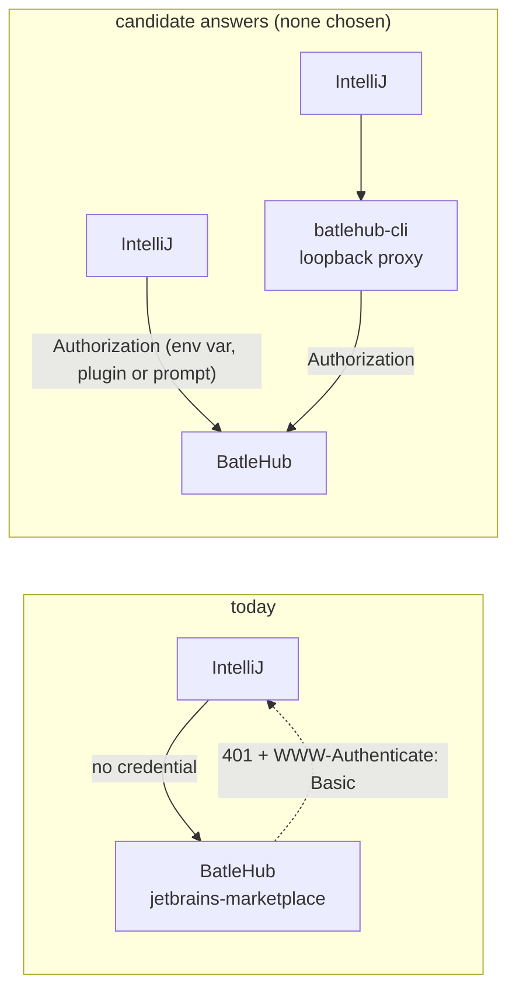
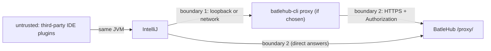

# RFC 0033 — Authenticated JetBrains Marketplace access

| Field       | Value                                                        |
| ----------- | ------------------------------------------------------------ |
| Status      | Draft                                                         |
| Short       | Authenticated JetBrains access                                |
| Settles     | Giving IntelliJ a way to send a credential to a jetbrains-marketplace registry, which its plugin-host setting has no field for |
| Author      | Max Batleforc <maxleriche.60@gmail.com>                       |
| Co-author   | Claude Opus 5 <noreply@anthropic.com>, Claude Opus 5.5 <noreply@anthropic.com> |
| Created     | 2026-09-13                                                    |
| Supersedes  | —                                                             |
| Depends on  | RFC 0011 §4.4 (the loopback gallery proxy, for the shape this one would copy); RFC 0015 for the grants a refusal comes from, and its §13.19 for the `401` challenge |
| Touches     | Undecided until §15 q3: `cli/src/api/ide.rs` (`jetbrains_instructions`), `ui/src/config/registryTypes.ts`, `docs/registries/jetbrains-marketplace.md`, `tests/heavy/authz.sh`, `docs/contributing/testing.md` §7-ter; `cli/` (a second loopback proxy) only if that is the answer |
| Risk        | medium — §7 (whichever answer is chosen places a read credential beside an IDE that runs third-party plugin code) |

**This is a placeholder opened deliberately early.** The problem is established
and §2 records it; the design is not, and §15 carries every question that has
to be answered before §4–§6 can be written. Nothing here should be implemented
from as it stands. Every section of the house form exists so that the gaps are
visible; a section whose content depends on the design says what it depends
on, and invents nothing.

---

## 1. Summary

A `jetbrains-marketplace` registry that refuses anonymous callers has no
*documented* way to be used by IntelliJ. Its `idea.plugins.host` property — and
the Plugin Repositories dialog behind it — takes a URL and nothing else, and
JetBrains' own documentation describes no authentication for a custom plugin
repository.

Two facts found since this draft was opened change the shape of the question:

- **The server no longer answers a bare `403`.** Since `7cc8ccc9` (#340,
  2026-11-13), an anonymous refusal on `/proxy/…` that a credential could
  answer is `401` with `WWW-Authenticate: Basic realm="BatleHub"`
  (`challenge_anonymous`, `crates/web/src/middleware/auth.rs:239-251`;
  RFC 0015 §13.19). An HTTP client that answers a Basic challenge can now
  authenticate without being told to in advance.
- **IntelliJ has an undocumented credential hook.** The IntelliJ IDEA 2026.1.3
  build the heavy suites pin (`IU-261.25134.95`) ships an extension point,
  `com.intellij.pluginRepositoryAuthProvider`, and one built-in implementation
  of it, `EnvironmentVariablePluginRepositoryAuthProvider`. Read from its
  bytecode (not observed on the wire): when the `IDEA_PLUGINS_HOST_AUTH`
  environment variable is set, it adds `Authorization: <that value>` to every
  request whose URL starts with `idea.plugins.host`. §15 q8 asks what that
  does to this RFC.

That is the same problem VS Code has, and RFC 0011 §4.4 already answered it
once: a loopback proxy the user's own CLI runs, which holds the credential so
the editor never sees it. This RFC asks whether the same answer fits here, or
whether one of the cheaper hooks above makes it unnecessary.

### Before / after

Today the refusal is legible to an HTTP client but not yet known to be legible
to IntelliJ: whether the IDE answers the challenge, ignores it or draws an
empty list is unmeasured. The candidate answers either let the IDE send the
credential itself or move it one process away from the editor, which is what
RFC 0011 did for the editor that had the same gap.

---

## 2. Motivation

1. **IntelliJ has no documented credential field.** `pacman.conf(5)` at least
   says what it does not have; JetBrains' *Managing plugins* page describes the
   custom repository URL, `idea.plugin.hosts` and `idea.plugins.host`, and says
   nothing about credentials in a URL, a token, or a login prompt. The
   `IDEA_PLUGINS_HOST_AUTH` variable of §1 exists in the shipped bytecode but
   in no JetBrains document, which is the condition §12 warns about for
   userinfo. A closed `jetbrains-marketplace` registry is therefore unusable
   from the IDE *by any documented means* rather than merely authenticated.
2. **It is the last registry kind with no client-level authorization
   coverage.** `docs/contributing/testing.md` §7-ter says twenty-one of
   twenty-four kinds are covered at both the route and the client level (its
   own count, written before the godist and mise kinds; not re-measured here).
   The three that are not are blocked by their client, and of those three
   `vscode-marketplace` and `openvsx` already have an answer in RFC 0011 and
   the che-code fork. This one has none: its row reads "Route level only. An
   IDE-level test needs the mechanism to exist first".
3. **The proxy that would answer it is VSX-shaped, not reusable as it
   stands.** `cli/src/gallery_proxy.rs` is a loopback server in front of one
   *VSX* registry: it classifies `extensionquery` bodies (`classify`), rewrites
   `assetUri`/`fallbackAssetUri` (`rewrite_urls`), and serves a synthetic
   `batlehub.sign-in` entry (`sign_in_document`, `sign_in_vsix`). None of that
   transfers to `updatePlugins.xml`, `plugins/list`,
   `pluginManager?action=download` and `files/{plugin}/meta.json`. What
   transfers is the *design* — the per-session path segment of `new_session`,
   the contract-file credential — and §15 asks how much of it.
4. **A refusal an IDE renders as an empty list is not a boundary.** RFC 0009
   §5.2's distinction applies here and has not been measured: nobody has
   observed what IntelliJ does with the `401` its plugin host now answers. If
   it draws an empty Plugin Repositories list in silence, the design needs an
   equivalent of RFC 0011 §4.4.2's sign-in entry, which is the expensive half.
   If it shows a legible error — or prompts, §15 q7 — the proxy reduces to
   attaching a header and rewriting URLs, or disappears.

---

## 3. Goals / non-goals

### Goals

- A supported way for IntelliJ to reach a `jetbrains-marketplace` registry
  that does not grant anonymous read.
- Whatever that way is, a client-level authorization pair for the kind — the
  IDE refused when the credential holds no read verb, and working when it
  does — so the kind leaves the "route level only" row of
  `docs/contributing/testing.md` §7-ter.

### Non-goals

- **Changing the server.** The registry already refuses correctly, the
  route-level pair is already asserted by `authz.sh reads`
  (`tests/heavy/authz.sh:4088`), and #340 already made the refusal a
  challenge. The gap is on the client side, and a server change to
  accommodate a client that cannot authenticate would be the wrong repair.
- **A second credential store.** Whatever runs would read the contract file
  RFC 0011 already defines (`cli/src/contract.rs`), not invent a
  JetBrains-specific one.
- **Publishing.** Upload is a Gradle plugin with its own token handling and is
  not affected by this gap.
- **Deciding between the candidate answers.** That is §15, and this draft
  deliberately does not pre-empt it.

---

## 4. User-facing design

### 4.1 Configuration

Depends on §15 q3. Every candidate changes only the client side: an
environment variable or a URL in `idea.properties`, an IDE plugin, or a
`batlehub-cli` subcommand. None adds a server configuration key.

### 4.2 Behaviour rules

Depends on §15 q3 and the observations of §6.P.

### 4.3 Validation

Depends on the chosen answer; no candidate adds a server-side input.

### 4.4 API surface

No new server endpoint under any candidate (§3 non-goals). A loopback proxy, if
chosen, adds a listener in `batlehub-cli` on the loopback interface only.

### 4.5 Mocks

None yet: the visible change — a setup snippet in `setup ide` and on the
registry page, or a sign-in entry in the IDE's plugin list — is not chosen.
Whichever is chosen gets its mock here before this RFC leaves `Draft`.

---

## 5. Architecture

Not written: it is the output of §15 q3. The mermaid of §1 shows the two
shapes on the table — the IDE carrying the credential itself, or a loopback
process carrying it for the IDE.

---

## 6. Detailed design

Not written, for the same reason. §6.P is the experiment that decides it, and
is a plan.

### 6.P Proof against a real client

**Status: a plan. Nothing below has been observed.**

Client: IntelliJ IDEA **2026.1.3** (build `IU-261.25134.95`), the build pinned
by `IDEA_VERSION` in `tests/heavy/marketplace.sh:52` and cached in
`~/.cache/batlehub-heavy/idea-2026.1.3`. Harness: `closed_world.sh`'s
`phase_jbplugin` form rather than `marketplace.sh`'s, because the latter passes
a custom repository URL to headless `installPlugins` and the
`IDEA_PLUGINS_HOST_AUTH` provider only handles URLs under `idea.plugins.host`
(`canHandle` is a `startsWith` on that property). The registry is a local-mode
`jetbrains-marketplace` registry with no anonymous read, a published fixture
plugin, two PATs (one with `releases:read` on the registry, one without), and
the wire tap of `HEAVY_TAP_BASE` recording every request and its
`Authorization` scheme.

Three arms, each with a success and a refusal case:

1. **Arm A — the `401` challenge.** `idea.plugins.host` set, no credential,
   `installPlugins <id>`. Observe: does the IDE make a second request with
   `Authorization: Basic` after the `401`? Headless mode cannot show
   `IdeaWideAuthenticator`'s `prompt.server.authentication` dialog, so this
   arm needs a GUI run (the browser sidecar or an Xvfb display) to observe
   the prompt, and a headless run to observe what the user would see without
   one. Settles §15 q7.
2. **Arm B — userinfo in the host URL.**
   `idea.plugins.host=http://<user>:<PAT>@…`. Allowed PAT: plugin lands in the plugins directory, the tap shows
   `Authorization: Basic` on the listing *and* the download. Refusal: PAT
   without the read verb → `403`, nothing installed, and the IDE's own error
   text quoted. Also observe whether the URL — and so the PAT — appears in
   `idea.log`. Settles §15 q2.
3. **Arm C — the auth-provider extension point.** First its built-in
   implementation: `IDEA_PLUGINS_HOST_AUTH="Bearer <PAT>"` in the IDE's
   environment, `idea.plugins.host` plain. Allowed PAT: the tap shows the
   header on every request under the host, including the download (whose URL
   must stay under the host prefix — §15 q5). Refusal: the PAT without the
   read verb → `403`, nothing installed; and an anonymous run (variable unset)
   → `401`, nothing installed. This exercises the same extension point a
   BatleHub IntelliJ plugin would implement, so it also settles whether the
   plugin path (§15 q11) works at all. Settles §15 q8.

In every arm, a run that installs the plugin without the tap showing the
credential proves nothing — it would mean the registry was open — so the
assertion is on the wire, as `heavy_wire_re_after` does today.

**Deliberately untouched**, so reviewers do not go looking:

- `crates/web/src/handlers/proxy/jetbrains_marketplace/` — the server side
  refuses and challenges correctly already (§3).
- `crates/core/src/services/signed_url.rs` — RFC 0012's signed URLs are wired
  only to the Terraform provider path (`handlers/proxy/terraform/`); §12 keeps
  them as an alternative, not as an existing answer.

---

## 7. Security

**Rating:** medium — whichever answer is chosen places a read credential beside
an IDE that runs arbitrary third-party plugin code; the server boundary itself
is unchanged.

### 7.1 Threat model

Assets: the user's BatleHub PAT (or contract-file credential) and the private
plugins of a closed registry. Actors: the user, third-party IDE plugins running
in the same JVM, other containers sharing the pod's loopback, anyone who reads
the IDE's config or logs.

| # | Threat (STRIDE) | Where | Mitigation | Residual risk |
| --- | --- | --- | --- | --- |
| T1 | Information disclosure — a plugin reads the token from `System.getenv`, `idea.properties` or the in-memory URL | IDE process | Proxy answer: the token never enters the IDE (RFC 0011 §4.4's reasoning). Direct answers: none in the IDE; limit by a read-only, expiring PAT scoped to the one registry | Open: §15 q9 decides whether direct answers are acceptable at all |
| T2 | Information disclosure — the token is written to `idea.log` or a crash report through the URL (arm B) | IDE logs | Measured in §6.P arm B before any snippet ships | Open until measured |
| T3 | Spoofing — another container in the pod reaches the loopback proxy and reads with the user's identity | boundary 1 | RFC 0011 §4.4.1's per-session random path segment (`gallery_proxy::new_session`), never logged | As accepted in RFC 0011 |
| T4 | Information disclosure — the IDE follows an absolute download URL off the host prefix and sends the request without the credential, or sends the credential to another host | boundary 2 | `canHandle` matches the host prefix only; URL rewriting (§15 q5) keeps downloads under it | Open: §15 q5 |
| T5 | Elevation — a challenge prompt (arm A) teaches users to type their password into any dialog that asks | IDE UI | Recommend a PAT, never the account password, in every snippet | Accepted if arm A is chosen |

### 7.2 Authentication and authorisation

No new server surface. The registry keeps default deny through RFC 0015's
grants; an anonymous caller gets `401` + Basic challenge, an authenticated one
without the verb `403` (`challenge_anonymous`, RFC 0015 §13.19). A bypassed
client-side mechanism gains nothing: it only ever sends the user's own
credential.

### 7.3 Input handling and injection

No new server-side parser. A loopback proxy, if chosen, would parse
`updatePlugins.xml` and the plugin API's JSON to rewrite URLs (§15 q5), which is
attacker-adjacent input from the registry and would get size limits and a fuzz
target then.

### 7.4 Secrets and cryptography

The secret is the existing PAT or contract-file credential; no new secret and
no new cryptography. Where it lives is exactly the open question (§15 q9): an
environment variable, a URL in a plain file, a plugin's password-safe entry, or
a separate process.

### 7.5 Abuse and resource exhaustion

No new server work: every candidate makes the same requests an anonymous IDE
makes today, with a header. A loopback proxy is bounded by one user's IDE.

### 7.6 Existing defences that still hold

- **The editor must not hold the token.** An IDE runs arbitrary third-party
  plugin code, which is the reason RFC 0011 §4.4 put the credential in a
  separate process rather than in `product.json`. The same reasoning applies
  to `idea.properties`, which is a plain file in the IDE's own config
  directory — and to `IDEA_PLUGINS_HOST_AUTH`, which every plugin can read.
  §15 q9 asks whether that floor still holds for this kind.
- **Loopback is not a boundary in a workspace pod.** Every container in the
  pod shares it, so a port protects nothing. RFC 0011 §4.4.1's answer — a
  per-session random path segment, regenerated per invocation and never
  logged — is the floor for anything that listens here too.
- RFC 0015's grants decide before any fetch (`testing.md` §7-ter), so the
  refusal case of every arm is the server's, not the client's.

---

## 8. Supply chain

No new dependency, image, action or tool is proposed yet; the IDE build is
already pinned by the heavy suites. An IntelliJ plugin (§15 q11), if chosen,
would bring the IntelliJ Platform Gradle plugin and its own release pipeline,
and would be listed here then.

---

## 9. Data and privacy

No new data is stored or transmitted by the server: every candidate sends the
user's existing credential on requests the IDE already makes, and the access
log already records the authenticated identity for them. The client-side
datum is the credential itself, covered by §7.4; arm B's possible appearance of
the PAT in `idea.log` is T2.

---

## 10. Operability

### 10.1 Observability

- **Metrics**: none new; the registry's existing request and refusal counters
  already distinguish `401` from `403`.
- **Logs and audit trail**: unchanged on the server. A loopback proxy, if
  chosen, logs as `gallery_proxy` does — never the session path or the token.
- **Alerts**: none, because nothing server-side changes.

### 10.2 Failure modes

| Failure | Detected by | Behaviour (fail open / closed) | Recovery |
| --- | --- | --- | --- |
| Credential missing or expired | the IDE's request | Closed: `401`/`403`, nothing installed | Re-run the CLI setup or `auth token`; what the IDE *shows* is §15 q7 |
| Loopback proxy not running (if chosen) | the IDE's connection error | Closed: no plugin list | Restart the CLI command |

### 10.3 Performance and capacity

No server cost. A loopback proxy would add one local hop per plugin request;
the volume is one user's IDE.

---

## 11. Other concerns

- **Accessibility**: no BatleHub UI change unless the console's setup guide
  changes, which would follow `registryTypes.ts`'s existing pattern.
- **Internationalisation**: a new setup snippet's prose goes through the
  existing locales of the console and the docs; none is written yet.
- **Compliance**: no control's evidence changes; credential handling stays
  under the existing PAT policy (mandatory expiry, RFC 0011-bis).
- **Licensing**: unchanged unless an IntelliJ plugin is chosen (§8).
- **Documentation**: `docs/registries/jetbrains-marketplace.md`,
  `jetbrains_instructions` in `cli/src/api/ide.rs:325` and
  `registryTypes.ts` today say only "anonymous read"; the chosen answer
  corrects all three, and `testing.md` §7-ter's row moves.

---

## 12. Alternatives considered

Recorded so the eventual design has to argue against them rather than
rediscover them. None is chosen.

| Alternative | Cost |
| --- | --- |
| A loopback proxy in `batlehub-cli`, as RFC 0011 §4.4 | A second protocol renderer to write and maintain; and the authorization boundary is then exercised by the proxy, not by the IDE, so the test proves "the supported deployment fails correctly" rather than "IntelliJ carries a credential" |
| Userinfo in the plugin-host URL | Undocumented by JetBrains. It may work — the IDE hands the URL to its HTTP client — but building on an undocumented behaviour is what made the `nodedist` and `sdkman` setup snippets wrong, and that cost is recent |
| A signed URL per RFC 0012, so the host URL needs no credential | Moves the secret into a URL that lands in `idea.properties`, and the plugin host is read repeatedly rather than once, so the expiry window is the whole question. Today `signed_url.rs` serves only the Terraform provider path |
| Leave it uncovered, and say so | Free, and honest — but it leaves one registry kind that cannot be closed without becoming unusable, which is a product gap rather than a testing one |
| **IntelliJ answering the `401` challenge** through its global `java.net.Authenticator` (`IdeaWideAuthenticator`, which carries a `prompt.server.authentication` string) — *unverified, to measure* (§6.P arm A) | No code if it prompts; but a prompt per IDE start, nothing in headless use, and users taught to type a secret into a dialog (T5) |
| **The `pluginRepositoryAuthProvider` extension point** — either its built-in `IDEA_PLUGINS_HOST_AUTH` environment variable (bytecode-read, 2026.1.3) or a BatleHub IntelliJ plugin implementing it, as `batlehub-vsx` does for VS Code — *unverified, to measure* (§6.P arm C) | The variable is zero code but undocumented, covers only `idea.plugins.host` (not the additive Plugin Repositories list), and puts the token in the IDE's environment (T1). A plugin can read the contract file and refresh, but is a new artifact with its own repository and release |

---

## 13. Rollout and compatibility

- **Default behaviour**: unchanged — a registry that grants the `anonymous`
  role read keeps working with no credential.
- **Migration**: none on the server; users of a closed registry follow the new
  snippet once one exists.
- **Operator prerequisites**: none beyond a PAT with `releases:read`.
- **Rollback**: removing a snippet or a CLI subcommand persists nothing.
- **Feature flag**: none planned.

---

## 14. Test plan

- **Unit**: depends on the answer; a loopback proxy gets the URL-rewrite unit
  tests `gallery_proxy` has today.
- **Integration**: the server is unchanged; `authz.sh reads` keeps the
  route-level pair.
- **Proof**: §6.P, then a permanent heavy phase (§15 q6).
- **Security**: one negative case per §7.1 row — T1 is a decision, not a test;
  T2 greps `idea.log` for the PAT after arm B; T3 reuses `gallery_proxy`'s
  wrong-path test if a proxy is chosen; T4 asserts no request leaves the host
  prefix without the header; T5 has no test.
- **Audit**: `task audit` unchanged.
- **Existing suites**: `closed_world.sh jbplugin` and `marketplace.sh` keep
  proving the anonymous flow.

---

## 15. Decisions and open questions

### Resolved

| # | Question | Decision |
| --- | --- | --- |
| 1 | What does IntelliJ do with a `403` from its plugin host? | **Superseded, re-asked as q7.** Since `7cc8ccc9` (#340) an anonymous refusal on `/proxy/…` is `401` + `WWW-Authenticate: Basic`, not `403` (`crates/web/src/middleware/auth.rs:239-251`), so the measurement that matters is of the challenge. |

### Still open

2. **Does `idea.plugins.host` accept userinfo in the URL?** Also not measured,
   and cheap to measure in the same run as q7 (§6.P arm B). A yes would make
   most of this RFC unnecessary — subject to T2.
3. **Which of the alternatives in §12**, given the answers to q2, q7 and q8.
4. **If it is a proxy: one binary or two?** `batlehub proxy serve` is VSX-only
   today. A `--kind` flag, a sibling subcommand and a second binary are all
   plausible, and the answer depends on how much of the rendering is shared —
   on present reading, almost none.
5. **Which documents need URL rewriting.** `updatePlugins.xml` and the plugin
   API return absolute download URLs on the BatleHub origin; left alone the
   IDE would fetch them without a credential, which is the bug RFC 0011
   §4.4.3 fixed for the gallery. The full list is part of the design, not of
   this draft. Under arm C it narrows to: does every download URL stay under
   the `idea.plugins.host` prefix?
6. **Where the heavy test lives**, once there is something to test — an
   `authz.sh live:` target, an extension of `marketplace.sh`, or its own
   script. **Recommendation:** a hermetic `authz.sh jetbrains-marketplace`
   phase, since the kind has a local mode and CLAUDE.md step 9 asks for a
   hermetic client phase in that case; `live:` is for kinds without one.
7. **What does IntelliJ do with the `401` + Basic challenge?** The class that
   would prompt, `com.intellij.util.net.IdeaWideAuthenticator`, exists in
   2026.1.3 and carries a `prompt.server.authentication` string, but whether
   the plugin manager's requests reach it is unmeasured. The answer decides
   whether an equivalent of RFC 0011 §4.4.2's sign-in entry is needed, which
   is most of the cost of a proxy. **Recommendation:** measure first (§6.P arm
   A), with a GUI run as well as a headless one.
8. **Does the built-in `IDEA_PLUGINS_HOST_AUTH` provider make the proxy
   unnecessary?** Found by reading the bytecode of
   `EnvironmentVariablePluginRepositoryAuthProvider` in
   `lib/intellij.platform.ide.impl.jar` of build `IU-261.25134.95`, registered
   in `META-INF/PlatformExtensions.xml:2040`:
   `Authorization: $IDEA_PLUGINS_HOST_AUTH` on every URL starting with `idea.plugins.host`. Undocumented, so subject to
   the same caution as userinfo. **Recommendation:** run §6.P arm C before any
   design work; if it holds on the wire, rescope this RFC to a setup snippet
   (`setup ide` writing the variable from the contract file), the heavy phase
   of q6, and a version floor — and settle q9 first, because it conflicts with
   §7.6's first floor.
9. **Is a token in the IDE's own environment or config acceptable?** §7.6 says
   the editor must not hold the token; userinfo (q2), the environment variable
   (q8) and an answered prompt (q7) all put it there. **Recommendation:**
   accept it only for a read-only PAT scoped to the one registry with a short
   expiry, and keep the proxy as the answer for deployments that will not
   accept that — the decision is the maintainer's, not this draft's.
10. **Does the answer cover the additive Plugin Repositories list?**
    `jetbrains_instructions` (`cli/src/api/ide.rs:325`) recommends the
    additive `updatePlugins.xml` repository over full replacement, but the
    built-in provider only handles `idea.plugins.host`. **Recommendation:** if
    q8's answer is chosen, the authenticated snippet uses full replacement and
    says why; the additive list stays anonymous-read only.
11. **If a plugin is needed (q8 fails or q9 rejects the variable), where does
    it live?** A BatleHub IntelliJ plugin implementing
    `pluginRepositoryAuthProvider` could read the contract file and refresh,
    as `batlehub-vsx` does for VS Code. **Recommendation:** a separate
    repository, following the precedent RFC 0011 §11 q6 set for `batlehub-vsx`.

---

## 16. Implementation phases

Not yet. Phase 1 is answering q2, q7 and q8 of §15 through the three arms of
§6.P, which is an experiment rather than an implementation, and the shape of
everything after it depends on what that experiment finds.
