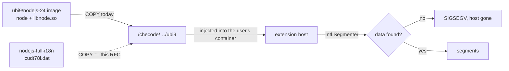

# RFC 0034 — A full-ICU node in the editor assembly

| Field       | Value                                                        |
| ----------- | ------------------------------------------------------------ |
| Status      | In review                                                     |
| Short       | full-ICU node                                                 |
| Settles     | Why the fork's node carries the full ICU data, how it is shipped, and what would let the commit be dropped |
| Author      | Max Batleforc <maxleriche.60@gmail.com>                       |
| Co-author   | Claude Opus 5, Claude Opus 5.5 <noreply@anthropic.com>        |
| Created     | 2026-09-13                                                    |
| Supersedes  | —                                                             |
| Depends on  | RFC 0023 (the fork, its series, and the rule that every feature carries a document) — §15 question 7 asks to loosen this |
| Touches     | `batleforc/che-code`: `build/dockerfiles/linux-libc-ubi9.Dockerfile`, `linux-libc-ubi8.Dockerfile`, `linux-musl.Dockerfile`, `BATLEHUB.md`, `.github/workflows/bh-image.yml`, `.github/scripts/bh-smoke.sh` (and, per §15 question 8, the assembly's entrypoint); here: `devfile.yaml`, `docs/contributing/testing.md`; `cde.batleforc.fr` (the `markdownlint` pin) |
| Risk        | low — §7 and §8 (a checksum-pinned data file in the editor image; no new surface, no secret, no personal data) |

---

## 1. Summary

The node that che-code ships inside its editor assembly is built with *small*
ICU and without the optional data package that completes it. One JavaScript
call — `new Intl.Segmenter().segment(s)` — does not throw on that build, it
**segfaults the process**. In the editor that process is the extension host, so
any extension that segments a string kills every other extension with it, with
no error message anywhere: the user sees *Extension host terminated
unexpectedly* and a workspace that reloads in a loop.

This is not hypothetical. `DavidAnson.vscode-markdownlint` 0.61 began calling
`Intl.Segmenter` (through `string-width`, for MD013's wide characters). Since
that release, opening *any* markdown file on `cde.batleforc.fr` takes the
extension host down three times before the editor gives up. It still does: on
2026-11-15 the assembly this workspace runs (node v24.21.0) dies on the same
one-liner with exit 139 (§6.P), and upstream's three Dockerfiles on `main`
still carry no ICU data.

The fix is the data file the node build already looks for and the image does
not carry. `[bh:node-icu]` puts `icudt78l.dat` where the editor's node finds
it, in all three assemblies. Nothing else changes: no patch to `code/`, no
change to an extension. Where exactly "where node finds it" is, once the
assembly runs in the user's container rather than in the image, is §15
question 8.

### Before / after

```text
# today — the assembly's own node (re-measured 2026-11-15)
$ /checode/checode-linux-libc/ubi9/node -e "new Intl.Segmenter().segment('ab')"
Segmentation fault                       # v24.21.0, icu_small=true, ICU 78.3 — exit 139

# with this RFC
$ /checode/checode-linux-libc/ubi9/node -e "new Intl.Segmenter().segment('ab')"
$ echo $?
0
```

---

## 2. Motivation

1. **The failure is silent, and it is not the failing extension that pays.**
   The extension host dies on a signal: no exception, no log line, no
   `[Extension Host]` message. Six days of this instance's logs carry four
   `SIGSEGV` entries and nothing that names a cause. What the user sees is
   every extension gone — git, rust-analyzer, the terminal tools — because one
   of them measured the width of a string.
2. **One extension is affected today, and any extension can be tomorrow.**
   `Intl.Segmenter` is the standard way to count graphemes since Node 16.
   `string-width`, `slice-ansi`, `cli-truncate` and everything downstream of
   them use it. The fuse is lit for the whole ecosystem, not for markdownlint
   in particular — pinning `markdownlint` 0.60.0 buys time, it does not fix
   anything.
3. **The data is missing, not the capability.** The binary is built
   `--with-intl=small-icu --with-icu-default-data-dir=/usr/share/node-24/icudata`
   and that path is compiled into `libnode.so.137` — `strings` finds it three
   times. Red Hat ships the completing data as an optional `full-i18n`
   subpackage, a `Recommends:` that a container base image does not pull. So
   the editor image inherits a node that is one 33 MB file away from correct.
4. **Waiting for upstream is unbounded, and the change is small.** che-code
   does not build node; it copies `/usr/bin/node` out of
   `registry.access.redhat.com/ubi9/nodejs-24` and `libnode.so*` out of that
   image's `/usr/lib64` (`build/dockerfiles/linux-libc-ubi9.Dockerfile`, the
   `cache node from this image` step — still so on upstream `main` on
   2026-11-15, base `ubi9/nodejs-24:9.8-1785389273`). Adding the data beside
   them is a line in the same stage. We ask upstream (§13), and carry it until
   they answer.

---

## 3. Goals / non-goals

**Goals**

- `Intl.Segmenter` works, on every assembly the fork publishes (ubi9, ubi8,
  musl), with the same result as a full-ICU node.
- The fix survives a rebase untouched: it edits build files, never `code/`.
- The image build proves it, in one line, on every build.
- The commit can be dropped the day upstream carries the data, and the test
  keeps passing when it is — that is how we learn it can go.

**Non-goals**

- **Building node ourselves.** che-code takes the distribution's binary and so
  do we; a node we compile is a supply chain we own for no reason, and it would
  not survive upstream's next base-image bump.
- **Replacing it with a nodejs.org build.** Those are full-ICU and would also
  fix it, but they are not the binary Red Hat patches, ships and errata-tracks;
  swapping it changes what runs the editor far beyond ICU. §12 keeps it as the
  fallback if the data route fails on some assembly.
- **Trimming the data.** ICU's filtered builds can produce a smaller `.dat`,
  and the day 33 MB matters we will measure it. It does not matter in an image
  that is already gigabytes.
- **Fixing the segfault itself.** That node segfaults where it should throw is
  a node defect, reported as one (§13); this RFC only stops feeding it.
- **Any change to the extensions an instance installs.** Pinning `markdownlint`
  is the interim measure of RFC 0023 §15 row 12, not the design here.

---

## 4. User-facing design

Nobody configures anything. The data file ships with the assembly, where its
node looks for it, and `Intl.Segmenter` behaves as it does everywhere else.

### 4.1 The interim, before the image exists

An instance that runs upstream's image today has two moves, and neither needs a
rebuild:

```yaml
# devfile.yaml — the editor's container
env:
  - name: NODE_ICU_DATA
    value: /projects/.icu          # a directory holding icudt78l.dat
```

`NODE_ICU_DATA` overrides the compiled default and is read by the server and by
every extension host it spawns. The file lives on the workspace's persistent
volume, so it survives a restart; a workspace that has not been given one keeps
the crash, which is why pinning `markdownlint` 0.60.0 stays the first move.

Verified on this instance on 2026-09-13: with `NODE_ICU_DATA` pointing at a
directory holding `icudt78l.dat` from the ICU 78.3 release, the assembly's own
node segments `'héllo wörld 👨‍👩‍👧'` into 13 graphemes and `'bonjour le monde'`
into 5 word segments, where the same binary without it dies on the first call.
This repository's `devfile.yaml` does not carry the entry yet (no `ICU` line
on 2026-11-15).

### 4.2 Behaviour rules

- Data present and matching the binary's ICU major: full ICU, every locale.
- Data absent: node runs on its built-in English-only data, and
  `Intl.Segmenter` crashes — the state this RFC exists to make unpublishable.
- `NODE_ICU_DATA` set by the operator: it wins over the compiled default, as
  node documents; the image does not override it.

### 4.3 Validation

No configuration to validate. The image build's gate (§14) is the check.

### 4.4 API surface

None: no endpoint, no CLI flag, no config key in BatleHub.

### 4.5 Mocks

Nothing visible changes except that the failure stops. The one new text is
the diagnostic line `docs/contributing/testing.md` gains (§6.2):

```text
Extension host died with no message? Test the editor's node for small ICU first:
  "$VSCODE_NODEJS_RUNTIME_DIR/node" -e "new Intl.Segmenter().segment('ab')"; echo $?
  139 → small ICU without data: set NODE_ICU_DATA (RFC 0034 §4.1)
```

---

## 5. Architecture

Three facts, and the design falls out of them.

- **The binary looks for the data.** `process.config.variables` on the shipped
  node reads `icu_small=true`, `icu_locales=en,root`, `icu_ver_major=78`,
  `icu_endianness=l`, `icu_default_data=/usr/share/node-24/icudata`. A node
  built this way loads `icudt78l.dat` from that directory at startup if it is
  there, and runs on its built-in English-only data if it is not.
- **The missing data is a Red Hat subpackage.** The Fedora `nodejs24.spec`
  builds `--with-intl=small-icu --with-icu-default-data-dir=%{nodejs_datadir}/icudata`,
  unzips `icudt78l.dat` from the upstream ICU release into it, and ships that
  directory as `%{name}-full-i18n` — declared `Recommends:`, which `dnf
  install nodejs` in a container honours only when weak dependencies are on.
- **The assembly is a copy of that image's files.** So the fix belongs where
  the copy is made, and travels with the three Dockerfiles rather than with the
  editor's source.

A fourth fact, measured on 2026-11-15, constrains *where* the file lands: the
assembly does not run in the che-code image. `entrypoint-volume.sh` starts
`/checode/checode-linux-libc/ubi9/node ./launcher/entrypoint.js` from the
`/checode` volume inside the user's own tooling container (`ps` in this
workspace: PIDs 62, 115, 129), where `/usr/share/node-24/icudata` does not
exist. §15 question 8 carries the consequence.



---

## 6. Detailed design

### 6.1 `[bh:node-icu]` in the fork

One hunk per assembly Dockerfile, in the stage that already caches the node
binary:

```dockerfile
# builder stage, beside the existing `cache node from this image` step
RUN dnf install -y nodejs-full-i18n \
    && cp -r /usr/share/node-24/icudata /checode/icudata
# runtime stage
COPY --from=linux-libc-ubi9-builder /checode/icudata /usr/share/node-24/icudata
```

The package name is the one thing confirmed at build time rather than here:
Fedora calls it `nodejs24-full-i18n`, the UBI 9 node-24 stream calls it
`nodejs-full-i18n`, and if neither resolves the same file is unzipped straight
from the ICU release the spec itself uses —
`icu4c-78.3-data-bin-l.zip`, `icudt78l.dat`, 33 MB. The `78` and the `l` are
read from `process.config.variables` of the very binary being shipped, never
hardcoded: a base-image bump that moves node to ICU 79 must move the data file
with it, and §14's smoke test is what catches it if it does not.

The runtime-stage target above is the compiled default path. Because the
assembly runs from `/checode` in the user's container (§5), that path is
probably the wrong one; §15 question 8 asks for the directory to move inside
the assembly instead.

The manifest row, per RFC 0023 §4.2:

```markdown
| node-icu | node built with full ICU, so `Intl.Segmenter` does not segfault | 0034 | 7.124.0 | upstream issue che-incubator/che-code#NNNN — drop when their assembly ships full ICU |
```

### 6.2 `proxy-cache` — the interim and the record

- `devfile.yaml` gains the `NODE_ICU_DATA` entry of §4.1 for as long as this
  workspace runs upstream's image, and loses it when it moves to the fork's.
- `docs/contributing/testing.md` gains the one-liner as a diagnostic: an
  extension host that dies with no message is tested for this first.

### 6.P Proof against a real client

The client is the editor's own node, the binary the extension host runs:
`/checode/checode-linux-libc/ubi9/node` from upstream's che-code image as
injected into this workspace (VS Code 1.128.1 assembly), and later the fork's
`ghcr.io/batleforc/che-code:<tag>-bh.<n>`. Cases 1–2 were **observed** on
2026-11-15; cases 3–6 are **to observe** once the data ships.

```text
$ D=/checode/checode-linux-libc/ubi9
$ export LD_LIBRARY_PATH=$D/ld_libs/core:$D/ld_libs/openssl
$ $D/node -v
v24.21.0
$ $D/node -p "JSON.stringify({s:process.config.variables.icu_small,
    d:process.config.variables.icu_default_data,v:process.versions.icu})"
{"s":true,"d":"/usr/share/node-24/icudata","v":"78.3"}
$ ls /usr/share/node-24/icudata
ls: cannot access '/usr/share/node-24/icudata': No such file or directory
$ $D/node -e "new Intl.Segmenter().segment('ab')"; echo "exit $?"
exit 139
```

1. **Observed — the binary's ICU configuration** (the first three commands
   above): node v24.21.0, small ICU, the compiled default path, and nothing
   at it.
2. **Observed — the crash (the case that must be refused today and is not)**
   (the last command): no output, **exit 139** (SIGSEGV). Unchanged from
   v24.18.0 in September; a node minor bump did not fix it.
3. **To observe — the interim works.** The same command with
   `NODE_ICU_DATA` pointing at a directory holding `icudt78l.dat`: exit 0,
   as measured on 2026-09-13 (§4.1).
4. **To observe — the fixed image.** `bh-smoke.sh` on each assembly of the
   fork's image: the Segmenter one-liner exits 0, and the Thai
   `DateTimeFormat` check of §14 differs from English (full data, not just a
   file found).
5. **To observe — the gate refuses.** A build with the data step removed:
   `bh-image.yml` fails at the smoke and publishes no image.
6. **To observe — the editor.** In `che_code_patch.sh` under
   `CHE_CODE_IMAGE`: a markdown file with wide characters opened with
   `markdownlint` 0.62.1 installed, and the extension host still alive
   afterwards.

**Deliberately untouched**, so reviewers do not go looking:

- `code/` and `launcher/` of che-code — the fix is a build-file change (or,
  per §15 question 8, the entrypoint script).
- The extensions an instance installs — pinning is the interim, not the fix.

---

## 7. Security

**Rating:** low — a data file added to an image already trusted with the
user's workspace; no new surface, input or secret.

### 7.1 Threat model

Assets: the integrity of the editor image. Actors: the ICU project and Red
Hat's repository (sources of the file), the fork's CI.


| # | Threat (STRIDE) | Where | Mitigation | Residual risk |
| --- | --- | --- | --- | --- |
| T1 | Tampering — a substituted `.dat` | B1 | RPM signature checked by `dnf`; the release zip's sha256 pinned in the Dockerfile hunk (§6.1). Negative test: a wrong checksum fails the build (§14) | ICU parses the file; a malicious but well-formed file could only change text behaviour, not execute. Accepted |
| T2 | Denial of service — data absent or for the wrong ICU major, so the segfault returns silently | B2 | `bh-smoke.sh` gate per assembly, fail closed (§14) | None once the gate exists; today it is the live defect |
| T3 | Information disclosure / elevation | — | Considered, not applicable: no network, filesystem or credential path is touched; `vsx-auth` (RFC 0011) stays the only feature in the series that handles a secret | — |

### 7.2 Authentication and authorisation

No new surface; nothing authenticates or authorises differently.

### 7.3 Input handling and injection

The `.dat` is parsed by ICU inside node, as every full-ICU node does. It is
data, not code: a corrupt file makes ICU fail, not execute. No
attacker-controlled input is added.

### 7.4 Secrets and cryptography

No secret. The only cryptography is the sha256 pin (and the RPM GPG check)
on the file.

### 7.5 Abuse and resource exhaustion

Nothing reachable by a caller. The file is 33 MB on disk per assembly.

### 7.6 Existing defences that still hold

The fork's series controls (RFC 0023 §7) and the image scan and signature
(RFC 0023 §8) apply to this commit like any other.

---

## 8. Supply chain

| Dependency / image / tool | Version | Why this one | Licence | Known CVEs | Maintenance |
| --- | --- | --- | --- | --- | --- |
| ICU data `icudt78l.dat`, via `nodejs-full-i18n` (UBI 9 node-24 stream) | matching the binary's ICU, 78.3 today | the exact file Red Hat's own spec pairs with this binary | Unicode-3.0 (ICU's licence since ICU 74), shipped with its `LICENSE` | none for a data file; ICU library CVEs are the node binary's, unchanged | Red Hat errata, tracking the ICU release |
| Fallback: `icu4c-78.3-data-bin-l.zip` from the ICU GitHub release | 78.3 | used only if the package does not resolve | Unicode-3.0 | as above | Unicode Consortium ICU project |

- **Build and release**: one extra layer per assembly in `bh-image.yml`; the
  SBOM of RFC 0023 §8 gains the data file. The Unicode-3.0 licence text
  travels next to the file in the assembly, which is all the licence asks.
- **Updates**: the package moves with the base image's node stream; the zip
  fallback is version-pinned and bumped when `icu_ver_major` moves, which the
  smoke gate forces.

---

## 9. Data and privacy

No personal or new data is stored or transmitted: the file is static locale
data, read locally by node, and nothing leaves the workspace.

---

## 10. Operability

### 10.1 Observability

- **Metrics**: none; the editor exposes none to BatleHub.
- **Logs and audit trail**: the `bh-image.yml` smoke output per assembly.
- **Alerts**: none, because the gate stops the image from being published;
  the failure surfaces as a red build, not in a running workspace.

### 10.2 Failure modes

| Failure | Detected by | Behaviour (fail open / closed) | Recovery |
| --- | --- | --- | --- |
| Package name does not resolve | build | closed: falls back to the pinned zip, or the build fails | §15 question 5 |
| Base image moves node to ICU 79, data still 78 | smoke gate | closed: no image | bump the data with the binary |
| Data in the image but not where the running node looks (§5) | smoke gate run inside the injected assembly, `bh-smoke.sh /checode/…` | closed if the gate runs against the assembly path, open if it runs inside the image only | §15 question 8 |
| Interim `NODE_ICU_DATA` file missing from `/projects/.icu` | the crash returns | open (it is today's state) | pin `markdownlint`, restore the file |

### 10.3 Performance and capacity

About 33 MB per assembly; with three assemblies (`ubi8`, `ubi9`, `musl`) in
the injected `/checode`, about 100 MB more per workspace volume beside
assemblies of 1.1–1.6 GB each (`du -sh` in this workspace). Startup reads the
file once per node process. To be measured on the first image.

---

## 11. Other concerns

- **Accessibility**: no UI change.
- **Internationalisation**: this is the i18n change. Small ICU carries `en`
  and `root` only (`icu_locales=en,root`); with the full data, every node
  process in the editor — the server and every extension host — formats
  dates, numbers, lists and collation in every ICU locale, and segments text
  in every script. A French or Thai user's extensions stop silently falling
  back to English formatting, which is a behaviour change worth a line in the
  release notes but not a regression.
- **Compliance**: none of BatleHub's controls move.
- **Licensing**: Unicode-3.0 for the data, a permissive licence that needs
  only its notice kept; compatible with the image's EPL-2.0/MIT
  (RFC 0023 §11).
- **Documentation**: `docs/contributing/testing.md` gains the diagnostic
  (§4.5, §6.2).

---

## 12. Alternatives considered

| Alternative | Why not |
| --- | --- |
| **Wait for che-code to fix it.** | The report is worth filing (§13), but the instance crashes today and the answer has no date. Carrying it costs one hunk per Dockerfile and is droppable the moment they act. |
| **Set `NODE_ICU_DATA` in the launcher instead of shipping the file.** | It needs the file to exist somewhere anyway. As an *interim* on an unmodified image it is exactly right (§4.1); as the design it adds an environment variable to every path that spawns a node and leaves the compiled default lying unused. §15 question 8 reopens this, because the compiled default lies in a container the image does not control. |
| **Ship a nodejs.org build.** | Full-ICU out of the box, and it replaces the binary Red Hat patches and tracks errata for with one nobody in this chain audits. Kept as the fallback if a future base image drops the subpackage. |
| **Pin `markdownlint` 0.60.0 and call it done.** | It is the right first move and it is already taken, but it fixes one extension. The next dependency to adopt `Intl.Segmenter` reopens it, and nothing warns us. |
| **Disable the extension host's use of `Intl`.** | Not possible, and it would break correct code to protect a broken build. |

---

## 13. Rollout and compatibility

1. **Today:** `markdownlint` pinned to 0.60.0 on the instance; `NODE_ICU_DATA`
   in `devfile.yaml` for workspaces that want 0.62 back.
2. **With RFC 0023 phase 3:** `[bh:node-icu]` in the series, the image built
   with the data, the smoke test in `bh-image.yml`.
3. **Two reports, both true and both to file in the same week** (neither
   found on 2026-11-15: no che-code issue matches "Segmenter" or "ICU"):
   - `che-incubator/che-code` — the assembly ships a node whose `Intl.Segmenter`
     crashes; the fix is the `full-i18n` data in the image.
   - `nodejs/node` — a small-ICU build segfaults instead of throwing when the
     break-iterator data is absent. This one outlives our fork: every
     distribution that ships small-ICU node has the same trap.
4. **Compatibility:** none to break. The change adds a file to an image; an
   editor that already worked keeps working, and the 33 MB is invisible beside
   the assembly's own size. Formatting in non-English locales changes for the
   better (§11).
5. **When upstream lands it:** the smoke test still passes with the commit
   dropped. That is the signal, and §16 phase 3 is where we act on it.

---

## 14. Test plan

- **The one-liner, in `bh-image.yml`, per assembly, as a gate:**
  `node -e "new Intl.Segmenter().segment('ab')"`, exit 0 required. It fails
  today on every published image (exit 139, §6.P) and passes with the data
  present. Run against the assembly directory as it is injected
  (`bh-smoke.sh /checode/…`), not only inside the build image, so §15
  question 8 is caught.
- **A locale that small ICU does not carry**, so the test proves the *full*
  data and not merely that a file was found:
  `node -e "if (new Intl.DateTimeFormat('th', {dateStyle:'long'}).format(new Date(0)) === new Intl.DateTimeFormat('en').format(new Date(0))) process.exit(1)"`.
- **Negative:** the zip fallback with a wrong sha256 fails the build; an
  image built without the data step fails the gate and is not published.
- **In the heavy suite** (RFC 0023 §14, `che_code_patch.sh` under
  `CHE_CODE_IMAGE`): a markdown file with wide characters opened with a
  `markdownlint` newer than 0.61 installed, asserting the extension host is
  still alive afterwards — the editor-level version of the same fact.
- **What must not regress:** `Intl.Collator`, `NumberFormat`, `DateTimeFormat`
  and `ListFormat` already work on the shipped binary and must keep working;
  the data replaces nothing, it completes.

---

## 15. Decisions and open questions

### Resolved

| # | Question | Decision |
| --- | --- | --- |
| 1 | Ship the data, or a different node | **Ship the data.** The binary already searches for it; everything else changes more. Decided 2026-09-13. |
| 2 | Where the file goes | **`/usr/share/node-24/icudata`, the path compiled into `libnode.so`**, so no environment variable is needed at runtime and nothing has to remember to set one. Decided 2026-09-13. Question 8 below challenges this. |
| 3 | Package or raw ICU release | **The distribution package when it resolves, the release zip when it does not** — the same file either way, and the build fails loudly rather than shipping without it. Decided 2026-09-13. |
| 4 | Whether this deserves its own RFC | **Yes, and so does the next one.** RFC 0023 §4.2 makes it a rule: a commit that changes what an editor image *is* must say why, or the fork becomes a pile of hunks whose reasons left with the person who wrote them. Decided 2026-09-13. |

### Still open

- **5. Which package name resolves in the UBI 9 node-24 stream** —
  `nodejs-full-i18n` or a versioned spelling. It is a one-line answer from the
  build, and the raw-zip path (§6.1) is the fallback that needs no answer.
- **6. Whether the musl assembly has the same default path.** It builds from a
  different base; `icu_default_data` must be read from *its* binary before the
  hunk is written, not assumed to match ubi9's. (Not measurable in this
  workspace: `/checode/checode-linux-musl/node` does not run on its glibc
  container.)
- **7. Decouple from RFC 0023.** Finding: the fix does not need the fork. The
  `NODE_ICU_DATA` interim works on the unmodified image (§4.1) and is not yet
  in `devfile.yaml`; upstream's Dockerfiles still lack the data (§2.4); no
  report has been filed (§13); and the fork this RFC waits on carries nothing
  yet, with RFC 0023 §15 question 16 proposing to go upstream-first. The same
  account has had che-code pull requests merged (`#752`, `#799`). Tying the
  only live, user-visible crash of the two RFCs to the most expensive phase
  of the other (RFC 0023 phase 3) delays it for no technical reason.
  **Recommendation: reorder §16 to (1) `NODE_ICU_DATA` in `devfile.yaml`
  now, (2) an upstream che-code pull request adding `nodejs-full-i18n` to the
  builder stages of the three Dockerfiles, with the one-liner as its test,
  plus the nodejs report, and (3) the fork commit `[bh:node-icu]` only as the
  fallback if that pull request is refused or stalls. Keep this a separate
  RFC; do not fold it into 0023.**
- **8. The compiled default path is in the wrong container.** Finding: the
  che-code image is an injector; the assembly runs from the `/checode` volume
  inside the user's tooling container (`/checode/entrypoint-volume.sh`, lines
  94–106 and the final `"$VSCODE_NODEJS_RUNTIME_DIR/node" ./launcher/entrypoint.js`;
  `ps` shows the server and file watcher running from `/checode/…/ubi9/node`),
  and `/usr/share/node-24/icudata` does not exist there (§6.P case 1). A
  `COPY` to that path in the image's runtime stage would not reach the node
  that crashes, contradicting resolved decision 2. **Recommendation: ship the
  data inside each assembly (`/checode/checode-linux-libc/ubi9/icudata`, and
  the ubi8/musl twins) and point node at it with `NODE_ICU_DATA` exported by
  `entrypoint-volume.sh` (or `--icu-data-dir` where the launcher spawns
  node), honouring an operator's own `NODE_ICU_DATA` if set; that is also
  the shape an upstream pull request can take. Make §14's gate run against
  the injected assembly path so this cannot regress.**

---

## 16. Implementation phases

| Phase | Content |
| --- | --- |
| 1 | The interim, here and now: `markdownlint` pinned to 0.60.0 on the instance, `NODE_ICU_DATA` available in `devfile.yaml` for anyone who wants the newer one back. **Useful alone**: the crash stops today, on an unmodified editor image. Not done on 2026-11-15 (no entry in `devfile.yaml`). |
| 2 | The two upstream reports (§13.3), with the one-line reproduction. **Useful alone**: the fix may arrive from upstream and cost us nothing. Not filed on 2026-11-15. |
| 3 | `[bh:node-icu]` in the fork's series with its manifest row, the three Dockerfile hunks, and the §14 gate in `bh-image.yml`. Lands with RFC 0023 phase 3, where the image is built. §15 question 7 proposes making this the fallback only. |
| 4 | The interim removed: `NODE_ICU_DATA` out of `devfile.yaml`, `markdownlint` unpinned, once a workspace runs the fork's image. The commit itself leaves the series when upstream ships the data, and the gate stays. |
