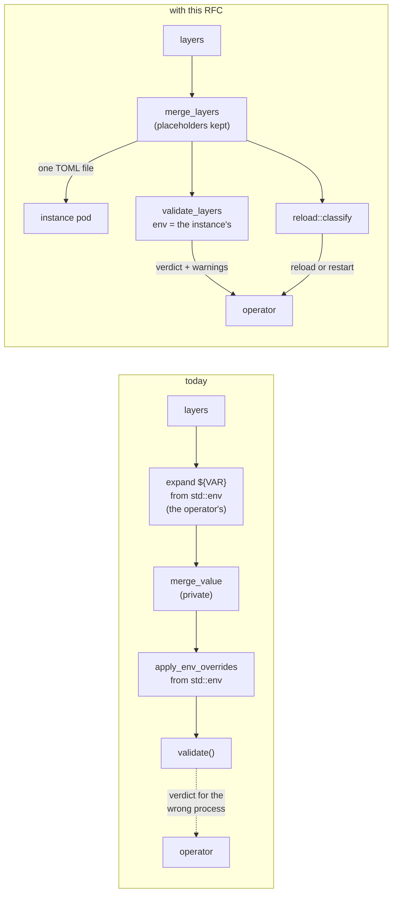
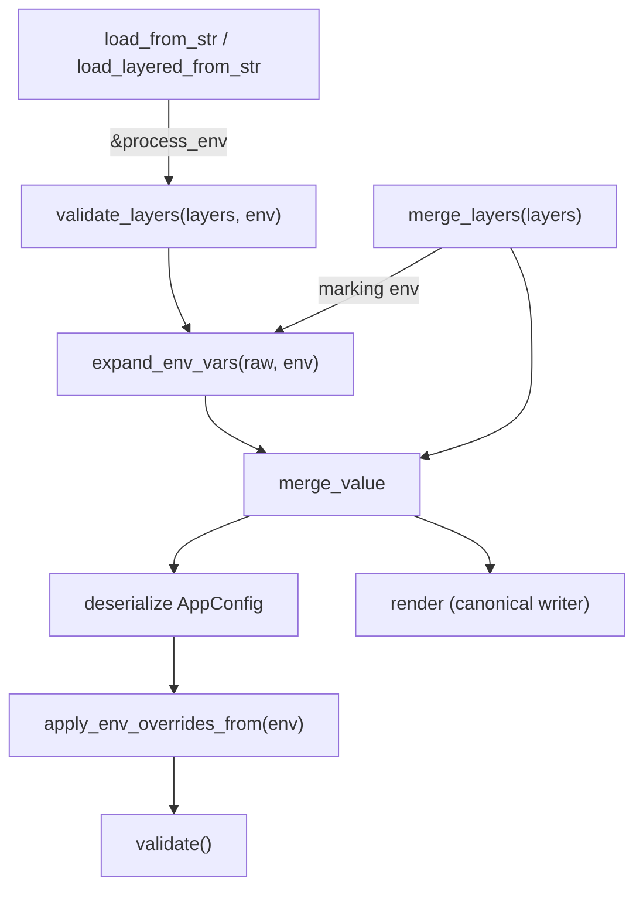

# RFC 0037 — Validating a configuration for another process

| Field       | Value                                                        |
| ----------- | ------------------------------------------------------------ |
| Status      | Implemented                                                   |
| Short       | Config validation for another process                         |
| Settles     | How a tool outside the server merges, validates and classifies a BatleHub configuration without reading its own environment |
| Author      | Max Batleforc <maxleriche.60@gmail.com>                       |
| Co-author   | Claude Opus 5.5 <noreply@anthropic.com>                       |
| Created     | 2026-10-14                                                    |
| Supersedes  | —                                                             |
| Touches     | `crates/config` (`lib.rs`, new `render.rs` and `reload_keys.rs`, `schema/mod.rs`), `crates/web/src/services/reload` (+ test fixtures in `handlers/back_office/config.rs`, `tests/banner_and_config_reload.rs`), `server/src/watcher.rs`, `server/src/hot_config.rs`, `server/src/main.rs`, `ui/openapi.json` + `ui/src/client` (regenerated), `ui/src/pages/AdminConfigReload.vue` + `ui/src/locales`, `cli/src/api/admin.rs`, `cli/src/cli/admin.rs`, new `tests/heavy/reload.sh` + `config.reload.toml`, `.tasks/test.yaml`, `.github/workflows/test.yaml`, `docs/guide/hot-reload.md`, `docs/guide/configuration.md` (+ `docs/fr/`), `docs/contributing/contributing.md`, `CHANGELOG.md` and the v1.6.0 version files |

---

## 1. Summary

`batlehub-config` can load a configuration for the process it runs in, and for
no one else. Three things a tool that *prepares* a configuration for another
BatleHub process needs are private or missing: the layer merge, a validation
that takes the target's environment instead of reading its own, and the list
of keys a hot reload does not apply. The first consumer is the Kubernetes
operator (`weebo-batlehub`), which renders an instance's configuration from
several sources, pushes it, and has to decide between a reload and a pod
restart; `batlehub-cli` and CI linting are the next.

This RFC adds three public items to `crates/config`, changes nothing about
how the server loads its configuration, and uses the third in the reload path,
so the list has a consumer inside BatleHub that keeps it true and the reload
diff stops reporting an unapplied change as no change.

### Before / after

```rust
// today — the only entry points, both reading std::env
let config = batlehub_config::load_layered_from_str(&[base, credentials])?;
// `merge_value` is private; there is no list of restart-only keys

// with this RFC
let merged: String = batlehub_config::merge_layers(&[base, registries, auth])?;
let config = batlehub_config::validate_layers(&[&merged, credentials], &|name| {
    instance_env.get(name).cloned()
})?;
let warnings = config.warnings();
// classify every layer the pod runs on, credentials included: a rotated
// `upstream_auth` lives there
let shipped = batlehub_config::merge_layers(&[&merged, credentials])?;
let verdict = batlehub_config::reload::classify(&previous_shipped, &shipped)?;
if !verdict.restart.is_empty() { /* restart the pod, else reload */ }
```



Today the operator could only call `load_layered_from_str`, which resolves
`${VAR}` and `PROXY_CACHE__*` against the operator's own environment and
returns a verdict about a process that will never run. After, the merge is the
server's own, the environment is the target's, and the reload/restart boundary
is the one the reload path itself enforces.

---

## 2. Motivation

1. **Validation reads the wrong environment.** `expand_braced_var`
   (`crates/config/src/lib.rs`) calls `std::env::var`, and
   `AppConfig::apply_env_overrides` (`crates/config/src/schema/mod.rs`) binds
   `let env = |key| std::env::var(key).ok()` before applying the seventeen
   `PROXY_CACHE__*` overrides. Called from an operator, `load_layered_from_str`
   refuses a config whose `${OIDC_CLIENT_SECRET}` is set in the pod and not in
   the operator, and accepts one whose `PROXY_CACHE__DATABASE__URL` exists only
   in the operator. Both verdicts are about the wrong process.
2. **The merge is private, so a consumer has to copy it.** `merge_value` and
   `array_identity_key` are `fn`, not `pub fn`. The rules they implement —
   arrays of tables merged on a *unique* `name`, else `type`; `x = []` clears —
   are the ones a copy gets subtly wrong, and a copy that disagrees with the
   server hashes and validates a document the server would merge differently.
3. **A merged document cannot be written back with its placeholders.** The
   operator ships *one* merged file to the pod (so `GET
   /api/v1/admin/config/content` shows the whole document) and lets the pod
   resolve `${VAR}`. Expanding first would write secrets into a ConfigMap;
   parsing without expanding and re-serialising with `toml` is not safe either:
   `"\u0024{X}"` is a literal `${X}` today (the scanner skips the character
   after a `\` inside a basic string, so it never sees a `$`), and comes back
   out of `toml::to_string` as `"${X}"`, which the pod expands.
4. **The restart boundary exists only as an absence, and crossing it is
   silent.** `ConfigReloadService::apply`
   (`crates/web/src/services/reload/applier.rs`) swaps what the hot builder
   produces; anything it does not swap needs a restart, and no code names that
   set. A reload that changes only `database.url` is staged, applied, and
   reported with an empty `ReloadDiff` (`compute_diff` in `validator.rs`
   compares the registry *names*, the size limit and the access tiers, nothing
   else). It is worse than restart keys: `changed_registries` is hard-coded to
   `vec![]`, so a reload that changes a registry's upstream — which *is*
   applied — is reported as a no-op too, and the watcher logs that nothing
   changed.
   `docs/guide/hot-reload.md` lists four restart-only families; the code has
   some thirty (§4.3). The operator's design guessed eight. A consumer that
   guesses short restarts too little, and the change does nothing.

---

## 3. Goals / non-goals

**Goals**

- A consumer merges layers with the server's own rules and gets back a TOML
  document it can ship, with every placeholder still in it and every literal
  `$` still literal.
- A consumer validates a set of layers against an environment it supplies,
  with the same checks, the same overrides and the same warnings as the
  server's load.
- A consumer knows, from two merged documents, whether going from one to the
  other needs a restart — with the answer coming from the same place the
  reload path uses.
- Nothing changes for the server: `load`, `load_from_str`, `load_layered` and
  `load_layered_from_str` keep their behaviour and error messages.

**Non-goals**

- **Connectivity probes.** `POST /api/v1/admin/config/validate` also builds the
  hot state (upstream clients, scanners); that needs the server's adapters and
  stays a server endpoint.
- **Changing what is hot-reloadable.** This RFC names the boundary; moving it
  (reloading `[[auth]]`, for instance) is a separate design each time.
- **Splitting `batlehub-config` from `batlehub-core`.** The dependency is
  heavier than an operator needs, but it has no I/O stack (no sqlx, no actix)
  and the schema types live in `core`; separating them is a cross-crate
  refactor with no consumer asking for it.
- **Publishing to crates.io.** Consumers pin a git tag, as the operator does.
- **The `--roles` flag.** It overrides `server.roles` from the command line,
  not from the environment; a consumer that renders the command line knows it.
- **Placeholders outside string values.** `port = ${PORT}` happens to work
  today because expansion runs on raw text, but the configuration guide (§5.1)
  only promises them inside strings. `merge_layers` refuses them with a message
  naming the placeholder; the server's own loading does not change.

---

## 4. User-facing design

The "user" is a Rust consumer of `batlehub-config`. Nothing changes for an
operator running BatleHub.

### 4.1 `merge_layers`

```rust
pub fn merge_layers(layers: &[impl AsRef<str>]) -> Result<String>
```

- Returns one TOML document: the layers merged with `merge_value`'s rules,
  **placeholders unexpanded**.
- The output is canonical: keys in sorted order, every string a basic string,
  every literal `$` written `\u0024`, every placeholder written `${NAME}`.
  Control characters, `\n` included, are written as escapes, so every string
  stays on one line (§4.5 says why that matters). Two inputs that mean the
  same thing give the same bytes, so a hash of the output moves only when the
  configuration does — a comment or a reordering of keys does not move it.
  The order of an array of tables is kept, and does move it: the order of
  `[[auth]]` is meaningful.
- One layer is a valid input (it is canonicalised); zero is an error, as in
  `load_layered_from_str`.
- `$${NAME}` in a layer is a literal `${NAME}` and comes out as
  `"\u0024{NAME}"`.

**The invariant**: for every environment `E` and every layer list `L` that
`merge_layers` accepts, *if* expanding each of `L` under `E` and merging
succeeds, expanding `merge_layers(L)` under `E` gives the same TOML value.
That is what lets the pod resolve the placeholders after the merge without
the operator ever holding their values. The converse does not hold, and need
not: the server expands each layer before merging, so a `${VAR}` in a value a
later layer overrides must still be set, while the merged document no longer
carries it. The merged document fails in fewer environments, never in more.

It holds only because §4.5 refuses a placeholder in the two places where the
two paths read it differently.

The first is a multi-line string. The scanner in `expand_env_vars` resets its
state on every newline, so from the second line of a `'''…'''` literal string
on, `${X}` is expanded as if it were code — and pasted raw into a *literal*
string, where `\` is not an escape. The marker path renders that value as a
one-line *basic* string, where it is: `X=a\tb` gives a backslash and a `t` on
the server and a tab in the pod. A `"""…"""` string has the converse problem:
a raw newline in `X` is legal there and a parse error in the rendered
one-line string.

The second is wherever the merge *compares* text: in a key, and in the
`name` or `type` of an array-of-tables entry. There
the marker path and the server's path disagree. `name = "${REG}"` in one layer
and `name = "npm"` in the next are two entries as markers and one entry on the
server when `REG=npm`, so the pod would start with two `npm` registries; two
`"${A}"`/`"${B}"` entries pass `array_identity_key`'s uniqueness check as
markers and fail it when `A=B`, which picks a different merge rule; and two
quoted keys `"${A}"` and `"${B}"` stay distinct as markers and collide in the
pod.

### 4.2 `validate_layers`

```rust
pub fn validate_layers(
    layers: &[impl AsRef<str>],
    env: &dyn Fn(&str) -> Option<String>,
) -> Result<AppConfig>
```

- Exactly `load_layered_from_str`, with `env` in place of `std::env` at both
  places it is read: `${VAR}` expansion and the `PROXY_CACHE__*` overrides.
- Returns the `AppConfig` so the caller reads `warnings()` from it: the same
  advisories the server logs at startup and serves on
  `GET /api/v1/admin/config/warnings`.
- `env` returning `None` for a `${VAR}` is the same error the server gives for
  an unset variable. `None` for an override means "not set", as today.

### 4.3 `reload::classify` and the reloadable keys

```rust
pub mod reload {
    pub enum Tier { Hot, Partial, Restart }
    pub const RELOAD_KEYS: &[(&str, Tier)];
    pub fn classify(before: &str, after: &str) -> Result<Verdict>;
}

pub struct Verdict {
    /// Changed paths a hot reload applies everywhere.
    pub hot: Vec<String>,
    /// Changed paths the request path applies and a startup-built
    /// background component does not (below).
    pub partial: Vec<String>,
    /// Changed paths that take effect only after a restart.
    pub restart: Vec<String>,
}
```

`classify` takes two documents as `merge_layers` returns them, diffs them as
TOML values, and sorts every changed leaf path into one of the three lists.
Paths are dotted, with an array-of-tables entry named by its identity key:
`registries[npm].cache.idle_days`.

**The three tiers are defined by readers.** *Hot*: every reader of the key
sees the new value once `ConfigReloadService::apply` returns. *Partial*: the
hot bundle — and so every request — sees it, and at least one component built
once at startup keeps the old value. *Restart*: nothing reads it again before a
restart. A path is sorted by the most specific pattern of `RELOAD_KEYS` that
matches it, and a path no pattern matches is *restart*. A section added to
`AppConfig` tomorrow is restart-only until someone shows otherwise, which is
the safe way to be wrong: a needless restart costs seconds, a reload that
silently does nothing costs an incident.

`RELOAD_KEYS`, traced from `make_hot_builder` and `build_hot_bundle`
(`server/src/hot_config.rs`), `build_pending`
(`crates/web/src/services/reload/applier.rs`) and the startup wiring in
`server/src/main.rs` and `server/src/setup.rs` on 2026-10-14:

| Pattern | Tier | Reader on reload, and the startup reader that keeps the old value |
| --- | --- | --- |
| `server.trusted_proxies` | hot | `ProxyTrust::from_config(effective_trusted_proxies())` in `build_pending` |
| `ip_blocking.trusted_proxies` | hot | the same, as its deprecated fallback |
| `server.signed_urls` | hot | the hot bundle's URL signer |
| `grants` | hot | the access config |
| `limits.versions_per_page`, `limits.packages_per_page` | hot | the hot bundle |
| `subdomain_routing` | hot | `RegistryHostMap::from_app_config` |
| `search.readmes` | hot | the swapped search flag |
| `scanners.*.escalation` | hot | the per-registry security policy |
| `registries[*]` | partial | the registry clients, policies and maps; the warming and release-import services keep the **startup client** (`warming_clients` in `main.rs`, `build_warming_map`, `build_release_import_map`) |
| `registries[*].cache.metadata_ttl_secs` | partial | the per-registry policy; listed so it beats the `cache` row below |
| `registries[*].cache.serve_stale` | hot | the per-registry policy, which nothing built at startup holds |
| `registries[*].cache.artifact_ttl_secs` | partial | the per-registry policy; the eviction service keeps the old TTL |
| `registries[*].rbac`, `.grants`, `.rules`, `.hosts`, `.path_routing` | hot | the grant hierarchy, rule chain and host table, all swapped whole |
| `registries[*].security.rescan` | restart | the rescan scheduler, started at boot only when a registry already had one |
| `registries[*].rate_limit` | restart | read once by `RateLimitService::new` |
| `registries[*].quota` | restart | read once by `build_quota_service` |
| `registries[*].storage` | restart | read once by the storage router |
| `registries[*].cache` | restart | read once by the warming and eviction services |
| `proxy` | partial | `build_cargo_index` and the clients; the README fetcher and the warming clients keep the old one |
| `air_gap` | partial | the clients' air-gap wrapper; the warming and release-import clients keep the old one |
| `limits.max_artifact_size_bytes` | partial | the hot bundle; the scan worker keeps the old limit |

`registries[*]` is *partial*, not hot, by the same rule that makes `proxy`
partial: a changed `upstreams` or `upstream_auth` reaches every request at
once, and warming keeps calling the old upstream with the old credential until
the next restart. A credentials rotation is the case that matters, and the
verdict says exactly that rather than rounding it to *hot* (warming fails
silently) or to *restart* (every rotation bounces the pod). A registry entry
**added or removed** is *partial* for the same reason: the request path serves
the new entry at once; warming, eviction, rate limits, quota and the metric
labels keep the startup list. An added entry is reported as one path,
`registries[<name>]`, not one per leaf: its `rate_limit` or `quota` would sort
as *restart*, which is true, but the entry itself is served at once, and
*partial* says both.

*Partial* does not say **which** startup component kept the old value; the
third column of the table does, and it is prose. A consumer that wants to
skip the restart when the stale component is one it does not use has to
read that from the configuration itself. The operator does not try: it
treats *partial* as "restart when background work matters to this
instance", a per-instance setting, rather than re-deriving the reader column.
Carrying the component in `Verdict` is deferred (§11 decision 10).

Everything else needs a restart. That is far more than the four families
`docs/guide/hot-reload.md` lists today: also `cache`, `otel`, `logging`,
`audit`, `notifications`, `flag_sources`, `release_imports`,
`vulnerability_scan`, `cache_coherence`, the rest of `upstream_audit`,
`stats`, `worker`, `search.text_config`, and the rest of `ip_blocking`,
`scanners`, `limits` and `server`.

On an instance started with `BATLEHUB_DISABLE_HOT_RELOAD=1` every change is a
restart whatever the verdict says. `classify` compares documents and cannot
see the flag; the consumer that set it knows.

### 4.4 Behaviour rules

- `load_from_str` and `load_layered_from_str` become `validate_layers` with a
  process-environment closure. Their messages, including the single-layer
  path's line and column, do not change.
- `merge_layers` and `validate_layers` never read `std::env`. A test that
  sets a process variable and checks it is ignored holds them to it.
- An empty `env` (`&|_| None`) is legal: every `${VAR}` fails, no override
  applies. The operator uses a closure that answers a placeholder value for
  names it cannot read (§7).

### 4.5 Validation

`merge_layers` rejects:

| Condition | Rationale |
| --- | --- |
| A layer is not valid TOML | Same as `load_layered`; the error names the layer by index. |
| A `${NAME}` outside a string value | The output could not keep it as a placeholder; §3 explains why this is not a server change. |
| `${}` or an unclosed `${` | Same errors as `expand_braced_var` today. |
| A `${NAME}` in a key, or in the `name`/`type` of an array-of-tables entry | The merge compares these as text; §4.1 shows the three ways the invariant breaks. |
| A `${NAME}` inside a multi-line string (`"""…"""` or `'''…'''`) | The server expands it in a different string context from the one it is rendered in; §4.1 shows both ways. |
| A `NAME` outside `[A-Za-z_][A-Za-z0-9_]*` | `expand_braced_var` accepts anything but `}`, including `"`, which would end the rendered string. The server's own loading keeps accepting it. |
| A key or string value contains a character of the marker range (§6.1), raw or written as a `\uE000`-style escape | The marker would be ambiguous: an escaped one is rendered back as `${NAME}` and becomes a placeholder in the pod. No configuration has a reason to carry one. |

`validate_layers` rejects what `load_layered_from_str` rejects, no more and no
less. Warnings are `AppConfig::warnings()`, unchanged.

---

## 5. Architecture

### 5.1 One environment seam



`env` enters once and reaches both readers. Because the server's own entry
points go through `validate_layers` with `std::env`, the consumer's path and
the server's are the same code with a different argument: a check added to
`validate()` or an override added to `apply_env_overrides_from` reaches both,
and there is no second path for them to drift on.

### 5.2 Merging without resolving

`merge_layers` expands each layer with a *marking* environment that answers
`${NAME}` with `U+E000 NAME U+E001`, merges the values with `merge_value`, and
renders the result with a writer that turns each marker back into `${NAME}`
and writes every other `$` as `\u0024`. Because the scanner in
`expand_env_vars` never treats `\u0024` as a `$`, a literal dollar in the
merged value cannot become a placeholder in the pod; because markers are the
only thing written back as `${…}`, a placeholder cannot become a literal. A
placeholder outside a string leaves a marker in a non-string position, which
TOML refuses — that parse error is where §4.5's message comes from.

`\u0024` rather than the `$$` escape, because `$$` cannot write every
value back. The scanner reads a run of dollars before `{` in pairs: an even run
of `n` gives `n - 1` literal dollars, an odd run gives `n - 1` and then expands.
A literal `$${X}` — which a single-quoted `'$${X}'` produces — has no
spelling in a scanned position at all. `\u0024` is decoded by TOML after the
scanner has passed, so every value has exactly one spelling.

---

## 6. Detailed design

### 6.1 `crates/config/src/lib.rs`

- `expand_env_vars(raw, env: &dyn Fn(&str) -> Option<String>)` and
  `expand_braced_var(chars, env)`: the lookup becomes `env(&name)`, with the
  same "is not set" error on `None`.
- `pub fn validate_layers(layers, env)`: the body of today's
  `load_layered_from_str`, with `env` threaded to `merged_layer_value` and
  `config_from_value`. The single-layer branch keeps the direct
  `toml::from_str::<AppConfig>` for its line and column.
- `load_from_str(raw)` = `validate_layers(&[raw], &process_env)`;
  `load_layered_from_str(layers)` likewise. `process_env` is
  `|k| std::env::var(k).ok()`.
- `pub fn merge_layers(layers)`: §5.2. The marker range is `U+E000`/`U+E001`
  (Private Use Area). A layer carrying either is refused, and the check runs
  on the **parsed** value, not the raw text: `"\uE000X\uE001"` has neither
  character in its bytes and both after TOML decodes it. Each layer is
  expanded once with `|_| Some(String::new())`, parsed, and every key and
  string walked; that pass also sees every escape spelling at once. Only then
  is it expanded with the marking environment.
- A placeholder in a multi-line string (§4.5) is found by the scanner, which
  tracks `"""` and `'''` for this purpose only; `expand_env_vars`' own
  behaviour on the server path does not change.

### 6.2 `crates/config/src/render.rs`

- The canonical writer: `fn render(value: &toml::Value) -> String`. Tables as
  `[a.b]` headers, arrays of tables as `[[a.b]]`, other arrays and inline
  values inline. Strings and keys basic-quoted with `$` → `\u0024` and
  markers → `${NAME}`, with `"`, `\` and every control character escaped
  so no rendered string spans a line; integers, floats, booleans and datetimes through
  `toml::Value`'s own `Display`. Keys are **sorted by the writer**, not left to
  `toml::Table`: it is a `BTreeMap` in this workspace, but Cargo unifies
  features across the *consumer's* graph, and one dependency of the operator
  enabling `toml/preserve_order` would turn it into an insertion-ordered map
  and move the hash on a reordering.
- Within a table, plain keys before sub-table headers (TOML requires it);
  nested arrays of tables as `[[registries.x]]` under their entry; an array
  mixing tables and other values, and an empty table inside an array, inline.

### 6.3 `crates/config/src/schema/mod.rs`

- `AppConfig::apply_env_overrides_from(&mut self, env: &dyn Fn(&str) ->
  Option<String>)`: the current body, minus the `let env = …` line.
  `apply_env_overrides()` stays, as a call with the process environment, for
  its existing callers. `apply_storage_env_overrides` and the other helpers
  already take `env: &dyn Fn(&str) -> Option<String>` and do not change.

### 6.4 `crates/config/src/reload_keys.rs`

- `pub const RELOAD_KEYS`: the rows of §4.3. `*` matches one path segment or
  one array entry. The most specific matching pattern wins (more segments,
  then fewer `*`), so the table has no ordering rule to get wrong; no match is
  *restart*.
- `pub fn classify(before, after) -> Result<Verdict>`: parses both documents
  (they are `merge_layers` output, so the parse cannot meet a marker), walks
  the two values in parallel, and emits a path wherever they differ. An array
  of tables is walked entry by entry on a unique `name`, else a unique `type`,
  so moving `[[registries]]` around is not a change. This is its own rule, not
  `array_identity_key`: that one returns `None` when a side is empty, which is
  the merge's "`x = []` clears", and would make the first registry ever added
  a whole-array change. An array with no usable key is one leaf. An entry
  present on one side only is `partial` when it is a registry, otherwise its
  path is classified like any other; an *added* entry also lists the
  restart-only keys it carries. Reordering a keyed array other than
  `[[registries]]` is a change at the array's path: the order of `[[auth]]`
  decides which provider answers first. Each `${` of the document is read back
  as a marker, so a placeholder and its `$${X}` literal differ.
- `classify` compares documents, not `AppConfig`s: a key written out at its
  default value is a change. That errs towards a restart, the safe side.
- Placeholders compare as text. A change to the *value* behind a `${VAR}` is a
  change to the pod's environment, which restarts the pod anyway.

### 6.5 `crates/web/src/services/reload`

This is what gives `RELOAD_KEYS` a reader inside BatleHub, and it fixes the
silence motivation 4 describes.

- `ConfigReloadService` gains `applied_layers: Vec<String>`, the raw layers of
  the config **in force**: set from the files the server started on, replaced
  by `apply`, untouched by a candidate that is rejected or left pending. It is
  not `last_content`, which looks like it and is the fingerprint of the last
  load *attempt* — the comment in `load_pending_from_content` already says it
  may not be the config in force. No field today holds the applied text.
- It also gains `startup_layers: Vec<String>`, the same text, set once at
  startup and never replaced. `applied_layers` is the config in force **for
  the keys a reload applies**; for a restart-tier key, what is in force is
  what the process started on. Without the second field a restart owed is
  forgotten on the next reload: `database.url` changed and applied, then
  `applied_layers` holds the new URL, and the next diff no longer names it
  while the process still talks to the old database.
- `ReloadDiff` gains `applied`, `partially_applied` and `restart_required`
  (`Vec<String>`). The first two are the hot and partial lists of
  `classify(merge_layers(applied_layers), merge_layers(candidate))`: what this
  candidate changes. `restart_required` is the restart list of
  `classify(merge_layers(startup_layers), merge_layers(candidate))`: every
  restart-tier key the running process does not have, whichever reload
  brought it — a candidate that changes nothing still reports the
  `database.url` an earlier one left owed. `changed_registries` is filled from
  the `registries[<name>]…` paths of the first comparison instead of
  `vec![]` — the console already renders it. `is_noop()` is false when the
  first comparison is non-empty, so a `touch` of the file after a restart key
  was applied stays a no-op instead of staging a pending reload on every
  event.
- `merge_layers` refuses some configurations the server runs — `port =
  ${PORT}` (§3), a placeholder in a registry `name` (§4.5). When it refuses
  either side, the reload goes on exactly as today and the diff carries
  `restart_required: ["*"]` with the refusal as its reason: the verdict is
  unknown, and unknown is a restart. The reload path never rejects a candidate
  the server would have accepted.
- Today a pending reload that changes only `database.url` is staged, applied,
  and reported with an empty diff; the file watcher logs *"config file event
  produced no change, nothing pending"* at debug level
  (`server/src/watcher.rs`), which is false — `build_pending` did stage one.
  After this RFC the diff names `database.url` under `restart_required`, the
  console shows it, and the watcher logs the paths at `warn`.
- `ReloadDiff` is an API schema: `task dump-spec` and `task ui:generate`
  regenerate `ui/openapi.json` and the client, `AdminConfigReload.vue` shows
  the three lists, and `cli/src/api/admin.rs`'s mirror struct (no
  `deny_unknown_fields`) gains them so `batlehub-cli` can print them.
- `SettledTextConfig::check` (`server/src/hot_config.rs`) keeps its job, which
  is refusing an unknown text-search configuration; its "applies after a
  restart" warning becomes redundant with the diff and goes.

### 6.6 `tests/heavy/reload.sh`

The library half has no client surface: `merge_layers` and `validate_layers`
are functions whose first consumer is another process, and the server's own
loading is the same code with the same argument. Its regression signal is
`cargo test -p batlehub-config` (§10). The reload half *is* visible — an admin
call, a console page and a log line change — and *partial* is a claim about
what a background component does, which only a running server can show. One
server, a watched config file, two mock upstreams through the tap, `npm` pinned
as in `tests/heavy/npm.sh`, `task test:reload-heavy`, and a `heavy-client`
matrix row:

1. Point `database.url` in the watched file at a host that does not resolve.
   The server log carries one `WARN` naming `database.url`;
   `GET /api/v1/admin/config/pending` exists and lists it under
   `restart_required`; the debug line *"produced no change, nothing pending"*
   does not appear. Apply it.
2. Point `registries[npm].upstreams` at the second mock and apply. The diff
   lists `registries[npm].upstreams` under `partially_applied` and in
   `changed_registries`. A cold `npm install` through the instance exits 0, and
   the tap shows its packument and tarball requests reaching the second mock
   and none reaching the first.
3. `POST /api/v1/admin/registries/npm/warm`. The tap shows the warming requests
   reaching the **first** mock. That is the observation that makes *partial*
   true, and the case to turn red on purpose the day warming follows the
   reload: then the row moves to *hot* in the same change.
4. Change `search.readmes` and apply. The diff lists it under `applied`, the
   next search reflects it, and no request reaches either mock. Its
   `restart_required` still lists the `database.url` of step 1, which step 1's
   apply did not make true. Step 1 points `database.url` at a host that does
   not resolve, so the proof that it is still owed is a client's: an
   `npm install` of a package not yet cached exits 0, which it could not do
   if the process had followed the new URL.

**Deliberately untouched**, so reviewers do not go looking:

- `merge_value` and `array_identity_key` — reused as they are for the merge;
  this RFC exposes their result, not a second implementation. `classify` keys
  arrays by its own rule (§6.4) because it answers a different question.
- `ConfigReloadService::load_layers` and the file watcher — they read the
  process environment and should; they run inside the server.
- `POST /api/v1/admin/config/validate` — still the answer for a dry run that
  needs connectivity probes (§3).
- The `ENV_LOCK` tests in `lib.rs` — they test the process-environment path,
  which still exists; new tests use an injected `env` and do not take the lock.

### 6.7 Docs

- `docs/guide/configuration.md` §5.1: state that a placeholder belongs in a
  string value and that `merge_layers` refuses one elsewhere.
- `docs/guide/hot-reload.md`: replace the four-family list with the table of
  §4.3, between `<!-- reload-keys -->` markers. A test in `reload_keys.rs`
  renders the table from `RELOAD_KEYS` and compares it with the block (reading
  the page through `CARGO_MANIFEST_DIR`), and `BLESS=1` rewrites it — the
  drift gate is `cargo test`, which CI already runs.
- `docs/contributing/`: one paragraph on where a new top-level section is
  classified (§6.4), beside the existing note on adding a config section.

---

## 7. Security considerations

- **Secrets stay in the consumer's memory.** `validate_layers` takes values
  through `env` and returns an `AppConfig`, and logs nothing through
  `tracing`. It does write one thing, as the server does today: an override
  that fails to parse prints *"environment override … has invalid value …;
  ignoring it"* to stderr, value quoted (`parse_env_or_warn` in
  `schema/mod.rs`). Only the four numeric overrides (`SERVER__PORT`, the
  three `DATABASE__*` pool settings) can reach it, so no secret does, but a
  consumer's stderr carries the line. Turning it into a returned warning is a
  change to `apply_env_overrides`' signature for one message, and is left out.
  `merge_layers` never sees a value at all, which is the point of §5.2: the
  merged document a consumer ships contains placeholders, not secrets.
- **Errors can quote values.** Some `validate()` messages quote what they
  refuse (`[[auth]] … '{url}' must use https`). A value that came from `env`
  can therefore appear in an error. A consumer that publishes errors — an
  operator writing a status condition — must redact the values it supplied, or
  supply placeholder values for secrets as the operator's design already does.
  This RFC does not try to make every message secret-free; §11 decision 9 defers that.
- **A placeholder value is a guess at the real one.** The closure of §4.4 that
  answers a stand-in for a secret it cannot read decides the verdict on every
  check that reads that value: a stand-in `http://…` fails `[[auth]]`'s https
  check that the real value passes, and a well-formed stand-in passes a URL
  check the real value fails. A stand-in must have the real value's shape, and
  a verdict on a key that held one is about the shape, not the secret.
- **No new endpoint.** No endpoint, flag or file is added to the server. The
  reload diff's response gains three lists of key paths (§6.5), computed from
  documents the admin already sees; they name keys, never values.

---

## 8. Alternatives considered

| Alternative | Why rejected |
| --- | --- |
| The consumer calls `POST /api/v1/admin/config/validate` on the running instance | There is no running instance before the first deploy, the endpoint refuses when `BATLEHUB_DISABLE_HOT_RELOAD=1`, and it validates a primary layer against the other layers *on the pod's disk*, not against the set the consumer is about to ship. |
| The consumer sets `std::env` to the target's environment and calls `load_layered_from_str` | The process environment is global: an operator reconciling two instances at once would validate each against a mix of both, and `set_var` is `unsafe` since Rust 2024 for exactly that reason. |
| Copy `merge_value` into the consumer | Motivation 2: the copy is the thing that drifts. |
| `merge_layers` returns `toml::Value` (the operator design's first sketch) | A `Value` loses whether a `$` was a placeholder, an escape or `$`, so the consumer would need its own writer and would get motivation 3 wrong. Returning the rendered document keeps the escaping rule in one crate. |
| `RESTART_KEYS`, a denylist (the operator design's first sketch) | Thirty-odd entries against a dozen, and a section added later defaults to *hot* — the silent failure motivation 4 describes. `RELOAD_KEYS` defaults to restart. |
| `.gitignore`-style patterns with `!` exceptions, last match wins | The `cache` exception and its `metadata_ttl_secs` carve-out would depend on line order; most-specific-wins has no order to get wrong. |
| A list with no consumer in BatleHub | A list nothing reads is a list nothing corrects; §6.5 makes the reload path its first reader. |

---

## 9. Rollout and compatibility

- **Default behaviour**: unchanged. The existing functions keep their
  signatures and messages.
- **Config migration**: none; `CURRENT_CONFIG_VERSION` does not move.
- **Semver**: new public API and new response fields, so a minor release:
  v1.6.0 (§11 decision 7).
- **Rollback**: revert; nothing is persisted.

---

## 10. Test plan

- **Unit** (`crates/config/src/lib.rs`): `validate_layers` ignores a process
  variable it was not given, for a `${VAR}` and for a `PROXY_CACHE__*`
  override; `env` reaches every override (one case per variable, table-driven
  over the seventeen); `load_from_str` still reads the process environment.
- **Unit** (`crates/config/src/render.rs`): every TOML value kind renders and
  re-parses to the same value; a literal `$`, `$${X}`, `"\u0024{X}"`, `'${X}'`,
  `'$${X}'` and a key with a `$` survive; output is byte-stable across runs;
  keys inserted out of order render sorted, run once more in CI with
  `cargo test -p batlehub-config --features toml/preserve_order`.
- **Property** (`crates/config/src/lib.rs`): §4.1's invariant over generated
  layers with placeholders, escapes and arrays of tables on `name`/`type`,
  and environment values carrying `\`, `"`, `$` and newlines; a case where the
  per-layer path fails on an overridden `${VAR}` and the merged document
  succeeds, which is the direction §4.1 allows.
- **Unit** (`merge_layers`): one case per row of §4.5, including
  `name = "${REG}"`, a quoted `"${K}"` key, `${A"B}`, a `${X}` on the second
  line of a `'''…'''` and of a `"""…"""` string, and `"\uE000X\uE001"`, which
  is refused rather than rendered as `${X}`.
- **Unit** (`crates/config/src/reload_keys.rs`): one case per `RELOAD_KEYS`
  row; `registries[x].cache.metadata_ttl_secs` is partial and
  `registries[x].cache.idle_days` restart; an unknown top-level section is
  `restart`; reordering `[[registries]]` is no change; adding the first
  registry to a document with none is `partial`; a changed placeholder name is
  a change; the generated table of §6.7 matches `docs/guide/hot-reload.md`.
- **Reload** (`crates/web/src/services/reload/tests.rs`): a reload that
  changes `database.url` reports it in `restart_required` and is not a no-op;
  a config with `port = ${PORT}` reloads as today and reports `["*"]`;
  a changed registry upstream fills `changed_registries`; `applied_layers`
  moves on `apply` and not on a rejected or pending candidate, and
  `startup_layers` never moves; after applying a `database.url` change, a
  second reload that changes only `search.readmes` still lists `database.url`
  under `restart_required`, and a `touch` with no change is a no-op; for each *hot*
  or *partial* row, a reload that changes it is observed in the swapped state
  after `apply` — the test that keeps the table honest, since a row with no
  such test is a claim nobody checked.
- **Heavy** (`tests/heavy/reload.sh`): §6.6.
- **Existing suites** that must pass unchanged: the layered-loading tests in
  `crates/config/src/lib.rs` and `crates/config/tests/config_generator_fixtures.rs`.

---

## 11. Decisions and open questions

### Resolved

| # | Question | Decision |
| --- | --- | --- |
| 1 | Where does the environment enter? | **One `&dyn Fn(&str) -> Option<String>`, used for both `${VAR}` and `PROXY_CACHE__*`.** The override helpers already take that type; two seams would let a caller inject one and forget the other. |
| 2 | What does `merge_layers` return? | **A rendered TOML document, not a `toml::Value`.** Against the operator design's first sketch; §8 gives the cost. |
| 3 | Denylist of restart keys, or allowlist of hot ones? | **A table, `RELOAD_KEYS`, where no match is restart.** Against the operator design's `RESTART_KEYS`: an unclassified key must fail towards a restart. |
| 4 | Is a key hot when only the request path reloads it? | **No — it is `partial`.** The first draft said restart-only for `proxy`, `air_gap` and `limits.max_artifact_size_bytes` while keeping `registries[*]` hot, though warming holds the startup registry client too. One rule for all of them; restart-only would make every credentials rotation a pod bounce. |
| 5 | Where does `classify`'s *before* come from? | **Two new fields: `applied_layers`, set at startup and on `apply`, for the hot and partial lists; `startup_layers`, set once, for the restart list.** `last_content` is the last attempt, not the config in force; and `applied_layers` alone forgets a restart owed as soon as the next reload is applied (§6.5). |
| 6 | Restart-only keys with a hot request path (was open question 3)? | **They are `partial` (decision 4).** Making them hot is the same follow-up as decision 8, for the same readers. |
| 7 | Which release carries it (was open question 1)? | **v1.6.0.** v1.5.0 is tagged and may have been pulled; new public API and response fields are a minor bump. As recommended. |
| 8 | Should *partial* become hot (was open question 2)? | **Yes, in its own RFC.** It touches some eight services (§4.3); `partial` is honest meanwhile. As recommended. |
| 9 | Should `validate()` stop quoting values (was open question 4)? | **Not in this RFC.** A follow-up lists the messages that quote values and decides per message; §7 tells a consumer to redact meanwhile. As recommended. |
| 10 | Should `Verdict` name the stale component (was open question 5)? | **Not yet.** The operator's per-instance switch (§4.3) is enough for its first release; the column is cheap to add once a consumer needs finer. As recommended. |

### Still open

None. The questions numbered 1, 2, 4 and 5 of the draft's open list are rows
7–10 above; each was decided as the draft recommended.

---

## 12. Implementation phases

| Phase | Content |
| --- | --- |
| 1 | The environment seam: `expand_env_vars(raw, env)`, `apply_env_overrides_from`, `validate_layers`, existing loaders rewired. Useful alone: it is what the operator's validation needs. |
| 2 | `merge_layers` and `render.rs`, with the property test. |
| 3 | `reload_keys.rs` (`RELOAD_KEYS`, `classify`), the reload path of §6.5, the regenerated client and console, and `tests/heavy/reload.sh`. Useful alone: an admin learns that a reload did not apply, whoever wrote the config. |
| 4 | Docs (§6.7), and the v1.6.0 release (§11 decision 7). |

---

## 13. Revision against the tree (2026-10-14)

All four phases landed on 2026-10-14, unreleased until v1.6.0 is tagged, which
is what moved the status to *Implemented*. The sections above are the design as
accepted; what follows is every place the tree differs from them, each one
deliberate.

### Corrections to the design

| # | § | What the RFC said | What landed, and why |
| --- | --- | --- | --- |
| 1 | §10 | `'${X}'` and `'$${X}'` are among the literals that *survive* | The server expands `${X}` in single-quoted strings too; the configuration guide has always said "anywhere inside a TOML string value", and `QuoteScan`'s comment saying otherwise was wrong (corrected). `merge_layers` therefore reads `'${X}'` as a placeholder, as the server does, and renders it `"${X}"`. |
| 2 | §4.1 | The invariant holds for any environment value | Both paths paste the value into the TOML text before parsing, so a value carrying `"`, `\` or a control character — or `'` inside a single-quoted string — changes what either side parses. The invariant holds for values without them, which is what the property test generates and what `merge_layers`'s doc comment says. Nothing a placeholder normally carries (a URL, a token, a password without quotes) is excluded. |
| 3 | §4.5 | Refuse a `${NAME}` inside a multi-line string | Refused where the server's own scanner would expand it. That scanner resets on every newline, so `$${X}` (its escape) and a `${` on a line it reads as a `#` comment are literals and merge; a multi-line value with no placeholder merges too. A refusal quotes the placeholder only up to the end of its name: the server reads one through the next `}`, however far, and the text in between can be a credential bound for the audit table. |
| 4 | §6.2 | An empty table inside an array renders inline | It renders as `[[x]]`, an array of tables with an empty entry. Valid, and it re-parses to the same value. |
| 5 | §4.5 | Errors name the layer *by index* | 1-based: `config layer 2: …`. |
| 6 | §4.3 | `pub mod reload { … RELOAD_KEYS: &[(&str, Tier)] … }` | The module is `batlehub_config::reload_keys`, as §6.4 names the file. `RELOAD_KEYS` carries a third column, who reads the key, because the table §6.7 generates prints it; without it the docs block would have been a table of tiers no reader can check. |
| 7 | §6.5 | `restart_required: ["*"]` *"with the refusal as its reason"* | The reason is a field, `restart_reason: Option<String>`. The four new fields are `#[serde(default)]`, so they are optional in the generated TypeScript client and an older server's response still parses. |
| 8 | §6.5 | `is_noop()` keeps a `touch` from staging a pending reload | Staging is unchanged: the byte-identical dedup already stops a `touch`, and a candidate that differs in bytes but not in meaning is still staged, as before. `is_noop` decides the watcher's log line. It is false when the candidate changes any key against the config in force, or when the verdict is `*`. |
| 9 | §6.5 | `startup_layers` is the text the server started on | `load_layered_text` returns the text it built the config from, so each file is read once — a FIFO has nothing left for a second read. The service merges it once, at construction. |
| 10 | §6.6 | Step 1: *"one `WARN` naming `database.url`"* | One per reload that stages a candidate: the watcher warns on every reload while a restart is owed, since every such diff lists it. The heavy suite asserts one for one edit. |
| 11 | §10 | *"for each hot or partial row, a reload that changes it is observed in the swapped state after apply"* | The real builder lives in the server crate, so the test is there: `every_hot_and_partial_row_is_read_by_the_reload_builder` builds the bundle twice and observes each row's field, and fails for a hot or partial row with no case. `server.trusted_proxies` and `ip_blocking.trusted_proxies` are read by `build_pending`, not the builder, and observed by `apply_success_swaps_hot_config`. **`proxy` is not observed by any test**: the builder reads it into the clients, which expose no field to compare, and the heavy suite does not drive it. Its row rests on the trace of §4.3. `upstream_audit.on_confirmed` lost its *partial* row: the service that blocks reads it once at startup, and its only hot reader exists only for `[registries.security]` registries. |
| 12 | §6.6 | Step 4: *"the next search reflects it"* | Not asserted: a search that reflects `readmes` needs indexed READMEs the mock upstream does not serve. The builder test observes `search.readmes` reaching the swapped state. |
| 13 | §6.6 | Deliberately untouched: *"the file watcher"* | Touched, for a defect this suite found (below). |
| 14 | §6.7 | A paragraph *"beside the existing note on adding a config section"* | There was no such note. `docs/contributing/contributing.md` §6 gains a *New config key or section* checklist. The `cargo test` drift gate covers `docs/guide/hot-reload.md`; the French page is translated by hand and kept current by `docs:i18n:check`, as every translation is. |
| 15 | §9 | Rollback: *"nothing is persisted"* | The new diff fields are persisted inside `config_changes.diff`. Rollback is still a revert: that column is read back as an opaque JSON value. |

### What the heavy suite observed

`tests/heavy/reload.sh`, run locally against the Postgres sidecar on
2026-10-14:

- **The first run found a defect the RFC did not know about.** notify 8.2's
  inotify backend subscribes to `IN_OPEN`, and `is_relevant` filtered on the
  file name only, so *reading* `config.toml` was a change. The reload's own
  read fired the next reload, until `ReloadEventLimiter` logged *"too many
  reload events in a short time, disabling automatic reload detection"* — on
  any server, after any edit. `is_relevant` now drops `Access(Open | Read |
  Close(Read))` and keeps `Close(Write)`, the `IN_CLOSE_WRITE` that is a write;
  `opening_or_reading_the_config_is_not_a_change` pins both halves.
- The same run proved the `*` path live, by accident: the suite's config named
  its registry `npm-${HEAVY_RUN}`, a placeholder in an identity key, and the
  pending diff came back `restart_required: ["*"]` with *"placeholder in
  `registries` entry's `name = "npm-${HEAVY_RUN}"`: merging matches entries on
  it as text"*. The suite now writes the run id in literally.
- Step 1: `database.url` pointed at `db.invalid` staged a pending reload listing
  it under `restart_required`, the watcher logged one *"config change needs a
  restart to take effect"* naming it, and *"produced no change, nothing
  pending"* did not appear.
- Step 2: after `registries[npm-<run>].upstreams` moved to upstream two, a cold
  `npm install` exited 0, its packument and tarball reached upstream two, and
  upstream one saw no request for that package.
- Step 3: `POST /api/v1/admin/registries/npm-<run>/warm` reached **upstream
  one** only — the warming service holds the startup client, which is what
  makes `registries[*]` partial.
- Step 4: `search.readmes` was listed under `applied`, neither upstream saw a
  request during that reload, `restart_required` still listed step 1's
  `database.url`, and an `npm install` of an uncached package exited 0 on a
  process configured, since step 1, with a database host that does not resolve.
