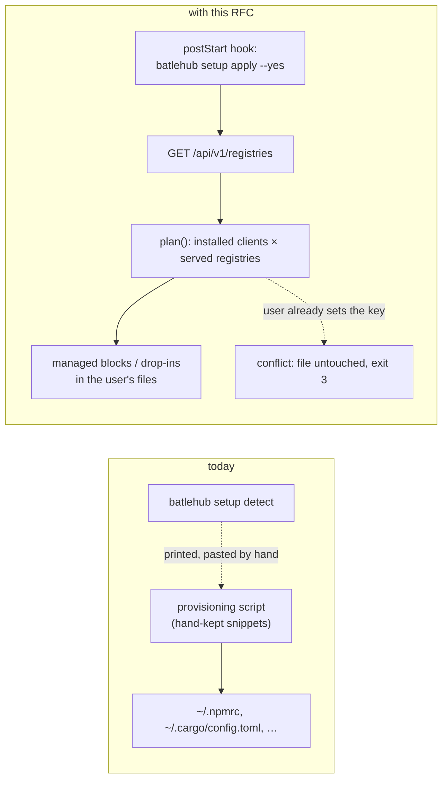
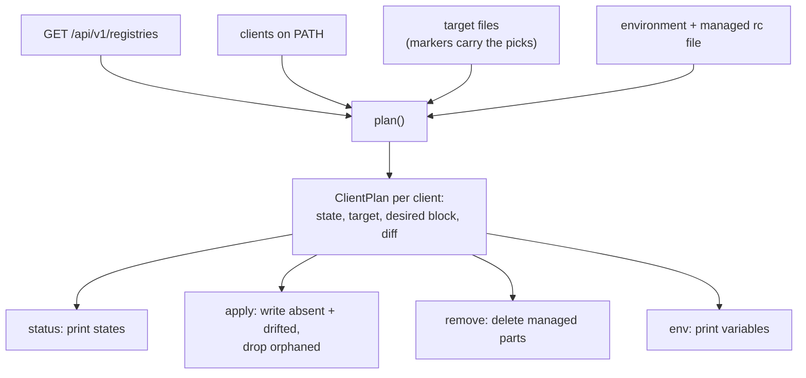

# RFC 0038 — Client setup that writes: `setup apply`, `setup remove`, `setup env`

| Field       | Value                                                        |
| ----------- | ------------------------------------------------------------ |
| Status      | Draft                                                         |
| Short       | client setup apply                                            |
| Settles     | How a machine is pointed at an instance in one command: the CLI writes, checks and removes every package-manager client's user configuration from the server's registry list |
| Author      | Max Batleforc <maxleriche.60@gmail.com>                       |
| Co-author   | Claude Opus 5.5 <noreply@anthropic.com>                       |
| Created     | 2026-10-24                                                    |
| Supersedes  | —                                                             |
| Touches     | `cli`, `crates/web` (registry list, phase 2), `docs` |

---

## 1. Summary

`batlehub setup detect` and `batlehub registry suggest --mise / --client-env`
already know what every client needs to go through an instance — and print it,
for a human to paste. On a fleet of ephemeral dev environments (Eclipse Che
workspaces, devcontainers, CI runners) nobody pastes: the paste is a
provisioning script that drifts from the CLI's own snippets the day a registry
is added.

This RFC adds the writing half. `batlehub setup apply` reads the instance's
registry list, picks the clients installed on the machine, and writes each
one's **user-level** configuration — a drop-in file where the client reads one,
a delimited block otherwise — after showing the diff. `setup status` says, per
client, whether the machine is configured, drifted or in conflict with a
setting the user owns; `setup remove` takes everything back out; `setup env`
emits the variables a client only reads from its environment.

Only the server URL has to be provisioned. Adding a registry on the instance is
picked up by the next `setup apply`, with no change on the machines.

### Before / after

```text
# today: a provisioning script, maintained by hand
batlehub setup detect --json | jq …            # snippets, not files
cat >> ~/.npmrc <<'EOF'
registry=https://npm.pkg.example.com/
EOF
batlehub registry suggest --mise > /tmp/m && …   # same again, per client

# with this RFC
export BATLEHUB_SERVER=https://pkg.example.com
batlehub setup apply            # diff of every file it would touch, nothing written
batlehub setup apply --yes      # written; idempotent, safe in a postStart hook
batlehub setup status           # cargo up-to-date, npm up-to-date, pip conflict, …
batlehub setup remove --yes     # every managed block and drop-in gone
```



The only thing the hook carries is the server URL; which files are written,
and with what, follows from the registry list at the moment it runs.

---

## 2. Motivation

1. **Nothing in the CLI writes a client's configuration.** `setup detect`
   (`cli/src/cli/setup.rs::run_detect`), `setup ide`, `registry suggest
   --mise` and `--client-env` (`cli/src/api/suggest.rs::render_mise_toml`,
   `render_client_env`) all print. Every estate that provisions machines
   re-implements the paste, and the RFC 0005-bis drift check guards the UI
   against the CLI — not the estate's script against either.
2. **The snippets that exist are publish snippets, not mirror snippets.** The
   cargo one is `[registries] batlehub = { index = … }`, which lets `cargo
   publish --registry batlehub` work and leaves every `cargo build` on
   crates.io. Going *through* the instance needs `[source.crates-io]
   replace-with`. An air-gapped estate (RFC 0008) wants the latter on every
   machine and the former only where someone publishes.
3. **Detection is manifest-driven, which is wrong for a machine.** `detect`
   scans the current directory for `Cargo.toml`, `package.json`… A dev
   environment is configured before any repository is cloned into it, and
   must cover the repository cloned next week. What decides is which clients
   are installed and which registries the instance serves, not which manifests
   happen to be in `$PWD`.
4. **Some clients are traps for a paste.** yarn berry ignores `.npmrc`
   entirely (`npmRegistryServer` in `.yarnrc.yml`); uv ignores `pip.conf`; a
   second `[source.crates-io]` table makes cargo refuse to start; a duplicate
   `[global]` section makes pip refuse its config. A script that appends
   blindly breaks the machine it was meant to configure. Only a writer that
   knows each format can refuse cleanly.
5. **Removing is as important as applying.** On a laptop that moves between a
   VPN where the instance is reachable and a network where it is not, the
   configuration must come out as cleanly as it went in.

---

## 3. Goals / non-goals

**Goals**

- One command configures every installed client that has a matching registry
  on the instance, from the server's registry list, at user level.
- Idempotent: a second `apply --yes` on an up-to-date machine writes nothing,
  including when the first run was given `--registry` or `--maven-mirror-of`
  and the second was not.
- Never edits a setting the user owns: a conflict is reported, not merged.
- Reversible: `remove` returns every touched file to its pre-`apply` content,
  byte for byte.
- Scriptable: exit codes and `--json` fit a `postStart` hook and a CI step.

**Non-goals**

- **Project-level files.** `apply` never writes inside a repository
  (`.npmrc`, `.cargo/config.toml`, `mise.toml` next to a manifest). Those are
  versioned and shared; `registry suggest --mise-commented` already covers the
  "commit a template" case.
- **Credentials.** `apply` configures anonymous reads. Publishing keeps
  `auth login` and the existing `.netrc` snippet; a token is never written into
  a client file by this command.
- **Merging into user-owned tables.** No TOML/INI/XML/YAML merge engine. A
  file that already sets what `apply` would set is a conflict (§4.3).
- **System-level configuration** (`/etc/npmrc`, `/etc/pip.conf`). User level
  only; image builders that want system level run `apply` as that user.
- **Installing clients or toolchains.** `apply` configures what is on `PATH`.
- **Hosts the instance does not serve.** OCI registries and git mirrors are
  configured on the same machines, but announcing them makes the instance a
  distributor of addresses it does not answer for — a different trust model
  (§7). They belong in a follow-on RFC, not here.
- **A TUI view.** The CLI's dry-run diff, `--only`/`--skip` and `status`
  cover the interactive case; the target is an unattended hook. See Future
  work.
- **Windows.** Phase 1 targets Linux and macOS (§11, resolved 4).

---

## 4. User-facing design

### 4.1 Commands

```text
batlehub setup apply  [--yes] [--only <client>,…] [--skip <client>,…]
                      [--registry <type>=<name>]… [--maven-mirror-of central|external:*|*]
                      [--shell-rc auto|none] [--insecure-http] [--allow-foreign-hosts]
                      [--json]
batlehub setup status [--only …] [--json]
batlehub setup remove [--yes] [--only …] [--json]
batlehub setup env    [--shell sh|fish] [--only …]
```

- `apply` without `--yes` prints a unified diff per file and exits without
  writing. `--yes` writes. There is no interactive prompt.
- `--only` / `--skip` take client ids from the table in §4.2.
- `--registry type=name` picks a registry when the instance serves several
  candidates of one type (§4.4, *Candidates*). The pick is recorded in the
  block's marker and kept by later runs without the flag; passing the flag
  again overrides it.
- `--maven-mirror-of` sets Maven's `<mirrorOf>`. Default `central`: only Maven
  Central is redirected, and a repository a project's POM declares (a company
  Nexus, a vendor repository) is left alone. `external:*` redirects everything
  but `localhost` and `file:`; `*` redirects everything. Recorded in the
  marker like a pick.
- `--shell-rc auto` (default) adds a one-line block to the user's shell rc
  file when at least one env-only client is configured: bash →
  `~/.bashrc` (what the non-login interactive terminals of Che and
  devcontainers read), zsh → `~/.zshenv` (read by every zsh, including the
  non-interactive ones IDE tasks spawn), fish → a conf.d drop-in, no rc block.
  `none` leaves rc files alone and relies on `setup env` being evaluated by
  the caller.
- `setup env` renders the variables from the same plan as `apply`, from the
  server — not by reading back `env.sh` — so `eval "$(batlehub setup env)"`
  works on a machine `apply` never ran on. With the server unreachable it
  prints nothing and exits 1, so the `eval` sets nothing.
- The server is resolved like every other command: `--server`,
  `BATLEHUB_SERVER`, then the active profile's `server_url`. `setup detect`
  today reads only the flag and the variable; the new verbs read the profile
  too.
- Exit codes, shared by `apply`, `status` and `remove`:

  | Code | `apply`, `remove` | `status` |
  | --- | --- | --- |
  | `0` | nothing left to do, or a dry run with nothing in `conflict`/`ambiguous` | every client `up-to-date`, `not-installed` or `no-registry` |
  | `1` | an error: server unreachable, a write failed, a §4.6 refusal | an error, including an unreachable server |
  | `3` | done (or a dry run), with at least one client in `conflict` or `ambiguous` | anything `absent`, `drifted`, `orphaned`, `conflict` or `ambiguous` |

  A hook tells "done" from "done, look"; a CI step asserts a machine with
  `setup status`.

### 4.2 Clients and what is written

| Client id | Detected by | Registry type | Written to | Mechanism |
| --- | --- | --- | --- | --- |
| `cargo` | `cargo` on PATH | `cargo` | `$CARGO_HOME/config.toml` | block: `[source.crates-io] replace-with = "batlehub"`, `[source.batlehub] registry = "sparse+…/"`, `[registries.batlehub] index = "sparse+…/"` |
| `npm` | `npm` | `npm` | `~/.npmrc` | block: `registry=…/` |
| `pnpm`, `bun` | `pnpm`, `bun` | `npm` | `~/.npmrc` | same block as `npm` (both read it); listed separately so `status` shows them |
| `yarn` | `yarn --version` (see below) | `npm` | ≥ 2: `~/.yarnrc.yml`; 1.x: `~/.npmrc` | ≥ 2: block `npmRegistryServer: "…/"`; 1.x reads `.npmrc` and is covered by the `npm` block |
| `pip` | `pip` / `pip3` | `pypi` | `~/.config/pip/pip.conf` (Linux and macOS) | block: `[global]` `index-url = …/simple/` |
| `uv` | `uv` | `pypi` | `~/.config/uv/uv.toml` | block: `[[index]]` `url = …/simple/`, `default = true` |
| `go` | `go` | `goproxy` | `$(go env GOENV)` | block: `GOPROXY=<url>` alone |
| `maven` | `mvn` | `maven` | `~/.m2/settings.xml` | whole file when absent, a `<mirror>` of `--maven-mirror-of`; conflict when present |
| `mise` | `mise` | `github`, `nodedist`, `rustup`, `openvsx`, … | `~/.config/mise/conf.d/batlehub.toml` | drop-in: `[settings.url_replacements]`, the rules `render_mise_toml` already emits (`generic` from phase 2) |
| `rustup` | `rustup` | `rustup` | env | `RUSTUP_DIST_SERVER`, `RUSTUP_UPDATE_ROOT` |
| `node` | always | `nodedist` | env | `NODEJS_ORG_MIRROR` (nvm, fnm, node-gyp headers) |

**yarn detection.** `yarn` on PATH is often a corepack shim, which on first
call prompts to download yarn or fetches it. `apply` runs `yarn --version`
with `COREPACK_ENABLE_DOWNLOAD_PROMPT=0`, `COREPACK_ENABLE_NETWORK=0` and a
2-second timeout; a failure is `not-installed`, never a hang in a hook.

**go.** No `,direct` in `GOPROXY`: a module the instance refuses fails the
install instead of being fetched from its origin behind the instance's back,
which would defeat both the air gap and every rule the instance enforces. No
`GOSUMDB` either: the go command already asks its proxy for
`$GOPROXY/sumdb/sum.golang.org/supported` and proxies the checksum database
through it when that answers, which is exactly the registry's `/sumdb/` route;
and `RegistryInfo` does not say whether a registry has `sumdb_url` set, so the
CLI could not decide when to write the line anyway.

Env-only clients are written to `~/.config/batlehub/env.sh` (and `env.fish`),
which the rc block sources:

```sh
# >>> batlehub setup (managed — edit with `batlehub setup`) >>>
[ -r "$HOME/.config/batlehub/env.sh" ] && . "$HOME/.config/batlehub/env.sh"
# <<< batlehub setup <<<
```

fish gets a drop-in, `~/.config/fish/conf.d/batlehub.fish`, and no rc block.

The values come from the code that prints them today — `RegistryInfo::base_url`
(`cli/src/api/registry.rs`), `SuggestedRegistry::proxy_url`,
`mise_url_replacements`, `resolved_env` — so a printed snippet and a written
file cannot disagree (§6.2).

### 4.3 Status vocabulary

`setup status` reports one state per client:

| State | Meaning | `apply --yes` does |
| --- | --- | --- |
| `not-installed` | the client is not on PATH | nothing |
| `no-registry` | the instance serves no candidate of the client's type (§4.4) | nothing |
| `ambiguous` | several candidates of that type and no pick, or the type's blocks name different registries | nothing; exit 3 |
| `absent` | nothing managed in the target file | writes |
| `up-to-date` | the managed block/drop-in matches what would be written | nothing |
| `drifted` | the managed block exists and differs (edited, or the instance changed) | rewrites the block |
| `orphaned` | the managed block names a registry the instance no longer lists | removes the block (then `absent` or `no-registry`) |
| `conflict` | something the user owns sets what the block would set | nothing; prints the snippet and the source; exit 3 |

A conflict has two sources. The first is the user's part of the target file —
everything **outside** the markers — checked per format on the key the block
would introduce:

| Client | Conflict when the user's part has |
| --- | --- |
| `cargo` | a `[source.crates-io]` table, or a `[source.batlehub]` / `[registries.batlehub]` table |
| `npm`, `pnpm`, `bun`, yarn 1 | a `registry=` line |
| `yarn` ≥ 2 | a top-level `npmRegistryServer:` line |
| `pip` | a `[global]` section — a second one is a hard error for pip's parser; the message says "pip.conf has `[global]`: add `index-url = …` to it" |
| `uv` | an `[[index]]` with `default = true`, or `index-url` |
| `go` | a `GOPROXY` line |
| `maven` | the file exists |
| `mise` | never (drop-in) |

The second is a setting that **overrides** the target file, so that a correct
block would still not be used:

| Client | Overriding source |
| --- | --- |
| `cargo` | `CARGO_REGISTRIES_*`, `CARGO_SOURCE_*` in the environment; a legacy `$CARGO_HOME/config` (no extension), which cargo prefers |
| `npm`, `pnpm`, `bun`, yarn 1 | `NPM_CONFIG_REGISTRY` / `npm_config_registry` |
| `yarn` ≥ 2 | `YARN_NPM_REGISTRY_SERVER` |
| `pip` | `PIP_INDEX_URL`; `index-url` in the legacy `~/.pip/pip.conf`, or on macOS in `~/Library/Application Support/pip/pip.conf` |
| `uv` | `UV_INDEX_URL`, `UV_DEFAULT_INDEX`, `UV_INDEX` |
| `go` | `GOPROXY` in the environment |
| `rustup`, `node` | the same variable already set to another value |

Environment overrides are read from two places: the environment of the
process running `apply`/`status` (an image's `ENV`, the hook's own exports),
and an `export VAR=` line in the rc file `--shell-rc` manages. A variable a
user exports from some other dotfile is not seen; `status` cannot read a shell
it is not running in, and this limit is stated in `docs/use/cli.md`.

### 4.4 Behaviour rules

- **Candidates.** A registry is a candidate for its type only in `proxy` or
  `hybrid` mode (`RegistryInfo::mode`). A `local` registry serves only what was
  published to it; pointing `~/.npmrc` at it breaks every public install. One
  candidate is used without asking; none is `no-registry`; several are
  `ambiguous` unless picked. No mode is preferred over another when several
  candidates remain (§11, resolved 11).
- **Picks belong to the type.** `npm`, `pnpm`, `bun` and `yarn` share one
  pick across `~/.npmrc` and `~/.yarnrc.yml`. The pick is read back from the
  `registry=` field of any block of that type; blocks of one type that name
  different registries make the type `ambiguous` until `--registry` rewrites
  them all.
- **Markers.** A block starts with

  ```text
  # >>> batlehub setup (managed — edit with `batlehub setup`) registry=<name>[ created][ nl][ mirror-of=<v>] >>>
  ```

  and ends with `# <<< batlehub setup <<<`, in the comment syntax of the file
  (`#` for TOML, INI, YAML, `.npmrc`, go env; `<!-- … -->` for XML). One block
  per file. The fields are the command's only state — there is no state file:
  - `registry=<name>` — always present; the pick, and what `orphaned` checks;
  - `created` — `apply` created the file, so `remove` deletes it;
  - `nl` — `apply` added a final newline the original lacked, so `remove`
    strips it again;
  - `mirror-of=<v>` — Maven only, the value of `--maven-mirror-of`.

  A drop-in is managed as a whole and carries the start marker as its first
  line, so `remove` can tell it from a file the user wrote under the same name
  (a drop-in without the marker is a `conflict`).
- **Placement.** A new block is appended at the end of the file, after a blank
  line. A file that does not exist is created with its parent directory, with
  the process's umask.
- **Writes are atomic** — a sibling temp file, `fsync`, rename — and keep the
  original file's mode and owner. A file that is a symlink (dotfile managers)
  is written through to its target, never replaced by a regular file.
- **`remove`** deletes the block and the blank line before it, the final
  newline when the marker says `nl`, and the file when the marker says
  `created` and nothing is left. It does not need the server.
- **Order.** Server list first; if the server cannot be reached, `apply`,
  `status` and `env` fail (exit 1) and write nothing — unlike `detect`, which
  degrades to placeholders, because a placeholder written into `~/.npmrc`
  breaks npm.
- **Host routing.** When a registry advertises `public_url` (RFC 0001) the
  written URL is the host-routed one, otherwise `{server}/proxy/{name}`; the
  same rule `RegistryInfo::base_url` applies today.
- **What the caller cannot read is not there.** `GET /api/v1/registries`
  lists only what the caller may read (`accessible_registries_for`,
  `crates/web/src/handlers/front_office/registries.rs`). A hook without a token
  never sees a registry closed to anonymous reads, so `apply` never writes a
  URL that will 401.

### 4.5 Validation

`apply` refuses, before writing anything (exit 1):

| Condition | Rationale |
| --- | --- |
| the server list cannot be fetched | a placeholder written into a client file breaks the client (§4.4) |
| the server URL is `http://` and the host is not `localhost`/`127.0.0.1`/`::1`, without `--insecure-http` | the registry list is the only thing `apply` trusts; over plain HTTP anyone on the path rewrites where every install goes |
| a `public_url` whose host is neither the server's host nor a subdomain of it, without `--allow-foreign-hosts` | `apply` would send installs to a host the operator did not name (§7) |
| a TOML target file that does not parse | appending to a broken file hides the original error under ours |
| a block's start marker without an end marker (or the reverse) | a half block cannot be replaced safely; the user fixes it or runs `remove` |

Warnings (printed to stderr, and in `--json` as `warnings[]`):

| Condition | Behaviour |
| --- | --- |
| a client in `conflict` | skipped, the snippet and the conflicting source printed, exit 3 |
| a type `ambiguous` | skipped, the candidate names printed, exit 3 |
| `--shell-rc auto` and a login shell other than bash, zsh or fish | env file written, no rc block, the `eval "$(batlehub setup env)"` line printed |

---

## 5. Architecture

### 5.1 One plan, four verbs



Every verb reads the same `ClientPlan` list; only `apply` and `remove` write,
and only through one function (`write_atomic`). The invariant a reviewer
checks: **nothing outside a marker pair is ever modified** — the writer takes
the file, removes the managed span if any, and inserts the new span; the bytes
before and after are copied untouched, and the marker records the one byte
(`nl`) the splice had to add, so a round trip `apply` → `remove` is
byte-identical to the original (§10).

Because the picks live in the files they govern, there is no second source of
truth to disagree with them: a `HOME` copied into a new image carries its
state with it, and a hand-deleted block takes its pick with it.

### 5.2 Where the snippets come from

The block bodies are rendered by the functions that already render the printed
snippets, moved where both callers reach them. No second copy of a snippet is
introduced, so the RFC 0005-bis drift check (UI ↔ CLI) keeps covering the
written form too.

---

## 6. Detailed design

### 6.1 `cli/src/api/client_setup.rs` (new)

- `enum ClientId` — the ids of §4.2, with `binary()`, `registry_type()`,
  `target(&Env) -> Target` (`File { path, format }`, `DropIn { path }`,
  `Env`).
- `enum ClientState` — §4.3.
- `struct Marker { registry, created, nl, mirror_of }` — parsed from and
  rendered to the start line of §4.4.
- `struct ClientPlan { client, state, registry: Option<RegistryInfo>, target,
  desired: Option<String>, diff: Option<String>, conflict: Option<String> }`.
- `fn plan(registries: &[RegistryInfo], picks: &RegistryPicks, env: &Env) ->
  Vec<ClientPlan>` — pure apart from reading files and `PATH`; `Env` carries
  `HOME`, `CARGO_HOME`, `GOENV`, the login shell, the process environment and
  a PATH lookup, so tests run against a temp directory.
- `fn conflicts(format, user_part) -> Option<Vec<String>>` — the per-format
  checks of §4.3. The `toml` crate the CLI already depends on reads cargo and
  uv; `.npmrc`, pip INI, go env and yarn's top-level key are line scanners;
  Maven is a file-exists check. No new crate.
- `fn splice(original, block) -> String` / `fn unsplice(original) -> String` —
  the marker logic of §4.4; the only code that edits file content.
- `fn write_atomic(path, content)` — temp, fsync, rename, mode and symlink
  rules of §4.4.

### 6.2 Snippet rendering

- The cargo, npm, pypi, goproxy and maven bodies move out of the
  `detect_*` closures in `cli/src/api/setup.rs` into `client_setup::render_*`,
  and the `detect_*` functions call them. The cargo body gains the
  `[source.*]` mirror form; `detect` keeps printing the publish form as well.
- mise: `render_mise_toml` and `mise_url_replacements`
  (`cli/src/api/suggest.rs`) take a `&[RegistryInfo]` adapter alongside
  `SuggestedRegistry`, so the rules come from what the server serves rather
  than from a `mise.lock`.
- env: `resolved_env` is reused as is for `rustup` and `nodedist`.

### 6.3 `cli/src/cli/setup.rs`

- `SetupCommand::{Apply, Status, Remove, Env}` with the flags of §4.1.
- `load_registries` keeps its 5-second timeout and gains a strict variant that
  returns the error instead of `Vec::new()`: today an unreachable server and an
  empty registry list are the same value. `apply`, `status` and `env` use the
  strict variant; `remove` does not call the server at all; `detect` keeps the
  lenient one.

### 6.4 Server: `upstreams` on the registry list (phase 2)

`generic` registries cannot be turned into mise rules from `RegistryInfo`
today: the rule is `^{upstream}/(.+)` → `{proxy}/$1`, and the list has no
upstream. `GET /api/v1/registries` gains `upstreams: [string]` for path-addressed
kinds (`generic`). The values are public facts of the configuration — the hosts
a mirror relays — and already visible to an admin; a caller sees them only for
registries it could already list.

### 6.5 Heavy coverage — `tests/heavy/client_setup.sh`

A new suite, `config.client_setup.toml` with one `proxy` registry each of
`cargo`, `npm`, `pypi`, `goproxy`, `maven`, `github`, `nodedist`, `rustup`,
`task test:client-setup-heavy`, a row in the `heavy-client` matrix. Clients
pinned as in the existing suites (cargo, npm, pnpm, bun, yarn 4, pip, uv, go,
mvn, mise, rustup), every one with `HOME` and its caches redirected into the
run's directory. The world is closed the way `closed_world.sh` closes it:
every client's proxy is `closed_proxy.py`, which relays the instance and
refuses every other host — no network namespace, which the GitHub runners'
AppArmor profile refuses. What it proves, asserted on the wire transcript
(`heavy_wire_re_after`), not only on exit codes:

1. `setup apply` (no `--yes`) — exit 0, every target file absent afterwards:
   nothing written by a dry run.
2. `setup apply --yes`, then one install per client (`cargo fetch` on a
   one-crate project, `npm i`, `pnpm i`, `bun i`, `yarn` 4, `pip install`,
   `uv pip install`, `go mod download`, `mvn dependency:resolve`, `mise install
   node@<pinned> gh@<pinned>`, `rustup toolchain install <pinned>`) — each
   succeeds; each artifact request is on the instance's side of the tap, and
   `closed_proxy.py` logs no request to an upstream host. `go mod download`
   also proves §4.2's go rule: `sum.golang.org` is unreachable, so the checksum
   lookups it makes are seen under `/proxy/<goproxy>/sumdb/`.
3. A second `setup apply --yes` — no file's mtime moves.
4. `~/.npmrc` pre-seeded with `registry=https://registry.npmjs.org/` —
   `status` says `conflict`, `apply --yes` exits 3, the file is byte-identical,
   and `npm i` fails with the closed proxy's refusal (the conflict is real,
   not masked).
5. `~/.config/pip/pip.conf` pre-seeded with a `[global]` section — `conflict`,
   untouched, and `pip config list` still parses it.
6. `GOPROXY=https://proxy.golang.org` in the environment — `status` says
   `conflict` for `go` and names the variable, though the `GOENV` block is
   `absent`.
7. `setup remove --yes` — every file byte-identical to its pre-`apply` copy
   (`cmp`), including one seeded without a final newline; drop-ins and created
   files gone.
8. A second `npm` proxy registry added to the instance — `status` says
   `ambiguous` for `npm`, `pnpm`, `bun`, `yarn`; `apply --yes --registry
   npm=<name>` writes that one's URL; a following plain `apply --yes` keeps it
   (no mtime moves) and exits 0. Same with `--maven-mirror-of '*'` followed by
   a plain `apply --yes`.
9. A `local` npm registry added beside the single proxy one — `npm` stays
   `up-to-date` on the proxy, not `ambiguous`.
10. The registry a block names removed from the instance — `status` says
    `orphaned`, `apply --yes` removes the block.

**Deliberately untouched**, so reviewers do not go looking:

- `cli/src/api/ide.rs`, `setup ide` — editors are configured through
  `proxy serve` and the RFC 0011 contract file, not through a user dotfile.
- `cli/src/cli/mise.rs` (`plan|seed|export|import`) — the air-gap transfer
  is about what the instance holds, not how clients reach it.
- `cli/src/tui/setup_wizard.rs` — keeps its manifest-driven project view; see
  Future work.
- `.netrc` — credentials are a non-goal (§3).
- The registry list's visibility — it already filters by the caller's grants;
  §4.4 relies on that, nothing changes it.

---

## 7. Security considerations

- **No new authenticated surface in phase 1.** `apply` reads the registry list
  the CLI already reads for `detect` and writes only under the user's home.
- **No credential is written.** The blocks carry URLs only. A registry closed
  to anonymous reads is not in an anonymous caller's list (§4.4), so it is
  never written.
- **The server decides where the machine's clients go.** That is the point of
  the command, and also its risk: whoever controls the instance's
  configuration redirects every package install of every machine that runs
  `apply` from a hook. It is the same trust the machine already places in the
  instance it installs from; `apply` adds no host the instance does not
  already serve — every written URL is under the server URL or a `public_url`
  on the server's host or one of its subdomains, and anything else needs
  `--allow-foreign-hosts` (§4.5).
- **The list must reach the machine intact.** A plain-HTTP server URL lets
  anyone on the path rewrite the list, and with it every install; `apply`
  refuses it outside loopback unless `--insecure-http` (§4.5).
- **No silent fallback to the origin.** `GOPROXY` carries no `direct`, so a
  module the instance refuses is not fetched around it (§4.2).
- **Symlinked dotfiles** are written through, never replaced, so a dotfile
  manager's link is not turned into a regular file that diverges from it.

---

## 8. Alternatives considered

| Alternative | Why rejected |
| --- | --- |
| A server endpoint that renders every snippet (`/api/v1/client/config?client=npm`) | Moves the per-client knowledge to the server for no gain: the CLI already has it, and an endpoint would be a third copy for 0005-bis to guard |
| Write project-level files | Versioned files are shared with people and CI that do not use this instance |
| Merge into user-owned tables (`toml_edit`, an INI writer) | Each format's merge is a source of corruption on someone's real config, and three new crates; a conflict with the snippet printed costs one manual edit, once |
| Only env vars (`eval "$(batlehub setup env)"`) | cargo, yarn berry and Maven have no variable for a mirror; processes not started from a shell (IDE tasks, language servers) never see them |
| pip through `PIP_INDEX_URL` instead of `pip.conf`, to dodge the `[global]` conflict | Same reason: pip run from an IDE task never sees it. The conflict message names the one line to add instead |
| A state file (`$BATLEHUB_HOME/state/setup.json`) for picks, created files and offline `status` | A second source of truth that a copied `HOME` or a hand-edited file contradicts; the marker line carries the same four facts in the file they describe |
| Maven `<mirrorOf>*</mirrorOf>` as the only form | Redirects repositories a POM declares that the instance does not proxy, and breaks those builds; `central` by default, `*` on request |
| A dotfiles repository per estate | It is what estates do today, and what drifts: the registry list lives on the server |
| `setup detect --write` instead of new verbs | `detect` is manifest-driven and degrades to placeholders; `apply` is client-driven and must refuse instead — two contracts under one verb |

---

## 9. Rollout and compatibility

- **Default behaviour**: nothing changes until `apply` is run. `detect`, `ide`,
  `registry suggest` keep their output byte for byte, except that `detect`'s
  cargo section adds the mirror form under the publish one.
- **Config migration**: none. `CURRENT_CONFIG_VERSION` does not move.
- **Operator prerequisites**: an `https://` server URL. An estate that injects
  only `BATLEHUB_SERVER` and runs `batlehub setup apply --yes` from its
  environment hook gets every client configured; one that needs a pick or a
  Maven mirror form passes the flag once and later runs keep it.
- **Rollback**: `setup remove --yes`. Nothing outside the home directory is
  touched.

---

## 10. Test plan

- **Unit** (`cli/src/api/client_setup.rs`): `splice`/`unsplice` round trip is
  byte-identical on files with and without trailing newline, CRLF, BOM; a
  half block refuses; marker parse/render round trip; each `conflicts` case of
  §4.3, file and override, on positive and negative fixtures; `plan` on a fake
  `Env` for every state of §4.3; `local` registries excluded from candidates;
  a pick read back from a marker, and two disagreeing markers making the type
  `ambiguous`; host-routed vs path-routed URLs; the foreign-host and
  plain-HTTP refusals; symlink write-through; mode preservation.
- **Rendered blocks** (`cli/tests/setup_apply.rs`): the block of every client
  against a fixed registry list, `assert_eq!` against the expected text, so a
  snippet change shows in review.
- **Integration** (`cli/tests/setup_apply.rs`): `apply --yes` / `status` /
  `remove --yes` / `env` against the in-process test server, in a temp `HOME`;
  exit codes 0, 1, 3 for each verb.
- **Heavy** (`tests/heavy/client_setup.sh`): §6.5.
- **Existing suites** that must pass unchanged: the `setup detect` and
  `registry suggest` tests (same output), the 0005-bis snippet drift gate
  (the moved renderers still match the UI).

---

## 11. Decisions and open questions

### Resolved

| # | Question | Decision |
| --- | --- | --- |
| 1 | What a machine has to be given | **The server URL only.** The registry list comes from the server; a registry added there reaches every machine on its next `apply` |
| 2 | New verbs or `detect --write` | **New verbs.** `detect` degrades to placeholders, `apply` must refuse (§8) |
| 3 | User or project level | **User level only.** Project files are versioned and shared |
| 4 | Merge or refuse on a user-owned key | **Refuse, report `conflict`, print the snippet.** No merge engine |
| 5 | Drop-in or block | **Drop-in wherever the client reads one** (mise conf.d, fish conf.d), a delimited block otherwise |
| 6 | Dry run by default | **Yes**, `--yes` writes |
| 7 | Credentials | **Out of scope**; `auth login` and `.netrc` stay. The list already hides what the caller cannot read, so the draft's "say so per closed registry" was dropped — it had no data source (`RegistryInfo` carries no anonymous-read flag) and nothing left to cover |
| 8 | OCI and git mirrors | **Out, to a follow-on RFC.** The draft had them as a phase; they make the instance announce hosts it does not serve, a different trust model with its own endpoint, config table and heavy case |
| 9 | TUI | **Out, to Future work** — against the draft, which had a Machine tab. The target is an unattended hook; the CLI's diff, `--only` and `status` cover a human |
| 10 | `environment.d` for desktop sessions | **No, Future work** — against the draft's recommendation. A third env target that helps only desktop IDEs; the motivating fleet is containers without `systemd --user` |
| 11 | Pick the `hybrid` registry when it and `proxy` ones compete | **No.** Explicit beats clever; the pick is one flag, once, and is kept (§4.4) |
| 12 | A block whose registry the instance no longer lists | **A separate `orphaned` state**, removed by `apply --yes`, so a renamed registry does not leave a dead URL in `~/.npmrc` |
| 13 | Windows | **Linux and macOS in phase 1.** `%APPDATA%` file targets later, no env target |
| 14 | Where a pick lives | **In the block's marker**, kept by later runs; `--registry` overrides. One pick per type across files |
| 15 | A state file | **None.** The marker carries `registry=`, `created`, `nl`, `mirror-of=` |
| 16 | Which registries are candidates | **`proxy` and `hybrid` only**; a `local` registry cannot be a mirror |
| 17 | `status` sees only the target file? | **No — overrides count as `conflict`**: known env vars and legacy/platform files per client (§4.3), from the process environment and the managed rc file |
| 18 | pip and a user `[global]` section | **Stays a conflict**, with a message naming the line to add; `PIP_INDEX_URL` rejected for the IDE-task reason (§8) |
| 19 | `--shell-rc` default | **`auto`**, writing `~/.bashrc` for bash, `~/.zshenv` for zsh, a conf.d drop-in for fish |
| 20 | yarn detection | **corepack download and network disabled, 2 s timeout**, failure = `not-installed`; yarn 1 covered by the npm block |
| 21 | `public_url` host check | **The server's host or a subdomain of it**, else `--allow-foreign-hosts` |
| 22 | Plain-HTTP server | **Refused outside loopback** unless `--insecure-http` |
| 23 | Maven `<mirrorOf>` | **`--maven-mirror-of central|external:*|*`, default `central`**, kept in the marker — against the draft's `*`, which breaks builds whose POMs declare other repositories |
| 24 | `GOSUMDB` and `,direct` | **Neither.** `GOPROXY=<url>` alone; the go command already proxies the sumdb through `GOPROXY` |
| 25 | `status` exit codes | **Same as `apply`**: 0 settled, 3 something to do or look at, 1 error |
| 26 | `setup env` source | **The server, through `plan()`**; exits 1 and prints nothing when unreachable. `sh` and `fish` only |
| 27 | New crates for conflict parsing and snapshots | **None.** `toml` and line scanners; `assert_eq!` instead of snapshots |
| 28 | Docs | **With the code of each phase**, not a phase of their own |

### Still open

None.

---

## 12. Implementation phases

| Phase | Content |
| --- | --- |
| 1 | `client_setup.rs`, the moved renderers, `setup apply|status|remove|env` for every client of §4.2 except `generic`-derived mise rules; unit, rendered-block and integration tests; heavy cases 1–10; docs: `docs/use/cli.md` (the verbs, the override limit of §4.3), `docs/operations/air-gap.md` (provisioning a fleet with `apply`), the Setup Guide page pointing at `setup apply`. **Ships on its own.** |
| 2 | `upstreams` on `GET /api/v1/registries` (§6.4), the `generic` mise rules it unlocks, the regenerated OpenAPI client, and the mise row of `docs/use/cli.md` updated |

---

## Future work

- **TUI Machine tab** — the same `ClientPlan` list on a checklist, with
  per-row diff and apply/remove. When someone asks for it in the TUI.
- **OCI and git mirrors** (`[[client_mirrors]]`) — a follow-on RFC, for the
  trust-model reason of §11, resolved 8.
- **`environment.d`** — for GUI-launched IDEs on desktop sessions.
- **A server-side default for `--maven-mirror-of`** — a field on the registry
  list, if fleets want it without a flag in the hook.
- **Windows file targets.**
