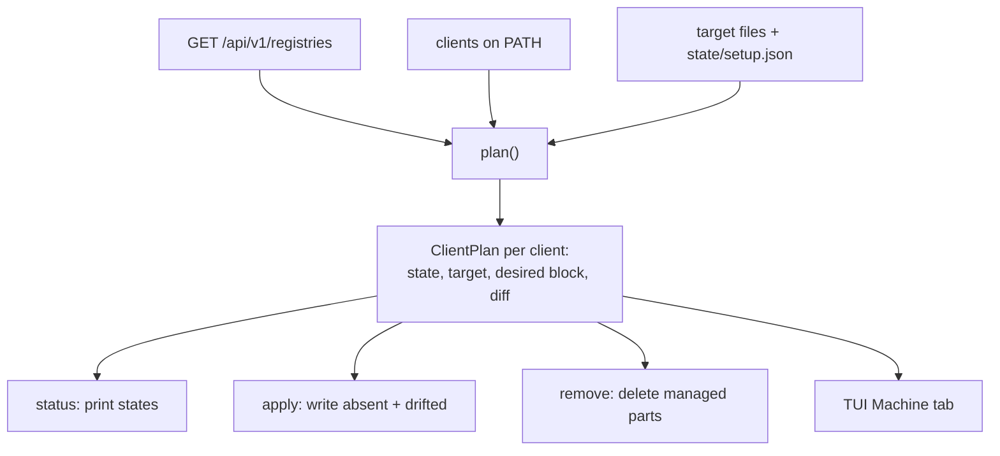

# RFC 0038 — Client setup that writes: `setup apply`, `setup remove`, `setup env`

| Field       | Value                                                        |
| ----------- | ------------------------------------------------------------ |
| Status      | Draft                                                         |
| Short       | client setup apply                                            |
| Settles     | How a machine is pointed at an instance in one command: the CLI writes, checks and removes every package-manager client's user configuration from the server's registry list, and the TUI does the same with a selection |
| Author      | Max Batleforc <maxleriche.60@gmail.com>                       |
| Co-author   | Claude Opus 5.5 <noreply@anthropic.com>                       |
| Created     | 2026-10-24                                                    |
| Supersedes  | —                                                             |
| Touches     | `cli`, `crates/web` (registry list, phase 2 and 3), `crates/config` (phase 3), `docs` |

---

## 1. Summary

`batlehub setup detect` and `batlehub registry suggest --mise / --client-env`
already know what every client needs to go through an instance — and print it,
for a human to paste. On a fleet of ephemeral dev environments (Eclipse Che
workspaces, devcontainers, CI runners) nobody pastes: the paste is a
provisioning script that drifts from the CLI's own snippets the day a registry
is added.

This RFC adds the writing half. `batlehub setup apply` reads the instance's
registry list, picks the clients installed on the machine, and writes each
one's **user-level** configuration — a drop-in file where the client reads one,
a delimited block otherwise — after showing the diff. `setup status` says, per
client, whether the machine is configured, drifted or in conflict with a
setting the user owns; `setup remove` takes everything back out; `setup env`
emits the variables a client only reads from its environment. The TUI's setup
wizard gets the same three verbs on a checklist.

Only the server URL has to be provisioned. Adding a registry on the instance is
picked up by the next `setup apply`, with no change on the machines.

### Before / after

```text
# today: a provisioning script, maintained by hand
batlehub setup detect --json | jq …            # snippets, not files
cat >> ~/.npmrc <<'EOF'
registry=https://npm.pkg.example.com/
EOF
batlehub registry suggest --mise > /tmp/m && …   # same again, per client

# with this RFC
export BATLEHUB_SERVER=https://pkg.example.com
batlehub setup apply            # diff of every file it would touch, nothing written
batlehub setup apply --yes      # written; idempotent, safe in a postStart hook
batlehub setup status           # cargo up-to-date, npm up-to-date, pip conflict, …
batlehub setup remove --yes     # every managed block and drop-in gone
```

---

## 2. Motivation

1. **Nothing in the CLI writes a client's configuration.** `setup detect`
   (`cli/src/cli/setup.rs::run_detect`), `setup ide`, `registry suggest
   --mise` and `--client-env` (`cli/src/api/suggest.rs::render_mise_toml`,
   `render_client_env`) all print. Every estate that provisions machines
   re-implements the paste, and the RFC 0005-bis drift check guards the UI
   against the CLI — not the estate's script against either.
2. **The snippets that exist are publish snippets, not mirror snippets.** The
   cargo one is `[registries] batlehub = { index = … }`, which lets `cargo
   publish --registry batlehub` work and leaves every `cargo build` on
   crates.io. Going *through* the instance needs `[source.crates-io]
   replace-with`. An air-gapped estate (RFC 0008) wants the latter on every
   machine and the former only where someone publishes.
3. **Detection is manifest-driven, which is wrong for a machine.** `detect`
   scans the current directory for `Cargo.toml`, `package.json`… A dev
   environment is configured before any repository is cloned into it, and
   must cover the repository cloned next week. What decides is which clients
   are installed and which registries the instance serves, not which manifests
   happen to be in `$PWD`.
4. **Some clients are traps for a paste.** yarn berry ignores `.npmrc`
   entirely (`npmRegistryServer` in `.yarnrc.yml`); uv ignores `pip.conf`; a
   second `[source.crates-io]` table makes cargo refuse to start; a duplicate
   `[global]` section makes pip refuse its config. A script that appends
   blindly breaks the machine it was meant to configure. Only a writer that
   knows each format can refuse cleanly.
5. **Removing is as important as applying.** On a laptop that moves between a
   VPN where the instance is reachable and a network where it is not, the
   configuration must come out as cleanly as it went in.

---

## 3. Goals / non-goals

**Goals**

- One command configures every installed client that has a matching registry
  on the instance, from the server's registry list, at user level.
- Idempotent: a second `apply --yes` on an up-to-date machine writes nothing.
- Never edits a setting the user owns: a conflict is reported, not merged.
- Reversible: `remove` returns every touched file to its pre-`apply` content.
- Scriptable: exit codes and `--json` fit a `postStart` hook and a CI step.
- The TUI exposes the same status, selection, diff and apply/remove.

**Non-goals**

- **Project-level files.** `apply` never writes inside a repository
  (`.npmrc`, `.cargo/config.toml`, `mise.toml` next to a manifest). Those are
  versioned and shared; `registry suggest --mise-commented` already covers the
  "commit a template" case.
- **Credentials.** `apply` configures anonymous reads. Publishing keeps
  `auth login` and the existing `.netrc` snippet; a token is never written into
  a client file by this command.
- **Merging into user-owned tables.** No TOML/INI/XML/YAML merge engine. A
  file that already sets what `apply` would set is a conflict (§4.3).
- **System-level configuration** (`/etc/npmrc`, `/etc/pip.conf`,
  `/etc/containers/registries.conf`). User level only; image builders that
  want system level run `apply` as that user.
- **Installing clients or toolchains.** `apply` configures what is on `PATH`.

---

## 4. User-facing design

### 4.1 Commands

```text
batlehub setup apply  [--yes] [--only <client>,…] [--skip <client>,…]
                      [--registry <type>=<name>]… [--shell-rc auto|none]
                      [--json]
batlehub setup status [--only …] [--json]
batlehub setup remove [--yes] [--only …] [--json]
batlehub setup env    [--shell sh|fish|nu] [--only …]
```

- `apply` without `--yes` prints a unified diff per file and exits 0 without
  writing. `--yes` writes. There is no interactive prompt: the TUI is the
  interactive path (§4.5).
- `--only` / `--skip` take client ids from the table in §4.2.
- `--registry type=name` picks a registry when the instance serves several of
  one type (two `npm` registries, say). Without it such a type is
  `ambiguous` (§4.3) and skipped.
- `--shell-rc auto` (default) adds a one-line block to the rc file of the
  user's login shell when at least one env-only client is configured;
  `none` leaves rc files alone and relies on `setup env` being evaluated by
  the caller.
- The server is resolved like every other command: `--server`,
  `BATLEHUB_SERVER`, then the active profile's `server_url`. `setup detect`
  today reads only the flag and the variable; `apply` reads the profile too.
- Exit codes: `0` nothing left to do (or a dry run), `1` an error (server
  unreachable, a write failed), `3` applied with at least one client in
  `conflict` or `ambiguous` — so a hook can tell "done" from "done, look".

### 4.2 Clients and what is written

| Client id | Detected by | Registry type | Written to | Mechanism |
| --- | --- | --- | --- | --- |
| `cargo` | `cargo` on PATH | `cargo` | `$CARGO_HOME/config.toml` | block: `[source.crates-io] replace-with = "batlehub"`, `[source.batlehub] registry = "sparse+…/"`, `[registries.batlehub] index = "sparse+…/"` |
| `npm` | `npm` | `npm` | `~/.npmrc` | block: `registry=…/` |
| `pnpm`, `bun` | `pnpm`, `bun` | `npm` | `~/.npmrc` | same block as `npm` (both read it); listed separately so `status` shows them |
| `yarn` (berry) | `yarn --version` ≥ 2 | `npm` | `~/.yarnrc.yml` | block: `npmRegistryServer: "…/"` |
| `pip` | `pip` / `pip3` | `pypi` | `~/.config/pip/pip.conf` | block: `[global]` `index-url = …/simple/` |
| `uv` | `uv` | `pypi` | `~/.config/uv/uv.toml` | block: `[[index]]` `url = …/simple/`, `default = true` |
| `go` | `go` | `goproxy` | `$(go env GOENV)` | block: `GOPROXY=…`, `GOSUMDB=sum.golang.org …/sumdb/sum.golang.org` (when the registry serves the sumdb) |
| `maven` | `mvn` | `maven` | `~/.m2/settings.xml` | whole file when absent (a `<mirror>` of `*`); conflict when present |
| `mise` | `mise` | `github`, `generic`, `nodedist`, `rustup`, `openvsx`, … | `~/.config/mise/conf.d/batlehub.toml` | drop-in: `[settings.url_replacements]`, the rules `render_mise_toml` already emits |
| `rustup` | `rustup` | `rustup` | env | `RUSTUP_DIST_SERVER`, `RUSTUP_UPDATE_ROOT` |
| `node` | always | `nodedist` | env | `NODEJS_ORG_MIRROR` (nvm, fnm, node-gyp headers) |

Env-only clients are written to `~/.config/batlehub/env.sh` (and `env.fish`),
which `setup env` prints and the rc block sources:

```sh
# >>> batlehub setup (managed — edit with `batlehub setup`) >>>
[ -r "$HOME/.config/batlehub/env.sh" ] && . "$HOME/.config/batlehub/env.sh"
# <<< batlehub setup <<<
```

fish gets a drop-in, `~/.config/fish/conf.d/batlehub.fish`, and no rc block.

The values come from the code that prints them today — `RegistryInfo::base_url`
(`cli/src/api/registry.rs`), `SuggestedRegistry::proxy_url`,
`mise_url_replacements`, `resolved_env` — so a printed snippet and a written
file cannot disagree (§6.2).

### 4.3 Status vocabulary

`setup status` (and the first column of the TUI) reports one state per client:

| State | Meaning | `apply --yes` does |
| --- | --- | --- |
| `not-installed` | the client is not on PATH | nothing |
| `no-registry` | the instance serves no registry of the client's type | nothing |
| `ambiguous` | several registries of that type, no `--registry` | nothing; exit 3 |
| `absent` | nothing managed in the target file | writes |
| `up-to-date` | the managed block/drop-in matches what would be written | nothing |
| `drifted` | the managed block exists and differs (edited, or the instance changed) | rewrites the block |
| `conflict` | the user's own part of the file sets what the block would set | nothing; prints the snippet; exit 3 |

A conflict is detected per format, on the key the block would introduce, in the
part of the file **outside** the markers:

| Client | Conflict when the user's part has |
| --- | --- |
| `cargo` | a `[source.crates-io]` table, or a `[source.batlehub]` / `[registries.batlehub]` table |
| `npm`, `pnpm`, `bun` | a `registry=` line |
| `yarn` | an `npmRegistryServer` key |
| `pip` | a `[global]` section (a second one is a hard error for pip's parser) |
| `uv` | an `[[index]]` with `default = true`, or `index-url` |
| `go` | a `GOPROXY` or `GOSUMDB` line |
| `maven` | the file exists |
| `mise` | never (drop-in) |

### 4.4 Behaviour rules

- **Markers.** A block starts with
  `# >>> batlehub setup (managed — edit with \`batlehub setup\`) >>>` and ends
  with `# <<< batlehub setup <<<`, in the comment syntax of the file (`#` for
  TOML, INI, YAML, `.npmrc`, go env; `<!-- … -->` for XML). One block per file.
  A drop-in file is managed as a whole and carries the start marker as its
  first line, so `remove` can tell it from a file the user wrote under the same
  name (a drop-in without the marker is a `conflict`).
- **Placement.** A new block is appended at the end of the file, after a blank
  line. A file that does not exist is created with the parent directory, mode
  `0644` (`0600` if the directory is `0700`).
- **Writes are atomic** — a sibling temp file, `fsync`, rename — and keep the
  original file's mode and owner. A file that is a symlink (dotfile managers)
  is written through to its target, never replaced by a regular file.
- **`remove`** deletes the block and the blank line before it, and deletes a
  drop-in or a file `apply` created (Maven) only when it still carries the
  marker. A file left empty by a removed block is deleted only if `apply`
  created it — recorded in `$BATLEHUB_HOME/state/setup.json`, which also lists
  what was written and when, for `status` to report `drifted` precisely.
- **Order.** Server list first; if the server cannot be reached, `apply` fails
  (exit 1) and writes nothing — unlike `detect`, which degrades to
  placeholders, because a placeholder written into `~/.npmrc` breaks npm.
- **Host routing.** When a registry advertises `public_url` (RFC 0001) the
  written URL is the host-routed one, otherwise `{server}/proxy/{name}`; the
  same rule `RegistryInfo::base_url` applies today.

### 4.5 TUI

The setup wizard (`cli/src/tui/setup_wizard.rs`, `Screen::SetupWizard`)
becomes a machine view when opened without a project in focus — and gains a
second tab, *Machine*, when it is:

- one row per client of §4.2: a checkbox, the client, the state of §4.3, the
  registry it would use, the target file;
- `space` toggles a row, `a` selects every `absent` and `drifted` row,
  `n` clears the selection;
- `enter` (or `d`) on a row shows the diff of its file in the detail pane, the
  same diff `apply` prints;
- `A` applies the selection, `R` removes it, each after a one-line
  confirmation (`apply 4 clients? y/N`), and the list refreshes its states;
- an `ambiguous` row opens a picker of the registries of that type, the
  choice standing in for `--registry type=name`;
- a `conflict` row cannot be selected; its detail pane shows the user's
  conflicting lines and the snippet to merge by hand.

The existing project list (`ProjectDetection`, manifest-driven) stays as the
*Project* tab, unchanged.

### 4.6 Validation

`apply` refuses, before writing anything:

| Condition | Rationale |
| --- | --- |
| the server list cannot be fetched | a placeholder written into a client file breaks the client (§4.4) |
| a target file cannot be parsed in its own format (invalid TOML/YAML/XML) | appending to a broken file hides the original error under ours |
| a block's start marker without an end marker (or the reverse) | a half block cannot be replaced safely; the user fixes it or runs `remove` |

Warnings (printed, and in `--json` as `warnings[]`):

| Condition | Behaviour |
| --- | --- |
| a client in `conflict` | skipped, snippet printed, exit 3 |
| a type `ambiguous` | skipped, the candidate names printed, exit 3 |
| `--shell-rc auto` and an unknown login shell | env file written, no rc block, the `eval "$(batlehub setup env)"` line printed |

---

## 5. Architecture

### 5.1 One plan, three verbs



Every verb, and the TUI, reads the same `ClientPlan` list; only `apply` and
`remove` write, and only through one function (`write_atomic`). The invariant a
reviewer checks: **nothing outside a marker pair is ever modified** — the
writer takes the file, removes the managed span if any, and inserts the new
span; the bytes before and after are copied untouched, so a round trip
`apply` → `remove` is byte-identical to the original (§10).

### 5.2 Where the snippets come from

The block bodies are rendered by the functions that already render the printed
snippets, moved where both callers reach them. No second copy of a snippet is
introduced, so the RFC 0005-bis drift check (UI ↔ CLI) keeps covering the
written form too.

---

## 6. Detailed design

### 6.1 `cli/src/api/client_setup.rs` (new)

- `enum ClientId` — the ids of §4.2, with `binary()`, `registry_type()`,
  `target(&Env) -> Target` (`File { path, format }`, `DropIn { path }`,
  `Env`).
- `enum ClientState` — §4.3.
- `struct ClientPlan { client, state, registry: Option<RegistryInfo>, target,
  desired: Option<String>, diff: Option<String> }`.
- `fn plan(registries: &[RegistryInfo], picks: &RegistryPicks, env: &Env) ->
  Vec<ClientPlan>` — pure apart from reading files and `PATH`; `Env` carries
  `HOME`, `CARGO_HOME`, `GOENV`, the login shell, and a PATH lookup, so tests
  run against a temp directory.
- `fn conflicts(format, user_part) -> Option<Vec<String>>` — the per-format
  checks of §4.3, on parsed content (`toml_edit` read-only, the INI and
  `.npmrc` line scanners already used by `grep_key`, `serde_yaml`, `quick-xml`
  for presence only).
- `fn splice(original, block) -> String` / `fn unsplice(original) -> String` —
  the marker logic of §4.4; the only code that edits file content.
- `fn write_atomic(path, content)` — temp, fsync, rename, mode and symlink
  rules of §4.4.

### 6.2 Snippet rendering

- The cargo, npm, pypi, goproxy and maven bodies move out of the
  `detect_*` closures in `cli/src/api/setup.rs` into `client_setup::render_*`,
  and the `detect_*` functions call them. The cargo body gains the
  `[source.*]` mirror form; `detect` keeps printing the publish form as well.
- mise: `render_mise_toml` and `mise_url_replacements`
  (`cli/src/api/suggest.rs`) take a `&[RegistryInfo]` adapter alongside
  `SuggestedRegistry`, so the rules come from what the server serves rather
  than from a `mise.lock`.
- env: `resolved_env` is reused as is for `rustup` and `nodedist`.

### 6.3 `cli/src/cli/setup.rs`

- `SetupCommand::{Apply, Status, Remove, Env}` with the flags of §4.1.
- `load_registries` keeps its 5-second timeout but gains a strict mode
  (`apply`, `remove` do not need the server, `status` falls back to the state
  file and reports `no-registry` as `unknown`).

### 6.4 `cli/src/tui/setup_wizard.rs`, `cli/src/tui/mod.rs`

- `SetupWizardWidget` gains `machine: ListNav<ClientPlan>`, a `selected:
  BTreeSet<ClientId>` and a `tab` field; `handle_setup_wizard` gains the keys of
  §4.5. The plan is computed on entering the screen and after each apply/remove.

### 6.5 Server: `upstreams` on the registry list (phase 2)

`generic` registries cannot be turned into mise rules from `RegistryInfo`
today: the rule is `^{upstream}/(.+)` → `{proxy}/$1`, and the list has no
upstream. `GET /api/v1/registries` gains `upstreams: [string]` for path-addressed
kinds (`generic`). The values are public facts of the configuration — the hosts
a mirror relays — and already visible to an admin; anonymous callers of the
list see them only if they could already list the registry.

### 6.6 Server: `client_mirrors` (phase 3)

Two things a dev environment needs that BatleHub does not serve — an OCI
registry and a git mirror — are configured on the same machines. The instance
can announce them so `apply` writes them too, without BatleHub proxying them:

```toml
[[client_mirrors]]
kind     = "oci"                       # registries.conf.d drop-in
upstream = "docker.io"
url      = "registry.example.com/hub"

[[client_mirrors]]
kind     = "git"                       # gitconfig include
upstream = "https://github.com/acme/"
url      = "https://git.example.com/acme/"
push     = "upstream"                  # pushInsteadOf keeps pushes on upstream
repos    = ["api", "web"]              # optional: per-repository rules only
```

- `GET /api/v1/client/mirrors`, anonymous, returns the list verbatim.
- Clients: `podman`/`buildah`/`skopeo` (`~/.config/containers/registries.conf.d/batlehub.conf`,
  drop-in), `git` (`~/.config/batlehub/git.conf`, included from `~/.gitconfig`
  through an `[include] path =` block; `url.<url>.insteadOf` per entry or per
  repository, `pushInsteadOf` when `push = "upstream"`), and `cargo` gains
  `[net] git-fetch-with-cli = true` when a git mirror exists, so cargo's git
  dependencies follow the same rewrite.
- `repos` matters: a prefix rule (`github.com/acme/` → mirror) sends every
  repository of the owner to the mirror, and a repository that is not mirrored
  fails to clone. With `repos`, only listed repositories are rewritten.
- `crates/config` validates the table (RFC 0037's validation entry point
  included): `kind` closed, `url` and `upstream` absolute, `push` only on
  `git`.

### 6.7 Heavy coverage — `tests/heavy/client_setup.sh`

A new suite, `config.client_setup.toml` with one registry each of `cargo`,
`npm`, `pypi`, `goproxy`, `maven`, `github`, `nodedist`, `rustup`, `task
test:client-setup-heavy`, a row in the `heavy-client` matrix. Clients pinned
as in the existing suites (cargo, npm, pnpm, bun, yarn 4, pip, uv, go, mvn,
mise, rustup), every one with `HOME` and its caches redirected into the run's
directory, and the run's network limited to the instance (the `closed_world.sh`
netns). What it proves, through the tap:

1. `setup apply` (no `--yes`) — exit 0, every target file absent afterwards:
   nothing written by a dry run.
2. `setup apply --yes`, then one install per client (`cargo fetch` on a
   one-crate project, `npm i`, `pnpm i`, `bun i`, `yarn` 4, `pip install`,
   `uv pip install`, `go mod download`, `mvn dependency:resolve`, `mise install
   node@<pinned> gh@<pinned>`, `rustup toolchain install <pinned>`) — each
   succeeds with no packet leaving the netns; each artifact request is seen on
   the tap.
3. A second `setup apply --yes` — no file's mtime moves.
4. `~/.npmrc` pre-seeded with `registry=https://registry.npmjs.org/` —
   `status` says `conflict`, `apply --yes` exits 3, the file is byte-identical,
   and `npm i` fails on the netns (the conflict is real, not masked).
5. `~/.config/pip/pip.conf` pre-seeded with a `[global]` section — `conflict`,
   untouched, and `pip config list` still parses it.
6. `setup remove --yes` — every file byte-identical to its pre-`apply` copy
   (`cmp`), drop-ins and created files gone, the state file empty.
7. A second `npm` registry added to the instance — `status` says `ambiguous`
   for `npm`, `pnpm`, `bun`, `yarn`; `apply --yes --registry npm=<name>`
   writes that one's URL.
8. Phase 3: `client_mirrors` with one `oci` and one `git` entry — `podman pull`
   of an image through the OCI mirror and `git clone` of a listed repository
   through the git mirror, with the upstream hosts unreachable; a `git push`
   dry run targets the upstream URL.

**Deliberately untouched**, so reviewers do not go looking:

- `cli/src/api/ide.rs`, `setup ide` — editors are configured through
  `proxy serve` and the RFC 0011 contract file, not through a user dotfile.
- `cli/src/cli/mise.rs` (`plan|seed|export|import`) — the air-gap transfer
  is about what the instance holds, not how clients reach it.
- `.netrc` — credentials are a non-goal (§3).

---

## 7. Security considerations

- **No new authenticated surface in phase 1.** `apply` reads the registry list
  the CLI already reads for `detect` and writes only under the user's home.
- **No credential is written.** The blocks carry URLs only. A registry closed
  to anonymous reads still needs `auth login` and the `.netrc` snippet; `apply`
  says so for each such registry rather than writing a URL that will 401.
- **The server decides where the machine's clients go.** That is the point of
  the command, and also its risk: whoever controls the instance's
  configuration redirects every package install of every machine that runs
  `apply` from a hook. It is the same trust the machine already places in the
  instance it installs from; `apply` adds no host the instance does not
  already serve — every written URL is under the server URL or a
  `public_url` it advertises — and refuses a `public_url` on another domain
  than the server's unless `--allow-foreign-hosts` is passed.
- **Phase 3 widens that.** `client_mirrors` lets the instance name hosts it
  does not serve (an OCI registry, a git forge). Those entries are shown in
  `apply`'s diff and in the TUI with their host highlighted, and `git` entries
  never rewrite a push unless `push` says so — a mirror must not be able to
  capture a `git push` silently.
- **Symlinked dotfiles** are written through, never replaced, so a dotfile
  manager's link is not turned into a regular file that diverges from it.

---

## 8. Alternatives considered

| Alternative | Why rejected |
| --- | --- |
| A server endpoint that renders every snippet (`/api/v1/client/config?client=npm`) | Moves the per-client knowledge to the server for no gain: the CLI already has it, and an endpoint would be a third copy for 0005-bis to guard |
| Write project-level files | Versioned files are shared with people and CI that do not use this instance |
| Merge into user-owned tables (`toml_edit`, an INI writer) | Each format's merge is a source of corruption on someone's real config; a conflict with the snippet printed costs one manual edit, once |
| Only env vars (`eval "$(batlehub setup env)"`) | cargo, yarn berry and Maven have no variable for a mirror; processes not started from a shell (IDE tasks, language servers) never see them |
| A dotfiles repository per estate | It is what estates do today, and what drifts: the registry list lives on the server |
| `setup detect --write` instead of new verbs | `detect` is manifest-driven and degrades to placeholders; `apply` is client-driven and must refuse instead — two contracts under one verb |

---

## 9. Rollout and compatibility

- **Default behaviour**: nothing changes until `apply` is run. `detect`, `ide`,
  `registry suggest` keep their output byte for byte, except that `detect`'s
  cargo section adds the mirror form under the publish one.
- **Config migration**: none for phases 1 and 2. Phase 3 adds an optional
  table; `CURRENT_CONFIG_VERSION` does not move.
- **Operator prerequisites**: none. An estate that injects only
  `BATLEHUB_SERVER` and runs `batlehub setup apply --yes` from its environment
  hook gets every client configured.
- **Rollback**: `setup remove --yes`. The state file records what was created;
  nothing outside the home directory is touched.

---

## 10. Test plan

- **Unit** (`cli/src/api/client_setup.rs`): `splice`/`unsplice` round trip is
  byte-identical on files with and without trailing newline, CRLF, BOM; a
  half block refuses; each `conflicts` case of §4.3 on positive and negative
  fixtures; `plan` on a fake `Env` for every state of §4.3; host-routed vs
  path-routed URLs; `ambiguous` with and without a pick; symlink write-through;
  mode preservation.
- **Snapshot** (`cli/tests/setup_apply.rs`): the block of every client against
  a fixed registry list, `insta` snapshots, so a snippet change shows in review.
- **Integration** (`cli/tests/setup_apply.rs`): `apply --yes` / `status` /
  `remove --yes` against the in-process test server, in a temp `HOME`;
  exit codes 0, 1, 3.
- **TUI** (`cli/src/tui/setup_wizard.rs` tests): selection keys, `a`/`n`,
  conflict rows not selectable, plan refresh after apply.
- **Heavy** (`tests/heavy/client_setup.sh`): §6.7.
- **Existing suites** that must pass unchanged: the `setup detect` and
  `registry suggest` tests (same output), the 0005-bis snippet drift gate
  (the moved renderers still match the UI).

---

## 11. Decisions and open questions

### Resolved

| # | Question | Decision |
| --- | --- | --- |
| 1 | What a machine has to be given | **The server URL only.** The registry list comes from the server; a registry added there reaches every machine on its next `apply` |
| 2 | New verbs or `detect --write` | **New verbs.** `detect` degrades to placeholders, `apply` must refuse (§8) |
| 3 | User or project level | **User level only.** Project files are versioned and shared |
| 4 | Merge or refuse on a user-owned key | **Refuse, report `conflict`, print the snippet.** No merge engine |
| 5 | Drop-in or block | **Drop-in wherever the client reads one** (mise conf.d, fish conf.d, containers registries.conf.d, git include), a delimited block otherwise |
| 6 | Dry run by default | **Yes**, `--yes` writes; the TUI confirms per action |
| 7 | Credentials | **Out of scope**; `auth login` and `.netrc` stay |
| 8 | OCI and git mirrors | **In, as phase 3**, announced by the server, written by the CLI; per-repository git rules so an unmirrored repository still clones |
| 9 | TUI | **Same plan, a Machine tab** with selection, diff, apply and remove |

### Still open

1. **`environment.d`.** For desktop sessions, `~/.config/environment.d/batlehub.conf`
   would give GUI-launched IDEs the env-only variables too. Recommendation: add
   it as an `env` target when `systemd --user` is detected, phase 1.
2. **Ambiguity default.** When one registry of a type is `hybrid` and the
   others `proxy`, pick the hybrid one instead of reporting `ambiguous`?
   Recommendation: no — explicit beats clever, and the TUI picker makes it one
   keypress.
3. **Status of a removed registry.** A block whose registry no longer exists on
   the instance: `drifted` (and `apply` removes it) or a separate `orphaned`
   state? Recommendation: `orphaned`, removed by `apply --yes`, so a renamed
   registry does not leave a dead URL in `~/.npmrc`.
4. **Windows.** `%APPDATA%` paths for npm, pip, Maven, cargo are known; the rc
   block has no equivalent. Recommendation: phase 1 targets Linux and macOS,
   Windows gets the file targets in a later phase and no env target.

---

## 12. Implementation phases

| Phase | Content |
| --- | --- |
| 1 | `client_setup.rs`, the moved renderers, `setup apply|status|remove|env` for every client of §4.2 except `generic`-derived mise rules; unit, snapshot and integration tests; heavy cases 1–7. **Ships on its own.** |
| 2 | The TUI Machine tab (§4.5). Independent of 3 |
| 3 | `upstreams` on `GET /api/v1/registries` (§6.5) and the `generic` mise rules it unlocks |
| 4 | `[[client_mirrors]]`, `GET /api/v1/client/mirrors`, the `podman` and `git` clients, cargo's `git-fetch-with-cli` (§6.6); heavy case 8 |
| 5 | Docs: `docs/use/cli.md` (the verbs), `docs/operations/air-gap.md` (provisioning a fleet with `apply`), the Setup Guide page pointing at `setup apply` |
