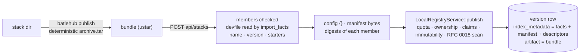
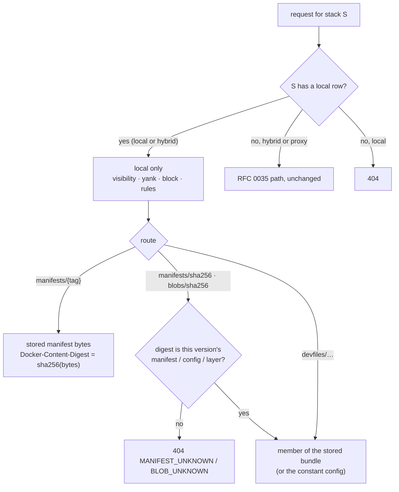

# RFC 0039 — Publishing devfile stacks: local and hybrid mode

| Field       | Value                                                        |
| ----------- | ------------------------------------------------------------ |
| Status      | In review                                                     |
| Short       | Devfile publish                                               |
| Settles     | How an instance hosts its own devfile stacks — an upload format the CLI builds, the OCI objects the server derives from it, and a composed index where a local stack owns its whole name |
| Author      | Max Batleforc <maxleriche.60@gmail.com>                       |
| Co-author   | Claude Opus 5.5 <noreply@anthropic.com>                       |
| Created     | 2026-10-24                                                    |
| Supersedes  | —                                                             |
| Touches     | `crates/core` (`entities/registry_kind.rs`, `entities/permission.rs`, `services/authz/translate.rs`, `services/devfile.rs`, new `services/local_registry/eco_devfile.rs`), `crates/config` (`schema/mod.rs` validation, `schema/warnings.rs`), `crates/web/src/handlers/proxy/devfile.rs`, `cli/src/api/publish.rs` + `cli/src/cli/publish.rs`, `tests/heavy/devfile.sh` + `config.devfile.toml`, `crates/web/tests/devfile.rs`, `docs/registries/devfile.md` (+ `docs/fr/`), `docs/build/config-generator`, `CHANGELOG.md`, `ROADMAP.md` |

---

## 1. Summary

RFC 0035 made `devfile` a proxy-only kind and left local mode to "its own
document" (§3, §11 decision 6), because a devfile registry has no publish
protocol: `registry-support` builds one offline into an image. This is that
document.

An estate that runs Che behind BatleHub already points *Get Started* at the
instance. What it cannot do is put its own stacks there — the team's base
devfile, a stack per internal toolchain — next to `registry.devfile.io`'s,
without building and running a second registry image. This RFC lets a
`devfile` registry be `local` or `hybrid`:

- **The upload is a BatleHub-defined bundle**, built by `batlehub publish`
  from a stack directory laid out as `registry-support` lays one out. There is
  no client to be compatible with, so the format is the smallest one the
  server can verify without guessing (§4.3).
- **The server derives the OCI objects** a pull reads — config, manifest,
  `devfile.yaml` layer, optional `archive.tar` layer — once, at publish, and
  serves them byte-stable afterwards. The read side of RFC 0035 does not
  change shape: the same routes, the same chokepoint at the tag.
- **The index is composed from rows**, as helm's is (RFC 0029 §5.4), with
  RFC 0035 §6.8's `compose_index` doing the composing. In `hybrid` a stack
  published here **owns its whole name**: upstream's entries for it are
  dropped and its upstream objects are never fetched (§4.5) — the rule
  RFC 0029 §13 arrived at after the per-version merge turned out to be a
  dependency-confusion vector.

### Before / after

```toml
# today — refused at load: "devfile has no local mode"
[[registries]]
type = "devfile"
name = "devfile"
mode = "hybrid"

# with this RFC
[[registries]]
type      = "devfile"
name      = "devfile"
mode      = "hybrid"                         # or "local"
upstreams = ["https://registry.devfile.io"]  # hybrid spells it out, as every hybrid kind does
hosts     = ["devfile.hub.acme.io"]

[registries.rbac]
anonymous  = ["releases:read", "releases:list"]  # Che and registry-library send no credential (RFC 0035 §5.1)
developers = ["releases:publish"]
```

```sh
# a stack directory, as registry-support lays one out
my-stack/
  devfile.yaml            # metadata.name = acme-rust, metadata.version = 1.2.0
  kubernetes/deploy.yaml  # anything else → archive.tar
  starter-projects/hello.zip   # optional, one per starterProjects[*].name

batlehub publish ./my-stack -r devfile
# → POST /proxy/devfile/api/stacks   (application/x-tar)
# → 201 {"stack":"acme-rust","version":"1.2.0","digest":"sha256:…"}

registry-library pull https://devfile.hub.acme.io/ acme-rust:1.2.0 --new-index-schema --context ./ws
```

---

## 2. Motivation

**The case that asked for it.** A Che estate whose workspaces are cut off from
the Internet serves `registry.devfile.io` through BatleHub (RFC 0035), and
keeps its own devfiles — a parent devfile per workspace image, a stack per
language toolchain the estate supports — in git, referenced by
`parent.uri`. Those devfiles are invisible to *Get Started*: the page lists
one registry's index, and the instance's index is upstream's. Running
`registry-support`'s image beside the instance would mean a second catalogue,
a second URL in `CheCluster.externalDevfileRegistries` (Che shows them as
separate tabs), and a build pipeline that produces an image per change to a
YAML file.

**Why a protocol has to be invented.** There is nothing to be a server for:

- `registry-support`'s build tool (`registry-library`'s sibling,
  `index/generator`) reads a `stacks/` tree and writes an index; its
  `registry-library push` (oras) pushes each stack version to the OCI
  registry the image embeds. Neither is an upload API for a running
  registry.
- `odo` (archived) and the IDE plugins only read.
- Che only reads.

So the choice is between implementing OCI distribution's push for one
namespace (oras's path) and a bundle upload in the shape of every other
BatleHub publish. §8 compares them; the bundle wins because the server must
in any case *derive* the index entry from the devfile, and a client that
pushes blobs one by one gives it nothing to derive from until the manifest
arrives last.

**Why now.** RFC 0035's phase 4 left the pieces this needs in the tree:
`compose_index` builds both index shapes from per-version facts,
`import_facts` reads those facts from a devfile's bytes with a line-based
reader, and every OCI object is already an artifact of its `stack@version`
coordinate (§13 item 1). Local mode is those pieces fed from a publish
instead of from a bundle import.

---

## 3. Goals / non-goals

**Goals**

- `mode = "local"` and `mode = "hybrid"` are accepted on `type = "devfile"`.
- `batlehub publish <stack dir>` publishes one stack version; `curl` can do
  the same with a tar.
- A published version is pulled by an unmodified `registry-library` (and
  therefore `odo init`) and shown by Che's *Get Started*, through the same
  routes and the same RFC 0035 §5.2 chokepoint as a proxied one.
- Every existing local-registry rule applies unchanged: quota, ownership,
  namespace claims, immutability (RFC 0016: a published version is never
  replaced), visibility (RFC 0015), yank, delete, RFC 0018 scanning at
  publish, block list and the other rules at read.
- `hybrid` cannot be made to serve a public stack under a name published
  here.
- Taking a name upstream lists is an explicit act, granted by its own action
  (§4.5), never a side effect of `releases:publish`.

**Non-goals**

- **OCI distribution push** (`oras push`, `registry-library push`). §8.
- **Samples.** A sample is a pointer to a git remote; publishing one would be
  publishing a URL. A local index has none, as the air gap's has none
  (RFC 0035 §6.8).
- **Building starter projects from git.** Upstream's server zips a
  `starterProjects[*].git` on request (the `202`). Here a starter project is
  served only when the bundle carries its zip; Che does not use the route at
  all — the workspace clones the git remote itself (RFC 0035 §5.1).
- **Hosting icons.** `metadata.icon` is published as written (§4.4). An
  uploaded image served from the instance needs an absolute URL of ours in
  the index, which the kind has avoided so far (RFC 0035 §6.5,
  `registry_public_base` not needed).
- **A per-version hybrid merge.** §4.5 and §11.
- **`stack.yaml` multi-version stacks as one upload.** One publish is one
  version; a directory with several versions is published once per version
  directory.

---

## 4. User-facing design

### 4.1 Configuration

No new option. `mode` gains its two other values on this kind; everything
else is RFC 0035 §4.1.

- `local` needs no `upstreams`; an `upstreams` entry is refused, as on every
  local registry.
- `hybrid` requires `upstreams`, like every hybrid kind
  (`requires_explicit_upstream_in_proxy_mode()` stays `false` for proxy mode,
  where the default is `registry.devfile.io`).
- `hosts` is as necessary as in proxy mode — `registry-library` asks for the
  OCI objects at the host root whoever holds them.
- Publishing is opened in `rbac` as on any local registry: nothing here, since
  batlehub grants `role:user` the publish verbs on a local or hybrid registry
  (RFC 0015 §10 rule 5); `[[registries.namespaces]]` grants (RFC 0015 §4.1)
  narrow who may publish under a stack-name prefix.

### 4.2 The client side

Reading is RFC 0035 §4.2, unchanged. Publishing:

```sh
batlehub publish ./stacks/acme-rust/1.2.0 -r devfile     # the directory
batlehub publish ./stacks/acme-rust/1.2.0/devfile.yaml   # or its devfile; same thing
batlehub publish ./acme-rust-1.2.0.devfile.tar           # or a bundle built elsewhere

# without the CLI
curl --data-binary @acme-rust-1.2.0.devfile.tar -H 'Content-Type: application/x-tar' \
  -H "Authorization: Bearer $BATLEHUB_TOKEN" \
  https://hub.acme.io/proxy/devfile/api/stacks

curl -X DELETE -H "Authorization: Bearer $BATLEHUB_TOKEN" \
  https://hub.acme.io/proxy/devfile/api/stacks/acme-rust/1.2.0
```

`detect_meta` recognises a directory containing `devfile.yaml`, a file named
`devfile.yaml`, and a `*.devfile.tar`, and reads `name` and `version` from
the devfile's `metadata` block for the confirmation line. `--name` and
`--version` are refused on this type: the server reads them from the devfile
and nowhere else (§4.3), so an override could only produce a `400`.

### 4.3 The bundle

An uncompressed ustar archive, `application/x-tar`, whose members are exactly:

| Member | Required | Becomes |
| --- | --- | --- |
| `devfile.yaml` | yes | layer `application/vnd.devfileio.devfile.layer.v1`, title `devfile.yaml`; the REST devfile |
| `archive.tar` | no | layer `application/x-tar`, title `archive.tar` |
| `starter-projects/{name}.zip` | no, one per name | artifact `starter-projects/{name}.zip` of the version |

Anything else — another path, a directory entry, a link, a device, a
duplicate member, an absolute or `..` path — is a `400` naming the member.
The members are stored verbatim; the server never re-packs them, so a
layer's digest is the digest of the member's bytes and stays that forever.

**The CLI does the packing.** From a stack directory it writes `devfile.yaml`
as is, every other regular file except `starter-projects/` and dotfiles into
`archive.tar`, and each `starter-projects/*.zip` as is. `archive.tar` is
written deterministically — paths sorted, `mtime` 0, `uid`/`gid` 0, owner
names empty, mode `0644` or `0755` from the executable bit — so publishing
the same directory twice produces the same digest, and the `409` of a
republish is about the version, not about a timestamp. A directory with no
file besides the devfile gets no `archive.tar` (the shape of `nodejs@2.2.1`
upstream: one layer).

**What the server checks, before any row or object is written:**

- the bundle is within `limits.max_artifact_size_bytes`, read with that bound
  (not buffered unbounded and then measured);
- `devfile.yaml` has `schemaVersion:` and a `metadata` block with `name` and
  `version`; `name` passes `validate_stack`, `version` passes
  `validate_version` (semver, the parse `registry-library` applies);
- each starter zip's name is in the devfile's `starterProjects[*].name` and
  passes `validate_starter`; a zip for a name the devfile does not declare is
  refused, since no client could ever ask for it;
- the devfile is read by the line-based reader RFC 0035 phase 4 added
  (`import_facts`) — the same facts the index will be composed from, so a
  devfile the reader cannot read is refused at publish rather than published
  and then missing from the index.

### 4.4 What a published version looks like

**The OCI objects.** At publish the server builds:

- the config blob `{}` (2 bytes, `application/vnd.devfileio.devfile.config.v2+json`),
  as upstream's are (probed: `nodejs@2.2.1`'s config is
  `sha256:44136fa3…`, size 2);
- the manifest, `application/vnd.oci.image.manifest.v1+json`, schemaVersion 2,
  the config descriptor and one layer descriptor per present layer in the
  order `devfile.yaml`, `archive.tar`, each with its
  `org.opencontainers.image.title` annotation;
- serialised once, compactly, and **stored as bytes**: the manifest digest is
  the sha256 of those bytes and is what `HEAD` answers with. It is never
  re-serialised on read (§7, *byte stability*).

**The index entry.** Composed by `compose_index` from the version's facts —
`name`, `displayName`, `description`, `tags`, `projectType`, `language`,
`provider`, `supportUrl`, `architectures` from `metadata`; `schemaVersion`
from the devfile; `starterProjects` from `starterProjects[*].name`;
`resources` from the layer titles; `links.self = devfile-catalog/{stack}:{version}`;
`lastModified` is the publish time. Two differences from the air gap's
composition, both because the publisher, not upstream, wrote the devfile:

- `icon` is `metadata.icon` when present, else empty (empty is still
  required — Che drops an entry with no `icon`, RFC 0035 §13);
- `default` is the highest **release** version the caller may see, not
  yanked; the highest prerelease only when the stack has no release. Plain
  semver ordering would make a `3.0.0-rc.1` the default over `2.4.0`, which is
  what Che offers and an unpinned pull takes. The devfile has no notion of a
  default; `registry-support`'s `stack.yaml` does, and §11 decision 7 leaves an
  explicit one out until an estate asks.

The namespace in `links.self` is `devfile-catalog`, upstream's. A local stack
owns its name in the index (§4.5), so the pair `devfile-catalog/{stack}` is
never ambiguous, and a client or script that assumed the namespace keeps
working.

**The REST devfile** (`/devfiles/{stack}`, `/devfiles/{stack}/{version}`) is
the stored `devfile.yaml` member, as for a proxied version.

**Starter projects** are served when the bundle carried the zip, and are
`404` otherwise, with a body saying the stack was published without it.
`registry-library download` reads the body whatever the status (RFC 0035
§4.4) — a `404` body unzipped as a zip fails loudly, which is the right
outcome for an absent file.

**`published_at`** is the publish time, so the age gate measures something
real on a local version — unlike upstream's rebuild date (RFC 0035 §6.7).
`deny_missing_timestamp` stays mandatory on the kind for the proxied half.

### 4.5 Hybrid: a local stack owns its name

The composed documents (both index shapes, the three variants, any query) are:

1. upstream's document, filtered by the block list as today;
2. **minus every upstream entry whose `name` is a stack published here** —
   any version, visible to the caller or not, yanked or not;
3. plus the composed local entries the caller may see;
4. sorted by `name`.

And on the OCI and REST routes, a stack name that has a local row is resolved
**only** locally: a version, tag or digest not held here is `404`
(`MANIFEST_UNKNOWN` / `BLOB_UNKNOWN` on `v2/`), with no upstream request.

This is RFC 0029 §13's `hybrid_merge = "chart"`, made the only behaviour. The
case that decided it for helm applies word for word: with `acme-rust 1.2.0`
published here, a public `acme-rust 9.9.9` listed beside it would be the
default Che offers and the version an unpinned `pull acme-rust` takes. The
other helm option, `version`, exists for a *mirror plus patches* estate —
republishing a few public charts with fixes. For devfiles that estate is one
publish away from this behaviour: publish the patched stack under the public
name and it replaces the public one whole. §11 records why no knob is added.

Step 2 counts a private or yanked version too. Otherwise a stack whose
versions are all hidden from a caller would be replaced, for that caller, by
the public stack of the same name — RFC 0029 §13's second observed defect.

The query parameters are applied to the local entries as the air gap applies
them (`arch`, `deprecated`), plus `minSchemaVersion` / `maxSchemaVersion`,
which a local version does carry and a hybrid index would otherwise apply to
one half only. Upstream's half keeps receiving them as forwarded parameters.

**Taking an upstream name is its own permission.** Because a published name
replaces upstream's whole stack for every user of the instance (§7), the
*first* publish of a name upstream's v2 index lists needs
`devfile:stack:claim` beside `releases:publish`. It is a kind-scoped action
(`Action::kinds() = [Devfile]`), on the model of `openvsx:namespace:claim`:
granted in `[registries.rbac]` or a `[[registries.namespaces]]` block, and
refused at load on any other kind. `releases:overwrite` is not reused — it
means rewriting an immutable version, a different act.

- **When it is checked**: only when the name has no local row yet. Later
  versions of an owned name are an ordinary publish, and deleting the last
  version releases the name, so the next first publish is checked again.
  `local` mode has no upstream and never checks.
- **How the name is decided**: through the ordinary cache-first resolution
  of upstream's v2 index, fetching it when the cache is cold. When upstream
  is unreachable and nothing is cached, the publish is refused with a `503`
  that says the claim could not be decided — the check fails closed, because
  a cold cache is exactly when a squat would pass. A caller holding
  `devfile:stack:claim` is not checked and publishes with upstream down.
- **A later collision** — upstream starts listing a name already published
  here — is not refused (the local stack keeps its name; that is §4.5's rule)
  but is reported: `merge_hybrid` returns the upstream names it dropped, and
  the handler logs one `WARN` per name per process and sets the gauge
  `batlehub_devfile_shadowed_upstream_stacks{registry}`.

### 4.6 Validation

`AppConfig::validate()`:

| Condition | Change |
| --- | --- |
| `type = "devfile"` with `mode = "local"` or `"hybrid"` | **Accepted** (was refused by `supports_local_mode()`). |
| `type = "devfile"`, `mode = "hybrid"`, no `upstreams` | Refused, as on every hybrid kind. |
| `type = "devfile"`, `mode = "local"`, `upstreams` set | Refused, as on every local registry. |
| More than one `upstreams` entry | Still refused (RFC 0035 §4.5). |

Warnings: RFC 0035 §4.5's two (no `hosts`, anonymous lacks `releases:read`)
apply to every mode. One more, at reload, for a `local`/`hybrid` devfile
registry whose `anonymous` set holds `releases:read` but whose `default`
visibility is private: Che reads anonymously, so every published version
would be absent from *Get Started*. The console's registry card says so.

---

## 5. Architecture

### 5.1 Publish



One version, one row, one stored artifact: the bundle, as uploaded.
`index_metadata` carries the facts `compose_index` reads, the manifest bytes
(base64), and the descriptor list with each member's digest and size. The
config blob is the constant `{}` and is not stored.

### 5.2 Read



The chokepoint is the one RFC 0035 §5.2 built: every route resolves a
`stack@version` coordinate and goes through the rules before a byte is read.
What changes is the source behind the coordinate. The digest lookup walks the
versions the composed index lists for the stack, as RFC 0035 §13 item 1 does
for proxied ones — now over local rows.

A member is read by walking the stored tar's headers to the member's offset;
the bundle is bounded by the size limit and members are few, so there is no
member index to store. A starter zip is the only member that can be large,
and it streams from that offset.

---

## 6. Detailed design

### 6.1 `crates/core` — the kind

- `supports_local_mode()` drops `Self::Devfile`; the comment beside it moves
  to `generic`, `nodedist`, `sdkman`, `rustup`, which still have no publish
  protocol. The assertion in `registry_kind.rs`'s tests flips.
- `fetchable_by_version()`, `warm_artifact()` and the listing filters are
  unchanged: a local version is a coordinate like a proxied one.

### 6.2 `crates/core` — `services/devfile.rs`

- `Bundle::read(bytes, max) -> Result<Bundle>` — the member walk and every
  check of §4.3; `Bundle { devfile: Range, archive: Option<Range>, starters:
  Vec<(String, Range)> }` as byte ranges into the stored artifact, so reading
  a member later is the same walk.
- `build_manifest(&Bundle, &bytes) -> (Vec<u8>, Vec<Descriptor>)` — §4.4,
  with the existing `Descriptor`. A unit test pins the bytes for a fixture
  bundle, and another feeds the result to `manifest_descriptors` (the parser
  the proxy path already trusts) and checks the round trip.
- `compose_index` gains a `Source::{Held, Published}` argument for the two
  §4.4 differences (icon, default), and the schema-version filter for the
  published source.
- `merge_hybrid(upstream: Value, local: Value, owned: &BTreeSet<String>) -> (Value, BTreeSet<String>)`
  — §4.5 steps 2–4, for both index shapes. `owned` is every stack name with a
  row, regardless of visibility; the returned set is the upstream names it
  dropped, which the handler turns into §4.5's collision `WARN` and gauge.
- `upstream_lists(index: &Value, stack: &str) -> bool` — the claim check of
  §4.5, over the v2 index `find_stack` already reads.

### 6.3 `crates/core` — `services/local_registry/eco_devfile.rs`

On the pattern of `eco_helm.rs` (≈100 lines there):

- `devfile_index(registry, address, caller)` — the visible local versions
  through `load_visible_versions_in`, as `get_conda_repodata` and helm's
  index do, then `compose_index(Published)`;
- `devfile_owned_stacks(registry)` — names with any row, for `merge_hybrid`;
- `devfile_member(pkg, member)` — the stored artifact and the member's range.

### 6.4 `crates/web` — `handlers/proxy/devfile.rs`

New routes, each with `is_devfile` and `require_local_mode`:

| Route | Handler |
| --- | --- |
| `POST /proxy/{registry}/api/stacks` | `devfile_publish` — body read bounded, `web::block` for the tar walk and the devfile read (CPU work, the lesson of RFC 0029 §13's unbounded decompression), `PublishRequest` with `index_metadata` of §5.1; `201 {stack, version, digest}`; `409` on a republish; on a `hybrid` registry, the first publish of a name upstream lists without `devfile:stack:claim` is `403` naming the action, and an undecidable claim is `503` (§4.5) |
| `DELETE /proxy/{registry}/api/stacks/{stack}/{version}` | `devfile_delete` — `releases:delete`; RFC 0016 tombstone |

The existing handlers branch once, at the coordinate: `index` calls
`merge_hybrid` (hybrid), `devfile_index` alone (local) or neither (proxy);
`devfile`, `starter_project`, `oci_manifest`, `oci_blob` and `oci_tags` ask
`devfile_owned_stacks` first and read the local member when the stack is
owned. `/api/stacks` is a literal prefix no index or OCI route uses, and the
type guard keeps it off every other kind (RFC 0035 §13 item 3).

The OCI-shaped errors, the real `HEAD` and the identity headers
(`X-BatleHub-Storage-Key`, RFC 0035 phase 4) apply to local objects exactly as
to proxied ones.

### 6.5 `crates/config`

The §4.6 rows, through the existing mode checks; the new warning in
`schema/warnings.rs` beside `helm.hybrid-merge-unset`. `CURRENT_CONFIG_VERSION`
does not move: a config valid today is valid after.

### 6.6 `cli`

- `api/publish.rs`: `detect_meta` arms for the three spellings of §4.2;
  `publish_devfile(registry, bundle)` → `post_bytes("/proxy/{registry}/api/stacks")`.
- `cli/publish.rs`: the directory packer of §4.3. `tar = "0.4"` is already in
  the workspace (`crates/core`, `crates/web`); the CLI takes it as a direct
  dependency, which adds nothing to `Cargo.lock`. `--name`/`--version`
  refused with `-t devfile`.
- `registry suggest` / setup snippets (RFC 0005-bis drift check): the
  registry page's *Publish* block gains the `batlehub publish` and `curl`
  lines.

### 6.7 Air gap

No kind carries a local row across the gap today, and devfile does not
become the first. `batlehub mise export` is driven by a `mise.lock`, where a
published package has no upstream URL to match (`cli/src/api/mise_plan.rs`);
it fetches through `/proxy/…` under `proxy_artifact_key`, while local rows
live under `local:{registry}/…`; and `import_entry`
(`crates/web/src/handlers/air_gap.rs`) writes a cached proxy entry, never a
local row. RFC 0008 §4.5 allows publishing on the disconnected side and never
addressed carrying local content over.

So a local stack is **published on each side**, from the same directory. The
bundle is what makes that exact: `archive.tar` is packed deterministically and
the server stores members verbatim (§4.3), so the same directory gives the
same layer digests and the same manifest digest on both instances — a fact the
closed-world phase checks (§6.8). Carrying local content across the gap, for
every kind at once, is a `ROADMAP.md` entry, not this RFC.

### 6.8 `tests/heavy/devfile.sh` — the local half

`config.devfile.toml` gains a `hybrid` devfile registry on
`devfile-local.localhost`. With the pinned `registry-library` CLI of
RFC 0035 §6.9:

1. `batlehub publish` a fixture stack (`acme-go`, one extra file, one starter
   zip); `201`; a second publish of the same directory `409`, and the digest
   in the `201` equals the one a re-pack computes.
2. `registry-library list --type all` lists `acme-go` beside upstream's
   stacks.
3. `registry-library pull acme-go:1.0.0 --all --new-index-schema`: the five
   requests of RFC 0035 §5.1 on the instance, the devfile on disk hashes to
   the manifest's layer, `archive.tar` extracted.
4. `registry-library download acme-go hello` returns the zip byte-identical.
5. Publish `go@99.0.0` (an upstream name) with a token holding
   `releases:publish` only: `403` naming `devfile:stack:claim`, and `list`
   still shows upstream's `go`. With the tap closing upstream and a fresh
   database (cold index cache), the same publish is `503`; `acme-go`'s second
   version publishes with upstream closed, since the name is already owned.
6. Publish `go@99.0.0` with a token that also holds `devfile:stack:claim`:
   `list` shows one `go`, version `99.0.0` only; `pull go:2.6.0` fails with
   *does not exist*, and the tap records no upstream request under
   `/v2/devfile-catalog/go/`.
7. A private version (RFC 0015) is absent from the anonymous index and `404`
   on every route anonymously; the stack name is still owned (no upstream
   `go` reappears for the anonymous caller).
8. Block `acme-go@1.0.0`: absent from the index, manifest `404`, a kept layer
   digest replayed with `curl` `404 BLOB_UNKNOWN`.
9. Delete: gone from the index; the name is released (upstream `go` is back
   after the `go@99.0.0` delete, and a new `go` publish needs the claim
   again).

Plus a `local` registry run of 1–4 and 8 with egress denied (the closed-world
phase), which publishes the fixture directory of step 1 and asserts the
manifest digest equals step 1's (§6.7); and the Che canary of RFC 0035 §13
against a published stack.

---

## 7. Security considerations

- **Dependency confusion** is the reason for §4.5's rule, and the reason it
  counts invisible rows. The heavy test's step 7 is the one that proves the
  invisible case.
- **Name squatting** in `hybrid`: publishing `nodejs` here takes `nodejs` away
  from every user of the instance. That is the point for an estate that wants
  its own `nodejs`, and a hazard otherwise, so it is its own act: the first
  publish of a name upstream lists needs `devfile:stack:claim` (§4.5,
  decision 10), and the check fails closed on a cold cache with upstream down
  (decision 11). Namespace grants (`[[registries.namespaces]]`, RFC 0015 §4.1)
  scope who holds it. A name upstream adds *after* it was published here is
  shadowed and reported, not refused (decision 13).
- **Byte stability.** The manifest digest is what containerd verifies against
  `HEAD`. Re-serialising the manifest on read — a serde version bump
  reordering keys — would make every pull of a published version fail with
  RFC 0035 §5.1's *unexpected commit digest* and exit `0` with a broken
  context dir. The bytes are stored; a test pins that a read returns them.
- **Upload parsing at a trust boundary.** The tar walk refuses links,
  absolute and `..` paths and unknown members before anything is stored; the
  body is read with the size bound applied as it streams; the walk and the
  devfile read run off the worker thread. No member path ever becomes a
  storage key — the key is the coordinate's, as for every published artifact.
- **What a devfile can do.** A devfile names container images and commands a
  workspace will run. Publishing one is publishing code that runs in every
  workspace that starts from it, which is why publish is `releases:publish`
  and claims apply. RFC 0018's scanners see `devfile.yaml` and `archive.tar`
  at publish, as they do at a proxied first fetch; nothing here parses
  `image:` fields (RFC 0035 §3).
- **Anonymous read** is required by both clients and does not change: a
  catalogue that must stay private stays behind a network boundary
  (RFC 0035 §4.5). Private visibility hides a version from Che entirely
  (§4.6 warning) — it is a staging tool, not access control for Che users.

---

## 8. Alternatives considered

| Alternative | Why not |
| --- | --- |
| OCI distribution push for `devfile-catalog/*` (what `registry-library push` / `oras push` speak) | Upload sessions (`POST` → `PATCH`… → `PUT`), monolithic and chunked forms, cross-repository mount, and a manifest that arrives last: the server learns the stack's name and version only after it has accepted every blob, and must then garbage-collect what no manifest claimed. RFC 0035 §3 rejected a general OCI endpoint for that reason. Its one advantage — an existing client — is a client nobody runs against a live registry: `registry-support` pushes during an image build. |
| The server packs `archive.tar` from a directory-shaped upload | The server would own a tar writer's determinism; two server versions writing different bytes would make the same upload two digests. The CLI packing it, and the server storing members verbatim, keeps one writer and makes `curl` uploads of prebuilt bundles exact. |
| A `.tar.gz` bundle | A gzip layer the server must decompress (bounded, off-thread: RFC 0029 §13's defect) to reach members that are themselves stored uncompressed. The bundles are kilobytes; starter zips are already compressed. |
| Store an index document and merge on publish | A second source of truth that goes stale on a yank, a visibility change or a block (RFC 0029 §8, same row). |
| Per-version hybrid merge, or a `hybrid_merge` knob as helm has | §4.5: the `version` behaviour is the vector RFC 0029 §13 found; the estate it serves is served by publishing under the public name. A knob that exists to be left at its default is a warning per reload (`helm.hybrid-merge-unset`) for nothing. |
| A second registry kind (`devfile-local`) | Two kinds for one protocol: two hosts in Che, two tabs in *Get Started*, which is the situation this RFC exists to end. |
| Run `registry-support`'s image, built in CI from a git repo | What estates do today. It is a second catalogue in Che, an image build per YAML change, and none of the instance's rules (block, age gate, scan, audit) on it. |
| Let `batlehub publish` push to Forgejo/git and the registry read it | A git-backed index is RFC 0019's forge kinds plus a cache invalidation problem, for a format that is one file per version. |

---

## 9. Rollout and compatibility

- Additive: a `proxy` devfile registry behaves byte-for-byte as before; the
  heavy suite's proxy half is the regression test.
- A registry switched from `proxy` to `hybrid` keeps its cache; nothing is
  owned until the first publish, so the switch alone changes no answer.
- `local` → `hybrid` and `hybrid` → `proxy` follow the existing mode-change
  rules: published rows stay, and a `proxy` registry does not read them.
- The CLI's `publish` gains a type; an older CLI against a newer server simply
  cannot publish devfiles (`detect_meta` returns nothing for the directory).
- Version: a minor release. `CHANGELOG.md` *Added*: devfile local and hybrid
  mode, `batlehub publish` for stack directories.

---

## 10. Test plan

**Unit** (`crates/core`):

- `Bundle::read`: each refused member shape (link, dir, `..`, absolute,
  duplicate, unknown path, oversized, starter zip for an undeclared name, no
  `devfile.yaml`, devfile without `metadata.version`) → error naming it.
- `build_manifest`: pinned bytes for a fixture; one-layer and two-layer
  shapes; round trip through `manifest_descriptors`.
- `compose_index(Published)`: icon kept, default is the highest visible
  non-yanked release (a prerelease only when there is no release), `lastModified` is the publish time, schema-version filter.
- `merge_hybrid`: an owned name removes every upstream entry of it; an owned
  name with no visible version leaves no entry and no upstream one; both
  index shapes; sorted output; the returned set names exactly the dropped
  upstream stacks.

**In-process** (`crates/web/tests/devfile.rs`):

- publish → `HEAD` manifest digest equals sha256 of `GET` body equals the
  `201`'s digest; blobs by digest; config `{}`.
- republish `409`; publish without `releases:publish` `403`; `mode = proxy`
  `404`; a `[[registries.namespaces]]` grant that excludes the caller `403`.
- the claim (§4.5): a first publish of a name the mock upstream lists is `403`
  without `devfile:stack:claim` and `201` with it; a second version of an
  owned name needs no claim; a cold cache with the mock upstream returning
  `500` is `503`, and `201` for a claim holder; after the last version's
  delete the claim is required again; `local` mode never queries upstream;
  `devfile:stack:claim` granted on a non-devfile registry is refused at load.
- a shadowed upstream name sets the gauge and logs once.
- an owned stack never reaches the mock upstream (mockito asserts zero calls).
- `devfile_publish_traversal_member_returns_400`, on the model of helm's.
- the authz matrix gains the two new routes; `registry_kind_coverage.rs`
  flips the devfile local-mode row.

**CLI**: the packer is deterministic (two packs, same bytes); `detect_meta`
for the three spellings; `--name` refused.

**Heavy**: §6.8.

---

## 11. Decisions and open questions

### Resolved

| # | Question | Decision |
| --- | --- | --- |
| 1 | Upload protocol | A BatleHub bundle (ustar, fixed member set), not OCI push (§8). |
| 2 | Who packs `archive.tar` | The CLI, deterministically; the server stores members verbatim. |
| 3 | Hybrid merge | Whole stack name, counting invisible rows; no knob (§4.5). |
| 4 | OCI namespace of a local stack | `devfile-catalog`, upstream's. |
| 5 | Starter projects | Served only from a zip in the bundle; never built from git. |
| 6 | `published_at` | The publish time. |
| 7 | An explicit default version (was open question 1) | **None until an estate asks.** The default stays the highest visible release (§4.4); a `3.0.0` that must not become the default is published as a prerelease until it should. If the case comes, it is a stack-level action (`PUT api/stacks/{stack}/default`), not a `?default=` on publish — the default belongs to the stack, not to the version being uploaded. |
| 8 | Icons served by the instance (was open question 4) | **No.** `metadata.icon` is published as written; a disconnected estate points it at a `github` registry's raw path on the same instance, and the registry page says so. Serving an `icon.svg` member would be the kind's only object that depends on the public host. A *bis* if an estate shows the workaround fails. |
| 9 | Air-gap export of local rows (was open question 3) | **Nothing new, checked rather than assumed**: no kind exports local rows (§6.7), so a local stack is published on both sides, and the deterministic bundle makes the two digests equal. Local content across the gap is a `ROADMAP.md` entry for every kind, not a draft RFC. |
| 10 | A default claim on upstream names in `hybrid` (was open question 2) | **Yes, as its own action**: `devfile:stack:claim`, kind-scoped like `openvsx:namespace:claim`. The draft suggested `releases:overwrite`; rejected, because that action means rewriting an immutable version (§4.5). |
| 11 | A cold cache at claim time | **Fails closed.** The upstream index is resolved cache-first and fetched when cold; upstream unreachable and nothing cached is a `503`. The draft's "a cold cache lets the first publish through" was the squat's window. A claim holder is not checked. |
| 12 | When the claim applies | **The first publish of a name only.** Later versions of an owned name are ordinary; deleting the last version releases the name. |
| 13 | Upstream later lists a name published here | **Shadowed and reported, not refused**: one `WARN` per name per process and the gauge `batlehub_devfile_shadowed_upstream_stacks`, from the set `merge_hybrid` returns. A console line waits for an operator to ask for it. |

### Still open

None.

---

## 12. Implementation phases

| Phase | Content | Done when |
| --- | --- | --- |
| 1 | `supports_local_mode`, config rows, `Bundle::read`, `build_manifest`, `eco_devfile.rs`, `POST`/`DELETE api/stacks`, local reads on every route (`local` mode only) | in-process tests pass; heavy steps 1–4, 8 on a `local` registry |
| 2 | `merge_hybrid`, owned-name resolution on the OCI/REST routes, `devfile:stack:claim` and the claim check, the shadowed-name gauge | heavy steps 5–7, 9; zero upstream calls for an owned stack |
| 3 | CLI: `detect_meta`, packer, `publish_devfile`; registry page snippets | CLI tests; heavy suite publishes through the CLI instead of `curl` |
| 4 | Docs (`docs/registries/devfile.md` *Modes* row, *Publish* section, the squatting note; `docs/fr/`), config generator, closed-world phase, Che canary | the canary shows a published stack's tile and opens its devfile |
