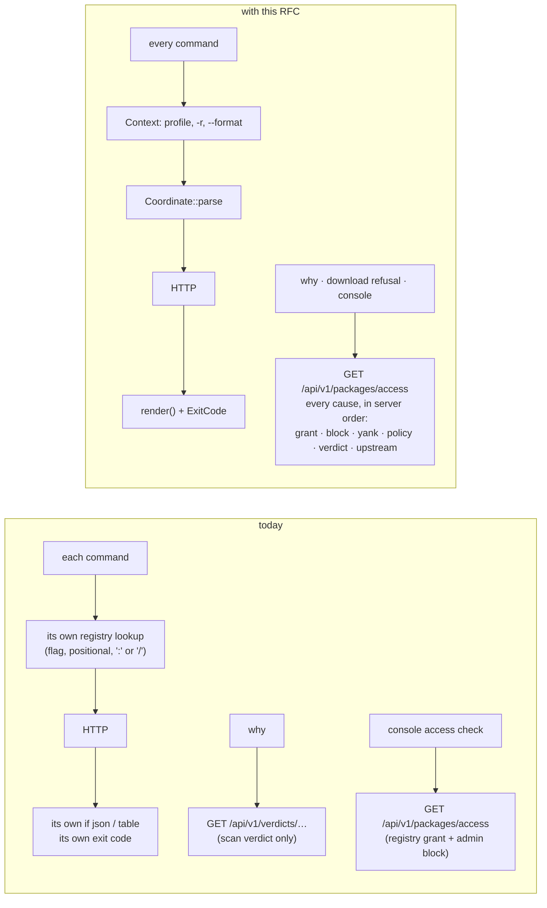
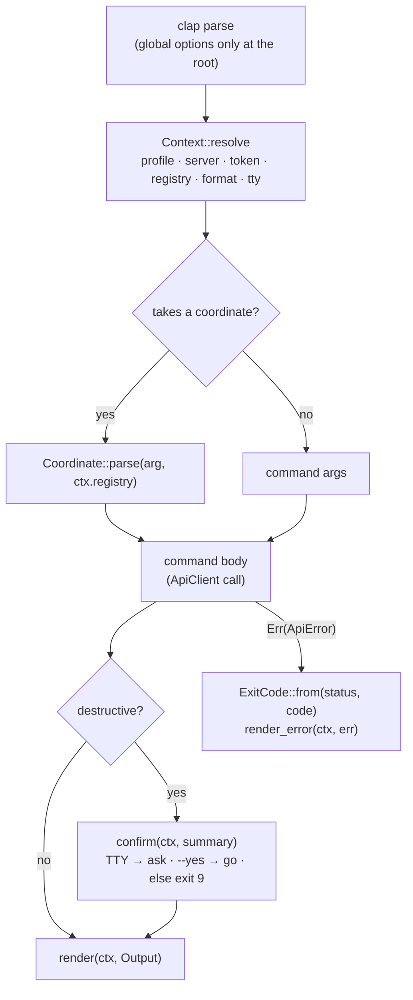
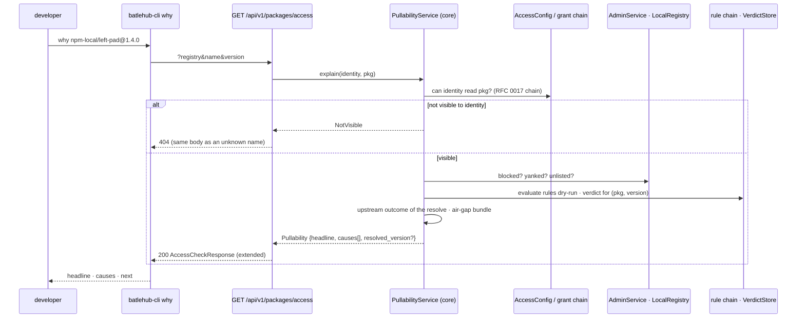
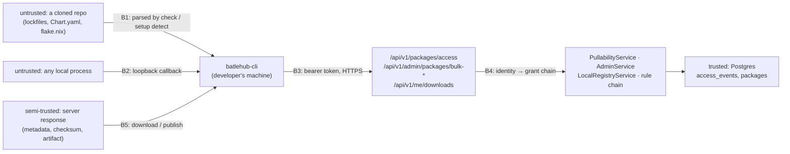

# RFC 0040 — One CLI: grammar, coverage and why a package is not pullable

| Field       | Value                                                        |
| ----------- | ------------------------------------------------------------ |
| Status      | Accepted — phases 2 to 5 landed; §17 records how far each phase is and where the built thing differs |
| Short       | CLI grammar and coverage                                      |
| Settles     | How every batlehub-cli command names a package, prints, fails and confirms, what it must cover for each registry kind, and how a developer learns why a version is not pullable |
| Author      | Max Batleforc <maxleriche.60@gmail.com>                       |
| Co-author   | Claude Opus 5.5 <noreply@anthropic.com>                       |
| Created     | 2026-11-02                                                    |
| Supersedes  | —                                                             |
| Touches     | `cli`, `crates/web` (`packages/access`, `me/downloads`, the generic lifecycle endpoints), `crates/core` (the pullability aggregate), `crates/adapters` (`list_own_downloads`), `ui` (the access-check page renders the new answer), `tests/heavy`, docs |
| Risk        | medium — §7 (an aggregate that answers about invisible packages, owner lifecycle authority, a loopback listener) |

---

## 1. Summary

`batlehub-cli` grew one command at a time, and nobody ever reviewed it as a
whole. Each command picked its own way to name a package, its own output flags,
its own verbs and its own exit codes. This RFC gives the CLI one grammar.

- **Naming a package.** Every command takes a single coordinate,
  `registry/name[@version]`.
- **Output.** `--format` controls the output and is honoured everywhere.
- **Verbs.** There is a closed set of verbs.
- **Command tree.** Commands are grouped by object, not by role, so the `admin`
  catch-all goes away.
- **Destructive operations.** A destructive command asks for confirmation on a
  terminal and refuses without one.
- **Exit codes.** One table of exit codes covers every command.

The RFC then sets a coverage bar. For each of the 29 registry kinds, a
developer can configure the client, publish, download, inspect, manage the
lifecycle of a version and check a lockfile, wherever the server can. A gate
fails the build when a kind has no stated answer for one of these capabilities.

Last, it answers the question a developer has when an install fails: why is
this package not pullable, or not pullable *yet*? The server already computes
the answer, but spread over four places. `GET /api/v1/packages/access` becomes
the one place that gathers every cause, and `batlehub-cli why` prints it.

### Before / after

```text
# today: five ways to say which registry, and the default one ignored
batlehub-cli version yank npm-local lodash 4.17.21          # positionals
batlehub-cli package readme npm-local/lodash@4.17.21        # coordinate with '/'
batlehub-cli why npm-local:lodash@4.17.21                   # coordinate with ':'
batlehub-cli admin flags list --registry npm-local          # long flag, no -r
BATLEHUB_REGISTRY=npm-local batlehub-cli owners list lodash # ignored: needs REG
batlehub-cli admin bulk delete npm-local lodash             # no confirmation
batlehub-cli wait npm-local:lodash@4.17.21; echo $?         # 1 = denied, 2 = timeout
npm install lodash   # 403 — and `why` only knows about scan verdicts

# with this RFC
batlehub-cli package yank npm-local/lodash@4.17.21
batlehub-cli package readme npm-local/lodash@4.17.21
batlehub-cli why npm-local/lodash@4.17.21
batlehub-cli flag list -r npm-local
BATLEHUB_REGISTRY=npm-local batlehub-cli owner list lodash
batlehub-cli package delete npm-local/lodash                # asks; refuses (exit 9) without a TTY
batlehub-cli wait npm-local/lodash@4.17.21; echo $?         # 4 = refused for good, 8 = timeout
batlehub-cli why --last  # lists my recent refusals: npm-local/lodash@4.17.21 NAMESPACE_READ_DENIED
batlehub-cli why npm-local/lodash@4.17.21
                     # ⛔ refused — not granted `read` on namespace `@corp`;
                     #    ask an administrator for it
```

A command follows the same pipeline, and the pullability question follows the
same path whether the console asks it or the CLI does:



The `why` and console paths are the core of the change. Today they ask two
different endpoints and get two partial answers. After this RFC they ask one
endpoint and get the same complete answer.

---

## 2. Motivation

1. **The default registry is ignored by most commands.** `--registry` and
   `BATLEHUB_REGISTRY` are passed only to `package`, `publish` and `download`
   (`cli/src/main.rs:114, 131, 133`). A developer who sets `registry` in their
   profile still has to repeat it for `owners`, `version`, `why`, `authz`,
   `mise` and every `admin` command. On top of that, five spellings coexist:
   - the global `-r`;
   - a local `-r` that shadows it (`package.rs:22`, `publish.rs:20`,
     `admin.rs:270, 358`);
   - a local `--registry` without `-r` (`vsx.rs:46`, `proxy.rs:32`,
     `security.rs:53, 65, 200`, `admin.rs:28, 117, 146, 163, 300, 541`);
   - a positional argument;
   - a coordinate, written `/` in `package readme` and `:` in `why`, `wait` and
     `verdicts pullers`.
2. **`--json` is a promise the CLI breaks.** The flag is global, but
   `version`, `publish`, `download`, `proxy` and `vsx` never receive it
   (`main.rs:116, 120, 121, 131, 133`). A CI script that parses `--json` from
   `publish` parses a table. Meanwhile `--csv`, `--format`, and
   `auth token --output raw|json` each do the same job a different way. The
   output-file flag is `-o/--output` in three places and `-o/--out` in `mise`.
3. **Destruction does not ask, and does not refuse.** Only `version delete`
   asks for confirmation (`version.rs:82-95`). These do not:
   - `admin bulk delete`;
   - `admin cache clear`;
   - `admin notifications delete`;
   - `admin audit-log --purge-before`, a purge hidden inside a listing command
     (`admin.rs:1016-1027`);
   - the TUI's yank.

   Elsewhere the same idea is spelled `--yes` with dry-run by default (`setup`),
   `--force`, which means something else (`gdpr erase`), `--dry-run`, and
   `--reclaim`, which has the opposite polarity.
4. **Exit codes are improvised, so scripts cannot branch on them.**
   - Every error is anyhow's 1.
   - `wait` returns 1 or 2 (`main.rs:125-129`).
   - `setup` returns 3 (`setup.rs:96`).
   - `mise` calls `process::exit(1)` partway through (`mise.rs:124, 145, 591`).

   A pipeline cannot tell "not logged in" from "not found" from "denied" except
   by matching `HTTP 403: {…}` against stderr (`api/mod.rs:347, 405, 446,
   456`).
5. **Verbs and groups follow no rule.**
   - Removing something is spelled six ways: `delete`, `remove`, `rm`,
     `release`, `revoke`, `clear`.
   - Reading something is spelled six ways: `list`, `info`, `get`, `view`,
     `show`, `list-blocked`.
   - `admin` holds 29 subcommands (`AdminCommand`'s variants). A package's lifecycle is split across
     `version`, `admin deprecate/unlist` and `admin bulk`.
   - There are three audit surfaces.
   - `config` (local) and `admin config` (server) share a name.
6. **Publish refuses 9 kinds the server accepts, and misroutes one.**
   - The catch-all `bail!` at `cli/src/cli/publish.rs:170-178` rejects
     goproxy, maven, terraform, galaxy, nix, helm, apk,
     jetbrains-marketplace and vscode-marketplace (devfile is handled before
     the match, `publish.rs:60`).
   - The kind is guessed from the file extension
     (`release_import/coordinates.rs:58-86`). A Helm chart `.tgz` is therefore
     detected as npm and `PUT` to npm's endpoint, and `apk` is detected with a
     real name and version, then refused.
7. **Lifecycle commands need an admin grant even when an owner would do.**
   `version yank/delete` always call the instance-tier `bulk-*` endpoints. Those
   require `releases:yank` (`back_office/bulk.rs:104, 117`). The native routes,
   which check package ownership, are never used: cargo, rubygems, terraform
   and composer yank, nuget unlist, helm and devfile delete. As a result, a
   package's owner cannot yank their own release from the CLI.
8. **`setup` stops short for half the kinds.**
   - `setup apply` writes nothing for conda, composer, rubygems, nuget,
     terraform, galaxy, helm, nix, gitlab and sdkman.
   - `setup detect` does not recognise galaxy, helm, nix or devfile projects.
   - `package versions` shows only what the server already holds, and stops at
     200 (`package.rs:161-162`).
   - `download` takes a raw `/proxy/…` path and has no test.
   - The TUI publish form sets `submitted = true`, and nothing ever reads it
     (`tui/publish_form.rs:74`).
9. **"Why is this not pullable?" has four partial answers.**
   - `batlehub-cli why` reads the scan verdict only.
   - `GET /api/v1/packages/access` answers only "registry granted?" and
     "admin-blocked?" (`front_office/packages.rs:208-262`), and no command
     calls it.
   - `authz explain` and `admin access-check` are admin-only.
   - `GET /api/v1/me/downloads` returns successful rows only, by design (RFC
     0004 §6.2).

   None of them names the namespace grant that RFC 0017 added, the release-age
   gate, a yank, a quota or an unreachable upstream. So a developer whose
   install gets a `403` has to ask an administrator.

---

## 3. Goals / non-goals

**Goals**

- Every command names a package with one coordinate, and resolves the registry
  the same way.
- Every command honours `--format` and `-o`. Data goes to stdout and messages to
  stderr.
- Every command draws its verbs from one closed set, and is grouped by the
  object it acts on.
- A destructive command confirms on a TTY and refuses without one, unless it
  is given `--yes`.
- One table of exit codes, one error shape, and every reason code linked to its
  documentation.
- For every `RegistryKind` × {configure, publish, download, consult, lifecycle,
  check}, the CLI either works or states why it cannot. A gate enforces this.
- A developer can learn, from the CLI or the console, every reason a version is
  not pullable now, when it will be, and what to do about it. Learning this
  must not reveal what the developer may not see.
- The user journeys that start in the CLI and today end in the console become
  completable in the CLI.
- The TUI speaks the same grammar, and covers the developer's side of the CLI.

**Non-goals**

- **Parity with the console or the API.** We close journeys, not endpoints.
  `stats/history`, `explore/invalidate`, `tombstones/compact`, `beta-channel`
  and the subscription test stay console-only, because they are rare,
  operator-side and visual.
- **Localising the CLI.** English messages are what a developer pastes into a
  search engine and into an issue. The docs page is already bilingual.
- **Admin screens in the TUI beyond stats.** The console is the administrator's
  tool, and a second implementation of it in ratatui would drift.
- **A keyring credential store.** `contract.rs:189` names `keychain` in the
  schema. Implementing it is its own decision, and nothing in the grammar
  depends on it.
- **Writing system configuration.** `setup apply` for deb, rpm, pacman and apk
  prints what to run as root and never writes under `/etc`. RFC 0038 limited
  `setup` to user files on purpose.
- **Changing the server's error body.** `AppError` already sends
  `{error, message, code, …details}` (`crates/web/src/error.rs:124-142`). The
  CLI reads that shape, and this RFC does not move it to RFC 9457.
- **Per-protocol APIs under `/proxy/{registry}/…`.** Things like npm dist-tags
  and crates owners stay with the native clients, except for publish and
  download, which this RFC unifies.

---

## 4. User-facing design

### 4.1 The coordinate

Every command that acts on a package takes one positional coordinate:

```text
registry/name[@version]
```

- **The registry is everything before the first `/`.** Registry names never
  contain `/` (`crates/config` validates them as identifiers), so the first `/`
  is unambiguous.
- **The version is everything after the last `@`, provided that `@` is not the
  first character of the name.** So `npm/@scope/pkg@1.2.3` gives name
  `@scope/pkg` and version `1.2.3`. `go/github.com/x/y@v1.2.0` keeps the module
  path whole. `maven/org.slf4j:slf4j-api@2.0.9` keeps Maven's `group:artifact`.
- **A coordinate with no `/` is a bare name.** Its registry comes from, in this
  order: the global `-r/--registry`, `BATLEHUB_REGISTRY`, the profile's
  `registry`. If none of them is set, the command fails with exit 2:

  ```text
  error: `lodash` names no registry
  hint: write npm-local/lodash, or pass -r, or `batlehub-cli profile set registry npm-local`
  ```

- **The registry part needs care.** A coordinate whose first segment is not a
  registry the caller can see is read as a bare name when a default registry
  is set by any of the three sources above. In that case the whole string is
  the name, as for `-r go github.com/x/y` or `@scope/pkg` with
  `BATLEHUB_REGISTRY=npm-local`. Otherwise the command fails with exit 5
  (§4.6), and the message lists the registries the caller can see. In both
  cases, when the first segment is one edit away from a visible registry name,
  stderr adds `hint: did you mean npm-local/…?`, because a typo read as part of
  the name otherwise ends in a puzzling 404.
- **Several coordinates are allowed wherever the operation is per-version.**
  This replaces `admin bulk`:
  `batlehub-cli package yank npm-local/a@1 npm-local/b@2`.
- **The old `registry:name@version` spelling** is accepted as a deprecated
  alias (§13). It is never produced in output.

### 4.2 Global options and the profile

| Option | Env | Meaning |
| --- | --- | --- |
| `-P, --profile` | `BATLEHUB_PROFILE` | the profile read *and* written: `auth login`, `logout` and `refresh`, `profile set`, and the TUI login all honour it |
| `--server` | `BATLEHUB_SERVER` | overrides the profile's `server_url` |
| `--token` | `BATLEHUB_TOKEN` | overrides the profile's credential |
| `-r, --registry` | `BATLEHUB_REGISTRY` | the default registry for a bare name and for every `--registry` filter |
| `--format <table\|json\|csv\|raw>` | `BATLEHUB_FORMAT` | output shape (§4.3); `--json` = `--format json` |
| `-o, --output <file>` | — | write the data to a file instead of stdout |
| `-y, --yes` | — | answer yes to a confirmation (§4.5) |
| `--no-color` | `NO_COLOR` | plain output |

No subcommand redefines any of these. These local copies go away:

- `--profile` on `auth login`, `logout` and `refresh`, and on `config show`
  and `set`;
- `--server` and `--json` on `setup *`;
- `-r` and `--registry` everywhere they are redefined;
- `-o/--out` in `mise`.

`BATLEHUB_FORMAT` exists so a CI job can set JSON once.

**The local configuration file becomes `profile`.** It keeps the same path and
format (`config.rs:57-62`), so no migration is needed:

| Command | Does |
| --- | --- |
| `profile list` | the profiles and which one is in use |
| `profile show [name]` | one profile, with the token masked |
| `profile set <key> <value>` | write a key in the `-P` profile |
| `profile use <name>` | make `name` the default (a `current` key at the top of the file) |
| `profile init` | today's `config init` |

The server's configuration is `server config` (decision 41), beside
`server stats` and `server health`. `config` is not reused: during the alias
minor it stays the hidden alias of `profile`, so a script that reads its own
profile through `config show` keeps working and gets a deprecation warning.

### 4.3 Output

- **`table`** is the default on a TTY. It is rendered by one helper, so all
  tables share column headers in `UPPER_SNAKE`, the same width rules and the
  same empty-result line (`no packages` on stderr, nothing on stdout).
- **`table`** stays the default off a TTY too (decision 36): today every pipe
  receives the table, and `eval "$(batlehub-cli setup env)"` and
  `TOKEN=$(batlehub-cli auth token)` read text.
- **`json`** is chosen with `--format json`, `--json` or `BATLEHUB_FORMAT`,
  which is how a CI job sets it once. The two formats emit:

  | Command shape | `json` emits |
  | --- | --- |
  | a listing | a bare array, always; when more pages exist, `next: <cursor>` goes to stderr, so `jq '.[].name'` keeps working |
  | a single object | an object |
  | an action | the server's response object, or `{"ok": true}` when there is none |

  Field names are the API's own: the CLI does not rename.
- **`csv`** is available on every listing, and replaces `--csv`. Headers are
  the JSON field names.
- **`raw`** is accepted only where a command produces one opaque value:
  `auth token`, `profile show --key`. It replaces `--output raw`.
- **stdout carries data only.** Progress, warnings, hints and confirmations go
  to stderr, so `batlehub-cli … --format json | jq` never sees a prompt.
- **`-o <file>`** writes exactly what stdout would have carried. For a command
  whose output is bytes (`download`, `sbom export`, `audit export`,
  `mise plan`, `mise export`), `-o` names
  the destination, and its absence means stdout only when stdout is not a TTY.
  A binary written to a terminal is refused with exit 2. For `mise export`
  the summary still goes to stdout, as `airgap.sh` reads it today.
- **Paging is the same everywhere.** `--limit N` sets the page size. `--page`
  is accepted on page-numbered endpoints, and `--after <cursor>` on cursor
  endpoints. `--all` follows the pages to the end, capped at 10 000 rows, with a
  warning on stderr when the cap is hit. Filtering always happens server-side.
  `--blocked` is passed to the server, which today filters only the fetched
  page on the client (`package.rs:118-122`).

### 4.4 Verbs, groups and the command tree

**The verbs are a closed set**, each with one meaning:

| Verb | Meaning |
| --- | --- |
| `list` | several objects, filterable |
| `show` | one object |
| `create` | a new object with its own identity (token, flag, channel) |
| `set` | write a value or a whole object (visibility, policy, banner, grant) |
| `add` / `remove` | attach or **detach a link** between existing objects (owner, ip-block entry, namespace claim, exemption) |
| `delete` | **destroy data** (version, token, notification, cache entry) |

A domain verb is allowed only where no verb above says it. The full list is:
`yank`, `unyank`, `pin`, `unpin`, `deprecate`, `undeprecate`, `unlist`,
`relist`, `block`, `unblock`, `publish`, `download`, `apply`, `discard`,
`reload`, `validate`, `verify`, `export`, `import`, `warm`, `evict`, `purge`,
`erase`, `claim`, `reset`, `explain`, `check`, `wait`, `why`, `login`,
`logout`, `refresh`.

**Groups are nouns, in the singular, named for the object.** `admin` is
dissolved. Authorisation is the server's job, and a command marks itself
`[admin]` in `--help` when its endpoint requires an instance-tier grant.

| Today | With this RFC |
| --- | --- |
| `config init/show/set` | `profile init/show/set` (+ `list`, `use`) |
| `registry info <name>` | `registry show <name>` |
| `registry suggest` | unchanged |
| `package list/versions/readme` | `package list/versions/readme`, coordinate form; + `package show` |
| `version yank/unyank/delete/pin/unpin REG NAME VER` | `package yank/unyank/delete/pin/unpin <coord>…` |
| `admin deprecate/undeprecate/unlist/relist` | `package deprecate/undeprecate/unlist/relist <coord>…` |
| `admin bulk yank/unyank/delete REG PKGS…` | the verbs above with several coordinates |
| — | `package block/unblock <coord>…` (§4.9) |
| `owners list/add/remove` | `owner list/add/remove <coord>` |
| `admin visibility get/set` | `visibility show/set <coord>` |
| `admin grants list/set/rm` | `grant list/set/remove` |
| `admin namespace list/claim/release` | `namespace list/claim/remove`; + `namespace signing-key list/set/delete` |
| `admin users list-blocked/block/unblock` | `user list [--blocked]`, `user block/unblock` |
| `admin quota list/reset` | `quota list/reset` |
| `admin ip-block list/add/remove` | `ip-block list/add/remove` |
| `admin config reload/changes/view/validate/from-file` | `server config reload/changes/show/validate/from-file`; + `server config pending/apply/discard/warnings` (§4.9) |
| `admin cache warm/clear/evict/coherence` | `cache warm/delete/evict/coherence` |
| `admin import <reg>` | `import <reg>` |
| `admin banner set/clear` | `banner set/delete` |
| `admin retention <reg> [--reclaim]` | `retention show <reg>` (what would go) · `retention apply <reg>` (destructive, §4.5) |
| `admin exposure` | `exposure list` |
| `admin bundles` | `bundle list` |
| `admin air-gap-missing` | `air-gap missing` |
| `admin flags list` | `flag list/create/delete` (§4.9) |
| `admin audit-log [--purge-before]` | `audit log` · `audit purge --before` |
| `admin export-audit-log` | `audit export` |
| `admin audit verify` | `audit verify` |
| `audit pulls` | unchanged |
| `admin gdpr erase [--force]/export` | `gdpr erase [--ignore-open-decisions]/export` |
| `admin stats`, `admin health` | `server stats`, `server health` |
| `admin sbom get/export` | `sbom show/export` |
| `admin notifications channels/list/delete` | `notification channels/list/delete` |
| `admin access-check` | `authz check` |
| `authz explain/shadow` | unchanged |
| `verdicts pullers/list/backfill/rescan` | `verdict pullers/list/backfill/rescan` |
| `auth token create/list/revoke` | `auth token create/list/delete` |
| `why`, `wait`, `publish`, `download` | unchanged names, coordinate form, extended (§4.8) |
| — | `check` (§4.8), `me` (§4.9), `upstream` (§4.9), `policy`, `exemption` (§4.9) |

Every left-hand spelling remains a hidden alias for one minor version (§13).

### 4.5 Destructive commands

A command is **destructive** when it deletes, purges, erases, yanks, unlists,
blocks, reclaims or applies a pending configuration. The `--help` text of each
one says so.

- **On a TTY**, without `--yes`, the command prints what it will do on stderr:
  the objects, one per line, up to 20, then `… and N more`. It then asks
  `Proceed? [y/N]`. Anything other than `y` or `yes` prints `aborted` and
  exits **9**, the same code as a missing confirmation, so `delete … && deploy`
  does not deploy after a "no".
- **Without a TTY**, without `--yes`, it does nothing, prints the same summary
  and `error: refusing to <verb> without a terminal; pass --yes`, and exits
  **9**. A script that forgets `--yes` therefore fails loudly instead of either
  blocking on a prompt or destroying silently.
- **`--dry-run`** prints the summary and exits 0 without asking. Every bulk or
  purge operation accepts it: `cache evict/coherence`, `audit purge`,
  `retention apply`, a multi-coordinate yank or delete. `retention show` is the
  dry run of `retention apply`, which retires `--reclaim`'s inverted polarity.
- **`setup apply/remove`** keep RFC 0038's contract: dry run by default,
  `--yes` writes. They already behave like a confirmation, and the heavy suite
  (`tests/heavy/client_setup.sh`, cases 1 and 7) depends on that.
- **`gdpr erase --force` becomes `--ignore-open-decisions`.** It never meant
  "do not ask". It meant "erase despite open decisions", and it still needs
  `--yes` like any other erase.

### 4.6 Exit codes and errors

| Code | Meaning | Typical source |
| --- | --- | --- |
| 0 | success | — |
| 1 | generic failure | network error, unexpected 5xx, I/O |
| 2 | usage | clap's own, a coordinate with no registry, a binary to a terminal |
| 3 | not authenticated | HTTP 401, no credential, refresh failed |
| 4 | refused | HTTP 403; any refusal of the requested operation now, whether or not waiting would lift it (`why` says which) |
| 5 | not found | HTTP 404, an unknown registry, an invisible package (§7) |
| 6 | conflict | HTTP 409; `setup` `conflict`/`ambiguous`/`orphaned` (today's 3) |
| 7 | partial failure | a multi-coordinate operation, a multi-file publish, `mise seed`/`import` |
| 8 | timed out | `wait --timeout` |
| 9 | confirmation required | §4.5 without a TTY, a "no" at the prompt, `-o` on an existing file without `--yes` |
| *n* | child's code | `java` passes its child's exit code through |

`wait` exits **0** when the version is servable, **4** when waiting cannot
help (today's 1), and **8** on timeout (today's 2). `download` exits **4** on
any refusal, ⏳ or ⛔, because the bytes were not written either way. `check` exits **0** when
every dependency is ✅ (or ⏳ without `--strict`), and **4** as soon as one is
⛔, because the caller's question is binary. 7 is kept for an operation that
*did* something, but only partially.

**Errors have one shape** on stderr:

```text
error: version 4.17.21 of npm-local/lodash is held until 2026-11-04 14:00 UTC
  code: MIN_AGE_NOT_MET — https://batlehub.dev/use/refused-downloads#min-age-not-met
hint: `batlehub-cli wait npm-local/lodash@4.17.21` returns when it becomes pullable
```

- `error:` is lowercase, one line, and taken from the server body's `message`
  (`AppError` → `ErrorBody`). It is never the raw `HTTP 403: {json}`.
- `code:` is printed when the body carries one. The URL comes from
  `batlehub_core::entities::security::reason_code_docs_url` (`security.rs:225`),
  the same function the server and the console use, so the three never
  disagree.
- `hint:` is optional and names the next command.
- `main` keeps its one early `process::exit` (`main.rs:65`, the flush before
  exit for `setup env`) and gains no other.
- With `--format json`, the error is **also** written to stdout as
  `{"error": {"message", "code", "docs", "hint", "exit": N}}`, so a script can
  parse a failure the same way it parses a success.
- Warnings are `warning: …` and always lowercase. Today both `Warning:`
  (`api/auth.rs:208, 250`) and `warning:` exist.

### 4.7 What each registry kind covers

Six capabilities, one cell per kind. A cell is one of:

- **✅** — implemented;
- **print** — the CLI prints the exact commands to run, because running them
  needs root or belongs to the native client;
- **n.a.** — the server cannot do it, with the reason.

There is no fourth value, and §6.6's gate forbids an empty cell.

- **Configure** = `setup detect/apply/status/remove/env`, `registry suggest`,
  and `setup ide` for editor kinds.
- **Publish** = `publish <input> [-r reg]`, with the name and version read from
  the input.
- **Download** = `download <coord>`.
- **Consult** = `package versions/show/readme`.
- **Lifecycle** = yank, unyank, delete, pin, deprecate and unlist, as the kind
  allows.
- **Check** = `check` reading the kind's lockfile.

| Kind | Configure | Publish (input) | Download | Consult | Lifecycle | Check (lockfile) |
| --- | --- | --- | --- | --- | --- | --- |
| cargo | ✅ | ✅ `.crate` | ✅ | ✅ | ✅ | ✅ `Cargo.lock` |
| npm | ✅ | ✅ `.tgz` | ✅ | ✅ | ✅ | ✅ `package-lock.json`, `pnpm-lock.yaml`, `yarn.lock` |
| pypi | ✅ | ✅ wheel, sdist | ✅ | ✅ | ✅ | ✅ `uv.lock`, `poetry.lock`, pinned `requirements*.txt` |
| goproxy | ✅ | ✅ module dir → `.info`/`.mod`/`.zip` | ✅ | ✅ | ✅ | ✅ `go.sum` |
| maven | ✅ | ✅ `.jar` + `--pom`, or `target/` | ✅ | ✅ | ✅ | n.a. — Maven has no lockfile |
| conda | ✅ `.condarc` | ✅ `.conda`, `.tar.bz2` | ✅ | ✅ | ✅ | ✅ `conda-lock.yml` |
| composer | ✅ `auth.json` + repo | ✅ `.zip` | ✅ | ✅ | ✅ | ✅ `composer.lock` |
| rubygems | ✅ `.gemrc` | ✅ `.gem` | ✅ | ✅ | ✅ | ✅ `Gemfile.lock` |
| nuget | ✅ `nuget.config` | ✅ `.nupkg` | ✅ | ✅ | ✅ | ✅ `packages.lock.json` |
| terraform | ✅ `.terraformrc` | ✅ module `.tar.gz`; provider dir of `_<os>_<arch>.zip` | ✅ | ✅ | ✅ | ✅ `.terraform.lock.hcl` |
| helm | ✅ `helm repo add` | ✅ chart `.tgz` | ✅ | ✅ | ✅ | ✅ `Chart.lock` |
| galaxy | ✅ `ansible.cfg` | ✅ collection `.tar.gz` | ✅ | ✅ | ✅ | n.a. — `requirements.yml` pins no digest |
| nix | ✅ user `nix.conf` | print — `nix copy --to` signs and uploads the closure | ✅ | ✅ | ✅ | ✅ `flake.lock` |
| devfile | print — Che's `CheCluster` is cluster config | ✅ `devfile.yaml` | ✅ | ✅ | ✅ | n.a. |
| openvsx | ✅ `setup ide` | ✅ `.vsix` | ✅ | ✅ | ✅ | n.a. — editors keep no lockfile |
| vscode-marketplace | ✅ `setup ide` | ✅ `.vsix` (the `openvsx` uploader: the server's `PUT …/vsix` serves both kinds) | ✅ | ✅ | ✅ | n.a. |
| jetbrains-marketplace | ✅ `setup ide` | ✅ plugin `.zip`/`.jar` | ✅ | ✅ | ✅ | n.a. |
| jetbrains | ✅ `setup ide` | n.a. — proxy only | ✅ | ✅ | n.a. | n.a. |
| deb | print — `/etc/apt` is root's | ✅ `.deb` + `--distribution`/`--component` | ✅ | ✅ | ✅ | n.a. |
| rpm | print | ✅ `.rpm` | ✅ | ✅ | ✅ | n.a. |
| pacman | print | ✅ `.pkg.tar.zst` | ✅ | ✅ | ✅ | n.a. |
| apk | print | ✅ `.apk` | ✅ | ✅ | ✅ | n.a. |
| github | ✅ mise | n.a. — proxy only | ✅ | ✅ | n.a. | ✅ `mise.lock` |
| forgejo | ✅ mise | n.a. | ✅ | ✅ | n.a. | ✅ `mise.lock` |
| gitlab | ✅ mise | n.a. | ✅ | ✅ | n.a. | ✅ `mise.lock` |
| generic | ✅ mise | n.a. — proxy only (`proxy/generic.rs:22`); RFC 0025 is a Draft | ✅ | ✅ | n.a. | ✅ `mise.lock` |
| nodedist | ✅ env + mise | n.a. | ✅ | ✅ | n.a. | ✅ `mise.lock`, `.nvmrc` |
| sdkman | ✅ env | n.a. | ✅ | ✅ | n.a. | ✅ `.sdkmanrc` |
| rustup | ✅ env | n.a. | ✅ | ✅ | n.a. | ✅ `rust-toolchain.toml` |

Rules for reading the table:

- **Lifecycle "✅" means through the server's generic lifecycle endpoint**
  (§6.4). The CLI never chooses between a native route and an admin route.
- **Download is by coordinate**, wherever `RegistryKind::fetchable_by_version()`
  (`registry_kind.rs:865`) says the kind can be fetched by version. For a kind
  that needs a file name, the CLI picks the artifact from `package show`. With
  several artifacts it asks on a TTY, and refuses with exit 2 without one,
  until `--artifact` is given.
- **Publish reads the kind from the target registry**, not from the file
  (§6.3). `-t/--type` survives one minor as a deprecated flag that is
  checked against the registry's kind (§4.11), never obeyed.
- **Consult on a proxy registry lists the upstream's versions too**, through
  the server's `upstream_detail()` path (`registry_kind.rs:772`). Each version
  has a state column, as described in §4.8.

### 4.8 Why a version is not pullable

**`batlehub-cli why <coord>`** prints one headline, then every cause, in the order
the server applies them, then the next step:

```text
⏳ npm-local/left-pad@1.4.0 — pullable from 2026-11-04 14:00 UTC

  ✅ pass  access      you hold `read` on namespace `@corp` (grant from group devs)
  ✅ pass  block       not blocked
  ✅ pass  lifecycle   not yanked, listed
  ⏳ wait  verdict     quarantined — MIN_AGE_NOT_MET: released 2026-11-02, the registry waits 2 days
                       https://batlehub.dev/use/refused-downloads#min-age-not-met
  ✅ pass  upstream    metadata served from cache

next: `batlehub-cli wait npm-local/left-pad@1.4.0`, or pin 1.3.9 (pullable now)
```

- **The headline is one of three:**
  - **✅ pullable now** — every cause passes, or only warns;
  - **⏳ pullable from \<time\>**, or **⏳ pullable when a scanner answers** —
    at least one cause lifts on its own, and none refuses for good;
  - **⛔ not pullable** — at least one cause refuses until somebody acts.
- **Causes are evaluated in the server's order**: access (the grant chain of
  RFC 0017 and #272), admin block, yank/unlist, policy rules (`DenyLatestRule`,
  `BlockListRule`, `ReleaseAgeGateRule`), the verdict (RFC 0018),
  upstream and air-gap bundle. All of them are reported, not only the first
  that fails, because a developer who fixes the first should not discover the
  second on the next install.
- **Every failing cause has a reason code, a docs link and a `next:`.** The
  next step is a command the caller can run themselves, or "ask an
  administrator for `<grant>` on `<scope>`".
- **The exit code reflects the headline**: 0 for ✅, 0 for ⏳, 4 for ⛔. `why` is
  a question, so a ⏳ answer is a successful answer. `wait` is the command
  whose exit code waits.
- **`--rescan`** keeps its meaning: it asks for a new scan before answering.

**`batlehub-cli why <registry/name>`** (no version) explains **resolution**. It
shows which version a client asking for "latest" receives and why it is not
the newest version: deny-latest, the release-age gate, a quarantine or a
yank. It follows with the last ten versions and their state:

```text
npm-local/left-pad resolves to 1.3.9 — 1.4.0 is held (MIN_AGE_NOT_MET, until 2026-11-04)

VERSION  STATE        UNTIL              CODE
1.4.0    quarantined  2026-11-04 14:00   MIN_AGE_NOT_MET
1.3.9    allowed      —                  —
1.3.8    yanked       —                  —
```

**`batlehub-cli why --last [--limit N]`** lists the caller's own recent refusals,
newest first: the coordinate, the time and the reason code. Each row is a
coordinate the developer can pass back to `why`. This is the answer for the
developer who saw a `403` in npm's output and does not know the exact version
npm asked for.

**`package versions` and `package show`** carry the same state column
(`allowed`, `warned`, `quarantined`, `denied`, `yanked`, `unlisted`,
`blocked`, `upstream-only`).

**`download <coord>`** writes the artifact to `<file>.part`, verifies its
checksum against the metadata while streaming, and renames it only on a match;
on any error or `SIGINT` the `.part` file is removed. To stdout, a mismatch is
reported and exits 1 after the last byte, which is documented. When the server
refuses, it prints exactly what `why` prints, then exits 4 or 5. A raw
`/proxy/…` path is still accepted.

**`wait <coord>`** keeps its behaviour and moves to the exit codes of §4.6.
It polls with exponential backoff and jitter (capped at 30 s), and retries a
503 or a connection error until `--timeout`; one-shot commands never retry.

**`batlehub-cli check [--lock <file>…] [--strict]`** finds the lockfiles in the
current project, using the detection `setup detect` already does, or reads the
given ones. It asks the pullability question for every pinned dependency and
prints a table of the ones that are not ✅. It exits 4 on any ⛔, and also on
any ⏳ with `--strict`. A CI job runs it right before `npm ci`, so the failure
names a dependency and a reason instead of a `403` buried in npm's log.

### 4.9 Journeys this RFC completes

| Journey | Commands | Endpoint (existing) |
| --- | --- | --- |
| Moderate a package | `package block/unblock <coord>…`, `package list --blocked` | `admin/packages/*/block`, `bulk-block`, `bulk-unblock` |
| Read and write the policy | `policy show/set/delete <coord> [--gate <gate>]`, `exemption list/add/remove -r <reg>` | `registries/{r}/policy/{package,version}/…`, `…/rules/{gate}`, `registries/{r}/exemptions` |
| Review a staged configuration | `server config pending`, `server config apply`, `server config discard`, `server config warnings` | `config/pending`, `config/pending/apply`, `config/warnings` |
| Raise and revoke a flag | `flag create`, `flag delete` | `POST /api/v1/flags/{source}`, `DELETE …/{external_id}` (the signed canonical form of RFC 0002) |
| See my own state | `me show`, `me quota`, `me downloads [--denied]`, `me advisories`, `me namespaces` | `me/*` |
| Diagnose an upstream | `upstream status`, `upstream recheck <reg>`, `upstream disappeared <reg>` | `upstream/*` |
| Rotate a namespace key | `namespace signing-key list/set/delete` | `registries/{r}/signing-keys/{ns}` |

**Login** gains a loopback callback. `auth login` listens on
`127.0.0.1:<free port>`, opens the browser at the server's SSO start URL with
`return_to=http://127.0.0.1:<port>/callback`, and the server, once it has
completed the provider exchange as it does for the console, redirects there
(§6.5). The CLI checks the `state` and writes the `-P` profile. `--no-browser` keeps today's flow, in which the user pastes the
redirect URL, for SSH sessions and the CDE. CI is unchanged: `BATLEHUB_TOKEN`
or a Kubernetes token path.

### 4.10 The TUI

The TUI speaks the CLI's grammar, through the same `Context`, `Coordinate`
and API layer:

- the TUI login writes the `-P` profile, not `cfg.default` (`tui/login.rs:63-94`);
- it connects without the "Restart TUI to connect" step (`tui/mod.rs:425`);
- every destructive key confirms in a modal;
- the publish form calls the same code path as `publish` (§6.3), and shows the
  name and version it read before sending.

It adds the developer's side that the CLI has and the TUI lacks:

- version delete, pin and unpin;
- owners;
- a **Why** pane on the package detail screen, showing §4.8's output and
  `--last`.

It adds no admin screen beyond the existing stats.

### 4.11 Validation

Hard errors (exit 2, nothing sent to the server):

| Condition | Rationale |
| --- | --- |
| a bare name and no registry from `-r`/env/profile | guessing a registry would publish or delete in the wrong place |
| `--format raw` on a command with more than one value | raw has no record separator; the result would be unparseable |
| `--format csv` on a non-listing command | CSV of one nested object is a lossy surprise |
| a binary output (`download`, `sbom export`) to a TTY without `-o` | prevents writing a tarball into the terminal |
| `publish` to a registry whose kind has a **print** or **n.a.** publish cell | the cell's reason is the message |
| `publish` with name or version unreadable from the input and no `-n`/`-v` | sending a guessed coordinate is how today's helm-as-npm happens |
| `-t` naming a kind different from the registry's | the registry decides; a mismatch is a user error worth stopping |
| a lockfile larger than 16 MiB passed to `check` | a reader must not be a memory bomb (T9) |

Warnings (stderr, prefixed `warning:`, once per invocation):

| Condition | Behaviour |
| --- | --- |
| a deprecated command, flag or `:` coordinate | runs, and names the replacement and the version that removes it |
| `--all` hit the 10 000-row cap | prints the rows it has and the cursor to continue from |
| `-t` given, matching the registry | ignored, with a note that it is no longer needed |
| `profile set token …` | stored, with a reminder that `auth login` refreshes and a static token does not |

---

## 5. Architecture

### 5.1 One pipeline for every command



This diagram shows why the five spellings, the missing `--json` and the ad hoc
exit codes cannot come back. A command receives a `Context` it did not build,
and returns an `Output` it does not print. It has no place left to redefine
`-r`, to choose stdout, or to call `process::exit`. `main` is the only caller of
`std::process::exit`: once at the end, and once early for `setup env`'s flush
(`main.rs:65`), which already exists.

### 5.2 One pullability answer, two renderers



The invariant is that the answer is computed **in one place**, by the same
functions the proxy path calls, in the same order: `ProxyService::handle` for
the proxy funnel and `LocalRegistryService::get_artifact` for the local one.
So `why` cannot report a cause the download path does not apply, or miss one
it does. §6.1 makes this checkable: the integration test runs both and compares
them.

### 5.3 The coverage matrix is code

The matrix in §4.7 is a `match` over `RegistryKind` in `cli/src/coverage.rs`,
with no wildcard arm. The CLI already depends on `batlehub-core`
(`cli/Cargo.toml:12`, used at `api/suggest.rs:30`). So adding a 30th kind to
`RegistryKind::ALL` is a **compile error in the CLI** until somebody writes its
six cells. This is the free first tier of CLAUDE.md's three tiers of per-kind
dispatch. The gate test of §6.6 then checks every ✅ against a test that exists,
and every **print** against a snapshot.

---

## 6. Detailed design

### 6.1 Server: the pullability aggregate

- **`crates/core/src/services/pullability.rs` (new):** `PullabilityService::
  explain(&Identity, &PackageId, registry_visible: bool) -> Result<Pullability,
  CoreError>`. Registry visibility (`AccessConfig::accessible_registries_for`,
  `crates/web/src/access.rs`) lives in `web`, which `core` cannot import, so
  the handler computes it and passes it in. The service calls, in this order:
  1. visibility: the registry answer passed in, then the authz chain's
     existing `explain` walk (`services/authz/chain.rs`, the one
     `authz explain` and `admin access-check` use) for the grant, then
     `check_visibility` for a `team`/`private` local package — the same pair
     `LocalRegistryService::get_artifact` applies (`local_registry/read.rs`).
     A shadowed grant is evaluated without `record_shadowed`, so `why` never
     adds an entry to the shadow evidence;
  2. `AdminService::get_package_status`;
  3. the local-registry yank and unlist state;
  4. the rule chain through a new `rules::evaluate_all` that returns every
     decision instead of stopping at the first deny; `evaluate_rules` becomes
     "the first deny of `evaluate_all`", so the proxy path and `why` call one
     function;
  5. the verdict through a new `VerdictService::peek`, which reads the stored
     row and never enqueues a scan or upserts (`VerdictService::current` does
     both, `services/verdict.rs:353-411`); no row reads as `wait`
     `SCAN_PENDING` "not yet requested";
  6. the upstream cause, derived from what step 4's metadata resolution
     actually did: served from cache (`pass`), stale copy served (`warn`), or
     upstream error with no stale copy (`refuse`, retryable). There is no
     cluster-wide upstream health to read: `UpstreamHealth`'s `degraded` flag
     is per process and the funnel never consults it (`metrics.rs:26, 77`);
  7. for an air-gapped instance, the bundle index.

  Quota is not a cause (decision 38): `RateLimitStore` has only `increment`
  (`ports/ops/rate_limit_store.rs:31`), so reading it would spend the caller's
  budget, and a 429 already explains itself.

  **Every step is evaluate-only**: no scan queued, no verdict, cache or shadow
  write, no audit row, no metric beyond §10.1's. Step 4's metadata
  resolution is the one exception (decision 35): on a proxy registry a `why`
  for an uncached version fetches upstream metadata and fills the cache,
  exactly as the install the developer is about to run would. It uses the
  uncaptured resolution, so no `proxy_error` audit row is written.

  `Pullability { headline: Headline, causes: Vec<Cause>, resolved_version:
  Option<String> }`. A `Cause` carries `kind`, `state` (`pass | warn | wait |
  refuse`), `reason_code`, `until: Option<DateTime>`, `detail` and `next`.
- **No version given:** the service runs the same resolution the metadata path
  runs, and fills `resolved_version` and a short version list.
- **`crates/web/src/handlers/front_office/packages.rs::check_access`** calls
  the service. `AccessCheckResponse` keeps `can_access`, `reason` and
  `proxy_url`, and adds `headline`, `causes` and `resolved_version`, so the
  existing `ui/src/pages/AccessCheck.vue` keeps working before it is updated to
  render causes. `AccessQuery.version` becomes optional.
- **Not visible means not found.** When step 1 says the identity cannot
  *see* the package, the handler returns the same `404` body an unknown name
  gets. A visibility refusal recorded in `access_events` is reported by
  `why --last` with the code an unknown name gets, never a `NOT_VISIBLE` code
  that would reopen the oracle. Today's `200 {can_access: false, reason: "registry not
  accessible"}` (`packages.rs:223-235`) confirms that the registry exists; that
  goes away too.
- **API surface.** `AccessCheckResponse` gains `headline`, `causes` and
  `resolved_version`; `AccessQuery.version` becomes optional; `me/downloads`
  gains `outcome`. Each change is in the `utoipa::path`, `task dump-spec` and
  `task ui:generate` run in the same PR, and `openapi_contract.rs` stays
  green.
- **`GET /api/v1/me/downloads` gains `outcome=success|denied`**, defaulting to
  `success`. `PackageRepository::list_own_downloads` takes the outcome. The
  "only this caller's rows" filter stays inside the port, as RFC 0004 §6.2
  requires. `access_events` stores a free-text `deny_reason` and no reason
  code (`migrations/001_init.sql:12`), so a migration adds a nullable
  `access_events.reason_code TEXT` (decision 39), written by both funnels on
  every denial, with its `mig!` entry in `embedded_migrator()`. A denied row
  returns coordinate, time and `reason_code`; a row written before the
  migration returns `reason_code: null`. `outcome='error'` rows are never
  returned.
- **`POST /api/v1/packages/access/batch` (new, decision 37)** for `check`:
  - body `{"items": [{registry, name, version}]}`, at most 50 items, else 400;
  - response `{"items": [...]}` in request order, each item the single
    answer's body or `{"state": "not_found"}`, identical for an unknown and
    an invisible coordinate (T1);
  - **cached metadata only**: a coordinate whose metadata is not cached is
    `wait` "not yet resolved", so a batch never fetches upstream;
  - a 10-second deadline per request; a coordinate not answered by then is
    `wait` "not yet resolved";
  - the caller's rate-limit bucket is charged once per item, through the same
    `RateLimitStore::increment` the middleware uses, so a batch of 50 costs
    what 50 single calls cost;
  - `bearer_token`, like the single endpoint.

### 6.2 `cli/src`: the foundations

- **`cli/src/context.rs` (new):** `Context::resolve(&GlobalArgs) -> Context`.
  It replaces the three copies of server-URL resolution (`main.rs:40-50, 69-79`,
  `config.rs`'s `resolve()`) and the five copies of profile selection
  (`cli/auth.rs:557, 621`, `api/auth.rs:193, 236`, `config_cmd.rs:59`).
- **`cli/src/coordinate.rs` (new):** `Coordinate::parse(&str, Option<&str>)`,
  with the rules of §4.1, and unit tests for npm scopes, Go module paths,
  Maven `group:artifact`, PyPI names with `.` and `-`, the legacy `:` form, and
  a bare name with and without `-r`. Fuzzed by a new `fuzz_cli_coordinate`
  target.
- **`cli/src/render.rs` (new):** `enum Output { Table(Table), Object(Value),
  Bytes(…), Empty(&'static str) }` and `render(&Context, Output)`. Every
  hand-built table (16 `Table::new` in `cli/admin.rs` alone, plus the
  `println!` listings) becomes a construction of `Output`.
- **`cli/src/exit.rs` (new):** `ExitCode` with the table of §4.6, and
  `From<&ApiError>`. `api/mod.rs` parses `ErrorBody` into `ApiError {status,
  message, code, details}` instead of formatting `HTTP {status}: {body}`.
- **`cli/src/confirm.rs` (new):** `confirm(&Context, Summary) ->
  Result<(), ExitCode>`, using `std::io::IsTerminal` on stdin *and* stderr.
- **`cli/src/cli/mod.rs`:** the `Command` tree of §4.4. Each old spelling is a
  `#[command(hide = true)]` variant that prints the deprecation warning and
  dispatches to the new one. There is no copied body.

### 6.3 `cli/src`: publish by registry kind

- `publish` calls `GET /api/v1/registries/{r}` first and dispatches on its
  `registry_type`. `api/publish.rs::detect_meta` (which calls
  `release_import/coordinates.rs::coordinate_from_filename`) is still used,
  only to read the name and version out of the input.
- New uploaders for the 9 refused kinds:
  - goproxy: a module dir, zipped by the CLI to the `golang.org/x/mod/zip`
    layout, then **one** `PUT` of `{version}.zip` to `goproxy/publish.rs:48`,
    which derives `.mod` and `.info` itself, so the publish is atomic;
  - maven: the jar and the pom, plus the `.sha1`/`.md5` checksums the protocol
    requires, `PUT` to `maven/proxy.rs:193`;
  - terraform: a module tarball `POST` to `modules/write.rs:38`, or a provider
    directory as a version `POST` followed by one `PUT` per `_<os>_<arch>.zip`
    (`providers/write.rs:37, 158`);
  - galaxy: `galaxy/publish.rs:91`;
  - helm: `helm.rs:453`;
  - apk: `repo/publish.rs:860`;
  - jetbrains-marketplace: `jetbrains_marketplace/publish.rs:63`;
  - vscode-marketplace: the openvsx uploader, same server route;
  - nix: prints `nix copy --to` with the registry's URL (§4.7).
- **A multi-file publish resumes.** Maven (the version row exists from the
  first file, `maven/proxy.rs:241-248`) and a terraform provider (the version
  `POST`, then one `PUT` per platform, `providers/write.rs:183`) can stop half
  way. A re-run treats a `409` on a file whose stored checksum equals the
  local file's as done, and continues. Maven uploads the pom last. A run that
  stops exits **7** and names the files still missing.
- The TUI publish form calls `publish::run` with a filled `PublishArgs`.

### 6.4 Server: one lifecycle endpoint that respects ownership

`back_office/bulk.rs`'s lifecycle handlers accept the caller when **either**
of these holds:

- it holds the instance-tier `releases:yank` (or `releases:delete`) grant, as
  today; or
- it is an **explicit** owner of **every** package in the request: an
  ownership row exists for the caller or one of its groups. This is not
  `can_publish`, which is true when a package has *no* owner
  (`adapters/src/db/governance/ownership.rs:92`), and the arm is refused
  outright when no ownership store is wired (where
  `check_ownership_lifecycle_access` returns `Ok(())`). A batch
  `owns_all(identity, registry, names)` is added to the core ownership port
  (`core/src/ports/governance/ownership.rs`), so one request is one query.

**The owner arm grants, per kind, only what that kind's native owner route
grants, plus the undo of each** (decision 34): yank with unyank, deprecate with
undeprecate, unlist with relist. `delete` and `pin` stay
`releases:delete`/instance-tier for everyone. So a cargo or rubygems owner can
yank and unyank, and never delete. The per-kind table lives beside the
coverage matrix as `fn owner_verbs(kind) -> &[LifecycleVerb]`, an exhaustive
match in core, so a new kind cannot inherit verbs by default.

This reopens, on purpose, a surface the code closed: the comment at
`bulk.rs:117-125` records that resolving the bulk routes at the registry tier
"would hand every `role:user` an endpoint `require_admin` reserved", and a
test caught it. The owner arm is narrower than that widening, and the three
rules below are what keep it so:

- **Names are canonicalised once**, with `canonical_package_name`
  (`registry_kind.rs:1171`), and the ownership check and the action use that
  same string, so `Foo_Bar` cannot be checked under one name and acted on
  under another.
- **On the owner arm, each item goes through `LocalRegistryService`**
  (`yank`, `unyank`, `unlist`, `deprecate`, `delete_version`), not the
  backend directly (`bulk.rs:126-137`), so the registry-tier write check and
  namespace membership still apply per item.
- **A re-run is safe**: every verb is idempotent per item, and a response with
  failed items maps to exit 7, listing them.

A request that mixes owned and unowned packages is refused as a whole with
`403`, naming the first unowned package, so that an owner cannot use a bulk
request to reach a package they do not own. The native routes are left as
they are, for the native clients. The CLI never calls them. Both
`authz_matrix.rs` inventories gain the owner arm, and the test the
`bulk.rs:117` comment refers to stays green unchanged.

### 6.5 `cli/src`: setup, versions, download, check, journeys, login

- **`api/client_setup.rs`:** new `ClientSpec` entries, written in the RFC 0038
  style, with a managed block, a conflict source and an override source:
  - conda (`~/.condarc`);
  - composer (`~/.config/composer/config.json`, `repositories` + `auth.json`);
  - rubygems (`~/.gemrc` `:sources:`);
  - nuget (`~/.nuget/NuGet/NuGet.Config`);
  - terraform (`~/.terraformrc` `provider_installation` / `host`);
  - galaxy (`~/.ansible.cfg` `[galaxy_server.batlehub]`);
  - helm (`helm repo add` through `$HELM_REPOSITORY_CONFIG`, so the file
    stays the user's);
  - nix (`~/.config/nix/nix.conf` `extra-substituters`, printing that
    `trusted-users` is needed);
  - gitlab (mise);
  - sdkman (`SDKMAN_CANDIDATES_API` in the managed rc block).

  deb, rpm, pacman, apk and devfile are a `print` arm that renders the snippet
  `registryTypes.ts` already holds.
- **`api/setup.rs`:** detection of `galaxy.yml` / `requirements.yml`,
  `Chart.yaml`, `flake.nix`, and `devfile.yaml`.
- **`package versions`:** calls the server-paginated listing with the
  upstream detail. The 200 cap goes away.
- **`download`:** resolves a coordinate through `package show`, then streams
  the artifact through core's `integrity::StreamingVerifier`
  (`integrity.rs:149`), with no hash loop of its own, into `<file>.part`
  (§4.8). On a refusal it calls `why`.
- **`check`:** the lockfile readers of §4.7. `mise.lock` is already read by
  `mise plan`. Each ecosystem's reader returns `Vec<Coordinate>`, sent to the
  batch endpoint of §6.1 in chunks of 50, one chunk at a time. A coordinate
  answered `wait` "not yet resolved" is shown as ⏳ with
  `next: batlehub-cli why <coord>`, which resolves it.
- **Journeys (§4.9):** a thin `api/*.rs` per endpoint group. The generated
  OpenAPI types are the contract, and `cli/src/api` does not re-declare a DTO
  the spec already has.
- **Login:** `cli/auth.rs::login` binds `TcpListener::bind("127.0.0.1:0")`,
  serves one request, checks the `state`, and closes the listener, with a
  5-minute timeout. The OIDC flow stays the server's (decision 40): the CLI
  opens the server's SSO start URL with
  `return_to=http://127.0.0.1:<port>/callback`. The server keeps the PKCE
  verifier, completes the exchange at its own callback
  (`handlers/auth/oidc/sso.rs:197-226`), and redirects to `return_to` instead
  of the SPA. `sso.rs` accepts a `return_to` only if it is exactly
  `http://127.0.0.1:<port>/callback` with a numeric port; anything else is a
  400 and the flow is not started. The provider's configuration does not
  change and no new OIDC client exists. It opens
  the browser with `open`/`xdg-open`/`start`. Failing to open the browser is a
  `warning:` that prints the URL, not an error.

### 6.6 The coverage gate

`cli/src/coverage.rs` holds the §4.7 matrix as `fn cell(kind, cap) -> Cell`,
an exhaustive match. `cli/tests/kind_coverage.rs` holds three tests:

- every ✅ cell has an integration test named `<kind>_<capability>` in
  `cli/tests/`;
- every **print** cell has a snapshot of what it prints;
- `docs/use/cli.md` carries the same matrix, generated between markers by
  `task docs:cli-matrix`, with the usual `:check` drift gate.

The gate fails, naming the kind and the capability. The **Check** column
enters `coverage.rs` in phase 7, with `check` itself; until then the match
has five capabilities, so phase 4 leaves the tree green.

### 6.7 Docs

- **`docs/use/cli.md` and `docs/fr/use/cli.md`.** Each phase updates both, in
  the same PR. They also carry the generated matrix of §6.6 and the exit-code
  table, which is the one home for both. `docs/use/troubleshooting.md` and
  `docs/use/refused-downloads.md` link to `why` rather than repeating it.
- **`docs/use/refused-downloads.md`.** "Ask for the full reason" now describes
  every cause, not only the verdict.
- **`CHANGELOG.md`.** At the minor that ships phase 3, a "Deprecated" section
  lists every old spelling and the version that removes it.

### 6.P Proof against a real client

The real consumers are the package managers each suite already pins (from the
`env:` block of `.github/workflows/test.yaml`: Node `24`'s npm, .NET
`10.0`'s `dotnet`, Terraform `1.16.2`, ansible-core `2.19.3`, mise
`2026.9.5`, uv `0.9.7`), plus `batlehub-cli` itself built from the branch,
because the CLI is the client this RFC changes. The floor is met by case 4
(success: a chart reaches `helm pull` through the right path) and cases 10, 12
and 13 (refusals, each with proof that the refused bytes or request never
crossed the wire).

The numbers below are this RFC's case numbers, not the suites' own: a case is
added to its suite under the suite's next free number, and the suite's
existing cases keep theirs.

No new script. Each claim of this RFC goes into the existing suite that owns
its surface, as `batlehub-cli` built from the branch. The clients are pinned as
those suites already pin them, with `HOME` and caches redirected into the run's
directory. Every assertion is made on the wire transcript (`heavy_wire_re_after`
or the tap's log), not only on exit codes.

**`tests/heavy/client_setup.sh`** (new kinds added to
`config.client-setup.toml`):

1. `setup apply --yes` for conda, composer, rubygems, nuget, terraform, galaxy,
   helm and nix. Then one install per client from a cold cache: `conda install`,
   `composer install`, `gem install`, `dotnet restore`, `terraform init`,
   `ansible-galaxy collection install`, `helm pull`, `nix build` of a
   one-derivation flake. Each install succeeds, every artifact request is on
   the instance's side of the tap, and `closed_proxy.py` logs no request to an
   upstream host.
2. `setup apply --yes` with a `deb` registry. No file is written outside the
   run's `HOME` (the `find -newer` stamp is empty), and stdout carries a
   `sources.list` line. Fed to `apt-get -o Dir::Etc::sourcelist=<that file>
   -o Dir::State=<scratch> update`, that line succeeds, and the tap shows
   `InRelease` fetched from the instance.
3. A pre-seeded `~/.condarc` with `channels:` pointing elsewhere. `status` says
   `conflict`, `apply --yes` exits **6**, and the file is byte-identical. This
   case also proves the moved exit code: it is RFC 0038's case 4 with today's 3
   replaced.

**`tests/heavy/closed_world.sh`** (the `phase_<kind>` of each newly wired kind
publishes with the CLI instead of `curl`):

4. `batlehub-cli publish chart-0.1.0.tgz -r helm-local`, with no `-t`. The tap shows
   `POST /proxy/helm-local/helm/api/charts` and **no** `PUT` on an npm path.
   `helm pull helm-local/chart --version 0.1.0` from an empty cache then
   succeeds.
5. `batlehub-cli publish ./mod -r go-local`. The tap shows the `.info`, `.mod` and
   `.zip` `PUT`s, and `go mod download example.com/mod@v0.1.0`, with
   `GOFLAGS=-mod=mod` and `GONOSUMDB=example.com`, succeeds.
6. `batlehub-cli publish app.jar --pom pom.xml -r maven-local`. The jar, the pom
   and the checksums are `PUT`, and `mvn dependency:get` resolves it.
7. galaxy, apk, terraform (one module, one provider) and jetbrains-marketplace:
   a publish through the CLI, then the native client's install. Each phase
   asserts the native publish path on the tap, with no request to another
   kind's path.

**`tests/heavy/quarantine.sh`**:

8. A version held by `MIN_AGE_NOT_MET`. `batlehub-cli why npm-q/pkg@new` exits 0,
   with a headline of `⏳ … pullable from <available>` and the code on the
   verdict line. `npm install pkg@new` is then refused. `batlehub-cli why --last`
   lists `npm-q/pkg@new` with `MIN_AGE_NOT_MET` at the top.
9. A version with a critical advisory. `batlehub-cli wait npm-q/pkg@vuln` exits
   **4** on its first poll; it was 1 before, at line 312 of the suite. With
   `--timeout 1s` on a version still scanning, it exits **8**.
10. `batlehub-cli download npm-q/pkg@vuln -o x.tgz` exits 4, prints `why`'s
    `⛔` headline, writes no `x.tgz`, and the tap shows no `GET` of the tarball
    to the upstream.

**`tests/heavy/authz.sh`**:

11. An owner without `releases:yank` runs `batlehub-cli package yank --yes
    cargo-local/mycrate@0.1.0`. It exits 0, and a following `cargo update -p
    mycrate --precise 0.1.0` fails with cargo's own yanked-version message. A
    non-owner running the same command (with `--yes`) exits 4, and the version
    still resolves. A third identity that owns nothing runs it on an
    **unowned** crate and exits 4 too: ownership is never vacuously true.
12. An identity without `read` on namespace `@secret` runs `batlehub-cli why
    npm-local/@secret/x@1` and `batlehub-cli why npm-local/@secret/nope@1`. Both
    exit 5, and their stdout and stderr are **byte-identical** apart from the
    name. Neither output contains `@secret`'s grant or rule names, and the tap
    shows no upstream request for either name.
13. `batlehub-cli package delete npm-local/x@1 </dev/null` (no TTY, no `--yes`)
    exits **9**, and the tap shows **no** `DELETE` or `bulk-delete` request.

**Phase 7 (`check`)**, in `quarantine.sh`:

14. A project whose `package-lock.json` pins the held version of case 8.
    `batlehub-cli check` exits 0 and lists it as ⏳, and `batlehub-cli check --strict`
    exits 4. `npm ci` then fails on the same coordinate, which proves that
    `check` predicted the client.

**Not heavy, on purpose:**

- **The loopback login.** Driving a real browser through a real provider
  belongs to `browser.mjs` and Dex. Its regression signal is
  `cli/tests/integration.rs` against a mock provider that issues the redirect.
  Promote it to a heavy case if a provider ever behaves differently from the
  mock.
- **The TUI.** It has no client on the wire beyond the CLI's own calls, which
  cases 1–14 already exercise. Its signal is `tui/mod.rs`'s unit tests against
  a `TestBackend`.

**Deliberately untouched**, so reviewers do not go looking:

- The native lifecycle and owner routes (`cargo/publish.rs:173, 217`,
  `cargo/ownership.rs:221`, etc.): the native clients keep using them; §6.4
  changes only the generic endpoint.
- `cli/src/contract.rs`, `proxy serve`, `vsx verify`, `auth status --path`
  and `auth write-token-file`: the RFC 0011 contract has its own vocabulary
  and its own consumers (the editors, `vsx_login.sh`, `vsx_view.sh`). Their
  `--registry` takes a **URL**, not a registry name, so it cannot become the
  global `-r`: it is renamed `--registry-url`, with `--registry` kept as a
  hidden alias for as long as the editor extensions that pass it are
  supported.
- `cli/src/cli/java.rs`: a passthrough to another program, whose arguments are
  not this grammar.
- `crates/web/src/error.rs`'s body shape (§3 non-goals).
- `setup apply`'s dry-run default (§4.5).

## 7. Security

**Rating:** medium. No unauthenticated surface is added, but three existing
boundaries move: an authenticated endpoint now answers questions about
packages the caller may not see, owners gain lifecycle authority through the
generic endpoint, and the CLI opens a loopback listener and parses files from a
repository the developer cloned.

### 7.1 Threat model



The attacker-controlled inputs are: the coordinate and query parameters sent
to `packages/access` (any authenticated caller, B3); a bulk lifecycle request
naming packages (an owner of some packages, B3); the bytes of a lockfile or
project file in a repository the developer did not write (B1); a request to the
loopback port (any local process, B2); and the artifact bytes a compromised
upstream or proxy returns (B5).

| # | Threat (STRIDE) | Where | Mitigation, and the code that enforces it | Residual risk |
| --- | --- | --- | --- | --- |
| T1 | Information disclosure: probing `packages/access` to learn that a package, namespace, registry, or a `team`/`private` local package exists | B3/B4 | step 1 of §6.1 (registry, grant chain, then `check_visibility`) returns `NotVisible`; `check_access` maps it to the 404 body of an unknown name; the `registry not accessible` 200 (`packages.rs:223-235`) is removed | **No worse than the funnel, not better**: the proxy path already answers 403 for a grant denial and 404 for an unknown registry (`proxy/handle.rs:128, 726`), and an unknown name on a proxy registry costs an upstream fetch that an invisible one does not, so timing can distinguish them. Equalising the funnel is out of scope; accepted by the author (2026-11-02) |
| T2 | Information disclosure: a cause names another subject's grant, a rule's text, or an administrator's block reason | B4 | `Cause` is built from a reason code, the caller's own grant and a fixed message; the free-text block `reason` that `check_access` returns today is dropped from the non-admin answer | A reason code itself tells the caller *which* gate refused; that is the point of the feature |
| T2b | Tampering: `why` corrupts state it only reads — the shadow evidence, the scan queue, the verdict table | B4 | §6.1's evaluate-only steps: no `record_shadowed`, `VerdictService::peek` instead of `current` | step 4's metadata fetch and cache fill on a proxy registry, accepted (decision 35); the batch endpoint never fetches |
| T3 | Information disclosure: `why --last` returns another user's refusals, or an administrator's free-text reason on the caller's own | B3/B4 | the `outcome` predicate is added inside `list_own_downloads_impl` (`db/packages/explore.rs:130`), beside the `user_id` predicate RFC 0004 §7 put there; the response DTO has no `deny_reason`, `ip_address` or `user_agent` field | none known: the reason comes from the new `reason_code` column (decision 39), never from `deny_reason` |
| T4 | Elevation of privilege: an owner reaches a package they do not own through a bulk request — including an **unowned** package, a name that canonicalises differently, or a registry or namespace whose write access the owner lost | B3/B4 | §6.4: explicit ownership rows only (`owns_all`), the arm refused with no ownership store, one canonical name for check and action, each item through `LocalRegistryService` | the gap between the ownership check and the per-item write is not transactional; accepted, the per-item path re-checks write access |
| T5 | Elevation of privilege: the owner arm grants a verb no native route grants an owner (e.g. `delete` on a kind whose native protocol has no owner delete) | B4 | `owner_verbs(kind)` (§6.4, decision 34), an exhaustive match; `delete` and `pin` are never on the owner arm | none known |
| T6 | Spoofing: a local process answers or races the loopback callback and injects its own code; or a caller-chosen redirect sends a code off the machine | B2 | bind `127.0.0.1:0`, accept one request, compare `state` with the value the CLI generated, close; `sso.rs` refuses any `return_to` other than `http://127.0.0.1:<port>/callback` exactly, before the flow starts (decision 40) | a local process running as the same user can already read the profile file; accepted |
| T7 | Tampering: `download` writes an artifact whose bytes do not match the metadata | B5 | the CLI hashes while streaming, compares with `integrity::parse_expected`'s formats, and removes the partial file on mismatch (exit 1) | a kind whose metadata carries no checksum is written unverified, with a `warning:` |
| T8 | Tampering: a crafted file is published to the wrong kind (today's helm-as-npm) | B3 | the kind comes from `GET /api/v1/registries/{r}`, never from the file extension (§6.3) | none known |
| T9 | Tampering / DoS: a malicious lockfile crashes or hangs `check`, or makes it send unbounded requests | B1 | each reader is a pure function of bytes to `Vec<Coordinate>`, with a size cap (16 MiB) and a fuzz target; coordinates travel only as query parameters, never into a path or a shell | none known |
| T10 | Repudiation: an owner yanks or deletes and the audit trail does not say who | B4 | the bulk handlers already write one lifecycle row per item with the identity (`record_bulk_lifecycle_audit`, `bulk.rs:30`); `delete_version` audits each tombstone | none |
| T11 | Denial of service: `why` on a proxy registry, or `check` on a large lockfile, makes the server fetch upstream metadata at the caller's pace | B3/B4 | the app-wide `RateLimitMiddlewareFactory` (`server/src/server_factory.rs:406`) applies to `packages/access`; the batch endpoint charges the bucket once per item, answers from cached metadata only and stops at a 10 s deadline (§6.1) | a single `why` on an uncached proxy version costs one upstream fetch, like the download; accepted (decision 35) |
| T12 | Information disclosure: `download -o` overwrites a dotfile such as `~/.npmrc` | CLI | `-o` refuses an existing file without `--yes`; with no `-o`, the CLI never takes a file name from the server | none |
| T13 | Tampering: a script that forgets `--yes` destroys data, or blocks on a prompt | CLI | `confirm` checks `IsTerminal` on stdin and stderr and returns exit 9 before the `ApiClient` call is built | none |

### 7.2 Authentication and authorisation

- `packages/access` and `me/downloads` keep `bearer_token` and gain no anonymous
  path. An anonymous identity gets the 401 it gets today.
- The bulk lifecycle handlers accept `releases:yank`/`releases:delete` **or**
  full ownership (§6.4). A check bypassed in the ownership arm gains an attacker
  what an owner already has through the native routes, for the verbs those
  routes grant; T5 is the case where it would gain more.
- `why`'s answer never depends on an admin grant: an administrator sees the same
  causes, plus the free-text block reason that today's console already shows
  them.

### 7.3 Input handling and injection

- **Server.** `AccessQuery` gains nothing but an optional `version`; the name
  still passes `validate_coordinate` in the funnels the aggregate calls.
- **CLI.** `Coordinate::parse` and every lockfile reader are fuzzed (§14). A
  reader never builds a path from a lockfile's content. The goproxy zipper
  follows `golang.org/x/mod/zip`'s rules (no `..`, no symlink, the 500 MiB
  unpacked limit), and is fuzzed against those rules.
- **Shell.** Opening the browser runs `xdg-open`/`open`/`start` with the URL as
  one argument, never through a shell.

### 7.4 Secrets and cryptography

- No new secret. The loopback login writes the same token to the same profile
  file, with the same `0600` mode, as the paste flow.
- The `state` value is 32 bytes from `getrandom` (already a dependency).
- Maven's `.sha1`/`.md5` sidecars are protocol requirements, not integrity
  controls; the server's own SHA-256 is what verifies the upload.
- `profile show` masks the token; `--format raw` on `auth token` is the only
  command that prints it, as today.

### 7.5 Abuse and resource exhaustion

- `packages/access` runs up to seven lookups per call (§6.1). It is under the
  same app-wide rate limit as every route. The batch endpoint is capped at 50
  items, charged per item, cache-only and bounded by a 10-second deadline, so
  one request cannot buy more work than 50 single calls.
- `--all` stops at 10 000 rows (§4.3), so a listing cannot page forever.
- The loopback listener accepts one connection and times out after 5 minutes.

### 7.6 Existing defences that still hold

- `ProxyService::handle` and `LocalRegistryService::get_artifact` remain the
  only places a download is decided; the aggregate *reads* their inputs and
  never short-circuits them.
- `ensure_safe_key` and `validate_coordinate` stay the last line on every
  storage key the new uploaders reach.
- RFC 0018's `withheld` findings without `findings:read`.
- RFC 0038's "user files only" for `setup apply`.

---

## 8. Supply chain

No new crate, image, action or tool. Every capability this RFC adds is built
from what the workspace already locks:

| Need | Crate (already locked) | Where it is used today |
| --- | --- | --- |
| goproxy module zip | `zip` | `cli` (`.vsix` serving) |
| Maven `.sha1` / `.md5` sidecars | `sha1 0.11`, `md-5 0.11` | `crates/web`, `crates/core` |
| `pnpm-lock.yaml`, `conda-lock.yml`, `Chart.lock`, `requirements.yml` | `serde-saphyr 2` | `crates/core` |
| `Cargo.lock`, `uv.lock`, `poetry.lock`, `rust-toolchain.toml` | `toml` | `cli` |
| `package-lock.json`, `composer.lock`, `flake.lock`, `packages.lock.json` | `serde_json` | `cli` |
| `yarn.lock`, `Gemfile.lock`, `go.sum`, `.terraform.lock.hcl`, `.sdkmanrc`, `.nvmrc` | none — a line reader each, fuzzed | — |
| loopback listener | `std::net::TcpListener` | — |
| opening the browser | `std::process::Command` | — |

- `cli/Cargo.toml` gains `sha1`, `md-5` and `serde-saphyr` as direct
  dependencies at the workspace's versions, so `Cargo.lock` gains no package.
  `task security` stays green, as it is today on `main`.
- No crate is added for HCL or for opening a browser (`webbrowser`, `open`):
  the HCL lockfile needs four keys out of a fixed shape, and a crate would be
  more code to audit than the reader.
- **Build and release**: unchanged. The CLI release matrix, the SBOM and the
  signatures cover the same binary.

---

## 9. Data and privacy

One new column is stored, and one existing datum gets a new reader:

| Data | Personal? | Where stored | Retention | Who can read it | Leaves the instance? |
| --- | --- | --- | --- | --- | --- |
| denied rows of `access_events` (coordinate, time, `deny_reason`) | yes: tied to `user_id` | Postgres, `access_events` (exists) | the existing access-event retention | today: auditors; with this RFC also **the user the row belongs to**, through `me/downloads?outcome=denied` | no |
| `access_events.reason_code` (new, decision 39) | no: a fixed vocabulary such as `MIN_AGE_NOT_MET`; personal only through the row's existing `user_id` | Postgres, `access_events` | the row's existing retention | as the row | no |
| the pullability answer | no: computed per call | not stored | — | the caller | no |
| the profile file's `current` key | no | the developer's `config.toml` | until edited | the developer | no |

- The denied row is returned with its **reason code** only. The free-text `deny_reason`, `ip_address` and
  `user_agent` columns are not part of the response, so an administrator's
  internal note never reaches the user.
- Reading one's own refusals is a GDPR access right the instance already owes
  (RFC 0036); `gdpr erase` already covers `access_events`
  (`ports/audit_trail.rs:53`), so the rows this read exposes are the rows
  erasure removes.
- No new log line carries a token, and no new metric label carries a user or
  package name (§10.1).

---

## 10. Operability

### 10.1 Observability

- **Metrics**: `batlehub_pullability_requests_total{headline}` with
  `headline ∈ {pullable, waiting, refused, not_found}`, and
  `batlehub_pullability_duration_seconds`. No registry, package or user label.
- **Logs and audit trail**: `packages/access` logs at `DEBUG` only, because
  the decision it reports was already logged by the funnel that made it. The
  lifecycle path keeps its one audit row per item, now including owners
  (T10). `why` writes no audit row: it decides nothing.
- **Alerts**: none. A slow aggregate is a slow page, not an outage, and the
  duration histogram is on the existing API dashboard. The batch endpoint is
  cache-only and charged per item, so a `check` before every `npm ci` costs
  database reads, not upstream fetches.

### 10.2 Failure modes

| Failure | Detected by | Behaviour | Recovery |
| --- | --- | --- | --- |
| verdict store unreachable | `VerdictService::peek` errors | that cause is `refuse` with `VERDICT_STORE_UNAVAILABLE`, retryable — what the funnel does (`rules/verdict_gate.rs:56-71`); never `wait`, which would send `wait` spinning to its timeout | automatic |
| scanner down, verdict row absent | no row | `wait` `SCAN_PENDING`, as the funnel would hold it | automatic |
| upstream unreachable | step 4's resolution errors | stale copy served → `warn`; no stale copy → `refuse`, retryable; never a 5xx for the whole answer | automatic |
| Postgres down | the first store call | 503, as every API route; the CLI exits 1 with the server's message | operator |
| newer CLI, older server | missing `headline` | old `can_access`/`reason` rendered, `warning: server predates RFC 0040` | upgrade the server |
| browser cannot be opened | `Command` error | `warning:` with the URL; the login continues on the listener | none needed |
| loopback port blocked (CDE, SSH) | bind or 5-minute timeout | exits 1 with a hint to use `--no-browser` | user |

The aggregate **fails closed in the direction that matters**: a cause it cannot
evaluate is reported as `wait` or `refuse`, never as `pass`, so `why` can never
promise a download the funnel will refuse. The download itself is unaffected
by any failure here, because the aggregate is not on its path.

### 10.3 Performance and capacity

- `packages/access` today does one grant lookup and one `get_package_status`.
  The aggregate adds a yank/unlist lookup, a rule evaluation, a verdict lookup,
  and the air-gap bundle index when there is one; no quota read
  (decision 38). The rule evaluation needs the
  package metadata, which on a proxy registry may be a cache miss and an
  upstream fetch; this is the expensive call (T11).
- The budget is the one `db_calls.sh` enforces for a download: the aggregate
  must not issue more statements than the download path it explains. A
  `pullability` arm is added to that suite. `db_calls.sh` counts database
  statements only; the upstream cost is measured by a new
  `GET /api/v1/packages/access` arm in `perf/profile_routes.txt` (line 154 is
  `skip: no arm yet` today), with a cold cache, plus an arm for the batch
  endpoint with 50 items, which must not issue more statements than 50
  single calls.
- Storage: one short text column on `access_events`, null on existing rows.
  The aggregate itself writes nothing but step 4's metadata cache fill on a
  single `why` (decision 35).

---

## 11. Other concerns

- **Accessibility**: the console's access-check page gains the causes list; it
  reuses the existing status components, with text next to every icon, keeps
  the causes in reading order so the focus order is the server's order, shows
  `next:` as selectable text, and passes the rendered design gates at the four
  viewports. The CLI never uses
  colour or an emoji alone: every icon has its word (`pullable`, `waiting`,
  `refused`), and `--no-color`/`NO_COLOR` are honoured.
- **Internationalisation**: the CLI stays English (§3). The console strings
  for the new causes, and for the 404 that replaces today's "registry not
  accessible", are added to `ui/src/locales/en.json` and `fr.json`, which
  `catalogues.test.ts` checks, and both
  `docs/use/cli.md` and `docs/fr/use/cli.md` are updated per phase.
- **Compliance**: T3 and §9 serve the GDPR access right of RFC 0036; no CRA,
  NIS2 or ISO control is weakened.
- **Licensing**: no new dependency, so no change.
- **Documentation**: §6.7.

---

## 12. Alternatives considered

| Alternative | Why rejected |
| --- | --- |
| Keep `admin` as a group and only harmonise inside it | The same object would keep two homes: `package yank` for owners, `admin bulk yank` for admins. That split is motivation 5, and §6.4 removes the reason for it |
| `registry:name@version` as the canonical coordinate | `:` is Maven's group separator, so `maven:org.slf4j:slf4j-api@2.0.9` has to be parsed by counting. The first `/` is never ambiguous, because registry names cannot contain one |
| Separate `-r` and `--name` flags instead of a coordinate | Three flags per command, and no way to paste a coordinate that `why --last` or `check` printed |
| Aggregate pullability in the CLI from several endpoints | The console would need the same logic in TypeScript. Several of the inputs (rule chain dry-run, upstream health, quota) have no public endpoint, and adding one for each widens the surface more than one aggregate does |
| A new `/api/v1/packages/pullability` endpoint | `packages/access` already asks the same question, has a console page, and is in the generated client. A second endpoint would leave the first one half-right forever |
| CLI picks the native lifecycle route when one exists | Two authorisation semantics per command, chosen by kind. The same `package yank` would succeed for a cargo owner and fail for a pypi owner |
| Break the old names immediately | Every CI script that calls `batlehub-cli version yank` or `admin bulk` breaks on upgrade with no warning. One minor of aliases costs one hidden enum variant each |
| Write `/etc/apt/sources.list.d` when run as root | It goes against RFC 0038's "user files only" decision for one family of kinds. A provisioning tool (Ansible, a Dockerfile) already writes `/etc`, and it needs the snippet, not the write |
| Default `--format` to `json` off a TTY | The draft chose this, on the belief that scripts already assume JSON off a TTY. They do not: the CLI has no TTY detection today and prints the table to every pipe; `eval "$(batlehub-cli setup env)"`, `TOKEN=$(batlehub-cli auth token)` and the heavy suites' greps all read text. Rejected by decision 36 |
| A `--legacy-exit-codes` flag for one minor | An option to keep a behaviour that this RFC calls wrong, and that would have to be removed on purpose later. Rejected by decision 33 |

---

## 13. Rollout and compatibility

- **Deprecation window: one minor version.** The release that ships phase 3
  keeps every old command and flag as a hidden alias. Each alias prints a
  `warning:` with the replacement and the version that removes it. The next
  minor removes them.
- **The `:` coordinate is the exception: accepted for good** (decision 42),
  with a `warning:` naming the `/` form. Registry names cannot contain `:`, so
  the branch is unambiguous, and the hint an older server prints keeps
  working against any CLI.
- **Removed flags are aliased too**, as hidden flags that print a `warning:`:
  `--csv`, local `--json`, `-o/--out` on `mise`, `--force` on `gdpr erase`,
  `--reclaim` on `retention` (whose polarity inverts, so its alias test checks
  the action, not only the warning).
- **Three spellings cannot be aliased**, because a new global option takes
  their name: `auth token --output raw` (the global `-o` would write a file
  named `raw`), and the local `--format` of `admin sbom get/export`
  (`cyclonedx`) and `admin export-audit-log` (`json|csv`), which clap refuses
  beside a global `--format`. The SBOM's document format becomes
  `--sbom-format`; the audit export's becomes the global `--format`. All
  three break in the release that ships phase 3 and are listed under
  "Changed" (decision 41). `config` does not change meaning: the server's
  configuration moves to `server config`, and `config` stays `profile`'s
  alias.
- **Behaviour no alias covers** changes in the release that ships phase 2:
  - every exit code: today every error is 1 (`main.rs:18`), so every 401, 403
    and 404 moves to 3, 4 and 5; `wait` 1→4 and 2→8, `setup` 3→6, `mise`
    partial failures 1→7;
  - a yank, unlist, block or bulk delete without `--yes` and without a TTY
    now exits 9 instead of acting, even through an alias.

  They ship in the same minor as the aliases, and `CHANGELOG.md` lists them
  under "Changed" with the full before/after table (decision 33). No
  environment switch restores the old codes.
- **No server configuration change.** One additive migration:
  `access_events.reason_code`, nullable, so a rollback leaves a column the
  older server ignores. The CLI's config file keeps its path and
  keys. `profile use` adds an optional `current` key; a unit test proves
  today's `config.rs` loader ignores an unknown top-level key, so an older CLI
  reads the file.
- **The server's own hint moves.** `security.rs:434` builds `Run \`batlehub
  why {coord}\`` with the `:` form and a binary name that does not exist
  (the binary is `batlehub-cli`). npm shows it to developers and
  `quarantine.sh:253` checks it. Phase 3 changes it to
  `batlehub-cli why registry/name@version`; the CLI keeps reading `:`
  (decision 42), so an older server's hint still works.
- **Server compatibility.** `AccessCheckResponse` only gains fields, and
  `outcome` defaults to `success`, so an older CLI against a newer server works
  unchanged. A newer CLI against an older server falls back on a missing
  `headline`: it prints the old `can_access`/`reason` with a
  `warning: server predates RFC 0040`. The one break is the 404 that replaces
  the `registry not accessible` 200: an older CLI or console shows a
  not-found error there. `ui/src/pages/AccessCheck.vue` (its generic error
  path, lines 63-81) gains a message for it in phase 5, with
  `AccessCheck.test.ts` and the regenerated `ui/src/client`.
- **Operator prerequisites: none.** The loopback login goes through the
  server's existing SSO client (decision 40); the provider's redirect list
  does not change. Against an older server that ignores `return_to`, the
  browser lands on the console instead; the listener times out after 5
  minutes and `auth login` exits 1 with `hint: use --no-browser`.
- **Rollback.** Every phase is CLI-only or additive on the server. Reverting a
  release restores the old CLI, and nothing is persisted that it cannot read.
  Rolling back the server past phase 4 is a **permission change**: owners lose
  the lifecycle arm, and an owner's CI that yanks starts getting 403. The
  release notes say so.

---

## 14. Test plan

- **Unit** (`cli/src/coordinate.rs`, `render.rs`, `exit.rs`, `confirm.rs`,
  `coverage.rs`):
  - the coordinate table of §4.1, including every ecosystem's naming oddity;
  - `ExitCode::from` for every status and code;
  - `confirm` with `IsTerminal` faked both ways.
- **Unit** (`crates/core/src/services/pullability.rs`): one case per cause and
  per headline, the ordering, a "nothing is wrong" case, and the not-visible
  case.
- **Integration** (`crates/web/tests/pullability.rs`, new): for each cause,
  set the state up, call `packages/access`, then call the artifact path, and
  assert that both agree: refused ⇔ ⛔/⏳, served ⇔ ✅, and the **first
  refusing cause's code equals the reason code the artifact path returned**.
  An invisible package is the one allowed mismatch: `why` says 404 where the
  funnel says 403 (T1). This is §5.2's invariant, made checkable. The same
  file asserts that a `why` leaves `scan_jobs`, `artifact_verdicts`, the
  shadow buffer and `access_events` unchanged (T2b).
- **Integration** (`crates/web/tests/authz_matrix.rs`): the owner arm of every
  generic lifecycle route, and the mixed-ownership refusal.
- **Integration** (`crates/adapters/tests/pg_me_scoping.rs`,
  `in_memory/package_repo.rs`): `outcome=denied` returns only the caller's
  denied rows, with `reason_code`; a row written before the migration returns
  `null`. The new migration runs in `task test:pg-cache`.
- **Integration** (`cli/tests/integration.rs`, split by group as it grows):
  - every command in `--format json` and `table`;
  - every destructive command with no TTY and no `--yes` (exit 9, no
    request);
  - every deprecated alias (warning on stderr, same stdout);
  - one `<kind>_<capability>` test per ✅ cell of §4.7;
  - the loopback login against a mock provider.
- **Gate** (`cli/tests/kind_coverage.rs`, `task docs:cli-matrix:check`): §6.6.
- **Fuzz** (`fuzz/fuzz_targets/fuzz_cli_coordinate.rs`): `Coordinate::parse`
  never panics, and `parse(display(c)) == c`. `fuzz_cli_lockfile` drives every
  lockfile reader and the goproxy zipper's path rules.
- **Negative tests, one per §7.1 row:**

  | Row | Test | The bypass attempted, refused |
  | --- | --- | --- |
  | T1 | `pullability.rs::invisible_package_is_not_found` (grant, `team` package to a non-member, `private` package) + `authz.sh` case 12 | invisible and unknown names give byte-identical 404s |
  | T2 | `pullability.rs::cause_names_no_rule_or_block_reason` | a block with an internal reason; the non-admin body carries the code only |
  | T3 | `pg_me_scoping.rs` denied arm | user B asks `outcome=denied`, gets none of A's rows; A's own rows carry `reason_code` and no `deny_reason`, `ip_address` or `user_agent` |
  | T4 | `authz_matrix.rs` mixed-ownership arm | an owner of `a` sends `a` and `b`; 403, neither changed |
  | T2b | `pullability.rs::why_writes_nothing` | a `why` on a never-seen version; no scan job, verdict, shadow entry or audit row |
  | T4b | `authz_matrix.rs` unowned-package and canonical-name arms | a caller owning nothing sends an unowned package; NuGet `Foo` vs `foo`, PyPI `a_b` vs `a-b`; 403 each |
  | T5 | `authz_matrix.rs` owner-verb arms | a cargo owner's bulk `delete` and `pin`; 403, version intact; their yank and unyank succeed |
  | T6 | `cli/tests/integration.rs::login_rejects_wrong_state`; `sso.rs::return_to_must_be_exact_loopback` | a callback with a forged `state` writes no profile; `return_to` of `http://evil.example/`, `http://127.0.0.1.evil.example/`, `http://localhost:1/callback` and `http://127.0.0.1:1/other` each get 400 and no redirect to the provider |
  | T7 | `cli/tests/integration.rs::download_checksum_mismatch` | a server returning other bytes; exit 1, no file left |
  | T8 | `closed_world.sh` case 4 | a chart `.tgz`; no `PUT` on an npm path |
  | T9 | `fuzz_cli_lockfile`; `check_rejects_oversized_lockfile` | a 17 MiB lockfile; exit 2, no request |
  | T10 | `authz_matrix.rs` owner arm asserts the audit row's actor | — |
  | T11 | `db_calls.sh` pullability arm; `pullability.rs::batch_is_cache_only_and_capped` | statements per call above the download's budget fails; a batch of 51 is 400; a batch of uncached coordinates makes no upstream request and answers `wait`; a batch of 50 drains 50 from the caller's bucket |
  | T12 | `cli/tests/integration.rs::output_refuses_existing_file` | `-o` on an existing file without `--yes`; exit 2, file unchanged |
  | T13 | `authz.sh` case 13 | no TTY, no `--yes`; exit 9, no request on the tap |
- **Heavy**: §6.P.
- **Existing suites that must pass unchanged:**
  - `crates/web/tests/*` beyond the files above, which proves that the server
    funnels did not move;
  - `tests/heavy/client_setup.sh` cases 1–10, with only the exit-code
    assertions edited;
  - `tests/heavy/mise.sh` (with `config.mise-airgap.toml`) for `mise plan/seed/export/import`.
- **Existing suites that change in the phase that changes their contract**
  (each phase greps `tests/heavy` for `$CLI` and `RC -eq` first):
  - `quarantine.sh`: `wait` exit 1 → 4 (lines 312, 803), the server hint's
    coordinate form (253), `--csv` (572), the `why` and `admin flags list` /
    `admin exposure` text it greps (357-359, 740-745);
  - `airgap.sh`: `mise plan -o` and `mise export -o` (288, 429-433), and
    `admin air-gap-missing` (952-955);
  - `vsx_login.sh`, `vsx_view.sh`: `--registry <url>` → `--registry-url`
    (alias kept, so these change only when the alias goes);
  - `crates/web/tests` that assert today's `registry not accessible` 200.

---

## 15. Decisions and open questions

### Resolved

These were settled with the user in a review session on 2026-11-02, before the
draft was written.

| # | Question | Decision |
| --- | --- | --- |
| 1 | Who is the CLI for? | **The developer first. Scripts and CI are a first-class contract; the administrator comes second.** The console already serves the administrator |
| 2 | May the grammar break existing invocations? | **Yes, through hidden deprecated aliases for one minor.** No script breaks silently |
| 3 | What happens to the TUI? | **It is harmonised and extended for the developer (§4.10), with no admin screens.** Option (a) "harmonise", with the developer gaps filled |
| 4 | RFC or straight to code? | **This RFC, then one PR per phase.** The grammar is a public contract |
| 5 | Which language? | **English only.** Messages are what people search for |
| 6 | What does "complete" mean? | **Journeys, not parity, plus the per-kind matrix at 100 %.** The endpoint gap list is a map, not a target |
| 7 | How is a package named? | **`registry/name[@version]`, split on the first `/` and the last `@`; `-r` is honoured everywhere.** Unambiguous for every ecosystem's names |
| 8 | Output contract? | **`--format` everywhere, `-o` everywhere, data on stdout, one renderer.** |
| 9 | Verbs? | **A closed set; `remove` detaches, `delete` destroys; singular groups.** |
| 10 | Group by role or by object? | **By object, with `admin` dissolved; `config` is the server's, `profile` is local.** |
| 11 | Destructive operations? | **Confirm on a TTY, `-y` to skip, exit 9 without a TTY, `--dry-run` for bulk.** |
| 12 | Exit codes? | **The table of §4.6.** |
| 13 | Which capabilities per kind? | **Configure, publish, download, consult and lifecycle, plus check (#22).** n.a. only where the server cannot |
| 14 | TUI "harmonisation plus"? | **The same grammar and data layer, plus delete, pin, owners and Why.** |
| 15 | Login? | **A loopback callback with the browser opened, and a paste fallback.** |
| 16 | Which journeys? | **The table of §4.9; the rest stays in the console (§3).** |
| 17 | How is coverage proven? | **The gate, one integration test per cell, and the heavy cases of §6.P.** Only a real client proves a `setup` snippet |
| 18 | Delivery? | **The phases of §16, one PR each, docs in every PR.** |
| 19 | Where is pullability computed? | **On the server, in `packages/access`, rendered by both the CLI and the console.** One answer, one place |
| 20 | `why` without a version? | **It explains resolution and lists the states.** |
| 21 | How do I find a refusal I did not note? | **`why --last`, through #30.** |
| 22 | Check a whole project? | **`batlehub-cli check`, after `why`, as its own phase.** |
| 23 | What does an unauthorised caller learn? | **The missing grant, never the rules; invisible means not found.** |
| 24 | Where does the publish kind come from? | **The target registry's type; the refused kinds are wired.** That fixes helm-as-npm (the panel counted 9, not 8) |
| 25 | Lifecycle authorisation? | **One generic endpoint that accepts `releases:yank` or full ownership.** |
| 26 | `setup` for system kinds? | **Print only; nothing under `/etc`.** |
| 27 | `package versions` on a proxy? | **Includes the upstream's versions, paginated, with state.** |
| 28 | `download`? | **By coordinate, checksum verified, refusal explained.** |
| 29 | TUI publish form? | **Wired to `publish`.** |
| 30 | How are refusals exposed? | **`outcome=denied` on `me/downloads`, filtered inside the port.** |

Decisions 31 to 43 answer the questions the last review (six-lens panel,
2026-11-02) left open; each went the way the recommendation proposed. The
number in brackets is the question's number while it was open.

| # | Question | Decision |
| --- | --- | --- |
| 31 | (11) `setup`'s exit 3 (RFC 0038 §4.3)? | **It becomes 6, "conflict".** `conflict`, `ambiguous` and `orphaned` all mean "a decision the CLI will not make for you", and 3 is now "not authenticated" |
| 32 | (12) `why`'s exit code on ⏳? | **0.** `why` answers a question; `wait` is the command whose exit code waits |
| 33 | (1) How do exit codes change, with no alias possible? | **In the same minor as the aliases, with the full before/after table under "Changed".** No `BATLEHUB_LEGACY_EXIT_CODES`: a second contract to maintain and remove. Includes exit 9 for a destructive alias without `--yes` |
| 34 | (2) Which verbs does the owner arm grant? | **Per kind, the verbs that kind's native owner route grants, plus their undo; `delete` and `pin` never.** The closed side; widening later is additive (§6.4) |
| 35 | (3) Does `why` fetch upstream metadata on a miss? | **Yes, as the download would, with no `proxy_error` audit row.** A wrong first answer is the failure this RFC removes |
| 36 | (4) `json` by default off a TTY? | **No: `table` stays the default everywhere; listings' JSON stays a bare array, the cursor on stderr.** Reverses the draft, which assumed scripts read JSON off a TTY; they read the table |
| 37 | (5) How does `check` reach the server? | **`POST /api/v1/packages/access/batch`: ≤ 50 items, charged per item, cached metadata only, 10 s deadline** (§6.1) |
| 38 | (6) Quota in the answer? | **No.** Reading `RateLimitStore` spends the budget, the memory backend is per replica, and a 429 explains itself |
| 39 | (7) Where does `why --last` get a reason code? | **A nullable `access_events.reason_code` column, written by both funnels.** The reason at the time of refusal is the one missing |
| 40 | (8) Which OIDC client for the loopback login? | **The server's existing SSO flow, with a `return_to` that `sso.rs` accepts only as `http://127.0.0.1:<port>/callback` exactly.** No provider change, no new client |
| 41 | (9) The spellings no alias can carry? | **The three flags break, listed under "Changed"; the server's configuration becomes `server config`, so `config` stays `profile`'s alias.** Amends decision 10: `config` is no longer reused for the server |
| 42 | (10) How long is `registry:name@version` accepted? | **For good, with a `warning:`.** Unambiguous, one parse branch, and older servers' hints keep working |
| 43 | (13) `batlehub` or `batlehub-cli`? | **The examples are rewritten to `batlehub-cli`;** no second binary name |

### Still open

None. Questions 1 to 13 raised by the last review were answered with the user
on 2026-11-02 and are decisions 31 to 43 above.

---

## 16. Implementation phases

Each phase leaves the tree green and updates `docs/use/cli.md` and
`docs/fr/use/cli.md`.

| Phase | Content | Useful on its own |
| --- | --- | --- |
| 1 | This RFC | — |
| 2 | Foundations: `Context`, `Coordinate`, `render`, `ExitCode`, `confirm`, the error shape; `-r` and `--format` honoured by the commands as they stand; the exit-code changes, in the same minor as phase 3's aliases (decision 33); `quarantine.sh` edited | yes: fixes motivations 1–4 without renaming anything |
| 3 | The command tree of §4.4, with deprecated aliases; `profile` | yes |
| 4 | Per-kind coverage: publish dispatch and the 9 uploaders, `setup` for the new kinds, `package versions` with upstream, coordinate `download`; the server's ownership arm (§6.4); the gate (§6.6); heavy cases 1–7, 11, 13 | yes |
| 5 | Pullability: `PullabilityService`, `rules::evaluate_all`, `VerdictService::peek`, the extended `packages/access`, the `access_events.reason_code` migration, `outcome=denied`, `why` / `why <name>` / `why --last`, the refusal in `download`; the console's access page renders causes; heavy cases 8–10, 12 | yes; needs 4 for `download` |
| 6 | Journeys of §4.9 and the loopback login, with `sso.rs`'s `return_to` | yes |
| 7 | `check`, the batch endpoint, the lockfile readers and their fuzz target; the Check column joins `coverage.rs`; heavy case 14 | needs 5 |
| 8 | TUI (§4.10) | needs 2, 3; gains the Why pane from 5 |
| 9 | Docs pass across both languages, removal of the aliases in the following minor | — |

---

## 17. Implementation progress

Updated as each piece lands. A phase is **done** only when everything its §16
row names has landed; a partial phase lists what is still open.

| Phase | State | Commits | What landed |
| --- | --- | --- | --- |
| 1 | done | `ac8e4fca` | This RFC, accepted |
| 2 | done | `4f23b2ce` | `cli/src/{exit,coordinate,render,confirm}.rs`; the exit-code table, the error shape (`error:`/`code:`/`hint:`, JSON copy on stdout), global `--format`/`BATLEHUB_FORMAT`/`-y`; `-r` honoured by every registry filter; destructive commands confirm; `setup` 3 → 6, `wait` 1/2 → 4/8, `mise` partial → 7; `quarantine.sh` and `client_setup.sh` edited |
| 3 | done | `6d7ac4aa` | The §4.4 tree (`admin` dissolved), `package <verb> <coord>…`, coordinates on `owner`/`visibility`/`grant`/`sbom show`/`authz check`, `profile` with `current`; every old spelling a hidden alias that warns; `--registry-url`; the server hint reads `batlehub-cli why reg/name@ver` |
| 4 | done | `f08b58d5`, `36180a88`, `c59d4b7d`, `b38c05e7`, `62e591b1`, + the heavy publish commit | §6.4 owner arm; §6.3 publish by kind with the nine uploaders; §6.5 `package versions` with upstream and `download <coord>`; §6.5 `setup` for conda, composer, gem, nuget, terraform, galaxy, nix, sdkman, gitlab (mise), helm (`manual`) and the print arms, plus detection of galaxy/helm/nix/devfile projects; §6.6 `cli/src/coverage.rs`, its gate and `task docs:cli-matrix`. heavy cases 1–3 (`client_setup.sh` 10–12) 4–7 (in each kind's own suite), 11 (`authz.sh cargo`) and 13 (`authz.sh npm`). A locally published terraform provider is not installable: issue #281 (§17.1) |
| 5 | done | `476e7c29` | `services/pullability.rs` (`explain`, `explain_resolution`); `evaluate_chain_all`; the extended `packages/access` (404 for not visible, `version` optional); migration 063 and `reason_code` written by both funnels; `me/downloads?outcome=denied`; `why <coord>`, `why <name>`, `why --last`; `download`'s refusal prints `why`; the console's access page renders causes. heavy cases 8–10 (`quarantine.sh`) and 12 (`authz.sh npm`); `package show`; `/api/v1/registries` lists a registry read without being installable (`installable: false`) |
| 6 | not started | — | |
| 7 | not started | — | |
| 8 | not started | — | |
| 9 | not started | — | |

### 17.1 Where the built thing differs

- **Phase 2 pulled one phase 3 break forward.** `admin sbom get/export --format`
  became `--sbom-format` in phase 2, not 3: the global `--format` made clap
  panic on the old local flag the moment it existed (a downcast mismatch).
- **No global `-o` yet** (§4.2). The commands whose output is bytes keep their
  own `-o/--output` (`mise --out` became `--output`, aliased); a global `-o`
  that captures any command's stdout is still to do.
- **No `--no-color`, no `fuzz_cli_coordinate` target.** The CLI is a binary
  crate with no library for a fuzz target to link; the coordinate parser is
  covered by unit tests until that split is made.
- **`--format csv` on a non-listing is caught after the call, not before**
  (§4.11). The renderer decides on the JSON it was given; an action that
  prints one object under `csv` has already acted when it exits 2.
- **`package show` names no artifact.** It prints the explore row of one
  version and `why`'s answer for it. The explore row carries no file names, so
  `download` of a kind with several files per version (pypi, maven, conda, …)
  stays n.a. until a listing of a version's files exists.
- **The owner arm lives in `bulk-yank`/`bulk-unyank` only.** `owner_verbs`
  grants `yank`/`unyank` and nothing else to any kind today, so the
  single-item deprecate/unlist routes have no owner arm to add; the enum holds
  only the two verbs some kind grants. Its tests are in
  `crates/web/tests/bulk_and_quota_and_cache.rs` beside the cargo ownership
  fixture rather than in `authz_matrix.rs`, whose two inventories cover the
  `/proxy` surface and gained no route.
- **`download` verifies against the kind's own metadata, read by the CLI**
  (npm's packument `dist.integrity`, cargo's sparse-index `cksum`), not
  against a server header: no artifact response carries a checksum, and adding
  one means threading it through every `ProxyResponse::Stream` site. Every
  other kind is written with T7's `warning:`. The refusal path prints the
  server's error and exits 4/5; printing `why`'s full answer waits for phase 5.
- **The CLI's own npm publish now sends `dist.integrity`/`dist.shasum`.** It sent
  neither, so the packument of a CLI-published version carried no checksum for
  `download` — or npm — to verify.
- **The coverage gate is a unit test in `cli/src/coverage.rs`, not
  `cli/tests/kind_coverage.rs`**: the CLI is a binary crate, so an integration
  test cannot import the matrix. It reads `cli/tests/*.rs` for `fn <kind>_<cap>(`
  or a row of a `*_case!` table, and the docs check is the same file's
  `the_reference_pages_carry_the_matrix` (`BLESS=1` writes). Most per-cell tests
  run the CLI against a stand-in server that lists one registry of the kind and
  expects the one request that kind's route takes. The server's handling of each
  format is the web suites' to prove, and the nine new uploaders also have a
  real-server test.
- **The matrix differs from §4.7's table in four places.** `jetbrains` configure
  is n.a., because `setup ide` configures the plugin marketplace and that kind
  serves IDE downloads by path. helm configure is **print** (`manual`): helm
  rewrites its own repository file and would drop a marked block. Download is
  n.a. for the kinds `fetchable_by_version` says have no single artifact (pypi,
  maven, conda, terraform, the OS kinds, the forges, the vendor mirrors) until
  a version's files can be listed (`package show` names none, see below). The Check column joins in phase 7, as
  §6.6 says.
- **`setup` deviations.** Composer's `auth.json` is not written (anonymous
  reads only), there is no terraform `host` block, and the nix public key is not
  written (the registry list does not carry it). Heavy case 1 proved micromamba
  reading `nodefaults` from `~/.condarc`, `dotnet restore` reading
  `~/.nuget/NuGet/NuGet.Config`, composer its XDG `config.json`, terraform the
  network mirror in `~/.terraformrc`, ansible-galaxy `~/.ansible.cfg` and gem
  `~/.gemrc`, each installing cold with egress denied. `DOTNET_CLI_HOME`,
  ansible refusing a duplicate section and the precedence of `NIX_CONFIG` are
  still unchecked against the clients' source.
- **Heavy cases 4–7 live in each kind's own suite, not in `closed_world.sh`.**
  `closed_world.sh` publishes nothing but a devfile stack; the suite that
  already publishes a kind is the one that owns its publish surface (§6.P's own
  rule), so the CLI replaced `curl` there: `helm.sh` `local`, `go.sh` Publish,
  `maven.sh` Publish, `galaxy.sh` `cli_publish`, `apk.sh`'s local generations,
  `terraform.sh` §4 and `marketplace.sh`'s JetBrains upload. `lib.sh` gained
  `heavy_cli`. Three differences from §6.P's wording: go is **one** `PUT` of the
  zip (the server derives `.mod` and `.info`, so the publish is atomic), maven's
  checksums are `.sha1` and `.md5`, and `marketplace.sh` has no tap, so the
  JetBrains publish is proven by `updatePlugins.xml` listing the id the CLI
  never sent and by IntelliJ installing it.
- **Case 7 found three terraform defects.** (1) A *hybrid* registry answered
  `404` for an upstream provider's archive and module tarball: both artifact
  routes read local storage only, while the download documents point at them
  for every version — no upstream provider installed through a hybrid
  registry. Fixed: they fall through to the proxy on a local miss.
  (2) `X-Terraform-Get` named `…/artifact` with no format, so go-getter parsed
  the gzip as an HTML page ("XML syntax error … U+001F") — no published module
  installed, in any mode. Fixed for a version published here
  (`?archive=tar.gz`); an upstream module's format is still the upstream's.
  (3) **Open:** a provider published here has no `SHA256SUMS` or signature —
  nothing uploads them — so `terraform init` refuses it ("checksum list has no
  SHA-256 hash"). The CLI publish is asserted; the install is not, until local
  providers can carry a publisher-signed checksum list (issue #281).
- **Heavy case 11 uses a dedicated non-owner and a fresh resolve.** The
  non-owner is `authz-cargo-peer`, who reads the registry and owns nothing: a
  caller who cannot see the registry gets `5` from the CLI before any request
  (it does not confirm the registry exists, §17.1 above), which is not the
  owner arm's refusal. The same identity asks about the unowned crate
  (`authz-orphan`, published by the administrator and stripped of its owner
  through the admin API, which allows removing the last one). And the yanked
  check is a fresh `cargo generate-lockfile`, not `cargo update --precise`:
  current cargo lets `--precise` select a yanked version on purpose.
- **`--format json` prints one document per run.** A command that has written
  its JSON result and then exits non-zero (`why`'s ⛔, `audit verify`'s
  failures) returns `CliError::reported`, and `main` appends no error object
  after it. Two documents on stdout broke `authz.sh`'s audit case in CI.
- **Heavy cases 1–3 are `client_setup.sh` 10–12, and differ in four places.**
  *nix is not driven*: no runner has it, and a rootless `nix build` against a
  substituter needs the daemon's `trusted-users` (the note `setup` prints).
  *helm exits 6, then 0*: `manual` is a command still to run, so the first
  `apply` exits 6 for helm alone; once the two printed commands have run,
  `apply` finds the repository in place and exits 0. *Over a TLS tap*:
  composer and terraform refuse a plain-HTTP instance, so the case reaches it
  as `https://127.0.0.1` with a CA of the run's own (rustls refuses a
  self-signed certificate as the server's: `CaUsedAsEndEntity`). *deb is a
  Debian upstream*: the printed line names the suite `stable`, which an
  Ubuntu archive does not have, so case 2 points at `deb.debian.org` and fetches
  its keyring; the `stable` in the print arm is still a guess for any other
  upstream.
- **No `VerdictService::peek`, no `rules::evaluate_all`.** Evaluate-only is a
  task-local (`pullability::scoped`) that `VerdictService::current` and the
  shadow-evidence write both check, so `why` runs the verdict gate and the
  grant chain the download runs, not a reading of their stored rows. Every
  rule's decision comes from `authz::evaluate_chain_all`, beside
  `evaluate_chain` in `authz/chain.rs`, so both share the exemption step.
- **The admin block is the `block_list` rule's cause**, not a separate
  `AdminService::get_package_status` call: the block list is what the funnels
  consult, so asking it twice could only disagree.
- **The local funnel's code travels through an out-parameter**
  (`authorize_read_against_coded`, `authorize_unheld_read_coded`), since
  `CoreError::AccessDenied` carries only text. A refusal by the grant chain or
  visibility has no code, as T1 requires.
- **Heavy case 9's timeout arm waits on a clock, not on a scan.** The embedded
  worker answered OSV 0.3 s after first contact, so "a version still scanning"
  could not hold for one second. The arm runs `wait --timeout 1s` on case 8's
  `MIN_AGE_NOT_MET` hold instead, which is waiting that can help but not within a
  second. Case 8 holds it with a registry whose `min_age_secs` is twenty years.
- **Registry visibility is the grants', not only `accessible_registries_for`.**
  §6.1 step 1 names `accessible_registries_for`, which reads the legacy
  `[registries.rbac]` table alone. The download funnel does not consult it, so
  a registry opened only by `[registries.grants]`, or a namespace grant, was
  pullable and answered `404` by `why`. The handler now counts a registry as
  visible when it exists and the caller holds `releases:read` anywhere in it
  (`holds_anywhere_in_registry`). The coordinate's own grant is still step 1's
  `authorize_grants_public`, so an invisible package stays a `404`.
- **`/api/v1/registries` lists a registry the caller reads but cannot
  install from**: a namespace-only grant (heavy case 12's denied user and
  `@team`) or `releases:read` without `source:read`. It is listed with
  `installable: false`, so `why` and `download` resolve the coordinate, and
  `setup apply` writes nothing for it (it already skipped `installable: false`).
  This widens what an RFC 0038 caller with metadata-only grants sees: the name
  of a registry it can already read from.
- **Heavy case 12 asks twice.** Once through the CLI (the hidden-registry
  branch above) and once at `/api/v1/packages/access` directly, which is the
  namespace-tier branch the case describes. Both pairs must be byte-identical
  apart from the name. The configured denied user plays `@secret`'s outsider,
  using the registry's own `@team` grant.
- **apk publish has no in-process test**: the route needs a signed package and
  a configured signer; heavy case 7 is its proof.
- **The CLI integration suite shows a rare `408` under load** (actix's client
  request timeout when the in-process server is starved), one random test per
  full run at most; every such test passes alone.

