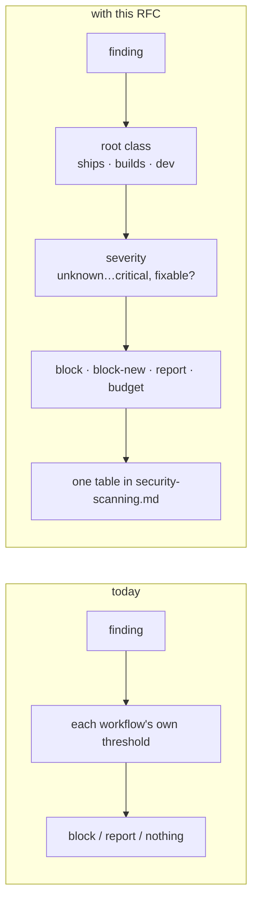
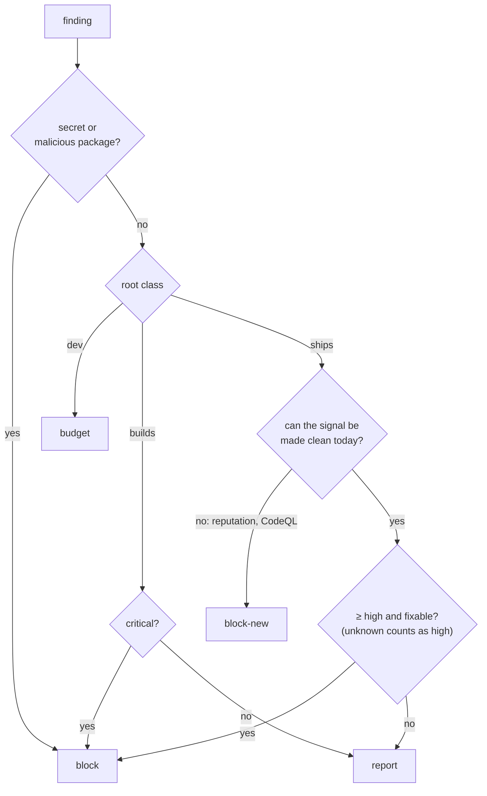
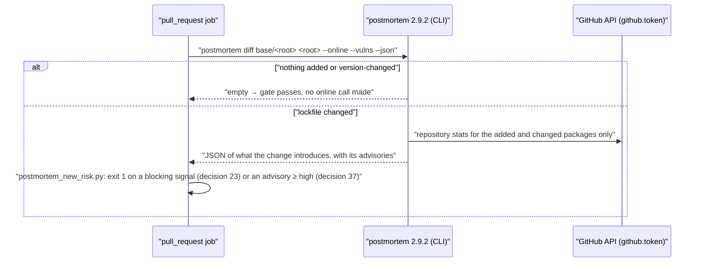
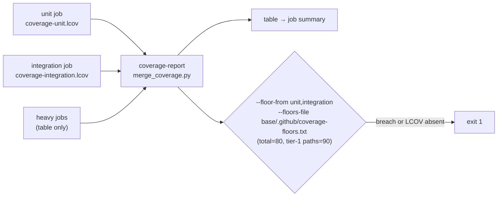
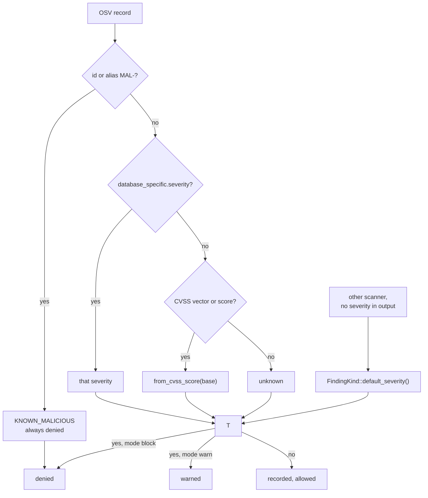
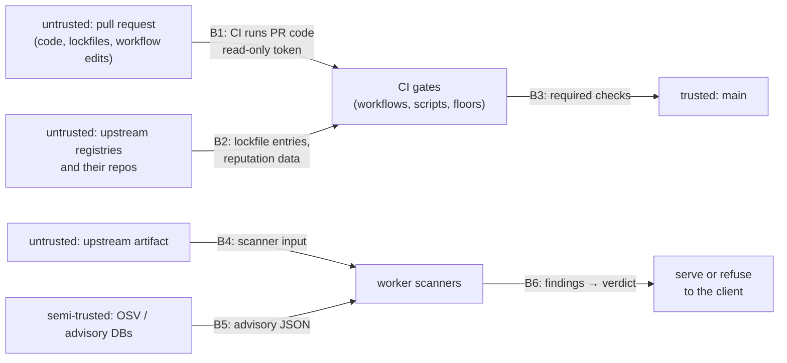

# RFC 0041 — Test depth and the security gate scale

| Field       | Value                                                        |
| ----------- | ------------------------------------------------------------ |
| Status      | In review                                                     |
| Short       | Test depth and gate scale                                     |
| Settles     | What the coverage floors are and where CI enforces them, and at which severity each security scanner — in CI and in the scan worker — blocks, reports or budgets a finding |
| Author      | Max Batleforc <maxleriche.60@gmail.com>                       |
| Co-author   | Claude Opus 5.5 <noreply@anthropic.com>                       |
| Created     | 2026-11-07                                                    |
| Supersedes  | —                                                             |
| Touches     | `crates/core` (`entities/security.rs`, `entities/vulnerability.rs`, `services/verdict.rs`, `services/scan_worker.rs`, `services/vulnerability/mod.rs`, `services/scanners.rs`, `services/rescan.rs`, `ports/vulnerability.rs`, `ports/security.rs`, `ports/scanner.rs`, `rules/flags.rs`, `rules/cve_gate.rs`, `rules/verdict_gate.rs`), `server/src` (`builders.rs`, `setup.rs`), `crates/adapters/migrations` (the marker), `crates/adapters/tests/pg_scan_queue.rs`, `helm/batlehub` (the deferred-jobs alert), `crates/adapters` (`scanners/*`, `vulnerability/osv.rs`, `db/security.rs`, `db/vulnerability.rs`), `crates/config` (`[registries.security] unknown_severity`, `schema/warnings.rs`), `config.example*.toml`, `deploy/helm/values-restricted.yaml`, `docs/.vitepress/components/configToml.ts`, `ui/openapi.json`, `ui/src/client`, `ui/src/locales`, `ui/src/components` (the verdict panel), `tests/heavy/quarantine.sh`, `tests/heavy/osv_fake.py`, `CHANGELOG.md`, `tests/fixtures/supply-chain-jdd/` (the test data: cases, recorded OSV answers, a malicious npm lockfile), `fuzz/` (`fuzz_osv_parse`), `.github/workflows` (`test.yaml`, `postmortem.yaml`, `semgrep.yaml`, `front-design.yaml`, `profile.yaml`, `dep-audit-frontend.yaml`, `pr-checklist.yaml`, a new `scripts-test.yaml`, a new `mutants.yaml`, a new `postmortem-fork.yaml`; for decision 28 also `back-dep-audit.yaml`, `image-scan.yaml`, `openapi-lint.yaml`, `secret-scan.yaml`, `front-lint.yaml`, `front-test.yaml`, `helm-lint.yaml`), `.github/actions/required-gate`, `.github/coverage-floors.txt`, `.tasks/security.yaml`, `.tasks/rust.yaml`, `.github/scripts` (+ `tests/`), `.tasks/coverage.yaml`, `.tasks/test.yaml`, `ui/vite.config.ts`, `.cargo/mutants.toml`, `mise.toml`, `cli/src/cli`, `crates/web/src/handlers/proxy`, docs (`contributing/security-scanning.md`, `contributing/testing.md`, `guide/security-gates.md`, `guide/configuration.md`, `use/refused-downloads.md`, `operations/compliance.md`, and the French twins), `CLAUDE.md`, `ROADMAP.md` |
| Risk        | high — §7 (the worker's default profile serves a package OSV knows to be malicious today, and the fix changes which versions every quarantined registry serves) |

---

## 1. Summary

Two things this repository already does well, but each by local decision. Its
tests reach 90.1 % of lines on `main`, and each of its security scanners blocks
on *something*. This RFC gives both a stated scale. For tests: four tiers of
code with a floor or a rule each, enforced in CI rather than only by a local task, the
UI's 80 % measured over the whole tree instead of the files that already have
a test, the gate scripts themselves under test, and mutation testing on the
code that decides grant or deny, where line coverage is already high and says
nothing more. For scanners: one severity vocabulary (the product's own
`Severity`), three classes of dependency root by what ships, four gate actions
(`block`, `block-new`, `report`, `budget`), and every scanner placed on that
grid with its reason — including postmortem's reputation gate, left unset
"until a baseline", which this RFC measures and settles as a diff against the
pull request's base. For BatleHub's own scan workers (RFC 0018): the same
vocabulary applied to what an *operator's* quarantine does with a finding.
Today a finding whose severity is `unknown` changes nothing under any
threshold above `unknown` (every shipped profile), and OSV returns `unknown` for every `MAL-` (known-malicious
package), `GO-`, and vector-only `RUSTSEC-`/`PYSEC-` advisory — so the default
profile serves a package OSV lists as malware. The RFC classifies `MAL-` as
malware, computes CVSS vectors, gives each finding kind one default severity
for "the scanner said nothing", and adds `unknown_severity` (default `high`)
so an unrated finding is judged, not dropped.

### Before / after

```text
# today — where each gate stops a pull request, as decided one workflow at a time
cargo audit / cargo deny   any advisory            block
pnpm audit                 high+                   block
postmortem (vulns)         high+                   block    (docs: report)
postmortem (reputation)    —                       nothing  ("needs a real baseline")
Trivy (images)             fixable high+           block
Trivy (mise toolchain)     fixable high+ > budget  block
Semgrep                    ERROR                   block    (WARNING: not even reported)
CodeQL                     —                       report
vuln-scan                  —                       report
coverage, Rust             80 % lines              only `task coverage-check`, which no CI job runs
coverage, UI               80 % of tested files    a file with no test is not measured

# with this RFC — one grid, each cell with a reason (§4.2)
                     ships           builds           dev toolchain
vulnerability        block ≥ high    block critical,  budget
                     (fixable)       report ≥ medium
reputation           block-new       report           —
malicious package    block           block            block
secret               block           block            block
static analysis      block ERROR / high on new, report WARNING / medium
coverage             tier 1 ≥ 90 % + no surviving mutant · tier 2 ≥ 80 % · UI ≥ 80 % of src/
```

```text
# today — the worker, default [registries.security] profile (max_severity = "high")
OSV MAL-2024-10000 (malicious)      severity unknown  → under threshold → allowed  (re-judged on every read)
OSV RUSTSEC-2023-0071 (CVSS vector) severity unknown  → under threshold → allowed
trivy finding without Severity      severity unknown  → allowed
postmortem finding without severity medium · socket medium · yara high

# with this RFC
OSV MAL-…                           malware_signal, critical  → denied
OSV vector CVSS:3.1/AV:N/AC:H/…     5.9 → medium              → recorded, allowed
unrated finding                     unknown → judged as unknown_severity (high) → denied
"said nothing" defaults             one table per FindingKind in core
```



The diagram's point is the middle of the right path: the action is derived
from two facts about the finding, so a reviewer can check a workflow against a
rule instead of against the comment someone left in it.

---

## 2. Motivation

1. **The 80 % Rust floor is not enforced by anything that runs.** Until this
   RFC's first draft, `CLAUDE.md` and `ROADMAP.md:271` both said "≥80% line
   coverage enforced by `task coverage-check`" (corrected with it, §6.9). No workflow calls `coverage-check`. The
   `coverage-report` job of `test.yaml` (line 1641) merges every LCOV and
   prints a table; `merge_coverage.py` "yields an 'absent' row instead of
   failing" by design and has no threshold at all. SonarCloud's *Sonar way*
   gate checks coverage of **new code** only. The overall number could fall to
   60 % one well-meaning pull request at a time, and every check would stay
   green.

2. **The UI's 80 % applies only to files that already have a test.**
   `ui/vite.config.ts:57` derives `coverage.include` from the co-located
   `*.test.ts` files, so a source file with no test is outside the measurement.
   Today 43 of the 161 non-generated sources in `ui/src` are outside it.
   Twenty-six of those are one-line `index.ts` barrels; the rest are
   `config/registryTypes.ts` (219 lines, 0 % — the setup snippets every
   operator copies), `config/visibility.ts`, `config/adminSections.ts`,
   `config/registryAddressing.ts`, four composables (`ui/src/composables` is at
   51.6 % on SonarCloud), `NamespaceUpload.vue`, `NamespacePackagesTable.vue`
   and `AdminDashboard.vue`. Adding an untested file can only *raise* the
   gate's number.

3. **The gates' own code is untested.** `.github/scripts` is 1 737 lines in
   six Python files (`wc -l`), 657 lines to cover at 0 % on SonarCloud: `sonar_quality_gate.py` decides whether the Sonar job fails,
   `mise_cve_report.py` decides whether the toolchain budget is exceeded,
   `vex.py` writes the VEX statements attached to the worker image,
   `slim_sbom.py` splits the frontend SBOMs (the 512-component truncation it
   fixes was found by running it, not by a test), `merge_coverage.py` builds
   the coverage table this RFC turns into a gate, `pr_checklist.py` writes
   the warnings a reviewer reads on a pull request. A bug in any of them makes
   a gate pass silently, which is the failure this repository already guards
   against by hand — `exit "${CODE:-1}"` in `postmortem.yaml` exists because a
   missing output once read as success.

4. **Where line coverage is highest, it has stopped saying anything.** The
   code that decides grant or deny is near-saturated: `crates/core/src/rules`
   94.8 %, `crates/web/src/middleware` 96.9 %, `crates/adapters/src/auth`
   96.3 %, `crates/web/src/extractors.rs` 100 %,
   `crates/core/src/services/integrity.rs` 96.5 %,
   `crates/adapters/src/storage/mod.rs` (`ensure_safe_key`) 100 %. A covered
   line is a line that ran, not one a test would notice was wrong. Nothing
   measures whether flipping a `<` in `ReleaseAgeGateRule` or an `&&` in the
   auth middleware fails a test — and these are the lines where a silent
   inversion is a vulnerability, not a bug.

5. **The average hides the holes.** The 90.1 % on `main` contains
   `cli/src/cli/security.rs` at 19.6 % (205 uncovered lines),
   `cli/src/cli/admin.rs` 58.4 %, `cli/src/cli/mise.rs` 50.9 %,
   `crates/web/src/handlers/proxy/jetbrains_marketplace/ide.rs` 45.7 %,
   `crates/web/src/handlers/proxy/conda.rs` 66.8 %,
   `crates/adapters/src/registry/galaxy/client.rs` 58.1 % and
   `crates/core/src/services/scan_worker.rs` 69.8 %. `cli/src/cli` as a whole
   is 70.6 %.

6. **The scanners have no common scale, and the choices live in comments.**
   `cargo audit` blocks on any advisory, `pnpm audit` on high, Trivy on
   *fixable* high, Semgrep on `ERROR` with `WARNING` findings not even written
   to SARIF (`semgrep.yaml:39`), Spectral on `warn`, CodeQL never, vuln-scan
   never. Several of those are right, and the reasons exist — in ten workflow
   files' comments. `security-scanning.md`'s layer table states each gate but
   not the rule that chose it, so the next scanner will be placed by the same
   local judgement, and nobody can say whether "high" in one row means what it
   means in the next.

7. **postmortem's reputation gate waited for a baseline; the baseline answers
   that no absolute threshold works.** `postmortem.yaml:105-109` leaves
   `max-risk`/`max-dep`/`max-high`/`max-sus` unset until "a real baseline".
   Measured on 2026-11-07 with postmortem 2.9.2 `tree --online` (§6.P,
   observation 0):

   | Root | Deps | `high` | max risk | risk ≥ 50 |
   | --- | --- | --- | --- | --- |
   | `.` (Rust) | 671 | 62 | 90 | 38 |
   | `ui/` | 675 | 149 | 100 | 70 |
   | `docs/` | 358 | 68 | 75 | 31 |

   The UI's 100 is `@lezer/yaml@1.0.4`, flagged as a typosquat of `yaml` — it
   is CodeMirror's own YAML grammar. The Rust 90 is `pest_stack_guard@1.0.1`,
   12 days old, 0 stars: exactly the signal the gate exists for, scored in the
   same band as 61 long-standing crates. Any `max-high` either fails today on
   old, accepted dependencies or is set above 149 and never trips. Waiting
   longer does not change that shape.

8. **Two dependency-hygiene gaps are in the tree today.** `postmortem harden .`
   (CIRSEC CB-DEP baseline, offline) reports `cargo test --workspace --doc`
   (`test.yaml:346`) and the profiling `cargo test` (`profile.yaml:114`)
   without `--locked` (CB-DEP-LOCK-002, high), and `npx --yes impeccable` and
   `npx --yes wait-on` in `front-design.yaml` running whatever version is
   latest that minute, install scripts included (CB-DEP-EXEC-003). Spectral,
   two files over, is already pinned with `--ignore-scripts`.

9. **The worker's default profile serves known-malicious packages.**
   `severity_of` (`crates/adapters/src/vulnerability/osv.rs:126`) reads
   `database_specific.severity`, then a `severity[].score` *that parses as a
   number*, else `Unknown` — and `severity_unknown_when_vector_not_numeric`
   asserts the last. Probed on api.osv.dev, 2026-11-07:

   | Advisory | `database_specific.severity` | `severity[]` | Becomes |
   | --- | --- | --- | --- |
   | `MAL-2022-1`, `MAL-2024-10000` (malicious packages) | — | — | `unknown` |
   | `GO-2024-2687` | — | — | `unknown` |
   | `RUSTSEC-2023-0071` | — | a CVSS 3.1 vector | `unknown` |
   | `PYSEC-2024-60` | — | a CVSS 3.1 vector | `unknown` |
   | `GHSA-c2qf-rxjj-qqgw` | `HIGH` | a vector | `high` |

   `Severity` orders `unknown` below `low`, and `threshold`
   (`crates/core/src/services/verdict.rs:126`) returns `None` for anything
   under `max_severity` (default `high`, `SecurityPolicy::defaults_for`).
   `classify` sends `ReasonCode::Vulnerability` to `threshold`. So a version
   whose only advisory is `MAL-…` is **allowed** under the default profile,
   and `cve_gate` (`crates/core/src/rules/cve_gate.rs:75`, `>= min_severity`)
   drops it the same way. `tests/heavy/quarantine.sh` cannot see this: its
   fake advisory (`BATLEHUB-HEAVY-FLIP`) carries `database_specific.severity:
   CRITICAL` (`osv_fake.py:29`), and its live advisory is a GHSA.
   Reproduced end to end with a real npm on 2026-11-07 (§17 M1).

10. **Each scanner adapter picks its own severity for "not stated".** Trivy:
    `Unknown` (`scanners/trivy.rs:81`). postmortem: `Medium`
    (`scanners/postmortem.rs:245`). socket: `Medium` (`scanners/socket.rs:70`).
    yara: `High` (`scanners/yara.rs:105`). guarddog: by rule-name family,
    `High`/`Medium` (`scanners/guarddog.rs:54`). So the same unrated malware
    signal is denied from yara and allowed from postmortem under the default
    threshold. That is a scale, chosen in six places: four `unwrap_or`
    literals, guarddog's rule families and the transitions' fixed `Medium`.

11. **postmortem's transitions never reach the default threshold.**
    `map_timeline` emits every `publisher_changed`, `install_hook_added`,
    `repository_moved`, `dormant_release` at `Medium`
    (`scanners/postmortem.rs:323`). Under `max_severity = "high"` they are
    recorded and change nothing unless the operator writes an `escalation`
    block (RFC 0018 §4.2) — which no shipped example does.

12. **Three worker defects make an outage read as "clean".** OSV's client
    turns a non-200 answer, an oversized body and a transport error into
    "no advisory" (`osv.rs:45`, `:61`, `:76-90`); the SBOM re-scan then
    replaces stored advisories with that empty answer
    (`services/vulnerability/mod.rs:148-162`); and `close_exhausted` drops
    the stored findings of a job that ran out of attempts
    (`scan_worker.rs:713`). Fixing them (phase 0) changes availability: an
    OSV that no worker can reach now holds every new version
    (`SCAN_PENDING`, then `SCANNER_ERROR` after 24 h), where today it
    serves them unscanned — §13 puts it on the upgrade checklist.

---

## 3. Goals / non-goals

**Goals**

- Every security scanner is placed on one grid — root class × finding kind —
  with an action and a reason, and the grid has one home.
- CI fails a pull request that takes the Rust or UI coverage below its floor,
  and the floors are stated per tier.
- A UI source file counts toward the UI floor whether or not it has a test.
- The gate scripts have tests, and those tests run when the scripts change.
- Assertion strength on tier-1 code is measured, by mutation testing.
- postmortem's reputation signals fail a pull request that *introduces* a
  dependency carrying a blocking signal (decision 23), and nothing else.
- The named holes of motivation 5 reach the tier-2 floor — tracked in
  phase 5, not gated per file (§6.6), so this goal is reached by work, not
  enforced.
- In the worker, no finding is dropped because nobody rated it: `MAL-` is
  malware, a CVSS vector is a score, and `unknown` is judged at a stated
  level.
- One table in `crates/core` says what each finding kind is worth when the
  scanner said nothing, and every adapter uses it.

**Non-goals**

- **Raising the global floor to 90 %.** It is already 90.1 %; the number would
  move and the holes of motivation 5 would stay.
- **Rust branch coverage.** `cargo llvm-cov --branch` needs a nightly
  toolchain; CI is stable. Revisit when `-Zcoverage-options=branch`
  stabilises.
- **Mutation testing of the whole workspace.** About 290 000 lines of Rust
  outside `tests/` (`wc -l`, 2026-11-07); the run would
  take hours per commit. Tier 1 is where an inversion is a vulnerability.
- **Mutation testing of the UI (Stryker).** A new JavaScript tool tree for
  code that makes no security decision — the server re-checks everything.
- **Per-file coverage floors.** They punish small files and reward padding;
  the tiers carry the intent.
- **A coverage percentage for the Python scripts.** It would need
  `coverage.py`, two new dependencies, for six scripts; a test per exit path is the
  bar (§4.4).
- **Per-scanner thresholds in the worker.** `max_severity` stays one number
  per registry; RFC 0018's `escalation` already raises one scanner's findings,
  and a second mechanism would make a verdict harder to explain.
- **A new verdict mechanism for policy changes.** Verdicts are already
  re-evaluated against the current policy on every read
  (`VerdictService::current`, `verdict.rs:353`); this RFC relies on that and
  adds nothing to it. What it means for the upgrade is §13 and decision 15.
- **Changing the CVSS buckets.** `Severity::from_cvss_score` is kept, with
  one exception: a score of exactly 0.0 becomes `low` (§4.5), because OSV
  writes 0.0 for "None" and `unknown` would now be judged `high`.
- **Raising postmortem's transitions by default** (motivation 11). Decision
  14 documents an escalation example and changes no default; motivation 11
  is answered in the docs only, until a false-positive rate is measured.
- **Bringing the excluded paths into the unit gate.** The 72 files of
  `COVERAGE_EXCLUDE` (22 056 lines: DB adapters, OIDC handlers, server
  wiring) are covered by the Postgres, S3, Redis and heavy suites; the list
  stays as it is.
- **Changing the "no suppressions" stance.** `deny.toml`'s `ignore = []` and
  an empty `.cargo/audit.toml` stay; `block-new` is not a suppression (§5.2).
- **Replacing scanners with one tool.** §12.

---

## 4. User-facing design

The users are contributors and the maintainer reviewing them (§4.1–4.4), and
operators and their package-manager clients (§4.5).

### 4.1 The scale

**Severity** is `batlehub_core::entities::vulnerability::Severity`
(`crates/core/src/entities/vulnerability.rs:13`): `unknown < low < medium <
high < critical`, with `from_cvss` buckets. A scanner whose own vocabulary
differs is mapped onto it once, in the table of §4.2: Semgrep `ERROR` →
`high`, `WARNING` → `medium`; CodeQL `security-severity` by its CVSS bucket;
postmortem reputation `high` → `high`.

**`unknown` is ranked as `high` on a `ships` root when the source never
assigns a severity.** That is the case for RUSTSEC advisories, which come back
`severity: unknown` from vuln.mlab.sh (`vuln-scan.yaml:31-34`); it is also why
`cargo audit` blocking on *any* advisory is the right reading of this scale
and not an exception to it.

**Fixable** means a version without the finding exists. Unfixable findings are
reported, never blocking: blocking on them fails every pull request until
someone else ships a release (Trivy's `ignore-unfixed: true` already says
this).

**Root class** — what a dependency root ends up in:

| Class | Means | Roots |
| --- | --- | --- |
| `ships` | in a released binary, image or chart | `Cargo.lock`, `ui/` production dependencies (bundled into the image), the three images |
| `builds` | runs in CI or at build time, never shipped | `ui/` dev dependencies, `docs/`, CI actions, `npx` tools |
| `dev` | a contributor's local toolchain | `mise.lock` |

**Gate actions**:

| Action | A matching finding… |
| --- | --- |
| `block` | fails the job, on every event; on `main` the job is a required status check of the `main` ruleset (decision 24), so a red one stops the merge |
| `block-new` | fails a pull request only when it is absent from the same scan of the pull request's base; on `main` it is `report` |
| `report` | reaches SARIF / the job summary / the PR comment, never fails |
| `budget` | fails when the count exceeds a recorded number (`mise-cve-budget.json`) |

### 4.2 The grid

This table becomes the canonical one, in `security-scanning.md` § The scale.
`Δ` marks what this RFC changes.

| Scanner | Finding | Root class | Action | Threshold | Δ |
| --- | --- | --- | --- | --- | --- |
| `cargo audit` | vulnerability, unmaintained, yanked | ships | block | any (`unknown` = high) | — |
| `cargo deny` | advisory, ban, licence, source | ships | block | any | — |
| `pnpm audit` (`ui/`) | vulnerability | ships + builds | block | ≥ high | — |
| `pnpm audit --prod` (`docs/`) | vulnerability in what the published site bundles | ships | block | ≥ high, prod deps (unchanged, decision 20) | — |
| postmortem vulns (Rust, UI) | vulnerability | ships | block on push and schedule, **block-new** on pull requests | ≥ high (decision 27) | Δ |
| postmortem vulns (docs) | vulnerability in the whole docs tree, build tooling included | builds | **block** / report | `fail-on-vuln: critical`; ≥ medium in SARIF (was report-only) | Δ |
| postmortem reputation (Rust, UI) | an added dependency's signals | ships | **block-new** | `typosquat`, `newborn-package` < 7 days, an install script (decision 23); a version change only on a takeover signal (decision 17) | Δ |
| postmortem reputation (docs) | same | builds | report | all | — (SARIF already) |
| `MAL-` check of the postmortem SARIF (Rust, UI, docs) | known-malicious package | all | block | any `MAL-` id (decision 4; `fail-on-vuln` alone misses it, §17 M4) | Δ new |
| `postmortem harden .` | CIRSEC CB-DEP control | repo | report | `fail` controls | Δ new |
| vuln-scan | vulnerability | all | report | — | — (promotion rule below) |
| Trivy (three images) | OS / library CVE | ships | block | fixable ≥ high | — |
| Trivy (`mise-scan`) | CVE in a tool | dev | budget | fixable ≥ high, count ≤ budget | — |
| Semgrep | rule match | code | block / **report** | `ERROR` block, `WARNING` report | Δ |
| CodeQL | security alert | code | **block-new** | `security-severity` ≥ high, via a repository ruleset | Δ |
| Spectral | OAS / OWASP API rule | API | block | ≥ warn | — |
| gitleaks | secret | all | block | any | — |
| clippy | lint | code | block | any warning | — |
| SonarCloud | quality gate | code | block | *Sonar way* on new code | — |

Two rules explain every row and are what a new scanner is placed by:

- **What ships blocks on what is fixable and serious; what only builds is
  reported, and blocks only at critical** (decision 3). Neither `pnpm audit`
  nor postmortem's `fail-on-vuln` can filter on fixability, so on `builds`
  roots the block is at critical whether or not a fix exists; an unfixable
  critical in the docs toolchain fails until it is replaced, which is the
  right outcome for a critical.
- **A signal that cannot be made clean today gates on change, not on state.**
  That is `block-new`, and it is the only way reputation and CodeQL can block
  without either failing every pull request or never failing at all.

**vuln-scan stays `report`** and gets a stated promotion rule instead of a
comment: it is promoted to `block` on `ships` roots once two consecutive weekly
runs show (a) no withdrawn advisory among its findings and (b) a non-`unknown`
severity on every RUSTSEC finding — the two reasons `vuln-scan.yaml:15-67`
gives for not gating today.

### 4.3 Test tiers

| Tier | Code | Floor | Plus |
| --- | --- | --- | --- |
| 1 — decides grant, deny or integrity | `crates/core/src/rules/`, `crates/web/src/middleware/`, `crates/adapters/src/auth/`, `crates/web/src/extractors.rs`, `crates/web/src/handlers/auth/` (outside `COVERAGE_EXCLUDE`), `crates/core/src/services/integrity.rs`, `crates/core/src/services/local_registry/mod.rs` (`validate_package_name`, `validate_coordinate`), `crates/adapters/src/storage/mod.rs` (`ensure_safe_key`), `crates/core/src/services/verdict.rs`, `crates/adapters/src/vulnerability/osv.rs`; for mutation testing only, the severity-mapping functions of `crates/adapters/src/scanners/*.rs` | 90 % lines per path, except the scanner adapters (below) | no surviving mutant (§6.4); a negative test per refusal; a fuzz target per parser (as today) |
| 2 — the rest of the Rust gate | everything `task coverage-check` measures | 80 % lines overall | — |
| 3 — UI | `ui/src/**/*.{ts,vue}` minus generated, tests, `main.ts`, barrels | 80 % lines, branches, functions, statements | — |
| 4 — gate scripts | `.github/scripts/*.py`, including the new `postmortem_new_risk.py`, and `mise_repo_tools.sh`, which decides the mise budget scan's `--only-tools` (an empty answer scans nothing) | every exit path has a test | — |

Tier 1's original paths pass the floor on SonarCloud (motivation 4), whose
numbers are not the gate's; which of them enter the floors file on day one
is M12's measurement (decision 40). `verdict.rs` is at 87.3 % on SonarCloud
and joins with the tests of §6.8. The worker's severity mapping is
here because motivation 9 is exactly the defect line coverage could not see:
`severity_of` is covered, and its test asserts the fail-open. The scanner
adapters join for their mapping functions only (`map_scan`, `map_timeline`,
`classify` and their kin, named in `.cargo/mutants.toml`), not for the line
floor: most of their uncovered lines are the subprocess and sandbox paths
that need the real binaries, and they sit below it today on SonarCloud
(`yara.rs` 74.1 %, `guarddog.rs` 79.5 %, `trivy.rs` 85.7 %, `socket.rs`
89.7 %). They stay at tier 2's 80 %, which `yara.rs` and `guarddog.rs` reach
in phase 5.

### 4.4 Validation — what a contributor sees

| Condition | Where | Message |
| --- | --- | --- |
| Rust total under 80 % (unit + integration) | `coverage-report` job, red | `coverage floor: total 79.4 % < 80 %` |
| A tier-1 path under 90 % | same job | `coverage floor: crates/core/src/rules 88.9 % < 90 % (tier 1)` |
| `unit` or `integration` LCOV missing | same job, red | `coverage floor: unit LCOV absent — refusing to compute a floor from a partial run` |
| UI under 80 % on any of the four | `front-test.yaml`, red | Vitest's own `ERROR: Coverage for lines (78.2%) does not meet global threshold (80%)` |
| A surviving mutant on a changed tier-1 line | `mutants.yaml` on the pull request: summary while the nightly list is non-empty, red after | cargo-mutants' `MISSED` line, file and replacement |
| An added dependency with a blocking signal | `postmortem — Rust`/`UI`, red | `new dependency <pkg>@<version> — newborn-package (3d old); ask a maintainer to review this head and approve it (external contributors cannot)` |
| A version change with a takeover signal | same | `<pkg> <from>→<to> — new-publisher; …` and the same instruction |
| A version change to a release under 7 days old | same | `<pkg> <from>→<to> — published 2d ago; …` and the same instruction (decision 49) |
| A new or moved dependency root, or more than 50 added | same | `new or moved dependency root (<root>) — needs a maintainer's approving review of this head` |
| A known-malicious package | `postmortem — Rust`/`UI`/`Website`, red | `known-malicious package <pkg>@<version> (MAL-…) — remove it`; no label passes this |
| The vulnerability lookup did not complete (quota) | same | `vuln.mlab.sh did not answer (rate limit) — retry after <time>`, never "no MAL-" |
| A spent GitHub rate limit | same | `GitHub API rate limit spent — resets at <time>` |
| A required check that never reported | the PR's merge box | "Expected — waiting for status": the workflow did not run; the aggregate job of decision 28 is what prevents it |
| A Python gate script's test fails | `scripts-test.yaml`, red | `unittest`'s own failure |
| A maintainer approved an earlier head | the postmortem job, red | `the approval covers <old sha>, not the head (<sha>) — ask a maintainer to approve again` (decision 46) |
| A PR edits `postmortem_new_risk.py` | the postmortem job's summary, warning | "running the base copy of postmortem_new_risk.py; your change applies after merge" (decision 39) |
| An advisory ≥ high against a package the PR adds or changes | `postmortem — Rust`/`UI`, red | `vulnerable dependency <pkg>@<version> — <advisory id> (<severity>); pick a fixed version` (decision 37) |
| A new advisory ≥ high against a package already on `main` | nothing on the PR (the PR does not introduce it); the `main` run's `postmortem-rust`/`-ui` issue | — (decision 37) |
| A Dependabot PR that changes a lockfile without `full-test` | `test.yaml / required`, red | `lockfile changed but the Rust suite was skipped — add the full-test label` (decision 41) |

Warnings that do not fail, and where they are read:

| Condition | Surfaced in |
| --- | --- |
| A Semgrep `WARNING` | Security tab, category `semgrep` |
| A CIRSEC `fail` control | the Rust postmortem job's summary |
| A newly introduced reputation finding on `docs/` | Security tab, category of the `postmortem — Website` job |
| A surviving mutant on `main`'s nightly run | `mutants.yaml` summary and its `mutants.out` artifact |

### 4.5 The worker scale

The worker side uses the same `Severity` and changes three things.

**`[registries.security] unknown_severity`** — how a finding with severity
`unknown` is judged against `max_severity`:

```toml
[registries.security]
mode             = "block"
max_severity     = "high"
unknown_severity = "high"   # unknown | low | medium | high | critical; default "high"
```

- Absent means `"high"`: an unrated finding counts as high, which is the CI
  rule of §4.1 (`cargo audit` blocks on any advisory) applied to the product.
- `"unknown"` restores today's behaviour — an unrated finding never acts —
  for an operator who must keep it, and says so in the config.
- The stored finding keeps `severity: "unknown"`. The judgement uses the
  substitute and records it in a separate, recomputed field (`judged_as`),
  never in the summary, so `batlehub-cli why` and the console can show
  "severity unknown, judged as high by `unknown_severity`". That field is
  visible where findings are (`findings:read`, administrators by default); a
  developer without it sees the reason code, as today.
- It applies at every place a finding's severity is compared with a number
  set by the operator: `threshold` (`ReasonCode::Vulnerability`,
  `MalwareSignal`, `TyposquatSuspect` and the rest of `classify`'s `_` arm),
  `escalate`'s `from` (`verdict.rs:110`) and the flags gate's
  `gate_min_severity` (`rules/flags.rs:99`, where a pushed flag may carry
  `"unknown"`). The forge-ref codes, which carry the operator's own action as
  their severity, are untouched. `cve_gate` on a registry *without* a
  security profile gets its own `unknown_severity`, default `"high"`
  (decision 16); on a security registry it is not
  a rule at all but a `RecordedVulnerabilityScanner` judged by `threshold`
  (`server/src/builders.rs:639`, `:881`).
- `mode = "warn"` still downgrades every refusal **except `MAL-`**, which is
  `ReasonCode::KnownMalicious`, always denied like `BLOCK_LIST` and
  `SOC_VERDICT` (decision 18). An administrator's per-version exemption
  (`GateExemption`, `apply_override`, `verdict.rs:324`) still turns it into
  `warned` with `ADMIN_OVERRIDE`, as it does for `BLOCK_LIST` today
  (decision 31): a false `MAL-` listing needs a way out short of a release,
  and the exemption is per version, explicit (`batlehub-cli exemption add
  … --gate security_verdict`, `VERDICT_EXEMPTION_GATE`, `verdict.rs:39`;
  quoted in `refused-downloads.md`'s `KNOWN_MALICIOUS` section, en and fr),
  and visible in the response
  headers and the audit log.
- **Nothing lowers `MAL-`.** It is decided first, from the id and every alias,
  and the twin, informational and withdrawn rules below never apply to a
  record that carries a `MAL-` name; the informational rule reads
  `affected[].database_specific.informational` only, only for `RUSTSEC-`
  records, and only on the `affected[]` entry of the package queried.

**OSV, read fully** (`crates/adapters/src/vulnerability/osv.rs`):

| OSV record | Today | With this RFC |
| --- | --- | --- |
| id or an alias starting `MAL-` | `Vulnerability`, `unknown` | `MalwareSignal`, `ReasonCode::KnownMalicious` (always denied), `critical` |
| `database_specific.severity` | parsed | unchanged, still first |
| `severity[]` with a CVSS v2/v3/v4 vector | `unknown` | base score computed, `Severity::from_cvss_score`, highest of the entries |
| `severity[]` with a bare number | parsed | unchanged |
| any record (decision 21) | as above | its own `database_specific.severity` if it has one; else the highest `database_specific.severity` among its direct twins (records naming it, or named by it, as an alias); else the highest computed vector among itself and its twins |
| a `RUSTSEC-` record with `affected[].database_specific.informational` set (`unsound`, `unmaintained`, `notice`) | `unknown` | `low`, not a vulnerability (decision 21) |
| a CVSS score of exactly 0.0 ("None") | `unknown` (`from_cvss_score(0.0)`) | `low` |
| `withdrawn` set | `unknown` | ignored |
| none of the above | `unknown` | `unknown` → judged by `unknown_severity` |

**One default per finding kind.** `FindingKind::default_severity()` in
`crates/core/src/entities/security.rs` is what an adapter uses when the
scanner's output carries no severity, replacing the four `unwrap_or`
literals of motivation 10:

| `FindingKind` | Default when unstated | Who changes |
| --- | --- | --- |
| `MalwareSignal` | `high` | postmortem (was `medium`), socket (was `medium`) |
| `InstallHook` | `high` | — |
| `Typosquat` | `medium` | — |
| `Transition` | `medium` | — (motivation 11: a documented escalation example, decision 14) |
| `Vulnerability` | `unknown` | — (then `unknown_severity`) |
| every other kind | `unknown` | — |

guarddog keeps its rule-family classification, since it derives a severity
from the rule name rather than leaving it unstated; yara keeps `high`, now
read from the table. A scanner that *states* a severity is never overridden.

Validation:

| Condition | Rejected or warned | Surfaced in |
| --- | --- | --- |
| `unknown_severity` not one of the five | rejected at load, as `max_severity` is (`crates/config/src/schema/mod.rs:3088`) | startup error |
| `unknown_severity` below `max_severity` on a `block` registry (`"unknown"` included) | warning `security.unknown-served`: unrated advisories, `MAL-` aside, are served | `ConfigWarning` on the admin config page, `batlehub-cli server config warnings` and the startup log (`explain-config` prints grants only, `server/src/explain.rs`) |
| `scanner_error = "warn"` or `"ignore"` on a `block` registry | warning `security.scanner-error-open`: a scanner that cannot answer — OSV down included — no longer holds a version | the same three places |

---

## 5. Architecture

### 5.1 Placing a finding



It shows the rule most rows of §4.2 follow, so a row can be checked against
it. Rows that depart from it say so in their reason cell: `cargo audit` and
`pnpm audit` on `ships` block on unfixable findings too (no fixability
filter exists in either tool); postmortem's vulnerabilities are `block-new`
on pull requests (decision 27); and the code, API and repository scanners
(Semgrep, CodeQL, Spectral, gitleaks, clippy, SonarCloud) sit outside the
three dependency root classes.

### 5.2 `block-new` on a pull request



It proves two things. The online cost scales with the diff, not the tree:
a pull request that touches no lockfile makes no call, and one that bumps a
crate scores that crate. And the comparison is against the pull request's own
base, in the same run, so a finding already on `main` cannot fail an unrelated
change, and a new one cannot hide in a stale committed baseline.

**Invariant:** because `block-new` compares head against the base *of this
pull request*, and `main`'s scheduled run reports every finding in absolute
terms, a risk can only reach `main` unflagged by a reviewer merging a red
check. `block-new` is not a suppression: nothing is hidden, the finding stays
in the main run's SARIF; only its power to fail an unrelated change is
removed.

### 5.3 Coverage floors



The floor is computed from `unit` and `integration` only — what
`task coverage-check` measures — so a flaky heavy job cannot move it, and the
same script with the same flags is what `task coverage-check` runs.

### 5.4 A worker finding, judged



It proves a `MAL-` listing never meets a threshold or a mode at all, and that
every other unrated finding reaches the threshold, with two exits left —
`unknown_severity` lowered by an operator and warned about, and an
administrator's per-version `security_verdict` exemption (decision 31).

**Invariant:** because the substitution is one function,
`Severity::judged(self, unknown_as)`, called at three sites — `evaluate`
(which sets `judged_as` for `threshold`, read by `classify`'s `_` arm as
`f.judged_as.unwrap_or(f.severity)`, and judges `escalate`'s comparison),
the flags gate and `cve_gate` — and nowhere else, a finding's stored `severity` is never rewritten: the
audit trail, the exposure report and the client's error show what the scanner
said, and `judged_as` is recomputed on every evaluation. Verdicts are
re-evaluated on every read (`VerdictService::current`, `verdict.rs:353`), so
the field cannot accumulate across rescans the way an appended summary would
(`escalate`, by contrast, does rewrite the stored severity, `verdict.rs:117`,
and stays as it is).

---

## 6. Detailed design

### 6.1 `.github/scripts/merge_coverage.py`

- New repeatable `--floor PATH=PCT` (`PATH` = `total` or a path prefix) and
  `--floor-from NAME[,NAME…]`, defaulting to `unit,integration`. Lines are
  merged as today; the floor is computed on the categories named only.
- Any breach prints one `coverage floor:` line per breach to stderr and the
  job summary, and exits 1. A category named in `--floor-from` with no LCOV
  exits 1 (fail closed); categories outside it keep the "absent" row.
- A breach line names the three least-covered files under that prefix and
  ends with "reproduce: `cargo llvm-cov -p <crate> --lcov --output-path
  lcov.info`, then `merge_coverage.py --floors-file
  .github/coverage-floors.txt --floor-from local local=lcov.info`", the
  first command carrying `--ignore-filename-regex "$COVERAGE_EXCLUDE"` as
  CI does — one crate, no container engine; floor prefixes absent from a
  local LCOV are skipped, not read as 0 %, and the line says the number is
  a lower bound for a `crates/core` file, which `crates/web/tests` also
  covers in CI. It names `task coverage-check` (Podman: Postgres, RustFS,
  Redis) as the full run. An absent LCOV says "see job `unit`" rather than
  repeating the failure.
- The floors live once, in `.github/coverage-floors.txt` (`PATH=PCT` per
  line), read with `--floors-file` by both callers and listed in the
  in-job change filter (decision 28) so a change to it runs the gate. The tier-1 prefixes are file or
  directory paths, and the file lists only paths a recorded run shows at or
  above their floor (decision 40, §17 M12); the `scanners/*.rs` files are
  tier 1 for mutation only and never enter it. A tier-1 path below 90 %
  enters the day it reaches it. On a pull request `merge_coverage.py` runs
  from the head but reads `--floors-file base/.github/coverage-floors.txt`
  (decision 39), so a PR cannot lower its own floor; `coverage-report`
  gains the `base/` checkout for that. On phase 3's own pull request,
  `base/` has no floors file yet; the step then reads the head's copy and
  says so in a warning, the bootstrap §6.5 gives the scripts.
- `test.yaml` `coverage-report` adds a second step after the table. The job
  already runs with `!cancelled()`, so it reports when a test job failed; the
  floor step then fails on the absent LCOV, which is correct — that pull
  request is red anyway. On a `dependabot/*` branch without `full-test` the
  job is skipped, like every test job there.
- The floor step is one of the jobs `test.yaml / required` waits for
  (decision 28): the workflow-level `paths:` filter goes, an in-job change
  filter (whose path list includes `.github/coverage-floors.txt`) decides
  whether the Rust jobs run, and the aggregate job fails
  unless each one succeeded or was skipped *by that filter*. The filter
  is `git diff --name-only` over `pull_request.base.sha...head.sha` on a
  pull request, `github.event.before...github.sha` on a push, and absent
  on a schedule (a full run), in each path-filtered workflow. It is
  evaluated **before** the Dependabot gate, so a PR the filter would skip
  stays green whatever its branch. A Dependabot branch without
  `full-test` skips the Rust jobs by design (`test.yaml:96-103`); the
  aggregate counts that skip as a pass unless the PR changes `Cargo.lock`
  or `fuzz/Cargo.lock` — the lockfiles of `test.yaml`'s own filter, not
  `ui/` or `docs/`'s `pnpm-lock.yaml`, whose daily bumps have their own
  workflows — which fails it with "Cargo.lock changed but the Rust suite
  was skipped — add the full-test label" (decision 41). The label is read
  from the event, so it takes effect on the next push or `@dependabot
  recreate`: one label and one recreate per cargo bump, stated in
  `security-scanning.md` beside the grid.
- `.tasks/coverage.yaml` `coverage-check` keeps `--fail-under-lines 80` and
  then runs `cargo llvm-cov report --lcov --output-path lcov.info
  --ignore-filename-regex "$COVERAGE_EXCLUDE"` (the same exclusions as CI) and
  `merge_coverage.py --floors-file .github/coverage-floors.txt --floor-from
  local local=lcov.info` — one merged LCOV locally, two categories in CI, the
  same floors.

### 6.2 `ui/vite.config.ts`

- `coverageIncludeFromTests` and `collectSourcesForTest` (40 lines) are
  deleted. `coverage.include` becomes `["src/**/*.{ts,vue}"]`, `exclude`
  becomes `["src/client/**", "src/**/*.test.ts", "src/test/**",
  "src/main.ts", "src/components/ui/*/index.ts", "src/**/*.d.ts"]`.
- Thresholds stay at 80 on all four. SonarCloud counts the whole of `ui/src`
  (a file missing from the LCOV, like `registryTypes.ts`, appears at 0 %) at
  83.3 % lines and 80.9 % branches — a 0.9-point margin on branches, and
  Vitest counts branches its own way. So phase 3 runs the inverted include
  locally first, records the four numbers in §17, lands the UI rows of §6.6
  in the same change, and switches only when lines, statements and
  functions are ≥ 80 and branches ≥ 81 (decision 32): one point of margin,
  so the next UI pull request with an uncovered branch does not go red.
  Measured (§17 M8): lines 88.56 %, statements 86.76 %, functions 86.71 %,
  **branches 78.12 %** — 124 more covered branches (3 485 of 4 302, the 81 %
  of decision 32) before the switch.

### 6.3 Gate scripts under test

- `.github/scripts/tests/test_<script>.py`, stdlib `unittest`, one file per
  script, each case feeding a fixture (an LCOV, a Sonar API response, a Trivy
  JSON, an SBOM) and asserting the exit status and the line the operator
  reads. Floor: every `sys.exit`/`return` path of `main` has a case. The first
  cases are the ones whose failure is silent: `sonar_quality_gate.py` on
  `ERROR`/`WARN`/`NONE`/HTTP error, `mise_cve_report.py` over and under budget
  and with no budget file, `slim_sbom.py` on 513 components (two chunks,
  nothing dropped), `merge_coverage.py` floors and absent categories,
  `vex.py`, `pr_checklist.py` (one case per path prefix of its warn list,
  §6.5).
- `task test:scripts` runs `python3 -I -m unittest discover -s
  .github/scripts/tests`.
- `scripts-test.yaml`: on `pull_request`/`push` touching `.github/scripts/**`,
  one job, `contents: read`, the same command.

### 6.4 Mutation testing on tier 1

- `cargo-mutants` 27.1.0 pinned in `mise.toml` (`github:sourcefrog/cargo-mutants`,
  checksum in `mise.lock`).
- `.cargo/mutants.toml`: `examine_globs` = the tier-1 paths of §4.3;
  `exclude_re` for `Display`/`Debug` impls and log-only functions;
  `test_workspace` is one top-level boolean in that file, not a per-path
  setting, so the job runs **two invocations**: the `crates/core` tier-1
  paths with `--test-workspace=true`, whose rules are also exercised by
  `crates/web/tests` — testing only the mutated file's package
  (cargo-mutants' default) would report mutants those suites kill as
  `MISSED` — and the rest per package; their cost is M11.
- `task mutants` (local, one file: `task mutants FILE=crates/core/src/rules/rbac.rs`)
  and `mutants.yaml`:
  - **nightly** on `main`: a matrix of `--shard k/8` over tier 1,
    `timeout-minutes: 60` each (decision 25), `mutants.out/` uploaded, missed
    mutants in the job summary. It does not fail on a survivor — it lists the
    pre-existing ones, which phase 5 works down — but a shard **does** fail
    when its baseline is red or it tested zero mutants, so an empty `MISSED`
    list can only mean "none survived". yara-x's `yr` is pinned with its
    checksum in `mise.lock` and installed in the job, because the one test
    that runs the real `yr` (`the_real_yr_finds_the_canary…`) is what kills
    mutants in `yara.rs`'s matching; without `yr` it skips itself
    (`scanners/yara.rs:338-341`) and those mutants survive. A red nightly opens
    or updates a `mutants-nightly` issue, as the postmortem jobs do, so a
    stale `MISSED` list is seen.
  - **pull request**, path-filtered on tier-1 files: a `git diff
    base...HEAD > pr.diff` step, then `--in-diff pr.diff`, so only mutants on
    changed lines run; `timeout-minutes: 60` and a `concurrency` group with
    `cancel-in-progress`. It reports until the
    nightly's `MISSED` list is empty, then a `MISSED` mutant fails the job
    (`block-new`, decision 1) — one `continue-on-error` line removed, in its
    own commit, when the list reaches zero.
- Measured (§17 M10): tier 1 is **1 045 mutants**; on
  `crates/core/src/services/integrity.rs` (28) the baseline build took 104 s
  and each mutant about 15 s, so a serial run of tier 1 is hours, past one
  180-minute job, hence the matrix. The per-mutant time in `adapters` and
  `web`, whose test suites are larger, is not measured (§17 M11). The job
  needs a working `yr` for the reason above. M10's red `storage/mod.rs`
  baseline is most likely this container's mise shim for `yr`, which
  passes `command_exists` and then fails inside cargo-mutants' scratch
  copy — an environment fault, not a missing binary (M11 re-runs it with
  `yr` by absolute path to confirm); the job calls `yr` by that path.

### 6.5 postmortem

- **`postmortem_new_risk.py` runs from the base checkout** (decision 39),
  from phase 2 on. `base/` is checked out at `pull_request.base.sha`
  anyway; the script is run as `python3 -I
  base/.github/scripts/postmortem_new_risk.py` on pull requests, so a pull
  request cannot edit the script that judges it, and the job summary says
  "running the base copy" when the head's differs. `merge_coverage.py`
  runs from the head, its floors read from `base/` (§6.1): its interface
  changes with the floors themselves, so a PR *can* make its own copy exit
  0 — T1's residual, closed by the required review of decision 47. A change to a gate script therefore takes effect one pull request later,
  after its own tests (§6.3) have passed on it. On the one pull request that
  adds a script, `base/` has no copy; the job then runs the head copy and
  says so in a warning — the bootstrap is the maintainer's own phase-2 PR.
  The *workflow* itself is the head's, which GitHub runs on `pull_request`,
  so a PR can still rewrite the step that calls the script. That is
  review's job (decision 30), and from phase 6 review is **required**
  (decision 47): the `main` ruleset requires one approval of the most
  recent push, with the maintainer in its bypass list, so the
  maintainer's own PRs merge as today and every fork and Dependabot PR
  needs the maintainer's approval of its exact head. What the reviewer is
  pointed at comes from a job the PR cannot edit: `pr-checklist.yaml`
  moves to `pull_request_target`, checks nothing out, lists the changed
  files through the API and comments when the PR touches a **gate
  input**: `.github/workflows/` (a new workflow included),
  `.github/scripts/`, `.github/coverage-floors.txt`, `.github/CODEOWNERS`,
  `mise.toml`, `mise.lock`, `.tasks/`, `ui/vite.config.ts` (the UI floors,
  read from the head), `.cargo/mutants.toml`, `deny.toml`,
  `.cargo/audit.toml`, `gitleaks.toml`, `semgrep` rule files and inline
  `nosemgrep` comments, and the mise CVE budget file. `COVERAGE_EXCLUDE`
  and `.cargo/mutants.toml` are read from `base/` on pull requests, like
  the floors. It never fails: Dependabot's weekly action bumps would trip
  it, and the required review is the gate.
- **The gate binaries come from `base/` too**: on pull requests,
  `jdx/mise-action` runs with `working_directory: base`,
  `MISE_TRUSTED_CONFIG_PATHS` set to `base/` only, and installs postmortem
  and cargo-mutants from `base/mise.toml` and `base/mise.lock`; each binary
  is then called by the absolute path `mise where` returns, never through
  a shim, and the script runs with `base/` as its working directory and
  the head's root as an argument. So a PR cannot repoint the binary that
  writes `introduced.json`, nor steer it through a head `mise.toml`'s
  `[env]` or a tool's `postinstall` — a matching checksum in the head's own
  `mise.lock` proves nothing.
- **Reputation, `block-new`** (Rust and UI jobs, `pull_request` only,
  decision 7): postmortem 2.9.2 (the same as the action) from `base/`'s
  pins, then `postmortem diff base/<root> <root> --online --vulns --json -o
  "$RUNNER_TEMP/introduced.json"` (never into the
  workspace: `--json` without `-o` writes `postmortem-tree-[date].json` into
  the current directory, which is how this RFC's own probe left one in the
  tree). `diff` has no gate flags, and its JSON carries no severity and no
  "suspicious" flag — each entry is `{name, version | from→to, assessment:
  {risk, signals}}` (§17 M9) — so `postmortem_new_risk.py` decides on the
  **signals**, printing `<pkg>@<version> — <signals>` per hit. An added
  package blocks on `typosquat`, on `newborn-package` under 7 days, or on an
  install script; its other signals are reported (decision 23 — none of PR
  #270's added packages would have blocked). "Introduced" (decision 17): a
  package **added** by the change is judged; a **version change** blocks only
  on a takeover signal (`new-publisher`, an install script the old version
  did not have, or a target version published less than 7 days before —
  decision 49, the usual shape of a compromised maintainer's patch
  release, at no cost to Dependabot, whose `cooldown` is already 7 days)
  and is otherwise listed in the job summary. For Cargo, `build.rs` and a
  proc-macro do not count as an install script: every crate may have
  them. A maintainer's **approving review** of the PR's head turns a
  blocked job into report-only (decision 46) — measured necessary: the
  update round of PR #270 bumped `tslib` 2.8.1→2.9.1, a legitimate
  Microsoft release that carries `new-publisher`, so that round would have
  gone red once and needed it (a false positive, M9). Every line
  `postmortem_new_risk.py` prints from lockfile data is escaped (`%`, CR,
  LF and a leading `::`), so a package name or version cannot issue a
  workflow command.
- **It fails closed on every way the answer can be missing**: `diff` exiting
  non-zero; the JSON absent or unparsable; a `--vulns` lookup that did not
  complete (read as "unknown", never as "no advisory"); a diagnostic of a
  spent GitHub rate limit or an unanswered host (the binary carries both messages), which
  prints the reset time instead of suggesting a rerun.
- **A root the base does not have is not a diff.** `postmortem diff crates/ .`
  (a side without a lockfile) exits 0 and reports `+628 -0`: every package
  "introduced". `diff` is wrapped in `timeout 300`. When the base has no
  lockfile for the root, or the diff **adds** more than 50 packages (§17 M9: the most a month of real changes
  added to one root was 19), the online scoring is skipped, the job fails with "new or moved
  dependency root — needs a maintainer's approving review of this head",
  and that review re-runs it as report-only. The override is bound to the
  commit (decision 46, amending 38): the script lists the PR's reviews
  through the API (`pull-requests: read`, paged to the end) and accepts
  one with `state == APPROVED` whose `commit_id` equals the PR's
  `head.sha` — a field GitHub sets — from an account with maintain or
  admin permission that is not the PR's author. A push, a force-push back
  to an older commit included, changes `head.sha` and voids it by
  construction; nothing is removed. An API error, or a call over 30 s,
  is red, fail closed, with the error printed. `postmortem.yaml` gains the
  `pull_request_review` trigger (`submitted`), so the approval re-runs the
  job without a manual rerun.
- **Lockfile vulnerabilities, `block-new` on pull requests** (decisions 27,
  37). *As built (§17 M18): `diff --vulns` cannot tell a clean package from
  an unanswered one, so the advisories come from `tree --vulns --json` and
  `diff` runs offline, only to say which packages the change adds or
  changes.* The action keeps running on every event for the SARIF; its
  `fail-on-vuln: high` stays on push and schedule and is unset on pull
  requests. There the same `diff` call carries `--vulns`, which reports
  the advisories of the packages the change **adds or changes** only, and
  `postmortem_new_risk.py` fails on any ≥ high. No artifact from another
  run is read: nothing can be planted in it by a fork branch named `main`,
  expire, or be cancelled, and an advisory published today against a
  package already on `main` cannot fail a PR that does not touch it — the
  `main` run reports that one. Measured (§17 M14): `diff --vulns` is
  **one** `/api/v2/scan` request per run, uploading the whole head
  lockfile (232 KB for `ui/`) and filtering locally to the added and
  changed packages, whose advisories it returns as structured
  `assessment.vulnerabilities[{id, severity, fixed}]` — a version change's
  too (`minimist` 1.2.6→1.2.5 carries its critical GHSA). An `unknown`
  severity counts as `high` (§4.1). Its reputation thresholds stay unset.
- **A scan the service cut is not a clean scan** (decision 50). M14
  measured a silent fail-open: an anonymous `/api/v2/scan` reads at most
  512 packages and postmortem 2.9.2 does not surface the `truncation` the
  service reports — a 685-package `Cargo.lock` returned no advisory for
  `rsa 0.9.6`, `rustdecimal 1.23.1` and `time 0.1.43`, which sort past the
  cut, and all three at 484 packages. The Rust root (681) and `ui/` (645)
  are both over it; with `VULN_MLAB_TOKEN` the limit is 1 024. So
  `postmortem_new_risk.py` reads the root's package count from the JSON
  (`stats.total` for `tree`; `added + changed + unchanged` of `summary`
  for `diff`, the head's side) and **fails
  closed** when it exceeds the caller's tier — 512 without the token,
  1 024 with it — with "`<root>` has `<n>` packages; an anonymous scan
  reads 512 — not scannable without VULN_MLAB_TOKEN". A fork PR never
  receives the secret, so its postmortem jobs are red by construction; a
  maintainer's approving review of its head (decision 46) triggers
  `postmortem-fork.yaml`, a `pull_request_target` job that checks out
  **only the lockfiles and manifests** of `head.sha` (`git
  sparse-checkout`, no build, no script from the head), runs the
  `base/`-pinned postmortem with the token, and posts its verdict as the
  same required check. The truncation is reported upstream to postmortem;
  when a release surfaces it, the count check stays as a second guard.
- **Malicious packages, `block`** (decision 4). Measured (§17 M4):
  postmortem 2.9.2 ranks `MAL-2023-1000` **`Medium`**, so `fail-on-vuln:
  high` passes a project whose only problem is a known-malicious package
  (`gate PASS`, exit 0); in its SARIF the advisory is a result of the generic
  rule `postmortem.known-vulnerability` at level `warning`, the `MAL-` id
  only in the message text (`ynodejs_mod_log@10.0.1: MAL-2023-1000 — …`);
  and `postmortem audit` offline answers `clean` on a lockfile-only checkout,
  having no installed code to read. So the check is one step, one more scan request (§17 M14):
  `postmortem_new_risk.py --sarif` reads a SARIF written by the
  **mise-pinned** postmortem (`postmortem tree <root> --online --sarif`,
  the binary `diff` uses, from `base/`'s pins on pull requests) — not the
  action's, which installs its scanner with `curl | tar` and no checksum
  and uploads through a floating `upload-sarif@v3` (§8). It fails on any
  `postmortem.known-vulnerability` result whose structured
  `properties.advisory` starts with `MAL-` — never the message text, so a
  package whose *name* contains `MAL-` raises no block. Measured (§17
  M17): `tree --vulns --sarif` writes **one result per advisory**, each
  with `properties.advisory` and `security-severity` (`lodash@4.17.20`'s
  four GHSAs are four results), and a `MAL-` id that is only an alias of
  a GHSA comes back as its own result (`rustdecimal@1.23.1`: the GHSA at
  `error`/7.5, `MAL-2022-1` and `RUSTSEC-2022-0042` at `warning`/5.0), so
  matching on the field misses nothing the message would have shown. That step **replaces** the action, so the tree is scanned once
  per run: its SARIF goes to the Security tab through
  `github/codeql-action/upload-sarif` pinned by SHA, and its exit status
  carries `fail-on-vuln: high` on push and schedule; the
  `postmortem-rust`/`-ui`/`-docs` issue the action opened on `main` is
  opened or updated by a `gh issue` step in a separate job holding
  `issues: write`, so the scanning job keeps `contents: read`. **It fails closed**: an absent `sarif-file`, a document without
  `runs[].results`, or a run whose vulnerability lookup did not complete (the
  `vuln_scan_failed` diagnostic §6.P observation 0 produced) is exit 1, not
  "no `MAL-`". The `audit` step is dropped. `VULN_MLAB_TOKEN` becomes a
  prerequisite (§13), as a repository **and** a Dependabot secret — runs
  triggered by Dependabot do not receive repository secrets, so without the
  second they are anonymous — and an anonymous scan of either root is
  cut (decision 50). The service's limit is no longer hourly: one scan per
  10 s per IP anonymously, 5 s with a token (M14; postmortem 2.9.2 still
  prints "anonymous 8/h", which 13 scans in ten minutes contradicted), and
  postmortem waits out the cooldown itself (~10 s), so two scans in one
  job cost ten seconds, not a refusal.
- **docs** (decisions 3 and 20): postmortem's `postmortem — Website` job gets
  `fail-on-vuln: critical` and a blocking gate, and `.tasks/security.yaml`'s
  `postmortem:docs` with it; `pnpm audit --prod` on `docs/` stays at
  `--audit-level high`, because what the published site bundles is `ships`.
- **Local parity**: `task postmortem:new-risk ROOT=<root>` runs the same
  `diff` and script against `origin/main`.
- **`harden`**: one step in the Rust job, `postmortem harden .`, output to the
  job summary, `continue-on-error: true` (it is `report`). The two current
  `fail` controls are fixed in the same phase: `--locked` on `test.yaml:346`
  and `profile.yaml:114`; `npx --yes --ignore-scripts impeccable@<exact>` and
  `wait-on@<exact>` in `front-design.yaml`, each an exact version published at
  least 14 days before the change (impeccable 4.8.0 of 2026-10-26 qualifies
  from 2026-11-09; wait-on 9.5.1 now). Neither needs its install script
  (§17 M5).
- `harden` run on `ui/` or `docs/` alone reports four false `fail`s (no
  CODEOWNERS, no Dependabot, no release-age gate, no malicious-package step)
  because it does not see the repository root, where `.github/CODEOWNERS` and
  `.github/dependabot.yaml` live; the release-age `fail` points at pnpm 11's
  own default (`harden` says so in its message: "pnpm 11's own default is
  1440"). It is run on `.` only.

### 6.6 The holes of motivation 5

Each file below reaches 80 % lines in phase 5, with tests in the file's own
`mod tests` or the crate's integration suite as `CLAUDE.md` § Test patterns
says. None of them is tier 1; the work is tracked, not gated per file.

| File | Today | Missing, read from the uncovered lines |
| --- | --- | --- |
| `cli/src/cli/security.rs` | 19.6 % | the `flag`, `exposure` and `why` renderers against the in-memory server |
| `cli/src/cli/admin.rs` | 58.4 % | admin subcommands' error arms |
| `cli/src/cli/mise.rs` | 50.9 % | plan rendering, the apply refusal |
| `crates/web/src/handlers/proxy/jetbrains_marketplace/ide.rs` | 45.7 % | the IDE-facing listing arms |
| `crates/web/src/handlers/proxy/conda.rs` | 66.8 % | local-mode arms, error mapping |
| `crates/adapters/src/registry/galaxy/client.rs` | 58.1 % | pagination and upstream errors, with `mockito` |
| `crates/core/src/services/scan_worker.rs` | 69.8 % | lease loss, scanner error |
| `ui/src/config/registryTypes.ts` | 0 % | one snapshot per kind's snippet |
| `ui/src/composables/*` (4 files) | 51.6 % (dir) | each composable's states |

### 6.7 Semgrep and CodeQL

- `semgrep.yaml`'s SARIF step passes `--severity ERROR --severity WARNING`;
  the gate step keeps `--severity ERROR --error`. The `WARNING` count is not
  known: a local `semgrep scan` was killed for memory in the 16 GiB
  development container. Phase 2 records the first CI count in §17.
- CodeQL `block-new` is not expressible in the workflow: it is a repository
  ruleset ("code scanning merge protection", **tool: CodeQL**, alerts ≥ high —
  not all tools, or the Semgrep `WARNING`s now in SARIF would block), which the
  maintainer adds (decision 2). `security-scanning.md` records that it exists
  and where, since nothing in the tree shows it.

### 6.8 The worker (`crates/core`, `crates/adapters`, `crates/config`)

**Three defects already shipped, fixed first** (phase 0, release N), because
the stricter judgement of phase 1 would make each worse:

- `crates/adapters/src/vulnerability/osv.rs` **fails open**: a non-200 answer
  (`:45`, a 429 or a 5xx), an answer over the 16 MiB cap (`:61`) and a
  transport error (`query_batch`, `:76-90`) all become `Ok(vec![])` — "no
  advisory" — so an OSV that is throttled or down gives a clean verdict, a
  `MAL-` package included, and `SCANNER_ERROR` never fires. Every answer
  now returns `Err` by default — a 401, a 403 or a 407 from an egress
  proxy, a 429, a 5xx, a 200 whose body is not JSON, a transport error —
  and only 400, 404 and 422 stay "no data": they are permanent, not
  transient, and failing on them would quarantine a whole ecosystem with
  nothing to recover it. A 400 on the coordinate's *own* PURL is logged at
  `WARN` (BatleHub built a PURL OSV refuses). The errors carry their class
  across the port: `ScannerError` gains `RateLimited { retry_after }` and
  `Transient`, which decision 44 defers on, and `Permanent`, which it does
  not — an answer over the 16 MiB cap, or more than 20 pages of
  `next_page_token`, is the same answer next time, so it is `Permanent`
  (→ `SCANNER_ERROR` at once, logged with the PURL). A present
  `next_page_token` is otherwise followed. Measured (§17 M13): OSV answers
  `200 {}` for the PURL types it does not know (helm, oci, conda, apk,
  devfile) and `400` for a malformed PURL; the existing
  `query_one_empty_on_404` (`osv.rs:295`) stays as it is. A slow OSV is
  already bounded by the worker's `tokio::time::timeout(job_timeout, …)`
  around each scanner (`scan_worker.rs:407`), which reads as `Transient`.
  An SBOM is attacker-supplied when it is `Upstream` or `Extracted`
  (`entities/sbom.rs:38`) and `component_purls` (`scanners/osv.rs:27`) has
  no cap, so the worker's OSV scanner queries at most 2 000 component
  PURLs per artifact and returns `Permanent` above it (T20).
- The same swallowing **erases stored advisories** (decision 34):
  `scan_one` replaces an SBOM's findings with whatever `query_batch`
  returned (`services/vulnerability/mod.rs:148-162`), so a 429 during a
  re-scan writes an empty set. The port changes:
  `VulnerabilityScanner::query_batch` (`ports/vulnerability.rs:75`) returns
  the matches **and** the PURLs that failed, in its four implementations
  (`vulnerability/osv.rs:75`, `scanners/osv.rs:115`, and the `StubScanner`
  and `ErrScanner` of `services/vulnerability/mod.rs:287`, `:431`). Its two
  callers both change:
  - the SBOM re-scan's `scan_one`, when any PURL failed, removes nothing:
    it reads the stored rows with the existing `list_for_coordinate`
    (`ports/vulnerability.rs:22`), unions them with the new matches, and
    writes the union with the existing `replace_findings_for_artifact` — so
    the rule stays in core and no adapter changes. Rows are unique on
    `(artifact_key, osv_id)` with one PURL each
    (`025_artifact_vulnerabilities.sql:13`), so a per-PURL replacement
    could drop an advisory a failed component still carries; the union
    cannot. Removal happens only on a scan where every PURL answered. The
    failed PURLs are logged once per pass, as a count per artifact at
    `WARN` and the PURLs at `DEBUG`, and retried at the next re-scan;
  - the worker's OSV scanner returns `Err` when **any** PURL failed, the
    package's own or a component's: a partial answer is not a clean one,
    and decision 44's deferral is what keeps one 429 from quarantining a
    served version.
- `crates/core/src/services/scan_worker.rs` **drops a refusal when a job
  runs out of attempts**: `close_exhausted` passes every required scanner as
  `done` (`:713`), so `record_scan`'s carry-forward (`verdict.rs:476-487`)
  skips them and the stored findings are discarded; what is left is a lone
  `SCANNER_ERROR`, which the maturity bypass serves. `close_exhausted` now
  passes as `done` only the required scanners that have **no** earlier
  verdict to carry: with a previous verdict their findings are carried, the
  fix `run_scanner` already received; on a version never scanned, passing
  an empty `done` would make `pending_findings` (`verdict.rs:84`) add
  `SCAN_PENDING` for each and quarantine it regardless of `scanner_error`,
  so there the lone `SCANNER_ERROR` stays, judged by `scanner_error`. T16
  gains the first-sight case.
- **A transient advisory-database error defers the job** (decision 44,
  replacing 35's mechanism). Today a scanner error never fails a job:
  `run_scanner` turns it into a `SCANNER_ERROR` finding
  (`scan_worker.rs:417-442`), the job records its verdict and completes,
  and nothing schedules another scan — `rescan_interval` defaults to
  `None` (`entities/security.rs:578`). With phase 0's fail-closed OSV that
  would quarantine a first-seen version for good on one 429. So:
  - **OSV runs first**, and an `Err` of class `RateLimited` or `Transient`
    from a scanner that declares itself an advisory database
    (`ArtifactScanner::is_advisory_db()`, true for the OSV scanner and
    `RecordedVulnerabilityScanner`, whatever key the operator gave it —
    `NamedScanner::wrap` renames findings to the config key,
    `services/scanners.rs:430-446`, so the name cannot decide) stops the
    job before any other scanner runs, with a new outcome, `Defer`;
  - `run_and_close` hands `Defer` to a new port method,
    `ScanQueue::defer(id, worker, not_before)`, in its six implementations
    (`db/security.rs:367`, `in_memory/security.rs:162`,
    `rules/verdict_gate.rs:164`, `services/verdict.rs:1017`,
    `services/upstream_audit/tests.rs:328`, `services/rescan.rs:177`;
    a default trait body for the test stubs). Postgres:
    `UPDATE … SET leased_until = $not_before, attempts = attempts - 1,
    last_error = COALESCE(last_error, 'deferred since ' || NOW()) WHERE id =
    $id AND leased_by = $worker AND completed_at IS NULL` — the column is a
    not-before time, the attempt is given back, `last_error` anchors the
    24 h budget across restarts, and a stale worker cannot touch a row
    another now holds. `complete` and `fail` gain the same `leased_by`
    guard. `not_before` is 1 minute doubling to 1 hour, ±20 % jitter, or
    `Retry-After` when longer, capped at 1 hour;
  - this applies to **every trigger**. On `FirstSeen` the version is held
    meanwhile by the first-sight `SCAN_PENDING` it already gets; on a
    rescan its stored verdict stands;
  - after 24 hours of deferral, a `FirstSeen` job records `SCANNER_ERROR`
    from the advisory database, outside the maturity bypass; a rescan runs
    the other scanners and records their findings, with the database
    passed as not `done`, so `record_scan` carries its stored findings
    forward (`verdict.rs:476-487`) and adds no `SCANNER_ERROR` — a new
    yara or socket refusal is not lost to an OSV outage;
  - `close_exhausted` (`:685`), reached only for errors outside a scanner
    (a database write), completes a `Rescan`/`Backfill` row without
    calling `record_scan`;
  - a deferred row does not block other work on the version: `enqueue`
    (`db/security.rs:373`, `ON CONFLICT DO NOTHING` on
    `scan_jobs_open_coordinate_idx`, `051_scan_jobs.sql:31-33`) becomes
    `ON CONFLICT … DO UPDATE` that raises `trigger` and `priority` and
    clears `leased_until` when the new job outranks the open one, so a SOC
    flag, a block-list change or an inbound webhook is not dropped;
  - `queued()` (`db/security.rs:524-530`) counts only leasable rows
    (`leased_until IS NULL OR leased_until < NOW()`) into
    `batlehub_scan_jobs_queued`, which the worker HPA scales on
    (`helm/batlehub/values.yaml:456-472`), and a new
    `batlehub_scan_jobs_deferred` gauge counts the others — so an outage
    does not hold the workers at `maxReplicas` with nothing to lease;
  - `OsvScanner` holds a circuit breaker, one per process (there are three
    instances: `main.rs:324`, `setup.rs:536`, `setup.rs:682`): after a 429
    or a 5xx its calls fail as `RateLimited` until `Retry-After` (capped at
    1 hour) or 60 s has passed. While it is open the worker leases no job
    that requires OSV, so the other scanners are not re-run for nothing.

  The maturity bypass decides per reason code today
  (`ReasonCode::is_maturity_bypassable`, `security.rs:211`), so
  `Folded.hold_codes` (`verdict.rs:212`) carries with each code whether
  its finding came from an advisory database (a new
  `FindingKind::AdvisoryDbError` beside `ScannerError`, set by
  `run_scanner` from `is_advisory_db()`), and `maturity_lifts` refuses it
  on a version with no earlier verdict; every other `SCANNER_ERROR` keeps
  the bypass RFC 0018 gave it.
- **`KNOWN_MALICIOUS` is readable before it is written** (decision 33):
  release N adds `ReasonCode::KnownMalicious` to `ALL` (so the length test
  at `entities/security.rs:696` becomes 30) and to `is_always_denied`,
  parses it at both sites (`artifact_findings.code`, `db/security.rs:55`,
  and `artifact_verdicts.reason_codes`, `:87`), and never emits it; its
  refusals-page sections, en and fr, land in the same release, since
  `every_reason_code_has_a_section_on_the_refusals_page` (`:703`) reads
  `ALL`. A code N does not know parses to a new variant,
  `ReasonCode::Unrecognised`, instead of failing the read: wire form
  `UNRECOGNISED`, in the OpenAPI enum and with its own refusals-page
  section (en, fr), always denied, outside `ALL` so nothing emits it, and
  serialised normally so a verdict holding it is a 403 with
  `X-BatleHub-Reason: UNRECOGNISED`, never a 500; `VerdictService::current`
  skips the save (`verdict.rs:~400`) for a verdict holding one, and the
  worker's `record_scan` leaves such a row untouched and closes the job
  with a `WARN`, so neither path rewrites what a newer release wrote (the
  SOC findings `record_scan` carries included). An unparsable stored
  severity reads as `critical` with a `WARN`, in N and every later release
  (`db/security.rs:58`, `db/vulnerability.rs:32`): a read error would fail
  `findings_for`, refuse every download of the version and every list that
  maps the row, and nothing would ever repair it.
- **A judgement is saved once per evaluator** (decision 45, amending
  42): `current` (`verdict.rs:~397-415`) re-saves on every change it saves
  today, and a change whose only cause is a substitution this RFC adds — a
  `judged_as`, or a stored `MAL-` reference read as `KNOWN_MALICIOUS` — is
  saved **once**, with the evaluator's version written into the verdict's
  free-text `policy_ref` (`eval=2`). A row already carrying that tag is not
  re-saved for a substitution. So the stored state converges after the
  rollout — listings hide the version (`hides_from_listings_under`,
  `proxy/handle.rs:1590`), `verdict list --state denied` and the rescan by
  state (`handlers/security.rs:751`, `:829`) see it, and
  `batlehub_verdict_transitions_total` counts it once — while the
  back-and-forth of N and N+1 rewriting the row stays bounded to the
  window in which both run. `judged_as` itself is never stored
  (`artifact_findings` has no column for it, `050_artifact_findings.sql`):
  it is computed on every read and returned with the finding.
- **An older binary refuses to start** (decision 48): release N ships an
  empty marker migration, and N+1 checks at startup that it is applied.
  `Migrator::with_migrations` (`crates/adapters/src/migrations.rs:23`)
  sets no `ignore_missing`, so a binary older than N should refuse a
  database N has migrated — a skipped N or a `helm rollback` below N
  becomes a loud boot failure instead of a refused version per row; §17
  M16 confirms sqlx does so before phase 0, and if it does not, N adds an
  explicit check of the highest applied migration.

**The changes of §4.5:**

- `crates/core/src/entities/vulnerability.rs`: `Severity::judged(self,
  unknown_as) -> Severity`, the one substitution; `from_cvss_score` maps
  exactly `0.0` to `Low`, and a NaN, a negative or a score above 10 stays
  `Unknown` (`"NaN".parse::<f64>()` succeeds today, `osv.rs:140`, and a
  naive `else { Low }` would fail open where the fuzz target sees no
  panic).
- `crates/adapters/src/db/{security,vulnerability}.rs`: a stored severity
  that does not parse reads as `critical` with a `WARN`, not `Unknown`
  (`:58`, `:32`), so a corrupted row is neither judged as an unrated
  advisory nor turned into a read error (decision 33, from release N).
- `crates/core/src/entities/security.rs`: `FindingKind::default_severity()`
  (§4.5 table, an exhaustive match); `ReasonCode::KnownMalicious`
  (`KNOWN_MALICIOUS`) in `ALL` and in `is_always_denied`; `SecurityPolicy`
  gains `unknown_severity: Severity`, `defaults_for` sets `Severity::High`;
  `Finding` gains `judged_as: Option<Severity>` (`#[serde(default,
  skip_serializing_if = "Option::is_none")]`), the only place the
  substitution is recorded — never the summary.
- `crates/core/src/services/verdict.rs`: in `evaluate`, findings are judged
  next to `escalate` — `escalate` compares judged severities, then each
  finding's `judged_as` is set where the substitution changed it; `classify`'s
  `_` arm reads `f.judged_as.unwrap_or(f.severity)`. `evaluate` first
  clears `judged_as` on every finding, so one stored under the default and
  read after the operator sets `"unknown"` carries no stale substitution;
  because verdicts are re-evaluated on every read, `judged_as` is
  recomputed, never accumulated.
- `crates/core/src/rules/flags.rs`: the rule gains `unknown_severity` beside
  `gate_min_severity` (`:36`); the comparison at `:99` judges
  `gate_severity()` (`crates/core/src/entities/advisory.rs:168`, which reads
  an absent severity as `High`) through `Severity::judged`.
- `crates/core/src/rules/cve_gate.rs` and `CveGateConfig`
  (`crates/config/src/schema/rules.rs:147`): `unknown_severity`, default
  `"high"` (decision 16), through `Severity::judged`. The refusal text
  (`:80`) no longer reads "known unknown vulnerability": an unrated advisory
  reads `unrated vulnerability GO-… (judged as high by unknown_severity)`, a
  `MAL-` one `known malicious package MAL-…`.
- `crates/adapters/src/vulnerability/osv.rs`, `parse_vulns`: `MAL-` first,
  from the id and every alias, and nothing after lowers it; then the CVSS
  vector scored with the `cvss` crate (v2, v3 and v4 are features of 3.0.0);
  then decision 21 across the answer, in the order of the §4.5 table;
  `withdrawn` records dropped. A match that is malicious through an alias has
  its `osv_id` set to the `MAL-` id, so every later reader that keeps only
  the id — the SBOM re-scan's `to_finding` (`services/vulnerability/mod.rs:167`)
  and `RecordedVulnerabilityScanner` (`services/scanners.rs:83`) — still sees
  it. `severity_unknown_when_vector_not_numeric` is replaced by a test
  asserting the vector's bucket. `parse_vulns` becomes `pub`
  (`#[doc(hidden)]`) for the fuzz target.
- `MAL-` is recognised in **one** place, `Finding::names_malicious()` in
  `crates/core/src/entities/security.rs` (its `reference` or `raw`
  aliases name a `MAL-` record), called by `evaluate`; the OSV scanner and
  `RecordedVulnerabilityScanner` (`services/scanners.rs:83`) only set
  `osv_id` to the `MAL-` id, so a `MAL-` advisory is `KNOWN_MALICIOUS` on
  the worker path, the `cve_gate` path of a security registry and on read
  alike.
- **No automatic backfill** (decision 36, reversing 15). `evaluate`
  classifies a stored finding whose `reference` or `raw` aliases name a
  `MAL-` record as `KNOWN_MALICIOUS` on read — M1's stored row is
  `VULNERABILITY/unknown/MAL-2023-1000` — so cached malware is refused at
  its next download with no rescan, under `mode = "warn"` too. What a
  rescan would still change is the vector re-score, which moves an
  unrated finding from `high` to its computed level — down for most,
  **up** to `critical` for a vector scoring 9 or more, so under
  `max_severity = "critical"` or `unknown_severity = "unknown"` it can
  newly refuse a version. That is the operator's `batlehub-cli verdict
  rescan -r <registry>` once every process runs N+1; it reads at most
  1 000 verdicts per state (`handlers/security.rs:829`), so the checklist
  says to repeat it until it queues nothing, and that it re-runs every
  scanner of the registry. Registries with a `cve_gate` and no security
  profile have no verdicts — `verdict rescan` answers 404 there
  (`handlers/security.rs:735-740`) — and are re-scored by the periodic
  SBOM re-scan, whose interval the checklist quotes. Release N counts,
  per registry, how many versions hold an `unknown` finding in
  `artifact_findings` **and** how many artifacts hold an `unknown` row in
  `artifact_vulnerabilities` (the `cve_gate`-only registries, Helm's
  `values-restricted.yaml` among them), and logs the line for every
  registry, zero included, at `WARN`, target `batlehub::upgrade`:
  "`<n>` versions on `<registry>` hold an unrated advisory; from the next
  release they are judged `unknown_severity` (default high)". The
  CHANGELOG checklist quotes that line and `grep batlehub::upgrade` on the
  logs. The two counts are new port methods,
  `VerdictRepository::count_unrated_by_registry` (five implementations:
  Postgres, in-memory, `verdict.rs:980`, `verdict_gate.rs:128`,
  `rescan.rs:131`, a default body for the stubs) and
  `VulnerabilityRepository::count_unrated_by_registry`; they run once per
  process start on one replica, in their own task under
  `pg_try_advisory_xact_lock` with a 30 s `statement_timeout` — not
  `WorkerRegistry::try_lead`, which holds its lock for the connection's
  life and would make that replica a second rescan leader
  (`db/security.rs:430-452`). A restart counts again, which is cheap
  (§17 M15) and keeps the line in the latest logs. The rescan's progress
  is `batlehub_scan_jobs_queued{trigger="rescan"}`.
- `crates/adapters/src/scanners/{postmortem,socket,trivy,yara}.rs`: the
  `unwrap_or(Severity::…)` literals become `kind.default_severity()`.
- `crates/config/src/schema/security.rs`: `unknown_severity` on
  `SecurityConfig`, validated like `max_severity`, carried by `to_policy`;
  `crates/config/src/schema/warnings.rs` emits `security.scanner-error-open`
  when `scanner_error` is `"warn"` or `"ignore"` on a `block` registry
  (from phase 0, the fail-open OSV gave before it, chosen explicitly), and
  `security.unknown-served` when `unknown_severity` is **set** below
  `max_severity` on a `block` registry — the default `"high"` under
  `max_severity = "critical"` warns about nothing, since nobody chose it —
  and the text names the registry and the effective level. The flags
  rule runs only on a registry without a security profile
  (`push_flags_rule`, `server/src/builders.rs`), so it takes its
  `unknown_severity` from the registry's `cve_gate` when one is
  configured, else the default `"high"`; on a security registry flags go
  through `FlagsScanner` and `evaluate`. And `rule_settings_the_verdict_ignores`
  (`crates/config/src/schema/mod.rs:3888-3897`), which already warns that
  `cve_gate.min_severity` is not the threshold on a security registry,
  gains `cve_gate.unknown_severity`: there the profile's
  `unknown_severity` decides. `CveGateRule` takes the key through a
  builder, `.with_unknown_severity(..)`, like `FlagsRule::with_gate`
  (`rules/flags.rs:51`), so its nine `new` call sites do not change.
- `fuzz/fuzz_targets/fuzz_osv_parse.rs`, its `[[bin]]` in `fuzz/Cargo.toml`
  and its name in `.tasks/rust.yaml`'s target list (`:35`): `parse_vulns`
  over arbitrary JSON — upstream input, the twin grouping and the vector
  parser in one target.
- The API contract: `ui/openapi.json` (reason codes at `:27412`) dumped
  again and `ui/src/client/types.gen.ts` regenerated (`task dump-spec`,
  `task ui:generate`); the console renders reason codes as data, so the UI
  needs one other change, the verdict panel (`VerdictPanel.vue:216`): it
  renders `judged_as` through one i18n key in `ui/src/locales/{en,fr}.json`,
  prints both levels through the existing `severity.*` keys instead of the
  raw value, and colours the badge from `judged_as` when it is set, keeping
  the stored severity in the text. `batlehub-cli why` prints it with the
  CLI's own string.
- Docs: `docs/guide/security-gates.md` and `docs/fr/guide/security-gates.md`
  (`unknown_severity`, the `MAL-` rule, each scanner's native severity and
  what it becomes, and that a Go registry is where unrated advisories are
  most common — the Go database rates nothing, `golang.org/x/net@0.22.0`
  carries 17 `GO-` records with no rated twin — so where an operator most
  often lowers `unknown_severity`, decision 22);
  `docs/guide/configuration.md` and `docs/fr/guide/configuration.md` (the key,
  and the `max_severity` row corrected to include `unknown`, which the code
  accepts); `docs/use/refused-downloads.md` and
  `docs/fr/use/refused-downloads.md` (a `KNOWN_MALICIOUS` section — the test
  `every_reason_code_has_a_section_on_the_refusals_page` reads both — and
  that `VULNERABILITY` can be an unrated advisory judged by
  `unknown_severity`); `docs/guide/admin-policies.md` and its French twin
  (`cve_gate`'s `unknown_severity`); `config.example*.toml`'s `cve_gate`
  comments, `deploy/helm/values-restricted.yaml` (`cve_gate` with `block:
  true`, given an explicit `unknown_severity: "high"` so the change is
  visible in the values file) and the ConfigGenerator's `cve_gate` block
  (`docs/.vitepress/components/configToml.ts:1117`), which gains an
  `unknown_severity` field with en and fr labels. The generator has no
  `[registries.security]` section, so its users meet `unknown_severity` in
  `configuration.md` only.

### 6.9 Docs and conventions

- `docs/contributing/security-scanning.md`: a § The scale with §4.1 and the
  grid of §4.2, which becomes canonical; the Layers table's Gate column
  points to it; the postmortem section replaces "thresholds intentionally left
  unset" with §6.5.
- `docs/contributing/testing.md`: § Coverage gets the tiers, the floors, where
  CI enforces each and `task mutants` / `task test:scripts`.
- `docs/operations/compliance.md` and `docs/fr/operations/compliance.md`: the ISO 27001 row lists 8.25–8.28 and not
  **8.29 (security testing in development and acceptance)**, which this RFC
  is evidence for.
- `CLAUDE.md`: the coverage sentence gains the tiers and "in CI by
  `coverage-report`"; one paragraph under § Vulnerability scanning saying a
  new CI scanner is placed on the grid of `security-scanning.md`, and one beside
  it saying a worker scanner adapter takes its unstated severity from
  `FindingKind::default_severity()`, never a literal.
- `docs/contributing/adding-a-vulnerability-scanner.md`: the same rule, and
  that a vector is a score.
- `ROADMAP.md:271` and `CLAUDE.md`: the false "enforced by
  `task coverage-check`" was corrected with this RFC (local only, no CI job)
  and the roadmap entry points here; phase 3 makes them say "enforced in CI".

### 6.P Proof against a real client

The real consumer is the CI pipeline acting on a contributor's pull request,
and the maintainer reading it. The proof is a set of **canary pull requests**
on a throwaway branch, never merged, each with the job that must turn red or
stay green. Observation 0 is already made; the others are the acceptance of
their phase.

0. *(made 2026-11-07)* `postmortem tree <root> --online --json` on `.`, `ui`,
   `docs` with 2.9.2 → the table of motivation 7. Settles that absolute
   reputation thresholds cannot gate. The vuln half was refused by
   vuln.mlab.sh (`mlab rate limit reached`), so these runs say nothing about
   vulnerabilities.
1. **Refusal** — canary removes the `mod tests` of
   `crates/core/src/services/integrity.rs`, a tier-1 path that is its own
   floor line (96.5 % on SonarCloud, which M12 confirms first, so the drop is not diluted by a directory) →
   `coverage-report` fails with an `integrity.rs … < 90 % (tier 1)` line
   naming the file; every other job green.
2. **Refusal, fail closed** — canary makes `unit` fail to compile → the floor
   step prints `unit LCOV absent` and exits 1 rather than computing a floor
   from `integration` alone.
3. **Refusal** — canary adds a dependency on a crate published less than 7
   days before to `crates/core/Cargo.toml` → `postmortem — Rust` exits 1
   with `new dependency <crate>@<version> — newborn-package`, and the `diff`
   step's log shows it scored only the added and changed packages.
4. **Success** — canary bumps one long-standing crate a patch version, and the
   same scan of `docs/` is untouched → the Rust job passes although 62 `high`
   nodes are in the tree; a canary that touches no lockfile shows the
   `postmortem diff` step's early exit and **no** API call from that step
   (the whole-tree scan of the `MAL-` check runs on every event, as the
   action does today; what scales with the diff is the new step's cost).
5. **Refusal** — canary inverts a comparison in
   `crates/core/src/rules/release_age.rs` *and* deletes the one test that
   catches it, keeping coverage above 90 % → `mutants.yaml` on the pull
   request reports the mutant `MISSED` on that line.
6. **Refusal** — canary makes `sonar_quality_gate.py` print `PASSED` for an
   `ERROR` response → `scripts-test.yaml` fails.
7. **Report** — canary adds `npx --yes left-pad` to a workflow → the
   `harden` summary lists CB-DEP-EXEC-003 for that line; the job stays green.
8. **Success** — canary adds an untested `ui/src/composables/useNothing.ts` of
   ten lines → it appears in Vitest's coverage table at 0 %, which it does not
   today.

The worker half has a real client: **npm**, in `tests/heavy/quarantine.sh`,
with `osv_fake.py` serving the advisories (the suite's step 7 already does
this for the one registry whose point is a database that changes its mind).
Each case gets a fresh registry name, as the suite's others do. The suite
already has a step 9 (the YARA rule of RFC 0036, `quarantine.sh:131`), so
observations 9–12 land as **steps 10–13**; npm is the version the heavy
suite pins (11.20 for M1).

9. **Refusal** — the fake OSV answers `left-pad@1.3.0` with a `MAL-` record
   and no severity; `npm ci` on a lockfile pinning `left-pad@1.3.0` (as
   M1 ran it) exits non-zero with
   `KNOWN_MALICIOUS` in npm's error text and `X-BatleHub-Reason:
   KNOWN_MALICIOUS` on the tap, the verdict is `denied` with the
   `MAL-` id as its reference, and the tarball request — `npm ci` reads the
   lockfile and asks for it directly, with no packument
   (`quarantine.sh:290-293`) — is a `403` with no body bytes, and the tap
   shows **no** upstream fetch of the tarball — the bytes were never
   served nor fetched. Run before the
   fix, the same case must install: that run, recorded in §17, is what turns
   motivation 9 from read to observed.
10. **Refusal** — same, with a `GO-`-style record carrying no severity at all
    → `denied`, and the verdict's finding reads `severity unknown, judged as
    high by unknown_severity` in its `judged_as`.
11. **Success** — a record with only `CVSS:3.1/AV:N/AC:H/PR:N/UI:N/S:U/C:H/I:N/A:N`
    (5.9) → the install succeeds and the verdict's finding is `medium`, not
    `unknown`: the vector was read.
12. **Success, the escape hatch** — the case of 10 on a registry with
    `unknown_severity = "unknown"` → the install succeeds, and
    the server logged the `security.unknown-served` warning for that registry
    at startup.

Three more CI canaries cover the gates the reviews found without one:

13. **Refusal, `block`** — canary adds `lockfiles/npm/*.jdd`'s malicious
    package (`tests/fixtures/supply-chain-jdd/`) to `ui/`'s lockfile →
    `postmortem — UI` exits 1 with `known-malicious package <pkg>@<version>
    (MAL-…)`, and an approving review does not lift it.
14. **Refusal, `block-new`** — canary pins a version with a known ≥ high
    advisory (`minimist@1.2.5`) → the `diff --vulns` step fails on it; a
    second canary touching no lockfile, on a base that already carries a
    ≥ high advisory, stays green.
15. **Refusal, `builds` at critical** — canary adds a package with a
    critical advisory to `docs/`'s lockfile → `postmortem — Website` exits
    1; one with only a high advisory is reported and passes.

The CI half observes no artifact: nothing there serves bytes.

**Deliberately untouched**, so reviewers do not go looking:

- `crates/adapters/src/scanners/guarddog.rs`'s rule-family classification
  and `mlab.rs`'s KEV escalation — they *state* a severity; §4.5 only governs
  the unstated one.
- `sigstore.rs` and the forge-ref codes — their severity is the operator's
  own `require_*` choice, judged by their own arms of `classify`.
- `COVERAGE_EXCLUDE` and `sonar.coverage.exclusions` — the excluded files are
  covered by the infra suites; the list is not shortened.
- `deny.toml`, `.cargo/audit.toml` — already at the strictest cell of the grid.
- `image-scan.yaml`, `mise-scan.yaml`, `secret-scan.yaml`,
  `openapi-lint.yaml` — placed on the grid as they
  are.

---

## 7. Security

**Rating:** high — the worker half changes which versions every quarantined
registry serves, and closes a fail-open in the default profile; the CI half
edits the gates themselves, where a mistake moves a gate to the open side and
`block-new` by construction stops flagging what is already on `main`.

### 7.1 Threat model

Assets: the integrity of what is merged to `main` and released; the honesty
of the green check; and, in a running BatleHub, the guarantee that a
quarantined registry does not serve what its scanners know to be malicious.
Actors: a contributor (possibly hostile, from a fork); a compromised upstream
package or its publisher; an upstream advisory database; an operator; the
maintainer.



| # | Threat (STRIDE) | Where | Mitigation | Residual risk |
| --- | --- | --- | --- | --- |
| T1 | Tampering — a PR lowers a floor, moves a scanner to `report`, or edits a gate script, gate input or workflow line to pass its own change | B1 | `postmortem_new_risk.py` runs from `base/`; postmortem and cargo-mutants are installed and called from `base/`'s pins under `MISE_TRUSTED_CONFIG_PATHS=base/` (§6.5); the floors, `COVERAGE_EXCLUDE` and `.cargo/mutants.toml` are read from `base/` on pull requests (§6.1, decision 39); from phase 6 the `main` ruleset requires one approval of the most recent push, the maintainer in its bypass list (decision 47), so no fork or Dependabot PR merges without the maintainer approving its exact head; the reviewer is pointed at every gate input by a `pull_request_target` checklist the PR cannot edit (§6.5) | the head's own `merge_coverage.py` and `ui/vite.config.ts` floors, and any workflow line, can still be rewritten — caught by the required review and its checklist; the maintainer's own PRs bypass review — accepted by the maintainer |
| T2 | Tampering — a gate fails open: a missing LCOV, an empty `exit-code`, a failed or rate-limited `diff`, a SARIF without the vulnerability half, a base without the lockfile | B1/B2 | floors exit 1 on an absent `--floor-from` category (§6.1); postmortem keeps `exit "${CODE:-1}"`; `postmortem_new_risk.py` exits 1 on every missing-answer case of §6.5 | a PR red for an outage or a spent quota — accepted, it is the safe direction |
| T3 | Tampering — base absorption: a dependency merged once is in every later base | B2 → B3 | `main`'s push and daily runs report absolute findings to SARIF and open the `postmortem-rust`/`-ui` issue; malicious packages are `block`, not `block-new` | a `high` reputation dep merged past a red check stays unflagged on PRs — accepted, the merge was the decision |
| T4 | Spoofing — the base checkout is a fork's ref | B1 | checkout of `github.event.pull_request.base.sha`, the upstream SHA | none |
| T5 | Elevation — scanning the base runs its code | B1 | postmortem reads lockfiles only, "no install, no lifecycle scripts"; cargo-mutants runs PR code exactly as `cargo test` already does, under `contents: read`; a head `mise.toml`'s `[env]` or `postinstall` cannot run in a postmortem job, which installs from `base/` and calls binaries by absolute path (§6.5) | as today |
| T6 | Tampering — a downloaded tool (postmortem, cargo-mutants, `yr`, `npx` tools, an action) is replaced | B2 | postmortem, cargo-mutants and `yr` through mise with a `mise.lock` checksum, from `base/` on PRs; the postmortem action — which installs its scanner with `curl \| tar` and no checksum and uploads with a floating `upload-sarif@v3` — is replaced by the pinned binary and `upload-sarif` pinned by SHA (§6.5); `npx` tools pinned to an exact version with `--ignore-scripts` | npm registry compromise of a pinned version — as for Spectral today |
| T7 | Information disclosure — Semgrep `WARNING`s of `p/secrets` in SARIF carry the matched line | B3 | gitleaks remains the secret gate (`--redact`); who can read code scanning alerts on this public repository is not anonymous (§17 M6: `401` without a token); that it is collaborators only is GitHub's documented rule for public repositories, not probed — `p/secrets` stays `ERROR`-only in SARIF if a reader outside them is ever seen | a near-secret pattern visible to collaborators — accepted |
| T8 | Denial of service — mutants or `diff --online` exhaust runners or API budget | B1 | PR mutants `--in-diff` on tier-1 files only; nightly 8 shards × 60 min; `diff` online only when a lockfile changed, under `timeout 300` | a large tier-1 PR slower — accepted |
| T9 | Elevation — a known-malicious package is served because its advisory is unrated | B5 → B6 | `severity_of` returns `critical` for `MAL-` on both the worker and the SBOM re-scan paths (§6.8); `Severity::judged` at its three call sites (§5.4) with `unknown_severity = "high"` by default | an operator who lowers `unknown_severity` serves unrated advisories (never `MAL-`) — warned at load; `cve_gate` and the flags gate allow when their store cannot be read (`cve_gate.rs:61`, "fail-open", unchanged by this RFC); a registry relying on `cve_gate` alone gets no `KNOWN_MALICIOUS` guarantee — `block` defaults to `false` and `bypass_roles` lifts it silently — the guarantee is the security profile's; a stored `MAL-` finding is recognised on read by its `reference` (decision 36) |
| T10 | Tampering — an attacker shapes their own package's findings to land under the threshold (no severity, odd category) | B4 | unstated severity comes from `FindingKind::default_severity()`, not the attacker's output; unknown postmortem categories already map to `MalwareSignal` (`postmortem.rs:239`); `--no-config` already stops a shipped `postmortem.conf` | a scanner that *states* a low severity for attacker content is believed — as today |
| T11 | Tampering — a malformed or hostile CVSS vector from an advisory source | B5 | parsed by the `cvss` crate; a parse failure falls to `unknown` and so to `unknown_severity` (closed); `fuzz_osv_parse` | none known |
| T12 | Denial of service (availability) — `unknown_severity = "high"` refuses versions whose only advisory is unrated, e.g. Go modules with a `GO-` record and no GHSA alias, and does so on the next *read*, not the next scan | B6 | `mode = "warn"`, a per-registry `unknown_severity`, and `GateExemption` per version (RFC 0018) are the operator's levers; the refusal names the advisory; the operator's rescan of §13 item (4) re-scores stored findings (decision 36) | more refusals after upgrade — the intended direction, announced (§13) |
| T13 | Tampering — during a rolling upgrade, an old worker ignores `unknown_severity` (`SecurityConfig` has no `deny_unknown_fields`) and the verdict depends on which worker read it | B6 | verdicts are re-evaluated on read by whichever process serves the download, so the window lasts until the last old process stops; §13 says to replace every process of the release before relying on the new default | inconsistent answers during the rollout window — accepted, announced |
| T14 | Tampering / DoS — OSV throttled, down, slow or oversized makes the scan read "no advisory" | B5 | every answer but 400/404/422 is an error (§6.8): a transient one defers the job, holding a first-seen version by `SCAN_PENDING` and keeping a rescanned one's stored verdict (decision 44); after 24 h, or for a `Permanent` one, a first scan records an advisory-database `SCANNER_ERROR`, outside the maturity bypass whatever the scanner's config key; `security.scanner-error-open` warns when `scanner_error` is set to serve | an operator who sets `scanner_error = "warn"` or `"ignore"` serves through an outage — warned at load; a 400/404 is read as "no data" by design (§17 M13) |
| T15 | Tampering — a curated rating lowers a group (a GHSA `LOW` beside a twin whose vector scores 9.8) | B5 | decision 21 prefers the curated rating on purpose (`idna@3.6`); it never applies to a `MAL-` record; both values are kept in the finding's raw JSON | a wrong curated rating serves a version — accepted, it is what `npm audit` and Dependabot show too |
| T16 | Elevation — an exhausted job erases a stored refusal | B6 | `close_exhausted` carries previous findings (§6.8) | none known |
| T17 | Tampering — a PR's own code writes the LCOV the floor reads (a test that rewrites `lcov.info`) | B1 | the floors are read from `base/` (decision 39); the LCOV is produced by the PR's tests by necessity | forged coverage passes the floor — caught by review, like any test that games its own measure; accepted |
| T18 | Elevation — a blocked dependency is lifted without the maintainer having reviewed the code that ships | B1 | the override is an `APPROVED` review whose `commit_id` equals `head.sha`, from a maintain/admin account that is not the author (decision 46); any push, a force-push back to an older commit included, changes `head.sha` and voids it | a maintainer approving a head they did not read — accepted, approval is the trust grant |
| T19 | Tampering — PR files beside the SARIF `postmortem_new_risk.py --sarif` reads | B1 | the script takes the action's `sarif-file` output path, not a glob of the workspace | a PR writing a file at that exact path before the action — none known; the action writes after checkout |
| T20 | Denial of service — an attacker-supplied SBOM with tens of thousands of components makes the worker query OSV per component, draws 429s and opens the breaker for every registry of the process | B4 → B5 | `Upstream`/`Extracted` SBOMs (`entities/sbom.rs:38`) are queried for at most 2 000 component PURLs, `Permanent` above (§6.8); the breaker is per process and makes jobs wait, never serve | one package can delay a process's scans by up to `Retry-After` (≤ 1 h) — accepted, the direction is closed |
| T21 | Repudiation — a version refused on read leaves no trace an operator can find | B6 | the substitution-caused transition is saved once (decision 45): counted in `batlehub_verdict_transitions_total`, logged as a transition on read, listed by `verdict list --state denied`; `judged_as` returned with every finding | none known |
| T22 | Tampering — a lockfile large enough that the advisory scan is cut reads as clean past the cut (§17 M14) | B2 | the package count is checked against the caller's tier and the job fails closed above it (decision 50); the token lifts the tier to 1 024 | a root above 1 024 packages is red until postmortem chunks or the plan changes — accepted, the direction is closed; `postmortem-fork.yaml` checks out no head code, only lockfiles and manifests |

### 7.2 Authentication and authorisation

No new endpoint, route, token or role. `unknown_severity` is configuration,
written by whoever writes `[registries.security]` today. The refusal text
reaches the same audiences as every verdict (`quarantine:read`,
`findings:read`, RFC 0018). In CI every new job runs with `contents: read`;
the postmortem scanning jobs keep `security-events: write` and gain
`pull-requests: read` (the review list of decision 46), while
`issues: write` moves to a separate job that only opens the issue, as in
the nightly mutants workflow, so no job that runs PR code holds it.
`pr-checklist.yaml` runs on `pull_request_target` with `pull-requests:
write` and checks nothing out. The `main` ruleset's required review
(decision 47) is a repository setting the maintainer adds in phase 6.

### 7.3 Input handling and injection

- CI: LCOV, lockfiles, postmortem's JSON from a pull request; the floor flags
  come from the workflow, not the PR; outputs pass through `env:`, never
  interpolated into `run:`.
- Worker: advisory JSON from OSV (B5) — the `MAL-` test is a prefix match on
  strings already parsed; vectors go to the `cvss` crate, with a fuzz target
  over `parse_vulns` (`fuzz_osv_parse`, §6.8). Scanner output from attacker content (B4) gains no new
  parsing.

### 7.4 Secrets and cryptography

No new secret. One existing secret gains a placement: `VULN_MLAB_TOKEN`
becomes a **Dependabot** secret as well as a repository one (§6.5, §13), so
runs Dependabot triggers read it; it is a rate-limit token for a public
lookup service, scoped to nothing else. `github.token` is used as today,
read-only, now also for the timeline and check-suite reads of decision 38.

### 7.5 Abuse and resource exhaustion

T8 and T12. No new work per request in the worker: the vector is scored once
per finding at scan time.

### 7.6 Existing defences that still hold

`deny.toml` bans and empty ignores; Trivy's image gates; gitleaks over full
history; `exit "${CODE:-1}"`; the dependabot `full-test` gate. In the worker:
`BlockList` and `SocVerdict` stay always-denied; `scanner_error =
"quarantine"`; the sandbox and `--no-config`.

---

## 8. Supply chain

| Dependency / tool | Version | Why this one | Licence | Known CVEs | Maintenance |
| --- | --- | --- | --- | --- | --- |
| `cvss` crate (`crates/adapters`) | 3.0.0 (2026-09-24), features `v3`, `v4` (+ `v2` for old records) | the RustSec project's own parser; scoring CVSS v3.1 and v4.0 by hand is a table-heavy formula we would get wrong | Apache-2.0 OR MIT | none in OSV (queried 2026-11-07) | 15.8 M downloads; RustSec org; one optional dependency (`serde`, already in the tree) |
| `cargo-mutants` (mise, `github:` backend) | 27.1.0 (2026-06-02) | the only maintained Rust mutation tester; `--in-diff` makes a PR run affordable | MIT | none in OSV | 1 389 ★, last push 2026-10-19; prebuilt `x86_64-unknown-linux-gnu` asset |
| `impeccable` (npx, already used) | pinned exact, ≥ 14 days old | unpinned today | Apache-2.0 | none in OSV for 4.8.0 (queried 2026-11-07); `task security` re-checks at the pin | 4.8.0 published 2026-10-26 |
| `wait-on` (npx, already used) | 9.5.1 | unpinned today | MIT | none in OSV for 9.5.1 (queried 2026-11-07) | published 2026-09-29 |
| postmortem | 2.9.2 (unchanged) | `diff --online --vulns` and the whole-tree `MAL-` scan, via mise with a `mise.lock` checksum, replacing the action, whose scanner is fetched with `curl \| tar` and no checksum (T6) | unchanged from today's use (no new licence obligation: a CI tool, not shipped) | as today | as today |
| yara-x `yr` (mise, `github:VirusTotal/yara-x`) | the version the worker image already ships, pinned with its checksum in `mise.lock` | the adapters' test baseline needs it (§6.4, M10); the same binary the scan worker runs, so no second YARA engine | BSD-3-Clause | checked with `task security` at the pin | VirusTotal; already a runtime dependency of the worker image |
| `github/codeql-action/upload-sarif` | pinned by SHA | uploads the pinned postmortem's SARIF, replacing the action's floating `upload-sarif@v3` | MIT | none in OSV | GitHub |
| PyPI `cvss` (probe only) | unpinned today (`uv run --with cvss`, `probe_osv_severity.py:23`); phase 1 pins an exact version | `tests/fixtures/supply-chain-jdd/probe_osv_severity.py` runs under `uv run`; it models decision 21 with a different CVSS library than the Rust crate, so §14 replays the same cases through the Rust `parse_vulns` too | LGPL-3.0 (a test tool, not shipped) | none in OSV | RedHat Product Security |
| Python `unittest` | stdlib | no `pytest` for seven scripts (six today and `postmortem_new_risk.py`) | PSF | — | — |

- **Build and release**: the server binary gains `cvss`; `cargo deny`
  (licence list already allows Apache-2.0/MIT) and the image SBOM pick it up.
  No Containerfile change. Two new workflows, actions pinned by SHA. The
  in-job change filter of decision 28 is a `git diff --name-only
  base.sha...head.sha` step, not a third-party action, so it adds nothing
  here; decision 37 reads no artifact across runs, so neither does it.
- **Updates**: `cvss` through Dependabot like every crate; cargo-mutants via
  `mise.lock` and the `mise-scan.yaml` budget; the `npx` pins by hand, kept
  visible by `harden`'s CB-DEP-EXEC-003.

---

## 9. Data and privacy

| Data | Personal? | Where stored | Retention | Who can read it | Leaves the instance? |
| --- | --- | --- | --- | --- | --- |
| a finding's "judged as" clause | no — a severity and a rule name | nowhere: computed on read and returned with the finding (`artifact_findings` has no column for it) | the response | `findings:read` | no |
| the evaluator tag in `policy_ref` (`eval=2`) | no | the verdict row, as today | the verdict's | `findings:read` | no |
| `introduced.json` | no — public repository statistics of added packages | `$RUNNER_TEMP`, never uploaded | the job | the job | already fetched from GitHub |
| `mutants.out/` | no — source lines | Actions artifact | 14 days | repository readers | no |

No new datum about a person is collected or stored; OSV is queried with the
same PURLs as today. One public datum is repeated: a `new-publisher` signal
in a PR's job summary can name the npm or crates.io account that published a
version — already public on the registry, now in a public CI log too.

---

## 10. Operability

### 10.1 Observability

- **Metrics**: the existing verdict counters by state and reason code move —
  more `denied` with `KNOWN_MALICIOUS` and `VULNERABILITY` after upgrade,
  by design. Release N's per-registry count of versions holding an
  `unknown` finding (a `WARN` line, target `batlehub::upgrade`, §6.8) is the number an operator reads before N+1 (decision
  36); a rescan drains as `batlehub_scan_jobs_queued{trigger="rescan"}`.
  No new label.
- **Logs and audit trail**: each verdict is already an audit event; the
  finding's `judged_as`, returned on every read, says when
  `unknown_severity` decided it, and a transition caused by it is saved
  and logged once (decision 45), so an auditor sees the rule, not only
  the outcome. New: `batlehub_scan_jobs_deferred` (decision 44), which
  rises during an OSV outage while `batlehub_scan_jobs_queued` does not.
- **Alerts**: one suggested in the Helm chart's rules, off by default:
  `batlehub_scan_jobs_deferred > 0` for 30 minutes — the advisory database
  is unreachable and new versions are held. In CI, postmortem's issue on `main` stays the
  page-worthy signal; a red nightly mutants run opens or updates the
  `mutants-nightly` issue (§6.4), so a stale `MISSED` list is seen.

### 10.2 Failure modes

| Failure | Detected by | Behaviour | Recovery |
| --- | --- | --- | --- |
| `unit`/`integration` LCOV missing | floor step | closed — exit 1 | fix the test job |
| `postmortem diff` fails (GitHub API, network) | the step | closed — job red | rerun |
| vuln.mlab.sh 429 | action `exit-code`, and the `MAL-` check's missing-half rule | closed — the Rust, UI and now docs jobs go red | `VULN_MLAB_TOKEN` (a prerequisite, §13) |
| GitHub rate limit spent during `diff --online` | `postmortem_new_risk.py` reads the diagnostic | closed — red, with the reset time | wait for the reset; a rerun before it fails again |
| base side has no lockfile for the root | `postmortem_new_risk.py` | closed — red, asks for a maintainer's approval of this head | the approving review (report-only run) |
| a mutants shard exceeds 60 min, has a red baseline or tests zero mutants | the shard | red | the shard's log; a `yr` the scratch copy cannot run is the usual baseline cause (M11) |
| OSV throttled, down or unreachable from a worker (any trigger) | the scanner's `RateLimited`/`Transient` error | the job is deferred with a back-off that spends no attempt (decision 44); a first-seen version stays held by `SCAN_PENDING`, a rescanned one keeps its stored verdict; `batlehub_scan_jobs_deferred` rises; after 24 h a first scan records `SCANNER_ERROR` and a rescan records the other scanners, carrying OSV's stored findings | automatic, once OSV answers |
| OSV answers oversized, or more than 20 pages | `Permanent` | `SCANNER_ERROR` at once, logged with the PURL; never deferred | an exemption, or the next OSV answer that fits |
| OSV fails for some components of an SBOM | `query_batch`'s failed PURLs | the SBOM re-scan keeps their stored rows and logs them at `WARN`; the worker's OSV scanner fails the scan (decision 34) | the next re-scan |
| OSV answers 400/404 for a PURL | `query_one` | "no data", as today (§17 M13) | none needed |
| a new `MAL-` listing lands on a dependency already on `main` | the `MAL-` check, on every run | every PR red, and `main`'s run and issue — by design: malware is `block`, not `block-new` (decision 4) | remove or replace the package on `main`; the approving review does not lift it |
| a new advisory ≥ high lands on a package already on `main` | `main`'s push and daily runs | `main`'s job red and its issue opened; PRs that do not add or change that package stay green (decision 37) | a fixing bump |
| a Dependabot lockfile bump without `full-test` | `test.yaml / required` | red, asking for the label (decision 41) | the `full-test` label |
| an equivalent mutant (cannot be killed) | review of `MISSED` | — | an `exclude_re` entry with its reason in `.cargo/mutants.toml`, reviewed like code |
| an OSV vector the `cvss` crate refuses | `severity_of` | closed — `unknown` → `unknown_severity` | none needed; the fuzz target keeps it from panicking |
| OSV unreachable before phase 0 | nothing — the call returns "no advisory" and the version is judged clean (§6.8, motivation 12) | open | phase 0 |

### 10.3 Performance and capacity

- **coverage floor**: one more pass over the merged LCOV; seconds.
- **`postmortem diff --online`**: GitHub API calls for the added and changed
  packages only, and none when no lockfile changed. §17 M9 measured 56
  calls for a 178-package round; it shares `github.token`'s hourly budget with the action's own scan. Dependabot rebasing ten open PRs after a merge is ~560 calls: the postmortem workflow's per-ref `concurrency` group (`postmortem.yaml:64-66`) only removes superseded runs *within* one PR, so the ten rebases still cost ~560 calls, inside the hourly budget of `github.token`. `--vulns` is one more vuln.mlab.sh request per root, cooled down by postmortem itself (§17 M14).
- **the `MAL-` check**: one `tree --vulns` request per root, replacing
  the action's — the same count as today. The service has no hourly quota
  any more (M14): one scan per 10 s per IP anonymously, 5 s with a token,
  which postmortem waits out; so the vuln.mlab.sh cost per push is the
  number of roots, and `vuln-scan.yaml`'s own requests share the same
  cooldown.
- **mutation testing**: 1 045 mutants (§17 M10), ~15 s each in `core` with a
  104 s baseline; 8 shards of ~130 mutants fit 60 minutes at that rate.
  M10 ran with cargo-mutants' default scope (the mutated file's package
  only), while §6.4 sets `test_workspace = true` for `crates/core`, where
  each mutant then runs the web suites too; so the shard count is a floor,
  and M11 measures both the `adapters`/`web` rate and `core` under
  `test_workspace = true` before the nightly is scheduled.
- **worker**: one vector parse per finding at scan time; nothing on the
  request path.

---

## 11. Other concerns

- **Accessibility**: one UI change — the console's verdict panel shows
  `judged_as` as text ("judged as high"), never by colour alone, and the
  badge's colour follows `judged_as` when it is set, so colour and outcome
  never disagree (a denied finding stored as `unknown` no longer wears the
  neutral badge); the text is the badge's accessible name, not a tooltip.
  The refusal text reaches that existing panel. Phase 1 checks it in the
  rendered gates like any panel change.
- **Internationalisation**: `judged_as` is a field, rendered through an i18n
  key in `ui/src/locales/{en,fr}.json`, and both levels go through the
  existing `severity.*` keys, so the French console no longer shows a raw
  English severity (`VerdictPanel.vue:216` does today); the French docs
  twins are listed in §6.8 and §6.9. Left as they are, and pre-existing:
  `ConfigWarning` texts reach the French admin page in English, and the
  CLI's `why` links go to the English refusals page.
- **Compliance**: ISO/IEC 27001:2022 A.8.29 (security testing) and A.8.8
  (technical vulnerabilities); CRA Annex I Part II (3), "effective and regular
  tests and reviews", and Part I's "no known exploitable vulnerabilities" for
  what the quarantine serves. `compliance.md` gains 8.29 (§6.9).
- **Licensing**: `cvss` (Apache-2.0 OR MIT) ships in the binary and is already
  inside `deny.toml`'s allow list; cargo-mutants is not distributed.
- **Documentation**: §6.9 and §6.8 — `security-scanning.md`, `testing.md`,
  `security-gates.md`, `adding-a-vulnerability-scanner.md`, `compliance.md`,
  `CLAUDE.md`, `ROADMAP.md`, the release notes (§13).

---

## 12. Alternatives considered

| Alternative | Why rejected |
| --- | --- |
| Do nothing | motivations 1, 2 and 9 are a false claim and a fail-open, both today |
| Raise the global floor to 90 % | already 90.1 %; the holes of motivation 5 stay and tier 1 is untouched in what it lacks |
| Absolute postmortem thresholds (`max-high: N`) | measured (motivation 7): fails today on a false typosquat at 100, or is set above 149 and never trips |
| Run `cargo llvm-cov --fail-under-lines 80` (or `task coverage-check`) in CI instead of `merge_coverage.py` floors | the cheapest option, and it gives the total; but it has no per-path tier-1 floor, needs Podman's services in CI for the excluded infra paths, and measures one merged LCOV where CI already has two |
| Gating `ui/`'s dev dependencies as `builds` (a dev-only filter on the diff) | the dev tree is where the bundler and test tools live, and a compromised build tool reaches the shipped bundle; it stays `ships` |
| A committed baseline file per root | 980 KB of JSON for the Rust root alone (the probe's file), rewritten on every bump, and stale the moment `main` moves |
| The action's `baseline` input with a second full `tree --online` | scores the whole tree twice to learn about the diff; `diff --online` scores only the diff (decision 7) |
| One scanner for everything (osv-scanner or grype) | advisories only; loses reputation, malicious-package and image-layer signals |
| Per-file coverage floors | pads small files with trivial tests |
| `pytest` + `coverage.py` for the scripts | two new dependencies for 1 737 lines whose risk is their exit status, which `unittest` asserts |
| Mutation testing on every PR, whole workspace | hours per run; `--in-diff` on tier 1 is the useful slice |
| Worker: `unknown` always treated as `critical` | denies under every threshold, so an operator who set `max_severity = "critical"` to serve more would get the opposite; `high` matches the CI rule and the default threshold |
| Worker: a CVSS calculator written here | v3.1 and v4.0 scoring are lookup-table formulas with rounding rules; the RustSec crate is what `cargo audit` itself trusts |
| Worker: drop `unknown` findings from verdicts | exactly today's defect, made explicit |
| Worker, minimal: classify `MAL-` and score vectors, but default `unknown_severity = "unknown"` | decision 13's real competitor: no version is refused at upgrade, but every unrated non-`MAL-` advisory (17 `GO-` records on `x/net` alone) keeps being served silently; the opt-out exists for an operator who wants exactly this |
| A SonarCloud quality gate on overall coverage instead of `merge_coverage.py` floors | SonarCloud lags the branch and is not a required check here; it has no per-path tiers; and a fork PR's analysis does not run, so the floor would vanish where it matters most |

---

## 13. Rollout and compatibility

- **The upgrade checklist**, which leads `CHANGELOG.md`'s entry for the
  release: (0) every process on release N first, and never roll back below
  N — from N+1 an older binary refuses to start against the database
  (decision 48); before N, check that **every worker can reach OSV**
  (or the configured `api_url`): from N an unreachable OSV holds every new
  version (motivation 12) and `batlehub_scan_jobs_deferred` shows it;
  read N's `batlehub::upgrade` lines (`grep batlehub::upgrade`, one per
  registry, zero included); (1) decide `unknown_severity` per registry, or accept `"high"`;
  (2) check registries in `mode = "warn"`, which no longer serve `MAL-`;
  (3) check `cve_gate` rules with `block = true` (the Helm restricted profile
  has one), which now refuse unrated advisories; (4) once every process
  runs N+1, run `batlehub-cli verdict rescan -r <registry>` where the
  release-N count was non-zero, repeated until it queues nothing (it reads
  1 000 verdicts per state), so vector-scored advisories take their
  computed level — down for most, up to `critical` for a few (decision
  36); it re-runs every scanner of the registry. A `cve_gate`-only
  registry has no verdicts and is re-scored by the periodic SBOM re-scan.
- **Default behaviour change — the one that matters.** After upgrade, a
  registry with `[registries.security]` and no `unknown_severity` judges
  unrated findings as `high`, and `MAL-` advisories as `KNOWN_MALICIOUS`.
  Verdicts are re-evaluated on every read (`VerdictService::current`,
  `verdict.rs:353`), so under the default `max_severity = "high"` and `mode =
  "block"` a version whose stored findings include an unrated one is
  **refused at its next download**, not at its next scan — including
  findings the new vector parsing would grade `medium` (e.g.
  `RUSTSEC-2023-0071`, stored as `unknown` today) until the operator's
  rescan of item (4) re-scores them.
- **Two more changes**: a postmortem or socket finding with no stated
  severity is now `high`, not `medium` — stored as `high`, so `unknown_severity
  = "unknown"` does not undo it, and no knob does (decision 19); and Trivy's
  own `UNKNOWN` findings are now judged by `unknown_severity`, which the
  opt-out does undo.
- **`cve_gate` on registries without a security profile** judges unrated
  advisories as `high` too (decision 16). Affected out of the box: the Helm
  `values-restricted.yaml` profile (`block = true`); the ConfigGenerator's
  `cve_gate` defaults to `block = false` (`configToml.ts:1157`), so only
  configurations that turned it on.
- **Escalations already stored**: `escalate` writes the escalated severity
  into the stored finding, so setting `unknown_severity = "unknown"` later
  does not undo an escalation an unrated finding already triggered; the
  checklist says so beside item (1).
- **Fork pull requests** receive neither repository nor Dependabot secrets,
  so their postmortem and vuln-scan jobs run anonymous, can spend the shared
  hourly budget and go red on a 429 — fail closed, and the rerun after the
  reset is the recovery.
- **`mode = "warn"` no longer serves `MAL-`** (decision 18).
- **Rolling upgrade and rollback**: a release that writes `KNOWN_MALICIOUS`
  cannot be read by one that does not know it — the old binary turns an
  unknown code into a read error (`crates/adapters/src/db/security.rs:55`),
  during a rolling upgrade as after a rollback. So the code comes in over
  two releases (decisions 26, 33): release N, the patch release of phase
  0, knows `KNOWN_MALICIOUS` as always denied, reads any code it does not
  know as always denied without re-saving the row, and never writes it;
  release N+1 (phase 1) writes it. Every process must run N or later before
  N+1 is deployed. *(Amended 2026-11-09: N and N+1 shipped together as
  1.10.0, so the upgrade from 1.9.x stops every process instead of rolling;
  the marker migration still makes a rollback below 1.10.0 a boot failure.
  See the 1.10.0 upgrade checklist in `CHANGELOG.md`.)* `SecurityConfig` and `CveGateConfig` carry no
  `deny_unknown_fields`, so an old binary ignores `unknown_severity` (T13).
  While N and N+1 both serve, a version whose only advisory is unrated is
  refused by N+1 and served by N, depending on the replica; decision 45
  saves the substitution once per evaluator version, but N, which knows
  no tag, saves its own answer back, so the row can flip between the two
  while both serve — bounded to that window — and converges once only
  N+1 runs; the checklist says to finish the rollout quickly.
- **Migration**: no schema change; `unknown_severity` is an optional key,
  `judged_as` an optional field; decision 44 reuses `leased_until` and `last_error`, the marker migration (decision 48) is empty, and the
  new port methods (§6.8) read and write existing tables.
- **Operator prerequisites**: for the worker, every process on release N
  (phase 0) before N+1 is deployed, and no rollback below N (decision 26). In CI, `VULN_MLAB_TOKEN`
  as a repository and a Dependabot secret (§6.5), and the maintainer edits
  the `main` ruleset: CodeQL merge protection (decision 2) and the required
  checks of decision 24, one `<workflow> / required` aggregate job per
  workflow (decision 28).
- **Rollback**: `unknown_severity = "unknown"` restores today's judgement of
  unrated findings on the next read, except `MAL-` and the per-kind defaults.
  A code rollback goes back to release N at the earliest (decision 26),
  and loses what N+1 adds on read: a stored `MAL-` reference is then
  `VULNERABILITY/unknown` again (decision 36), served under N's rules, so
  the checklist says a rollback to N re-opens the cached `MAL-` versions
  until N+1 is back. CI: revert the phase's workflow
  change.
- **Staged rollout**: the two shipped defects of §6.8 first, in a patch
  release; then the worker fix, alone in its release, so its effect on
  verdict counters is readable. postmortem `block-new` lands on `ui/` a week
  after Rust.

---

## 14. Test plan

- **Unit**:
  - `crates/adapters/src/vulnerability/osv.rs`: a `MAL-` id, a `MAL-` alias, a
    v3.1 vector (RUSTSEC-2023-0071's → medium), a v4.0 vector, a bare number,
    a score of 0.0 (→ low), a garbage vector (→ unknown), the GHSA path
    unchanged; `MAL-` beside a `LOW` GHSA twin, `MAL-` with `informational`
    set and a synthetic `withdrawn` `MAL-` record all stay `critical`; a
    429 (`RateLimited`, with its `Retry-After`), a 5xx, a 401, a 403, a 407,
    a 200 with an HTML body and a transport error are each a deferrable
    `Err` (T14); an oversized body and a 21st page are `Permanent`; a 400
    and a 422 are empty, a 400 on the coordinate's own PURL logs a `WARN`,
    and `query_one_empty_on_404` is kept unchanged; `from_cvss_score` maps
    `0.0` to `Low` and NaN, `-1.0` and `10.5` to `Unknown`.
  - `scan_worker.rs`: a stored `MAL-` verdict, then an exhausted job, stays
    `Denied` (T16).
  - `db/`: a stored severity that does not parse reads as `critical` with a
    `WARN`, and a list over that row still answers (decision 33).
  - `crates/core/src/services/verdict.rs`: `unknown` finding under defaults →
    `Denied` with `judged_as = high`; under `unknown_severity = "unknown"`
    → `Allowed`; under `mode = "warn"` → `Warned`; a stated `low` finding is
    not substituted; forge-ref codes unchanged.
  - `osv.rs` decision 21, from the recorded answers of
    `tests/fixtures/supply-chain-jdd/osv/`: `golang.org/x/net@0.22.0`'s
    twinned `GO-` records take their GHSA's `MODERATE`, the 17 untwinned stay
    `unknown`; `idna@3.6`'s PYSEC twin takes its GHSA's curated `MODERATE`
    over its vector's 7.5; `memmap2@0.5.10`'s `RUSTSEC-2026-0186`
    (`unsound`) is `Low`; a
    synthetic `withdrawn` record is dropped (none of the recordings has one).
  - `evaluate` with a `security_verdict` exemption over a `KNOWN_MALICIOUS`
    finding → `Warned` with `ADMIN_OVERRIDE` (decision 31); a finding
    judged `high` under the default and read again under `"unknown"` →
    `Allowed`, with no `judged_as`.
  - A source test that `Severity::judged` is called at the three sites of
    §5.4 and nowhere else (a `grep` over `crates/`, like the existing route
    inventories).
  - `escalate`: an `unknown` finding counts toward an escalation whose
    `from` is at or below the judged severity.
  - `crates/core/src/rules/flags.rs`: a pushed `gate` flag with `"unknown"`
    is denied under `gate_min_severity = "high"`.
  - `crates/core/src/rules/cve_gate.rs`: an `unknown` record denied under
    the default, allowed with `unknown_severity = "unknown"`; the refusal
    texts of §6.8. `RecordedVulnerabilityScanner`: a stored `MAL-` record on a
    security registry in `mode = "warn"` → `KNOWN_MALICIOUS`, `Denied`.
  - `verdict.rs`: a `KNOWN_MALICIOUS` finding is `Denied` under
    `mode = "warn"` and under `max_severity = "critical"`.
  - `evaluate`: a stored `VULNERABILITY/unknown` finding whose `reference`
    is `MAL-2023-1000` → `KNOWN_MALICIOUS`, `Denied`, under `mode = "warn"`
    too (decision 36).
  - `scan_one` (decision 34): a 429 on one component keeps every stored
    row, the `MAL-` one of that component and a row whose PURL is an
    answering component that no longer matches included, and adds the new
    matches; a scan where every PURL answered replaces them. The worker's
    OSV scanner with one failed component returns a deferrable `Err`;
    with 2 001 components, `Permanent` (T20). `query_one` with a
    `next_page_token` follows it.
  - `scan_worker` (decision 44), against the in-memory queue **and** in a
    `crates/adapters/tests/pg_scan_queue.rs` case run by `task test:pg-*`
    (which fails rather than skips when `DATABASE_URL` is unset): an OSV
    `RateLimited` on a `FirstSeen` job runs no other scanner, defers it
    with its attempt given back and `leased_until` in the future, and the
    version stays held by `SCAN_PENDING`; a deferral by a worker that no
    longer holds the lease changes nothing; an outage lasting longer than
    `max_attempts` passes leaves a `Rescan` job's stored verdict
    unchanged; after 24 h (anchored in `last_error`, surviving a worker
    restart) a `FirstSeen` job records `SCANNER_ERROR` not lifted by the
    maturity bypass, and a `Rescan` job records a new yara finding while
    carrying OSV's stored findings; the same with the OSV scanner renamed
    `[scanners.osv-mirror]`; a `Webhook` enqueue on a deferred version
    promotes the row; `queued()` leaves a deferred row out;
    `close_exhausted` on a `Rescan` row does not call `record_scan`; the
    breaker answers at once inside `Retry-After`, a `Retry-After` of a day
    is capped at 1 h, and no OSV-requiring job is leased while it is open.
  - `VerdictService::current` (decision 45): a verdict whose only change is
    a `judged_as` or an on-read `KNOWN_MALICIOUS` is saved once with
    `eval=2` in `policy_ref`, counted once, and not re-saved on the next
    read; the listing then hides the version (a `MAL-` version stored
    `allowed` before the upgrade, hidden after one read); a maturity lift
    still saves.
  - release N's startup: a database migrated by N refuses a binary
    without N's marker migration (decision 48, after M16).
  - release N's reader: a row with `KNOWN_MALICIOUS` and a row with a code
    it does not know → `Denied` under `mode = "warn"`, and the row is
    unchanged after the read, by `current` and by the worker's
    `record_scan` alike; an unparsable severity → `critical` (decision
    33); `ALL.len() == 30` and the refusals pages, en and fr, carry a
    `KNOWN_MALICIOUS` and an `UNRECOGNISED` section; a verdict holding
    `Unrecognised` serialises (`why`, `list_verdicts`) and its download is
    a 403 with `X-BatleHub-Reason: UNRECOGNISED`, not a 500.
  - `postmortem_new_risk.py`, from a recorded `diff --vulns --json`: an
    advisory ≥ high on an added package → 1, on a changed one → 1, below
    high → 0, `unknown` → counted as high (§4.1), a lookup that did not
    complete → 1 (decision 37); a version change to a release 2 days old →
    1, 9 days old → 0 (decision 49); `--sarif`: a `MAL-` id as the
    advisory → 1, as an alias of a GHSA (the `rustdecimal` recording's
    shape) → 1, a package *named* with `MAL-` in it → 0; a package name
    carrying `::error::` or a newline is printed escaped. The override
    (decision 46): an approving review on `head.sha` by a maintainer → report-only;
    on an earlier SHA → red; after a force-push back to an older commit
    the maintainer had not approved → red; by the PR's author or a
    triage-only account → red; an API error or a 30 s timeout → red; a
    review list longer than one page is read to its end.
  - `.github/scripts/tests/test_pr_checklist.py`: one case per gate input
    of §6.5, listed from a recorded API answer, with no checkout.
  - `VerdictService::current`: a verdict stored with an `unknown` finding is
    re-judged under the new default on read (the upgrade case of §13).
  - `to_policy` carries `unknown_severity` (`schema/security.rs`).
  - `FindingKind::default_severity()`: an exhaustive match, so a new kind
    cannot be added without a value.
  - `crates/config`: `unknown_severity` validation and its warning;
    `cve_gate.unknown_severity` set on a security registry →
    `rule_settings_the_verdict_ignores` warns;
    the two upgrade counts log a line for a registry at zero, and a
    `cve_gate`-only registry's unrated `artifact_vulnerabilities` row is
    counted;
    `security.scanner-error-open` for `scanner_error = "warn"` and
    `"ignore"` on a `block` registry, none under `"quarantine"`.
  - `.github/scripts/tests/`: §6.3, plus `postmortem_new_risk.py`, from the
    real `diff --online` JSON of §17 M9: an added package with `typosquat`,
    with `newborn-package (3d old)`, with an install script → exit 1 each;
    one with `newborn-package (21d old)` or `no-repository` → reported, exit
    0; a version change with `new-publisher` → exit 1, without → exit 0; 51
    added → exit 1 asking for the label; a base without the lockfile → the
    same; an empty diff → 0; malformed JSON → 1; a rate-limit diagnostic → 1
    with the reset time; `--sarif` with a `MAL-` message (the shape of §17
    M4), with no file, with no `runs[].results`, with `vuln_scan_failed` → 1
    each.
- **Integration** (`crates/web/tests/security_registry.rs`): its `FakeOsv`
  is an `ArtifactScanner`, so it never reaches `parse_vulns`; it gains a
  finding of kind `Vulnerability`, severity `unknown`, reference
  `MAL-2023-1000` — the shape M1 stored — and asserts the on-read
  `KNOWN_MALICIOUS` refusal and npm's refusal shape, for the in-process
  layer; the Rust `parse_vulns` is replayed over `cases.json` in a unit
  test, so the probe's Python model is not the only check of decision 21.
- **CI shape**: a canary PR touching only `ui/` shows every required check
  reporting (none "Expected"), per decision 28; a Dependabot canary bumping
  an action without `full-test` shows `test.yaml / required` green with its
  Rust jobs skipped, and one bumping `Cargo.lock` shows it red, asking for
  the label (decision 41).
- **Proof**: §6.P — canaries 1–8 and 13–15 for CI, quarantine.sh steps 10–13 (observations 9–12) for the
  worker. Both draw on `tests/fixtures/supply-chain-jdd/`: `cases.json` and
  the recorded OSV answers (replayed by the fake OSV for observations 9–12), and
  `lockfiles/npm/*.jdd` for the CI `MAL-` canary; `probe_osv_severity.py
  cases` must exit 0 against the recordings.
- **Security** — one negative test per row of §7.1:
  - T1: a canary editing `postmortem_new_risk.py` to `exit 0` still fails its own PR (the base copy ran); a canary editing the *workflow* line is caught only by review and the `pr_checklist.py` warning of decision 30; a canary whose `mise.lock` repoints postmortem still runs `base/`'s binary; a canary whose head `mise.toml` sets `[env] _.path` and a `postinstall` changes nothing the postmortem job runs; a canary that deletes `pr_checklist.py` still gets the checklist comment (`pull_request_target`); from phase 6, a fork canary cannot merge without an approval of its head;
  - T2: `test_merge_coverage.py` absent-unit case, and canary 2;
  - T3: on a throwaway branch carrying canary 3's dependency, a
    `workflow_dispatch` run (the push/schedule mode) shows the absolute
    finding in SARIF, while a PR opened *from* that branch's child, with the
    dependency already in its base, does not fail;
  - T4: the job log shows the base SHA equals `pull_request.base.sha`;
  - T5: the base scan's log shows no `cargo`/`pnpm` process;
  - T6: `mise install` refuses a cargo-mutants archive whose checksum differs
    from `mise.lock`;
  - T7: a request to the code scanning API for a canary alert is refused
    anonymously **and** with the token of an authenticated account that
    is not a collaborator;
  - T8: canary 5 completes within its timeout with `--in-diff`;
  - T9: observation 9 (and the unit `MAL-` cases);
  - T10: a postmortem fixture finding with no severity and an unknown category
    → `MalwareSignal`/`high` → `Denied` under defaults;
  - T11: `fuzz_osv_parse`, and the garbage-vector unit case → `unknown` →
    `Denied`;
  - T12: observation 12 (the operator's escape hatch works);
  - T13: a release-N binary reading a row release N+1 wrote, and a row with a code neither knows (both always denied, under `mode = "warn"` too, row not re-saved; decision 33);
  - T14, T16: the unit cases above, and the `security.scanner-error-open`
    case;
  - T15: the `idna@3.6` recording, whose curated `MODERATE` wins, and a
    `MAL-` beside a `LOW` twin, which does not;
  - T17: a canary whose test rewrites `lcov.info` to 100 % passes the floor
    — shown, and recorded as the accepted residual;
  - T18: the override cases above, the force-push back to an unapproved
    commit included;
  - T19: a file a PR plants at a workspace path named like the SARIF is
    not read — the script reads only the path the pinned scan step wrote
    under `$RUNNER_TEMP`;
  - T20: the 2 001-component SBOM case above, and the breaker case;
  - T21: the decision-45 case above (saved, counted, listed);
  - T22: `postmortem_new_risk.py` on a `tree` JSON with `stats.total` 513
    and no token → 1, with the token → 0; 1 025 with the token → 1; a
    fork canary is red, then green after an approval runs
    `postmortem-fork.yaml`, whose log shows no file outside the lockfiles
    and manifests checked out.
- **Audit**: `task security` green with `cvss`, the `npx` pins and `mise.lock`.
- **Existing suites** that must pass unchanged: `cargo test --workspace`
  (except the replaced `severity_unknown_when_vector_not_numeric` and
  `severity_from_cvss_score_buckets`, whose 0.0 case changes),
  `front-test.yaml` with the wider include, every heavy suite — `quarantine.sh`
  steps 1–9 included, whose GHSA advisory is unaffected; but those steps read
  live api.osv.dev for `minimist` and `left-pad`, so an unrated advisory
  published against either later would now refuse them, so phase 0 moves
  the "clean" steps to `osv_fake.py`, since phase 0's fail-closed OSV turns
  a CI 429 into a quarantine — `task docs:*` (including the i18n check
  the French pages trip), `task rfc:index:check`.

---

## 15. Decisions and open questions

### Resolved

Every question below was put to the maintainer with a recommendation on
2026-11-07; each recommendation was taken. Later decisions amend earlier
ones where noted.

| # | Question | Decision |
| --- | --- | --- |
| 1 | Mutation testing on pull requests: report or `block-new`? | **Report first, then `block-new`.** The nightly lists survivors without failing; once its list is empty, a `MISSED` mutant on a changed tier-1 line fails the PR. A PR is not blocked on weak tests it did not write. |
| 2 | CodeQL `block-new` at `security-severity` ≥ high via a ruleset? | **Yes.** The maintainer adds the ruleset; `security-scanning.md` records it, since nothing in the tree shows it. |
| 3 | `builds` roots: block at critical, report ≥ medium? | **Yes.** `docs/` moves to `fail-on-vuln: critical` (was report-only). Its `pnpm audit --audit-level critical` half was reversed by decision 20. |
| 4 | Malicious packages as their own `block` row? | **Yes, without quota**: the `MAL-` check of the action's SARIF in CI (the `audit` step was dropped after §17 M4 found it answers `clean` on a lockfile); `MAL-` → `KNOWN_MALICIOUS` in the worker (decision 18). A `MAL-` record carries no severity to gate on (motivation 9). |
| 5 | Tier-1 membership | **The verdict evaluator and the worker's severity mapping join tier 1; `scan_worker.rs` stays tier 2.** Motivation 9 is a defect in exactly that mapping; the worker loop around it is plumbing. |
| 6 | A drift check between the grid and the workflows? | **No, not now.** Ten rows under CODEOWNERS; revisit at the next scanner. |
| 7 | `postmortem diff --online` or the action's `baseline` with a second full scan? | **`diff --online`.** Cost scales with the diff; the gate logic is a tested tier-4 script (§6.5). |
| 10 | Absolute or relative postmortem reputation thresholds? | **Relative (`block-new`) on `ships`, report on `builds`.** Measured: no absolute number separates the 12-day-old crate from 61 accepted ones (motivation 7). |
| 11 | Committed baseline or computed from base? | **Computed from the PR's base, in the same run.** Mechanism given by decision 7. |
| 12 | Global floor 90 %, or tiers? | **Tiers.** The global number is already there; the missing depth is in tier 1 and the holes of §6.6. |
| 13 | `unknown_severity` default on upgrade? | **`"high"` for every deployment.** Closes the fail-open everywhere; versions whose only advisory is unrated are refused at their next download (amended: verdicts are re-evaluated on read, §13); the release notes lead with it and with the `"unknown"` opt-out. `MAL-` is malware either way. |
| 14 | A default `escalation` for postmortem transitions? | **A documented example, not a default.** `publisher_changed` with `install_hook_added` at one version raised to `high`, in `security-gates.md`; a default only once the false-positive rate is measured on a real cache. |

Numbers 8 and 9 were never used (a renumbering of the first draft).

Questions 15 to 20 came out of the first six-lens review and 21 to 25 out of
§17's measurements, all on 2026-11-07; each was put to the maintainer with a
recommendation the same day, and each recommendation was taken.

| # | Question | Decision |
| --- | --- | --- |
| 15 | Stored `unknown` findings at upgrade | *Reversed by decision 36.* **Backfill rescan.** The first start logs the count and enqueues every verdict holding an `unknown` finding at `Backfill` priority; applying the default only to new findings would keep cached `MAL-` versions served. |
| 16 | `cve_gate` on registries without a security profile | **Its own `unknown_severity`, default `"high"`.** A `cve_gate` with `block = true` already means "refuse what is known vulnerable"; announced in the release notes. |
| 17 | `block-new` on a version bump of an already-flagged package | **Block added packages; block a version change only on a takeover signal** (new publisher, new install script); report the rest. A Dependabot bump of a long-flagged package passes. |
| 18 | `MAL-` under `mode = "warn"` | **Always denied**, as `KNOWN_MALICIOUS` in `is_always_denied`. A database's statement that a package is malware is not a severity to trade off. |
| 19 | A knob for the per-kind default severities | **No knob.** An unrated malware signal is what the threshold is for; stated in the release notes. |
| 20 | Is the published docs bundle `builds`? | **What the site bundles is `ships`**: `pnpm audit --prod` on `docs/` stays at high; only the whole-tree postmortem scan is `builds` (critical). This reverses decision 3's loosening of `pnpm audit --prod`, and says so. |
| 21 | Twins and informational advisories in the worker | **Groups by shared id or alias; a curated `database_specific.severity` wins over a computed vector; an unrated record takes its group's rating; informational RUSTSEC is `low`; withdrawn is dropped.** Measured on the JDD: `idna@3.6` and this repository's `memmap2@0.5.10` stay served; only the two `MAL-` packages and `x/net` change verdict. |
| 22 | Go advisories with no rated twin | **Keep decision 13**: they are judged `high`; `security-gates.md` says a Go registry is where `unknown_severity` is most often lowered. |
| 23 | Which signals block an added dependency in CI | **`typosquat`, `newborn-package` under 7 days, an install script**; the rest is reported. PR #270's added packages pass; its `tslib` bump blocks once on `new-publisher` (decision 17) and needs the label. |
| 24 | The "block" gates do not block a merge | **Required status checks on the `main` ruleset**, each path-filtered workflow given an always-run stub job (amended by decision 28: one aggregate job per workflow, no stub); no required review, which one maintainer cannot satisfy. *Amended by decision 47: a required review of the most recent push, the maintainer bypassing it.* |
| 25 | The mutation budget | **A nightly matrix of `--shard k/8`, 60 minutes each**; the PR job (`--in-diff`) unchanged. |

Questions 26 to 32 came out of the final six-lens review of 2026-11-07,
each checked against the code; each was put to the maintainer with a
recommendation the same day, and each recommendation was taken.

| # | Question | Decision |
| --- | --- | --- |
| 26 | How `KNOWN_MALICIOUS` is introduced, given that an older binary turns an unknown reason code into a read error (`crates/adapters/src/db/security.rs:55`) | **Two releases.** N (phase 0's patch release) reads it and maps any unknown code to `MALWARE_SIGNAL`/critical without writing it; N+1 (phase 1) writes it. Rollback to N stays supported; the release notes say N must be everywhere first. *What N reads is amended by decision 33.* |
| 27 | A new advisory against `main`'s own lockfile would turn every PR red once checks are required | **The lockfile-vulnerability half is `block-new` on PRs, `block` on push and schedule** (the `main` run opens the `postmortem-rust`/`-ui` issue as today). |
| 28 | The shape of the required checks (workflow-level `paths:` leave a required check "Expected"; a stub can mask a real job; a skipped job passes) | **One aggregate `<workflow> / required` job per workflow is the only required check**, workflow-level filters replaced by in-job change filters; it fails unless each needed job succeeded or was skipped by that filter. Dependabot's skip without `full-test` counts as a pass, and is documented. Amends decision 24. |
| 29 | The `postmortem-reviewed` label: unseen by a rerun, and left on for later pushes | **Read live through the API; removed by the workflow on `synchronize`**, so a review covers the head it was given for; triage rights suffice. *Amended by decision 38: bound to the head commit, not removed.* |
| 30 | A PR can rewrite the workflow step that calls a gate | **Accepted as review's job**, with `pr_checklist.py` warning on changes under `.github/workflows`, `.github/scripts` and `.github/coverage-floors.txt`; T1's residual records it. Failing such PRs would trip Dependabot's weekly action bumps. *Amended by decision 47: review is required; the checklist runs on `pull_request_target` over every gate input.* |
| 31 | Can the administrator's exemption lift `KNOWN_MALICIOUS`? | **Yes, as for `BLOCK_LIST`.** A false `MAL-` listing needs a way out short of a release; the exemption is per version, explicit, and visible in headers and audit. |
| 32 | The UI branch margin after the include inversion (3 361 of 4 302 measured; 3 442 needed at 80 %, 3 485 at 81 %) | **Switch only at ≥ 81 % branches**, one point of margin over the 80 % threshold. |

Questions 33 to 40 came out of the second six-lens review of 2026-11-07,
each re-checked against the code; each was put to the maintainer with a
recommendation the same day, and each recommendation was taken.

| # | Question | Decision |
| --- | --- | --- |
| 33 | What release N carries for `KNOWN_MALICIOUS` (amends 26): read as `MALWARE_SIGNAL`, it was served under `mode = "warn"` and re-saved downgraded | **N ships the whole variant**, in `ALL` and `is_always_denied`, parsed at `db/security.rs:55` and `:87`; an unknown code reads as always denied and is not re-saved; an unparsable severity reads as `critical`; N+1 only makes OSV emit it. |
| 34 | A partial OSV failure wipes an SBOM's stored advisories (`scan_one` replaces with what came back) | **Phase 0: `query_batch` returns the failed PURLs; findings are replaced only where OSV answered**, the rest kept (logged, not stored as a code: no schema change), through a new `replace_findings_for_purls`; the worker's OSV scanner fails on any failed PURL; a page token is followed or the call fails. |
| 35 | An OSV error on a rescan quarantines served versions; provoked 429s reach the maturity bypass | **A rescan keeps the stored verdict and retries; a first-scan OSV `SCANNER_ERROR` is outside the maturity bypass.** Mechanism (§6.8): a back-off through `leased_until` that spends no attempt, completion untouched after 24 h, `close_exhausted` without `record_scan` on a rescan, the bypass reading the finding's scanner. *Mechanism replaced by decision 44: scanner errors never failed a job, so the deferral is a new job outcome, first scans included.* |
| 36 | The backfill re-ran every scanner, could be closed by an old worker, read a state nobody shares, and had no real slot cap (amends 15) | **No automatic backfill.** A stored `MAL-` finding is recognised on read by its `reference`/aliases; the vector re-score is the operator's `batlehub-cli verdict rescan -r <registry>` after the rollout; release N logs the per-registry count first. Reverses decision 15. |
| 37 | How lockfile vulnerabilities are `block-new` (decision 27 had no mechanism) | **`postmortem_new_risk.py --sarif` compares the head SARIF with the latest `main` run's SARIF artifact**; `fail-on-vuln` unset on PRs; no artifact → red. The `MAL-` check stays `block` on every PR, existing packages included. *Mechanism replaced by decision 43.* |
| 38 | The label cannot be removed with a fork's read-only token (amends 29) | **The label counts only if applied after the head commit**, read from the timeline; nothing is removed. Mechanism (§6.5): compared with the `created_at` of the head SHA's first check suite, not a committer date; fail closed on an API error. *Replaced by decision 46: an approving review on `head.sha`.* |
| 39 | Which copy of a gate script runs, and from when | **`postmortem_new_risk.py` from `base/` from phase 2; `merge_coverage.py` from the head with the floors read from `base/`**; phases 2–5 are "reported red in CI", merge-blocking from phase 6. |
| 40 | The floors on day one | **Only paths measured at or above their floor (M12) enter `coverage-floors.txt`**; scanner files never; a tier-1 path enters when it reaches 90 %. |

Questions 41 to 43 came out of the third six-lens review of 2026-11-07;
each was put to the maintainer with a recommendation the same day, and
each recommendation was taken. The review's other findings were
contradictions or missing mechanisms, fixed in the text without a new
decision: an unparsable severity is `critical` everywhere (33), the
`KNOWN_MALICIOUS` docs and length test move to phase 0, the OSV status
codes (§17 M13), the label bound to a check suite's time (38), the gate
binaries from `base/` (30), the rescan back-off (35), the startup count
run once (36).

| # | Question | Decision |
| --- | --- | --- |
| 41 | Decision 28 counts Dependabot's skip without `full-test` as a pass, so a `Cargo.lock` bump can merge with no clippy or test | **`test.yaml / required` fails when the suite was skipped and a lockfile changed**, asking for `full-test`; action-only bumps stay green. Amends 28. *Scope (third review): `Cargo.lock` and `fuzz/Cargo.lock` only, the filter evaluated before the Dependabot gate.* |
| 42 | During a rolling upgrade, N and N+1 judge a stored unrated finding differently and each rewrites the row on every download | **`current` does not re-save a change caused only by this RFC's on-read substitutions** (`judged_as`, a stored `MAL-` reference); every other change saves as today. The checklist says to finish the rollout quickly. *Amended by decision 45: saved once per evaluator version.* |
| 43 | Decision 37's baseline, the latest *successful* `main` run, predates any advisory that turned `main` red, so every PR would block; a fork branch named `main` could plant it; it can expire or be cancelled | **`postmortem diff --vulns`** judges the advisories of the packages the PR adds or changes, in the same run; no artifact from another run is read. Amends 37. |

Questions 44 to 49 came out of the fourth six-lens review of 2026-11-07
(the "last review"), each re-checked against the code; each was put to the
maintainer with a recommendation the same day, and each recommendation was
taken. Two reviewers found the same blocker (44). The review's other
findings were fixed in the text without a new decision: OSV's status
codes default to `Err` with 400/404/422 the only "no data"; decision 34
done in core as a union, no port method; `ReasonCode::Unrecognised` given
a wire form; the upgrade count over both tables, zero included; the
`MAL-` check from the pinned binary, matching aliases (M17); the gate
binaries called by absolute path under `MISE_TRUSTED_CONFIG_PATHS`; the
flags-gate fallback; `test_workspace` as two invocations; the `yr`
reason; observations 9–12 as quarantine.sh steps 10–13; NaN scores;
motivation 12.

| # | Question | Decision |
| --- | --- | --- |
| 44 | A scanner error never fails a job (`scan_worker.rs:417-442`), so 35's back-off never triggers, and from phase 0 one OSV 429 on a first scan quarantines the version for good (`rescan_interval` defaults to `None`) | **A transient advisory-database error defers the job, on every trigger**: OSV runs first; `Defer` through a new `ScanQueue::defer` guarded by `leased_by`, the attempt given back, `Retry-After` capped at 1 h; `SCAN_PENDING` holds a first-seen version meanwhile; after 24 h a first scan records `SCANNER_ERROR`, a rescan records the other scanners and carries OSV's stored findings; deferred rows promoted by a higher trigger and kept out of the HPA gauge; oversized or paged-out answers `Permanent`; SBOM components capped. Replaces 35's mechanism. |
| 45 | Under 42 a version refused on read stays stored `allowed`, so listings, `verdict list --state denied`, the rescan by state and the transitions counter miss it | **Saved once per evaluator version** (`eval=2` in `policy_ref`); rows converge after the rollout. Amends 42. |
| 46 | The `postmortem-reviewed` label is bypassed by a force-push back to a commit whose first check suite predates the label | **An `APPROVED` review whose `commit_id` equals `head.sha`**, by a maintain/admin account that is not the author, replaces the label. Replaces 38's mechanism. |
| 47 | T1 and decision 24 assumed a one-maintainer repository cannot require a review; the PR checklist ran from the PR it warned about | **The `main` ruleset requires one approval of the most recent push, the maintainer in its bypass list; `pr-checklist.yaml` runs on `pull_request_target` over every gate input**, never checking out the head. Amends 24 and 30. |
| 48 | "Every process on N first, never below N" rests on discipline; a skipped N or a `helm rollback` fails per version, silently | **N ships a marker migration; an older binary refuses to start** (sqlx without `ignore_missing`, confirmed by M16, else an explicit check). |
| 49 | A version change blocks only on `new-publisher` or a new install script, so a compromised maintainer's hours-old patch release passes | **A target version under 7 days old blocks**, at no cost to Dependabot (7-day `cooldown`); `build.rs` and proc-macros are not install scripts. Amends 17. |

Question 50 came out of measurement M14 (2026-11-07), put to the
maintainer with a recommendation the same day, and the recommendation was
taken.

| # | Question | Decision |
| --- | --- | --- |
| 50 | An anonymous vuln.mlab.sh scan is cut at 512 packages and postmortem 2.9.2 does not say so; the Rust root (681) and `ui/` (645) are over it, and fork PRs never get the token | **`VULN_MLAB_TOKEN` required (1 024); `postmortem_new_risk.py` fails closed when a root's package count exceeds the caller's tier; a fork PR is red until a maintainer's approval of its head runs `postmortem-fork.yaml`** (`pull_request_target`, lockfiles and manifests only, the token, the `base/` binary); the truncation reported upstream. |

### Still open

None.

---

## 16. Implementation phases

Each phase leaves the tree green and is useful alone. The worker fix comes
first: it is a fail-open in shipped code, and nothing else waits on it.

| Phase | Content | Needs |
| --- | --- | --- |
| 0 | Release N, a patch release: the three shipped defects of §6.8 — OSV's fail-open on the coordinate's own PURL (and its page token), the SBOM wipe through the `query_batch` port change, `close_exhausted`'s dropped findings — and the deferral of decision 44 (`ScannerError` classes, `ScanQueue::defer`, the promoting `enqueue`, the gauges, the breaker, the SBOM cap), with their tests and the `pg_scan_queue.rs` case; `quarantine.sh`'s clean steps moved to `osv_fake.py`; `KNOWN_MALICIOUS` known and always denied but never written, with its refusals-page sections (en, fr) and `ALL.len()` at 30; `ReasonCode::Unrecognised` (`UNRECOGNISED`, documented); the OpenAPI dump and regenerated client for both (`openapi_contract.rs` compares byte for byte); the marker migration; an unparsable severity read as `critical`; `security.scanner-error-open`; the two upgrade counts | 26, 33, 34, 44, 48 |
| 1 | Worker: `MAL-` → malware in `severity_of`, CVSS vectors via `cvss`, `Severity::judged` at the three sites of §5.4, `FindingKind::default_severity()`, `unknown_severity` (+ validation, warning), `judged_as`, `fuzz_osv_parse`, the OpenAPI dump and regenerated client again if they change, the unit tests of §14, quarantine.sh steps 10–13 (observation 9 run first on the unfixed build), the docs of §6.8, the `CHANGELOG.md` upgrade checklist, `KNOWN_MALICIOUS` emitted and recognised on read through `Finding::names_malicious()`; the substitution saved once per evaluator (`eval=2`); `cve_gate.unknown_severity` in `rule_settings_the_verdict_ignores`; the verdict panel's `judged_as` badge and i18n; the probe's PyPI `cvss` pinned | 26, 33, 36, 45 |
| 2 | CI grid in `security-scanning.md`; Semgrep `WARNING` to SARIF; `harden` report; `--locked` ×2; the `npx` pins; `docs/` gates; `postmortem_new_risk.py` with its `--sarif` mode, its tests and `scripts-test.yaml`; the lockfile-vulnerability half to `block-new` on PRs through `postmortem diff --vulns` (offline for reputation until phase 4; M14 measured first); the `MAL-` check from the pinned postmortem replacing the action (SARIF through a SHA-pinned `upload-sarif`, the issue from its own job), matching aliases; `postmortem_new_risk.py` run from `base/`, postmortem installed and called from `base/`'s pins under `MISE_TRUSTED_CONFIG_PATHS`; `COVERAGE_EXCLUDE` and `.cargo/mutants.toml` from `base/`; `pr-checklist.yaml` on `pull_request_target` over every gate input, with a test per input; `compliance.md` 8.29; `VULN_MLAB_TOKEN` as repository and Dependabot secret, the package-count check against the caller's tier and `postmortem-fork.yaml` (decision 50); the truncation reported upstream | 27, 30, 37, 39, 43, 47, 50 |
| 3 | The other gate scripts under test (§6.3); M12 recorded, then `merge_coverage.py` floors, `.github/coverage-floors.txt` (the paths M12 shows at their floor) and the `coverage-report` floor step reading it from `base/` (the head's copy, with a warning, on this phase's own PR); `coverage-check` on the same file; the UI include inversion after a recorded local run with branches ≥ 81 %, with the UI rows of §6.6 and the branch tests M8 calls for; `testing.md`, `CLAUDE.md`, `ROADMAP.md` say "reported red in CI", and "blocks a merge" from phase 6 | 39, 40; M12 |
| 4 | postmortem `block-new`: the `diff --online` mode of `postmortem_new_risk.py` (*as built: with `postmortem scripts` on each side for install scripts, §17 M20–M21*), Rust then UI a week later; the 7-day signal on version changes; the approving-review override on `head.sha` and the `pull_request_review` trigger | 46, 49 |
| 5 | cargo-mutants: M11 measured, `.cargo/mutants.toml`, `yr` pinned and called by path, `task mutants` (two invocations, §6.4), the 8-shard nightly and the PR job (reporting); then the holes of §6.6 (with `yara.rs` and `guarddog.rs` to 80 %), the 3 survivors of M10 and the nightly's others, after which the PR job blocks (*as built: tools called by `mise which`, since `mise where github:VirusTotal/yara-x` panics in mise 2026.11.3; the holes closed, `scan_worker.rs` excepted — its scanner-error arm is proved in `security_registry.rs`, the queue-error arm of a lost lease is not; the PR job still reports, the nightly's first MISSED list owed*) | — |
| 6 | The workflow shape of decisions 28 and 41 landed first, then the `main` ruleset (maintainer): CodeQL merge protection, the required checks, and one required approval of the most recent push with the maintainer bypassing it; the postmortem transitions escalation example in `security-gates.md` (*as built: `.github/scripts/required_gate.py` + `.github/actions/required-gate` in sixteen workflows, each job named `<file>.yaml / required` because a ruleset matches checks by name; the escalation example was already in `security-gates.md` § escalation; the ruleset is the maintainer's*) | 28, 30, 41, 47 |

Every gate script lands with its tests in the same change (phase 2 for
`postmortem_new_risk.py`, phase 3 for `merge_coverage.py`'s floors), so a gate
is covered from its first day.

---

## 17. Measurements

Probes this RFC depends on, made on 2026-11-07 unless the row says it is
owed. A row that contradicts the text becomes a numbered question in §15.

| # | Probe | Phase | Result |
| --- | --- | --- | --- |
| M1 | observation 9 on the **unfixed** build: does npm install a version whose only advisory is `MAL-`? | 1 | **Yes.** npm 11.20 against the server at `756158f5`, OSV answers replayed from `tests/fixtures/supply-chain-jdd/osv/`: `left-pad@1.3.0` answered with the real `MAL-2023-1000` record was stored `VULNERABILITY / unknown`, verdict `allowed`, `npm ci` exit 0, tarball `200`. Same for a `GO-` record with no severity and a vector-only `RUSTSEC-2023-0071`. Control `minimist@1.2.5` (GHSA critical): `403 X-BatleHub-Reason: VULNERABILITY`. |
| M2 | Count of cached versions holding an `unknown` finding on a real instance (the operator's rescan of §13 item (4), decision 36) | 1 | No production instance here; the development database holds 0 of 54. Proxy: of the JDD's 18 versions, 7 change verdict under the text as written, 3 under decision 21 as resolved (the two `MAL-` packages and `x/net`); of this repository's 1 704 locked packages, 2 have advisories and 1 (`memmap2`, informational) would flip without decision 21. Still owed on a real cache. |
| M3 | First CI count of Semgrep `WARNING` results | 2 | Not measurable here: `semgrep-core` 1.183.0 exits "with unexpected output" on a single file in this container. Owed to the first CI run. |
| M4 | What `fail-on-vuln: high`, `audit` and the `--sarif` check each do on a `MAL-` canary | 2 | postmortem 2.9.2 on a lockfile pinning only `ynodejs_mod_log@10.0.1`: `fail-on-vuln: high` **passes** (`worst Medium`, exit 0); SARIF: rule `postmortem.known-vulnerability`, level `warning`, `MAL-` id in the message; `audit` offline: `clean`. §6.5 rewritten accordingly. |
| M5 | Does `impeccable` need its install script? | 2 | No: 4.8.0 and its `@impeccable/cli-linux-x64` 0.1.18 declare no install script (`hasInstallScript` absent); `--ignore-scripts` is safe. |
| M6 | Who can read code-scanning alerts on this public repository (T7) | 2 | Not anonymous: `GET /repos/batlehub/batlehub/code-scanning/alerts` without a token answers `401 Requires authentication`. Shows "not anonymous", not "collaborators only" (T7). |
| M7 | Does branch protection on `main` require code-owner review (T1)? | 2 | No, nor anything else a merge would wait for: classic protection `Branch not protected`; one ruleset, `main`, with `deletion`, `non_fast_forward`, `required_signatures`, no bypass actors. Decision 24. |
| M8 | Vitest's four metrics with the inverted include, before switching | 3 | lines 88.56 %, statements 86.76 %, functions 86.71 %, **branches 78.12 %** (3 361 / 4 302) — Vitest exits 1 on branches. After phase 3's tests (2026-11-08: `NamespaceUpload`, `NamespacePackagesTable`, `useShiki` against the real highlighter): lines 91.68 %, statements 89.93 %, functions 90.13 %, **branches 81.28 %** (3 497 / 4 302), Vitest exits 0; the include switched. |
| M9 | GitHub API calls of `diff --online` on a typical Dependabot bump, and the added-package cap | 4 | PR #270's UI round (11 added, 167 changed): **56** core API calls, 6 s, cold cache. Over the month to 2026-11-07, the most packages one change added to one root was 19 (`a283ffc2`, Rust); changes ran to 167. JSON fields: `assessment.risk`, `assessment.signals` only. Cap set at 50 added. |
| M10 | cargo-mutants: mutants × seconds on `crates/core/src/rules`, then on all of tier 1 | 5 | `--list`: 1 045 mutants in tier 1 (rules 110, middleware 136, adapters/auth 186, extractors 20, handlers/auth 63, integrity 28, local_registry 74, storage 6, verdict 85, osv 22, scanners 315). Timed on `integrity.rs`: baseline build 104 s, ~15 s per mutant, 11 min — **3 missed**: deleting the `128 => Sha512` arm of `parse_expected_token` (a bare-hex SHA-512 checksum then disables cache-write verification, CLAUDE.md's silent failure) and two replacements of `sha1_hex`'s result. All three survive at 96.5 % line coverage. `storage/mod.rs` could not run: red baseline without `yr`. |
| M11 | Seconds per mutant in `adapters` and `web`, whose test binaries are larger, and in `crates/core` under `--test-workspace=true` (§6.4's two invocations) | 5 | Measured 2026-11-08 with `task mutants FILE=…`, `yr` by `mise which` (the shim was the red baseline). `crates/adapters/src/storage/mod.rs`: baseline green, 186 s build + 38 s test; 5 mutants in 8 min, 4 caught, 1 unviable, ~52 s each. `crates/web/src/extractors.rs`: 20 mutants in **2 h** (~302 s build + ~303 s test each, the test timeout auto-set to 1 446 s): 16 caught, 3 unviable, **1 missed** — `galaxy_token_scheme_request` replaced by `true` (any registry's `Token` header rewritten to `Bearer`), now killed by `a_token_scheme_becomes_bearer_on_galaxy_only`. So a `web` mutant costs ~6 min here (2 build jobs; a CI runner has 4), and tier 1's ~220 `web` mutants (middleware, extractors, handlers/auth) alone are ~22 h: **8 shards of 2 h do not cover tier 1**. Owed: the first nightly's real per-shard time, then the shard count (or `--test-package` narrowing for `web`) set from it. `crates/core` under `--test-workspace=true` not timed; `mutants_run.sh` now runs the workspace suite once first, since cargo-mutants 27.1.0 runs the baseline per package. |
| M12 | Line coverage of each tier-1 path from `task coverage-check` with `--ignore-filename-regex "$COVERAGE_EXCLUDE"` (decision 40) | 3 | Measured 2026-11-08: `cargo llvm-cov --workspace` with the exclusions, no Postgres/RustFS/Redis (their suites skip; none of them reaches a tier-1 path), 2 failures out of the run (`yara.rs`'s real-`yr` test, the mise shim of M11; `cli` `maven_publish`, a keep-alive flake that passes alone). `total` 91.57 %; `core/rules` 94.75; `web/middleware` 96.86; `adapters/auth` 96.34; `web/extractors.rs` 100; `web/handlers/auth` (outside the exclusions) 99.36; `integrity.rs` 96.51; `local_registry/mod.rs` 90.13; `storage/mod.rs` 100; `osv.rs` 99.08; **`verdict.rs` 87.55**, left out of `.github/coverage-floors.txt` until it reaches 90. |
| M13 | What OSV answers for each PURL kind `supports()` admits, and for a malformed PURL (§6.8) | 0 | `POST /v1/query` on 2026-11-07: `pkg:helm/…`, `pkg:oci/…`, `pkg:conda/…`, `pkg:apk/…`, `pkg:devfile/…` → `200 {}` (`pkg:generic/…` too, though `supports()` excludes `Generic`, `scanners/osv.rs:58`); `pkg:npm/%%%@1` → `400`. Six types probed, not every kind `supports()` admits; none of them becomes a permanent error, so a 400/404 stays "no data". |
| M14 | vuln.mlab.sh requests of `postmortem diff --vulns`, what they send, and the service's limits | 2 | Measured 2026-11-07 through a counting CONNECT proxy, the local cache (`~/.postmortem/cache/vuln-scan`) cleared: **one request per run**, uploading the whole head lockfile (232 074 bytes up for `ui/`'s 230 900-byte `pnpm-lock.yaml`), results filtered locally to added and changed packages (`minimist` 1.2.6→1.2.5 reports its critical GHSA; PR #270's round reports none — `glob@13.0.6`'s medium GHSA is in the scan but the package is unchanged). Limits (the service's API page): anonymous 512 packages / 4 MiB / one scan per 10 s per IP, token 1 024 / 8 MiB / 5 s, no hourly quota — 13 anonymous scans in ten minutes passed, postmortem waiting ~10.2 s between them; postmortem 2.9.2's own "anonymous 8/h" note is stale. **Silent truncation**: a 685-package `Cargo.lock` returned no advisory for `rsa 0.9.6`, `rustdecimal 1.23.1`, `time 0.1.43` (direct, sorting past the cut); the same three at 484 packages returned 4, 3 (`MAL-2022-1` among them) and 2. postmortem's output carries no truncation field. Decision 50. |
| M15 | Cost of the two upgrade counts on a large cache, and whether an index covers them | 0 | Synthetic, Postgres 17 sidecar, the real `025`/`050` schemas: `artifact_findings` 2 M rows (367 MB, 500 k versions × 4, 3 % `unknown`) — `COUNT(DISTINCT (package_name, version)) … GROUP BY registry` **1.0 s**; `artifact_vulnerabilities` 900 k rows (254 MB) — **0.46 s**. Parallel sequential scans, no index on `severity`; linear, so a 30 s `statement_timeout` holds to ~50 M rows. No index added. |
| M16 | Does a binary built before N's marker migration refuse to start against a database N migrated? | 0 | **Yes.** sqlx-core 0.9.0's `validate_applied_migrations` returns `VersionMissing` unless `ignore_missing` (default `false`, untouched by `Migrator::with_migrations`); live: migrations applied to a fresh database, a row `99999` added to `_sqlx_migrations`, `run_migrations` again → `migration failed: migration 99999 was previously applied but is missing in the resolved migrations`; `server/src/main.rs:610` propagates it with `?`, so the server exits. Decision 48 needs no explicit check. |
| M17 | How postmortem renders several advisories and a `MAL-` alias in SARIF, and whether `tree --sarif` exists | 2 | `tree --vulns --sarif` exists (2.9.2). **One result per advisory**, rule `postmortem.known-vulnerability`, `properties.advisory` = the id, `security-severity` 9.0/7.5/5.0 by level: `lodash@4.17.20` → 4 results; `rustdecimal@1.23.1` → `GHSA-7pwq-f4pq-78gm` (`error`, 7.5), `MAL-2022-1` and `RUSTSEC-2022-0042` (`warning`, 5.0) — the alias is its own result. `--json` carries the same ids under `vulnerabilities[].vulns[]`. |
| M18 | What postmortem 2.9.2 writes when vuln.mlab.sh does not answer, and how `diff --vulns` tells a clean package from an unanswered one | 2 | Measured 2026-11-08 on the JDD npm canary, the cache in an empty `HOME`, every request through a dead proxy: `tree --vulns --sarif` **exits 0 with zero results** and no diagnostic; `tree --vulns --fail-on-vuln high` **exits 0**; `tree --vulns --json` carries `diagnostics: [{kind: "vuln_scan_failed", message}]`. `diff --vulns --json` writes `assessment: null` on every package, which is also what it writes, with the lookup answered, for a clean added package (`left-pad@1.3.0`). So `diff --vulns` cannot fail closed, and neither can the SARIF nor the exit code. Phase 2 takes the advisories, the count of decision 50 and the failure from `tree --vulns --json`, uses `diff` offline for which packages a pull request adds or changes, and checks the SARIF's advisory count against the JSON's. Recordings: `.github/scripts/tests/fixtures/postmortem/`. |
| M19 | What the `cvss` crate does with an incomplete vector, and which twins decision 21 groups | 1 | Measured 2026-11-08 while building phase 1: `cvss` 3.0.0 parses `CVSS:3.1/AV:N/AC:L` and scores the missing base metrics as zero, 0.0, which §4.5 now reads as `low` — a fail-open. It checks v2 and v4 vectors itself; `parse_vulns` refuses a v3 vector lacking any of the eight base metrics, which then rates nothing (`unknown`). Twins are grouped by **shared** id or alias, as decision 21 and the probe do, not only "named by each other" as §4.5's table words it; the two definitions agree on every recording. A `rustdecimal`-shaped answer yields one finding per twin, all under `MAL-2022-1`, not de-duplicated. |
| M20 | What postmortem 2.9.2 `diff --online` writes when GitHub does not answer | 4 | Measured 2026-11-08 with an invalid token and an empty cache: **exit 0**, one `warn:` line on stderr, and `stats-failed` added to each package's `assessment.signals` — a `newborn-package` signal cannot be computed then, so the run reads as clean. `postmortem_new_risk.py` fails closed on `stats-failed` (not liftable by an approval) and asks `/rate_limit` for the reset time. The signal vocabulary, recorded the same day: `typosquat of <name> (transposed)`, `newborn-package (<n>d old)`, `fresh-release (<n>h old)` (a target version's age), `new-publisher`, `dormant-release (<n>d gap)`, `no-repository`. An added package's install script is **not** a `diff` signal (esbuild 0.25.0, `hasInstallScript`, came back `risk: 0`); `postmortem scripts --json` on each side supplies it. Recordings: `.github/scripts/tests/fixtures/postmortem/diff-online*.json`, `scripts-*.json`. |
| M21 | Does `postmortem scripts` see install scripts from a lockfile alone? | 4 | npm `package-lock.json`: **yes**, from `hasInstallScript`. pnpm 9 `pnpm-lock.yaml`: **no** — the format dropped `requiresBuild`; `ui/`'s lockfile without `node_modules` lists 0 packages, with them `vue-demi`. CI installs nothing, so for `ui/` and `docs/` the install-script rule is blind; pnpm's own `allowBuilds:` (deny by default) is the control, and `pnpm-workspace.yaml` is now a gate input of `pr_checklist.py`. Cargo: no package listed, consistent with decision 17. |
