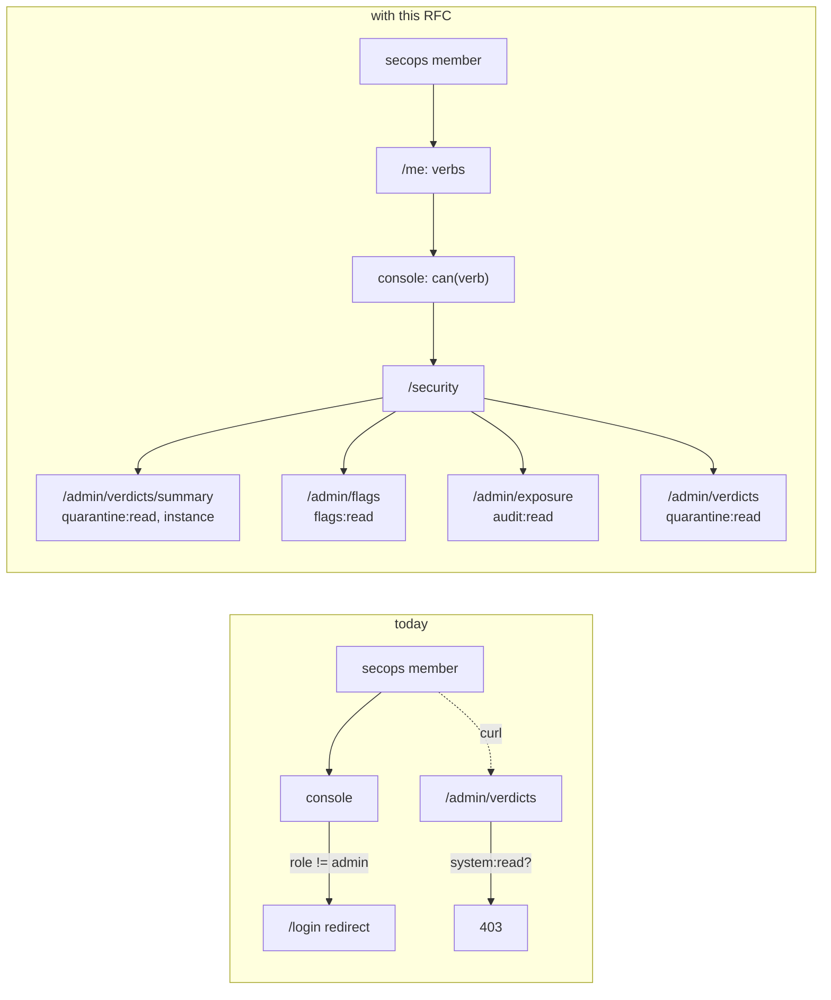
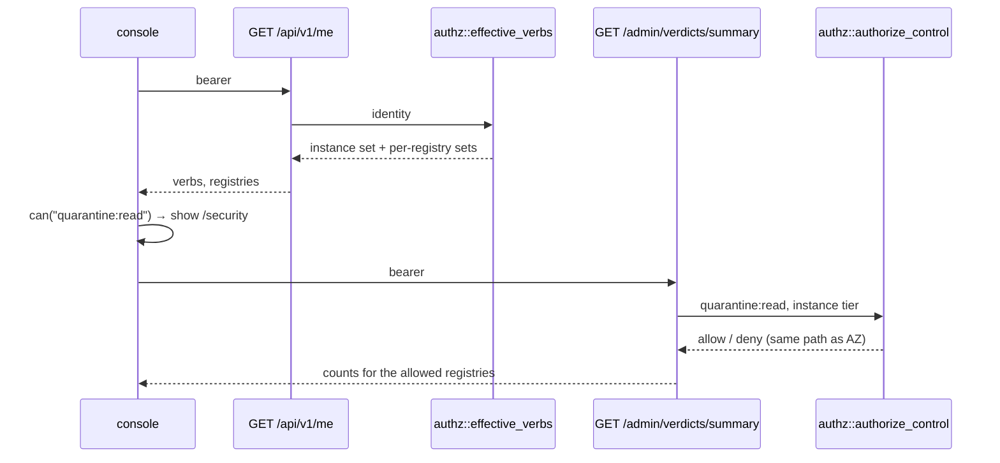
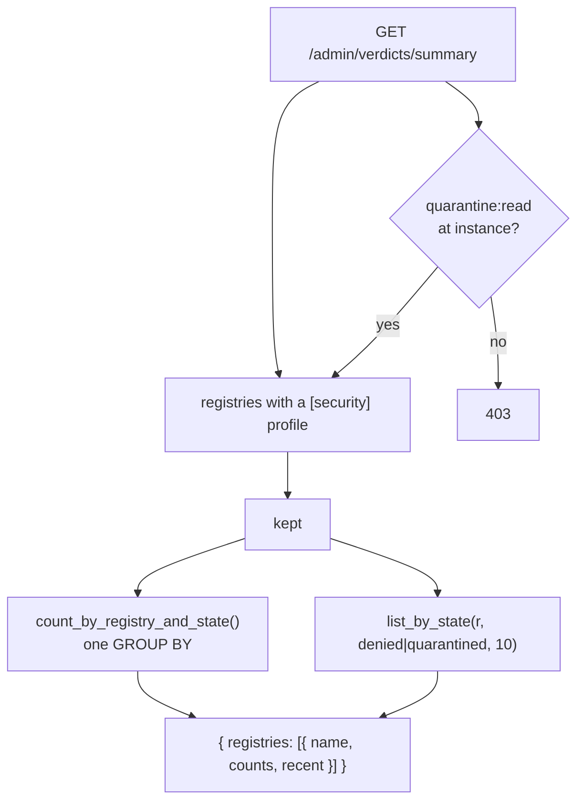

# RFC 0042 — A security console beside the admin

| Field       | Value                                                        |
| ----------- | ------------------------------------------------------------ |
| Status      | Implemented                                                   |
| Short       | Security console by verb                                      |
| Settles     | How a delegated security group reaches a security dashboard without being admin: verbs in /me, narrowed endpoint verbs, one aggregate read |
| Author      | Sn0walice <snow.alice@pm.me>                                  |
| Co-author   | Claude Opus 5.5 <noreply@anthropic.com>                       |
| Created     | 2026-11-10                                                    |
| Supersedes  | —                                                             |
| Touches     | `crates/core` (authz, verdict port), `crates/adapters` (verdict counts), `crates/web` (`/me`, `security.rs`, `sbom.rs`), `cli` (`whoami`), `ui` (auth, router, nav, a new page), `tests/heavy` (`authz.sh`, `console_fetch.sh`), `perf/profile_routes.txt`, docs |

---

## 1. Summary

RFC 0015 made every back-office endpoint ask the engine for a verb, and those
verbs are delegable at the instance tier. The server can therefore already
serve a security team that is not admin. The console cannot. It decides
everything on `role === "admin"`, `/me` does not say which verbs the caller
holds, two security reads ask for `system:read` (which also opens config and
health), and no endpoint gives a cross-registry view of what is held.

This RFC closes those four gaps and adds nothing to the authorization model.
`/me` returns the caller's effective verbs, at the instance tier and per
registry. The console gates routes, the nav and in-page actions with
`can(verb)`. Three endpoints move to the verb that names what they disclose.
One read is added, `GET /api/v1/admin/verdicts/summary`. A new `/security` page
is built from it and from the existing flags, exposure and audit reads, each
section shown only when its verb is held.

### Before / after

```toml
# The operator writes this today, and it already works on the server:
[grants]
"group:oidc1:secops" = ["audit:read", "quarantine:read", "findings:read", "flags:read"]
```

```text
# today — a member of secops signs in
GET /api/v1/me                    → { role: "user", groups: ["secops"] }      no verbs
console                           → no "Admin" link, /admin redirects to /login
GET /api/v1/admin/flags           → 200   (flags:read, instance)  — unreachable from the UI
GET /api/v1/admin/verdicts?registry=npm1
                                  → 403   asks system:read
GET /api/v1/admin/verdicts?…      → (no cross-registry form exists)

# with this RFC
GET /api/v1/me                    → { …, verbs: ["audit:read","findings:read","flags:read","quarantine:read"],
                                      registries: { "npm1": [ …, "quarantine:read", "findings:read" ] } }
console                           → "Security" link, /security renders four sections
GET /api/v1/admin/verdicts?registry=npm1          → 200 (quarantine:read; findings kept: findings:read)
GET /api/v1/admin/verdicts/summary                → 200, every registry with a [security] profile
GET /api/v1/admin/config                          → 403, unchanged: config:read was never granted
```



The diagram shows the request the RFC exists for. Today the secops member
stops at the role check in the router, and the one read they could make by hand
asks for a verb nobody would give a security team. Afterwards each box on
`/security` is backed by the endpoint whose verb the operator granted, and by
no other.

---

## 2. Motivation

1. **The console cannot see a delegation the server honours.** With the
   `[grants]` block above, `GET /api/v1/admin/flags` answers `200` to the
   secops member (`flags.rs`, `require_verb(FlagsRead, None)`). But the router
   guard is `to.meta.requiresAdmin && !isAdmin.value`
   (`ui/src/router/index.ts`), with `isAdmin = role === "admin"`
   (`ui/src/composables/useAuth.ts`). So the page holding `FlagsPanel`
   (`/admin/operations/sbom`) redirects them to `/login`. The UI cannot fix
   this alone: `MeResponse` (`front_office/me/identity.rs`) carries `role` and
   `groups` and no verbs, and a group's verbs are known only to the engine.
2. **The verdict listing is behind the wrong verb.** `list_verdicts`
   (`security.rs`) calls `require_verb(SystemRead, Some(registry))`. If an
   operator grants `system:read` so a reviewer can read verdicts, the same
   grant opens `/admin/health/system`, the subject directory
   (`governance/subjects.rs`), the notification wiring
   (`notification/subscriptions.rs`), the upstream audit (`ops/upstream.rs`),
   the air-gap reads and the SBOM export. Meanwhile the verbs that name this
   disclosure, `quarantine:read` and `findings:read` (RFC 0018 §4.1), are not
   consulted at all. The response also always includes findings, which
   `findings:read` exists to withhold.
3. **The bulk verdict operations borrow `system:write`.** `bulk_rescan` and
   `backfill_verdicts` require `system:write`. That verb also edits
   notification subscriptions, invalidates the explore cache
   (`explore.rs`) and imports an air-gap bundle (`air_gap.rs`). An estate that
   wants secops to re-judge what it holds has to hand them the ability to
   reroute every alert.
4. **No cross-registry read exists.** `list_verdicts` requires `registry`, and
   `VerdictRepository` (`ports/security.rs`) can only list one registry and one
   state at a time. A dashboard answering *"what is held across the instance"*
   would need registries × states requests and could still not report a
   count above its `limit`.
5. **The console shows an action its caller cannot use.** `PackageDetailPage`
   passes `:can-rescan="isAdmin"` to `VerdictPanel`. But `rescan_verdict`
   requires `gates:exempt`, which `translate.rs` deliberately grants to
   nobody (asserted at `translate.rs:808`). So by default every administrator
   sees a *Rescan* button that answers `403`, which breaks `PRODUCT.md`
   principle 4. The same role-for-verb confusion gates the page's whole admin
   section (`v-if="isAdmin"`, `PackageDetailPage.vue:1933`).

---

## 3. Goals / non-goals

**Goals**

- `/me` reports the caller's effective verbs, using the same resolution the
  server enforces.
- The console gates every route, nav entry and action on a verb, never on
  `role` (`PRODUCT.md` principle 4).
- Every security read asks for the verb that names what it discloses.
- One aggregate read gives cross-registry verdict counts and recent holds.
- A `/security` page, separate from `/admin`, that a non-admin holding any of
  the four security verbs can use.

**Non-goals**

- **No new authorization concept**: no role, no persona, no "security admin"
  flag. A security team is a group with grants, and the verbs already exist.
- **No rename of `/api/v1/admin/…`.** See §11 decision 3.
- **No change to who can do what by default.** Every verb moved in §4.2 is
  granted to `role:admin` at the tier its endpoint checks, so an upgrade
  takes nothing away from an administrator (RFC 0015 §10 rule 5).
- **No per-package verbs in `/me`.** Package- and version-tier grants live in
  the database (RFC 0017). Listing them per caller is the N+1 that RFC 0015
  §13.2 measured at 806×. `/me` reports the instance and registry tiers, the
  ceiling the console needs to decide whether to *show* a surface. The server
  still enforces per package.
- **No refusal feed from the audit log in the summary.** The audit log already
  has a filtered read (`/admin/audit-log`, `audit:read`). Copying it into the
  summary would add a second gate over the same rows.
- **The admin sections are not split further.** `/admin` stays one area,
  visible to anyone holding any of its pages' verbs, and each tab is filtered.

---

## 4. User-facing design

### 4.1 Configuration

Nothing new. The operator writes the grant in the place
`docs/guide/access-control.md` § *Where you write them* already documents:

```toml
[grants]                                     # instance tier
"group:oidc1:secops" = ["audit:read", "quarantine:read", "findings:read",
                        "flags:read", "scans:run"]
```

The only new verb is `scans:run` (§4.2). A narrower team writes a subset. A
grant of `quarantine:read` alone gives a dashboard with counts and recent holds
but no reason details, and no flags, exposure or audit sections.

### 4.2 The verb of each security endpoint

| Endpoint | Today | With this RFC |
| --- | --- | --- |
| `GET /api/v1/admin/verdicts?registry=` | `system:read` (registry) | `quarantine:read` (instance); `findings` emptied unless `findings:read` (instance) — decision 8 |
| `GET /api/v1/admin/verdicts/summary` | — | new; `quarantine:read` (instance) — decision 8 |
| `POST /api/v1/admin/verdicts/rescan` | `system:write` (registry) | `scans:run` (registry) |
| `POST /api/v1/admin/verdicts/backfill` | `system:write` (registry) | `scans:run` (registry) |
| `GET /api/v1/sbom/export` | `system:read` (instance) | `packages:read` (instance) |
| `GET /api/v1/admin/flags` | `flags:read` | unchanged |
| `GET /api/v1/admin/exposure`, `/export` | `audit:read` | unchanged |
| `GET /api/v1/admin/audit-log`, `/export` | `audit:read` | unchanged |
| `GET /api/v1/verdicts/{r}/{n}/{v}/pullers` | `audit:read` (registry) | unchanged |
| `POST /api/v1/verdicts/{r}/{n}/{v}/rescan` | `gates:exempt` (coordinate) | unchanged (§6, deliberately untouched) |
| `GET /api/v1/admin/stats` | `stats:read`, filtered per registry | unchanged |

`scans:run` is new because neither existing candidate fits. `gates:exempt`
silences a finding, and an estate that lets secops *re-judge* has not let
them *accept*. `cache:warm` fetches upstream bytes, but a rescan reads what is
already cached and the operator's intent is about judgement, not storage.
`retention:run` is the naming precedent for a verb that starts a job.

`sbom/export` moves to `packages:read` because the export is the
administrative package inventory with components attached. That is the
disclosure `packages:read` already names (`permission.rs`, *"the
administrative package inventory"*). `system:read` names health and wiring,
which an SBOM is not.

### 4.3 Behaviour rules

- **`/me` for anonymous** returns `verbs: []` and the registry-tier verbs
  the instance grants to `anonymous`, so a public mirror's console can still
  show what an anonymous reader may do. With no `[grants]` and no
  `[registries.grants]` anywhere, `registries` is `{}` and `verbs` is the
  floor that `instance_node` grants to the caller's role.
- **`/me.registries` is keyed by registries that have a hierarchy**, as
  `installable_registries` is. If a registry is absent, the caller was not
  *shown* to hold anything there. That is different from "holds nothing", and
  the console treats absence as "do not show", never as "show".
- **An active shadow (RFC 0015 §4.7) is not a grant in `/me`**, for the reason
  `installable_registries` gives: a dry run is the state where denials are
  about to start.
- **The listing and the summary are instance-tier reads** (decision 8). Both
  name coordinates across a whole registry, including packages the caller may
  not be able to read, so the registry-tier `quarantine:read` every user holds
  by default is not enough. A caller without the instance-tier verb gets
  `403`. A registry with no `[security]` profile is absent from the summary.
- **Recent holds in the summary carry reason codes, never findings.** Findings
  stay behind `findings:read` in the per-registry listing. The summary carries
  counts and coordinates, which is what `quarantine:read` already discloses
  on a single package.
- **The `/security` nav entry appears when the caller holds, at the instance
  tier, any of `quarantine:read`, `findings:read`, `flags:read`, `audit:read`.**
  A registry-tier `quarantine:read` alone does not count, because `role:user`
  holds it on every registry by default (RFC 0018 §4.1). Counting it would give
  every developer a security console they did not ask for. Their view stays
  `VerdictPanel` on the package page.
- **`/admin` appears when the caller holds, at the instance tier, the verb of
  at least one admin tab.** Each sidebar entry and tab is shown only if its
  own verb is held. The verb of each route is defined once, beside the route
  (`meta.verb`), and the nav and sidebar read it from there.
- **Nothing changes for an administrator.** `role:admin`'s floor gains
  `quarantine:read`, `findings:read` and `scans:run` at the instance tier
  (they are only at the registry tier today), so every surface above resolves
  for them at the tier it checks.

### 4.4 Validation

No new config, so no new hard errors. One new warning:

| Condition | Where the operator sees it |
| --- | --- |
| An instance-tier grant names `quarantine:read` or `findings:read` and no registry has a `[security]` profile | `ConfigWarning` in `GET /api/v1/admin/config` and in the config page's warning list, the same channel every grant warning uses |

---

## 5. Architecture

### 5.1 One resolution, read twice



`effective_verbs` and `authorize_control` both resolve over
`instance_prefix(hot)` plus the registry node (`chain.rs`), and both call
`resolve(path, subject)`. The first reads `.actions()`, the second reads
`.holds(action)`. Because they share the path builder, `/me` cannot claim a
verb the endpoint then refuses at the instance or registry tier. This is the
`explain` lesson recorded in `resolution_path`'s comment, *"a diagnostic that
can disagree with reality is worse than none"*, applied to the console.

### 5.2 The summary is one query



Counts come from a single `GROUP BY registry, state` over `artifact_verdicts`,
keeping the registries that have a `[security]` profile. This has the shape of
`count_unrated_by_registry`, which exists for the same reason. Recent holds
reuse `list_by_state` with a small limit, so there is no new query.

---

## 6. Detailed design

### 6.1 `crates/core`

- `entities/permission.rs`: `Action::ScansRun` (`"scans:run"`), added to
  `Action::ALL`, documented next to `RetentionRun`.
- `services/authz/translate.rs`: `role:admin` gains `ScansRun` in the
  registry-tier control block. `instance_node` gains `QuarantineRead`,
  `FindingsRead` and `ScansRun`. The test next to `translate.rs:808` gains
  the matching assertions. `GatesExempt` stays absent, and the existing
  assertion that it is absent stays.
- `services/authz/chain.rs`: `pub async fn effective_verbs(hot, identity) ->
  EffectiveVerbs { instance: BTreeSet<Action>, registries: BTreeMap<String,
  BTreeSet<Action>> }`. It sits next to `installable_registries` and uses the
  same prefix-and-registry-node walk, with no shadow.
- `ports/security.rs`: `VerdictRepository::count_by_registry_and_state() ->
  Result<Vec<(String, VerdictState, u64)>, CoreError>`, with no default
  method. A default returning nothing would make the dashboard report "0 held"
  on a backend that never counted.

### 6.2 `crates/adapters`

- `in_memory/security.rs`: counts over the map.
- `db/security.rs`: `SELECT registry, state, count(*) FROM artifact_verdicts
  GROUP BY 1, 2`. No migration, because `artifact_verdicts` already has
  `(registry, state)`.

**This is the one file inside `crates/adapters/src/db/`, where the TD-0001 /
TD-0004 session works.** The change is one new trait method body in
`security.rs` and touches no file that session edits.

### 6.3 `crates/web`

- `front_office/me/identity.rs`: `MeResponse` gains `verbs: Vec<String>` and
  `registries: BTreeMap<String, Vec<String>>`. The values are the `as_str()`
  spellings, the same strings the grants config and the 403 messages use.
  The handler takes `web::Data<Arc<ProxyService>>` for `hot`, as
  `security.rs` does.
- `security.rs`: `list_verdicts` asks for `QuarantineRead`, then
  `authorize_control(…, FindingsRead)`. On a deny it clears `findings`.
  `bulk_rescan` and `backfill_verdicts` ask for `ScansRun`. New
  `verdict_summary` handler, with `VerdictSummaryResponse` (`ToSchema`) as the
  body of its `200`.
- `back_office/sbom.rs`: `export_sbom` asks for `PackagesRead`.
- `lib.rs`: one `cfg.service(verdict_summary)` and its path in the OpenAPI
  list. It is registered **before** any `{…}` route under
  `/api/v1/admin/verdicts`, and there is none today. **This touches the router
  file the other session works in.** It is two added lines.
- `crates/web/tests/authz_matrix.rs`: no change. Both inventories filter on
  `/proxy/`, and every route here is under `/api/v1/`.

### 6.4 `cli`

- `cli/src/api/…` `MeResponse` gains the two fields as `#[serde(default)]`,
  so a newer CLI still reads an older server. `batlehub-cli auth whoami` prints
  the instance verbs. Nothing else in the CLI moves: the paths are unchanged
  (§11 decision 3).

### 6.5 `ui`

- `task dump-spec`, then `task ui:generate`. The client is never edited by
  hand.
- `composables/useAuth.ts`: `can(verb, registry?)` reads
  `identity.registries[registry]` when given, otherwise `identity.verbs`.
  `canAny(verbs)` is the `some` over it. `isAdmin` stays only where the
  *role* is the thing shown (the role badge in `AppHeader`). Every gating use
  moves to `can`.
- `router/index.ts`: `meta.requiresAdmin` becomes `meta.verb` (one verb) or
  `meta.anyVerb` (the `/admin` and `/security` parents). The guard sends an
  authenticated caller who lacks the verb to `/`, not to `/login`, because
  they are signed in.
- `config/navigation.ts`: `NavViewer` replaces `isAdmin` with `can`.
  `primaryNav` adds `/security` per §4.3. `config/adminSections.ts` entries
  read their verb from the route's `meta`, so they are not mapped a second
  time.
- `pages/PackageDetailPage.vue`: the admin section and each of its actions
  use `can(verb, registry)`. `:can-rescan` becomes
  `can("gates:exempt", registry)`, which fixes motivation 5.
- `pages/SecurityDashboard.vue`, at `/security`. Its sections are *Holds*
  (summary, `quarantine:read`), *Findings* (link into the per-registry
  listing, `findings:read`), *Flags* (the existing `FlagsPanel`,
  `flags:read`) and *Exposure* (the existing `ExposurePanel`, `audit:read`).
  Each section renders only when its verb is held, so the page has no locked
  states. It uses the shared states, fields and tables from audit lot C, which
  keeps `design/system-rules.test.ts` green as written.

### 6.6 `tests/heavy/authz.sh`

The suite is `tests/heavy/authz.sh`. It gets a new phase,
`phase_security_console`, which runs on `config.authz.toml` with one added
instance grant: `"group:*:secops" = ["audit:read","quarantine:read",
"findings:read","flags:read","scans:run"]`. The token is a static
`[[auth.tokens]]` carrying that group. The client is `curl`, as in every
other `authz_*` helper. A second case runs in `tests/heavy/console_fetch.sh`,
whose Playwright browser is pinned by that suite's `console_fetch.mjs`
lockfile. What it proves, on the wire:

1. `curl /api/v1/me` as secops: `verbs` contains exactly the five granted
   verbs and none of `config:read`, `system:read`. The same call as admin
   lists `scans:run` and `quarantine:read`.
2. `curl /api/v1/admin/verdicts?registry=npm1` as secops: `200`, and the
   items carry `findings`. With a token whose group holds only
   `quarantine:read`: `200`, every `findings` is `[]`.
3. The same calls as a plain `role:user` (registry-tier `quarantine:read`
   only, no instance grant): `/me.verbs` holds no security verb, and both
   `GET /api/v1/admin/verdicts?registry=npm1` and `…/summary` answer `403`.
4. `curl -X POST /api/v1/admin/verdicts/rescan` as secops: `202`, and
   `batlehub_scan_jobs_queued` moves. As a token holding `system:write` only:
   `403`, with the body naming `scans:run`.
5. `curl /api/v1/admin/config` and `/api/v1/admin/health/system` as secops:
   both `403`. The grant did not open what motivation 2 says `system:read`
   used to.
6. `GET /api/v1/admin/verdicts/summary` as secops after `quarantine.sh`'s
   fixture is held: `counts.quarantined ≥ 1` for its registry, and
   `recent[0]` names the held coordinate with no `findings` key.
7. Console (`console_fetch.sh`, new step): signed in as secops, the header
   shows *Security* and not *Admin*. `/security` renders the four section
   headings. Navigating to `/admin/operations/config-reload` lands on `/`.
   Signed in as a plain user, neither link is shown.

**Deliberately untouched**, so reviewers do not go looking:

- `POST /api/v1/verdicts/{r}/{n}/{v}/rescan` keeps `gates:exempt`. It is
  checked on the coordinate *before* resolution spends the upstream budget
  (its comment says so). Moving it to `scans:run` is a separate question about
  per-package delegation, and nothing here needs it.
- `back_office/tombstones.rs`'s compact endpoint asks for `tombstones:read`
  on a write. This is out of scope and is noted as a follow-up.
- `inbound_webhook.rs`'s `/admin/notifications/inbound` stays `system:read`.
  It shows the wiring of where flags come from, not the flags themselves.
- `require_verb` and `authorize_control` keep their signatures. The summary
  calls `require_verb` once, with no registry.
- `crates/web/src/middleware/auth.rs` is not touched. `/me` reads the
  identity the middleware already resolved.

### 6.7 Docs

- `docs/guide/access-control.md`: a *Delegating the security console*
  subsection with the §4.1 block, and `scans:run` in the verb table.
- `docs/use/` page for `whoami`: the new `verbs` line.
- `docs/operations/incident-response.md`: its SOC-flag section gains a
  pointer to `/security`, where a delegated responder reads what is held.

---

## 7. Security considerations

- **`/me` discloses the caller's own verbs, and nothing about anyone else's.**
  Any caller could already learn them by trying each endpoint and reading the
  `403`'s text, which names the verb. The registry map is bounded by the
  registries that have a hierarchy, which `GET /api/v1/registries` already
  lists to the same caller.
- **No endpoint becomes reachable to anyone new by default.** Every move in
  §4.2 goes to a verb that `role:admin` holds at the tier checked (§4.3 last
  rule), and `role:user`'s defaults gain nothing. The one widening is
  operator-written: a grant naming `quarantine:read` at the instance tier now
  reaches the verdict listing, which is the point.
- **Findings stay withheld from a `quarantine:read`-only reader**, now in the
  listing too, where they were not before. This is a narrowing.
- **Neither cross-package read leaks a private package name to a developer.**
  Both require `quarantine:read` at the instance tier, which no translation
  grants to `role:user` (decision 8), so the default per-registry
  `quarantine:read` keeps its per-package meaning.
- **The UI gates are not authorization.** `navigation.ts`'s header says so,
  and the server enforces every verb above whether the console hid the link or
  not. Case 7 of §6.6 checks presentation, cases 1–6 check enforcement.

---

## 8. Alternatives considered

| Alternative | Why rejected |
| --- | --- |
| A `security` role beside `admin` | A fourth value in `Role` changes `has_role_at_least`, every `Role` match and the OIDC role mapping, to express something the verbs already express. RFC 0015 removed `require_admin` so as not to have two models. |
| The console calls each endpoint and hides what 403s | It gives one request per surface on every page load, and a `403` cannot tell "not granted" from "registry has no profile". It also shows the surface until the probe returns, which breaks principle 4 for the duration. |
| `/me` returns verbs at the instance tier only | Motivation 5's button is registry-scoped (`gates:exempt` per registry), and so is every action on the package page. Without the registry map, the page has to keep `isAdmin` and stays wrong. |
| A summary under `/api/v1/security/summary` | It starts a new top-level namespace for one route, next to `/api/v1/admin/verdicts` which serves the same data per registry. Two prefixes for one resource is the drift RFC 0003 cleaned out of the UI's routes. |
| Gate `/security` on registry-tier `quarantine:read` | `role:user` holds it everywhere by default (`translate.rs`), so every developer would get the console. |
| Reuse `cache:warm` for bulk rescans | It is granted to warming operators for storage reasons, and §4.2 explains why judgement is a different delegation. |

---

## 9. Rollout and compatibility

- **Default behaviour.** With no `[grants]` change, an administrator sees
  what they see today plus a `/security` link, and a user sees what they see
  today minus a *Rescan* button that never worked.
- **API compatibility.** `MeResponse` only gains fields. The OpenAPI client
  and the CLI read them as optional. No path changes. A script holding a
  token with `system:read` that used it for `/admin/verdicts` loses access.
  That token was the over-grant motivation 2 describes, and the release note
  says so and names the replacement verb.
- **Config.** No migration, and `CURRENT_CONFIG_VERSION` does not move.
- **Rollback.** Nothing is persisted. Reverting the binary restores the old
  verbs, and a grant naming `scans:run` then fails to parse as an unknown
  verb. The release note says to drop it before downgrading.

---

## 10. Test plan

- **Unit** (`crates/core/src/services/authz/chain.rs`, `translate.rs`):
  `effective_verbs` against admin, user, anonymous and an instance-granted
  group. Shadow excluded. A registry with no hierarchy is absent. The floor
  includes `scans:run`, `quarantine:read` and `findings:read` at the instance
  tier and still excludes `gates:exempt`.
- **Integration** (`crates/web/tests/security_registry.rs`, `flags.rs`, a new
  `me_verbs.rs`): each row of §4.2's table against an instance-granted group,
  a plain user and an admin. Findings are emptied without `findings:read`. The
  summary returns empty, not `403`, for a caller with no readable registry.
  `openapi_contract.rs` passes with `VerdictSummaryResponse` declared.
- **UI** (vitest): `useAuth.can`/`canAny`. The router guard, per `meta.verb`.
  `primaryNav` for the four viewers of §6.6 case 7. `SecurityDashboard` renders
  only granted sections. `PackageDetailPage` hides *Rescan* without
  `gates:exempt`. `system-rules.test.ts` passes unchanged.
- **Heavy** (`tests/heavy/authz.sh`, `console_fetch.sh`): §6.6.
- **Existing suites** that must pass unchanged: `authz_matrix.rs` (no proxy
  route moves), `openapi_contract.rs`, `cli/tests/integration.rs` (the CLI's
  paths are untouched), and the `translate.rs` differential harness, which
  proves the floor change breaks no legacy equivalence.

---

## 11. Decisions and open questions

### Resolved

| # | Question | Decision |
| --- | --- | --- |
| 1 | Does the model need a security role or persona? | **No.** The verbs exist and delegate at the instance tier. The gap is that the console and four endpoints do not use them. |
| 2 | Verb for bulk rescan / backfill | **A new `scans:run`.** `system:write` also reroutes alerts, `gates:exempt` accepts findings, and `cache:warm` is a storage delegation. |
| 3 | Rename `/api/v1/admin/…` now that non-admins reach it? | **Keep the paths; the prefix names the back office, not the role.** A rename would need aliases in the router (the file the parallel session owns), a deprecation window for `cli/src/api/security.rs` and `admin.rs`, and changes to every doc link, and it would change no access decision. `docs/guide/access-control.md` states the reading in one line. The new summary goes under the existing `/admin/verdicts`. |
| 4 | What gates the `/security` nav entry? | **An instance-tier hold of any of the four security verbs.** Registry-tier `quarantine:read` is every user's default. |
| 5 | Should the summary include audit-log refusals? | **No.** `/admin/audit-log` already filters them under `audit:read`, and the dashboard links to it with the filter set. |
| 6 | Should `/me.registries` list only the registries whose set differs from the instance set? | **No, full sets.** An instance has tens of registries, not thousands, and a merge in the client is a second resolution, which §5.1 exists to avoid. |
| 7 | `sbom/export` to `packages:read` or `findings:read`? | **`packages:read`.** The export lists components, not findings, and an auditor asking for an inventory should not need the embargo-grade verb. |
| 8 | At which tier do the verdict listing and the summary check `quarantine:read`? | **The instance tier**, against the draft's registry tier. Found at implementation: `role:user` holds `quarantine:read` on every registry by default (`translate.rs`), so a registry-tier check would let any developer list every held coordinate of a registry, private packages included. A per-registry delegate is lost, and an instance grant covers the case the RFC is for. |

### Still open

None.

---

## 12. Implementation phases

Each phase is one commit. `cargo test --workspace`, clippy, fmt, vitest,
vue-tsc and oxlint pass after each one.

| Phase | Content |
| --- | --- |
| 1 | **`/me` exposes verbs.** `effective_verbs`, `MeResponse` fields, CLI `whoami`, spec and client regenerated. Useful on its own: `whoami` answers "what may I do". |
| 2 | **Verbs narrowed.** `scans:run`, the floor additions, `list_verdicts` / bulk / backfill / `sbom/export` re-gated, findings withheld, access-control docs. The behaviour change of §9 lands here. |
| 3 | **Summary endpoint.** `count_by_registry_and_state` (in-memory and Postgres), `verdict_summary`, route registration, spec and client regenerated. |
| 4 | **Console reads verbs.** `can`/`canAny`, router `meta.verb`, nav and admin sidebar, `PackageDetailPage`. This fixes motivation 5. With no other phase, an administrator's console is unchanged except for that fix. |
| 5 | **`/security` page.** `SecurityDashboard.vue`, nav entry, i18n keys, the heavy cases of §6.6. |

Phases 1 and 2 are independent. Phase 4 needs 1, and phase 5 needs 3 and 4.

---

## 13. Revision against the tree (2026-11-10)

All five phases landed on 2026-11-10, one commit each, on a branch cut from
`alice-fix` after TD-0001/TD-0004 merged. Every point where the built thing
differs from the text above is listed here. The text above is left as it was
accepted, except for decision 8, which was written into it before phase 2.

**Decision 8, found before phase 2 was written.** §4.2 had the verdict listing
and the summary checking `quarantine:read` at the registry tier. `translate.rs`
grants that verb to `role:user` on every registry, so any developer could have
listed every held coordinate of a registry, private packages included. Both
reads now check the instance tier, and `role:admin`'s instance floor gained
`quarantine:read` and `findings:read` (and `scans:run`). The cost is that a
per-registry delegate cannot list verdicts. An instance grant covers the case
this RFC exists for.

**`count_by_registry_and_state` has a default after all.** §6.1 said no
default, so that a backend that never counted could not answer "0 held". The
default that shipped returns `CoreError::NotSupported`, which keeps that
property without touching the four test doubles that implement the port.

**One table for the admin pages' verbs, not `meta.verb`.** §6.5 put each
admin route's verb in its `meta`. The verbs live in `ADMIN_PAGE_VERBS`
(`ui/src/config/adminSections.ts`), which the router guard, the sidebar and
`SectionTabs` all read, so a link and the guard behind it cannot disagree. A
page missing from the table is refused. A signed-in caller who lacks a page's
verb lands on the first page of the same section they may open, then of any
section, then `/`, never on `/login`.

**What `/security` does not have yet.**

- The *Findings* section of §6.5. There is no console page listing one
  registry's verdicts to link it to. `findings:read` is honoured by the API
  (the listing empties findings without it), but the console has no surface
  for it.
- The package page's admin section is gated on `packages:read` as a whole.
  The actions inside it (yank, delete, grants, visibility) keep their own
  server-side verbs, but the console does not yet hide each one by verb, so a
  `packages:read`-only delegate sees buttons that answer `403`.
- The `whoami` and `incident-response` doc pointers of §6.7 were not written.
  `docs/guide/access-control.md` § *Delegating the security console* carries
  the instruction.

**What the heavy suites observed** (§6.6).

- `tests/heavy/authz.sh matrix`, against a real server and Postgres: 109
  assertions, and the vocabulary check passes with `scans:run` in it. That
  check would have failed on phase 2 alone, because the verb was new and
  nothing on the wire exercised it. The tap's transcript for the new section:
  secops `GET /api/v1/admin/verdicts?registry=…` gets `404` past the gate (no
  `[security]` profile in that config), and the denied `role:user` gets `403`.
  `GET …/verdicts/summary` gives `200` and `403` for the same pair. A bulk
  rescan by secops gets `404` past the gate, and the SRE holding `system:read`
  gets `403`, with a body naming `scans:run`. `config/warnings` and `health`
  give `403` to secops, and `flags` gives `200`.
- `quarantine:read` and `findings:read` are no longer exceptions in the
  vocabulary check. They are exercised as control gates now.
- Cases 1 to 5 of §6.6 ran on the wire, with one change in case 2: the
  findings half (emptied without `findings:read`) is asserted in-process, in
  `security_registry.rs`, which has a verdict to empty. Case 6 (summary counts
  after a real hold) is in-process for the same reason: the matrix config
  deliberately has no security profile. The Postgres `GROUP BY` is asserted in
  `crates/adapters/tests/pg_verdicts.rs` against a real database.
- `tests/heavy/console_fetch.sh`, case 7, in a real Chrome against the built
  console: secops's nav is `/packages`, `/setup`, `/security`, `/admin`;
  `/security` draws `holds-panel`, `flags-panel` and `exposure-panel`; and
  `/admin/operations/config-reload` lands on `/admin/observability/audit-log`.
  A plain user's nav is `/packages`, `/setup`, and both `/security` and the
  admin page land on `/`. **Case 7 as written was wrong.** It said secops sees
  *Security* and not *Admin*, but §4.3 shows `/admin` to anyone holding one
  admin page's verb, and `audit:read` is the audit log's. The browser
  followed §4.3, the suite's first run failed on the case, and the case now
  asserts §4.3: *Admin* appears, holding the audit log alone.
- **`/me` is 20 KB for the administrator** on `config.authz.toml`'s 35
  registries, against 4 KB for secops. That is decision 6's full sets, as
  predicted, and the number to watch if an estate has hundreds of registries.

**A pre-existing failure the console run met.** `console_fetch.sh`'s own
`user-view` step fails before case 7 is reached: the catalogue's *Fetch*
button is clicked and no `POST …/fetch` crosses the tap. It fails identically
on `alice-fix` at `988ea75`, without this RFC's commits, so it is not this
change. Case 7 was run on its own to get past it.

**Follow-up, not this RFC:** the console's *Fetch* failure above, and
`back_office/tombstones.rs`'s compact endpoint, which asks for
`tombstones:read` on a write.
