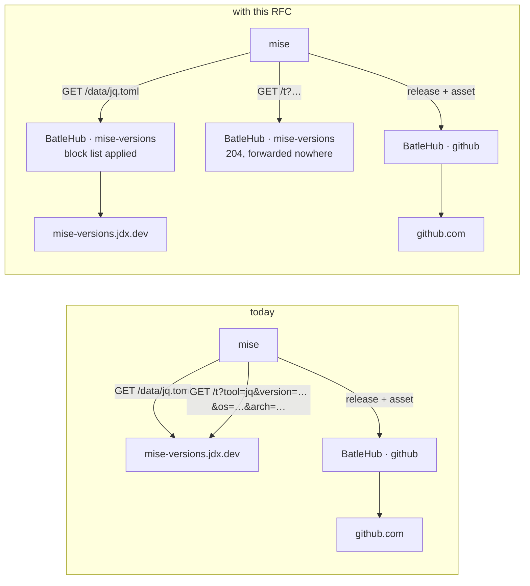
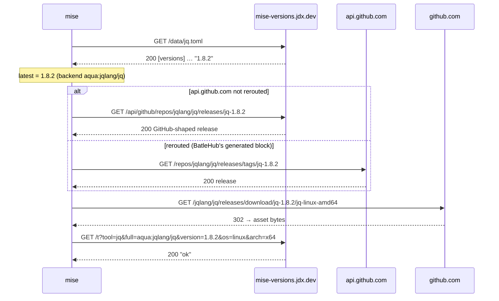
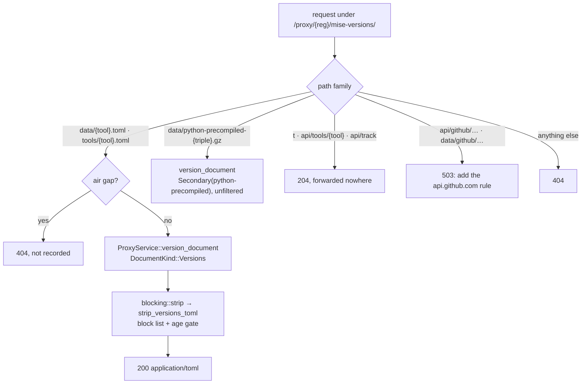

# RFC 0043 — The mise versions host

| Field       | Value                                                        |
| ----------- | ------------------------------------------------------------ |
| Status      | **Implemented** — signed off 2026-11-10; phases 1–3 landed 2026-11-11 in #311 (`04bd331f`), proven by `tests/heavy/closed_world.sh mise-versions` against mise 2026.9.5; phase 4 (the `python-precompiled` filter) and decision 1's block dialog landed 2026-11-13; §13 records 19 differences |
| Short       | mise versions host                                            |
| Settles     | Proxying mise-versions.jdx.dev as a registry kind: version lists filtered by the block list, the install beacon kept on site, and an air gap that answers rather than times out |
| Author      | Sn0walice <snow.alice@pm.me>                                  |
| Co-author   | Claude Opus 5.5 <noreply@anthropic.com>                       |
| Created     | 2026-11-10                                                    |
| Supersedes  | —                                                             |
| Touches     | `crates/core`, `crates/adapters`, `crates/web`, `crates/config`, `server`, `cli`, `ui`, `perf`, `tests/heavy`, docs |

---

## 1. Summary

mise asks one host before any other when it lists a tool's versions:
`mise-versions.jdx.dev`, a shared cache its author runs so that installs do
not spend GitHub's anonymous rate limit. BatleHub already routes every
download mise makes through `[settings.url_replacements]`, and routes none of
these listings. So the version mise picks for `jq@latest` is chosen from a
list BatleHub never saw, after every install mise reports the tool, version,
OS and architecture to that host, and an air-gapped host waits on a connect
timeout before it falls back.

This RFC adds a `mise-versions` registry kind. It serves `/data/<tool>.toml`
through the block list, answers the install beacon itself and forwards
nothing, refuses the GitHub-mirror family with the one status that makes mise
ask GitHub instead, and answers a listing in an air gap with the `404` that
mise reads as "use the backend's own list". There is nothing to install from
this kind: every byte mise installs still comes through the registry kind
that already serves it.

### Before / after

```toml
# today — mise.toml, as `batlehub-cli registry suggest --mise` writes it
[settings.url_replacements]
"regex:^https://api\\.github\\.com/repos/(.+)" = "https://hub.example.com/proxy/github/github/$1"
"regex:^https://github\\.com/([^/]+)/([^/]+)/releases/download/([^/]+)/(.+)" = "https://hub.example.com/proxy/github/github/$1/$2/releases/download/$3/$4"
# … nothing for mise-versions.jdx.dev: listings and the beacon leave the site

# with this RFC — one more rule, emitted first
"regex:^https://mise-versions\\.jdx\\.dev/(.+)" = "https://hub.example.com/proxy/mise-versions/mise-versions/$1"
```



The beacon is the request that changes most: today it leaves the site with
the estate's inventory in its query string, and afterwards it never leaves
the instance.

---

## 2. Motivation

1. **`latest` is chosen from a list BatleHub never filtered.** mise lists a
   registry tool's versions from `https://mise-versions.jdx.dev/data/<tool>.toml`
   first (`src/backend/mod.rs`, `versions_host::list_versions`, mise
   v2026.11.5) and only calls the backend's own listing when that returns
   nothing. When an admin blocks `jq-1.8.2` on the `github` registry,
   `mise use jq@latest` still resolves `1.8.2` from jdx.dev, then fails on the
   asset download. The client then errors out on a version the block list
   said not to offer, when it should have installed `1.8.1`. RFC 0010 §2 set
   the standard that a blocked version is absent from *every* listing a
   client resolves through. mise's first listing is the one it misses.
2. **The install beacon sends the estate's inventory off site.** After every
   install of a core or registry tool, mise sends
   `GET https://mise-versions.jdx.dev/t?tool=…&full=…&version=…&os=…&arch=…`
   (`track_install_url`, v2026.11.5) or `POST /api/tools/<tool>` with a JSON
   body (v2026.9.5, the version CI pins). `use_versions_host_track` defaults to
   `true`. `full` is the backend coordinate, `ubi:` or `http:` URLs included
   once mise has stripped their credentials. An operator who routed every
   download through BatleHub still publishes what is installed, where and on
   what, to a third party.
3. **An air-gapped host pays a timeout per tool.** With `[air_gap]` on and
   egress denied, the jdx.dev request has nowhere to go. mise waits up to
   `fetch_remote_versions_timeout` (20 s by default) before it logs the
   failure at `warn` (`log_versions_host_warn … "failed"`) and falls back. RFC
   0008-bis made the fallback correct. Nothing yet makes it fast or quiet:
   `mise install` across ten registry tools spends minutes saying nothing.
4. **The closed-world suite cannot see it.** `tests/heavy/mise.sh` and the
   `mise` phase of `closed_world.sh` install `github:cli/cli`, a backend
   coordinate. mise only asks the versions host for a tool whose backend is
   the registry default (`versions_host_tool`, "backend … is not the registry
   default"), so neither suite has ever produced a jdx.dev request. The
   motivation above was found by reading the source, not by a failing run.

---

## 3. Goals / non-goals

**Goals**

- A `mise-versions` registry kind that proxies `mise-versions.jdx.dev` and
  that a single `url_replacements` rule routes to.
- `/data/<tool>.toml` is served with blocked versions removed, through the
  same `blocking::strip` path every other listing takes.
- The install beacon is answered `204` on site and never forwarded, in both
  shapes mise has shipped.
- In an air gap, a listing is a `404` at once rather than a timeout, so mise
  falls back to the backend listing RFC 0008-bis composes from held assets.
- `batlehub-cli registry suggest --mise` emits the rule.

**Non-goals**

- **The GitHub-mirror family (`/api/github/…`, `/data/github/…`).** It
  doubles the `github` kind, and mise already skips it when
  `url_replacements` reroutes `api.github.com` (`github_is_url_replaced`),
  which the generated block does. When it is reached anyway, BatleHub answers
  `503` so that mise asks GitHub (§4.3).
- **mise before 2026.1.0.** Up to 2025.12 mise asked for `/<tool>` as plain
  text. jdx.dev still serves it, but no mise this project pins reads it. It
  falls to the catch-all `404`, and that mise lists from its backend (§11,
  decision 4).
- **Deriving a block here from a block on the backend registry.** `jq` on
  this kind and `jqlang/jq` on `github` are two coordinates. Mapping one to
  the other needs mise's own registry table, which BatleHub does not carry.
  The console offers the second block instead (§11, decision 1).
- **Carrying the listing across the gap.** `mise export` is driven by
  `mise.lock`, and a lock names assets, not listings. The air-gapped `404`
  makes carrying it unnecessary (§5.3).
- **A local or hybrid mode.** Nobody publishes to jdx.dev.

---

## 4. User-facing design

### 4.1 Configuration

```toml
[[registries]]
name = "mise-versions"
type = "mise-versions"
mode = "proxy"                                 # the only mode
upstreams = ["https://mise-versions.jdx.dev"]  # the default when absent

  # Optional. Hides versions younger than the gate from the listing (§11, decision 2).
  [[registries.rules]]
  kind = "release_age_gate"
  min_age_secs = 604800
  deny_missing_timestamp = false
```

- `upstreams` defaults to `https://mise-versions.jdx.dev`. A self-hosted copy
  of jdx/mise-versions is pointed at the same way.
- No new `RegistryConfig` field. `path_allow`, `index_url` and `broker_url`
  are rejected on this type, as they are on every type that does not read
  them.

The client side is one rule, placed **before** any other rule that could
match the host, because mise applies the first match only:

```toml
[settings.url_replacements]
"regex:^https://mise-versions\\.jdx\\.dev/(.+)" = "https://hub.example.com/proxy/mise-versions/mise-versions/$1"
```

An authenticated instance uses a `~/.netrc` entry for the proxy host, as
every other mise rule does. mise sends netrc credentials on any rewritten URL
and refuses to do so over an HTTPS-to-HTTP rewrite
(`ensure_secure_url_replacement`).

### 4.2 Coordinates

| Request | `PackageId` | Document / cache key |
| --- | --- | --- |
| `GET data/jq.toml`, `GET tools/jq.toml` | `jq`, version unused | metadata, `versions` (one entry for both paths) |
| `GET data/python.toml` | `python`, version unused | metadata, `versions` |
| `GET data/python-precompiled-x86_64-unknown-linux-gnu.gz` | `python/x86_64-unknown-linux-gnu`, version unused | metadata, `python-precompiled` |
| `GET t?…`, `POST api/tools/{tool}`, `POST api/track` | none | none: answered in the handler |
| `GET api/github/…`, `GET data/github/…` | none | none: answered in the handler |

A tool is a package, and a mise version string is the version. A block
therefore reads `jq` / `1.8.2`, in mise's own spelling, not the forge tag
`jq-1.8.2`. That is what `mise ls-remote jq` prints and what an admin types.

### 4.3 Behaviour rules

- **Nothing blocked, no gate:** `/data/<tool>.toml` is served byte-exact,
  with upstream's `content-type: application/toml` and its `etag`.
- **A `release_age_gate` on the registry:** every entry whose `created_at` is
  younger than `min_age_secs` is removed, exactly as a blocked one is.
  `created_at` is a required field of the format, so `deny_missing_timestamp`
  only decides the fate of a line the parser could not read: kept when
  `false`, dropped when `true`. The gate is re-evaluated on every request
  against the cached document, so a version appears in the listing on the day
  it comes of age with no cache flush (§11, decision 2).
- **Blocked versions:** their `[versions]` entries are removed. Every other
  line is untouched, including `rolling`, `prerelease`, `release_url` and
  unknown keys. Order is preserved, because mise reads the table in file
  order (`IndexMap`, `parse_version_list`).
- **Every version removed:** the document is still served, with an empty
  `[versions]` table. mise treats an empty list as "none here" (`"empty"`,
  fallback) and asks the backend, which refuses the same versions. The
  alternative, a `404`, would tell the console the tool does not exist.
- **Unknown tool upstream:** jdx.dev answers `404` with a text body
  (`Tool "data/<tool>" not found`). It is relayed as a `404`, and mise falls
  back.
- **The beacon**, in any of its three shapes (`GET /t`,
  `POST /api/tools/{tool}`, `POST /api/track`): `204`,
  empty body, never forwarded, never written to the audit trail. The query is
  not parsed beyond its size bound, so a beacon carries no data into
  BatleHub either.
- **The GitHub-mirror family:** `503` with a body naming the rule to add.
  mise retries a mirror lookup on api.github.com for a timeout, a `429` or any
  `5xx`, and trusts everything else (`retries_on_github`). A `404` here would
  read as "no such release" and break the install, so `503` is the only safe
  answer.
- **`python-precompiled-*.gz`:** relayed and cached as a document, not
  filtered in phase 1. It is an index of python-build-standalone builds, and
  its filter waits until its format is read (§11, decision 3).
- **Air gap:** `/data/<tool>.toml` is a `404`, not the usual `503`, and is not
  recorded as a miss (§5.3). The beacon is still a `204`. The mirror family is
  still a `503`. `python-precompiled` is served if held and is otherwise the
  usual `503` miss.

### 4.4 Validation

`AppConfig::validate()` rejects:

| Condition | Rationale |
| --- | --- |
| `mode` other than `proxy` | There is nothing to publish, and `hybrid` would fall through to an upstream that is the only source. |
| `path_allow`, `index_url`, `broker_url` set | Fields this type never reads. Silently ignoring them hides a misconfiguration. |

Warnings, at load and on the admin's config page:

| Condition | Behaviour |
| --- | --- |
| Any rule other than `release_age_gate` | Accepted, and reported as inert: this kind serves no artifact for it to fire on, and only the age gate has a listing form (§11, decision 2). |
| `upstreams` not ending in a host root | Served as given. A listing that answers `404` for every tool is worth saying once at boot rather than once per `ls-remote`. |

---

## 5. Architecture

### 5.1 The protocol as `mise-versions.jdx.dev` serves it

Read from the mise source at tag `v2026.11.5` (`src/versions_host.rs`,
`crates/mise-util/src/versions_host.rs`, `crates/mise-util/src/http.rs`), and
at `v2026.9.5` where the two differ. Probed on 2026-11-10 with `curl -sD-`.
Every request mise makes to this host goes through `apply_url_replacements`
in the shared HTTP client (`mise-util/src/http.rs:2500`), so one rule routes
all of them.

| # | Request | When | Answer (probed) | What mise does with it |
| --- | --- | --- | --- | --- |
| 1 | `GET /data/<tool>.toml` | listing a registry or core tool, except `java` and `python` | `200 application/toml`; `jq` 1 635 B, `node` 46 674 B, `terraform` 65 293 B; `cache-control: public, max-age=0, must-revalidate`, `etag` | parses `[versions]` in file order; `404` or empty → backend listing; `429` → stops asking for the run; other failure → `warn`, backend listing |
| 2 | `GET /data/python.toml` | listing python-build definitions | `200`, 69 419 B | same, for python's compile path only |
| 3 | `GET /data/python-precompiled-<triple>.gz` | python, precompiled builds | `200 application/gzip`, 10 216 B for `x86_64-unknown-linux-gnu` | gunzips, capped at `MAX_BODY_BYTES` |
| 4 | `GET /api/github/repos/{o}/{r}/releases/{tag}`, `…/releases?page=N`, `…/tags?page=N`, `…/contents/{path}?ref=`, `…/packslip-list`, `…/attestations/{digest}`; `GET /data/github/{o}/{r}/releases.json` and siblings | a `github:`/`aqua:` lookup, **only when `api.github.com` is not rerouted** | `200 application/json`; a release 5 807 B, page 1 of releases 64 199 B | trusted on any answer but timeout, `429`, `5xx` |
| 5 | `GET /t?tool=&full=&version=&os=&arch=` (2026.11+) · `POST /api/tools/{tool}` + JSON (2026.5–2026.10) · `POST /api/track` + JSON (2026.1–2026.4) | after a successful install, when `use_versions_host_track` | `GET /t`: `200 text/plain`, 3 B, `cache-control: …immutable`; `POST /api/track` with `{}`: `400` | ignores the body; status only logged at `trace` |
| — | `GET /tools/<tool>.toml` | mise 2026.1.0–2026.6.5, in place of row 1 | `200 application/toml`, the same body as `/data/<tool>.toml` | as row 1 |
| — | `GET /data/<unknown>.toml` | — | `404 text/plain`, 42 B, `Tool "data/<unknown>" not found` | backend listing |
| — | `GET /<tool>` | mise ≤ 2025.12 | `200 text/plain`, one version per line | not read by any mise this RFC supports |

The entry format, verbatim from `/data/jq.toml`:

```toml
[versions]
"1.5rc1" = { created_at = 2015-01-01T02:54:01.000Z, release_url = "https://github.com/jqlang/jq/releases/tag/jq-1.5rc1", prerelease = true }
"1.5" = { created_at = 2015-08-16T06:39:17.000Z, release_url = "https://github.com/jqlang/jq/releases/tag/jq-1.5" }
```

`VersionEntry` requires `created_at` (a TOML datetime) and defaults
`release_url`, `rolling` and `prerelease`. toml-rs ignores unknown keys, so a
field added upstream reaches the client through an entry-preserving filter.



That is one cold install, against the real hosts, with no proxy. Request 1
picks the version and request 5 reports it. Neither of the two goes through
BatleHub today.

**What mise verifies.** Nothing on the listing: it is parsed, not checked.
The checksum and attestation checks act on the asset (`mise.lock`,
`github_attestations`), which this RFC does not touch. The versions host is
used at all only when `use_versions_host` is `true` (the default), the
backend is the registry default for the tool, and neither `offline` nor
`prefer_offline` is set.

**Auth.** mise sends no credential to jdx.dev except a netrc entry for the
host it was rewritten to. In CI it adds `x-mise-ci: true` and a ` ci` suffix
on the User-Agent (`VERSIONS_HOST_HEADERS`). BatleHub drops both before it
forwards upstream, because neither is the estate's to send.

**Spellings.** Tool names are mise registry keys and core plugin names:
lowercase, `-`-separated (`cargo-binstall`, `github-cli`), and never a
backend coordinate, since `aqua:…` and `ubi:…` are never sent. The file name
is `<tool>.toml` with no further encoding (`version_list_url`). Versions are
mise's own spellings, without the forge's tag prefix.

### 5.2 The kind on the request path



The invariant is that **every path this kind answers is enumerated, and the
fallback is a `404` that never dials out**. A new endpoint on jdx.dev cannot
start leaking through BatleHub without a change here. The cost is that a new
listing endpoint degrades to mise's own fallback until this kind learns it.

### 5.3 Why the air gap answers `404`

RFC 0008's rule is that a miss is a `503` that names the coordinate, so the
next bundle can carry it. That rule assumes something could be carried. Here
nothing can: a bundle is built from `mise.lock`, which names assets, and
composing `jq.toml` from held assets needs the tool → repository mapping that
only mise has. A `503` would do two harmful things. mise would log a `warn`
(`status=503 fallback=true`) for every tool on every install, and the miss
record would fill with listings no export can ever satisfy.

A `404` is what mise reads as "this host does not list it" (`not_found`,
logged at `trace`). It then asks the backend listing, which RFC 0008-bis
composes from the assets the bundle holds. The client ends up with the right
answer, the held set, from the right place, at the cost of one round trip
on the LAN.

The invariant is that **in an air gap this kind never claims to know a
version list**. The only list mise can see is the held set, composed by the
kind that holds it.

---

## 6. Detailed design

### 6.1 `crates/core` — the kind

`RegistryKind::MiseVersions`, `as_str` `"mise-versions"`, added to `ALL`. The
compiler then forces an answer from every exhaustive match listed in
`CLAUDE.md` step 5:

| | `mise-versions` |
| --- | --- |
| `supports_local_mode()` | `false` |
| `requires_explicit_upstream_in_proxy_mode()` | `false` (defaults to jdx.dev) |
| `is_path_addressed()` | `false` |
| `listing_filter()` | ``Filtered("data/<tool>.toml", ["versions"])``, ``Filtered("python-precompiled-*.gz", [])`` |
| `readme_support()` | `None("a version list carries no prose about a tool")` |
| `upstream_detail()` | `Document("versions")`: the console's version table, with `created_at` as the date |
| `fetchable_by_version()` | `None("this kind lists versions; the bytes come from the backend's own registry")` |
| `warm_artifact()` | `None` |
| `install_actions()` | none |

`DocumentKind::PYTHON_PRECOMPILED = Secondary("python-precompiled")`, beside
`LATEST` and `GEM` in `crates/core/src/ports/registry/client.rs`.

### 6.2 `crates/core` — blocking and the listing

- `blocking::strip` gains a `MiseVersions` arm. `DocumentKind::Versions` →
  `with_text(doc, mise_versions::strip_versions_toml)`. It walks the text line
  by line and drops a line of the `[versions]` table whose quoted key is
  blocked. It does not re-serialize, so formatting, order and unknown keys
  survive (the same choice as `strip_index_tab`, RFC 0010 §6.2). A line it
  cannot read as `"<key>" = { … }` is kept and counted, because a version left
  in is visible and a corrupted document is not.
- `crates/core/src/services/mise_versions.rs`: the one parser, header-free.
  It yields `(version, created_at)` for its two readers, `strip` and
  `upstream_detail`.
- **The age gate in the listing (§11, decision 2).** `ListingContext` gains
  `min_age: Option<Duration>`, filled by `ProxyService::version_document`
  from the registry's `release_age_gate` rule (and its
  `deny_missing_timestamp`) when the kind is `MiseVersions`, and `None` for
  every other kind. Only `strip_versions_toml` reads it. Scoping it this way
  keeps the decision from being a cross-kind change: no other listing starts
  hiding young versions because a field appeared. Making it general is a
  separate RFC's argument.
- `services/listing_synthesis.rs`'s `render_listing`: **no arm, on
  purpose.** Its `_ => return None` is the "silent" tier `CLAUDE.md` warns
  about, and here the silence is the design (§5.3). It is written down in the
  coverage gate (§6.7) so that it reads as a decision rather than an
  oversight.
- `BlockedVersions` normalisation: identity. mise spellings are compared
  verbatim.

### 6.3 `crates/adapters` — `registry/mise_versions.rs`

A flat file, per the layout rule: one TOML document, no DTOs worth a module.

- `MiseVersionsRegistryClient { http, base }`.
- `fetch_version_document(Versions, tool)` → `GET {base}/data/{tool}.toml`,
  passing `etag` / `If-None-Match` through as the other document kinds do.
- `fetch_version_document(PYTHON_PRECOMPILED, "python/{triple}")` →
  `GET {base}/data/python-precompiled-{triple}.gz`, bytes untouched.
- `list_versions(tool)` → parse of the above, for the console.
- `resolve_metadata` / `fetch_artifact` → `CoreError::NotFound`: there is no
  artifact, and saying so is cheaper than a variant nobody calls.
- Headers forwarded upstream: none of the client's. `x-mise-ci` and the
  client's User-Agent are dropped (§7).
- `#[cfg(feature = "registry-mise-versions")]`, declared in `Cargo.toml` and
  in `default`.

### 6.4 `crates/web` — `handlers/proxy/mise_versions.rs`

- `GET data/{file}` and `GET tools/{file}`: `{tool}.toml` →
  `validate_package_name(tool)`, then `version_document`. Both paths share
  one cache entry. Upstream is always asked for `data/{tool}.toml`, which is
  the path jdx.dev will keep. `python-precompiled-{triple}.gz` → the triple is checked
  against `[a-z0-9_]+(-[a-z0-9_]+){2,3}`. Anything else under `data/` → `404`.
- `GET t`, `POST api/tools/{tool}`, `POST api/track` → `204` with no body. The request body is
  read up to 4 KiB and discarded so the connection can be reused, and nothing
  is logged above `trace`.
- `GET api/github/{tail:.*}`, `GET data/github/{tail:.*}` → `503` with an
  `ErrorBody` naming the `api.github.com` rule.
- Under `[air_gap]`, `data/{tool}.toml` → `404` before any cache lookup.
- Routes registered in `crates/web/src/lib.rs` with the `mise-versions`
  `utoipa` tag. Every `200` declares `body = UpstreamDocument`, and the `204`
  declares no body (`openapi_contract.rs`).
- No `raw_auth_from_request` change: mise sends netrc as `Basic`.

### 6.5 `server`, `config`, `cli`, `ui`

- `server/src/builders.rs`: both matches gain the arm. The client is built
  with the shared `UpstreamHttpOptions`.
- `crates/config`: the §4.4 rejections beside the existing per-type field
  checks. `CURRENT_CONFIG_VERSION` does not move.
- `cli/src/api/suggest.rs`: `typed_url_replacements("mise-versions")` → the
  one rule. `TYPED_HOSTS` gains `mise-versions.jdx.dev`. The mise block
  generator places this rule first and emits the registry whenever any
  registry tool is detected, since every one of them is listed through it.
- `ui/src/config/registryTypes.ts`: a `RegistryTypeDef` with the mise snippet.
- The block dialog (§11, decision 1): blocking a release on a `github`,
  `gitlab` or `forgejo` registry offers, for each `mise-versions` registry, a
  second block. The tool defaults to the repository name and the version to
  the tag with a leading `v` or `<repo>-` removed. Both are editable, and
  nothing is blocked there until the admin confirms. The guess is a
  convenience in the console, not a mapping the server relies on.

### 6.6 Rules

The block list and the `release_age_gate` apply through `strip` (§6.2). The
rest of the rule engine is never reached, because there is no artifact path.
Any other rule on this registry is accepted and reported as inert (§4.4).

### 6.7 The five gates and the four proofs

| Gate | Entry |
| --- | --- |
| `registry_kind_coverage.rs` | `("mise-versions", Live::ClosedWorld("mise-versions"), AirGap::Case)` |
| `air_gap.rs` | `a_mise_versions_listing_is_a_404_in_an_air_gap_and_not_a_recorded_miss` |
| `authz.sh` (`authz_check_kinds_covered`) | `live:mise-versions`, in `AUTHZ_LIVE_KINDS` + `config.authz-live.toml`: there is no local mode, so the allowed arm reads a real listing |
| `authz_matrix.rs` | the four route families in both inventories |
| `soak_kind_coverage.rs` | a `mise-versions` arm in `soak.sh` reading `data/node.toml` |
| `sbom/extractor/mod.rs` README check | `ReadmeSupport::None`, with its reason |

### 6.8 `tests/heavy/closed_world.sh` — phase `mise-versions`

A new phase, `phase_mise_versions`, in `PHASES`. It adds a `[[registries]]`
block to `config.closed-world.toml` and a `- phase: mise-versions` row under
`heavy-closed-world` in `test.yaml`. The client is mise
`$MISE_VERSION` (2026.9.5 in CI today), installed by the job's existing step.
`MISE_DATA_DIR`, `MISE_CACHE_DIR`, `MISE_CONFIG_DIR` and `MISE_STATE_DIR` are
under `$HEAVY_WORK/mise-versions/`, and the cache directory is emptied
between cases, since mise caches remote versions. Egress is denied (`DENY`),
so the client can reach nothing but this instance. The rules are the
generated block: this kind first, then the six `github` rules. The tool is
`jq`, whose registry backend is `aqua:jqlang/jq`. That makes it a
versions-host tool, unlike `github:cli/cli`.

What it proves, on the wire, through the tap:

1. `mise ls-remote jq` → exit 0, `1.8.1` and `1.8.2` printed. On the tap:
   `GET /proxy/$MV_REG/mise-versions/data/jq.toml -> 200`. No request to the
   `github` registry's releases list, because the backend fallback was not
   needed.
2. Block `jq` `1.8.2` on the `mise-versions` registry, empty the cache, run
   `mise latest jq` → prints `1.8.1`. `mise ls-remote jq` no longer prints
   `1.8.2`.
3. `mise install jq@latest` → exit 0, `jq --version` prints `jq-1.8.1`. On
   the tap: the asset under `/proxy/$GITHUB_REG/jqlang/jq/releases/download/jq-1.8.1/`
   `-> 200`, and no request naming `jq-1.8.2` at all. That last one is the
   refusal: the blocked bytes were never asked for.
4. On the same install, the beacon: `POST /proxy/$MV_REG/mise-versions/api/tools/jq -> 204`
   (2026.9.5), or `GET …/t?tool=jq… -> 204` on a mise 2026.11 or later. `batlehub_upstream_request_duration_seconds_count{registry="$MV_REG"}`
   does not move across the install, so the beacon was not forwarded.
5. A second `mise ls-remote jq` from an emptied client cache moves
   `batlehub_metadata_cache_hits_total{registry="$MV_REG"}`.
6. The `github` rules removed and only this kind's left, then
   `mise install jq@1.8.1` from an emptied cache → the tap shows
   `GET …/api/github/repos/jqlang/jq/releases/… -> 503`. mise's log then
   names `asking api.github.com`, which the closed world refuses. The client's
   own error text is quoted with `heavy_client_said`. This case proves the
   503 is read as "ask GitHub" rather than "no such release".
7. The block lifted, and a `release_age_gate` added whose `min_age_secs` is
   computed from `jq.toml` itself, so the case does not rot as time passes:
   one day more than `1.8.2`'s age. After a reload and an emptied cache,
   `mise latest jq` prints `1.8.1`, and `mise ls-remote jq` lacks `1.8.2`
   while still listing `1.8.1`. No request names `jq-1.8.2`.

The kind also owes the other three proofs, each named in §6.7: the credential
boundary (`authz.sh` `live:mise-versions`), the air gap (`air_gap.rs`, plus
an `airgap.sh` phase running `mise install jq@1.8.1` against an instance
holding only that asset: exit 0, `data/jq.toml -> 404` on the tap, nothing in
the miss record under this registry), and the soak arm.

**Deliberately untouched**, so reviewers do not go looking:

- `services/listing_synthesis.rs` — no arm, by design (§5.3), and the
  `AirGap::Case` asserts the `404` it produces.
- `release_url` in each entry — not rewritten. mise reads it as a hint for
  finding the release by tag. The tag lookup it leads to goes through the
  `github` rules like any other, and rewriting it would make the document
  disagree with `etag`.
- `cli/src/api/mise_plan.rs` — the plan reads `mise.lock`, which never names
  this host, and an air-gapped listing is answered without a bundle.
- `tests/heavy/mise.sh` — it proves RFC 0008/0019 against `github:cli/cli`,
  which never reaches the versions host. The new phase is the right place.

### 6.9 Docs

`docs/registries/mise-versions.md` (the registry page, with the support table
generated by `docs:listing-coverage`). `docs/use/mise.md` §1 gains the rule
and the beacon paragraph, and §2 gains the air-gap `404`. The FR mirror
follows, and the ROADMAP gains an entry under *New registry types*.

---

## 7. Security considerations

- **No new authenticated surface, and no new write.** The beacon endpoints
  accept a write-shaped request and store nothing. They sit behind the
  registry's read grant like every other route, so an anonymous caller on a
  closed registry gets the usual `401`.
- **The beacon is a privacy fix, and it must not become a log.** Its query
  string names tools, versions and backend URLs. BatleHub reads none of it and
  writes none of it to the audit trail or above `trace`. Otherwise it would
  move the inventory from jdx.dev's logs into ours, which is not the point.
- **Attacker-controlled input:** the tool name and the triple, both validated
  before they reach a cache key (`validate_package_name`, the triple pattern).
  The `api/github/{tail}` family is never forwarded, so its tail is never
  parsed.
- **The TOML filter fails open per line.** An unreadable line is kept, not
  dropped. The worst case is a blocked version still offered. Its install
  is then refused at the asset by the `github` kind, if blocked there too.
  The filter cannot produce a document that mise cannot parse, because it only
  removes whole lines from a document that already parsed.
- **Client headers are not forwarded.** `x-mise-ci` and the User-Agent
  describe the estate's CI. Upstream sees BatleHub's own User-Agent.

---

## 8. Alternatives considered

| Alternative | Why rejected |
| --- | --- |
| Tell users `use_versions_host = false` | It works, and it costs every mise on the site GitHub's 60 anonymous requests an hour for listings. That cost is what jdx.dev exists to remove, and `registry suggest` would be recommending a rate limit. It also leaves the beacon setting to each user. |
| A `generic` registry on jdx.dev | Caches the bytes, but as one synthetic package (RFC 0010 §2's argument against `generic` for Node). It has no tool to block and no listing filter, and it forwards the beacon. |
| Compose `jq.toml` in an air gap from the `github` kind's held assets | Needs mise's tool → repository table (`registry.toml`) on the server, plus its version-from-tag rules per backend. The `404` gets the same held set from the kind that already composes it, with no table. |
| Proxy the GitHub-mirror family too | A second copy of the `github` kind's documents under another coordinate, so a block would have to be applied twice. mise skips the family when `api.github.com` is rerouted, which the generated block does. |
| Answer the mirror family `404` | mise trusts a `404` as "no such release" (`MirrorAnswer::Answered`) and fails the install. |
| Forward the beacon | The beacon is the leak. Upstream popularity counts are not the estate's to contribute. |

---

## 9. Rollout and compatibility

- **Default:** nothing changes until a `mise-versions` registry is configured
  *and* the client rule is added. Either one alone is inert.
- **Config:** additive. `CURRENT_CONFIG_VERSION` does not move.
- **Operators:** add the registry, then regenerate the mise block with
  `batlehub-cli registry suggest --mise`. The rule must precede any
  catch-all rule.
- **Rollback:** remove the client rule. mise goes back to jdx.dev directly.
  Nothing is persisted but metadata cache entries.

---

## 10. Test plan

- **Unit** (`crates/core/src/services/mise_versions.rs`,
  `services/blocking/mise_versions.rs`): parse of the real `jq.toml` fixture,
  stripping one, all and no versions, an unreadable line kept, order and
  unknown keys preserved, the output re-parsed by `toml`; the age gate
  removing exactly the entries younger than `min_age`, a line it cannot read
  kept or dropped by `deny_missing_timestamp`, and `min_age: None` for every
  other kind leaving their listings byte-identical.
- **Adapter** (`registry/mise_versions.rs`, `mockito`): `data/{tool}.toml`
  relayed with `etag`, upstream `404` relayed, client headers not forwarded.
- **Integration** (`crates/web/tests/mise_versions.rs`): block → filtered
  listing; `tools/{tool}.toml` and `data/{tool}.toml` served from one cache
  entry; a gate → young versions absent; all three beacon shapes `204` with
  the counting upstream untouched; the
  mirror family `503`; `../` and `%2F` in the tool name → `400`; an unknown
  `data/` file `404`.
- **Air gap** (`crates/web/tests/air_gap.rs`): §6.7.
- **Heavy** (`tests/heavy/closed_world.sh`, phase `mise-versions`): §6.8.
- **Existing suites** that must pass unchanged: `closed_world.sh` phase
  `mise` and `tests/heavy/mise.sh`. Both prove the `github` rules still route
  everything when the new rule is placed before them.

---

## 11. Decisions and open questions

### Resolved

| # | Question | Decision |
| --- | --- | --- |
| 1 | Should a block on the backend registry hide the version here too? | **No: two blocks, and the console offers the second.** Deriving `jq` / `1.8.2` from `jqlang/jq` / `jq-1.8.2` needs mise's `registry.toml` and its per-backend tag-to-version rules on the server, a table to keep in step with every mise release. The pair is documented on the registry page, and the block dialog on a `github`/`gitlab`/`forgejo` release offers a matching block on each `mise-versions` registry, pre-filled and editable, because only the admin knows the tool name (§6.5). |
| 2 | Does `release_age_gate` filter this listing? | **Yes. It is the first listing-level age filter in the tree, and it is scoped to this kind.** With no artifact here, a gate configured on this registry could never fire. Hiding every entry younger than `min_age_secs` makes `latest` land on a version the backend registry's gate also lets through. `ListingContext` carries the gate to `strip`, and every other kind ignores it (§6.2), so the age gate stays an artifact rule everywhere else. |
| 3 | Filter `python-precompiled-*.gz`? | **Not in phase 1: relayed byte-exact, and filtered in phase 4.** The format has to be read from mise's python plugin before a filter can be written against it. Until then a blocked Python version is still offered on the precompiled path and refused at its asset, which is RFC 0010's behaviour before its listings were filtered. |
| 4 | Which mise releases does this kind serve? | **2026.1.0 and later, on three listing and three beacon paths.** Read at each tag: ≤ 2025.12 asks for `/<tool>` as plain text; 2026.1.0–2026.6.5 asks for `/tools/<tool>.toml`; 2026.6.6 and later ask for `/data/<tool>.toml`. jdx.dev still serves `/tools/jq.toml` with the same body (probed 2026-11-10), so the older TOML path is one more route to the same document. The beacon is `POST /api/track` (2026.1–2026.4), `POST /api/tools/{tool}` (2026.5–2026.10) and `GET /t?…` (2026.11 and later), and all three are answered `204`. A mise older than 2026.1 hits the catch-all `404` and lists from its backend, which is degraded but not broken. |
| 5 | What does the GitHub-mirror family answer? | **`503`, never `404`.** mise retries a mirror lookup on api.github.com only for a timeout, a `429` or a `5xx` (`retries_on_github`), and a `404` is trusted as "no such release". |
| 6 | Air-gapped listing: `503` miss or `404`? | **`404`, unrecorded.** Nothing could carry it across, and mise reads `404` as "use the backend", which RFC 0008-bis already composes (§5.3). |
| 7 | Forward the beacon? | **No.** It is the inventory leak this kind exists to stop. |

### Still open

Nothing. The four questions this draft opened are rows 1 to 4 above, each
decided as the draft recommended. Row 4 was settled by reading mise at each
tag rather than by choice.

---

## 12. Implementation phases

| Phase | Content |
| --- | --- |
| 1 | `RegistryKind::MiseVersions`, the TOML parser and `strip`, the adapter, the handlers (all four families, air gap included), config checks, the five gates, unit and integration tests. Lands with phase 2: a kind without its client is not finished (`CLAUDE.md` step 9). |
| 2 | The `mise-versions` closed-world phase, the `airgap.sh` phase, `authz.sh` `live:`, the soak arm. |
| 3 | `registry suggest` rule and ordering, the UI snippet, the registry page and `docs/use/mise.md`. Useful on its own once 1–2 have landed. |
| 4 | The `python-precompiled` filter (§11, decision 3), after its format is read from mise's python plugin. |

---

## 13. Revision against the tree (2026-11-13)

Phases 1, 2 and 3 of §12 landed in one pull request, #311, squashed on
`main` as `04bd331f` (2026-11-11), without decision 1's block dialog. RFC
0045 (#321, `860cb2f7`) later moved this kind's client rule into the core
wire table. Phase 4 and the block dialog landed with this revision
(2026-11-13). This RFC has no §13 to §16 of the newer template, so the
revision takes the next free number.

| Phase | State | Where it is in the tree |
| --- | --- | --- |
| 1 | done | `RegistryKind::MiseVersions` (`entities/registry_kind.rs`); the parser `services/mise_versions.rs` (`lines`, `versions`, `younger_than`); `blocking/mise_versions.rs::strip_versions_toml`; `upstream_detail/mise_versions.rs::read`; the adapter `registry/mise_versions.rs::MiseVersionsRegistryClient`; the handlers `handlers/proxy/mise_versions.rs` (`mise_versions_data`, `_tools`, `_beacon`, `_beacon_tools`, `_beacon_track`, `_github_api`, `_github_data`); `server/src/builders.rs`; `schema/tests.rs::mise_versions_is_proxy_only_and_takes_an_age_gate`; `crates/web/tests/mise_versions.rs` |
| 2 | done, less the `airgap.sh` phase | `closed_world.sh::phase_mise-versions` with its `- phase: mise-versions` row in `test.yaml`; `authz.sh` `live_run_mise_versions` (`live:mise-versions`) plus a hermetic beacon row; the soak arms `mise_versions_list` and `mise_versions_beacon` in `perf/k6/soak_arms.js` with `perf/mock-upstream/src/protocols/mise_versions.rs` |
| 3 | done | `core/src/services/mise_wire.rs::typed_rules` (the rule, since RFC 0045), `TYPED_HOSTS` in `cli/src/api/suggest.rs`, `"mise-versions"` first in `MISE_TYPES` (`cli/src/api/client_setup.rs`); `ui/src/config/registryTypes.ts`; `docs/registries/mise-versions.md` and `docs/use/mise.md` §1.1, with their French twins. The block dialog (2026-11-13): `ui/src/lib/miseBlock.ts::miseBlockGuess` and the offer in `components/admin/PackageVersionsTable.vue` (`offerMiseBlocks`, `blockOnMise`), tested by `miseBlock.test.ts` and `PackageVersionsTable.test.ts` ("offers the matching mise block on a forge release, pre-filled and opt-in", "offers no mise block outside a forge registry", "says which mise block was refused after the forge block landed") |
| 4 | done (2026-11-13) | `services/mise_versions.rs::precompiled_entry`, `blocking/mise_versions.rs::strip_precompiled_index`, `ProxyService::mise_precompiled_hides` (`proxy/handle.rs`), the handler's `filter_precompiled` through `upstream.rs::cached_forward_filtered`; `listing_filter()` now lists the index as filtered. Unit tests `a_precompiled_line_is_read_as_mise_reads_it` and the four `precompiled_*` tests in `blocking/mise_versions.rs`; integration tests `the_python_index_is_byte_exact_with_nothing_hidden_under_both_prefixes`, `a_blocked_python_version_is_absent_from_the_index`, `an_age_gate_hides_the_young_python_builds_only`, `an_unreadable_python_index_is_relayed_untouched`; closed-world case 7b |

### Where the build differs from the text

1. **Phase 4 filters the index at its handler, gunzipped.** The format, read
   from mise 2026.9.5's `src/plugins/core/python.rs`
   (`fetch_precompiled_remote_versions`, `select_python_precompiled`): gzip
   text, one python-build-standalone file name per line, of which mise reads
   only the lines matching `^cpython-(\d+\.\d+\.[\da-z]+)\+(\d+)`. A block on
   `python` removes every build of that version. The age gate judges each
   *build* by its `+YYYYMMDD` release tag, so an older build of a gated
   version stays, as the gate would let its archive through. A line mise does
   not read is kept; an undated `cpython-…+` line follows
   `deny_missing_timestamp`. The cache keeps upstream's bytes and the filter
   runs on every answer; with nothing removed the bytes are upstream's. An
   index that does not gunzip, or exceeds 16 MiB decompressed, is relayed
   untouched, failing open like the TOML filter (§7).
2. **mise 2026.9.5 asks for the index under `tools/`**, not `data/`
   (`https://mise-versions.jdx.dev/tools/{url_path}`). Until this revision
   `tools/` answered only `{tool}.toml`, so a `mise install python` through
   the rule got a `404` for the index. Both prefixes now serve both
   documents, from one cache entry fetched from upstream's `data/`, which
   jdx.dev serves with the same `etag` (probed 2026-11-13).
3. **The block dialog offers, does not pre-select.** On a `github`, `gitlab`
   or `forgejo` registry, the single-version block dialog lists one opt-in
   checkbox per `mise-versions` registry. Ticking it shows the tool (the last
   segment of the repository) and the version (the tag without `<tool>-` or a
   leading `v`), both editable. The mise block is sent after the forge block
   succeeds, with the same reason. A refused mise block keeps the dialog open
   and names that registry. The bulk block offers none.
4. **No `airgap.sh` phase.** The air gap is proven by `air_gap.rs` only. The
   `mise-auto-wire` cases in `airgap.sh` belong to RFC 0045 and do not run
   `mise install jq` against a held asset.
5. **The age gate does not ride on `ListingContext`.** `Rule::listing_age_gate`
   (`rules/release_age.rs`) yields the gate, and `ProxyService` in
   `proxy/handle.rs` adds `younger_than`'s versions to the `BlockedVersions`
   (`BlockedVersions::extend`) when the kind is `MiseVersions`. The scoping
   to this kind is the same; the field is not.
6. **An unreadable line is always kept**, even under
   `deny_missing_timestamp = true`, which §4.3 said would drop it. It has no
   version to name; a `shortcut:` comment on `younger_than` records the limit.
7. **No `DocumentKind::PYTHON_PRECOMPILED`.** The index goes through the web
   passthrough cache (`cached_forward_filtered`, key
   `mise-versions:{registry}:python-precompiled:{triple}`), authorized as the
   package `python`, not through the adapter. In an air gap it is held-or-503
   and no miss is recorded, where §4.3 said "the usual 503 miss".
8. **The tool name is checked by `validate_path_safe`**, not
   `validate_package_name`. The triple is checked as written: three or four
   `[a-z0-9_]` words.
9. **The beacon body is not read.** §6.4 said up to 4 KiB is read and
   discarded; the handler returns `204` without touching it.
10. **The `200` bodies declare `ProtocolDocument`**, not `UpstreamDocument`.
11. **§4.4's two warnings are not emitted.** Neither "a rule other than
    `release_age_gate` is inert" nor "`upstreams` not a host root" exists.
    `path_allow` and `broker_url` are rejected by the generic checks
    (`validate_registry_path_allow`, `validate_registry_broker_url`);
    `index_url` is not rejected on this kind, nor on any other non-cargo kind.
12. **The air-gap test is named**
    `a_mise_versions_listing_is_a_404_and_not_a_recorded_miss`, without "in an
    air gap".
13. **The soak arms read `data/jq.toml` and the beacon**, from
    `perf/k6/soak_arms.js`, not a `soak.sh` arm reading `data/node.toml`.
14. **§6.8 case 3 asserts the asset aqua actually fetches.** Measured on mise
    2026.9.5: aqua resolves jq through `releases/tags/jq-<v>` and downloads
    through `releases/assets/{id}`, so the phase accepts that or
    `releases/download/`.
15. **Case 4 checks the beacon on the wire only.** It is asserted `204` when
    mise sends it before exiting, and logged otherwise. The "upstream duration
    does not move" half is the integration test
    `every_beacon_shape_is_absorbed_and_nothing_reaches_upstream`
    (`expect(0)` on the mock upstream).
16. **Case 5 is not run.** Version documents are not metered, so there is no
    cache-hit counter for it to read.
17. **Case 7 uses a second registry, `mise-versions-gated-…`**, whose gate is
    written at start-up from `jq.toml`, instead of a reload. It asserts
    `ls-remote` only, not `mise latest`.
18. **§10's test rows not written as such:** the adapter has no `etag` or
    header-forwarding test (the client builds its own request, so no client
    header reaches it); the integration suite does not prove that `tools/` and
    `data/` share one cache entry, only that both are filtered; `%2F` in the
    tool name is not tested, `..` is; no test pins other kinds' listings
    byte-identical, the scoping being the `kind == MiseVersions` guard.
19. **Added beyond the text:** a `releases:list` hermetic row in `authz.sh`,
    `a_closed_registry_refuses_every_route` and
    `the_routes_refuse_a_registry_of_another_kind`.

### The proof, as observed

`tests/heavy/closed_world.sh mise-versions` passed end to end against mise
2026.9.5 when #311 landed (exit 0, 29 s, as its commit records), and again
as the base of RFC 0045's cases. It observed cases 1, 2, 3, 6 and 7; case 4
when the beacon reached the wire; case 5 not run (point 16). The refusal is
case 3: no request named `jq-<newest>` while it was blocked. Not rerun for
this revision.

### Security, as tested

| §7 claim | Test |
| --- | --- |
| No new authenticated surface | `a_closed_registry_refuses_every_route` (every route `403`); `authz.sh` `live:mise-versions` |
| The beacon is not a log | `every_beacon_shape_is_absorbed_and_nothing_reaches_upstream`; the handler logs at `trace` only |
| Attacker-controlled input validated | `an_unsafe_tool_name_is_refused_and_an_unknown_file_is_not_found`; the unit test on `precompiled_triple` (`../`, two-part triple) |
| The filter fails open per line | `blocking/mise_versions.rs::an_unreadable_line_is_kept`, `a_blocked_entry_is_one_line_less_and_still_parses` |
| Client headers not forwarded | by construction (the adapter builds its own request); no test |

No dependency was added.
