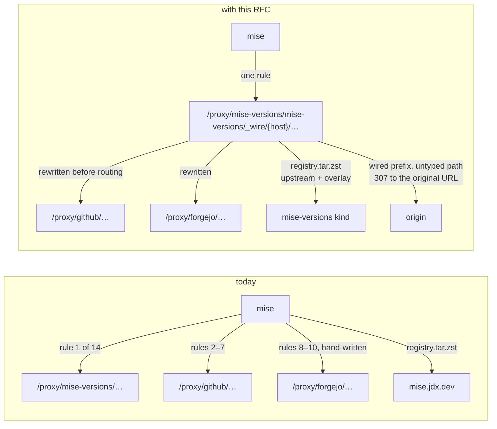
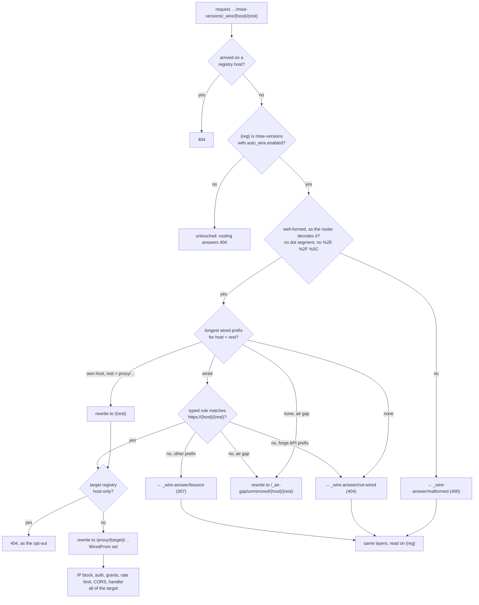
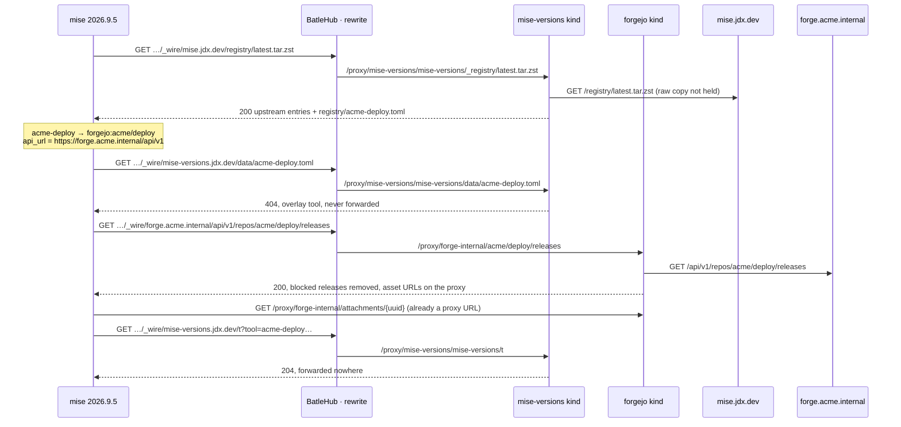
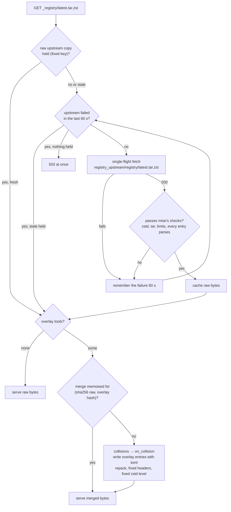
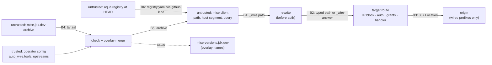

# RFC 0045 — mise auto-wire

| Field       | Value                                                        |
| ----------- | ------------------------------------------------------------ |
| Status      | **Accepted** — re-accepted 2026-11-11 after the last-review panel; §15 Q15–Q17 decided with the user, no blocker |
| Short       | mise auto-wire                                                |
| Settles     | One mise rule routes every wired host through BatleHub, and the estate's own tools reach mise by short name through an overlay on the floating registry |
| Author      | Max Batleforc <maxleriche.60@gmail.com>                       |
| Co-author   | Claude Opus 5.5 <noreply@anthropic.com>                       |
| Created     | 2026-11-11                                                    |
| Supersedes  | —                                                             |
| Touches     | `crates/core`, `crates/adapters`, `crates/web`, `crates/config`, `server`, `cli`, `ui`, `tests/heavy`, docs |
| Risk        | high (§7)                                                     |

---

## 1. Summary

Routing mise through BatleHub today takes a block of
`[settings.url_replacements]` that `batlehub-cli registry suggest --mise`
writes: six rules for GitHub, three for a Forgejo, one per other registry,
the RFC 0043 rule first, the RFC 0008 catch-all last. The block is long,
sensitive to order, and frozen at the moment it was generated. It also leaves
mise's own registry alone, so a tool the estate builds itself has no short
name: every project spells it as a backend coordinate.

This RFC extends the `mise-versions` registry kind (RFC 0043) with an
**auto-wire** mode, a hybrid of the two places mise reads from:

- **The wire.** One client rule sends every wired host to
  `/proxy/{reg}/mise-versions/_wire/{host}/{rest}`. The server rewrites that
  path to the typed proxy route of the registry configured for that host,
  before routing, as RFC 0001's host routing already does. The rewrite table
  is the one the CLI holds today, moved to `crates/core` and read from the
  server's own config, so a self-hosted Forgejo is wired by its real host.
- **The overlay.** With `registry_floating = true`, mise downloads its tool
  registry from `https://mise.jdx.dev/registry/latest.tar.zst`. Through the
  wire, BatleHub serves that archive with the estate's own tools added, so
  `mise use acme-deploy` resolves to the backend the operator declared. The
  listing for an overlay tool is answered `404` on site, so mise lists it from
  its backend, through BatleHub, and the name never reaches jdx.dev.

What this does not solve, stated up front: outside an air gap the client rule
lists the wired hosts, so a registry on a **new host** still needs the rule
regenerated. A new registry on a host already wired, and every change of path
or target, needs nothing on the client.

### Before / after

```toml
# today — 14 rules, as `registry suggest --mise --mise-catch-all` writes them
# for github + mise-versions + a Forgejo + nodejs.org + npm, plus the air gap
[settings.url_replacements]
"regex:^https://mise-versions\\.jdx\\.dev/(.+)" = "https://hub.example.com/proxy/mise-versions/mise-versions/$1"
"regex:^https://api\\.github\\.com/repos/(.+)" = "https://hub.example.com/proxy/github/$1"
"regex:^https://github\\.com/([^/]+)/([^/]+)/releases/download/([^/]+)/(.+)" = "https://hub.example.com/proxy/github/$1/$2/releases/download/$3/$4"
# … four more github rules, three forgejo rules (written by hand for a
# self-hosted forge, since the CLI only knows codeberg.org), nodejs, npm …
"regex:^https://hub\\.example\\.com/(.*)" = "https://hub.example.com/$1"
"regex:^https://([^/]+)/(.*)" = "https://hub.example.com/_air-gap/unmirrored/$1/$2"

[tools]
"forgejo:acme/deploy" = { version = "2.4", api_url = "https://forge.acme.internal/api/v1" }   # in every project

# with this RFC — `registry suggest --mise --auto-wire`, on an instance whose
# mise-versions registry has `overlay = true`
[settings]
registry_floating = true
[settings.url_replacements]
"regex:^https://(api\\.github\\.com|github\\.com|codeload\\.github\\.com|raw\\.githubusercontent\\.com|mise-versions\\.jdx\\.dev|mise\\.jdx\\.dev|forge\\.acme\\.internal|nodejs\\.org|registry\\.npmjs\\.org|conda\\.anaconda\\.org)/(.*)" = "https://hub.example.com/proxy/mise-versions/mise-versions/_wire/$1/$2"

[tools]
acme-deploy = "2.4"
```

An air-gapped estate writes `^https://([^/]+)/(.*)` instead of the host list:
every host goes to the wire, and the ones it does not know fall to the
RFC 0008 sink on the server. `registry_floating = true` is printed only when
the overlay is on, because it also floats mise's aqua registry (§4.1, §15 Q13).



The request that changes most is the registry archive: today it is fetched
from jdx.dev and decides what every short name means; afterwards it is
fetched through BatleHub and carries the estate's own names.

---

## 2. Motivation

1. **The generated block is long, ordered, and stale on arrival.** For an
   estate with `github`, `mise-versions`, one Forgejo, `nodejs.org` and `npm`,
   `render_mise_toml` (`cli/src/api/suggest.rs:1446`) emits fourteen rules
   (6 github, 3 forgejo, 1 each for mise-versions, nodejs and npm, plus the
   identity rule and the catch-all). mise applies the first match only
   (`apply_url_replacements`, `crates/mise-util/src/http.rs:3403` at mise
   v2026.11.3), so the RFC 0043 rule must come first, the identity rule must
   precede the catch-all, and the catch-all must come last. Each registry the
   operator adds afterwards is invisible to every `mise.toml` already
   distributed, until each one is regenerated and re-committed.
2. **The CLI guesses hosts the server knows.** `TYPED_HOSTS` carries
   `codeberg.org` for Forgejo, with the comment "A self-hosted one is not
   recognisable from a URL, so its registry is written by hand"
   (`suggest.rs:107`). The server has the upstream of every registry in its
   config. The table that maps a host to a registry lives on the side that
   cannot see the config.
3. **The estate's own tools have no short name.** mise resolves `acme-deploy`
   only through its registry: the baked copy, or with `registry_floating`
   the archive at `https://mise.jdx.dev/registry/latest.tar.zst`
   (`MISE_REGISTRY_ARCHIVE_URL`, `src/registry.rs:58`). Neither knows an
   internal tool, so every project writes the backend coordinate, its options
   and its asset pattern by hand, and a change to any of them is a change in
   every repository.
4. **A short name for an internal tool would leak it.** The moment an
   internal tool becomes a registry tool, mise asks
   `mise-versions.jdx.dev/data/<tool>.toml` for its versions
   (`versions_host_tool`, `src/backend/mod.rs:274-279`: a tool found in the
   registry under its short name is a versions-host tool) and reports each
   install there. Without RFC 0043, motivation 3 cannot be solved without
   creating this leak; with it, the leak is closed only if the kind answers
   those names itself.

---

## 3. Goals / non-goals

**Goals**

- One client rule, generated from the server's config, that routes every host
  BatleHub mirrors for mise.
- The host → registry table in one place, `crates/core`, read by the server
  for the rewrite and by the CLI for the rule and for the classic block.
- A wired request is authorised, rate-limited, logged and counted exactly as
  the typed URL it is rewritten to, and the wire's own answers go through the
  same layers.
- Operator-declared tools served to mise by short name through the floating
  registry, without their names leaving the instance.
- `batlehub-cli registry suggest --mise --auto-wire` prints the block. The
  current block stays the default, and motivation 2 is solved only behind
  `--auto-wire`: the classic block still falls back to codeberg's forgejo
  rules for a self-hosted Forgejo (`mise_url_replacements`,
  `cli/src/api/suggest.rs:1362`).

**Non-goals**

- **Wiring backends that shell out** (`npm:`, `pipx:`, `cargo:`, `go:`). mise
  runs the ecosystem's own tool for them, which never reads
  `url_replacements`. The client-env block of `registry suggest` still covers
  them.
- **Bouncing every host.** A full catch-all that answers `307` to the original
  URL for an unknown host would be an open redirect on the instance's
  hostname (§12). Outside an air gap, the client rule names the wired hosts.
- **Composing a listing for an overlay tool.** A `404` makes mise list from
  the backend, which the backend's registry already filters.
- **Publishing tools through the API.** Overlay tools are declared in config,
  reviewed like the rest of it, and hot-reloaded. Releases published to the
  instance itself are §15 Q8's follow-up RFC.
- **GitLab as a `source`.** The typed table has no gitlab rules today, and
  mise sends the GitLab project path URL-encoded (§15 Q12).
- **An aqua registry.** `aqua.registries` describes assets, not short names,
  so it does not solve motivation 3 (§12).
- **mise before 2026.8.0.** `registry_floating` is absent from
  `settings.toml` at tag v2026.7.0 and present at v2026.8.0 (fetched from
  `https://raw.githubusercontent.com/jdx/mise/v<tag>/settings.toml` on
  2026-11-11). An older mise ignores the setting: the wire still works, and
  the overlay is invisible.

---

## 4. User-facing design

### 4.1 Configuration

```toml
[[registries]]
name = "mise-versions"
type = "mise-versions"
mode = "proxy"

  [registries.auto_wire]
  enabled = true                          # default false: the wire is off
  overlay = true                          # default false: no archive route
  registry_upstream = "https://mise.jdx.dev"   # default, for the archive
  retired = ["acme-old"]                  # overlay names no longer served (§4.2)

  # A tool from one of this instance's registries: the backend is written
  # by the server from that registry's kind and upstream.
  [[registries.auto_wire.tools]]
  name = "acme-deploy"                    # the short name mise users type
  aliases = ["deploy"]                    # optional, other short names
  source = { registry = "forge-internal", repo = "acme/deploy" }
  bins = ["acme-deploy"]                  # optional
  description = "ACME deploy CLI"         # optional
  version_order = "semver"                # "semver" (default) or "source"

  # Or any backend, written as mise's own registry files write it.
  [[registries.auto_wire.tools]]
  name = "acme-lint"
  backends = ["github:acme/lint"]         # tried in order
  on_collision = "drop"                   # "drop" (default) | "overlay" | "upstream"
```

- **Absent `[registries.auto_wire]`** is `enabled = false`. The kind behaves as
  RFC 0043 describes and no `_wire` path is rewritten. An empty table is the
  same as an absent one.
- **`enabled` and `overlay` both default to the closed side.** A wire that is
  on rewrites every path under `_wire`, and an overlay that is on changes what
  short names mean for every mise that floats its registry. Both are an
  operator's decision, not a default.
- **`tools` without `overlay = true`** is a load error (§4.3): a declared
  tool that is never served is a misconfiguration nobody would notice.
- **`source` or `backends`, exactly one.** `source` names a registry of this
  instance (§4.2, *Sources*). `backends` is the escape hatch for anything else,
  such as an `http:` backend with its own URL template.
- **`on_collision` absent is `"drop"`**, the closed side (§4.2, *Collisions*).
- **`retired` absent is empty.** Names in it are answered as overlay names
  for listings and beacons, without being served in the archive (§4.2).
- **`version_order` is always written**, defaulting to `semver`. mise rejects
  a whole archive in which any entry lacks it (`missing_version_order`,
  `src/registry.rs:44`) and falls back to its baked registry with a `warn`.
  One forgotten field would hide every overlay tool.
- The rewrite table needs no configuration. It is the typed table in
  `crates/core` (§6.1), joined to the upstreams of the registries this
  instance already has.

The client side is printed by:

```bash
batlehub-cli registry suggest --mise --auto-wire                    # connected
batlehub-cli registry suggest --mise --auto-wire --mise-catch-all   # air gap
```

**`registry_floating = true` is printed only when the overlay is on**, with a
comment, because mise ties two things to it. With it, mise also downloads the
official aqua registry from `github.com/aquaproj/aqua-registry`
(`AQUA_DEFAULT_REGISTRY_URL`, `src/aqua/aqua_registry_wrapper.rs:14`, added at
`:111-117`), read at `HEAD` through `raw.githubusercontent.com`. Every `aqua:`
tool then resolves against the current aqua registry rather than the copy
baked into the user's mise. Through the wire that file is served by the
`github` kind, cached on site and the same for every client, but it is no
longer pinned to the mise release (§15 Q13).

### 4.2 Behaviour rules

**The wire.** A request under `/proxy/{reg}/mise-versions/_wire/{host}/{rest}`,
where `{reg}` is a `mise-versions` registry with `auto_wire.enabled`:

| Case | Answer |
| --- | --- |
| `{host}` + `{rest}` fall under a wired prefix and match a typed rule | rewritten in place to that rule's target, then routed as if the client had sent it |
| under a wired forge API prefix (`api.github.com/`, a Forgejo's `/api/v1/`), no typed rule, no air gap | `404`, code `not_wired`, naming the missing typed rule (§15 Q11) |
| under any other wired prefix, no typed rule, no air gap | `307` to `https://{host}/{rest}` (see below on credentials) |
| under a wired prefix, no typed rule, air gap | rewritten to `/_air-gap/unmirrored/{host}/{rest}`: `501`, recorded |
| not under any wired prefix, no air gap | `404`, code `not_wired` |
| not under any wired prefix, air gap | rewritten to the sink: `501`, recorded |
| `{host}` is this instance's own host and `{rest}` starts with `proxy/{registry}/` | rewritten to `/{rest}`; any other own-host `{rest}` is `404` |
| `{host}` or `{rest}` malformed (§7.3) | `400` |
| the rewrite would land on a registry that is host-only (`path_routing = false`) | `404`, the same body the opt-out gives today |
| the request arrived on a registry host (RFC 0001 host routing) | `404`: the wire is a main-host ingress |
| `{reg}` unknown, not `mise-versions`, or `enabled = false` | not rewritten; routing answers `404` |

- **Wired** means a `(host, path prefix)` pair. The typed table gives the
  pairs of each kind: `api.github.com/repos/`, `github.com/`,
  `codeload.github.com/`, `raw.githubusercontent.com/` for `github`. For
  `generic` and `forgejo` the pair is the configured upstream's host and path
  (`https://storage.googleapis.com/acme-bucket` wires
  `storage.googleapis.com/acme-bucket/`, not the whole host). The longest
  prefix wins, so two registries on one host with different prefixes are
  normal (§15 Q10). Two registries with the same prefix: the first declared
  wins, and the other is reported (§4.3).
- **The wire's own answers** (`307`, `404 not_wired`, `400`) are not written
  by the middleware. It rewrites the request to an internal route,
  `/proxy/{reg}/mise-versions/_wire-answer/{outcome}`, which needs read on
  `{reg}` and goes through the IP block, auth, rate limit, CORS, tracing and
  security headers like any route. An anonymous caller on a closed instance
  gets `401` for every wire path alike, so the outcome cannot be used to map
  the wired hosts.
- **A bounce loses credentials.** When a replacement changes the host, mise
  drops the forge token it would have sent to the original host
  (`clear_cross_host_credentials`, `http.rs:2510`), and on the `307` it drops
  the netrc header it sent to the instance. The bounced request therefore
  reaches the origin anonymous. A bounce is "what mise did before" for a
  public file, not for a private repository or a token-only API. That is why
  forge API prefixes never bounce: an untyped path there is a gap in the
  typed table, and a `404` naming it is found faster than an anonymous `403`
  from the forge (§15 Q11).
- **The query string** survives the rewrite unchanged, as it does in
  `host_routing::rewrite_uri`.

**Sources.** A `source` names a registry of this instance, and the server
writes the mise backend for it:

| Source registry kind | Backend written | Reached through |
| --- | --- | --- |
| `github` | `github:{repo}` | the wire, `api.github.com/repos/` and siblings |
| `forgejo` | `forgejo:{repo}` with `api_url = {upstream}/api/v1` | the wire, the registry's upstream prefix |

- `{upstream}` is the source registry's **first** upstream, reduced to
  `scheme://host[:port][/path]`. A source registry whose upstream carries
  userinfo, a query or a fragment is a load error: the rendered backend is
  published in an archive every reader of the `mise-versions` registry can
  fetch.
- The `api_url` is the upstream, never the instance. mise builds
  `{api_url}/repos/{repo}/releases…` (`crates/mise-util/src/forgejo.rs:121`),
  and the forge kinds serve `/proxy/{reg}/{owner}/{repo}/…`, without
  `/repos/`. Pointing `api_url` at the instance would need a second route
  shape. Pointing it at the upstream lets the wire route it like any other
  forge request, with the same grants, block list and cache.
- A source whose upstream prefix is not wired is a load error (§4.3): an
  overlay tool that bypasses the instance it is declared on is never what an
  operator means.
- `gitlab` is not a source in this RFC (§15 Q12), and releases published to
  the instance itself are §15 Q8's follow-up.

**The overlay.** With `overlay = true`, the wire maps
`mise.jdx.dev/registry/latest.tar.zst` to this kind's own
`_registry/latest.tar.zst` route:

- **The raw upstream archive** is cached under one fixed key, through the
  passthrough cache. Before it is cached, it is checked as mise would check it
  (zstd, tar, the three limits, every `registry/*.toml` parses and carries
  `version_order`). A body that fails is never cached, so a truncated `200`
  or a captive portal cannot evict a good stale copy.
- **No tools declared:** the raw archive is served as is.
- **Tools declared:** the raw archive is unpacked, each overlay entry is
  added as `registry/<name>.toml`, and the result is repacked. The merge is
  memoised in memory under `(sha256 of the raw archive, hash of the overlay
  config)`, so an overlay change made while jdx.dev is down still merges onto
  the held raw copy. Nothing else in the upstream entries is changed.
- **Collisions.** A name in both (a tool name or alias of either side) is
  settled by the overlay tool's `on_collision` (§15 Q2):

  | `on_collision` | Archive | `mise use <name>` |
  | --- | --- | --- |
  | `"drop"` (default) | both entries removed | fails with mise's own "not found" |
  | `"overlay"` | the overlay entry replaces the upstream one, aliases included | installs from the overlay backend |
  | `"upstream"` | the overlay entry is removed | installs the public tool |

  Every collision is counted and listed on the config page, whatever its
  resolution. A forced `"overlay"` cannot be dismissed there while it
  shadows, because it changes what a public name installs for the whole
  estate. A `"drop"` collision that appears without a config change (jdx.dev
  added the name) also raises the shipped alert of §10.1 (§15 Q9).
- **Upstream unreachable, raw copy held:** the held copy is merged and
  served, as other passthrough documents are served stale.
- **Upstream unreachable, nothing held:** `503`, and the failure is
  remembered for 60 seconds per process so that the next requests answer at
  once instead of each waiting on the upstream timeout. A mise that already
  holds an archive **keeps using it**: on a failed refresh it logs
  `failed to refresh floating mise registry` and does not touch its cache
  (`refresh`, `src/registry.rs:300-320`). Only a mise that never fetched one
  uses its baked registry, with the overlay tools absent.
- **`data/<tool>.toml` for an overlay or `retired` name:** `404`, answered
  on site before any cache lookup and never forwarded. mise lists from the
  backend (`src/versions_host.rs:119-120`), through the wire, through the backend
  registry's block list.
- **The beacon for an overlay or `retired` name** is the RFC 0043 `204`,
  unchanged.

### 4.3 Validation

Rejected at load:

| Condition | Rationale |
| --- | --- |
| `auto_wire` on a registry whose type is not `mise-versions` | The wire is this kind's route. Elsewhere the field would be ignored, which hides a mistake. |
| More than one `mise-versions` registry with `auto_wire.enabled` | Two wires would each generate a client rule that claims every host; the second is unusable. |
| `tools` non-empty while `overlay = false` | The tools would never be served. Names to keep answering locally go in `retired`. |
| A tool `name`, alias or `retired` name outside `^[a-z0-9][a-z0-9-]{0,63}$` | It becomes a file name in the archive and a path segment in `data/<name>.toml`. |
| Duplicate names or aliases within the overlay, or a name both in `tools` and `retired` | The archive would hold one, at random. |
| Both `source` and `backends`, or neither | One tool, one origin. |
| `backends` empty, or an entry without a `<backend>:` prefix mise knows | mise would reject the entry, and with it the whole archive. |
| `source.registry` unknown, of a kind other than `github`/`forgejo`, or its prefix not wired | The server cannot write a backend for it, or the backend would leave the instance. |
| `source.registry`'s first upstream with userinfo, a query or a fragment | It would be published in the archive. |
| `source.repo` not `owner/name`, or with a `.`/`..` segment | It becomes a path in the forge API. |
| `version_order` other than `semver` or `source` | mise rejects the archive (`version_order must be "source" or "semver"`). |
| More than 1 000 overlay tools | Upstream holds 1 022 files today, and mise refuses an archive with more than 4 096 tar entries, directories included (`MAX_REGISTRY_ARCHIVE_ENTRIES`, counted by entry index, `src/registry.rs:390-391`). The bound keeps the sum well clear. |

Warnings. Each has a code and a path in the existing `ConfigWarning` shape
(`crates/config/src/schema/warnings.rs:20`), which gains a `dismissible: bool`
field (OpenAPI and the TypeScript client regenerated): today `dismissible` is
a prop of the whole list (`ConfigWarningList.vue:11`), and a dismissal only
hides a row for the browser session (`AdminConfigReload.vue:96-108`). The
three that are known only at run time (marked †) come from the last archive
build, which `get_config_warnings` (`handlers/back_office/config.rs:455`)
appends to the config's own list. That build was meant to run **eagerly** on
load, on reload and on each archive refresh; **as implemented (2026-11-12) it
runs on the first archive request of each replica**, so after a restart or a
reload the † rows are absent until a client floats the registry. Known gap:
the wire is built where no proxy service or HTTP client exists
(`MiseWire::build`), and an eager fetch belongs in a startup/reload hook that
holds both. They are **per replica**: the config page
shows the replica that answered. The candidate and pending panels
(`ConfigEditorCard.vue`, `PendingReloadCard.vue`) cannot show a † warning
before the reload is applied; with the default `"drop"`, a colliding tool
disappears at the reload and the warning appears then.

| Code | Path | Condition | Behaviour | Dismissible |
| --- | --- | --- | --- | --- |
| `mise.wire.prefix-claimed` | `registries[i].upstreams` | two registries claim the same wired prefix | first declared wins | yes |
| `mise.overlay.backend-unwired` | `registries[i].auto_wire.tools[j].backends` | a `backends` entry names a host that is not wired | served; the install goes to the origin, or fails in an air gap | yes |
| `mise.overlay.readers-wider` | `registries[i].auto_wire.tools[j].source.registry` | the readers of the `mise-versions` registry are not a subset of the source registry's readers (§15 Q16) | served; the overlay name and backend reach readers who cannot read the source | yes |
| `mise.overlay.inert` | `registries[i].auto_wire.overlay` | `overlay = true` with `enabled = false` | inert: the archive is reached only through the wire | yes |
| `mise.overlay.collision` † | `registries[i].auto_wire.tools[j].name` | an overlay name collides with the upstream archive | settled by `on_collision` | yes |
| `mise.overlay.forced-shadow` † | `registries[i].auto_wire.tools[j].on_collision` | `"overlay"` is in force | the overlay shadows a public tool | **no**, while it applies |
| `mise.overlay.upstream-invalid` † | `registries[i].auto_wire.registry_upstream` | the last upstream archive failed mise's checks | held copy kept, or `503` | yes |

### 4.4 API surface

| Method | Path | Auth | Who may call | Limit |
| --- | --- | --- | --- | --- |
| any | `/proxy/{reg}/mise-versions/_wire/{host}/{rest}` | the target route's | whoever the target route admits | the target registry's rate limit |
| any | `/proxy/{reg}/mise-versions/_wire-answer/{outcome}` (internal target of the rewrite) | read on `{reg}` | anyone with read on `{reg}` | registry rate limit |
| `GET` | `/proxy/{reg}/mise-versions/_registry/latest.tar.zst` | read on `{reg}` | anyone with read on `{reg}` | registry rate limit |
| `GET` | `/api/v1/mise/auto-wire` | as `GET /api/v1/registries` | any caller who may list registries | API rate limit |

- `_wire` is a **rewrite, not a route**: it is not in the OpenAPI document,
  since nothing answers at that path. Its contract is
  `crates/web/tests/mise_auto_wire.rs` (§14), not `authz_matrix.rs`, whose
  route inventory is checked against the OpenAPI document and would report a
  `_wire` entry as stale.
- `_wire-answer` and `_registry/latest.tar.zst` are `utoipa::path`s. The
  archive declares `body = UpstreamDocument`, the `307` and `404` declare
  their headers and `ErrorBody`. Both enter `authz_matrix.rs`'s inventory as
  `NoRow` with a reason (proxy-only kind), as the inventory already does for
  other proxy-only routes.
- `/api/v1/mise/auto-wire` returns `MiseAutoWire { pattern, replacement,
  hosts, air_gap_pattern, registry_floating, overlay_tools }`: the rule the
  CLI prints, computed on the server so that the CLI and the rewrite cannot
  disagree. `hosts` is filtered to the registries the caller may see (§15 Q5),
  and the response says how many wired hosts were hidden, so the CLI can say
  so in the block (§4.5). `overlay_tools` is filtered the same way, by the
  caller's read on each tool's source registry (§15 Q16).
  The TypeScript client is regenerated (`task dump-spec`, `task ui:generate`).

### 4.5 Mocks

**`batlehub-cli registry suggest --mise --auto-wire` — nominal**

```text
$ batlehub-cli registry suggest --mise --auto-wire
# Generated by `batlehub-cli registry suggest --mise --auto-wire`.
# Put it in ONE config file: ~/.config/mise/config.toml for every project, or
# a project's mise.toml. mise does not merge url_replacements across files: a
# project file that still has the classic block replaces this one entirely.
# If the file already has a [settings] table, merge these keys into it.
# Hosts not listed are fetched directly. Regenerate when the instance mirrors
# a new host. Troubleshooting: https://hub.example.com/docs/use/mise#auto-wire
[settings]
# Also floats mise's aqua registry: aqua tools resolve against the current
# aqua registry (served by this instance), not the copy baked into mise.
registry_floating = true
[settings.url_replacements]
"regex:^https://(api\\.github\\.com|github\\.com|codeload\\.github\\.com|raw\\.githubusercontent\\.com|mise-versions\\.jdx\\.dev|mise\\.jdx\\.dev|forge\\.acme\\.internal|nodejs\\.org|registry\\.npmjs\\.org|conda\\.anaconda\\.org)/(.*)" = "https://hub.example.com/proxy/mise-versions/mise-versions/_wire/$1/$2"

# Overlay tools (mise ≥ 2026.8.0): acme-deploy (alias deploy), acme-lint
$ echo $?
0
```

It decides that the comments name the three things a user must know (one
file wins whole, regenerate on a new host, the aqua side effect), and that the
overlay tools are listed so a user can see which names to expect.

**Same command — overlay off**

```text
$ batlehub-cli registry suggest --mise --auto-wire
# Generated by `batlehub-cli registry suggest --mise --auto-wire`.
# (same header as above, without the aqua comment)
[settings.url_replacements]
"regex:^https://(api\\.github\\.com|github\\.com|codeload\\.github\\.com|raw\\.githubusercontent\\.com|mise-versions\\.jdx\\.dev|forge\\.acme\\.internal|nodejs\\.org|registry\\.npmjs\\.org|conda\\.anaconda\\.org)/(.*)" = "https://hub.example.com/proxy/mise-versions/mise-versions/_wire/$1/$2"
$ echo $?
0
```

It decides that no `registry_floating` and no `mise.jdx.dev` are printed when
nothing would be overlaid: the aqua side effect is not paid for nothing.

**Same command — a caller who sees only part of the wired registries**

```text
$ batlehub-cli registry suggest --mise --auto-wire
# Generated by `batlehub-cli registry suggest --mise --auto-wire`.
# Filtered for alice: 2 wired hosts are hidden from your account. Do not commit
# this block to a shared mise.toml: teammates would fetch those hosts directly.
# (rest of the header as above)
[settings.url_replacements]
"regex:^https://(api\\.github\\.com|github\\.com|codeload\\.github\\.com|raw\\.githubusercontent\\.com|mise-versions\\.jdx\\.dev)/(.*)" = "https://hub.example.com/proxy/mise-versions/mise-versions/_wire/$1/$2"
$ echo $?
0
```

It decides that a filtered block says so on its first lines, because the
header otherwise tells the user to put it in a project file.

**Same command — air gap (`--mise-catch-all`)**

```text
$ batlehub-cli registry suggest --mise --auto-wire --mise-catch-all
# Generated by `batlehub-cli registry suggest --mise --auto-wire --mise-catch-all`.
# Put it in ONE config file (see the connected header). Air gap: every host
# goes to this instance. Hosts it does not mirror answer 501 and are recorded
# for the next bundle. Troubleshooting: https://hub.example.com/docs/use/mise#auto-wire
[settings.url_replacements]
"regex:^https://([^/]+)/(.*)" = "https://hub.example.com/proxy/mise-versions/mise-versions/_wire/$1/$2"
$ echo $?
0
```

It decides that the air-gap block has its own header (the connected one
says unlisted hosts are fetched directly, which is false here) and prints no
`registry_floating` until phase 5 carries the archive in the bundle (§15 Q3):
before that, floating would only add the aqua side effect. With the overlay
off the air-gap block is the same, which is why it has no variant.

**Same command — the instance has no wire**

```text
$ batlehub-cli registry suggest --mise --auto-wire
error: this instance has no mise-versions registry with auto_wire enabled
hint: the classic block is still available: batlehub-cli registry suggest --mise
$ echo $?
5
```

It decides that the flag fails rather than silently printing the classic
block, which would look like the auto-wire one to a user who did not read it.
`5` is `NotFound` (`cli/src/exit.rs:17`).

**Same command — the caller sees no wired registry (empty)**

```text
$ batlehub-cli registry suggest --mise --auto-wire
error: no host is wired for your account on this instance
hint: ask an administrator for read access to the registries mise should use
$ echo $?
4
```

`4` is `Refused` (`cli/src/exit.rs:16`).

**Same command — a server older than this RFC**

```text
$ batlehub-cli registry suggest --mise --auto-wire
error: this server does not offer auto-wire (GET /api/v1/mise/auto-wire answered 404)
hint: upgrade the server, or use the classic block: batlehub-cli registry suggest --mise
$ echo $?
5
```

**mise against a stale rule — a host the server no longer wires**

```text
$ mise install node@22
mise ERROR failed to install core:node@22.11.0
mise ERROR HTTP status client error (404 Not Found) for url (https://hub.example.com/proxy/mise-versions/mise-versions/_wire/nodejs.org/dist/v22.11.0/node-v22.11.0-linux-x64.tar.gz)
$ curl -s -H "Authorization: Bearer $BATLEHUB_TOKEN" https://hub.example.com/proxy/mise-versions/mise-versions/_wire/nodejs.org/dist/
{"error":"Not Found","message":"nodejs.org/dist/ is not wired on this instance. Regenerate the rule: batlehub-cli registry suggest --mise --auto-wire","code":"not_wired"}
```

mise does not print a body, so the URL in its error is what the user has;
the decision is that the body is still written for whoever runs `curl` on it,
in the existing `ErrorBody` shape (`crates/web/src/error.rs:8`). The docs
show the `Authorization` form, since a user of the global config may have no
netrc.

**mise — an overlay name that is not served (collision dropped, archive
unavailable on first use, or mise older than 2026.8.0)**

```text
$ mise use acme-deploy@2.4
mise ERROR acme-deploy not found in mise tool registry
$ mise settings get registry_floating
true
```

The user sees mise's own text (`src/args/backend_arg.rs:503`) and nothing
that names the cause. The decision
is that the cause is found from the docs page the generated block links to,
whose *Auto-wire* section lists the three causes with the command that tells
them apart (`mise --version`, `ls ~/.cache/mise/mise-registry/`, and the
console's collision list, which an operator reads).

**mise — the §6.P refusal: no read on the backend registry**

```text
$ mise install acme-deploy@2.4.0
mise ERROR failed to install forgejo:acme/deploy@2.4.0
mise ERROR HTTP status client error (404 Not Found) for url (https://hub.example.com/proxy/mise-versions/mise-versions/_wire/forge.acme.internal/api/v1/repos/acme/deploy/releases/tags/v2.4.0)
```

Since §15 Q15 the answer is the same `404 not_wired` an unwired host gets, for
a caller who may read the `mise-versions` registry; one who may not gets that
registry's own `401`/`403`.

It decides that the user sees the URL they sent, not the internal path it was
rewritten to, because that is the line they will paste into a ticket.

**Console — config page, warnings panel (`ConfigWarningList.vue`: path, code
badge, message, Dismiss)**

```text
┌ Configuration warnings ─────────────────────────────────────────────────────┐
│ registries[2].auto_wire.tools[4].on_collision  [mise.overlay.forced-shadow] │
│   "terraform" shadows the public tool while on_collision = "overlay".       │
│ registries[2].auto_wire.tools[1].name          [mise.overlay.collision]     │
│   "acme-lint" is in the upstream mise registry too. Both are left out of    │
│   the archive: rename the tool, or set on_collision.          [ Dismiss ]   │
│ registries[2].auto_wire.tools[1].backends      [mise.overlay.backend-unwired]│
│   http:acme-lint names https://dl.acme.io/lint, which is not wired:         │
│   installs go there directly.                                 [ Dismiss ]   │
│ registries[5].upstreams                        [mise.wire.prefix-claimed]   │
│   api.github.com/repos/ is claimed by github and github-ent; github wins.   │
│                                                               [ Dismiss ]   │
│ registries[2].auto_wire.overlay                [mise.overlay.inert]         │
│   overlay = true has no effect while enabled = false.         [ Dismiss ]   │
│ registries[2].auto_wire.registry_upstream      [mise.overlay.upstream-invalid]│
│   The last archive from https://mise.jdx.dev failed mise's checks; the copy │
│   from 2026-11-11 09:12 UTC is served.                        [ Dismiss ]   │
└─────────────────────────────────────────────────────────────────────────────┘
```

It decides that each warning uses the panel's existing row (path, code,
message), names the way out, and that only the forced shadow has no Dismiss
button. No new screen is added. The panel shows the rows of one replica at a
time; `mise.overlay.inert` and the † rows cannot appear together on a real
instance (the † rows need a merge, which `enabled = false` never triggers
through the wire), and are drawn together here only to show every row.

**Server — a config refused at load or reload**

```text
$ batlehub-server --config config.toml
Error: invalid configuration
  registries[2].auto_wire.tools: 2 tools declared while overlay = false
  hint: set overlay = true, or move the names to auto_wire.retired
$ echo $?
1
```

The same message is the hot-reload refusal in the server log
(`config reload refused`, previous config kept) and the config editor's
validation error under the field, in the editor's existing error row. A
`source.registry` that is not wired reads:
`registries[2].auto_wire.tools[0].source.registry: "forge" is not wired (its
prefix is claimed by "forge-old", or path_routing = false)`.

---

## 5. Architecture

### 5.1 The wire, before routing



The rewrite runs in the outermost layer, in the same pass as
`HostRoutingMiddlewareFactory` (`crates/web/src/middleware/host_routing.rs`).
Its module comment states the property this RFC relies on: "everything
downstream — route matching, auth, the rate limiter's
`extract_registry_from_path`, tracing spans, metrics labels — sees the path it
already understands."

The invariant is that **a wired request is the typed request, and every
answer of the wire goes through the same layers**. Because the rewrite happens
before route matching and authentication, and every wire outcome (including
the wire's own `307`, `404` and `400`) is a rewrite to a route rather than a
response from the middleware, no wire request leaves the instance without
passing the IP block, authentication, rate limit and span. Two answers are
outside it, and both predate this RFC: the registry-host `404` and the
host-only `404` are written by `HostRoutingMiddleware` itself
(`host_routing.rs:212-227`), the outermost wrap
(`server/src/server_factory.rs:450`), outside `TracingLogger`. The wire adds
no third. The wire therefore cannot
grant access the typed URL lacks, cannot skip a check the typed URL has, and
cannot reach a path the typed table does not produce. It also never dials
anything: `{host}` is only looked up, and at most echoed into a `Location`
header under a wired prefix.

Three things in the existing middleware had to be accounted for:

- **The fast path.** `HostRoutingMiddleware::call` returns at once when no
  registry host is bound (`host_routing.rs:186`), which is the default. The
  condition becomes "no registry host bound **and** no wire".
- **The path opt-out.** `path_routing = false` is enforced in the `None` arm
  on the path the request arrived with (`host_routing.rs:212-227`). The wire
  re-runs that check on the path it produces.
- **Registry hosts.** RFC 0001 keeps the admin API, the SPA and the probes on
  the main host. A request host-routed to a registry is never wired, so the
  own-host case cannot reach them from a registry host, and
  `HostRoutedRegistry` never names the wrong registry.

### 5.2 One install through the wire



This shows that the one rule reaches two kinds and the archive, that asset
downloads already point at the proxy and so bypass the wire, and that the
overlay tool's name crosses no boundary but BatleHub's own.

### 5.3 The overlay archive



Two invariants. **The overlay changes a public name only when the operator
names it**: by default an entry is written only when neither side's names or
aliases meet the other's, so no upstream tool's backend, and with it the
repository its attestation is checked against, is redirected by accident.
Replacing one takes `on_collision = "overlay"` on that tool, which stays on
the config page while it applies. **The archive is complete or absent**: mise
replaces its baked registry with the archive wholesale, so serving the
overlay alone would erase every public tool. With no valid upstream copy, the
answer is `503`.

---

## 6. Detailed design

### 6.1 `crates/core` — the wire table

- `crates/core/src/services/mise_wire.rs` (new). `WIRE_RULES` is
  `typed_url_replacements` from `cli/src/api/suggest.rs:1256`, moved verbatim
  and keyed on `RegistryKind` rather than `&str`, **with** the GitLab rules
  that today live only in `client_setup.rs` (`GITLAB_MISE_RULES`, `:1554`),
  and the conda-forge rule added by #318 (`234b095c`). `cli` already depends
  on `batlehub-core`, so its three call sites keep working by calling the
  moved table: `suggest.rs:219` (`proxy_path_for`), `suggest.rs:1362`
  (`mise_url_replacements`, the classic block) and `client_setup.rs:2132`.
- The **selection** moves with the table, so the CLI and the server cannot
  disagree on the same config: which upstream of a `generic` registry is
  wired (every one, first claim wins, the CLI's skip message kept), and
  `foreign_upstream` (`client_setup.rs:1200`) — a typed rule only for a
  registry of the public host, and for conda only for the conda-forge channel
  root. `WireTable::build` and both CLI paths call the same core function; a
  parity test builds both from one registry list and compares the
  `(host, prefix)` sets.
- The overlay's archive rule (`mise.jdx.dev/registry/latest\.tar\.zst` →
  `{proxy}/mise-versions/_registry/latest.tar.zst`) is **not** in the shared
  table, so the classic block never prints a rule for a route that does not
  exist. `WireTable::build` keeps the `mise.jdx.dev/registry/` prefix wired
  whenever `auto_wire.enabled = true`, whatever `overlay` says (§15 Q17): to
  the merged archive with the overlay on, to a raw passthrough of the public
  archive with it off. The prefix therefore exists independently of
  `overlay`, and switching the overlay off never strands a client on its
  cached archive.
- `WireTable::build(registries, own_host) -> (WireTable, Vec<WireWarning>)`:
  for each registry in declaration order, the `(host, prefix)` pairs that the
  shared selection gives it, with the forgejo rules rebased onto a self-hosted
  forge's prefix. Regexes are compiled once here. A
  later claim on the same prefix becomes `WireWarning::PrefixClaimed`. A
  registry with `path_routing = false` contributes no pair.
- `WireTable::target(host, rest, air_gap) -> WireOutcome`, with variants
  `Rewrite(path)`, `Bounce(url)`, `Sink(path)`, `NotWired` and `Malformed`.
  This is pure: it runs the regex against `https://{host}/{rest}` and resolves
  `{proxy}` to `/proxy/{registry}`. The checks of §7.3 happen here, before any
  regex. Every `Rewrite` path starts with `/proxy/` and every `Sink` path with
  `/_air-gap/unmirrored/`; the fuzz target asserts it, with no exception.
- `source_backend(kind, upstream, repo) -> MiseBackend`, next to the table
  whose prefixes it must satisfy.
- `MiseOverlayTool` and `MiseAutoWire` are core types. `crates/config` turns
  `AutoWireConfig` into them at load, so the adapter and the web layer never
  read a config type (§6.2).

### 6.2 `crates/config`

- `RegistryConfig` gains `auto_wire: Option<AutoWireConfig>`, with
  `AutoWireConfig { enabled, overlay, registry_upstream, retired, tools:
  Vec<MiseToolConfig> }` and `MiseToolConfig { name, aliases, source,
  backends, bins, description, version_order, on_collision }`, with
  `MiseToolSource { registry, repo }`. A backend is either a string or
  `{ full, options }`, as mise's registry files allow (`registry/amp.toml`).
- §4.3's rejections go beside the existing per-type field checks in
  `AppConfig::validate()`. `CURRENT_CONFIG_VERSION` does not move: the change
  is additive.
- The resolved `MiseOverlayTool`s land on `HotConfig`, not on
  `RegistryPolicy`, following the existing rule for per-registry settings.
  The `WireTable` does not: it has its own holder (§6.3), because `HotConfig`
  is swapped before `RegistryMap` on reload.
- `crates/config/src/reload_keys.rs` gains explicit rows:
  `registries[*].auto_wire` (`Tier::Hot`: the table and the overlay are
  rebuilt on reload) and `registries[*].auto_wire.registry_upstream`
  (`Tier::Partial`: the upstream client keeps the startup one, as other
  upstreams do under `registries[*]`).
- A server older than this RFC ignores `auto_wire` (no `deny_unknown_fields`
  on `RegistryConfig`, `schema/registry.rs:148`). §13 covers what that means
  for a downgrade.

### 6.3 `crates/web` — the rewrite

- `crates/web/src/middleware/mise_wire.rs` (new), called from
  `HostRoutingMiddleware::call`. `HostRoutingMiddlewareFactory::new(map,
  trust)` keeps its signature (`crates/web/tests/host_routing.rs:225` and
  `server/src/server_factory.rs:450` call it), and the table is passed with a
  new `.with_wire(table)`. The fast path returns only when **both** the
  host map and the wire table are empty. A host-routed request is never wired
  (§5.1). A main-host request is wired, then the path opt-out check runs on the
  rewritten path. The URI update reuses `rewrite_uri`'s two-step
  (`match_info_mut().get_mut().update` and `head_mut().uri`), extracted into a
  shared helper.
- The well-formedness check reads the path as the router will decode it
  (`match_info().unprocessed()`, as the opt-out check already does), and
  compares encodings case-insensitively.
- `Bounce`, `NotWired` and `Malformed` become rewrites to
  `/proxy/{reg}/mise-versions/_wire-answer/{outcome}`, carrying the computed
  `Location` or message in a request extension. The handler there writes the
  `307` (with `Cache-Control: no-store`, no body), the `404 not_wired` or the
  `400`. `_wire-answer` is an ordinary registered route: called without the
  extension (directly, or through the own-host case, which never re-enters
  the wire), it answers `404` and nothing else. The `Location` is built from
  the table's canonical `host[:port]` (a wired prefix matches the port
  exactly as configured) and the **raw, still-encoded** `{rest}`; a control
  character anywhere in it is `Malformed`.
- The table lives in a `LockedMap`-style holder beside `RegistryHostMap`. On
  reload it is swapped **after** `RegistryMap` and the host map, right after
  `registry_host_map.replace_from` (`services/reload/applier.rs:377`), so a wire
  rewrite never names a registry the router does not have yet. An in-flight
  request keeps the snapshot it was rewritten with.
- `WiredFrom { host }` request extension. Read by the request span, which is
  the access log: `BatleHubSpanBuilder::on_request_start`
  (`server/src/server_factory.rs`) gains the `mise.wire.host` field, so a log
  line shows both the host mise asked for and the route that served it.

### 6.4 `crates/web` and `crates/adapters` — the overlay

- `handlers/proxy/mise_versions.rs` gains `mise_versions_registry_archive`
  for `GET …/_registry/latest.tar.zst`. It calls
  `ProxyService::cached_passthrough`
  (`crates/core/src/services/proxy/passthrough.rs:144`) directly, not
  `cached_forward_with` (`upstream.rs:134`), which builds its own fetch
  closure, forwards an upstream 4xx as a definite answer and caps bodies at
  its fixed 32 MiB. The route's own closure caps the body at 4 MiB, runs the
  archive checks of §4.2, and turns **any non-2xx** (a 403, 404 or 429 from
  Fastly or from a `registry_upstream` mirror) into `Err`, so the held copy is
  served and the negative entry applies (stale serving is on by default,
  `serve_stale`, `schema/registry.rs:1254`). The fetch has its own timeouts,
  10 s to connect and 30 s in total, because the `reqwest::Client` the
  `mise-versions` handlers receive has none (`crates/web/src/lib.rs:1926-1929`);
  a timeout counts as unreachable. It passes `offline = air_gapped(&svc)`, as
  the python-precompiled route does (`mise_versions.rs:156-165`). An upstream
  error with nothing held is `503`, not the passthrough's default `502`
  (`upstream.rs:180`).
- The cache key carries the upstream URL, so changing `registry_upstream`
  never serves the old upstream's copy. How long the held copy outlives an
  outage depends on the cache backend: Redis keeps a stale copy for
  max(TTL, 7 days) (`cache/redis.rs:117-120`), the in-memory store loses it on
  restart, Postgres keeps it (§10.2).
- Concurrent misses are coalesced by the single-flight with a negative entry
  that `ProxyService` already has for metadata (`services/proxy/discovery.rs`,
  the guard on `ProxyService`, `services/proxy/mod.rs`), reused rather than
  copied, with a 60-second negative entry. Its state is process-wide (held in
  a `OnceLock`, as `REFRESH_LIMITER` is, `crates/web/src/lib.rs:1930-1936`),
  not built in `configure_app`, which runs once per actix worker. Followers
  share the leader's deadline. This route needs it because every networked
  mise command retries a failed refresh (§10.2).
- `data/{tool}.toml` checks the overlay and `retired` names before the cache
  lookup and answers `404` for them.
- `crates/adapters/src/registry/mise_registry_overlay.rs` (new) does the
  check and the merge. It reads with `zstd::Decoder` and `tar::Archive`,
  mirroring `parse_registry_archive` (`src/registry.rs:382-421`): regular
  files at depth 2 under `registry/`, ending in `.toml`, path components
  normalised as `Path::components` does, a later duplicate replacing an
  earlier one. It applies mise's limits as mise counts them (4 096 tar
  entries, 1 MiB per entry, 16 MiB of **decoded** entry bytes,
  `MAX_REGISTRY_ARCHIVE_SIZE`), and caps the compressed body at 4 MiB (the
  passthrough's own cap is 32 MiB, `upstream.rs:43`). Any upstream entry that
  does not parse fails the whole check, so that no alias escapes collision
  detection. Overlay entries are written with `toml::to_string` from a typed
  struct. Only the entries it parsed are repacked, with `tar::Builder` (mtime
  0, uid/gid 0, mode `0644`) and `zstd::Encoder` at a fixed level, in name
  order, so the same inputs give the same bytes on every replica.
- The merge result is memoised in **one process-wide slot** keyed on
  `(sha256 of the raw archive, overlay hash)`, replaced on a new key, so
  republished archives and overlay edits never accumulate. The merge itself
  is single-flighted with the fetch. All new state is derived from the config
  and from an upstream document, so nothing needs backing up.
- `crates/adapters/Cargo.toml`: the `registry-mise-versions` feature gains
  `dep:zstd`, `dep:tar` and `dep:toml`, which are optional in that crate.

### 6.5 `cli`, `ui`

- `registry suggest --mise --auto-wire` reads `/api/v1/mise/auto-wire` and
  prints §4.5. `--mise-catch-all` with `--auto-wire` uses `air_gap_pattern`.
  `--mise-commented` applies as before. Errors use the house `error:` /
  `hint:` form and the exit codes of §4.5.
- `ui/src/config/registryTypes.ts`: the `mise-versions` entry gains the
  auto-wire snippet beside the RFC 0043 one.
- The config page's warnings panel renders §4.3's seven codes, with the
  existing component. `ConfigWarningList.vue` reads the new per-warning
  `dismissible` field instead of its list-wide prop, which touches every
  caller of the component, so that `mise.overlay.forced-shadow` has no
  button. It also gains `role="list"` and `role="listitem"` (§11).

### 6.6 The gates

| Gate | Entry |
| --- | --- |
| `authz_matrix.rs` | `_registry/latest.tar.zst` and `_wire-answer/{outcome}` in the route inventory as `NoRow` (proxy-only kind). No `_wire` entry: it is not a route. |
| `crates/web/tests/mise_auto_wire.rs` | the wire's contract: one rewrite per typed kind answers as its target, and every table target is a registered route |
| `registry_kind_coverage.rs`, `soak_kind_coverage.rs` | unchanged: no new kind |
| `air_gap.rs` | `a_wired_unmirrored_host_lands_in_the_sink_and_is_recorded` |
| `openapi_contract.rs` | the archive, `_wire-answer` and `/api/v1/mise/auto-wire` declare their bodies |
| `profile_route_coverage.rs` | the same three operations in `perf/profile_routes.txt`: the archive as a soak arm, the other two with `skip: <reason>` |
| `fuzz/` | `fuzz_mise_wire_target`, seeded with `%2e%2e`, `%2E%2e`, `%2f`, `%5C`, `%252e`, a `host:port` that differs from the wired one, and `%0D%0A`, `%3F`, `%23` in `{rest}` (§14) |

### 6.P Proof against a real client

Suite: `tests/heavy/closed_world.sh`, a new phase `mise-auto-wire`, a
`[[registries]]` block in `config.closed-world.toml` with `auto_wire`, and a
row under `heavy-closed-world` in `test.yaml`. The client is mise
`$MISE_VERSION`, 2026.9.5 in CI today, which has `registry_floating`. Its
`MISE_*_DIR`s are under `$HEAVY_WORK/mise-auto-wire/`, egress is denied, and
the client config is exactly the CLI's output, with no hand-written rule. The
overlay declares `acme-deploy` with a `source` on the closed world's
`forgejo` registry and its fixture repository, so the backend the phase
installs from is the one the server wrote. Between cases the phase empties
both caches: `~/.cache/mise` on the client, and the server's document cache
for the `mise-versions` registry. Assertions are on the tap
(`heavy_wire_re_after`) and on `/metrics`, not on exit codes alone.

1. `batlehub-cli registry suggest --mise --auto-wire` prints exactly one
   `url_replacements` entry and `registry_floating = true`. The phase writes
   it to `mise.toml` as-is.
2. `mise install jq@1.8.1` exits 0 and `jq --version` prints `jq-1.8.1`. On
   the tap, every request mise built from a public URL is under `_wire/`
   (among them `_wire/mise-versions.jdx.dev/data/jq.toml -> 200`, and
   `_wire/api.github.com/repos/jqlang/jq/… -> 200`). Asset downloads appear
   as plain `/proxy/github/…`, because the release document already points
   them at the proxy. The request counter moves for `registry="github"` and
   `registry="mise-versions"`, so each rewrite reached its own kind.
3. `mise registry acme-deploy` prints `forgejo:acme/deploy`, and the tap shows
   `_wire/mise.jdx.dev/registry/latest.tar.zst -> 200` and
   `_wire/raw.githubusercontent.com/aquaproj/aqua-registry/HEAD/registry.yaml`
   answered by the `github` kind (the aqua side effect of §4.1, proven rather
   than assumed). `mise registry jq` still prints `aqua:jqlang/jq`, so the
   upstream entries survived the merge.
4. From emptied caches, `mise install acme-deploy@latest` exits 0. The tap
   shows `_wire/mise-versions.jdx.dev/data/acme-deploy.toml -> 404` and the
   forge listing under `_wire/forge.acme.internal/api/v1/repos/acme/deploy/…`.
   `batlehub_upstream_request_duration_seconds_count{registry="mise-versions"}`
   moves by exactly one, the archive fetch: not the listing and not the
   beacon. The name `acme-deploy` never reaches an upstream other than the
   forge.
5. **Refusal, the credential boundary.** With a netrc token lacking read on
   the `forgejo` registry, `mise install acme-deploy@2.4.0` exits non-zero,
   and its error, quoted with `heavy_client_said`, holds `404 Not Found`
   (`not_wired`, §15 Q15) and the `_wire/forge.acme.internal/api/v1/…` URL. The fixture forge receives no
   request for `acme/deploy`. The wire added no access. The same case in
   `tests/heavy/authz.sh` (`live:mise-auto-wire`) carries the allowed arm.
6. **Refusal, the overlay cannot shadow by accident.** The fixture upstream
   archive is swapped for one that also defines `acme-deploy`. From emptied
   caches, `mise install acme-deploy@latest` exits non-zero with mise's own
   "not found" text, `batlehub_mise_overlay_collisions{resolution="drop"}`
   reads `1`, and no request names the upstream entry's repository. With
   `on_collision = "overlay"` and a reload, the same install exits 0 from the
   overlay backend, and the config page lists the forced shadow without a
   Dismiss button.
7. With the `github` registry removed from the server but the old client rule
   kept, `mise install jq@1.8.1` exits non-zero. Its error names
   `_wire/api.github.com/…` with `404`, and `curl -n` on that URL returns the
   `not_wired` body of §4.5.
8. With `registry_upstream` pointed at a closed port and the server's cache
   purged, a client **with** a held archive still installs `acme-deploy`
   (exit 0, mise logs `failed to refresh floating mise registry`), and a
   client with an emptied cache installs `jq@1.8.1` from its baked registry.
   The tap shows the second archive request answered `503` in under a second:
   the negative entry, not a second upstream timeout.

9. **Prefix wiring (§15 Q10).** Two `generic` registries are configured on
   the closed world's fixture file host, under `/a/` and `/b/`. mise
   downloads one `http:` tool from each: the tap shows each request rewritten
   to its own registry (`registry="generic-a"` and `registry="generic-b"`
   move once each), and an `http:` URL under `/c/` on the same host exits
   non-zero with `404` on `_wire/{host}/c/…`, with no request reaching the
   fixture host.

10. **Bounce carries no credential.** A wired `generic` prefix on a
    tap-visible fixture origin, and an `http:` tool whose URL falls under it
    but matches no typed rule: mise follows the `307` to the origin, and the
    origin's tap shows the request with **no** `Authorization` header, though
    mise sent the netrc credential to the instance.

Air gap: an `airgap.sh` phase with the `--mise-catch-all` variant. A request
to an unwired host is `501` and appears in `GET /api/v1/admin/air-gap/missing`
under its host. `mise install jq@1.8.1` from a held bundle exits 0 with every
mise-built request on the tap under `_wire/`.

**Deliberately untouched**, so reviewers do not go looking:

- `crates/web/src/handlers/air_gap.rs` — the sink is reused as is: the wire
  rewrites into it rather than adding a second recorder.
- The typed proxy handlers — not one changes. The wire's whole effect is a
  path they already serve.
- `cli/src/api/mise_plan.rs` — the plan reads `mise.lock`, which records
  resolved URLs, not the rule that rewrote them.
- `services/listing_synthesis.rs` — no listing is composed for overlay tools.
  The backend's listing is the answer (§4.2).
- `extractors.rs::raw_auth_from_request` — mise sends netrc as `Basic` to the
  instance's host, the same as with typed rules.

---

## 7. Security

**Rating:** high. The overlay decides what a short name installs for every
mise that floats its registry through this instance, and the wire rewrites
paths ahead of authentication.

### 7.1 Threat model

Assets: the mapping from short name to backend (and so the repository whose
attestation mise checks), the grants and ingress settings of every wired
registry, the admin surface of the main host, the instance's hostname as a
redirect origin, upstream credentials in registry URLs, and the names of
internal tools.



| # | Threat (STRIDE) | Where | Mitigation | Residual risk |
| --- | --- | --- | --- | --- |
| T1 | Elevation: `_wire/github.com/../../api/v1/admin/…`, `%2e%2e`, `%2F` or the own-host case smuggles a rewrite onto a non-proxy route | B1 | `WireTable::target` reads the path as the router decodes it and rejects any `.`/`..` segment, `%2E`, `%2F`, `%5C` (any case), double-encoded forms and empty segments (`Malformed` → `400`). The own-host case accepts only `{rest}` under `proxy/{registry}/`. Every output starts with `/proxy/` or `/_air-gap/unmirrored/`. | None known; the fuzz target is the check. |
| T2 | Elevation: the wire grants what the typed URL would not | B2 | The rewrite precedes auth (§5.1), so the target's grants are the only ones evaluated. `mise-versions`' own read grant is not a substitute. | None. |
| T3 | Spoofing / phishing: the instance used as an open redirect | B3 | `Bounce` only under a wired `(host, prefix)` pair, which comes from the typed table or an operator-configured upstream with its path, and never under a forge API prefix. An unwired prefix is `404`, never `307`. | A redirect to `github.com/<anything>` from the instance's hostname. Accepted: a host the operator chose to mirror, and the exact URL the client asked for. |
| T4 | Tampering: an overlay entry redirects a public tool (`jq` → `github:evil/jq`), so mise checks the attestation of the wrong repository | B5 | By default, names and aliases met on both sides are dropped from both (§5.3). Replacing an upstream entry takes `on_collision = "overlay"` on that very tool, and the config page shows it without a Dismiss button while it applies: visible, not undismissable, since a dismissal is per browser session anyway. | An operator can add a new name, or force a shadow, pointing anywhere. Accepted (2026-11-11, the user): config write is already full control of the instance, and the force is visible rather than silent. |
| T5 | Tampering / confusion: upstream later publishes a tool with an overlay name, and users silently move to the public backend | B4/B5 | `"drop"` by default, counted, warned, and alerted (§10.1). The install fails loudly instead of switching backend. | Until an operator acts, that name does not install (§15 Q9). Accepted: failing is the safe direction. |
| T6 | Information disclosure: internal tool names sent to jdx.dev | B5→J | `data/<name>.toml` for an overlay or `retired` name is answered `404` before the cache lookup and is never forwarded. The beacon is the RFC 0043 `204`. | After the overlay is switched off, a client keeps its cached archive indefinitely (§13), so its names stay registry tools. `retired` closes this for as long as the operator keeps them listed (§15 Q14). A project `mise.toml` whose old classic block has no `mise-versions.jdx.dev` rule replaces the global block whole while `registry_floating` stays on, so that project's listings of overlay names go to jdx.dev; §13 requires every committed block to route `mise-versions.jdx.dev` before the overlay is turned on. |
| T7 | Denial of service: a hostile or broken upstream archive (zstd bomb, 100 000 entries, a 2 GiB entry, `../` paths, a truncated `200`) | B4 | mise's limits as mise counts them, decoding stopped at 16 MiB, a 4 MiB compressed cap, only depth-2 `registry/*.toml` regular files, `tar`'s refusal of `..`. A body that fails is never cached, so the held copy survives. | None known. |
| T8 | Tampering: TOML injection through an overlay field (a `description` with `"\n[backends]…`) | config → B5 | Entries are serialised with `toml::to_string` from a typed struct, never concatenated, and re-parsed by the merge's own test. | None. |
| T9 | Information disclosure: the wired hosts learnt by a caller who may not see them | API, B1 | `/api/v1/mise/auto-wire` is filtered by visibility (§15 Q5), and the wire's own answers need read on `{reg}`, so an anonymous caller cannot tell `307` from `404`. | None beyond Q5's: `accessible_registries_for` is rbac-only and misses namespace-only grants, so such a caller gets a shorter host list, never a longer one. Since §15 Q15, a rewrite whose target the caller cannot read answers exactly as `not_wired`, and the air-gap sink goes through `_wire-answer`; `anonymous_cannot_tell_wired_from_unwired` covers both arms (target unreadable, air-gap sink). |
| T10 | Repudiation: a request served under a path the client never sent, or answered outside the access log | B1 | `WiredFrom` keeps the original host in the request span, and every wire outcome is a routed request (§5.1). | The two host-routing `404`s that predate the wire stay outside the span (§5.1). |
| T11 | Elevation: the wire reaches a registry its operator made host-only, or the admin API from a registry host | B1 | The opt-out check re-runs on the rewritten path; a host-routed request is never wired (§5.1). | None. |
| T12 | Information disclosure: upstream credentials published through a rendered `source` backend | B5 | Only `scheme://host[:port][/path]` is rendered; an upstream with userinfo, a query or a fragment is a load error for a source registry. | None. |
| T13 | Tampering: an unpinned aqua registry changes what `aqua:` tools resolve to | B6 | Only when the overlay is on, documented in the generated block; served by the `github` kind, so cached once and the same for the whole estate. | aqua tools follow aqua's `HEAD` rather than the mise release's copy (§15 Q13). |

### 7.2 Authentication and authorisation

- The wire adds no authorisation surface of its own: it is a rename that runs
  before authentication (T2), and its own answers are routes behind read on
  `{reg}` (T9). An anonymous caller on a closed registry gets that registry's
  `401`, at the wired URL.
- `_registry/latest.tar.zst` is read on the `mise-versions` registry, like its
  other documents.
- `/api/v1/mise/auto-wire` has the same authentication as
  `GET /api/v1/registries` (`front_office/registries.rs::list_registries`).
- mise sends its netrc entry for the instance's host on every rewritten URL
  (`http.rs:3304-3324`). A forge token mise would attach to the original host
  is dropped when the replacement changes the host
  (`clear_cross_host_credentials`, `http.rs:2510`), exactly as with today's
  typed rules: the wire changes nothing here. On a `307`, mise drops the
  instance's netrc header before following (`http.rs:1098-1104`), so a bounce
  never carries the instance's credential to an origin.

### 7.3 Input handling and injection

- `{host}`: lowercase `^[a-z0-9.-]{1,253}(:[0-9]{1,5})?$`, compared against
  the table and never resolved or dialled. Anything else is `400`.
- `{rest}`: at most 4 KiB, read as the router decodes it. Refused on any `.`
  or `..` segment, `%2E`, `%2F`, `%5C` in any case, a `%25` that decodes to
  one of them, or an empty segment (T1). The query string is passed through
  untouched to the target, which validates it as it does today.
- The rewritten path re-enters normal routing, so the target handler's own
  validation (`validate_package_name`, the coordinate guards, `ensure_safe_key`)
  still runs on it.
- The upstream archive: T7's limits. The overlay config: §4.3's patterns, T8's
  serialisation, T12's upstream reduction.
- No SSRF surface is added. The only new outbound request is
  `{registry_upstream}/registry/latest.tar.zst`, through the shared HTTP client
  and its `is_blocked_ip` guard, at an operator-configured URL.

### 7.4 Secrets and cryptography

No new secret, and no new cryptography. The archive is unsigned upstream
(`download_registry_archive` checks parse, not signature, in mise v2026.11.3),
so the overlay loses no signature it could have kept. The overlay hash and the
raw archive's sha256 are content keys, not security controls. Upstream
credentials stay out of the archive (T12).

### 7.5 Abuse and resource exhaustion

- A wired request costs one prefix lookup and at most one regex match on
  strings capped at 4 KiB. The rate limit applied is the target registry's,
  because `extract_registry_from_path` reads the rewritten path, and the
  wire's own answers are rate-limited as `{reg}`'s routes.
- An upstream archive fetch is single-flighted and its failure remembered for
  60 seconds, so a client fleet retrying a failed refresh costs the upstream
  one request a minute per process. A merge runs once per
  `(raw sha256, overlay hash)` per process, bounded by T7's limits.
- A `307` has no body and is not cached.

### 7.6 Existing defences that still hold

- RFC 0001's outermost rewrite, its proxy-trust verdict and its path opt-out:
  the wire runs in the same layer, after the trust verdict, and re-applies the
  opt-out to its own output.
- RFC 0043's beacon `204` and air-gap `404`, which the wire reaches unchanged.
- RFC 0008's sink: never fetches, records the host.
- The SSRF guard on every upstream fetch, and `ensure_safe_key` on storage.
- mise's own `ensure_secure_url_replacement`: an HTTPS URL rewritten to an
  HTTP instance is refused by the client, as before.

---

## 8. Supply chain

No new crate, image, action or tool. The merge uses `tar 0.4.46`,
`zstd 0.14.3`, `toml` and `regex`, all already in `Cargo.lock`. In
`crates/adapters` the first three are optional and are added to the
`registry-mise-versions` feature (§6.4); `task audit` is unchanged.

Two run-time inputs change, and neither is a dependency of the build:

- `mise.jdx.dev/registry/latest.tar.zst`, fetched by the server at the URL
  mise itself uses (§7.1 B4).
- The aqua registry at `HEAD`, which `registry_floating` makes every client
  read (§7.1 B6, T13). It changes what a released mise resolves `aqua:` tools
  to, which is a supply-chain change for the clients even though it adds
  nothing to ours (§15 Q13).

---

## 9. Data and privacy

| Data | Personal? | Where stored | Retention | Who can read it | Leaves the instance? |
| --- | --- | --- | --- | --- | --- |
| Overlay tool names, `retired` names and backends | no | config file, and served in the merged archive and in `overlay_tools` | as the config | config readers; the archive is served to every reader of the `mise-versions` registry, identical for all (§15 Q16), while `overlay_tools` in `/api/v1/mise/auto-wire` is filtered by the caller's read on each source registry, and the `mise.overlay.readers-wider` warning flags a source whose readers are narrower | no: answered locally (T6) |
| The raw upstream archive | no | passthrough cache | until replaced or purged | readers of the `mise-versions` registry | no |
| The merged archive | no | process memory | until the process restarts or its key changes | readers of the `mise-versions` registry | no |
| `WiredFrom.host` in the access log and span | no: an upstream hostname | logs, traces | as existing logs | log readers | no |
| Wired hosts in `/api/v1/mise/auto-wire` | no | computed | not stored | callers who may list registries | no |

No personal data is added. The access log already records the path and the
client IP for typed rules, and the wire records the same line with one more
hostname. The wire's own logs carry the outcome and the host only, never the
URI or the query: mise puts tokens in queries for some forges
(`?private_token=`). The beacon's inventory stays unforwarded and unlogged
(RFC 0043 §7).

---

## 10. Operability

### 10.1 Observability

- **Metrics**:
  `batlehub_mise_wire_requests_total{outcome="rewritten|bounced|sink|not_wired|malformed"}`
  has five values and no host label. The target registry's own metrics carry
  `registry=`. `batlehub_mise_overlay_collisions{resolution="drop|overlay|upstream"}`
  is a gauge, recomputed on each merge.
- **Logs**: `not_wired`, `bounced` and `malformed` at `debug`, with the
  outcome and host only. Each `PrefixClaimed` once at `warn` on load and
  reload. A collision at `warn` once per merge, naming the tool and its
  `on_collision` path.
- **Audit trail**: none added. No security decision is made by the wire; it
  is made by the target route, which already writes its access events.
- **Alerts**: one shipped rule in `deploy/prometheus-alerts.yaml`,
  `BatleHubMiseOverlayCollision` (spelled like the existing `BatleHub…`
  rules), firing when `batlehub_mise_overlay_collisions{resolution="drop"}`
  rises while `batlehub_config_reloads_total` (new, a counter on the reload
  applier) did not move in the same window, and ignoring series younger than
  the window, since the gauge reappears from nothing after each restart.
  Upstream has taken one of the estate's names, and that name no longer
  installs anywhere (T5, §15 Q9). The alert points to the config warnings
  panel; the `warn` line names the tool.

### 10.2 Failure modes

| Failure | Detected by | Behaviour | Recovery |
| --- | --- | --- | --- |
| jdx.dev archive unreachable, raw copy held | upstream metrics | held copy merged and served | automatic, on the next successful fetch |
| jdx.dev archive unreachable, nothing held | `503`, negative entry, mise `warn` | clients holding an archive keep it; clients with none use the baked registry: public tools resolve, overlay tools do not | automatic |
| jdx.dev slow (accepts, then trickles) | the 30 s total timeout | counted as unreachable: held copy, or `503` and the negative entry; followers share the leader's deadline | automatic |
| jdx.dev or a mirror answers 403, 404 or 429, copy held | upstream metrics | any non-2xx is a failure: held copy served, negative entry set, no re-dial for 60 s | automatic |
| Held copy lost: in-memory store restarted, or a Redis stale copy past max(TTL, 7 days), during an outage | `503` | as "nothing held" | automatic, on the next successful fetch |
| Air gap, nothing held | `503`, not recorded in the sink | as "nothing held"; overlay names need the connected side until §15 Q3's phase 5 | Q3 |
| Upstream archive malformed, truncated or over a limit | `mise.overlay.upstream-invalid`, upstream metrics | never cached; the held copy stays, or `503` | automatic once upstream is fixed |
| Clients retrying a failed refresh on every command | wire request rate | single-flight plus the 60-second negative entry, process-wide: one upstream attempt a minute per process, not per worker | automatic |
| Config reload drops a registry a client rule names | `not_wired` counter | `404` for that prefix (closed) | regenerate the rule |
| Overlay collision appears upstream | gauge, alert, config page | `"drop"` by default: both entries dropped (closed) | rename the overlay tool, or set `on_collision` |
| Rewrite table build error | config validation | the reload is refused and the previous config stays | fix the config |
| Replicas briefly disagree (rolling config change) | — | each replica serves its own merge; mise reads whichever it gets, and the next refresh converges | automatic |

The fail-open rows are the archive ones, and in both a client ends with
either the archive it already had or the registry it shipped with: the state
before this RFC, not a weaker one.

### 10.3 Performance and capacity

- The archive is 96 388 bytes compressed. Probe:
  `curl -sI https://mise.jdx.dev/registry/latest.tar.zst` on 2026-11-11
  (`content-type: application/zstd`, `cache-control: max-age=3600`). The
  v2026.11.3 source tree carries 1 022 registry files. A merged copy is about
  the same size, once per overlay hash per process.
- mise refreshes at most once per `registry_cache_ttl` (default `1h`) per
  client while the refresh succeeds. For a 1 000-client estate that is about
  1 000 small requests an hour, served from cache. While it fails, every
  networked command retries; §7.5's negative entry is what keeps that off
  the upstream.
- The merge cost (unzstd, untar, tar, zstd of about 100 KB) has not been
  measured. Phase 3 measures it once on a release build against the recorded
  fixture and writes the number into §17; it is not a test assertion, since a
  wall-clock bound is a flaky gate.
- The wire adds one prefix lookup per request, on a path whose handler then
  does network I/O. The `db_calls` budget suite is unchanged: no database
  call is added.

---

## 11. Other concerns

- **Accessibility**: the only UI change is seven warning rows in the existing
  panel, which has a heading and contrast checked by the design gates but
  renders plain `div`s today: it gains `role="list"` and `role="listitem"`
  (§6.5). A row without a Dismiss button removes a focus stop and adds none.
- **Internationalisation**: warning messages are written by the server in
  English, as every existing `ConfigWarning` is; the codes are stable slugs.
  Nothing new is added to `ui/src/i18n`. Translating warning text is a
  console-wide change, not this RFC's.
- **Compliance**: none touched. RFC 0036's baseline gains a minimisation
  point (T6) and loses none.
- **Licensing**: mise's registry files are MIT, relayed unmodified, and the
  merged archive keeps every upstream entry's content. Our obligations do not
  change.
- **Documentation**: `docs/use/mise.md` gains §1.2 *Auto-wire* (the block,
  one file wins whole, the migration of §13, the troubleshooting list of
  §4.5, the `http:` stopgap of §15 Q8) and an air-gap paragraph in §3.1;
  `docs/registries/mise-versions.md` gains the `auto_wire` table; the FR
  mirror follows; ROADMAP gains an entry under RFC 0043's.
- **Deprecation**: none. The classic block stays the default, and the wire is
  opt-in on both sides.

---

## 12. Alternatives considered

| Alternative | Why rejected |
| --- | --- |
| Do nothing: keep the per-host block | Leaves motivations 1–3. The self-hosted Forgejo stays hand-written, and internal tools stay coordinates in every project. |
| A full catch-all with `307` to the origin for unwired hosts | One rule with no host list, but the instance becomes an open redirect for any URL (T3). In an air gap the catch-all is safe because unwired means sink, and that variant is kept. |
| A wire route that answers `307` to the typed URL instead of rewriting in place | One more round trip per request, and mise drops the instance's netrc header on a redirect (`http.rs:1098-1104`), so every wired request to a closed registry would arrive anonymous. The in-place rewrite has a precedent in RFC 0001. |
| Answering the wire's outcomes from the middleware | Simpler, but those answers skip the IP block, auth, rate limit and access log, and let an anonymous caller map the wired hosts (T9, T10). |
| Wiring by host alone | Simpler, but a `generic` upstream on a shared host (`storage.googleapis.com/acme-bucket`) would make the whole host a redirect origin (T3), and two registries on one host could not coexist. |
| Rewrite backends in the served registry to `github:o/r[api_url=…]` instead of a wire | No client rule for forge APIs, but asset downloads from aqua backends still need rules, and it changes the backend string that `mise.lock` records for every public tool. |
| `aqua.registries` pointing at a BatleHub-served `registry.yaml` | It gives `aqua:acme/deploy`, not `acme-deploy`: aqua registries describe packages, while short names live only in mise's registry. Operators would also write aqua's per-platform asset YAML. |
| Per-project `[plugins]` / `shorthands_file` | Per-project lines are what this RFC removes, and `shorthands_file` is removed in mise 2026.12.0 (`deprecated_remove_at`). |
| `mode = "hybrid"` on `mise-versions` | Everywhere else in the tree, `hybrid` means database-backed publish with proxy fallthrough: `require_local_mode` gates it, and the console offers uploads for it (`NamespaceUpload.vue`). Here nothing is published, so the word would mislead the code and the UI (§15 Q1). |
| Overlay wins on collision by default | It protects users from T5, but lets config redirect a public tool's attestation identity (T4) by accident. Dropping both fails closed for both, and `on_collision` keeps the deliberate case possible. |
| `api_url` pointing at the instance for `source` tools | mise appends `/repos/{repo}/…` to it, which no forge kind serves. A second route shape, for what the wire already routes. |
| Keying the archive cache on the upstream `etag` | The passthrough builds its key before the fetch (`passthrough.rs:157`), so the etag is unknown at lookup, and an overlay change during an outage would find no copy under the new key. |

---

## 13. Rollout and compatibility

- **Default behaviour:** nothing changes. `auto_wire` is absent, so no path is
  rewritten and no archive is served. A client with the classic block keeps
  working against an instance with the wire on, because typed routes are
  unchanged.
- **Config:** additive, no schema migration, no data.
- **Operator prerequisites:** a `mise-versions` registry (RFC 0043). For the
  overlay, egress to `mise.jdx.dev` or a mirror in `registry_upstream`.
- **Migration, per estate, in this order:**
  1. Enable the wire (`enabled = true`) and distribute the one-rule block.
     mise does not merge `url_replacements` across config files: the nearest
     file's map replaces the others (settings layers are stacked with
     `preloaded`, `src/config/settings.rs:1656-1663`). So the classic block
     is removed from every committed `mise.toml` before a global wire rule is
     relied on, or the project file silently wins. To find them, run
     `mise settings get url_replacements` in each repository, or grep the
     estate for `url_replacements`; the docs section carries both. Before
     step 2, every block that stays committed must route
     `mise-versions.jdx.dev`, or that project's overlay listings leave the
     instance (T6).
  2. Turn the overlay on and regenerate: `registry_floating = true` appears,
     with its aqua side effect (§4.1). Users need mise ≥ 2026.8.0.
  3. Only then move `[tools]` entries from coordinates to short names, and
     regenerate `mise.lock` in each project, since the lock records the tool
     under the name it was installed by. A teammate or a CI job without the
     rule, with an older mise, or with an untrusted config cannot resolve the
     short name, so CI images get the global config in step 1.
- **Rollback, in the reverse order:** put the coordinates back in `[tools]`
  and regenerate `mise.lock`; remove `registry_floating` from the client
  config (or delete `~/.cache/mise/mise-registry/`), because mise keeps a
  cached archive **indefinitely** when it cannot refresh it
  (`src/registry.rs:34-56`), and a client whose rule now sends `mise.jdx.dev`
  to the sink would keep the overlay names forever; restore the classic
  block; then move the overlay names to `retired` and set `overlay = false`.
  Switching the overlay off alone freezes no client: while `enabled = true`
  the wire keeps `mise.jdx.dev/registry/` and serves the public archive raw,
  so the next refresh drops the overlay names (§15 Q17).
  Keep them in `retired` for as long as any client may hold an old archive:
  otherwise their listings reach jdx.dev and T6 reopens (§15 Q14).
- **Server downgrade:** an older server ignores `auto_wire` silently
  (§6.2). Every `_wire` path is then a `404` and every overlay listing is
  forwarded. A downgrade therefore follows the rollback above first.

---

## 14. Test plan

- **Unit** (`crates/core/src/services/mise_wire.rs`): every rule of the moved
  table against its current fixture in `suggest.rs`'s tests (moved with it);
  a prefix claimed twice → first wins plus a warning; two prefixes on one
  host → longest wins; a self-hosted Forgejo upstream rebases the forgejo
  rules; a host-only registry contributes no pair; `Bounce` only under a wired
  prefix and never under a forge API prefix; air gap turns `Bounce` and
  `NotWired` into `Sink`; the own host only
  under `proxy/`; the archive prefix present whenever `enabled = true`, merged with `overlay = true` and raw without (§15 Q17);
  `source_backend` for github and forgejo.
- **Unit** (`crates/adapters/src/registry/mise_registry_overlay.rs`): check
  and merge of the recorded v2026.11.3 archive fixture; no overlay → bytes
  unchanged; output re-read with a port of `parse_registry_archive`'s rules;
  determinism (same input, same bytes, two runs); each `on_collision` by name
  and by alias; each of mise's limits counted as mise counts them; a `../`
  entry, a `registry/./x.toml` entry, a duplicate and a symlink; an
  unparseable upstream entry fails the check; a missing `version_order` never
  produced.
- **Integration** (`crates/web/tests/mise_auto_wire.rs`): one rewritten
  request per typed kind answers as its target; every table target is a
  registered route; `WiredFrom` in the span; `enabled = false` → `404`;
  reload changes the table; an instance with no host routing still wires;
  `data/<overlay>.toml` and `data/<retired>.toml` → `404`, with the counting
  upstream untouched; `/api/v1/mise/auto-wire` agrees with the rewrite for
  every host it lists; two `generic` registries on one host with different
  path prefixes each receive only their own paths, and a third prefix on
  that host is `404` (the proof Q10 asks for); the archive route with a
  garbage upstream keeps the
  held copy; concurrent misses make one upstream request; a failed upstream
  answers the next request at once.
- **Proof**: §6.P.
- **Security**, one per §7.1 row:
  - T1 `wire_refuses_dot_segments_and_encodings` (`..`, `%2e%2e`, `%2E%2e`,
    `%2f`, `%5C`, `%252e`), `own_host_wire_only_reaches_proxy_paths`, plus the
    fuzz target asserting no output path escapes `/proxy/` or
    `/_air-gap/unmirrored/`;
  - T2 `wired_request_without_target_grant_is_refused` (a grant on
    `mise-versions` alone does not open `forgejo`; `401` anonymous, `403`
    with a token, matching §6.P case 5);
  - T3 `unwired_prefix_is_never_redirected` (same host, other bucket), and
    `untyped_forge_api_path_is_404_not_bounced`;
  - T4 `overlay_cannot_replace_an_upstream_entry_without_force`, and
    `forced_shadow_is_reported_and_not_dismissible`;
  - T5 `upstream_name_added_later_drops_both_and_alerts`;
  - T6 `overlay_and_retired_listings_and_beacon_never_reach_upstream`;
  - T7 `archive_over_each_limit_is_refused_and_held_copy_kept`;
  - T8 `overlay_description_cannot_inject_toml`;
  - T9 `auto_wire_hosts_are_filtered_by_visibility`, and
    `anonymous_cannot_tell_wired_from_unwired`;
  - T10 `request_span_keeps_the_wired_host_for_every_wire_outcome`;
  - T11 `wire_respects_host_only`, `wire_on_registry_host_is_refused`;
  - T12 `source_backend_never_carries_userinfo`;
  - T13 the §6.P case 3 assertion on the aqua registry request.
- **Audit**: `task audit` unchanged (§8).
- **Wire answer route**: `wire_answer_without_extension_is_404`.
- **Existing suites that must pass unchanged** (the middleware constructor
  keeps `new(map, trust)` for this; the wire is added with `.with_wire`):
  `host_routing.rs`'s tests,
  among them `an_empty_map_never_rewrites` (the fast path keeps that meaning
  when no wire is configured); `suggest.rs`'s classic-block tests and
  `client_setup.rs`'s tests (the moved table); the `mise` and `mise-versions`
  closed-world phases and `tests/heavy/mise.sh` (the classic block still
  routes); `air_gap.rs`; `authz_matrix.rs`.

---

## 15. Decisions and open questions

### Resolved

| # | Question | Decision |
| --- | --- | --- |
| 1 | How is the mode spelled? | **A `[registries.auto_wire]` table, not `mode = "hybrid"`.** `hybrid` already means publish plus proxy fallthrough to `require_local_mode`, `supports_local_mode()` and the console's uploads. "Hybrid" stays the docs' word for what it does: local answers first (overlay, own host, `404` for overlay listings), upstream for the rest. As recommended. |
| 2 | What does a name collision do? | **Both dropped by default; `on_collision` per tool settles it otherwise: `"drop"`, `"overlay"` (force the name) or `"upstream"` (yield).** The default fails closed for T4 and T5. The user asked for a way to force a name or resolve the clash, and a per-tool field keeps the force on the line that causes it, shown on the config page while it applies. Extends the recommendation. Its operational cost is reopened as Q9. |
| 3 | Does an air-gap bundle carry the merged archive? | **Phase 5, after reading the export code.** Until then the docs say that overlay names need the connected side; `mise.lock`-driven installs of public tools still work. As recommended. |
| 4 | Two registries claim one host | **First declared wins, with a warning.** As recommended. Narrowed by the panel: the claim is now on a `(host, prefix)` pair (Q10). |
| 5 | Does `/api/v1/mise/auto-wire` filter hosts by visibility? | **Yes.** The closed side by default, and the regenerate cost falls on the user being granted something. As recommended. The panel added that the wire's own answers must not leak what this filter hides (T9). |
| 6 | Wired host, untyped path | **`307` to the origin**, bounded by T3, keeping today's behaviour for paths no typed rule covers. As recommended. Its credential cost is reopened as Q11. |
| 7 | A default `batlehub-cli` entry in the overlay? | **No.** The docs carry the snippet; an instance that adds names on its own is what T4 guards against. As recommended. |
| 8 | Releases published to the instance itself, with no forge behind them | **(b) now, (a) next, as its own RFC.** `source` covers a tool whose releases live on a forge the instance proxies. A binary with no forge behind it has no home yet: none of `github`, `gitlab`, `forgejo` or `generic` has a local mode (`supports_local_mode()`, `crates/core/src/entities/registry_kind.rs:382`), and RFC 0021's release import publishes only into protocol kinds. So the stopgap is (b): `docs/use/mise.md` documents an `http:` backend in `backends`, with a `url` template on a `generic` registry fronting an internal file server. It works with no code, but has no publish, needs `version_list_url` for a listing, and has no per-version block list. (a) is a local mode for `forgejo` (publish releases and assets, served on the same routes, so a `source` on it works unchanged), in a separate RFC, because it touches publish, storage keys, retention and grants. (c), leaving operators to run a Forgejo, was not chosen. As recommended. |
| 9 | Does a collision that appears upstream drop both names? (reopened 2) | **Yes: `"drop"` stays the default, with the shipped `BatlehubMiseOverlayCollision` alert (§10.1).** The server stays stateless; the alert points to the config warnings panel and the `warn` line names the tool and the fix (wording corrected by the last-review panel). Sticky served names were not chosen. As recommended. |
| 10 | Wire by `(host, path prefix)` rather than host? (reopened 4) | **`(host, prefix)`, longest prefix wins**, with a proof obligation: §6.P case 9 and the two-prefix integration test must pass before phase 2 lands. The user asked for it to be tested; if the proof fails, this question reopens rather than the code falling back to host-only wiring. As recommended. |
| 11 | Should a bounce exist for forge API hosts? (reopened 6) | **No bounce under a forge API prefix: `404 not_wired`, naming the missing typed rule. `307` elsewhere.** A bounced forge API call is anonymous, so it fails on private repositories and spends GitHub's anonymous limit. As recommended. |
| 12 | GitLab as a `source` | **Out of this RFC.** GitLab rules are missing from `registry suggest`'s classic block (only `client setup` writes them, `GITLAB_MISE_RULES`); `source` support belongs in one change, with a gitlab closed-world proof and the `%2F`-after-`projects/` exception tested on its own. As recommended. The wire itself carries the GitLab rules (§6.1), so moving to auto-wire does not drop GitLab routing for estates set up with `client setup`. |
| 13 | Is the aqua side effect of `registry_floating` acceptable? | **Accepted and documented**: printed only with the overlay, commented in the generated block, proven by §6.P case 3. Pinning the aqua registry waits until an estate asks for it. As recommended. |
| 14 | How long do `retired` names need answering? | **For as long as the operator keeps them in `retired`**, documented in the rollback with the client command that clears mise's cache. Explicit, stateless, reviewable. As recommended. |
| 15 | Must a rewritten request whose target the caller cannot read answer like an unwired host? | **Yes: when the caller cannot read the target registry, the answer is exactly `not_wired`, and the air-gap sink branch goes through `_wire-answer`, so it needs read on `{reg}`.** Closes T9's enumeration through the target's `401` and the sink's grant-free `501`. Cost accepted: a legitimate user without read on the target sees "not wired" rather than `401`. Decided 2026-11-11 with the user; matches the recommendation. |
| 16 | Who may read overlay tool names? | **`overlay_tools` is filtered like `hosts`, and a load warning `mise.overlay.readers-wider` fires when `mise-versions`' readers are not a subset of a source registry's readers.** The archive stays identical for every reader, since per-caller archives would break determinism; the warning is the control. Decided 2026-11-11 with the user; matches the recommendation. |
| 17 | What does the wire do with `mise.jdx.dev/registry/` once the overlay is switched off? | **While `auto_wire.enabled = true`, `mise.jdx.dev/registry/` stays wired whatever `overlay` says: a raw passthrough of the public archive when the overlay is off.** A client block written while the overlay was on never freezes on its cached archive. Test: overlay on → off → the next refresh gets the public archive. Decided 2026-11-11 with the user; matches the recommendation. |

**The review panel (2026-11-11)** read the draft through six lenses. Its
findings that changed no decision are fixed in the text: the wire's fast path
and path opt-out (§5.1), the own-host and `%2E` holes (T1), the wire's own
answers moved behind the route layers (T9, T10), the archive cache design
(`cached_forward_with`, validation before caching, single-flight, negative
entry, fixed key, in-memory merge, §6.4), mise's real behaviour on a failed
refresh (§4.2, §10.2, §13), the archive rule's target path and its absence
from the classic block (§6.1), the core-side types (§6.1, §6.2), the reload
tiers, the `authz_matrix.rs` placement (§4.4), the migration order and the
one-file-wins rule (§13), the mocks (§4.5), the limits as mise counts them,
the userinfo leak (T12), the logged fields (§9), and the inconsistent
examples. A finding about `registry_options_shape_listing` in §12 was right:
that reason was wrong and is removed. The findings that change a decision are
questions 9 to 14.

**The last-review panel (2026-11-11, after acceptance)** read the accepted
text through the same six lenses. Its findings that change no decision are
fixed in the text: the archive route on `cached_passthrough` with its own
timeouts, non-2xx as failure, `offline` and an upstream-keyed cache (§6.4,
§10.2); the reused, process-wide single-flight and a one-slot merge memo;
the selection logic moved into core with a parity test, the GitLab and conda
rules in `WIRE_RULES`, three call sites and refreshed line numbers (§6.1);
the `WireTable` holder and its swap point, the unchanged middleware
constructor, `_wire-answer` without its extension, the `Location` built from
the raw path (§6.2, §6.3); the narrowed invariant and T10 (§5.1); the
`dismissible` field, eager merge, per-replica warnings and the alert's
spelling and reload signal (§4.3, §6.5, §10.1); the filtered-block,
air-gap and load-refusal mocks (§4.5); the list roles (§11); the bounce
proof (§6.P case 10); the profile-route gate (§6.6); the project-file leak
in T6 and §13; and the dependency line of §16. The findings that change a
decision are questions 15 to 17, decided with the user the same day.

### Still open

None.

---

## 16. Implementation phases

| Phase | Content |
| --- | --- |
| 1 | `crates/core::mise_wire` (the table moved and keyed on `RegistryKind` with the GitLab and conda rules, the shared selection with its CLI/server parity test, `WireTable`, `target`, `source_backend`) with its unit tests and the fuzz target; `suggest.rs` and `client_setup.rs` read the moved table, and their tests pass unchanged. No behaviour change: the archive rule is not in the shared table. Useful alone as a refactor. |
| 2 | Config (`auto_wire` without `overlay`), the rewrite with its fast path, opt-out re-check and registry-host refusal, `_wire-answer`, `WiredFrom`, `/api/v1/mise/auto-wire`, `registry suggest --auto-wire`, reload rows, the T1–T3 and T9–T11 tests; §15 Q15 (an unreadable target answers `not_wired`, the sink through `_wire-answer`) and Q17 (`mise.jdx.dev/registry/` wired while enabled, a raw passthrough of the public archive until phase 3 brings the merge, with the on → off → refresh test). The closed-world phase, cases 1, 2, 7 and 9 (Q10's proof, which must pass before the phase lands), and case 5 against a `github` source until phase 3 brings `source`. Useful alone: the one-rule block. |
| 3 | The overlay: config (`tools`, `retired`, `source`), `_registry/latest.tar.zst` with validation, single-flight and negative entry, the merge, the local `404` for overlay and retired listings, collisions, the seven warning codes (with §15 Q16's `mise.overlay.readers-wider`) and the filtered `overlay_tools`, the non-dismissible row, the alert rule, T4–T8, T12, T13. Cases 3, 4, 5 (on the forgejo source), 6 and 8. T6's local `404` lands in the same phase as the overlay names it protects. |
| 4 | `airgap.sh` phase, `authz.sh` `live:mise-auto-wire`, docs (EN + FR) including the migration, the rollback, the troubleshooting list and the `http:` stopgap of Q8, ROADMAP. |
| 5 | Q3: the bundle carries the raw archive, if Q3 is decided that way. |

Phases 2 and 3 depend on RFC 0043 phase 1 (the `mise-versions` kind), which
is on `main` (`RegistryKind::MiseVersions`,
`crates/core/src/entities/registry_kind.rs:270`).
