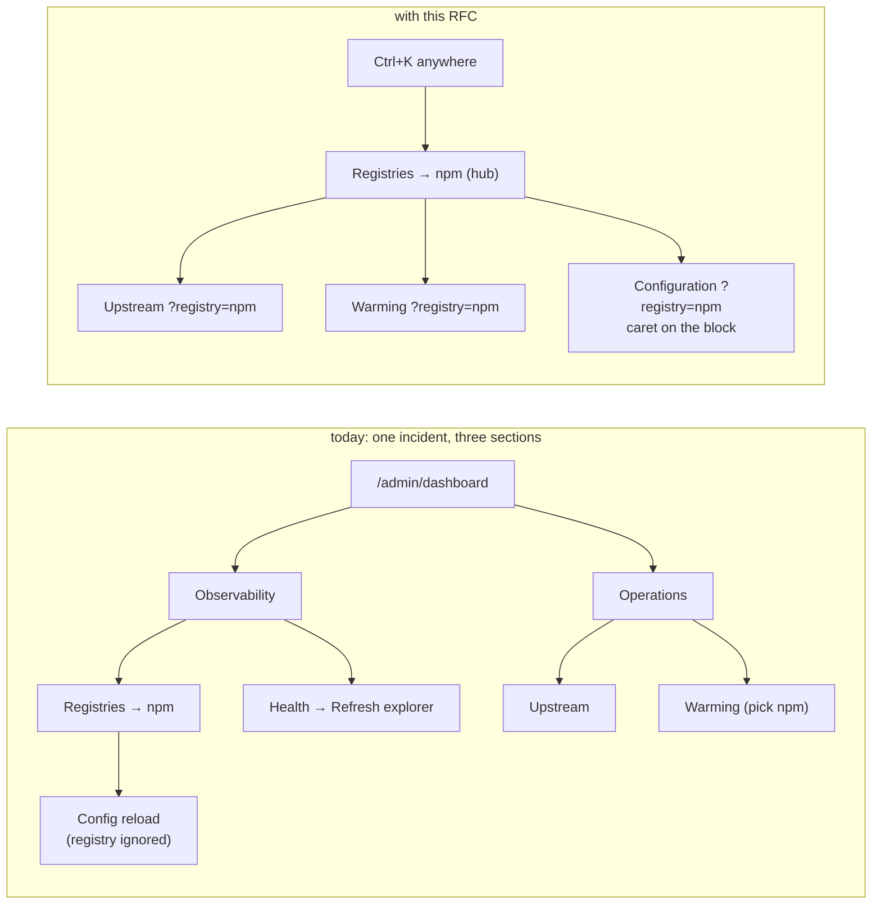
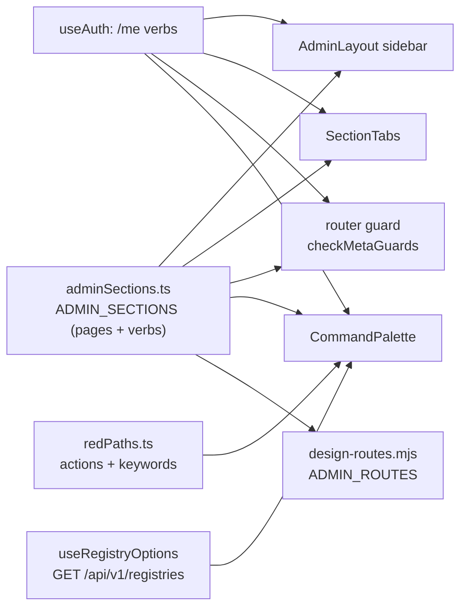
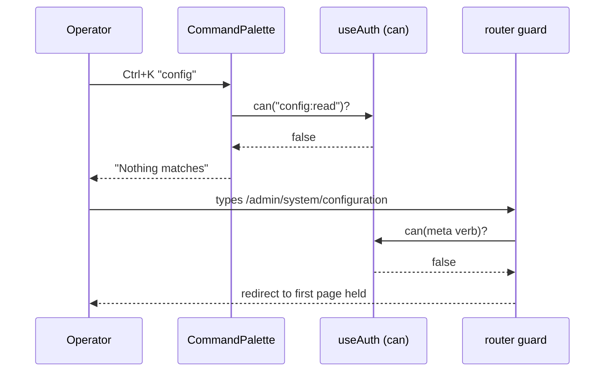
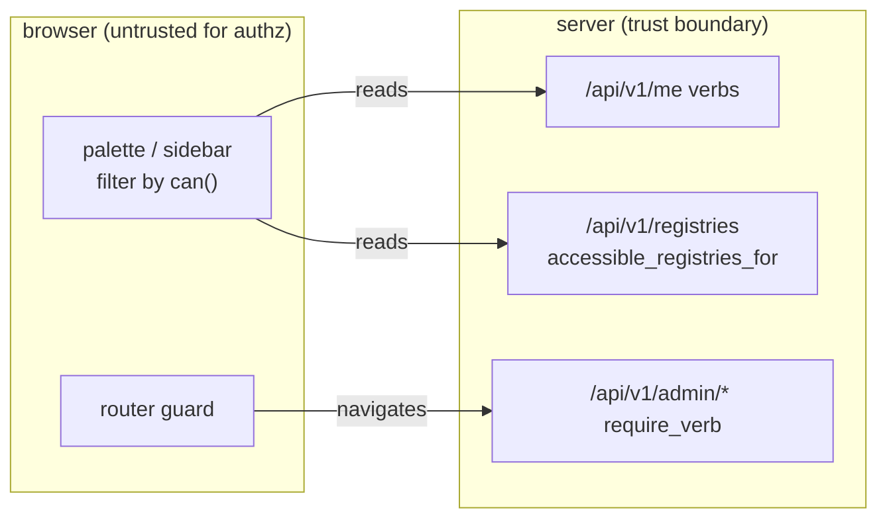

# RFC 0046 — Admin red paths

| Field       | Value                                                        |
| ----------- | ------------------------------------------------------------ |
| Status      | Draft                                                         |
| Short       | Admin red paths                                               |
| Settles     | Where each administrative task lives, how an operator reaches it from anywhere in the console, and what keeps the admin findable as pages are added |
| Author      | Max Batleforc <maxleriche.60@gmail.com>                       |
| Co-author   | Claude Opus 5.5 <noreply@anthropic.com>                       |
| Created     | 2026-11-11                                                    |
| Supersedes  | —                                                             |
| Touches     | `ui` (`config/adminSections.ts`, `config/navigation.ts`, `layouts/AdminLayout.vue`, `components/admin/SectionTabs.vue`, `components/app/AppHeader.vue`, a new `components/app/CommandPalette.vue` and `config/redPaths.ts`, `router/index.ts`, `pages/AdminRegistry.vue`, `pages/AdminConfigReload.vue` and the registry-scoped pages of §6.3, `locales/{en,fr}.json`, `build/design-routes.mjs`), `tests/heavy` (`console_security.mjs`, `console_fetch.sh`), docs (`guide/administration*.md`, `use/package-explorer-cache.md`) |
| Risk        | low — §7 (the palette lists destinations, and must list no more than the router already lets the viewer open) |

---

## 1. Summary

The admin console has grown from the 17 destinations RFC 0003 §4.2 sized its
seven sidebar sections for to 23 routed pages, and the sections have not
moved. An operator under pressure — an upstream is down, a user cannot
download, a CVE has landed — has to know *which of seven category words*
hides the page that fixes it, because the sidebar shows only the categories
and a section's pages appear only once you are inside it.

This RFC names those pressured journeys **red paths** (§2.1), measures each
one against the console as it is, and changes three things, in this order:

1. **The sidebar shows every page** it can open, grouped under its section,
   with no URL changed (§4.5 M1).
2. **A command palette** (`Ctrl+K` / `⌘K`, and a visible button) finds any
   page, registry or red-path action by what the operator would call it,
   in both locales, listing only what the viewer may open (§4.5 M2).
3. **The sections are regrouped by task**, with a **registry hub** that
   gathers what one registry's incident needs, and every moved path kept as
   a redirect (§4.5 M3, M4).

No endpoint, schema, configuration key or dependency is added.

### Before / after

```text
# today — "npm's upstream is failing, what do I do?"
Admin → Observability → (Health) → Registries tab → npm      (status)
Admin → Operations → (Upstream)                              (recheck)
Admin → Operations → Warming → pick npm again                (re-warm)
Admin → Observability → (Health) → Refresh explorer          (cache)
Registry page → Edit configuration → top of a 600-line file  (?registry= ignored)

# with this RFC
Ctrl+K "npm" ⏎                                               (registry hub)
  hub: status · Recheck upstream · Warm · Refresh explorer · Edit config ⏎
                                                  (caret on [[registries]] npm)
```



The diagram proves the point of §2: today one registry's incident crosses
three sections and drops the registry on every hop; after, every hop starts
from the registry and carries it.

---

## 2. Motivation

### 2.1 What a red path is

A **red path** is the route from an operator's *trigger* — an alert, a
ticket, a user's complaint, a published CVE — to the control that resolves
it. It is the path taken under pressure, by someone who may open the admin
once a month, so it is measured by how many **guesses** it takes, not by
clicks: a click on a label that names the task is free; a click on a label
that does not ("Observability" for "the registry is broken") is a guess.

The twelve red paths, from the code as it stands at `6eb196a4`
(`ui/src/config/adminSections.ts`, `ui/src/config/navigation.ts`,
`ui/src/router/index.ts`). *Clicks* count from `/admin/dashboard` with
perfect knowledge; *guesses* count section or tab labels that do not name
the task.

| # | Trigger | Where the control is today | Clicks | Guesses |
| --- | --- | --- | --- | --- |
| RP-1 | "I can't download X" | Security & Access → Access Check | 2 | 1 |
| RP-2 | An upstream is degraded | Observability → Registries → *name*; recheck under Operations → Upstream | 3 + 1 | 2 |
| RP-3 | Change one registry's config | registry page → Edit configuration, then find the block by hand | 4 + scroll | 2 |
| RP-4 | A CVE: which versions carry it? | Security & Access → Findings → group by reference | 3 | 1 |
| RP-5 | A scan failed / rescan | Security & Access → Scans → Failures | 3 | 1 |
| RP-6 | Block one version | the package page, Admin tab | catalog + 2 | 0 |
| RP-7 | Block many versions | Packages → Bulk Block | 2 | 0 |
| RP-8 | A leaked token or an abusive IP | Security & Access → (Blocks) | 1 | 1 |
| RP-9 | A package looks stale | Observability → (Health) → Refresh explorer | 1 | 1 |
| RP-10 | Who did this? | Observability → Audit Log | 2 | 1 |
| RP-11 | Announce maintenance | Operations → Global banner | 2 | 1 |
| RP-12 | A team needs a namespace | Namespaces & Channels → Team Namespaces | 1 | 0 |

The clicks are not the problem; ten of the twelve are three or fewer. The
guesses are, and §2.2 is why they are worse than the column suggests.

### 2.2 Motivations

1. **The sidebar names 1 of 23 destinations.** `ADMIN_SIDEBAR` has seven
   entries and `AdminLayout.vue` renders only those: *Dashboard* names a
   page, the other six name a section and open its first tab. The pages of a section
   are `SectionTabs` *inside* the page, so they are visible only after the
   section has been guessed. RFC 0003 §4.2 kept the seven groups because
   "the sidebar is the right pattern for 17 destinations"; there are now 23
   routes (22 in `ADMIN_PAGE_VERBS` plus `observability/registries/:name`),
   and Operations alone holds seven tabs. Falsifiable: count the `to:` in
   `adminSections.ts`.
2. **One registry's incident spans three sections and loses the registry on
   every hop** (RP-2, RP-3). The registry page (`AdminRegistry.vue`, RFC 0044
   §6.4) shows status but no action: the upstream recheck is on
   `operations/upstream`, warming on `operations/warming`, the explorer
   flush on `observability/health`. Of the registry-scoped pages, only
   `AdminScans.vue` reads `?registry=`; the others make the operator pick the
   registry again.
3. **A promised hop is dead.** RFC 0044 §4.5 specifies that *Edit
   configuration* opens `AdminConfigReload` with `?registry=` and "puts the
   caret on the first line of the matching `[[registries]]` block". The link
   sends the parameter (`AdminRegistry.vue:272–274`); nothing reads it — no
   `route.query` in `AdminConfigReload.vue`, no `setSelectionRange` anywhere
   in `ui/src`. RP-3 ends at the top of the file.
4. **Labels collide or misfile.** "Blocks" (accounts and addresses, under
   Security & Access) and "Bulk Block" (package versions, under Packages)
   are different objects with the same verb. "SBOM Export" is a package
   artifact filed under Operations. "Health" is where the explorer cache is
   flushed (`adminHealth.refreshExplore`), and the published docs still send
   readers to **Admin → Explore Cache** (`docs/use/package-explorer-cache.md:44`),
   a page that is a redirect since RFC 0003.
5. **There is no way to ask.** No search, no shortcut: `ui/src` binds no
   global key (`ctrlKey`/`metaKey` appear only in `PackageBreadcrumb.vue`'s
   middle-click guard). The operator who knows the *word* — "rescan",
   "banner", "audit" — cannot type it.
6. **Eight admin pages were never measured by the rendered gate.**
   `ADMIN_ROUTES` in `ui/build/design-routes.mjs` lists 15 paths; scans,
   findings, authorization, registries, a registry, upstream, banner and
   air-gap are absent. The pages most recently added are the ones nobody
   checked at 390 px — the same blind spot RFC 0004 §10 closed once.

---

## 3. Goals / non-goals

**Goals**

- Every red path of §2.1 reaches its control with **zero guesses** from the
  palette, and with at most one from the sidebar.
- Every admin page the viewer may open is **visible** in the sidebar without
  entering its section.
- A registry-scoped control opened from the registry hub **arrives with the
  registry selected**, including the configuration editor's caret.
- No bookmark breaks: every path that resolves today resolves after, through
  `LEGACY_REDIRECTS`.
- The palette and the sidebar **list exactly what the router lets the viewer
  open**, from the same table, so they cannot drift from the guard.
- A test fails when an admin page is added to the router without a sidebar
  entry, a palette entry, a verb and a rendered-gate route.

**Non-goals**

- **New admin features.** A red path whose control does not exist yet is
  listed in §15, not built here.
- **Backend or API changes.** Every list the palette shows already has a
  reader (§4.4); a server-side search would be a new enumeration surface for
  no gain at this size.
- **Package search in the palette.** The catalog already searches, ranked and
  paginated; the palette hands the query to `/packages?q=` instead (§4.2).
- **Merging the security console into the admin.** RFC 0042 placed
  `/security` beside the admin on purpose, for a group without admin verbs;
  the palette reaches both.
- **Usage analytics to rank red paths.** It would record what each operator
  opens; the list in §2.1 is reviewed, not measured.
- **Customisable navigation** (pinning, reordering). Twelve red paths do not
  need it, and per-user state is what §9 keeps at zero.
- **A redesign of the pages themselves.** Their composition is RFC 0004's;
  this RFC moves where they are, not what is on them.

---

## 4. User-facing design

### 4.1 Configuration

No configuration key is added. The palette, the expanded sidebar and the new
section tree are always on; there is nothing for an operator to set and no
closed side to default to, because nothing here grants or widens access.

### 4.2 Behaviour rules

**Sidebar (phase 1).**

- Each section is a heading followed by its pages, all visible. A section
  whose pages the viewer cannot open is absent, as today
  (`AdminLayout.vue`'s `sidebar` computed, RFC 0042 §4.3).
- The current page carries `aria-current="page"` and the 1 px selection edge;
  its section heading is not a link and is not focusable, so Tab moves page
  to page.
- `SectionTabs` stays on each page: it is the mobile navigation and the
  in-page reminder of siblings. On desktop it becomes redundant and is kept
  anyway — removing it is §15 question 6.

**Palette (phase 2).**

- Opened by `Ctrl+K` / `⌘K`, or by the *Go to…* button in the header (every
  viewer who is signed in) and at the top of the admin sidebar. The shortcut
  does nothing while focus is in a `textarea`, a `contenteditable` or an
  `input` other than the palette's own — the configuration editor is a
  `textarea` an operator types into for minutes.
- Entries come from four sources, filtered **before** they are shown:
  1. *Pages*: `ADMIN_PAGE_VERBS` where `can(verb)`, plus `/security` when
     `canAny(SECURITY_VERBS)`, `/me/*`, `/tools/*` and `/setup`.
  2. *Registries*: `GET /api/v1/registries` (`useRegistryOptions`), which
     `accessible_registries_for` already filters. A registry links to its
     hub when `can("system:read", name)` holds, otherwise to
     `/packages?registry=<name>`.
  3. *Red-path actions*: `config/redPaths.ts`, one entry per row of §2.1
     with keywords in both locales ("unblock", "débloquer", "CVE", "rescan",
     "bannière", …), each pointing at a page that is itself filtered by
     rule 1. An action whose page the viewer cannot open is not listed.
  4. *Search packages for "…"*: always the last row when the query is
     non-empty and the viewer has registry access; it routes to
     `/packages?q=<query>` (`useCatalogQuery.applyQuery` reads `q`).
- Matching is client-side: case- and accent-insensitive, every query word
  must prefix a word of the label or a keyword; ranked page > action >
  registry, then shorter label first. With an empty query the palette shows
  the red-path actions the viewer can open, in §2.1 order.
- `Enter` navigates; `Ctrl+Enter` / `⌘Enter` opens in a new tab; `Esc`
  closes and returns focus to whatever had it. Nothing is remembered between
  openings (§15 question 4).
- The uninteresting case: a viewer with no admin verb opens the palette and
  sees their own pages, `/setup`, the registries they read and the package
  search — no admin entry, no empty "Admin" group.

**Section tree (phase 3).**

- Six sections, named by task (§4.5 M3). Every moved path gains a
  `LEGACY_REDIRECTS` entry; query and hash are preserved, as
  `handleLegacyPath` already does.
- The registry hub is `observability/registries/:name` moved to
  `/admin/registries/:name`. It gains an *Actions* strip whose links carry
  `?registry=<name>`; each link is drawn only when the viewer holds the
  target page's verb for that registry (`can(verb, name)`).
- Each registry-scoped page reads `?registry=` on mount and preselects it
  (§6.3); a name it does not list is ignored with the page's normal
  "choose a registry" state, never an error.

### 4.3 Validation

Rejected:

| Condition | Rationale |
| --- | --- |
| A route under `/admin` with no `ADMIN_PAGE_VERBS` entry and no `meta.verb` | Already refused by the guard (fail closed); phase 1 adds the unit test that fails the build instead of the page silently redirecting (§14). |
| An `ADMIN_PAGE_VERBS` path in no section, or in two | One home per page; the sidebar and palette are generated from the sections. |
| A `redPaths.ts` entry whose target is not in `ADMIN_PAGE_VERBS` or the public pages | A palette row that the guard would bounce is a lie. |
| A `LEGACY_REDIRECTS` target that is not a route | A redirect chain that ends in "No match found". |

All four are unit tests over static tables, not runtime checks: nothing a
user types reaches them.

Warnings: none. `?registry=` naming an unknown registry is not a warning; the
page simply has nothing preselected (§4.2), as a hand-edited query on any
other page behaves today.

### 4.4 API surface

No API change. The palette reads `GET /api/v1/me` (verbs, already loaded by
`useAuth`) and `GET /api/v1/registries` (already called through
`useRegistryOptions` by five pages). No new call is made per keystroke:
the registry list is fetched once when the palette first opens and reused for
the session's identity.

### 4.5 Mocks

**M1 — sidebar, desktop, phase 1 (an admin holding every verb).**

```text
┌──────────────────────────┐
│ ⛨ ADMIN                  │
│ [ Go to…        Ctrl K ] │
│                          │
│ ▦ Dashboard              │
│ PACKAGES                 │
│   All packages           │
│   Bulk block             │
│ SECURITY & ACCESS        │
│   Blocks                 │
│ ┃ Access check           │  ← current: ink + 1px crimson edge
│   Authorization          │
│   Scans                  │
│   Findings               │
│ NAMESPACES & CHANNELS    │
│   Team namespaces        │
│   Beta channel           │
│ OPERATIONS               │
│   Upstream  … (7 rows)   │
│ OBSERVABILITY            │
│   Health · Registries ·  │
│   Audit log              │
│ NOTIFICATIONS            │
│   Subscriptions ·        │
│   Inbound events         │
└──────────────────────────┘
```

It decides that phase 1 changes only visibility: same labels, same order,
same URLs, so it can ship before anyone agrees on M3. The section headings
are small caps text, not links.

**M1′ — the same, for a security group holding only `quarantine:read` and
`findings:read`.**

```text
┌──────────────────────────┐
│ ⛨ ADMIN                  │
│ [ Go to…        Ctrl K ] │
│ SECURITY & ACCESS        │
│ ┃ Scans                  │
│   Findings               │
└──────────────────────────┘
```

It decides that a section shows only the pages the viewer holds, never a
greyed-out row: a disabled entry still announces a page exists, and RFC 0042
§4.3 already chose "absent" over "disabled".

**M2 — palette, nominal (admin, query `npm`).**

```text
┌ Go to… ─────────────────────────────────────────────── Esc ┐
│ > npm▏                                                      │
├─────────────────────────────────────────────────────────────┤
│ REGISTRIES                                                  │
│ ▸ npm                         npm · proxy      Registry hub │  ← active
│   npm-internal                npm · local      Registry hub │
│ ACTIONS                                                     │
│   Recheck an upstream                     Operations › Up…  │
│ ─────────────────────────────────────────────────────────── │
│   Search packages for “npm”                       Catalog → │
├─────────────────────────────────────────────────────────────┤
│ ↑↓ move   ⏎ open   Ctrl ⏎ new tab                           │
└─────────────────────────────────────────────────────────────┘
```

**M2 states.**

```text
empty query      → "Common tasks": the 12 red paths the viewer may open
no match         → "Nothing matches “zzz”." + the Search packages row
registries load  → pages and actions shown at once; REGISTRIES group shows
                   a one-line skeleton, never blocks typing
registries fail  → REGISTRIES group: "Registries could not be loaded." (text,
                   role=status); pages and actions unaffected
refusal (M1′'s   → query "config": "Nothing matches “config”." — the
 viewer)            Configuration page is not listed, and typing its URL
                   still lands on the first Security page the viewer holds
```

It decides that the refusal looks like an absence, not an error: the palette
is not the place to tell someone which pages exist above their verbs.

**M3 — section tree, phase 3 (proposal; §15 question 1).**

```text
Overview        Dashboard
Registries      All registries · ‹registry hub› · Upstream · Warming ·
                Release imports · Air gap
Packages        All packages · Block in bulk · SBOM export
Security        Scans · Findings
Access          Access check · Authorization · Blocked accounts & addresses ·
                Team namespaces · Beta channel
System          Configuration · Global banner · Health & cache · Audit log ·
                Notification subscriptions · Inbound events
```

It decides the grouping question by the trigger: what is broken (a registry),
what is wrong with it (a package, a vulnerability), who is affected
(access), or the instance itself (system). Renames in M3 remove both
collisions of §2.2(4).

**M4 — registry hub, phase 3 (`/admin/registries/npm`).**

```text
← All registries
npm                                   npm · proxy       [Monitoring ↗]
┌ Upstream ─────┬ Cache ────────┬ Scans ───────┬ Suggestions ────────┐
│ degraded      │ 81 % hit      │ 0 queued     │ 1 → see             │
└───────────────┴───────────────┴──────────────┴─────────────────────┘
Actions  Recheck upstream · Warm · Refresh explorer · Release imports ·
         Edit configuration
[ Overview | Configuration | Activity | Scan ]
```

It decides that actions are links to the existing pages with the registry
preselected, not forms embedded in the hub: one implementation per control.
An action the viewer lacks the verb for is not drawn. With every action
hidden, the strip is absent, not empty.

**M5 — configuration editor reached from the hub.**

```text
Configuration                                  npm · line 214
  212 │
  213 │ [[registries]]
▏ 214 │ name = "npm"          ← caret here, line scrolled to the top third
  215 │ type = "npm"
```

States: a reload is staged → the staged diff opens and the notice reads "A
reload is staged; review or discard it first." (RFC 0044 §4.5, unchanged);
the name is not found → the caret stays at line 1 and the notice reads "No
`[[registries]]` block named “npm” in the first layer." — the layered case of
`load_layered`, where the block lives in a layer the editor does not edit;
read-only mount → the same jump, in `ConfigReadOnlyView`.

---

## 5. Architecture



One table feeds every consumer. Today `ADMIN_PAGE_VERBS`, `ADMIN_SIDEBAR`
and six `*_TABS` arrays are written separately in `adminSections.ts` and
`ADMIN_ROUTES` is a fifth copy in `design-routes.mjs`; §2.2(6) is what
drifting copies produce. Phase 1 replaces them with one
`ADMIN_SECTIONS: { key, label, icon, pages: { to, label, verb, keywords }[] }[]`
from which `ADMIN_PAGE_VERBS`, the sidebar and the tabs are derived, and
against which a test checks `design-routes.mjs`'s list (§6.5).



The palette filter is a convenience; the guard is the control. Both read the
same table and the same `can`, so the palette cannot offer what the guard
refuses — and if it did, the guard would still refuse it.

---

## 6. Detailed design

### 6.1 `ui/src/config/adminSections.ts`

- `ADMIN_SECTIONS` as in §5. `ADMIN_PAGE_VERBS`, `ADMIN_SIDEBAR`,
  `firstAdminPage` and the `*_TABS` exports become derived values with the
  same names and shapes, so the 26 files listed by
  `grep -rl adminSections ui/src` keep compiling in phase 1.
- Each page gains `keywords: { en: string[]; fr: string[] }` for the palette.
  Keywords are data, not i18n catalogue entries: they are never displayed,
  so the catalogue gate (`i18n-audit.mjs`) has nothing to check.

### 6.2 `ui/src/components/app/CommandPalette.vue` and `config/redPaths.ts`

- Built on `radix-vue`'s `DialogRoot` (already wrapped by
  `components/ui/dialog/Dialog.vue`) and the ARIA 1.2 combobox pattern
  `components/ui/combobox/Combobox.vue` implements: an `input role=combobox`
  with `aria-activedescendant` over a `listbox`. Not a second combobox
  implementation: the list rendering is extracted from `Combobox.vue` if it
  does not already expose it (§15 question 5).
- Mounted once in `App.vue` beside `AppHeader`; the shortcut listener is a
  single `keydown` on `window`, removed on unmount.
- `redPaths.ts`: `{ id: "RP-1", label, keywords, to, query? }[]`, one per
  §2.1 row. `to` must be a key of `ADMIN_PAGE_VERBS` or a public page
  (§4.3).

### 6.3 Registry-scoped pages read `?registry=`

| Page | Today | Change |
| --- | --- | --- |
| `AdminConfigReload.vue` | ignores it | caret on the `name = "<registry>"` line of the first `[[registries]]` block that has it; RFC 0044 §4.5's text, implemented |
| `AdminUpstream.vue` | `<Select>` | preselect |
| `AdminWarming.vue` | registry field | preselect |
| `AdminImports.vue` | registry list | filter to it |
| `AdminHealth.vue` | per-registry clear | scroll to and focus that registry's row |
| `AdminScans.vue` | reads it | unchanged |

The value is matched against the page's own list; it is never interpolated
into a request it would not otherwise make.

### 6.4 `ui/src/router/index.ts` and `config/navigation.ts`

Phase 3 moves the routes to M3's paths and adds one `LEGACY_REDIRECTS` entry
per old path — 22 entries, plus the old `observability/registries/:name`
pattern, which needs a function in `handleLegacyPath` because the table is
keyed by exact path. `SECTION_INDEXES` gains the six new section roots. The
existing redirects that point at moved pages are rewritten to point at the
final target directly, so no chain is two hops.

### 6.5 `ui/build/design-routes.mjs`

`design-routes.mjs` is a plain Node script and cannot import the `.ts` table
(it pulls `@lucide/vue`). `ADMIN_ROUTES` therefore stays a literal, gains the
eight pages of §2.2(6) plus one concrete registry hub, and a unit test in
`adminSections.test.ts` reads the file and fails when the literal and the
derived list differ — the copy is kept, its drift is not.

### 6.6 `tests/heavy/console_security.mjs`

Gains the palette measurements of §6.P: open with `Ctrl+K`, type, read the
listed rows' `href`s; one run per token `console_fetch.sh` already provisions.

### 6.P Proof against a real client

The client is a browser: Chrome as pinned by
`.github/actions/headless-chrome` (and the browser sidecar on `9222` locally),
driven by `tests/heavy/console_security.mjs` under `console_fetch.sh`, which
already boots a server with an admin token and an RFC 0042 security-group
token. The observations to produce, none of them run yet:

1. **Admin, sidebar.** `/admin/dashboard` at 1440 px: the sidebar's `a`
   elements are exactly the derived `ADMIN_PAGE_VERBS` keys plus the hub
   list, in M1 order; one carries `aria-current="page"`.
2. **Admin, palette success.** `Ctrl+K`, type `rescan`: the first row's
   `href` is the scans page with `tab=failures`; `Enter` lands there, and
   the server log shows `GET /api/v1/admin/scans` and no other new path.
3. **Admin, carried registry.** From `/admin/registries/npm`, *Edit
   configuration*: `document.activeElement` is the editor `textarea` and
   its `selectionStart` is the offset of `name = "npm"` in the served
   config.
4. **Refusal.** The security-group token opens the palette and types
   `config`: zero rows but *Search packages*; then `page.goto` on the
   configuration path ends on the first security page it holds, and the
   server log shows **no** `GET /api/v1/admin/config*` from that session —
   the refused page never fetched its data.
5. **Shortcut inside the editor.** Focus in the configuration `textarea`,
   `Ctrl+K`: the palette does not open and the textarea receives no
   character.
6. **Bookmarks.** Each of the 22 phase-1 paths loaded directly after phase 3
   ends on its M3 path with the query string intact.

---

## 7. Security

**Rating: low.** The change moves links. It adds no endpoint, no stored
state and no new read; the risk is that a convenience surface lists more
than the access model allows, or that a registry name becomes markup or a
path.

### 7.1 Threat model



Everything left of the boundary is presentation: a viewer can edit the
bundle and list every page; the server's `require_verb` is what refuses the
data.

| # | STRIDE | Threat | Mitigation and enforcement | Residual |
| --- | --- | --- | --- | --- |
| T1 | Information disclosure | Palette lists a registry the viewer may not read | Registries only from `GET /api/v1/registries`, filtered by `accessible_registries_for` (`front_office/registries.rs:90`); the palette adds none | Namespace-only grants are invisible to that list (known, `legacy-access-vs-grants`): a registry is *missing*, never extra. Accepted by the author. |
| T2 | Information disclosure | Palette or sidebar lists an admin page above the viewer's verbs | Same `ADMIN_SECTIONS` + `can()` as the guard (`checkMetaGuards`); a unit test asserts the palette's admin rows equal `firstAdminPage`'s candidates for three verb sets | The page *names* ship in the JS bundle anyway; nothing new is learned. |
| T3 | Elevation of privilege | A palette row or hub action reaches a page the guard would refuse | The guard is unchanged and fails closed (a page missing from the table is refused); the palette only calls `router.push` | None. |
| T4 | Tampering / XSS | A registry name rendered as markup | Rendered with `{{ }}` text interpolation only; the palette has no `v-html`. `vue/no-v-html` is **off** in `ui/eslint.config.js:56`, so the guard is a unit test with a markup-shaped registry name (§14), not lint | A later edit adding `v-html` to the palette is caught by that test only. |
| T5 | Tampering | A registry name or query string builds a path elsewhere | Hub links use `encodeURIComponent` (the `packagePath` pattern); `?registry=` is matched against the page's own list and otherwise ignored (§6.3) | None. |
| T6 | Spoofing (UI) | A keyboard shortcut steals input in the config editor, causing a mistyped config | Shortcut suppressed in `textarea`/`contenteditable`/foreign inputs (§4.2); §6.P obs. 5 | A browser extension may claim the same chord; then the button still works. |

### 7.2 Authentication and authorisation

No new decision. Who may open what is `require_verb` on the server and
`checkMetaGuards` in the router, both unchanged; the palette reads the same
`can`. Phase 3's moves keep each page's verb: the move is in `ADMIN_SECTIONS`,
which carries the verb with the path, so a page cannot change sections and
lose its gate.

### 7.3 Input handling and injection

The palette's query never leaves the browser except as `/packages?q=`, which
the catalog already accepts from any URL. `?registry=` is compared with
values the page fetched itself.

### 7.4 Secrets and cryptography

None handled. The palette stores nothing (§9), so no token or registry name
reaches `localStorage`.

### 7.5 Abuse and resource exhaustion

One `GET /api/v1/registries` per session identity, on first open. Matching
runs over at most a few hundred entries per keystroke in memory.

### 7.6 Existing defences that still hold

`require_verb` on every `/api/v1/admin/*` route; the fail-closed guard of RFC
0042 §4.3; `accessible_registries_for`; the CSP of `ui/build/csp.ts` (the
palette adds no inline script or external origin).

---

## 8. Supply chain

No new dependency, image, action or tool. The dialog is `radix-vue` 1.9.17
and the combobox pattern is the in-repo `Combobox.vue`, both already in
`ui/pnpm-lock.yaml`; fuzzy-matching libraries (`fuse.js`, `cmdk`-style
packages) were considered and rejected in §12 on size of need. `task
security` is unchanged.

---

## 9. Data and privacy

No new data is stored or transmitted. The palette keeps no history, no
recents and no counters, in memory past closing or in browser storage
(§15 question 4 asks whether recents are worth `localStorage`), and §3 rules
out usage analytics. The registry list it shows is the one the viewer's
pages already fetch.

---

## 10. Operability

### 10.1 Observability

- **Metrics**: none; the change is client-side and makes no new request
  kind. A red path's use is deliberately not measured (§3).
- **Logs and audit trail**: unchanged. Every action a red path reaches is
  already audited by the page that performs it.
- **Alerts**: none, because nothing new can fail on the server.

### 10.2 Failure modes

| Failure | Detected by | Behaviour | Recovery |
| --- | --- | --- | --- |
| `GET /api/v1/registries` fails | the palette | pages and actions still listed; the REGISTRIES group says so (M2) | reopen the palette |
| `/me` not loaded yet | `useAuth.identityReady` | palette shows nothing admin until it resolves — fails closed | automatic |
| A moved page's old URL | `handleLegacyPath` | redirect, query kept | none needed |
| A page added without a section | unit test (§4.3) | build red | add it to `ADMIN_SECTIONS` |

### 10.3 Performance and capacity

The palette is a lazily imported chunk (`defineAsyncComponent`), loaded on
first open, so the initial bundle grows by the shortcut listener only. The
expanded sidebar adds ~23 links to the admin layout; measured by the
rendered gate's existing budgets at four viewports.

---

## 11. Other concerns

- **Accessibility**: WCAG 2.2 AA. The palette is a modal dialog with a
  labelled combobox; focus is trapped and returns on close; results are
  announced through the existing `Announcer` ("4 results"). The shortcut uses
  a modifier, so WCAG 2.1.4 (character key shortcuts) does not apply, and the
  visible button gives a pointer and a touch route. The sidebar's headings
  are not focus stops (M1). All mocks are checked by `ui:design:routes` at
  1440/1024/768/390 once phase 1 adds the missing routes.
- **Internationalisation**: every label in `en.json` and `fr.json`; palette
  keywords in both languages so a French-speaking operator finds "bannière"
  and "débloquer" (§6.1). The renames of M3 get French labels named from
  behaviour (*Blocage de masse* for bulk blocking, per the project's own
  rule).
- **Compliance**: no control touched; RFC 0036's audit trail is unchanged.
- **Licensing**: unchanged.
- **Documentation**: phase 1 corrects `docs/use/package-explorer-cache.md`'s
  "Admin → Explore Cache"; phase 3 rewrites every "Admin → …" path in
  `docs/guide/administration*.md` and `configuration.md`'s *Admin →
  Dashboard*; `guide/administration.md` gains a "Red paths" table — §2.1 as
  instructions.

---

## 12. Alternatives considered

| Alternative | Why rejected |
| --- | --- |
| Do nothing | Every new page deepens §2.2(1); RFC 0044 alone added five, and three of them were never rendered-gated. |
| Only the palette (point 3 alone) | Fixes the operator who knows the word; leaves the one who browses with seven opaque categories, and leaves RP-3's dead hop. |
| Only regroup (point 2 alone) | A better tree still hides 21 pages behind six headings, and a URL migration with nothing shipped first makes the whole RFC wait on M3's naming argument. |
| A top-bar mega-menu | Duplicates the sidebar on desktop and has no good phone form; the mobile admin menu RFC 0003 built is a list, which M1 already is. |
| A "quick actions" tile grid on the dashboard | Reachable only from the dashboard; the red paths start wherever the operator is. |
| Server-side search endpoint | A new enumeration surface (§7) to search fewer than 300 static entries. |
| `fuse.js` or a `cmdk` port | ~6–20 kB for fuzzy ranking that prefix matching over keywords covers; a dependency to audit for a feature whose index is hand-written. |
| Fold `/security` into the admin | Undoes RFC 0042's reason for it: a delegated group without admin verbs. |

---

## 13. Rollout and compatibility

- **Default behaviour**: all three changes are on with the release that
  ships them; there is no flag, because no change alters what anyone may do.
- **Migration**: phase 3 only, and only URLs: 22 legacy redirects plus the
  registry pattern. No schema, config or data.
- **Operator prerequisites**: none. Runbooks quoting admin URLs keep working
  through the redirects; the docs are updated in the same change.
- **Rollback**: phases 1 and 2 roll back by reverting the front. Phase 3
  rolled back after release leaves *new* URLs that the old build does not
  know. The router has no catch-all route, so a bookmark made in between
  renders the admin layout with an empty content area — no data is fetched,
  nothing is exposed, but nothing tells the operator either. A rollback of
  phase 3 should therefore ship the inverse redirects. No risk of §7
  reopens.
- **Staged**: the phases are the stages (§16); phase 1 alone is useful.

---

## 14. Test plan

- **Unit** (`ui/src/config/adminSections.test.ts`, new): every `/admin`
  route has a verb; every page is in exactly one section; derived
  `ADMIN_PAGE_VERBS` equals the router's admin children; `redPaths.ts`
  targets all resolve; every `LEGACY_REDIRECTS` target is a route.
- **Unit** (`CommandPalette.test.ts`): filtering for three verb sets
  (admin, security group, plain user); prefix and accent matching in `fr`;
  the shortcut is ignored in a `textarea`; `Esc` restores focus; the
  registries-failed state.
- **Unit** (`AdminConfigReload.test.ts`): `?registry=` puts `selectionStart`
  on the block; not found shows the notice; a staged reload ignores it.
- **Integration**: `AdminLayout.test.ts` renders M1 and M1′.
- **Proof**: §6.P, observations 1–6.
- **Security**: T1 — palette shows exactly `useRegistryOptions`' list
  (unit); T2 — admin rows equal guard candidates (unit, three verb sets);
  T3 — §6.P obs. 4 (heavy); T4 — a registry named `` in
  the fixture renders as text (unit); T5 — `?registry=../x` preselects
  nothing (unit, per page of §6.3); T6 — §6.P obs. 5 (heavy).
- **Audit**: `task security` unchanged.
- **Existing suites** that must pass unchanged: `ui:test` (the router guard
  tests prove the fail-closed redirect still holds), `ui:design:routes`
  (now over 23 admin routes), `docs:audience` and `docs:structure`,
  `console_fetch.sh` (RFC 0042's nav and refusal cases).

---

## 15. Decisions and open questions

### Resolved

| # | Question | Decision |
| --- | --- | --- |
| R1 | Scope | **The three changes of §1, in that order, as one RFC.** The user asked for all three; phasing keeps each shippable alone. |
| R2 | Backend changes? | **None.** Every list the palette needs already has a filtered reader (§4.4). |
| R3 | Package search in the palette | **A hand-off row to `/packages?q=`, not results.** The catalog ranks and pages; a second search would disagree with it. |

### Still open

1. **The M3 tree and its names.** Six sections by trigger as drawn, or keep
   seven and only move the misfiled pages (SBOM to Packages, the explorer
   flush named, registries out of Observability)? Recommendation: M3 — the
   misfilings are symptoms of grouping by category, and a smaller move would
   be revisited at the next five pages.
2. **Where the registry-scoped operations live.** In M3 Upstream, Warming,
   Release imports and Air gap are pages under *Registries*, reached from the
   hub with `?registry=`. The alternative is hub tabs that embed them.
   Recommendation: pages + preselection (M4): one implementation per
   control, and the global views (every upstream at once) stay.
3. **A second shortcut.** `/` as in GitHub and many consoles is a character
   key shortcut, which WCAG 2.1.4 requires to be remappable or turnable off.
   Recommendation: `Ctrl/⌘+K` only.
4. **Recents.** Showing the last five destinations needs `localStorage`
   (per-viewer, survives sign-out on a shared machine). Recommendation: no,
   until someone asks; the empty query already shows the red paths.
5. **Reusing `Combobox.vue`.** Its list is internal; extracting it touches
   a component with its own Sonar exception (`comboboxRoles`).
   Recommendation: extract the listbox, keep one ARIA implementation.
6. **`SectionTabs` on desktop** once the sidebar lists every page.
   Recommendation: keep them in phase 1, decide after M1 is used for a
   release.
7. **Red paths without a control today.** Two triggers have no page at all:
   "revoke every token of a user" (only account blocking, RP-8) and "what
   changed in the config last week" beyond `ConfigChangeHistory`.
   Recommendation: list them in the administration guide's red-path table as
   gaps and leave them to their own RFCs.

---

## 16. Implementation phases

| Phase | Content | Useful alone |
| --- | --- | --- |
| 1 | `ADMIN_SECTIONS` as the single table; expanded sidebar (M1, M1′); the four §4.3 unit tests; `design-routes.mjs` gains the eight missing pages, checked against the table (§6.5); `?registry=` caret in the configuration editor (RP-3, RFC 0044's promise); `docs/use/package-explorer-cache.md` corrected | yes — visibility, the dead hop and the gate gap are fixed with no URL changed |
| 2 | `CommandPalette` + `redPaths.ts` (M2, every state); header and sidebar buttons; `console_security.mjs` observations 2, 4, 5 | yes — zero-guess red paths over the old tree |
| 3 | M3 routes, renames and `LEGACY_REDIRECTS`; registry hub actions strip (M4) and `?registry=` on the §6.3 pages; docs paths rewritten; administration guide's red-path table; observation 6 | completes the regrouping |

The security-relevant property — the palette lists no more than the guard
allows — lands in phase 2 with the palette, tested by the same commit; the
sidebar filter it shares is already enforced in phase 1.
