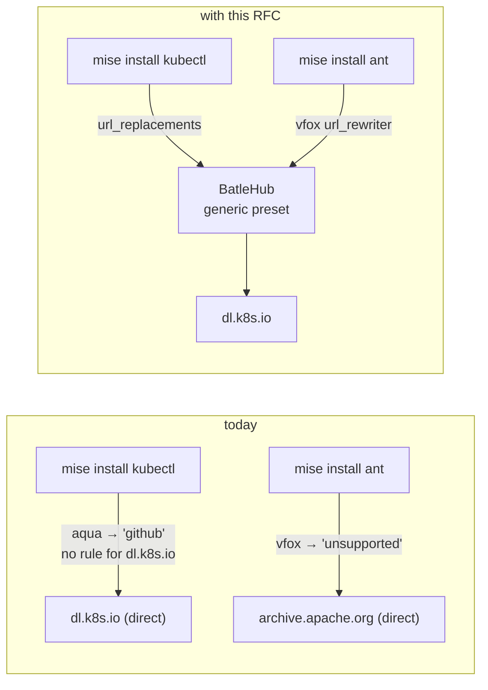
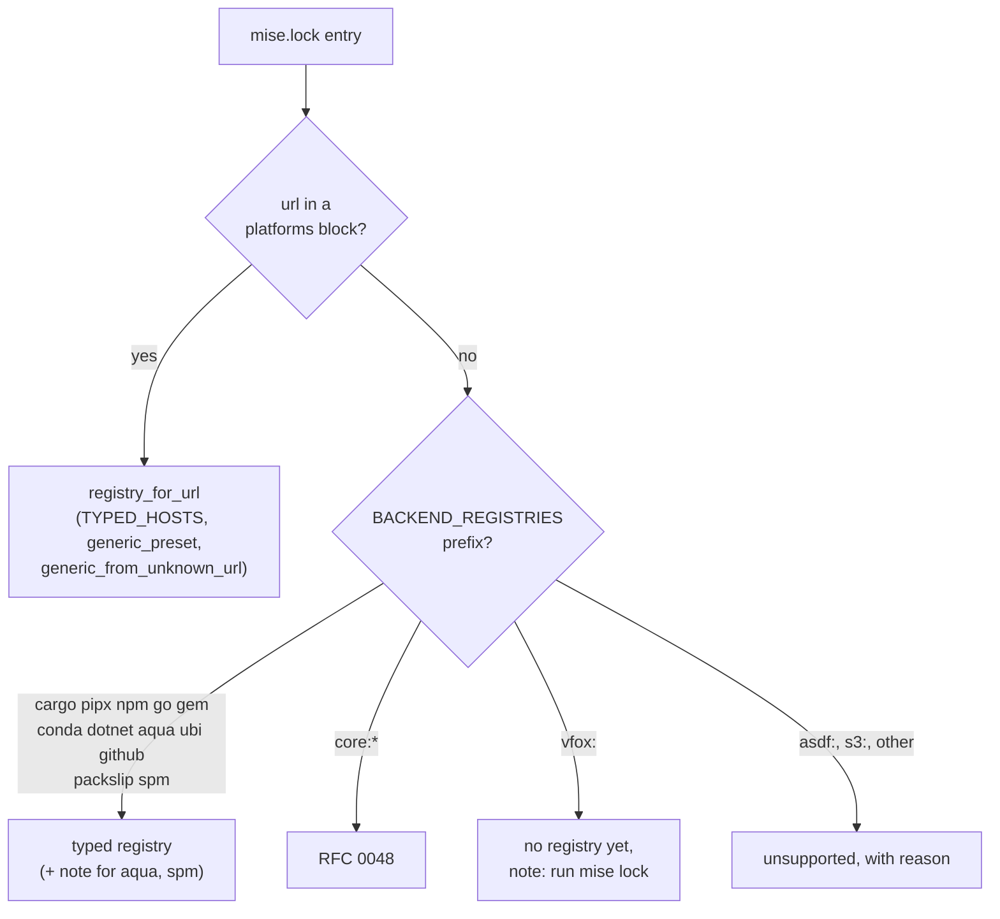
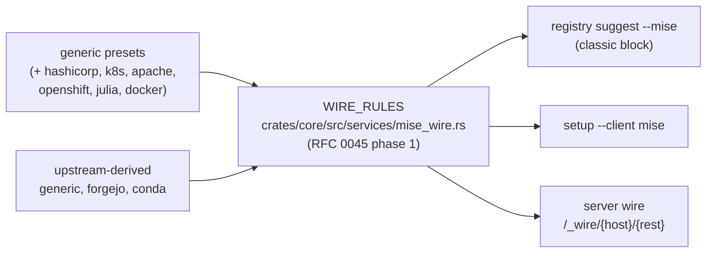
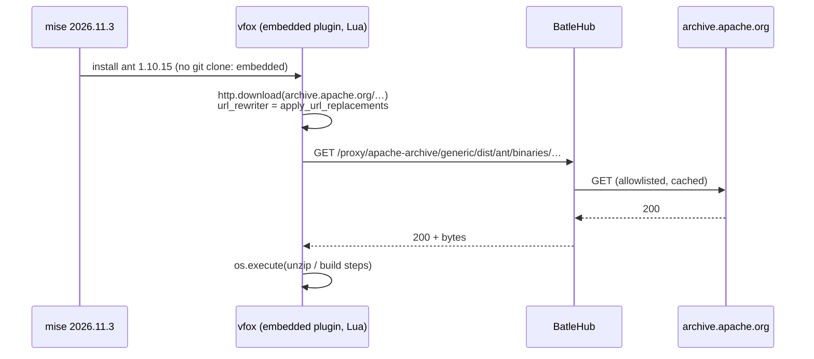
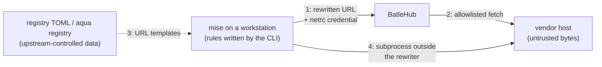

# RFC 0047 — mise backends coverage

| Field       | Value                                                        |
| ----------- | ------------------------------------------------------------ |
| Status      | Draft                                                         |
| Short       | mise backends coverage                                        |
| Settles     | Which mise backends reach BatleHub, how the CLI tells a covered backend from one that is not, and how the gaps close: aqua's `http` packages, the `http:` backend, the vfox plugins mise embeds, `dotnet:`, `packslip:` and conda channels other than conda-forge |
| Author      | Max Batleforc <maxleriche.60@gmail.com>                       |
| Co-author   | Claude Opus 5.5 <noreply@anthropic.com>                       |
| Created     | 2026-11-11                                                    |
| Supersedes  | — (amends RFC 0045 §6.1: conda joins the upstream-derived kinds, §6.4) |
| Touches     | `cli` (`api/suggest.rs`, `api/client_setup.rs`, `api/mise_plan.rs`, `cli/mise.rs`), `crates/core` (`services/mise_wire.rs` once RFC 0045 phase 1 lands), `crates/adapters` (`registry/path_proxy.rs`: `generic` globs with `require_literal_separator`, §15 Q7), `tests/heavy` (`closed_world.sh`, `airgap.sh`), `.github/workflows/test.yaml` and `mise-scan.yaml` (the pinned mise), docs (`use/mise.md`, `registries/generic.md`, `registries/conda.md`, `registries/nuget.md`) |
| Risk        | medium — §7 (the CLI writes the client rules that decide which host a tool's bytes come from) |

---

## 1. Summary

mise installs a tool through one of fourteen *backends*. BatleHub covers a
backend in one of two ways: a `url_replacements` rule catches the URL mise
fetches (GitHub, Forgejo, GitLab, npm, cargo, conda), or a client-env block
points the ecosystem tool mise shells out to at the proxy (`pipx:`, `go:`,
`gem:`). Whether a backend is covered is decided in one table of the CLI,
`BACKEND_REGISTRIES` (`cli/src/api/suggest.rs:310`), and one function,
`unsupported_backend_reason` (`cli/src/api/suggest.rs:287`).

Measured against the registry of mise 2026.11.3 (1 074 tools), that table is
wrong in both directions. It calls **every aqua package GitHub**, although 48
of the 704 aqua tools download from HashiCorp, Apache, Kubernetes, Google
Cloud Storage and a dozen other vendor hosts. It calls **every vfox plugin
unsupported** ("git-fetched"), although 40 of the 41 vfox tools in the
registry are plugins mise compiles in, never clones, and whose downloads
already go through `url_replacements`. It does not know `dotnet:` at all,
although the `nuget` kind exists. And the 17 `http:` tools (dart, flutter,
julia, nim, oc…) have no preset, so each locked version gets a generic mirror
narrowed to that one file.

This RFC corrects the table, adds generic presets for the hosts that carry
the most measured defaults (§2, per-tool table in §2.7 — it does not cover
every tool), maps `dotnet:` and `packslip:` onto the kinds that already serve
them, derives the conda rule from the registry's upstream channel, and states
what stays out (`asdf:`, `s3:`, `spm:` source builds, the one non-embedded vfox
plugin) with the reason. Every rule it adds lands in RFC 0045's wire table,
so the auto-wire mode picks them up without a second list. The `core:*`
toolchains (java, ruby, zig, deno, …) are RFC 0048's.

### Before / after

```text
# today — `batlehub-cli mise plan` on a mise.toml with kubectl, ant,
#   dotnet:dotnet-outdated-tool, conda:ffmpeg (no lock yet)
4 tool(s) · 0 download(s) · 2 registries · 0 host(s) with no mirror configured
  unsupported: vfox:jdx/vfox-ant: a git-fetched plugin backend; mise clones it, …
  unsupported: dotnet:dotnet-outdated-tool: no registry kind fronts this backend, …
# and `registry suggest --mise` proposes a `github` registry for kubectl,
# which downloads from dl.k8s.io

# with this RFC, still no lock
4 tool(s) · 0 download(s) · 3 registries · 0 host(s) with no mirror configured
  note: aqua: packages of type `http` download from their vendor's host, not GitHub; run `mise lock` to see which
  note: vfox:jdx/vfox-ant: built into mise, downloads over HTTP; run `mise lock` so the plan knows the URL

# with this RFC, after `mise lock` — the URLs decide
4 tool(s) · 4 download(s) · 4 registries · 0 host(s) with no mirror configured
# registry suggest: k8s-dl (generic, dl.k8s.io), apache-archive (generic),
#   nuget (dotnet.registry_url + NuGet.config), conda (rule from its upstream)
```



The diagram shows the two requests that leave the estate today with nothing
on the wire to say so; with the RFC both are rewritten onto a registry, and
in an air gap the catch-all rule (`cli/src/api/suggest.rs:1439`) sinks the
ones still unwired instead of letting them time out.

---

## 2. Motivation

The inventory is `mise registry` of mise 2026.11.3, the backend each tool
uses **by default** (the first one listed): aqua 704, github 188, vfox 41,
npm 41, pypi 23, conda 20, http 17, packslip 16, core 14, go 4, gem 3,
spm 1, gitlab 1, cargo 1. The aqua figures come from the aqua registry
vendored in the same crate (`vendor/aqua-registry/registry.yml`,
aquaproj/aqua-registry at `017ef00e`).

1. **48 aqua tools are labelled GitHub and download from somewhere else.**
   `BACKEND_REGISTRIES` maps `aqua:` to `github` with the comment "aqua and
   ubi both resolve to GitHub release assets"
   (`cli/src/api/suggest.rs:320-322`). Of the 704 aqua defaults, 648 are
   `github_release`, 4 `github_archive`, 4 `github_content` — those are
   GitHub, and the six GitHub rules cover them. The other **48 are aqua type
   `http`**: `releases.hashicorp.com` (8: terraform's siblings boundary,
   consul, nomad, packer, waypoint…), `storage.googleapis.com` (6 tool rows:
   cloud-sql-proxy, skaffold, spin, claude, claude-code, nelm),
   `archive.apache.org` (3: maven, spark, tomcat),
   `awscli.amazonaws.com` (3), `dl.k8s.io` (2: kubectl, kubectl-convert),
   `binaries.sonarsource.com` (2), `releases.crossplane.io` (2) and one each on
   download.docker.com, downloads.haskell.org, get.helm.sh,
   download.racket-lang.org, download.oracle.com, pkgs.tailscale.com and
   others. Without a lock, `registry suggest --mise` proposes a `github`
   registry for `kubectl`, and kubectl then downloads from `dl.k8s.io`
   directly. With a lock the URL is read and the right generic mirror is
   proposed (`registry_for_url`, `cli/src/api/suggest.rs:963`), so the bug
   is the lock-less path and the plan's wording, not the lock path.

2. **40 of the 41 vfox tools are declared unsupported and are not.**
   `unsupported_backend_reason` returns "a git-fetched plugin backend; mise
   clones it, and there is no HTTP path through BatleHub" for every `vfox:`
   (`cli/src/api/suggest.rs:294-297`), and `docs/use/mise.md` §5 repeats it.
   In mise 2026.11.3 the vfox crate (2026.11.3) carries 37 plugins under
   `embedded-plugins/`, and a plugin found there is never cloned
   (`src/plugins/vfox_plugin.rs:243-245,314,334`). Every HTTP call a plugin's
   Lua makes goes through the URL rewriter mise installs,
   `vfox.set_url_rewriter(crate::http::apply_url_replacements)`
   (`src/plugins/vfox_plugin.rs:199`), which the vfox crate applies in its
   Lua `http` module (`src/lua_mod/http.rs`, `src/plugin.rs:194-197`). Only
   `tiny` (`jdx/vfox-tiny`) is not embedded. The SDKs this hides behind a
   wrong "unsupported" are the ones a JVM, PHP or mobile estate asks for
   first: **android-sdk, graalvm, php, scala, groovy, clojure, leiningen,
   ant, spring-boot, lua, yarn, poetry, pipenv, gcloud, elasticsearch,
   mysql**.

3. **`dotnet:` is unsupported although the `nuget` kind exists.** mise's
   `dotnet:` backend runs `dotnet tool install <tool> --tool-path …`
   (`src/backend/dotnet.rs:138-146`), which reads NuGet.config, and lists
   versions from `dotnet.registry_url`, default
   `https://api.nuget.org/v3/index.json` (`src/backend/dotnet.rs:17-18,
   175-179`), through mise's own HTTP client. BatleHub serves that index
   (`crates/web/src/lib.rs:1323`, `nuget_service_index`) and
   `client_setup` already writes NuGet.config for `ClientId::Nuget`
   (`cli/src/api/client_setup.rs:153`). `BACKEND_REGISTRIES` has no
   `dotnet:` row, so the plan says "no registry kind fronts this backend".

4. **`http:` tools get a mirror one file wide.** The 17 `http:` defaults
   (dart, flutter, julia, nim, oc, openshift-install, kotlin-toolchain,
   neo4j, sentinel, tfc-agent, nomad-pack, cursor-agent, grok, muse, twg,
   android-cli) each name a URL template and often a `version_list_url`
   (`registry/flutter.toml`: `releases_linux.json`; `registry/julia.toml`:
   `versions.json`). None of their hosts has a preset (`generic_preset`,
   `cli/src/api/suggest.rs:137`, knows five). `generic_from_unknown_url`
   therefore writes `path_allow` as "the single exact path observed"
   (`cli/src/api/suggest.rs:1001-1004`): the next version is refused, and the
   version list mise reads first is not in the allowlist at all.

5. **`packslip:` is unsupported in the plan and mostly GitHub on the wire.**
   The 16 packslip tools (hk, usage, pitchfork, helmfile, timoni…) read the
   repository's releases through mise's GitHub client
   (`src/backend/packslip.rs:1761,1770`), the signed list at
   `raw.githubusercontent.com/{repo}/HEAD/.well-known/packslip.json`
   (`src/backend/packslip.rs:1649`) or, for a vendor-hosted project,
   `https://{host}/.well-known/packslip/{path}.json`
   (`src/backend/packslip.rs:358-361`). With a lock the asset URL is a GitHub
   URL and is covered; without one the plan falls to "no registry kind
   fronts this backend" (`cli/src/api/suggest.rs:305-307`).

6. **The conda rule only knows conda-forge.** The baseline fix
   (#318, merged as `234b095c`) adds `conda:` to `BACKEND_REGISTRIES`
   and a rule anchored on `https://conda.anaconda.org/conda-forge/`, and
   refuses the rule for a registry of any other channel
   (`foreign_upstream`, `cli/src/api/client_setup.rs:1200`). A tool with
   `channel = "bioconda"` — or an estate whose `conda.channel` is its own
   channel — goes direct, with a `shortcut:` comment saying so.

7. **What this RFC covers, per tool group, and what it leaves.** The
   threshold for a vendor-host preset is **two or more mise default tools
   downloading from the host**, measured on the pinned mise; below it, a lock
   yields a narrow generic mirror from `generic_from_unknown_url`, as today.

   | Group (defaults) | Routed after this RFC | Correct verdict, no route yet | Gap |
   | --- | --- | --- | --- |
   | aqua GitHub types (656) | 656 (`github`) | — | — |
   | aqua `http` (48) | 23: hashicorp 8, storage.googleapis.com 6 (bucket widening), apache 3, k8s 2, sonarsource 2 (existing preset), helm 1 (existing), docker 1 | — | 25: awscli 3 and crossplane 2 meet the threshold and get a preset after a probe (§15 Q6: by measurement and on request); 20 single-tool hosts |
   | `http:` (17) | 10: julia, oc, openshift-install, sentinel, tfc-agent, nomad-pack, dart, flutter, grok, … | — | 7: nim, kotlin-toolchain, neo4j, cursor-agent, muse, twg, android-cli |
   | vfox embedded (40) | 2 by preset: ant, groovy | 38: the verdict becomes a note; a lock gives a narrow generic | — |
   | vfox cloned (1, `tiny`) | — | — | unsupported (git) |
   | conda (20) | 20 (conda-forge; other channels by upstream) | — | — |
   | packslip (16) | the `github.com/` and owner/repo forms | — | `packslip:{host}` forms |
   | `dotnet:` | listing and install through `nuget` (§6.2) | — | — |
   | npm, pypi, cargo, go, gem, github, gitlab | unchanged, covered | — | — |

   So the headline is narrower than "every backend": the verdicts become
   true for all of them, and routes are added where the volume is.

---

## 3. Goals / non-goals

**Goals**

- The CLI's verdict on a backend matches what mise 2026.11.3 actually
  fetches: no covered backend reported unsupported, no uncovered one
  reported covered.
- Every host that two or more mise default tools download from (§2.7) has
  either a typed rule or a generic preset whose allowlist survives a version
  bump and includes the version list mise reads.
- `dotnet:` installs through a `nuget` registry; `conda:` through a `conda`
  registry of whatever channel it fronts.
- The rules live in one table — RFC 0045's `WIRE_RULES` — so `registry
  suggest --mise`, `batlehub-cli setup` and the server-side wire agree.
- The proof runs the real mise binary, pinned, in the closed-world suite and
  in the air gap.

**Non-goals**

- **`asdf:` plugins.** mise clones them over git and runs their shell
  scripts, which call `curl` themselves; `url_replacements` never sees those
  requests. Covering them means a git smart-HTTP proxy *and* a forward proxy
  for arbitrary scripts — a different product.
- **The non-embedded vfox plugin (`tiny`) and any vfox plugin named by URL.**
  Same git clone as asdf; one tool in the registry does not pay for it.
- **`s3:`.** The backend signs requests with the AWS SDK against the bucket's
  endpoint (`src/backend/s3.rs:184-193,467-476`); they never pass through
  mise's HTTP client, and BatleHub serves no S3 API.
- **`spm:` source builds.** They `git clone` the package
  (`src/backend/spm.rs:432-471`). The artifact-bundle path, which reads a
  GitHub or GitLab release (`src/backend/spm.rs:272-300,612-631`), *is* in
  scope, as GitHub.
- **Live signature verification on the disconnected side** for `packslip:`,
  aqua's cosign/slsa and vfox attestations. RFC 0008 §5 ("What will not
  work") already rules it out; this RFC does not reopen it. packslip does not
  need it: its Sigstore check uses a trust root embedded in the mise binary
  and fetches no TUF root (§15 Q5), so a packslip tool installs air-gapped
  once the documents it verifies are held like any other artifact.
- **The `core:*` toolchains** — RFC 0048.
- **A dedicated kind for HashiCorp releases or dl.k8s.io.** A `generic`
  registry with a preset caches and allowlists them; per-version blocking for
  generic is RFC 0045 Q8's open thread, not this one.
- **Shipping a copy of the aqua registry in the CLI.** See §12.

---

## 4. User-facing design

### 4.1 Configuration

No new server option. One server behaviour changes: `generic`'s `path_allow`
globs match with `require_literal_separator` (§15 Q7), so `*` stops at `/`
(migration note in §13). The operator sees new presets in what the CLI
suggests:

```toml
# written by `batlehub-cli registry suggest --mise`
[[registries]]
name       = "hashicorp-releases"
type       = "generic"
upstreams  = ["https://releases.hashicorp.com"]
# one literal product prefix each, so the allowlist names products,
# not the host
path_allow = ["terraform/**", "consul/**", "nomad/**", "packer/**",
              "vault/**", "waypoint/**", "boundary/**", "sentinel/**",
              "tfc-agent/**", "nomad-pack/**"]

[[registries]]
name       = "conda-bio"
type       = "conda"
upstreams  = ["https://conda.anaconda.org/bioconda"]
```

and on the client, in the mise block:

```toml
[settings]
dotnet.registry_url = "https://hub.example.com/proxy/nuget/nuget/v3/index.json"

[settings.url_replacements]
"regex:^https://conda\\.anaconda\\.org/bioconda/(.+)" = "https://hub.example.com/proxy/conda-bio/$1"
"regex:^https://releases\\.hashicorp\\.com/(.+)"      = "https://hub.example.com/proxy/hashicorp-releases/generic/$1"
```

- A preset's `path_allow` is the narrowest glob that still matches every
  version of the tools that use the host, plus the listing document mise
  reads. Absent `path_allow` on a hand-written generic registry keeps
  today's meaning (validated by `validate_registry_path_allow`,
  `crates/config/src/schema/mod.rs:2600`). Today `glob::Pattern::matches`
  runs with default options in `crates/adapters/src/registry/path_proxy.rs:90`,
  where `*` also crosses `/` (`*/*/*` is the whole host, `go*` admits
  `go1.25/anything/below`). Phase 2 switches the call to `matches_with` and
  `require_literal_separator: true` for every `generic` registry (§15 Q7), so
  `*` stays inside one segment and only `**` crosses `/`. The presets are
  still written as literal product prefixes, and their refusal corpus runs
  under the new semantics.
- `dotnet.registry_url` is written only when a `nuget` registry is chosen
  for the mise target, together with the NuGet.config source the install
  needs (§6.2). Absent, mise lists from nuget.org as today.
- The conda rule is derived from the registry's first upstream, so it
  exists only for the channel that registry fronts. An upstream with no
  channel segment — the server's own default, the bare
  `https://conda.anaconda.org` (`server/src/builders.rs:212`) — derives no
  rule: it would claim every channel on the host. `setup` skips it with that
  reason, as today. No default changes on the server side.
- Each rule has a minimum mise version (conda middleware, embedded vfox,
  `dotnet.registry_url`); an older mise only *warns* on an unknown setting
  (`src/config/config_file/mise_toml.rs:681`) and the tool goes direct, so
  `docs/use/mise.md` states the minimum per rule and `setup` prints it next
  to the rule (§15 Q8). `setup` does not refuse a rule an older mise cannot
  honour: it does not run `mise --version`, and the floor is the operator's
  to check.

### 4.2 Behaviour rules

- **Backend verdict, in order.** (1) The lock has a URL for the tool: the
  URL decides, through `registry_for_url`, whatever the backend — this is
  already the rule (`cli/src/api/mise_plan.rs:267-316`) and it is the one
  that is right for aqua, vfox, packslip and http. (2) No URL: the backend
  prefix decides, through `BACKEND_REGISTRIES`. (3) No row: the reason.
- **aqua without a lock** keeps mapping to `github` — 648 of 704 are — and
  the suggestion carries a note: "aqua packages of type `http` download from
  their vendor's host; run `mise lock` to see it". A note, not a refusal
  (§15 Q2): refusing would break the lock-less path for the 648 GitHub
  packages to warn about 48. The CLI does not guess which aqua package is
  which (§12).
- **vfox without a lock** is not "unsupported". The reason becomes: "vfox
  plugins built into mise download over HTTP through `url_replacements`; run
  `mise lock` so the plan knows the URL. A plugin mise clones (one named by
  URL, or not built in) cannot come through." The plan cannot tell an
  embedded plugin from a cloned one by name alone without a list that
  drifts, so it tells the operator how to find out instead.
- **vfox plugins known to shell out** — `php`, `poetry`, `pipenv` today —
  get a second note, locked or not: "vfox:{plugin} runs a subprocess
  ({what}) whose own downloads bypass `url_replacements`; connected they go
  direct, air-gapped they fail" (§15 Q4, T5). The list is
  `VFOX_SUBPROCESS_PLUGINS` in `cli/src/api/suggest.rs`, keyed by the
  registry's short name. It is a list that drifts, accepted as such: it is
  re-measured on every mise pin bump (§6.5) by grepping the embedded
  plugins' Lua for `os.execute`/`cmd.exec`, and a plugin missing from it
  loses only the warning, never a route. `docs/use/mise.md` keeps the same
  list with what each subprocess fetches.
- **`asdf:`** keeps today's "unsupported" reason unchanged.
- **`dotnet:`** maps to `nuget`. mise reads only the version list itself
  (`dotnet.registry_url`, `src/backend/dotnet.rs:175-179`); the install is a
  `dotnet tool install` subprocess (`:138-154`) that reads NuGet.config and
  never sees the rewriter. So the mise target writes `dotnet.registry_url`
  **and** the NuGet.config source the NuGet target writes today; without the
  latter the listing would be proxied and the bytes not (§7.1 T7).
- **`packslip:`** maps to `github` for the `github.com/{owner}/{repo}` and
  `{owner}/{repo}` forms — a predicate (no dot in the first segment), not a
  prefix row; a `packslip:{host}` form maps to nothing and gets a reason
  naming the host and its `.well-known` path.
- **`spm:`** maps to `github`, with a note that source builds clone over git;
  the GitLab form (mise tests `tool_name.contains("gitlab.com")`,
  `src/backend/spm.rs:812`) maps to `gitlab`.
- **`ubi:`, `github:`, `gitlab:`, `forgejo:`** unchanged.
- **conda.** The rule is `^{upstream}/(.+)` → `{proxy}/$1`, the shape the
  generic kind already uses (`cli/src/api/suggest.rs:1348-1360`), for an
  upstream that names a channel. A lock-less `conda:` suggestion carries
  `upstreams = ["https://conda.anaconda.org/conda-forge"]`, so it keeps the
  rule #318 writes today, and `proxy_path_for` keeps a conda-forge fallback so
  plans with conda entries still seed (`cli/src/api/suggest.rs:219`).
  `foreign_upstream`'s conda branch compares the **whole channel URL**, as the
  baseline does, against the channel the rule names — so two conda registries
  of two channels each get their own rule, and neither can take the other's.
- **The uninteresting case.** A project whose tools are all `github_release`
  aqua packages, npm and cargo sees no change in its block.

### 4.3 Validation

Rejected:

| Condition | Rationale |
| --- | --- |
| Two `conda` registries with the same upstream channel chosen for one mise target | Two rules on one prefix: mise applies the first and the second is dead. `WireWarning::PrefixClaimed` (RFC 0045 §6.1) already names this for the server side; the CLI refuses rather than emitting a dead rule. The same one-claim policy applies to every prefix, typed or generic (RFC 0048 §13 uses it for `nodejs.org`). Text and exit code in §4.5. |
| A preset whose `path_allow` admits a path of another product or the host root | The preset table is code; a unit test runs each preset against a corpus of paths it must refuse (§14), so this never reaches an operator. A "no `**`" check is not enough: `*` crosses `/` too. |

Warnings:

| Condition | Behaviour | Surfaced in |
| --- | --- | --- |
| aqua tool, no lock | `github` suggested, note printed | `registry suggest --mise` output, next to the registry |
| vfox tool, no lock | not unsupported; note printed | same, and `mise plan`'s `notes` |
| vfox tool in `VFOX_SUBPROCESS_PLUGINS` (php, poetry, pipenv) | planned as usual; subprocess note printed | `registry suggest --mise` above its registry, `mise plan`'s `notes` |
| a rule needs a newer mise than some clients may run | written; the floor printed beside it | `setup`'s `detail` line, `docs/use/mise.md` |
| a locked `conda:` tool on a channel no registry fronts | the tool goes direct | `mise plan`: its host under `no mirror:` (the lock carries the URL) |
| a conda registry on a channel-less upstream | no rule, skipped with the reason | `setup`'s `detail` line, as `foreign_upstream` does today |
| `dotnet:` chosen without the NuGet source writable | listing proxied, install would go direct | `setup` prints "also run `setup --client nuget`" |
| `packslip:{host}` | reason names the host | `mise plan`'s `unsupported` |

### 4.4 API surface

No API changes: every change is in what the CLI writes and in the server-side
wire table RFC 0045 already specifies.

### 4.5 Mocks

Drawn against today's renderers: `render_toml` (`cli/src/api/suggest.rs:1602`)
for `registry suggest`, whose output is TOML with `# from {src}` and `# {note}`
comments, and `print_summary` (`cli/src/cli/mise.rs:714-735`) for `mise plan`.
The one format change is a `note:` line in the plan summary, from the new
`MisePlan.notes` (§6.3).

**`batlehub-cli registry suggest --mise` — no lock**

```text
$ batlehub-cli registry suggest --mise
# Generated by `batlehub-cli registry suggest`.
# Review before applying — names are suggestions, and RBAC below is a
# permissive starting point.

# from mise.toml: kubectl
# aqua packages of type `http` download from their vendor's host, not
# GitHub; run `mise lock` to see which.
[[registries]]
type       = "github"
name       = "github"
# upstreams omitted — the adapter's default upstream applies
…
# from mise.toml: dotnet:dotnet-outdated-tool
[[registries]]
type       = "nuget"
name       = "nuget"
…
# from mise.toml: conda:ffmpeg
[[registries]]
type       = "conda"
name       = "conda"
upstreams  = ["https://conda.anaconda.org/conda-forge"]
…
```

`ant` (vfox) yields no registry here: without a lock the CLI cannot know its
host, and §12 rejects shipping a list. It decides that lock-less output
guesses nothing it cannot know, and that each caveat sits above its registry.

**The same, after `mise lock`** — the URLs decide (`registry_for_url`):

```text
# from mise.lock: kubectl
[[registries]]
type       = "generic"
name       = "k8s-dl"
upstreams  = ["https://dl.k8s.io"]
path_allow = [
  "v1.*/bin/**",
  "release/stable.txt",
]
…
# from mise.lock: ant
[[registries]]
type       = "generic"
name       = "apache-archive"
upstreams  = ["https://archive.apache.org/dist"]
path_allow = [
  "ant/**",
  …
]
```

**`batlehub-cli mise plan` — notes and refusal**

```text
$ batlehub-cli mise plan
3 tool(s) · 1 download(s) · 1 registry · 1 host(s) with no mirror configured
  no mirror: tool.example.com
  unsupported: asdf:mise-plugins/mise-postgres: a git-fetched plugin backend; mise clones it, and there is no HTTP path through BatleHub
  unsupported: packslip:tool.example.com: reads https://tool.example.com/.well-known/packslip.json; no registry mirrors tool.example.com
  note: vfox:jdx/vfox-ant: built into mise, downloads over HTTP; run `mise lock` so the plan knows the URL
  note: vfox:php: runs a subprocess (configure, make) whose own downloads bypass url_replacements; connected they go direct, air-gapped they fail
```

Exit 0: a plan with unsupported tools is still a plan (RFC 0008 §2.1). Empty
case — nothing unsupported, nothing to note: the summary line alone, as today.

**`batlehub-cli setup --client mise` — two conda channels, a nuget registry**

```text
mise  ~/.config/mise/conf.d/batlehub.toml  would write 2 rules, 1 setting
      conda      → ^https://conda\.anaconda\.org/conda-forge/(.+)      (mise ≥ {floor})
      conda-bio  → ^https://conda\.anaconda\.org/bioconda/(.+)        (mise ≥ {floor})
      nuget      → dotnet.registry_url = https://hub.example.com/proxy/nuget/nuget/v3/index.json   (mise ≥ {floor})
      also run `batlehub-cli setup --client nuget`: `dotnet tool install` reads NuGet.config, not mise
```

Setup works per registry: both channels get their rule, nothing is skipped.
Each line carries the rule's minimum mise version (§15 Q8); `{floor}` is the
measured version phase 1 records per rule, not a placeholder the CLI prints.

**Refusal — two registries on one channel**

```text
$ batlehub-cli setup --client mise
error: conda registries conda and conda-mirror both front https://conda.anaconda.org/conda-forge; mise applies the first rule only
hint: choose one with --registry, or remove the other from the selection
exit 4
```

Exit 4 is the CLI's `Refused` (`cli/src/exit.rs`).

---

## 5. Architecture

### 5.1 Where the verdict is made



It proves the lock remains the source of truth: every change of this RFC is
either in the lock-less branch or in the tables the lock branch already
reads.

### 5.2 One rule table



The invariant: **because a conda rule is derived from the registry's own
upstream and `foreign_upstream` compares the whole channel URL, a registry
can only ever be the target of the channel it fronts.** The same holds for
generic today; this RFC adds conda to the list of upstream-derived kinds that
RFC 0045 §6.1 gives as "generic and forgejo".

### 5.3 The vfox path



It shows the one hop mise performs itself and the hop it does not: a
plugin's `os.execute` (php's `configure` and `make`, poetry's installer
script running `python`) is a subprocess, outside the rewriter (§7, T5).

---

## 6. Detailed design

### 6.1 `cli/src/api/suggest.rs`

- `BACKEND_REGISTRIES` gains `("dotnet:", "nuget", "nuget")` and
  `("packslip:github.com/", "github", "github")`; the baseline's
  `("conda:", "conda", "conda")` stays. Two verdicts are not prefix rows and
  live in `registry_for_backend` as predicates: `packslip:{owner}/{repo}` (no
  dot in the first segment) → `github`, and `spm:` → `gitlab` when the name
  contains `gitlab.com` (`src/backend/spm.rs:812`), else `github`. The table
  stays a `starts_with` list of three-tuples (`cli/src/api/suggest.rs:310`).
- `unsupported_backend_reason`: `vfox:` returns `None` from the "unsupported"
  branch and is reported as a **note**, not an unsupported tool; `asdf:`
  keeps its reason; `packslip:{host}` gets a reason naming the
  `.well-known` URL.
- `registry_for_backend` returns a `note` for `aqua:` (the `http`-type
  caveat) and `spm:`; the `SuggestedRegistry.note` field exists
  (`cli/src/api/suggest.rs:51-52`).
- `generic_preset` gains, from the measured hosts (§2.1, §2.4):

  | Host | Name | Upstream | `path_allow` | Tools (mise defaults) |
  | --- | --- | --- | --- | --- |
  | `releases.hashicorp.com` | `hashicorp-releases` | `https://releases.hashicorp.com` | one `{product}/**` per product (§4.1) | 8 aqua + nomad-pack, sentinel, tfc-agent |
  | `api.releases.hashicorp.com` | `hashicorp-api` | `https://api.releases.hashicorp.com` | `v1/releases/**` | the `version_date_url` of the HashiCorp `http:` tools (`registry/sentinel.toml:19`) |
  | `dl.k8s.io` | `k8s-dl` | `https://dl.k8s.io` | `v1.*/bin/**`, `release/stable.txt` | kubectl, kubectl-convert |
  | `archive.apache.org` | `apache-archive` | `https://archive.apache.org/dist` | `maven/**`, `ant/**`, `groovy/**`, `spark/**`, `tomcat/**` | maven, spark, tomcat (aqua), ant, groovy (vfox) |
  | `mirror.openshift.com` | `openshift-mirror` | `https://mirror.openshift.com/pub/openshift-v4/clients` | `ocp/**` | oc, openshift-install |
  | `julialang-s3.julialang.org` | `julia-dist` | `https://julialang-s3.julialang.org/bin` | `versions.json`, `linux/**`, `mac/**`, `winnt/**` | julia |
  | `download.docker.com` | `docker-dl` | `https://download.docker.com` | `linux/static/stable/**`, `mac/static/stable/**` | docker-cli |

  Every pattern starts with a literal product segment, and is tested under
  `require_literal_separator` (§4.1, §15 Q7). Each preset whose host serves
  a mutable document (`release/stable.txt`, `versions.json`, a bucket's
  `version_list_url`) lists it in the `generic` revalidate list RFC 0048
  phase 1b adds (§15 Q10), so "latest" does not freeze in the cache.
- `VFOX_SUBPROCESS_PLUGINS` (§4.2, §15 Q4): `("php", "configure, make")`,
  `("poetry", "the installer script, run by python")`, `("pipenv", "pip")`;
  `registry_for_backend` and the plan attach its note.

  `storage.googleapis.com` is already a bucket host
  (`cli/src/api/suggest.rs:182-186`): dart (`dart-archive`), flutter
  (`flutter_infra_release`), grok, skaffold and claude each get a
  bucket-scoped generic from `generic_from_unknown_url`, and this RFC widens
  that function's allowlist for a bucket to the *directory* of the observed
  path plus the `version_list_url` the registry TOML names, instead of the
  single file — and checks that `version_list_url` is on the same host and
  bucket before admitting it.
- `dl.google.com` carries **two `generic` registries on one host** (§15 Q3):
  `go-dl` (upstream `https://dl.google.com/go`, `go*`, RFC 0048 owns it) and
  a new `android-dl` (upstream `https://dl.google.com/android`, for
  android-sdk, aapt2 and android-cli), each wired on
  its `(host, prefix)` pair the way RFC 0045 §15 Q10 settled for the server
  wire. Presets are therefore keyed by host **and** path prefix:
  `generic_preset`, `proxy_path_for` and `registry_kind_for_host` (`:137`,
  `:214`, `:277`) take the URL's path and pick the longest matching prefix,
  where they assume one preset per host today. `android-dl`'s `path_allow`
  is probed in phase 2 before the preset is written, like every preset.
- `mise_url_replacements` (`cli/src/api/suggest.rs:1342-1366`) derives the
  conda rule from the registry's upstream, next to the generic derivation,
  until RFC 0045 phase 1 moves the table. `typed_url_replacements("conda")`
  **stays** as the conda-forge fallback that `proxy_path_for` (`:219`, no
  upstream argument) uses, so plans keep seeding conda entries; a plan test
  pins it.

### 6.2 `cli/src/api/client_setup.rs`

- `MISE_TYPES` (`cli/src/api/client_setup.rs:1536`) gains `nuget`.
- The mise target, for a chosen `nuget` registry, writes
  `dotnet.registry_url = "{base}/nuget/v3/index.json"` (the form NuGet.config
  already uses, `client_setup.rs:3074`) through RFC 0048's
  `mise_settings_for`, the one settings function, and no `url_replacements`
  rule (the rewrite would also catch the `dotnet` CLI's NuGet.config-driven
  reads, which are not mise's). Because the install itself reads
  NuGet.config, the mise target also prints "also run `setup --client
  nuget`" when that target is not selected (§4.5).
- `foreign_upstream`'s conda branch compares against the channel the
  derived rule names (the registry's own upstream), so it refuses nothing for
  a correctly configured second channel; the check that remains is "the
  server names an upstream" (`upstreams:read`), as for every other kind.

### 6.3 `cli/src/api/mise_plan.rs`

- A `vfox:` entry with no URL lands in a new `notes: Vec<String>` of the plan
  (the struct carries `unsupported`, `cli/src/api/mise_plan.rs:50`, and
  `unmirrored_hosts`, `:52`), not in `unsupported`. `MisePlan` is read back
  from disk (`cli/src/cli/mise.rs:366`, `:583`), bundles included, so the
  field is `#[serde(default)]` and `PLAN_VERSION` (`mise_plan.rs:41`) moves
  to 2; a test reads a version-1 plan. `print_summary` prints each note as
  `  note: …`. RFC 0048 writes its Zig and Go advisories to the same field.

### 6.4 `crates/core/src/services/mise_wire.rs` (RFC 0045)

- When RFC 0045 phase 1 has landed, §6.1's presets and the conda derivation
  are added to `WIRE_RULES`/`WireTable::build` instead of the CLI, and the
  list "of its first upstream for `generic` and `forgejo`" becomes "for
  `generic`, `forgejo` and `conda`". If this RFC's phase 1 lands first, it
  lands in the CLI and RFC 0045 phase 1 moves it with the rest, unchanged.

### 6.5 `tests/heavy` and CI

- mise is pinned to 2026.9.5 in four places: `MISE_VERSION` in
  `.github/workflows/test.yaml` (lines 1024, 1401, 1550) and `version:` in
  `.github/workflows/mise-scan.yaml:98`, whose comment requires it to equal
  `test.yaml`'s. The conda `url_replacements` middleware and the embedded
  vfox plugins this RFC relies on are verified in 2026.11.3's source; all
  four move to the current 2026.11.x release (2026.11.3 or later; 2026.11.7
  is the newest on crates.io on 2026-11-13) **inside phase 1** (§15 Q1), and
  phase 1 runs every existing mise phase under the new pin before it merges,
  so a behaviour change elsewhere is caught in the same PR. Each pin bump
  also re-runs the measurement script this RFC used: the §2.7 counts, the
  preset threshold (§15 Q6) and `VFOX_SUBPROCESS_PLUGINS` (§15 Q4). If the
  pin lands on a release later than 2026.11.3, the source facts this RFC
  cites are re-read at that release in the same PR.
- `closed_world.sh` `phase_mise` (line 1082) gains the cases of §6.P;
  `airgap.sh` gains the refusal cases.

### 6.P Proof against a real client

Suite `tests/heavy/closed_world.sh mise` and `tests/heavy/airgap.sh`, client
**mise at the phase-1 pin** (2026.11.3 or the later 2026.11.x the pin lands
on, §6.5; linux-x64, the release asset CI already downloads), the
wire read with `heavy_wire_re_after` and never from mise's exit code alone.
The tool versions below are the ones the phase will pin; they are proposals,
not yet resolved against each backend.

1. `mise install conda:ffmpeg@7.1.1` against a `conda` registry of
   `conda.anaconda.org/conda-forge` — the tap shows
   `GET /proxy/conda/linux-64/repodata_shards.msgpack.zst` (or
   `repodata.json*`) and the package GET under `/proxy/conda/`; **no request
   to `conda.anaconda.org`** leaves the client.
2. Same with a second registry of `conda.anaconda.org/bioconda` and
   `"conda:samtools" = { version = "1.21", channel = "bioconda" }` — the
   reads land on `/proxy/conda-bio/`, none on `/proxy/conda/`.
3. `mise install kubectl@1.31.0` (aqua `http`) with the `k8s-dl` preset —
   `GET /proxy/k8s-dl/generic/v1.31.0/bin/linux/amd64/kubectl` answered 200,
   56 381 592 bytes (the size `curl -I` measured on 2026-11-11); no request to
   `dl.k8s.io` from the client.
4. `mise install ant@1.10.15` (embedded vfox) — the tap shows the archive
   GET under `/proxy/apache-archive/`, and **no request to
   `github.com/jdx/vfox-ant`** (the plugin was not cloned).
5. `mise install dotnet:dotnet-outdated-tool@4.6.4` with
   `dotnet.registry_url` and the NuGet.config `setup --client nuget` writes —
   the version list and the `.nupkg` GET both reach `/proxy/nuget/`; none
   reaches `api.nuget.org`. Negative arm: with `4.6.4` blocked on the `nuget`
   registry, the install fails and the tap shows no `.nupkg` upstream GET.
6. **Refusal.** `mise install consul` (aqua `http`) through a
   `hashicorp-releases` registry whose `path_allow` is narrowed by the fixture
   to `terraform/**` — the proxy answers 403, mise exits
   non-zero quoting the 403, and the server log shows **no upstream GET** for
   the path: the refused bytes were never fetched.
7. **Air gap refusal.** On the disconnected instance, with the catch-all
   rule, `mise install sentinel@0.30.0` whose asset the bundle does not hold —
   the client gets the catch-all's `501`, the host is recorded under
   `unmirrored`, and nothing leaves the instance.
8. `batlehub-cli mise plan` on a lock holding `asdf:mise-plugins/mise-postgres`
   and `ant` — `asdf` under `unsupported` with the git reason; `ant` planned
   with its archive URL, not unsupported.
9. **Credential and downgrade (T3).** A fixture block whose replacement
   targets `http://` — mise refuses to send the netrc credential over the
   downgrade (the request fails or goes without `Authorization`), asserted on
   the rewritten request the proxy-side tap receives. The connected arm
   asserts that the rewritten request to the proxy carries the credential and
   the vendor-side tap sees none.

**Deliberately untouched**, so reviewers do not go looking:

- `crates/adapters/src/registry/generic*` — the presets are CLI data. The
  one server change to the kind is the glob call in `path_proxy.rs:90`
  (§15 Q7); the revalidate list and the cold-fill path are RFC 0048's
  (§15 Q9, Q10).
- `crates/adapters/src/registry/conda/` — the server already serves any
  channel it is pointed at; only the client rule was channel-blind.
- `tests/heavy/authz.sh` — no new grant shape: every route used exists and is
  covered by its kind's phase.

---

## 7. Security

**Rating:** medium — no new server surface, but the CLI writes the client
rules that decide where a tool's bytes come from, and widens what generic
presets allow through.

### 7.1 Threat model



Assets: the estate's view of which bytes are trusted, credentials sent to the
proxy, availability of the cache. Actors: an upstream vendor (or whoever
controls the aqua/mise registry data), an operator writing registries, a
second registry on a shared host.

| # | Threat (STRIDE) | Where | Mitigation | Residual risk |
| --- | --- | --- | --- | --- |
| T1 | Tampering — a registry of one conda channel answers another channel's reads | boundary 1 | rule derived from the registry's own upstream; `foreign_upstream` compares the whole channel URL (`cli/src/api/client_setup.rs:1200`) | none known; accepted by the author |
| T2 | Elevation — a preset turns BatleHub into an open fetcher for a whole vendor host | boundary 2 | presets start with a literal product segment; a unit test runs every preset against a corpus of paths it must refuse (another product, the host root) — not a "no `**`" check, since `*` crossed `/` in `generic` globs (`path_proxy.rs:90`) until §15 Q7 | a product directory is still wide (all of `maven/**`); accepted, it is one product. Operator-written `*` patterns stop at `/` from phase 2: `require_literal_separator` in `path_proxy.rs:90` (§15 Q7), proved by `generic_star_does_not_cross_a_separator` |
| T3 | Info disclosure — the netrc credential for the proxy follows a rewritten URL to another host, or over http | boundary 1 | mise clears cross-host credentials and refuses a downgrade on a rewrite (`src/backend/conda.rs:65-80`, the same rule `crate::http::Client` applies); BatleHub rules always target the instance | relies on mise; regression covered by §6.P 9 (an assertion on a host egress already blocks would be vacuous) |
| T4 | Repudiation/DoS — a backend reported covered goes direct in an air gap and times out | boundary 1 | catch-all rule (`cli/src/api/suggest.rs:1439`) sinks every unwired host to a `501` recorded under `unmirrored` | none for HTTP; T5 remains |
| T5 | Info disclosure — a vfox plugin's subprocess (php's build, poetry's installer) fetches directly | boundary 4 | out of the rewriter's reach; documented per plugin in `docs/use/mise.md`, and the plan and `suggest` flag the plugins of `VFOX_SUBPROCESS_PLUGINS` (§4.2, §15 Q4) | **accepted, highest residual**: in connected mode those requests leave the estate unproxied; in an air gap they fail. The flag list drifts between pin bumps; a plugin missing from it loses the warning, not a route |
| T6 | Spoofing — upstream registry data points a template at an attacker host | boundary 3 | a rewritten URL only reaches hosts with a registry; an unwired host is direct (connected) or sunk (air gap), as today; a bucket's `version_list_url` is admitted only on the same host and bucket (§6.1) | unchanged from today |
| T7 | Tampering / EoP — `dotnet:` reported covered while its install bypasses the proxy: `dotnet tool install` is a subprocess reading NuGet.config (`src/backend/dotnet.rs:138-154`), so with only `dotnet.registry_url` written the listing is proxied and the `.nupkg` is not, skipping blocks connected and missing the catch-all air-gapped | boundary 4 | `setup` writes or demands the NuGet.config source (§6.2); `mise plan` notes `dotnet:` as subprocess-fetched | the install's correctness rests on NuGet.config, outside mise; §6.P 5's negative arm proves a blocked `.nupkg` does not install |

### 7.2 Authentication and authorisation

No new surface: every request lands on an existing typed or generic route,
gated by the kind's existing grants; a `dotnet` read is a `nuget` read.

### 7.3 Input handling and injection

The CLI reads `mise.lock` and the registry's upstream URL; both become regex
text through the existing `regex_escape` (`cli/src/api/suggest.rs:1356`).
The conda derivation reuses that path, so a channel URL with regex
metacharacters is escaped, not interpreted; §14 has the test.

### 7.4 Secrets and cryptography

No new secret. The only credential involved is the user's netrc entry for the
proxy, handled by mise as T3 says.

### 7.5 Abuse and resource exhaustion

The presets bound what an authenticated user can make the proxy fetch to the
listed product paths. Sizes: kubectl 56 MB, terraform 27 MB, maven 9 MB, the
flutter release list 272 KB (all `curl -I`, 2026-11-11); none exceeds what
generic registries already cache for node or go.

### 7.6 Existing defences that still hold

`validate_registry_path_allow`, the generic kind's allowlist enforcement,
RBAC on every route, the catch-all sink of RFC 0008, and RFC 0045's
`PrefixClaimed` warning.

---

## 8. Supply chain

No new dependency, image, action or tool in BatleHub; `task audit` is
unchanged. The **pinned mise moves from 2026.9.5 to the current 2026.11.x**
(2026.11.3 or later) in all four places (`test.yaml` lines 1024, 1401, 1550;
`mise-scan.yaml:98`; MIT, the release asset CI already verifies by URL), in
phase 1 (§15 Q1). The bump also changes mise's behaviour in every other mise
phase; phase 1 runs them all under the new pin before it merges (§13).

---

## 9. Data and privacy

No new data is stored or transmitted: the presets add routes to existing
caches, and the access log records the same request line it records for any
generic read.

---

## 10. Operability

### 10.1 Observability

- **Metrics**: none new; a preset is a generic registry and its requests are
  counted by the generic kind's existing request metrics.
- **Logs and audit trail**: unchanged; a refused path is the generic kind's
  existing `403` log line.
- **Alerts**: none, because no new failure mode is server-side.

### 10.2 Failure modes

| Failure | Detected by | Behaviour | Recovery |
| --- | --- | --- | --- |
| A vendor host changes its URL layout (a new path outside the preset glob) | `403` on the client, generic log line | closed: refused, not fetched | widen the preset in a CLI release; the operator can widen `path_allow` by hand at once |
| A future mise un-embeds a vfox plugin | §6.P case 4 (the tap sees a git clone) | the tool goes direct (connected) or fails (air gap) | the plan's note already tells the operator to check |
| An aqua package changes type | the lock's URL | lock path is right by construction | none needed |
| A vendor host down or slow, cold miss | generic `502`, upstream latency metric | closed: `502`; a cached artifact is still served | retry once the vendor is back |
| A large cold artifact slower than mise's 30 s read timeout | mise's own timeout and retries | the fill is detached from the request and single-flighted, and bytes stream to the client as they arrive (RFC 0048 phase 1b, §15 Q9): a retry joins the running fill instead of starting another | none needed; a fill that fails upstream caches nothing |
| A mutable index under a preset (`release/stable.txt`, `*/index.json`, `versions.json`) | the revalidate list (§15 Q10) | revalidated against upstream on read; on an upstream error the cached copy is served stale | none needed; until RFC 0048 phase 1b lands, purge by hand |
| Air gap, per tool | — | only lock-driven installs work; an aqua or vfox listing request goes to the catch-all sink (`501`, recorded); a held artifact is served by path | carry the version in the next bundle |

### 10.3 Performance and capacity

The new presets cache what was fetched directly before; storage grows by the
artifacts the estate installs (tens of MB per tool version, §7.5). No new
CPU path.

---

## 11. Other concerns

- **Accessibility**: CLI text only; no colour carries meaning on its own
  (notes are labelled `note`).
- **Internationalisation**: the CLI is English-only today; the docs pages
  touched have FR siblings, updated in the same change.
- **Compliance**: no control touched; the change narrows unproxied egress,
  which helps the RFC 0036 supply-chain baseline.
- **Licensing**: no change; the aqua registry and mise source were read, not
  copied.
- **Documentation**: `docs/use/mise.md` §5 is corrected (vfox), and gains the
  per-backend table; `registries/generic.md` lists the presets;
  `registries/conda.md` drops the conda-forge-only caveat the baseline added;
  `registries/nuget.md` gains the `dotnet:` paragraph.

---

## 12. Alternatives considered

| Alternative | Why rejected |
| --- | --- |
| Ship the aqua registry (3.5 MB YAML) in the CLI to classify aqua packages without a lock | Drifts with every aqua release, and the lock path is already exact; 648 of 704 are GitHub anyway. |
| Ship the list of embedded vfox plugins in the CLI | Drifts with every mise release (37 today); the lock records the URL for vfox installs (`src/backend/vfox.rs:751-764`), so the note "run `mise lock`" is exact and cheap. |
| One `**` generic per vendor host | Turns the proxy into an open fetcher for the host (T2). |
| A `url_replacements` rule for `api.nuget.org` instead of `dotnet.registry_url` | The rule would also rewrite reads the `dotnet` CLI makes for unrelated restores in the same shell; the setting scopes it to mise. |
| Keep conda pinned to conda-forge | An estate on its own channel (the reason to run a conda proxy at all) gets nothing. |
| Do nothing | The plan keeps telling the operator the opposite of the truth about 40 vfox tools and `dotnet:`. This RFC routes 23 of the 48 aqua `http` tools and 2 of the 40 vfox tools by preset (§2.7); the rest get a true verdict and, with a lock, a narrow generic — less than "every tool", more than nothing. |

---

## 13. Rollout and compatibility

- **Default behaviour**: the server is unchanged; a block regenerated with a
  new CLI gains rules, an old block keeps working.
- **Migration**: one, for `generic` globs (§15 Q7). From phase 2 `*` no
  longer crosses `/`: a hand-written `path_allow` that relied on it (`go*`
  meant to admit `go1.25/sub/file`, `v*` for `v1.2/bin/x`) starts refusing
  those paths with the kind's existing `403`. The fix is to write `**` where
  a separator must be crossed. The release notes and
  `docs/registries/generic.md` carry the note with the before/after of one
  pattern; the change fails closed, so nothing is admitted that was refused.
  An operator who added a generic registry by hand for one of the preset
  hosts keeps it; the preset is a suggestion.
- **Operator prerequisites**: none beyond the registries the CLI suggests.
- **Rollback**: an older CLI writes the older block; registries created from
  presets keep serving. Rolling back re-opens §2's gaps, nothing in §7.
- **Staged rollout**: the mise pin bump (all four pins, §6.5) lands inside
  phase 1, which runs every existing mise phase under the new pin before it
  merges (§15 Q1). Landing order with RFC 0048: this RFC's phase 1 (pin +
  `MisePlan.notes`) → RFC 0048 phase 1 → RFC 0048 phase 1b (cold fill,
  revalidate list) → this RFC's phase 2, so each preset ships with its
  revalidate globs.
- **Old plans and bundles**: `MisePlan.notes` is `#[serde(default)]` and
  `PLAN_VERSION` moves to 2, so a plan written by an older CLI still reads.
- **Existing conda behaviour**: a lock-less `conda:` suggestion keeps writing
  the conda-forge rule (#318's test stays), and plan seeding keeps the
  conda-forge fallback.

---

## 14. Test plan

- **Unit** (`cli/src/api/suggest.rs`): each new `BACKEND_REGISTRIES` row;
  `vfox:` is not unsupported and carries the note; `asdf:` still is;
  `packslip:host` reason names the `.well-known` URL; every preset refuses a
  corpus of paths of another product and the host root (T2); `proxy_path_for`
  on one real URL per preset; the conda derivation escapes a channel URL with
  `.` and `+`, and derives nothing from a channel-less upstream; a lock-less
  `conda:` keeps the conda-forge rule; `spm:` GitLab form → `gitlab`; the
  bucket-host allowlist widening and its same-bucket check; `dl.google.com`
  URLs under `/go/` and `/android/` pick `go-dl` and `android-dl` (§15 Q3);
  each `VFOX_SUBPROCESS_PLUGINS` entry carries its note, an embedded plugin
  outside the list does not (§15 Q4).
- **Unit** (`crates/adapters/src/registry/path_proxy.rs`, §15 Q7):
  `generic_star_does_not_cross_a_separator` (`go*` refuses
  `go1.25/x/y`, admits `go1.25.4.linux-amd64.tar.gz`), `**` still crosses,
  and every CLI preset's corpus re-run under the new semantics.
- **Unit** (`cli/src/api/client_setup.rs`): `nuget` writes
  `dotnet.registry_url`, no rule; two conda registries of two channels write
  two rules; a conda registry with no named upstream is skipped (T1); each
  written rule's line carries its minimum mise version (§15 Q8).
- **Unit** (`cli/src/api/mise_plan.rs`): the `notes` list for `vfox:`; a
  version-1 plan without `notes` still reads; a conda entry still gets a
  `proxy_path`.
- **Proof**: §6.P, cases 1–8.
- **Security**: T1 (§6.P 2 and the two-channel unit test), T2 (preset corpus
  test, `generic_star_does_not_cross_a_separator`, §6.P 6), T3 (§6.P 9), T4 (§6.P 7), T7 (§6.P 5's negative arm). T5
  has no negative test: it is the accepted residual.
- **Audit**: `task audit` unchanged.
- **Existing suites**: every `closed_world.sh` mise phase and `airgap.sh`
  under the bumped pin; `cargo test -p batlehub-cli`.

---

## 15. Decisions and open questions

### Resolved

| # | Question | Decision |
| --- | --- | --- |
| 1 | Is conda-forge-only routing acceptable as a first step? | **Yes, as the baseline shipped in #318 (`234b095c`).** It closed the "unsupported" verdict for the 20 conda tools at once; this RFC generalises it. |
| Q1 (2026-11-13) | The mise pin: bump in phase 1, or in its own PR first? | **Inside this RFC's phase 1**, from 2026.9.5 to the current 2026.11.x (2026.11.3 or later), all four pins (§6.5). Against the draft's recommendation of a separate PR: the user keeps one PR, and phase 1 runs every existing mise phase under the new pin before it merges, so a regression elsewhere is still seen, in the same CI run. |
| Q2 (2026-11-13) | aqua without a lock: note or refusal? | **A note** (§4.2). As recommended: a refusal would break the lock-less path for 648 GitHub packages to warn about 48. |
| Q3 (2026-11-13) | `dl.google.com` serves Go and Android: one preset or two? | **Two `generic` registries on one host**, `go-dl` and `android-dl`, wired on `(host, prefix)` as RFC 0045 §15 Q10 settled; presets are keyed by host and path prefix (§6.1). As recommended. |
| Q4 (2026-11-13) | vfox subprocesses (T5): document only, or also flag the known shell-out plugins? | **Both**: documented per plugin in `docs/use/mise.md`, and the plan and `suggest` flag `php`, `poetry`, `pipenv` from `VFOX_SUBPROCESS_PLUGINS` (§4.2, §6.1). Against the draft's "document only": the user wants the warning where the operator reads the plan. The list drifts; it is re-measured on each mise pin bump (§6.5), and a missing entry costs a warning, not a route. |
| Q5 (2026-11-13) | Does packslip's `trusted_root(None)` fetch a TUF root online? | **No — it uses a root embedded at build time.** mise calls `packslip::sigstore::trusted_root(None)` (`src/backend/packslip.rs:1032`, mise 2026.11.3, which locks packslip 1.11.3); packslip's `trusted_root` is `TrustedRoot::from_json(json.unwrap_or(SIGSTORE_PRODUCTION_TRUSTED_ROOT))` (`packslip-1.11.3/src/sigstore.rs:546-551`), and that constant is `include_str!("trusted_root.json")` (`sigstore-trust-root-0.15.1/src/trusted_root.rs:359`). packslip's only network client, `RekorClient`, is used by `sign` (`sigstore.rs:293`), not on the verify path. So packslip tools install air-gapped with nothing extra for the trust root; what they need is the documents they verify, held like any artifact. Residual: the root is frozen at the mise build, so a Sigstore root rotation needs a newer mise, not a network. A research answer, not a user decision. |
| Q6 (2026-11-13) | Do presets grow by measurement only, or on request too? | **Both.** The §2.7 threshold is re-measured on each pin bump (§6.5), and an operator's request adds a preset after the same path-layout probe and refusal-corpus test. Against the draft's "by measurement" alone. awscli.amazonaws.com and releases.crossplane.io are probed in phase 2. |
| Q7 (2026-11-13) | `generic` glob semantics: switch to `require_literal_separator`, or document? | **Switch the kind**: `path_proxy.rs:90` matches with `require_literal_separator: true` from phase 2, so `*` stays inside a segment. A behaviour change that fails closed; the migration note is in §13 and the test is `generic_star_does_not_cross_a_separator` (§14). |
| Q8 (2026-11-13) | Minimum mise version per rule: document and print, or refuse? | **A floor per rule, stated in `docs/use/mise.md` and printed by `setup`** beside the rule (§4.1, §4.5). As recommended: `setup` does not run the client's `mise`, so it cannot know what to refuse. |
| Q9 (2026-11-13) | Cold large downloads versus mise's 30 s timeout — blocker | **A detached single-flight fill plus streaming to the client while caching.** As recommended. Shared with RFC 0048 §15 Q9 and **owned by RFC 0048, phase 1b**: it is a change to the proxy's cache path for every kind, and RFC 0048 is the one touching `crates/core`. This RFC's presets rely on it; §10.2 links it. No longer a blocker here. |
| Q10 (2026-11-13) | Mutable index files under a preset | **A per-glob revalidate list on `generic`, with stale-on-error.** As recommended. Shared with RFC 0048 §15 Q12 and **owned by RFC 0048, phase 1b**; this RFC's phase 2 fills the list for each preset's mutable files (§6.1) and lands after it. |

### Still open

None: every question was decided with the user on 2026-11-13, Q5 by reading
packslip's source.

---

## 16. Implementation phases

| Phase | Content |
| --- | --- |
| 1 | The mise pin bump, all four pins, to the current 2026.11.x with every existing mise phase run under it (§15 Q1). Verdicts: `BACKEND_REGISTRIES` rows (`dotnet:`, `packslip:`) and the `packslip`/`spm` predicates, the `vfox:` note, `VFOX_SUBPROCESS_PLUGINS` and its note, the `aqua:` note, `MisePlan.notes` (`serde(default)`, `PLAN_VERSION` 2), unit tests, `docs/use/mise.md` §5 corrected with the minimum mise versions and the subprocess plugins. Useful alone: the plan stops lying about 40 tools. |
| 2 | After RFC 0048 phase 1b. `require_literal_separator` in `path_proxy.rs` with its test and migration note (§15 Q7); presets keyed by host and prefix, `android-dl` beside `go-dl` (§15 Q3), the awscli and crossplane probes (§15 Q6), each preset's revalidate globs, the bucket widening, with the T2 test; §6.P 3, 4, 6, 7; `registries/generic.md`. |
| 3 | `dotnet.registry_url` in the mise target, conda rule derived from the upstream, `foreign_upstream` per channel, the per-rule floor in `setup`'s output; §6.P 1, 2, 5, 8; `registries/conda.md`, `registries/nuget.md`. |
| 4 | Move the presets and the conda derivation into `WIRE_RULES` once RFC 0045 phase 1 is on `main` (or nothing, if RFC 0045 phase 1 moved them). |
