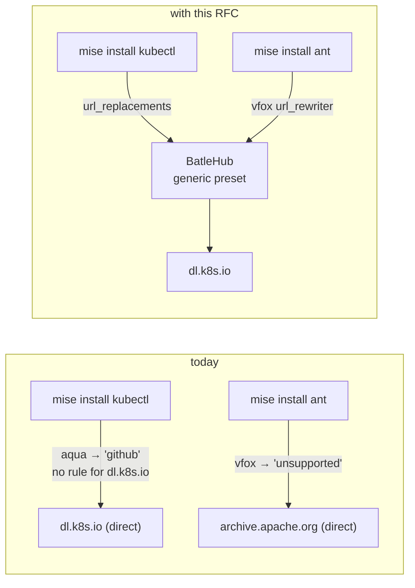
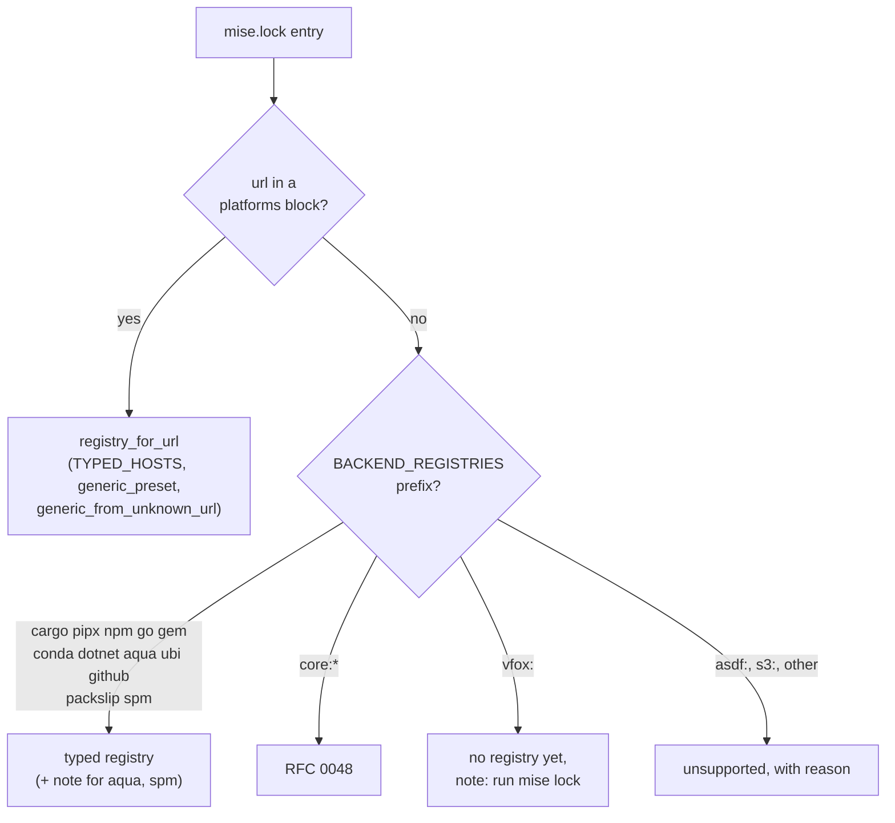
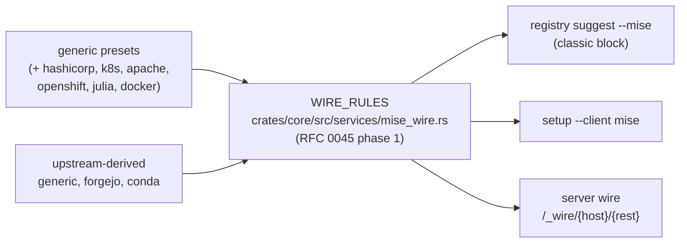
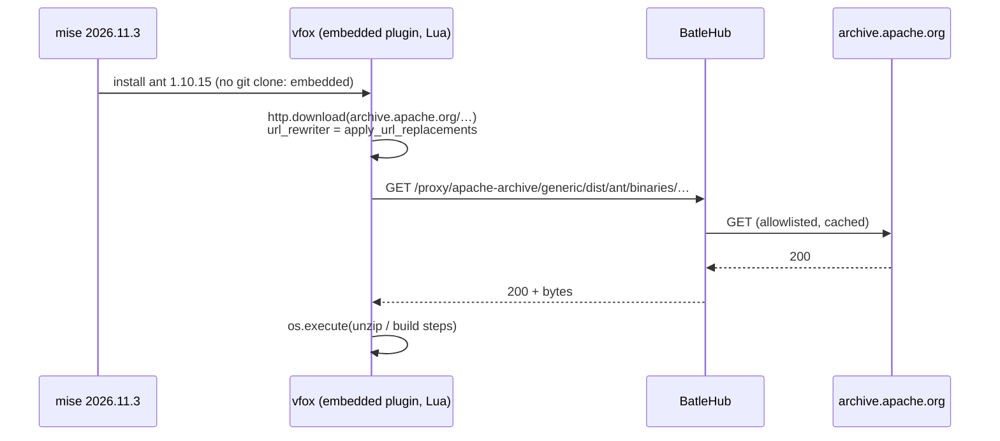
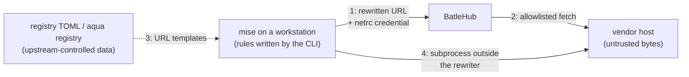

# RFC 0047 — mise backends coverage

| Field       | Value                                                        |
| ----------- | ------------------------------------------------------------ |
| Status      | Draft                                                         |
| Short       | mise backends coverage                                        |
| Settles     | Which mise backends reach BatleHub, how the CLI tells a covered backend from one that is not, and how the gaps close: aqua's `http` packages, the `http:` backend, the vfox plugins mise embeds, `dotnet:`, `packslip:` and conda channels other than conda-forge |
| Author      | Max Batleforc <maxleriche.60@gmail.com>                       |
| Co-author   | Claude Opus 5.5 <noreply@anthropic.com>                       |
| Created     | 2026-11-11                                                    |
| Supersedes  | —                                                             |
| Touches     | `cli` (`api/suggest.rs`, `api/client_setup.rs`, `api/mise_plan.rs`), `crates/core` (`services/mise_wire.rs` once RFC 0045 phase 1 lands), `tests/heavy` (`closed_world.sh`, `airgap.sh`), `.github/workflows/test.yaml` (the pinned `MISE_VERSION`), docs (`use/mise.md`, `registries/generic.md`, `registries/conda.md`, `registries/nuget.md`) |
| Risk        | medium — §7 (the CLI writes the client rules that decide which host a tool's bytes come from) |

---

## 1. Summary

mise installs a tool through one of fourteen *backends*. BatleHub covers a
backend in one of two ways: a `url_replacements` rule catches the URL mise
fetches (GitHub, Forgejo, GitLab, npm, cargo, conda), or a client-env block
points the ecosystem tool mise shells out to at the proxy (`pipx:`, `go:`,
`gem:`). Whether a backend is covered is decided in one table of the CLI,
`BACKEND_REGISTRIES` (`cli/src/api/suggest.rs:310`), and one function,
`unsupported_backend_reason` (`cli/src/api/suggest.rs:287`).

Measured against the registry of mise 2026.11.3 (1 074 tools), that table is
wrong in both directions. It calls **every aqua package GitHub**, although 48
of the 704 aqua tools download from HashiCorp, Apache, Kubernetes, Google
Cloud Storage and a dozen other vendor hosts. It calls **every vfox plugin
unsupported** ("git-fetched"), although 40 of the 41 vfox tools in the
registry are plugins mise compiles in, never clones, and whose downloads
already go through `url_replacements`. It does not know `dotnet:` at all,
although the `nuget` kind exists. And the 17 `http:` tools (dart, flutter,
julia, nim, oc…) have no preset, so each locked version gets a generic mirror
narrowed to that one file.

This RFC corrects the table, adds the generic presets the measured hosts call
for, maps `dotnet:` and `packslip:` onto the kinds that already serve them,
derives the conda rule from the registry's upstream channel, and states what
stays out (`asdf:`, `s3:`, `spm:` source builds, the one non-embedded vfox
plugin) with the reason. Every rule it adds lands in RFC 0045's wire table,
so the auto-wire mode picks them up without a second list. The `core:*`
toolchains (java, ruby, zig, deno, …) are RFC 0048's.

### Before / after

```text
# today — `batlehub-cli registry suggest --mise` on a mise.toml with
#   kubectl, ant, dotnet:dotnet-outdated-tool, conda:ffmpeg (no lock yet)
[[registries]] name = "github"   type = "github"     # from aqua:kubernetes/kubectl — wrong host
# unsupported: vfox:jdx/vfox-ant: a git-fetched plugin backend; mise clones it, …
# unsupported: dotnet:dotnet-outdated-tool: no registry kind fronts this backend, …
[[registries]] name = "conda"    type = "conda"      # conda-forge only (baseline)

# with this RFC
[[registries]] name = "k8s-dl"         type = "generic"   # preset: dl.k8s.io
[[registries]] name = "apache-archive" type = "generic"   # preset: archive.apache.org (ant)
[[registries]] name = "nuget"          type = "nuget"     # dotnet: → NuGet.config + dotnet.registry_url
[[registries]] name = "conda"          type = "conda"     # rule derived from the upstream channel
# note: aqua:kubernetes/kubectl downloads from dl.k8s.io, not GitHub — run `mise lock`
#       for the exact URL of every other aqua tool
```



The diagram shows the two requests that leave the estate today with nothing
on the wire to say so; with the RFC both are rewritten onto a registry, and
in an air gap the catch-all rule (`cli/src/api/suggest.rs:1439`) sinks the
ones still unwired instead of letting them time out.

---

## 2. Motivation

The inventory is `mise registry` of mise 2026.11.3, the backend each tool
uses **by default** (the first one listed): aqua 704, github 188, vfox 41,
npm 41, pypi 23, conda 20, http 17, packslip 16, core 14, go 4, gem 3,
spm 1, gitlab 1, cargo 1. The aqua figures come from the aqua registry
vendored in the same crate (`vendor/aqua-registry/registry.yml`,
aquaproj/aqua-registry at `017ef00e`).

1. **48 aqua tools are labelled GitHub and download from somewhere else.**
   `BACKEND_REGISTRIES` maps `aqua:` to `github` with the comment "aqua and
   ubi both resolve to GitHub release assets"
   (`cli/src/api/suggest.rs:320-322`). Of the 704 aqua defaults, 648 are
   `github_release`, 4 `github_archive`, 4 `github_content` — those are
   GitHub, and the six GitHub rules cover them. The other **48 are aqua type
   `http`**: `releases.hashicorp.com` (8: terraform's siblings boundary,
   consul, nomad, packer, waypoint…), `storage.googleapis.com` (5, among them
   `claude`, `skaffold`), `archive.apache.org` (3: maven, spark, tomcat),
   `awscli.amazonaws.com` (3), `dl.k8s.io` (2: kubectl, kubectl-convert),
   `binaries.sonarsource.com` (2), `cli.crossplane.io` (2) and one each on
   download.docker.com, downloads.haskell.org, get.helm.sh,
   download.racket-lang.org, download.oracle.com, pkgs.tailscale.com and
   others. Without a lock, `registry suggest --mise` proposes a `github`
   registry for `kubectl`, and kubectl then downloads from `dl.k8s.io`
   directly. With a lock the URL is read and the right generic mirror is
   proposed (`registry_for_url`, `cli/src/api/suggest.rs:963`), so the bug
   is the lock-less path and the plan's wording, not the lock path.

2. **40 of the 41 vfox tools are declared unsupported and are not.**
   `unsupported_backend_reason` returns "a git-fetched plugin backend; mise
   clones it, and there is no HTTP path through BatleHub" for every `vfox:`
   (`cli/src/api/suggest.rs:294-297`), and `docs/use/mise.md` §5 repeats it.
   In mise 2026.11.3 the vfox crate (2026.11.3) carries 37 plugins under
   `embedded-plugins/`, and a plugin found there is never cloned
   (`src/plugins/vfox_plugin.rs:243-245,314,334`). Every HTTP call a plugin's
   Lua makes goes through the URL rewriter mise installs,
   `vfox.set_url_rewriter(crate::http::apply_url_replacements)`
   (`src/plugins/vfox_plugin.rs:199`), which the vfox crate applies in its
   Lua `http` module (`src/lua_mod/http.rs`, `src/plugin.rs:194-197`). Only
   `tiny` (`jdx/vfox-tiny`) is not embedded. The SDKs this hides behind a
   wrong "unsupported" are the ones a JVM, PHP or mobile estate asks for
   first: **android-sdk, graalvm, php, scala, groovy, clojure, leiningen,
   ant, spring-boot, lua, yarn, poetry, pipenv, gcloud, elasticsearch,
   mysql**.

3. **`dotnet:` is unsupported although the `nuget` kind exists.** mise's
   `dotnet:` backend runs `dotnet tool install <tool> --tool-path …`
   (`src/backend/dotnet.rs:138-146`), which reads NuGet.config, and lists
   versions from `dotnet.registry_url`, default
   `https://api.nuget.org/v3/index.json` (`src/backend/dotnet.rs:17-18,
   175-179`), through mise's own HTTP client. BatleHub serves that index
   (`crates/web/src/lib.rs:1323`, `nuget_service_index`) and
   `client_setup` already writes NuGet.config for `ClientId::Nuget`
   (`cli/src/api/client_setup.rs:153`). `BACKEND_REGISTRIES` has no
   `dotnet:` row, so the plan says "no registry kind fronts this backend".

4. **`http:` tools get a mirror one file wide.** The 17 `http:` defaults
   (dart, flutter, julia, nim, oc, openshift-install, kotlin-toolchain,
   neo4j, sentinel, tfc-agent, nomad-pack, cursor-agent, grok, muse, twg,
   android-cli) each name a URL template and often a `version_list_url`
   (`registry/flutter.toml`: `releases_linux.json`; `registry/julia.toml`:
   `versions.json`). None of their hosts has a preset (`generic_preset`,
   `cli/src/api/suggest.rs:137`, knows five). `generic_from_unknown_url`
   therefore writes `path_allow` as "the single exact path observed"
   (`cli/src/api/suggest.rs:1001-1004`): the next version is refused, and the
   version list mise reads first is not in the allowlist at all.

5. **`packslip:` is unsupported in the plan and mostly GitHub on the wire.**
   The 16 packslip tools (hk, usage, pitchfork, helmfile, timoni…) read the
   repository's releases through mise's GitHub client
   (`src/backend/packslip.rs:1761,1770`), the signed list at
   `raw.githubusercontent.com/{repo}/HEAD/.well-known/packslip.json`
   (`src/backend/packslip.rs:1649`) or, for a vendor-hosted project,
   `https://{host}/.well-known/packslip/{path}.json`
   (`src/backend/packslip.rs:358-361`). With a lock the asset URL is a GitHub
   URL and is covered; without one the plan falls to "no registry kind
   fronts this backend" (`cli/src/api/suggest.rs:305-307`).

6. **The conda rule only knows conda-forge.** The baseline fix
   (branch `fix/mise-conda-backend`) adds `conda:` to `BACKEND_REGISTRIES`
   and a rule anchored on `https://conda.anaconda.org/conda-forge/`, and
   refuses the rule for a registry of any other channel
   (`foreign_upstream`, `cli/src/api/client_setup.rs:1200`). A tool with
   `channel = "bioconda"` — or an estate whose `conda.channel` is its own
   channel — goes direct, with a `shortcut:` comment saying so.

---

## 3. Goals / non-goals

**Goals**

- The CLI's verdict on a backend matches what mise 2026.11.3 actually
  fetches: no covered backend reported unsupported, no uncovered one
  reported covered.
- Every host a mise default backend downloads from in measurable volume has
  either a typed rule or a generic preset whose allowlist survives a version
  bump and includes the version list mise reads.
- `dotnet:` installs through a `nuget` registry; `conda:` through a `conda`
  registry of whatever channel it fronts.
- The rules live in one table — RFC 0045's `WIRE_RULES` — so `registry
  suggest --mise`, `batlehub-cli setup` and the server-side wire agree.
- The proof runs the real mise binary, pinned, in the closed-world suite and
  in the air gap.

**Non-goals**

- **`asdf:` plugins.** mise clones them over git and runs their shell
  scripts, which call `curl` themselves; `url_replacements` never sees those
  requests. Covering them means a git smart-HTTP proxy *and* a forward proxy
  for arbitrary scripts — a different product.
- **The non-embedded vfox plugin (`tiny`) and any vfox plugin named by URL.**
  Same git clone as asdf; one tool in the registry does not pay for it.
- **`s3:`.** The backend signs requests with the AWS SDK against the bucket's
  endpoint (`src/backend/s3.rs:184-193,467-476`); they never pass through
  mise's HTTP client, and BatleHub serves no S3 API.
- **`spm:` source builds.** They `git clone` the package
  (`src/backend/spm.rs:432-471`). The artifact-bundle path, which reads a
  GitHub or GitLab release (`src/backend/spm.rs:272-300,612-631`), *is* in
  scope, as GitHub.
- **Live signature verification on the disconnected side** for `packslip:`,
  aqua's cosign/slsa and vfox attestations. RFC 0008 §5 ("What will not
  work") already rules it out; this RFC does not reopen it.
- **The `core:*` toolchains** — RFC 0048.
- **A dedicated kind for HashiCorp releases or dl.k8s.io.** A `generic`
  registry with a preset caches and allowlists them; per-version blocking for
  generic is RFC 0045 Q8's open thread, not this one.
- **Shipping a copy of the aqua registry in the CLI.** See §12.

---

## 4. User-facing design

### 4.1 Configuration

No server configuration changes. The operator sees new presets in what the
CLI suggests:

```toml
# written by `batlehub-cli registry suggest --mise`
[[registries]]
name       = "hashicorp-releases"
type       = "generic"
upstreams  = ["https://releases.hashicorp.com"]
path_allow = ["*/index.json", "*/*/*"]

[[registries]]
name       = "conda-bio"
type       = "conda"
upstreams  = ["https://conda.anaconda.org/bioconda"]
```

and on the client, in the mise block:

```toml
[settings]
dotnet.registry_url = "https://hub.example.com/proxy/nuget/v3/index.json"

[settings.url_replacements]
"regex:^https://conda\\.anaconda\\.org/bioconda/(.+)" = "https://hub.example.com/proxy/conda-bio/$1"
"regex:^https://releases\\.hashicorp\\.com/(.+)"      = "https://hub.example.com/proxy/hashicorp-releases/generic/$1"
```

- A preset's `path_allow` is the narrowest glob that still matches every
  version of the tools that use the host, plus the listing document mise
  reads. Absent `path_allow` on a hand-written generic registry keeps
  today's meaning (validated by `validate_registry_path_allow`,
  `crates/config/src/schema/mod.rs:2600`); the presets never emit `**` for a
  whole vendor host.
- `dotnet.registry_url` is written only when a `nuget` registry is chosen
  for the mise target. Absent, mise lists from nuget.org as today.
- The conda rule is derived from the registry's first upstream, so it
  exists only for the channel that registry fronts. No default changes on
  the server side.

### 4.2 Behaviour rules

- **Backend verdict, in order.** (1) The lock has a URL for the tool: the
  URL decides, through `registry_for_url`, whatever the backend — this is
  already the rule (`cli/src/api/mise_plan.rs:267-316`) and it is the one
  that is right for aqua, vfox, packslip and http. (2) No URL: the backend
  prefix decides, through `BACKEND_REGISTRIES`. (3) No row: the reason.
- **aqua without a lock** keeps mapping to `github` — 648 of 704 are — and
  the suggestion carries a note: "aqua packages of type `http` download from
  their vendor's host; run `mise lock` to see it". The CLI does not guess
  which aqua package is which (§12).
- **vfox without a lock** is not "unsupported". The reason becomes: "vfox
  plugins built into mise download over HTTP through `url_replacements`; run
  `mise lock` so the plan knows the URL. A plugin mise clones (one named by
  URL, or not built in) cannot come through." The plan cannot tell an
  embedded plugin from a cloned one by name alone without a list that
  drifts, so it tells the operator how to find out instead.
- **`asdf:`** keeps today's "unsupported" reason unchanged.
- **`dotnet:`** maps to `nuget`. The mise target writes
  `dotnet.registry_url`; the NuGet target writes NuGet.config as today.
- **`packslip:`** maps to `github` for `github.com/{owner}/{repo}` and
  `{owner}/{repo}` forms; a `packslip:{host}` form maps to nothing and gets a
  reason naming the host and its `.well-known` path.
- **`spm:`** maps to `github`, with a note that source builds clone over git.
- **`ubi:`, `github:`, `gitlab:`, `forgejo:`** unchanged.
- **conda.** The rule is `^{upstream}/(.+)` → `{proxy}/$1`, the shape the
  generic kind already uses (`cli/src/api/suggest.rs:1348-1360`).
  `foreign_upstream`'s conda branch compares the **whole channel URL**, as the
  baseline does, against the channel the rule names — so two conda registries
  of two channels each get their own rule, and neither can take the other's.
- **The uninteresting case.** A project whose tools are all `github_release`
  aqua packages, npm and cargo sees no change in its block.

### 4.3 Validation

Rejected:

| Condition | Rationale |
| --- | --- |
| Two `conda` registries with the same upstream channel chosen for one mise target | Two rules on one prefix: mise applies the first and the second is dead. `WireWarning::PrefixClaimed` (RFC 0045 §6.1) already names this for the server side; the CLI refuses rather than emitting a dead rule. |
| A preset whose `path_allow` would be `**` on a vendor host | The preset table is code; a unit test fails the build (§14), so this never reaches an operator. |

Warnings:

| Condition | Behaviour | Surfaced in |
| --- | --- | --- |
| aqua tool, no lock | `github` suggested, note printed | `registry suggest --mise` output, next to the registry |
| vfox tool, no lock | not unsupported; note printed | same, and `mise plan`'s `notes` |
| conda registry fronting a channel the tool does not use | rule written, tool goes direct | `setup`'s `detail` line, as `foreign_upstream` does today |
| `packslip:{host}` | reason names the host | `mise plan`'s `unsupported` |

### 4.4 API surface

No API changes: every change is in what the CLI writes and in the server-side
wire table RFC 0045 already specifies.

### 4.5 Mocks

**`batlehub-cli registry suggest --mise` — no lock, nominal**

```text
$ batlehub-cli registry suggest --mise
Scanned mise.toml (no mise.lock — run `mise lock` for exact URLs)

  k8s-dl            generic  dl.k8s.io                      kubectl
  apache-archive    generic  archive.apache.org             ant
  nuget             nuget    api.nuget.org                  dotnet:dotnet-outdated-tool
  conda             conda    conda.anaconda.org/conda-forge conda:ffmpeg
  github            github   api.github.com                 aqua:cli/cli, hk

  note  aqua: aqua packages of type `http` download from their vendor's host,
        not GitHub; `mise lock` records which.
  note  vfox: ant is a plugin built into mise and downloads over HTTP; the
        URL is known once `mise lock` has run.
```

It decides that the lock-less path still suggests something useful, and that
both guesses carry their caveat beside them, not in a footer.

**`batlehub-cli mise plan` — refusal**

```text
$ batlehub-cli mise plan
…
unsupported (2):
  asdf:mise-plugins/mise-postgres  a git-fetched plugin backend; mise clones it,
                                   and there is no HTTP path through BatleHub
  packslip:tool.example.com        reads https://tool.example.com/.well-known/packslip.json;
                                   no registry mirrors tool.example.com
exit 0
```

It decides that the refusal names the host the operator would have to add,
and that `exit 0` is kept (a plan with unsupported tools is still a plan,
RFC 0008 §2.1).

**`batlehub-cli setup --client mise` — another channel's registry**

```text
mise  ~/.config/mise/conf.d/batlehub.toml  would write 2 rules
      skipped: conda registry bio (it proxies https://conda.anaconda.org/bioconda,
               which conda:ffmpeg does not read)
```

It decides the wording of the one case where a registry exists and is still
not wired.

---

## 5. Architecture

### 5.1 Where the verdict is made



It proves the lock remains the source of truth: every change of this RFC is
either in the lock-less branch or in the tables the lock branch already
reads.

### 5.2 One rule table



The invariant: **because a conda rule is derived from the registry's own
upstream and `foreign_upstream` compares the whole channel URL, a registry
can only ever be the target of the channel it fronts.** The same holds for
generic today; this RFC adds conda to the list of upstream-derived kinds that
RFC 0045 §6.1 gives as "generic and forgejo".

### 5.3 The vfox path



It shows the one hop mise performs itself and the hop it does not: a
plugin's `os.execute` (php's `configure` and `make`, poetry's installer
script running `python`) is a subprocess, outside the rewriter (§7, T5).

---

## 6. Detailed design

### 6.1 `cli/src/api/suggest.rs`

- `BACKEND_REGISTRIES` gains `("dotnet:", "nuget", "nuget")`,
  `("packslip:github.com/", "github", "github")`, a `packslip:` owner/repo
  match (no dot in the first segment), and `("spm:", "github", "github")`.
  The baseline's `("conda:", "conda", "conda")` stays.
- `unsupported_backend_reason`: `vfox:` returns `None` from the "unsupported"
  branch and is reported as a **note**, not an unsupported tool; `asdf:`
  keeps its reason; `packslip:{host}` gets a reason naming the
  `.well-known` URL.
- `registry_for_backend` returns a `note` for `aqua:` (the `http`-type
  caveat) and `spm:`; the `SuggestedRegistry.note` field exists
  (`cli/src/api/suggest.rs:1040-1044`).
- `generic_preset` gains, from the measured hosts (§2.1, §2.4):

  | Host | Name | Upstream | `path_allow` | Tools (mise defaults) |
  | --- | --- | --- | --- | --- |
  | `releases.hashicorp.com` | `hashicorp-releases` | `https://releases.hashicorp.com` | `*/index.json`, `*/*/*` | 8 aqua + nomad-pack, sentinel, tfc-agent |
  | `dl.k8s.io` | `k8s-dl` | `https://dl.k8s.io` | `v*/bin/**`, `release/stable*.txt` | kubectl, kubectl-convert |
  | `archive.apache.org` | `apache-archive` | `https://archive.apache.org/dist` | `maven/**`, `ant/**`, `groovy/**`, `spark/**`, `tomcat/**` | maven, spark, tomcat (aqua), ant, groovy (vfox) |
  | `mirror.openshift.com` | `openshift-mirror` | `https://mirror.openshift.com/pub/openshift-v4/clients` | `ocp/**` | oc, openshift-install |
  | `julialang-s3.julialang.org` | `julia-dist` | `https://julialang-s3.julialang.org/bin` | `versions.json`, `*/x64/**`, `*/aarch64/**` | julia |
  | `download.docker.com` | `docker-dl` | `https://download.docker.com` | `*/static/stable/**` | docker-cli |

  `storage.googleapis.com` is already a bucket host
  (`cli/src/api/suggest.rs:182-186`): dart (`dart-archive`), flutter
  (`flutter_infra_release`), grok, skaffold and claude each get a
  bucket-scoped generic from `generic_from_unknown_url`, and this RFC widens
  that function's allowlist for a bucket to the *directory* of the observed
  path plus the `version_list_url` the registry TOML names, instead of the
  single file. The `dl.google.com` preset stays `go*` (RFC 0048 owns it);
  android-sdk's `dl.google.com/android/**` is §15 Q3.
- `typed_url_replacements("conda")` disappears in favour of the
  upstream-derived rule (§4.2); until RFC 0045 phase 1 moves the table, the
  derivation lives next to the generic one in `mise_url_replacements`
  (`cli/src/api/suggest.rs:1342-1366`).

### 6.2 `cli/src/api/client_setup.rs`

- `MISE_TYPES` (`cli/src/api/client_setup.rs:1536`) gains `nuget`.
- The mise target, for a chosen `nuget` registry, writes
  `dotnet.registry_url = "{base}/v3/index.json"` under `[settings]` and no
  `url_replacements` rule (the rewrite would also catch the `dotnet` CLI's
  NuGet.config-driven reads, which are not mise's).
- `foreign_upstream`'s conda branch compares against the channel the
  derived rule names (the registry's own upstream), so it refuses nothing for
  a correctly configured second channel; the check that remains is "the
  server names an upstream" (`upstreams:read`), as for every other kind.

### 6.3 `cli/src/api/mise_plan.rs`

- A `vfox:` entry with no URL lands in a new `notes` list of the plan (the
  struct carries `unsupported`, `cli/src/api/mise_plan.rs:50`, and
  `unmirrored_hosts`, `:52`), not in `unsupported`.

### 6.4 `crates/core/src/services/mise_wire.rs` (RFC 0045)

- When RFC 0045 phase 1 has landed, §6.1's presets and the conda derivation
  are added to `WIRE_RULES`/`WireTable::build` instead of the CLI, and the
  list "of its first upstream for `generic` and `forgejo`" becomes "for
  `generic`, `forgejo` and `conda`". If this RFC's phase 1 lands first, it
  lands in the CLI and RFC 0045 phase 1 moves it with the rest, unchanged.

### 6.5 `tests/heavy` and CI

- `.github/workflows/test.yaml` pins `MISE_VERSION: "2026.9.5"` (lines 1024,
  1401). The conda `url_replacements` middleware and the embedded vfox
  plugins this RFC relies on are verified in 2026.11.3's source; the pin
  moves to 2026.11.3 in phase 1 (§15 Q1).
- `closed_world.sh` `phase_mise` (line 1082) gains the cases of §6.P;
  `airgap.sh` gains the refusal cases.

### 6.P Proof against a real client

Suite `tests/heavy/closed_world.sh mise` and `tests/heavy/airgap.sh`, client
**mise 2026.11.3** (linux-x64, the release asset CI already downloads), the
wire read with `heavy_wire_re_after` and never from mise's exit code alone.
The tool versions below are the ones the phase will pin; they are proposals,
not yet resolved against each backend.

1. `mise install conda:ffmpeg@7.1.1` against a `conda` registry of
   `conda.anaconda.org/conda-forge` — the tap shows
   `GET /proxy/conda/linux-64/repodata_shards.msgpack.zst` (or
   `repodata.json*`) and the package GET under `/proxy/conda/`; **no request
   to `conda.anaconda.org`** leaves the client.
2. Same with a second registry of `conda.anaconda.org/bioconda` and
   `"conda:samtools" = { version = "1.21", channel = "bioconda" }` — the
   reads land on `/proxy/conda-bio/`, none on `/proxy/conda/`.
3. `mise install kubectl@1.31.0` (aqua `http`) with the `k8s-dl` preset —
   `GET /proxy/k8s-dl/generic/v1.31.0/bin/linux/amd64/kubectl` answered 200,
   56 381 592 bytes (the size `curl -I` measured on 2026-11-11); no request to
   `dl.k8s.io` from the client.
4. `mise install ant@1.10.15` (embedded vfox) — the tap shows the archive
   GET under `/proxy/apache-archive/`, and **no request to
   `github.com/jdx/vfox-ant`** (the plugin was not cloned).
5. `mise install dotnet:dotnet-outdated-tool@4.6.4` with
   `dotnet.registry_url` and NuGet.config on the proxy — the version list and
   the `.nupkg` GET both reach `/proxy/nuget/`; none reaches `api.nuget.org`.
6. **Refusal.** `mise install consul` (aqua `http`) through a
   `hashicorp-releases` registry whose `path_allow` is narrowed by the fixture
   to `terraform/**` — the proxy answers 403, mise exits
   non-zero quoting the 403, and the server log shows **no upstream GET** for
   the path: the refused bytes were never fetched.
7. **Air gap refusal.** On the disconnected instance, with the catch-all
   rule, `mise install sentinel@0.30.0` whose asset the bundle does not hold —
   the client gets the catch-all's `501`, the host is recorded under
   `unmirrored`, and nothing leaves the instance.
8. `batlehub-cli mise plan` on a lock holding `asdf:mise-plugins/mise-postgres`
   and `ant` — `asdf` under `unsupported` with the git reason; `ant` planned
   with its archive URL, not unsupported.

**Deliberately untouched**, so reviewers do not go looking:

- `crates/adapters/src/registry/generic*` — the presets are CLI data; the
  generic kind's server code does not change.
- `crates/adapters/src/registry/conda/` — the server already serves any
  channel it is pointed at; only the client rule was channel-blind.
- `tests/heavy/authz.sh` — no new grant shape: every route used exists and is
  covered by its kind's phase.

---

## 7. Security

**Rating:** medium — no new server surface, but the CLI writes the client
rules that decide where a tool's bytes come from, and widens what generic
presets allow through.

### 7.1 Threat model



Assets: the estate's view of which bytes are trusted, credentials sent to the
proxy, availability of the cache. Actors: an upstream vendor (or whoever
controls the aqua/mise registry data), an operator writing registries, a
second registry on a shared host.

| # | Threat (STRIDE) | Where | Mitigation | Residual risk |
| --- | --- | --- | --- | --- |
| T1 | Tampering — a registry of one conda channel answers another channel's reads | boundary 1 | rule derived from the registry's own upstream; `foreign_upstream` compares the whole channel URL (`cli/src/api/client_setup.rs:1200`) | none known; accepted by the author |
| T2 | Elevation — a preset turns BatleHub into an open fetcher for a whole vendor host | boundary 2 | presets use product-scoped globs, never `**`; unit test over the preset table | a product directory is still wide (all of `maven/**`); accepted, it is one product |
| T3 | Info disclosure — the netrc credential for the proxy follows a rewritten URL to another host, or over http | boundary 1 | mise clears cross-host credentials and refuses a downgrade on a rewrite (`src/backend/conda.rs:65-80`, the same rule `crate::http::Client` applies); BatleHub rules always target the instance | relies on mise; regression covered by §6.P 1 |
| T4 | Repudiation/DoS — a backend reported covered goes direct in an air gap and times out | boundary 1 | catch-all rule (`cli/src/api/suggest.rs:1439`) sinks every unwired host to a `501` recorded under `unmirrored` | none for HTTP; T5 remains |
| T5 | Info disclosure — a vfox plugin's subprocess (php's build, poetry's installer) fetches directly | boundary 4 | out of the rewriter's reach; documented per plugin in `docs/use/mise.md` | **accepted, highest residual**: in connected mode those requests leave the estate unproxied; in an air gap they fail |
| T6 | Spoofing — upstream registry data points a template at an attacker host | boundary 3 | a rewritten URL only reaches hosts with a registry; an unwired host is direct (connected) or sunk (air gap), as today | unchanged from today |

### 7.2 Authentication and authorisation

No new surface: every request lands on an existing typed or generic route,
gated by the kind's existing grants; a `dotnet` read is a `nuget` read.

### 7.3 Input handling and injection

The CLI reads `mise.lock` and the registry's upstream URL; both become regex
text through the existing `regex_escape` (`cli/src/api/suggest.rs:1356`).
The conda derivation reuses that path, so a channel URL with regex
metacharacters is escaped, not interpreted; §14 has the test.

### 7.4 Secrets and cryptography

No new secret. The only credential involved is the user's netrc entry for the
proxy, handled by mise as T3 says.

### 7.5 Abuse and resource exhaustion

The presets bound what an authenticated user can make the proxy fetch to the
listed product paths. Sizes: kubectl 56 MB, terraform 27 MB, maven 9 MB, the
flutter release list 272 KB (all `curl -I`, 2026-11-11); none exceeds what
generic registries already cache for node or go.

### 7.6 Existing defences that still hold

`validate_registry_path_allow`, the generic kind's allowlist enforcement,
RBAC on every route, the catch-all sink of RFC 0008, and RFC 0045's
`PrefixClaimed` warning.

---

## 8. Supply chain

No new dependency, image, action or tool in BatleHub; `task audit` is
unchanged. The heavy suite's **pinned mise moves from 2026.9.5 to
2026.11.3** (MIT, the release asset CI already verifies by URL). The bump
also changes mise's behaviour in every other mise phase; phase 1 runs them
all before the pin lands (§13).

---

## 9. Data and privacy

No new data is stored or transmitted: the presets add routes to existing
caches, and the access log records the same request line it records for any
generic read.

---

## 10. Operability

### 10.1 Observability

- **Metrics**: none new; a preset is a generic registry and its requests are
  counted by the generic kind's existing request metrics.
- **Logs and audit trail**: unchanged; a refused path is the generic kind's
  existing `403` log line.
- **Alerts**: none, because no new failure mode is server-side.

### 10.2 Failure modes

| Failure | Detected by | Behaviour | Recovery |
| --- | --- | --- | --- |
| A vendor host changes its URL layout (a new path outside the preset glob) | `403` on the client, generic log line | closed: refused, not fetched | widen the preset in a CLI release; the operator can widen `path_allow` by hand at once |
| A future mise un-embeds a vfox plugin | §6.P case 4 (the tap sees a git clone) | the tool goes direct (connected) or fails (air gap) | the plan's note already tells the operator to check |
| An aqua package changes type | the lock's URL | lock path is right by construction | none needed |

### 10.3 Performance and capacity

The new presets cache what was fetched directly before; storage grows by the
artifacts the estate installs (tens of MB per tool version, §7.5). No new
CPU path.

---

## 11. Other concerns

- **Accessibility**: CLI text only; no colour carries meaning on its own
  (notes are labelled `note`).
- **Internationalisation**: the CLI is English-only today; the docs pages
  touched have FR siblings, updated in the same change.
- **Compliance**: no control touched; the change narrows unproxied egress,
  which helps the RFC 0036 supply-chain baseline.
- **Licensing**: no change; the aqua registry and mise source were read, not
  copied.
- **Documentation**: `docs/use/mise.md` §5 is corrected (vfox), and gains the
  per-backend table; `registries/generic.md` lists the presets;
  `registries/conda.md` drops the conda-forge-only caveat the baseline added;
  `registries/nuget.md` gains the `dotnet:` paragraph.

---

## 12. Alternatives considered

| Alternative | Why rejected |
| --- | --- |
| Ship the aqua registry (3.5 MB YAML) in the CLI to classify aqua packages without a lock | Drifts with every aqua release, and the lock path is already exact; 648 of 704 are GitHub anyway. |
| Ship the list of embedded vfox plugins in the CLI | Drifts with every mise release (37 today); the lock records the URL for vfox installs (`src/backend/vfox.rs:751-764`), so the note "run `mise lock`" is exact and cheap. |
| One `**` generic per vendor host | Turns the proxy into an open fetcher for the host (T2). |
| A `url_replacements` rule for `api.nuget.org` instead of `dotnet.registry_url` | The rule would also rewrite reads the `dotnet` CLI makes for unrelated restores in the same shell; the setting scopes it to mise. |
| Keep conda pinned to conda-forge | An estate on its own channel (the reason to run a conda proxy at all) gets nothing. |
| Do nothing | 48 aqua tools and 40 vfox tools keep leaving the estate with nothing on the wire, and the plan tells the operator the opposite of the truth about 40 of them. |

---

## 13. Rollout and compatibility

- **Default behaviour**: the server is unchanged; a block regenerated with a
  new CLI gains rules, an old block keeps working.
- **Migration**: none. An operator who added a generic registry by hand for
  one of the preset hosts keeps it; the preset is a suggestion.
- **Operator prerequisites**: none beyond the registries the CLI suggests.
- **Rollback**: an older CLI writes the older block; registries created from
  presets keep serving. Rolling back re-opens §2's gaps, nothing in §7.
- **Staged rollout**: the mise pin bump runs every existing mise phase first.

---

## 14. Test plan

- **Unit** (`cli/src/api/suggest.rs`): each new `BACKEND_REGISTRIES` row;
  `vfox:` is not unsupported and carries the note; `asdf:` still is;
  `packslip:host` reason names the `.well-known` URL; every preset's
  `path_allow` contains no `**` at the root (T2); `proxy_path_for` on one
  real URL per preset; the conda derivation escapes a channel URL with `.`
  and `+`; the bucket-host allowlist widening.
- **Unit** (`cli/src/api/client_setup.rs`): `nuget` writes
  `dotnet.registry_url`, no rule; two conda registries of two channels write
  two rules; a conda registry with no named upstream is skipped (T1).
- **Unit** (`cli/src/api/mise_plan.rs`): the `notes` list for `vfox:`.
- **Proof**: §6.P, cases 1–8.
- **Security**: T1 (§6.P 2 and the two-channel unit test), T2 (preset glob
  test, §6.P 6), T3 (§6.P 1's tap shows no credential to
  `conda.anaconda.org`), T4 (§6.P 7). T5 has no negative test: it is the
  accepted residual.
- **Audit**: `task audit` unchanged.
- **Existing suites**: every `closed_world.sh` mise phase and `airgap.sh`
  under the bumped pin; `cargo test -p batlehub-cli`.

---

## 15. Decisions and open questions

### Resolved

| # | Question | Decision |
| --- | --- | --- |
| 1 | Is conda-forge-only routing acceptable as a first step? | **Yes, as the baseline already shipped on `fix/mise-conda-backend`.** It closed the "unsupported" verdict for the 20 conda tools at once; this RFC generalises it. |

### Still open

1. **The mise pin.** Bump the heavy suite from 2026.9.5 to 2026.11.3 in this
   RFC's phase 1, or in its own PR first? Recommendation: its own PR, so a
   behaviour change in another phase is not read as this RFC's.
2. **aqua without a lock: note or refusal?** The note keeps the lock-less
   path useful for the 648 GitHub tools; a refusal would force `mise lock`.
   Recommendation: note.
3. **`dl.google.com` serves both Go (RFC 0048) and Android
   (`android-sdk`, `aapt2`, `android-cli`).** One preset per host cannot
   hold two upstream prefixes today. Split into two generic registries on one
   host (RFC 0045 §15 Q10 allows prefix wiring), or widen the existing
   preset? Recommendation: two registries.
4. **vfox subprocesses (T5).** Document per plugin only, or also make the
   plan flag the plugins known to shell out (php, poetry, pipenv)?
   Recommendation: document only; the flag would be the drifting list §12
   rejects.
5. **packslip's sigstore trust root.** `packslip::sigstore::trusted_root(None)`
   (`src/backend/packslip.rs:1032`) is not read here: whether it fetches a
   TUF root online decides whether packslip tools install in an air gap at
   all. To be read in the packslip crate before phase 3.
6. **Preset ownership.** Six vendor hosts are a start; does the preset table
   grow by measurement (a host enters when N mise defaults use it) or on
   request? Recommendation: by measurement, re-run on each mise pin bump with
   the script this RFC used.

---

## 16. Implementation phases

| Phase | Content |
| --- | --- |
| 1 | Verdicts: `BACKEND_REGISTRIES` rows (`dotnet:`, `packslip:`, `spm:`), the `vfox:` note, the `aqua:` note, `mise_plan` `notes`, unit tests, `docs/use/mise.md` §5 corrected. Useful alone: the plan stops lying about 40 tools. |
| 2 | Presets and the bucket widening, with the T2 test; §6.P 3, 4, 6, 7; `registries/generic.md`. |
| 3 | `dotnet.registry_url` in the mise target, conda rule derived from the upstream, `foreign_upstream` per channel; §6.P 1, 2, 5, 8; `registries/conda.md`, `registries/nuget.md`. |
| 4 | Move the presets and the conda derivation into `WIRE_RULES` once RFC 0045 phase 1 is on `main` (or nothing, if RFC 0045 phase 1 moved them). |
