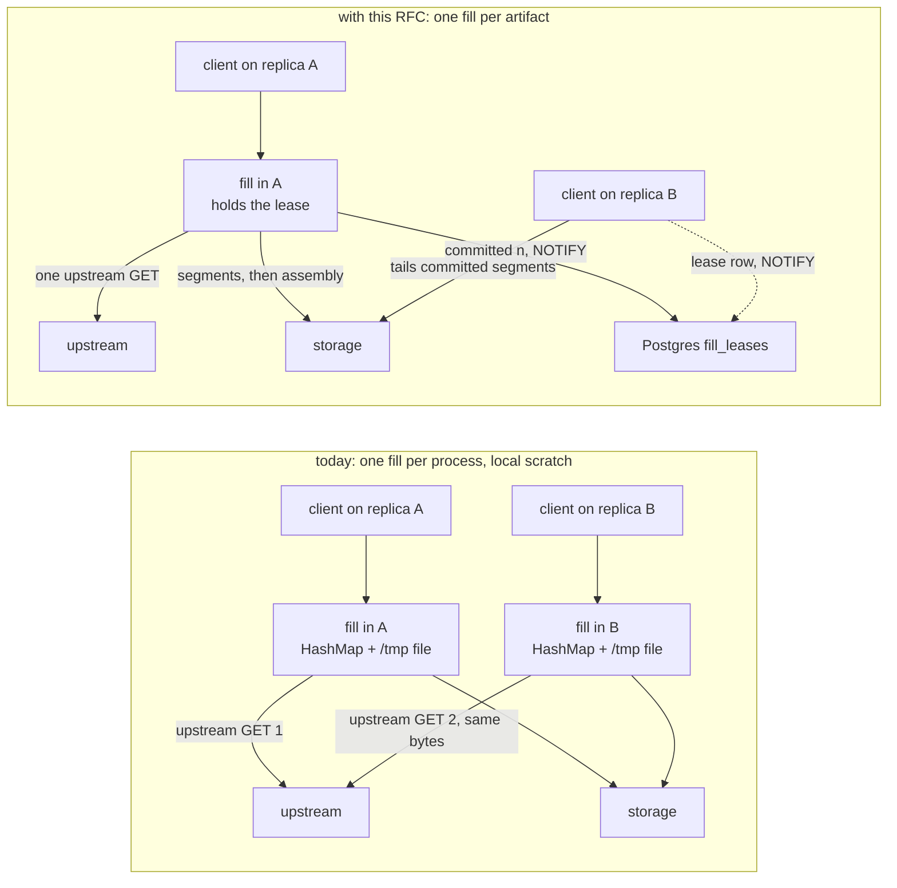
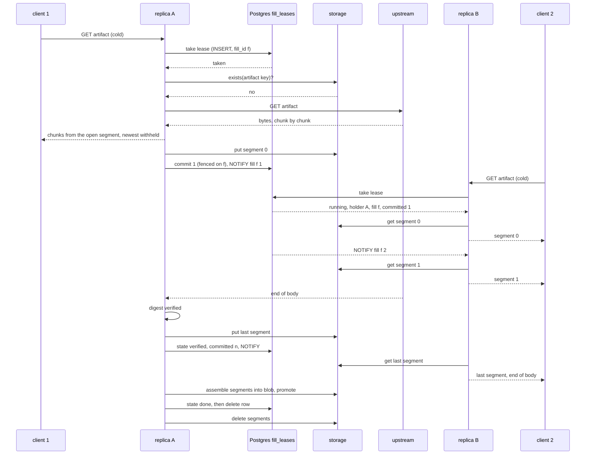
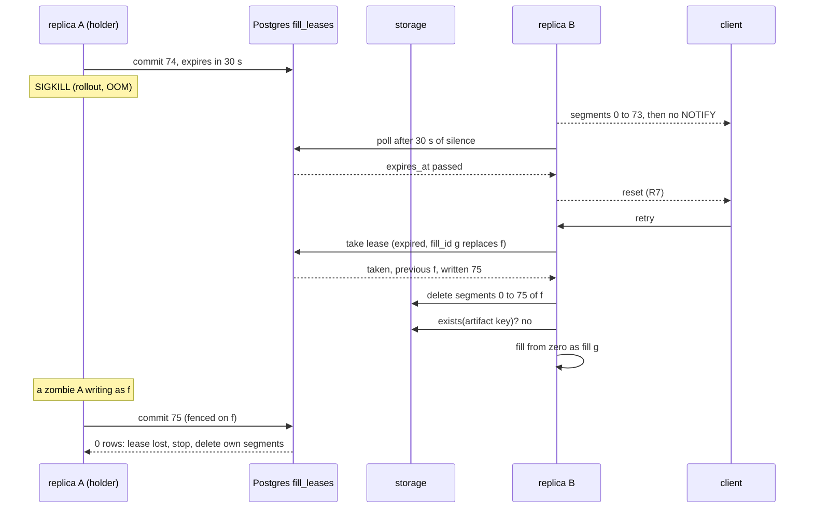
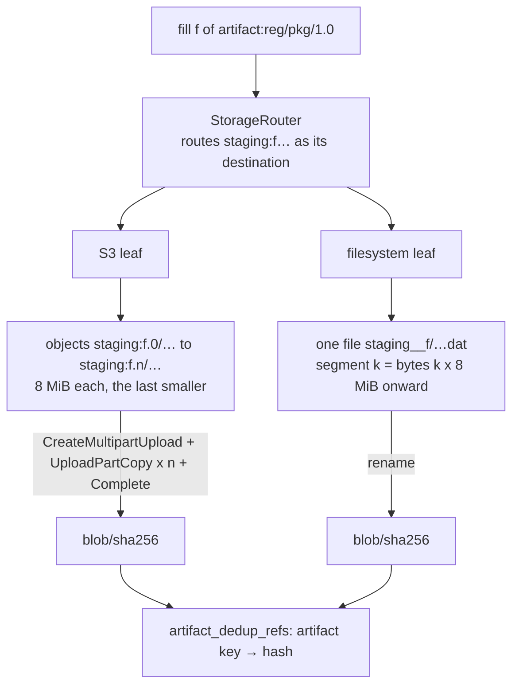
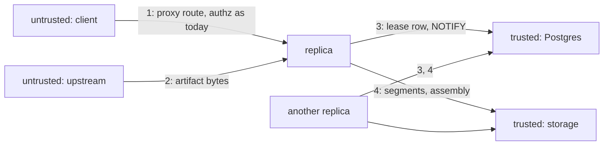

# RFC 0048-bis — Cross-replica cold fill

| Field       | Value                                                        |
| ----------- | ------------------------------------------------------------ |
| Status      | Implemented — phases 1 to 3 built 2026-11-15; phases 4 and 5 dropped by §15 Q2 and Q6 |
| Short       | Cross-replica cold fill                                       |
| Settles     | How a cold fill is shared by every replica and outlives the pod that started it: a lease in the shared cache backend, the bytes as segments in storage, no local scratch |
| Author      | Max Batleforc <maxleriche.60@gmail.com>                       |
| Co-author   | Claude Opus 5.5 <noreply@anthropic.com>                       |
| Created     | 2026-11-15                                                    |
| Supersedes  | —                                                             |
| Complements | RFC 0048 — §15 Q9 and the phase 1b delta of its §16: the detached single-flight fill is per process and spools to a local scratch file, so it is shared by one replica only and dies with its pod |
| Touches     | `crates/core` (`services/proxy/fill.rs`, `services/proxy/cache.rs`, `ports/storage/backend.rs`, a new `ports/ops/fill_lease.rs`), `crates/adapters` (`storage/s3`, `storage/filesystem.rs`, `storage/router`, `db`, migration 069), `server`, `helm`, `tests/heavy/backends.sh`, docs |
| Risk        | medium (§7)                                                   |

---

## 1. Summary

RFC 0048 made a cold miss a detached, single-flight fill that streams to
every client asking for the artifact while it is stored. That fill lives in
one process: its registry of running fills is a `HashMap` behind a mutex in
`FillCoordinator`, and its joiners read the bytes back from a scratch file
in `TMPDIR`. With N replicas behind a round-robin Service the same artifact
can be fetched N times, a joiner on another pod cannot see the fill, a pod
that dies mid-fill loses it, and every pod needs a hand-sized `emptyDir`
that the kubelet evicts the pod for exceeding.

This RFC moves the two halves of the fill out of the process. The **lease**
— who is filling which storage key, how far it got, how it ended — becomes
a row in Postgres when `[cache]` is shared, fenced by a fill id and woken by
the `LISTEN` connection the read cache already holds. The **bytes** go to
storage as fixed 8 MiB segments, which any replica can tail, and are
assembled into the artifact inside the store once the digest is verified:
`UploadPartCopy` on S3, a rename on the filesystem. A `memory` cache keeps
an in-process lease, since it means one replica. The scratch file, the
`fillScratch` volume and the second local write of every large artifact
are removed.

### Before / after

```text
# today — two replicas, a shared cache, S3; a 1.6 GB Swift tarball, cold
replica A  GET /proxy/swift-dl/…tar.gz   → fill A: upstream GET 1, /tmp/batlehub-fill-<uuid>
replica B  GET /proxy/swift-dl/…tar.gz   → fill B: upstream GET 2, /tmp/batlehub-fill-<uuid>
# two fetches of the same 1.6 GB, two scratch files; a third concurrent fill on
# either pod passes fillScratch.sizeLimit and the kubelet evicts that pod

# with this RFC
replica A  GET …tar.gz  → takes the lease on artifact:swift-dl/…, upstream GET 1,
                          writes segments staging:<fill>.0 … .189 to the bucket
replica B  GET …tar.gz  → finds the live lease, tails the committed segments
                          from the bucket, then each new one on its NOTIFY
replica A  killed       → lease expires 30 s later; the next request on B
                          takes it over and fills again; A's segments are deleted
# helm: fillScratch is gone; replicaCount > 1 with a memory cache fails to render
```



The request that changes is replica B's: today it starts a second upstream
fetch; after, it makes none and reads what replica A has committed.

---

## 2. Motivation

1. **N replicas fetch the same cold artifact up to N times.**
   `FillCoordinator::join_or_start` (`crates/core/src/services/proxy/fill.rs`)
   looks the key up in `inflight: Mutex<HashMap<String, Arc<Fill>>>`, built
   once per process in `server/src/main.rs`. Two requests for one artifact
   that a Service sends to two pods each find an empty map and each call
   `fill_artifact`, which issues its own `fetch_artifact`. Falsifiable with
   two servers on one database and one bucket: the upstream log shows two
   `GET`s for one tarball (§6.P obs. 1 asserts one).
2. **A joiner on another replica cannot join.** `Fill::stream` opens
   `fill.scratch`, a path under `std::env::temp_dir()` on the pod that runs
   the fill. A retry that lands elsewhere — mise retries after its 30 s read
   timeout, CI fans the same toolchain out to many runners — starts from
   zero on a pod that has none of the bytes.
3. **A fill dies with its pod, and nothing knows.** The fill is a
   `tokio::spawn` in the process; a rollout or an OOM kill ends it, its
   subscribers' streams end with `the cold fill vanished`, and the half
   written object is cleaned by nobody: the router's own `store_streaming`
   comment already says "there is no staging GC sweep".
4. **Every large artifact is written twice to disk, on a volume sized by
   hand.** `FillWriter::spool` copies each chunk to the scratch file while
   `store_streaming` writes the same chunk to storage. The chart mounts
   `fillScratch` on `/tmp` with a `sizeLimit` the kubelet enforces by
   evicting the pod. #361 shipped 2 GiB; `ffddab72` raised it to 8 GiB
   because "2Gi was reached by two concurrent Swift fills (1.6 GB each)". The
   limit is a guess at how many large fills run at once, and the cost of a
   wrong guess is the whole pod, not the one fill.
5. **The multi-replica guide promises what the fill does not do.**
   `docs/guide/high-availability.md` says "No sticky sessions are needed —
   any replica can serve any request". For a cold large artifact, any
   replica can serve it only by fetching it again.

---

## 3. Goals / non-goals

**Goals**

- One upstream fetch per cold artifact across every replica sharing a
  database, a cache backend and a bucket.
- A request on any replica joins a running fill and is served the bytes
  already committed, then the rest, as RFC 0048 serves a local joiner today.
- A fill whose pod dies is taken over by the next request for it within one
  lease period, and what it wrote is deleted.
- No local scratch: no `TMPDIR` file, no `fillScratch` volume, one write of
  each artifact to the pod's disk at most (filesystem storage), none on S3.
- RFC 0048's guarantees unchanged: a complete body is a verified one (its
  T10), a client disconnect never cancels the fill, a quarantined registry
  keeps store-then-serve, `no-store` is not shared.
- A single replica with a `memory` cache behaves as today, with the bytes
  in storage instead of `/tmp`.

**Non-goals**

- **Resuming a taken-over fill from its committed bytes.** Restart from zero
  is what this RFC builds; `Range` resume is §15 Q2, because one of the ten
  upstreams probed answered a `Range` with the whole body.
- **Sharing a `no-store` fill.** Upstream forbade caching; persisting its
  bytes as segments would be caching them.
- **Coordinating anything but the artifact fill.** Metadata resolution,
  listing synthesis and `revalidate` keep their own paths; `revalidate`
  rides the fill only where it already does (a full fetch through it).
- **Cross-region or cross-cluster sharing.** One database and one bucket is
  the boundary, as for every other shared state here.
- **A Redis implementation of the lease.** Every server already requires
  Postgres; §15 Q6 asks whether a second implementation is worth its cost.
- **Changing the router's dedup model.** Blobs stay at `blob/<sha256>`; the
  segments are staging keys and never enter `artifact_dedup_refs`.
- **Sticky routing at the ingress.** Rejected in §12; the chart does not own
  the ingress controller.
- **New configuration.** Segment size and lease timings are constants
  (§15 Q1, Q3); nothing in `[limits]` or `[cache]` changes.

---

## 4. User-facing design

### 4.1 Configuration

No new key in the server's configuration. What decides the behaviour is
what is already there:

```toml
[cache]
type = "postgres"   # or "redis": shared → the lease is a Postgres row (§5.1)
                    # "memory" (default): one replica → in-process lease

[storage]
type = "s3"         # segments are objects, assembled with UploadPartCopy
                    # "filesystem": segments are byte ranges of one file
```

The Helm chart loses one value and gains one rule:

```yaml
# removed — the fill no longer writes to /tmp
# fillScratch:
#   sizeLimit: 8Gi

# new rule in templates/deployment.yaml (§4.3):
replicaCount: 3
config:
  cache:
    type: "postgres"   # required once replicaCount > 1
```

- **Absent `[cache]`** is `memory`, which `cache_is_shared` in
  `server/src/stores.rs` already reads as one server; the lease stays in the
  process.
- **Defaults are the safe side**: nothing is shared across replicas unless
  the operator configured a store several replicas share, which the guide
  already requires for more than one.

### 4.2 Behaviour rules

- **R1. The uninteresting case — one replica, `memory` cache.** The lease
  is the in-process map it is today (`InMemoryFillLeases`, new, in core).
  The bytes go to storage as segments instead of to `/tmp`; local joiners
  read the open segment from memory and the committed ones from storage.
  No database statement is added to a cold miss.
- **R2. Shared cache, one replica.** The lease is a row; the replica pays
  about five statements per fill plus one per segment (§10.3), and nothing
  else changes for its clients.
- **R3. A miss under a live lease held elsewhere** follows it: the replica
  starts one follower for that key (not one per request), and every local
  request reads committed segments from storage. It makes no upstream
  request.
- **R4. A miss under an expired lease** takes it over: deletes the previous
  fill's segments up to its `written` mark, then fills from zero.
- **R5. A fill starts only after a storage miss observed under the lease.**
  The lease holder calls `StorageBackend::exists` on the artifact key before
  fetching, so a fill that finished between the request's miss and its
  lease is served from storage instead of fetched again.
- **R6. The newest segment is withheld.** Segment n is committed (readable
  by other replicas) only once a byte of segment n+1 has arrived; the last
  segment is committed only after the digest is verified. A local reader
  keeps today's rule — the newest chunk is withheld — and reads the open
  segment from the filler's buffer.
- **R7. A reader whose fill died is reset.** Its response ends with an
  error, as a dropped `FillWriter` ends it today; the client's retry is the
  request that takes the lease over (R4). A reader never splices bytes of
  two fills into one body.
- **R8. Quarantine keeps store-then-serve.** `hot.security` naming the
  registry still sets `hold`; a reader on any replica waits for `done` and
  reads the promoted artifact.
- **R9. `no-store` is not shared.** The fill checks `Cache-Control` before
  writing a segment, ends `no_store`, and every reader fetches for itself
  (`Served::NoStore`), as today.
- **R10. A lease store that errors falls back to a local fill.** The cold
  miss is served as RFC 0048 serves it on one replica, counted in
  `batlehub_proxy_fill_lease_errors_total`. Integrity is unaffected: the
  promote path does not change (§10.2).

### 4.3 Validation

Rejected at render or startup:

| Condition | Rationale |
| --- | --- |
| Helm: `replicaCount > 1` and `config.cache.type` absent or `memory` | Each pod would hold its own lease and its own rate limits, IP blocks and banner — the guide already calls this unsupported. Rendering refuses it rather than shipping N uncoordinated fills. |

Nothing in `AppConfig::validate()` changes: a server cannot count its
replicas, and a `memory` cache on one replica is the default.

Warnings, and where the operator sees them:

| Condition | Behaviour | Surfaced in |
| --- | --- | --- |
| The `LISTEN` connection is not live (a transaction-mode pooler, `listen_url` unset) | Followers poll their lease row once a second instead of waking on `NOTIFY` | the existing `batlehub_read_cache_live` = 0 and its one log line; `batlehub_proxy_fill_follow_polls_total` |
| A takeover | The new holder fills from zero | `WARN` naming the key, the previous holder and how far it got; `batlehub_proxy_fill_takeovers_total` |
| A fill lost its lease (a fenced write matched no row) | The fill stops and deletes its own segments | `WARN`; `batlehub_proxy_fill_lease_lost_total` |
| The sweep deleted orphans | Logged once per sweep with the count | `INFO`; `batlehub_proxy_fill_orphans_deleted_total` |

### 4.4 API surface

No endpoint, route or DTO changes. The proxy routes answer as they do; the
OpenAPI spec and the generated client are untouched.

### 4.5 Mocks

No web, TUI or CLI surface changes. The two texts an operator meets are the
chart's refusal and the takeover log line.

**`helm template` — refusal**

```text
$ helm template batlehub helm/batlehub --set replicaCount=3
Error: execution error at (batlehub/templates/deployment.yaml:21:4):
replicaCount 3 needs a shared [cache] (config.cache.type "postgres" or
"redis"): with "memory" every pod fills, rate-limits and bans on its own.
See docs/guide/high-availability.md#config-cache
```

It decides the wording names the fix and the page, not only the rule.

**Server log — takeover and lease lost**

```text
WARN batlehub_core::services::proxy::fill: cold fill taken over
  key=artifact:swift-dl/swift-6.2-RELEASE-ubuntu24.04.tar.gz
  previous_holder=batlehub-7c9f-x2kq previous_fill=0196f1c2-… committed=74
  deleted_segments=76
WARN batlehub_core::services::proxy::fill: cold fill lost its lease, stopping
  key=artifact:swift-dl/… fill=0196f1c2-… committed=75
```

It decides a takeover names both holders and the cost (segments thrown
away), so a rollout that kills fills shows up as a number.

---

## 5. Architecture

### 5.1 Two halves, two stores

The fill has a **control half** — who fills, how far, how it ended — and a
**byte half**. Today both live in one `Fill` (`watch::Sender<Progress>` and
a scratch path). After, the control half is the port `FillLeases` (new,
`crates/core/src/ports/ops/fill_lease.rs`) and the byte half is storage.

| Half | `memory` cache | `postgres` or `redis` cache |
| --- | --- | --- |
| Lease and progress | `InMemoryFillLeases` (new, core) | `PgFillLeases` (new, `crates/adapters/src/db/ops/fill_lease.rs`), table `fill_leases` (migration 069) |
| Wake-ups | `tokio::sync::watch` | `NOTIFY` on `batlehub_invalidate` with a `fill:` payload, read by `spawn_invalidation_listener` |
| Bytes | segments in storage | segments in storage |

The Postgres row is chosen for a Redis cache too: Postgres is a hard
requirement of every server, the row needs the same transactional notify
the read cache uses, and the precedent is `PgClusterState`, wired by
`cache_is_shared` regardless of which shared backend `[cache]` names
(`server/src/main.rs`). §15 Q6 keeps the Redis question open.

`FillCoordinator` stays: it is the per-process map of `Arc<Fill>` that
makes every request of one replica share one local `Fill`, whether that
`Fill` is fed by a local filler or by a follower of a remote one. Joining
locally first means K requests on one replica cost one follower and one
row watch, not K.

### 5.2 A cross-replica join



It proves replica B makes no upstream request, that client 2 receives a
complete body only after A verified the digest, and that assembly is off
the readers' path: they finish from segments while A assembles.

**Invariant.** Because a segment becomes readable only through a
`committed` count that the lease holder writes *after* the segment's `PUT`
returned, and the last count only after verification, a reader cannot read
a segment that is not fully written, nor end a body that is not verified.

### 5.3 Lease takeover



It proves a takeover needs no cooperation from the dead holder, and that a
holder that is not dead but slow (a GC pause, a partition) cannot write
into the new fill: every write it makes is conditioned on its own fill id,
and its segment keys carry that id, so nothing it writes is ever read.

**Invariant.** Because the fill id is both the fencing token in every
`UPDATE` and the name of every segment, two fills of one key never share a
readable byte: a reader follows the fill id the row names, and a stale
holder's writes match no row.

### 5.4 Where the bytes live



It proves no byte of the artifact passes through the pod twice on either
backend: S3 assembles server-side, the filesystem renames the one file it
wrote.

---

## 6. Detailed design

### 6.1 `crates/core/src/ports/storage/backend.rs` — segments

`staging_key_for` already makes `staging:<uuid>/<artifact key>`, and
`staged_destination` and `route_key_to_backend` already route such a key to
its destination's backend. A fill's staging key is the same shape with the
fill id as the uuid. Segment n of it is (new helper):

```rust
/// RFC 0048-bis: segment `n` of the fill staged at `staged`.
/// `staging:<fill>/<dest>` → `staging:<fill>.<n>/<dest>`; still a staging
/// key, so `staged_destination` and the router route it unchanged.
pub fn segment_key(staged: &str, n: u32) -> Option<String>;

pub const FILL_SEGMENT_BYTES: usize = 8 * 1024 * 1024; // §15 Q1
```

New `StorageBackend` methods, each with a default that is correct on any
backend:

| Method (new) | Default | S3 override | Filesystem override |
| --- | --- | --- | --- |
| `put_segment(staged, n, Bytes)` | `store(segment_key)` | — (default is one `PutObject`) | append to the one staging file, flush |
| `get_segment(staged, n) -> Option<ByteStream>` | `retrieve(segment_key)` | — | open, seek `n × FILL_SEGMENT_BYTES`, read one segment |
| `assemble_segments(staged, count, dest)` | `store_streaming(dest, chained get_segment)` | `CreateMultipartUpload`, one `UploadPartCopy` per segment, `CompleteMultipartUpload`; one segment → `CopyObject` | `rename` the staging file onto `dest` |
| `delete_segments(staged, upto)` | `delete` each segment key `0..upto` | — | delete the staging file and its `staging__<fill>` directory |
| `promote_segments(staged, count, key, outcome)` | `assemble_segments(staged, count, key)`, then `delete_segments` | — | — |
| `retrieve_from(key, offset)` | `retrieve` and skip `offset` bytes | `GetObject` with `Range: bytes=offset-` | seek |
| `delete_stale_staging(older_than) -> usize` | `Ok(0)` | `ListObjectsV2` on `staging:` and `blob/staging/`, delete by `LastModified` | walk `staging__*` and `blob/staging/`, delete by mtime |

`StorageRouter` (`crates/adapters/src/storage/router/mod.rs`) sends the
segment methods to `staging_leaf`, as it sends every staging-key operation.
It overrides `promote_segments` the way it overrides `promote`, through
`finalize_dedup` with a new variant, `BlobSource::Segments { staged, count }`,
whose `materialize` is the leaf's `assemble_segments(staged, count,
"blob/<hash>")` and whose `discard_staged` is `delete_segments`. So a dedup
hit assembles nothing, and a first reference assembles straight into the
content key — not into a staging object that `move_key` then copies a
second time with `CopyObject`, which on S3 is also capped at 5 GiB per
request.

`retrieve_from` exists for one race: a reader past segment k when the
filler deletes the segments after `done`. It finds segment k gone, reads
the lease (`done`) and continues from the promoted artifact at its offset.
Because segments are deleted only after `done` is committed and `done` only
after the promote returned, a missing segment always has a promoted
artifact with the same verified bytes behind it.

**Measured on the two S3 servers the suites run** (`tests/heavy/backends.sh`
pins RustFS `1.0.0-rc.6`; MinIO `RELEASE.2025-09-07T16-13-09Z` is the
cached binary), with boto3 against each, 2026-11-15:

| Probe | RustFS 1.0.0-rc.6 | MinIO 2025-09-07 |
| --- | --- | --- |
| A segment object is readable as soon as its `PutObject` returns | yes | yes |
| 8 + 8 + 3 MiB segments assembled with `UploadPartCopy` equal their concatenation (SHA-256 compared) | yes, 0.149 s | yes, 0.134 s |
| A part of an *unfinished* multipart upload is readable | no, `NoSuchKey` | no, `NoSuchKey` |
| Two 1 MiB parts, the first not last, completed | refused, `EntityTooSmall` | refused, `EntityTooSmall` |
| 64 × 8 MiB (512 MiB), sequential `UploadPartCopy` + complete | 9.04 s | not measured |
| `CopyObject` of that 512 MiB result | 6.43 s | not measured |

The third row is why segments are objects and not the parts of the upload
`store_streaming` already does (`PART_SIZE = 8 MiB` in
`crates/adapters/src/storage/s3/backend.rs`): no reader can see a part
before the upload completes. The fourth is the 5 MiB minimum that fixes
the floor of §15 Q1. The last two are a local single-disk RustFS, so they
bound nothing about AWS; they say assembly is a data copy on RustFS, not a
metadata operation, and is worth parallelising (§15 Q4).

### 6.2 `crates/core/src/ports/ops/fill_lease.rs` — the lease (new)

```rust
pub enum Taken {
    /// This request holds the lease and must fill. `previous` names a fill
    /// it took over, whose segments it deletes before starting.
    Started { fill: FillId, previous: Option<(FillId, u32)> },
    /// Another holder is filling; follow it.
    Running(LeaseState),
}

pub struct LeaseState {
    pub fill: FillId, pub holder: String, pub committed: u32,
    pub phase: Phase, // Filling, Verified { total }, Done, Failed(FillError), NoStore
}

#[async_trait]
pub trait FillLeases: Send + Sync {
    async fn take(&self, key: &str, holder: &str) -> Result<Taken, CoreError>;
    /// Fenced on `fill`: `Ok(false)` means the lease is lost.
    async fn commit(&self, key: &str, fill: FillId, committed: u32) -> Result<bool, CoreError>;
    async fn heartbeat(&self, key: &str, fill: FillId) -> Result<bool, CoreError>;
    async fn finish(&self, key: &str, fill: FillId, phase: Phase) -> Result<bool, CoreError>;
    async fn release(&self, key: &str, fill: FillId) -> Result<(), CoreError>;
    /// Progress of a fill held elsewhere, until it ends or its lease expires.
    fn follow(&self, key: &str, fill: FillId) -> BoxStream<'static, Result<LeaseState, CoreError>>;
    async fn expired(&self, older_than: Duration) -> Result<Vec<(String, FillId, u32)>, CoreError>;
}
```

`FillId` is a `uuid::Uuid` (v4, the feature already enabled). `FillError`
moves from `fill.rs` to the port unchanged, with a `serde` derive so the row
can carry it.

Constants (§15 Q3): `LEASE_TTL = 30 s`; the holder heartbeats when no
`commit` extended the lease in the last 10 s; a follower that heard nothing
for `LEASE_TTL` polls once and treats `expires_at < NOW()` — compared in
SQL, never against the replica's clock — as dead.

### 6.3 `crates/adapters` — `PgFillLeases` and migration 069

```sql
-- 069_fill_leases.sql — RFC 0048-bis: one row per running cold fill.
CREATE TABLE IF NOT EXISTS fill_leases (
    storage_key  TEXT PRIMARY KEY,
    fill_id      UUID NOT NULL,          -- fencing token; names the segments
    holder       TEXT NOT NULL,          -- replica name, for logs only
    expires_at   TIMESTAMPTZ NOT NULL,
    phase        TEXT NOT NULL CHECK (phase IN
                   ('filling', 'verified', 'done', 'failed', 'no_store')),
    committed    INTEGER NOT NULL DEFAULT 0,  -- segments readers may read
    written      INTEGER NOT NULL DEFAULT 0,  -- segments that may exist
    total_bytes  BIGINT,
    error        JSONB,                       -- FillError, 1 KiB at most
    upload_id    TEXT,                        -- S3 multipart while assembling
    started_at   TIMESTAMPTZ NOT NULL DEFAULT NOW()
);
CREATE INDEX IF NOT EXISTS fill_leases_expires_idx ON fill_leases (expires_at);
```

- **`take`** is one `INSERT`: `INSERT … ON CONFLICT (storage_key) DO
  UPDATE … WHERE fill_leases.expires_at < NOW() OR fill_leases.phase IN
  ('failed', 'no_store')`, in a CTE that first reads the previous row
  `FOR UPDATE` so the caller learns the fill id and `written` it replaced,
  and returns the live row when the conflict is not taken over: one round
  trip in the common case, two when a concurrent `take` races it. The
  pattern is `PgScanQueue::lease_ordered`'s `leased_until < NOW()`
  (`crates/adapters/src/db/security.rs`), on a primary key instead of
  `SKIP LOCKED`.
- **`commit`** is one statement: `WITH u AS (UPDATE … SET committed = $3,
  written = $3 + 1, expires_at = NOW() + $4 WHERE storage_key = $1 AND
  fill_id = $2 AND phase = 'filling' RETURNING committed) SELECT
  pg_notify('batlehub_invalidate', 'fill:' || $2 || ':' || committed) FROM
  u`. Zero rows is the fenced refusal; the notify is sent only when the row
  moved, and only on commit.
- **`follow`** registers the fill id with the listener and yields each
  payload; while `CACHES.live()` (`crates/adapters/src/db/read_cache.rs`)
  is false it polls `SELECT committed, phase, expires_at < NOW() FROM
  fill_leases WHERE storage_key = $1` once a second instead.
- **The listener** (`listen` in `read_cache.rs`) gains one arm before the
  catch-all `CACHES.invalidate(payload)`: a payload starting `fill:` is
  routed to the follower registry, as a `heartbeat:` payload is skipped
  today. One `LISTEN` connection per replica, as now.
- **The sweep** runs every 5 minutes behind `PgAdvisoryLeader`
  (`crates/adapters/src/db/packages/audit_trail.rs`) with a lock id of its
  own — the leader election TD-0002 §6 already deduplicated, not a third
  copy. It takes `expired(LEASE_TTL)`, deletes each fill's segments up to
  `written`, aborts its `upload_id` if any, deletes the row; then calls
  `delete_stale_staging(24 h)` on each leaf for what no row names (a
  process killed between a `PutObject` and the next `commit`, a `memory`
  replica that crashed, the router's own `blob/staging/<uuid>` orphans).

`InMemoryFillLeases` implements the same port with a `Mutex<HashMap>` and a
`watch` per fill; its `follow` is never called on one replica, and the
in-process tests use one instance shared by two `ProxyService`s to stand in
for two replicas (§14).

### 6.4 `crates/core/src/services/proxy/fill.rs` and `cache.rs`

- **`fetch_and_cache`** keeps its order: `gate_missing_checksum` per
  request, `hold`, then `self.fills.join_or_start(&artifact_key)`. On a
  local miss the coordinator calls `FillLeases::take`:
  `Started` spawns the filler as today (`tokio::spawn` of `fill_artifact`);
  `Running` creates a local `Fill` fed by a follower task. Joined, started
  or following, the request then calls `fill.serve(hold)` and gets the same
  `Served::{Stream, FromStorage, NoStore}` it gets today.
- **`fill_artifact`** no longer calls `store_streaming`. After the
  `no-store` check and with the verifier built exactly as now
  (`instrument_upstream`), it cuts the stream into `FILL_SEGMENT_BYTES`
  segments, hashing SHA-256 and counting bytes as `store_streaming` did, and
  for each: `put_segment`, then `commit` once the next segment has a byte
  (R6). At the end it runs `enforce_verify_outcome`, puts the last
  segment, `finish(Verified)`, then calls `promote_segments` (§6.1),
  records the artifact row (`record_artifact`), `finish(Done)` and
  releases the row. `must_stage` disappears: segments are always staging
  keys, so a warn-only or unverified fill is no longer written straight to
  the artifact key, and every fill takes one path.
- **`FillWriter::spool`** and the `Spool` struct are deleted with the
  scratch file. The open segment is a `Vec<Bytes>` in the filler; local
  readers clone its chunks (reference counts, not copies) through the
  existing `watch::Sender<Progress>`, whose `readable` becomes
  `(committed segments, chunks of the open one)`.
- **`Fill::stream`** reads committed segments with `get_segment`, then
  either the open segment's chunks (local filler) or the next committed
  segment on the next notification (follower). One chunk in RAM per
  reader, as now; one segment per fill, which `S3StorageBackend` already
  holds today while it uploads a part.
- **Lease loss** (`commit`, `heartbeat` or `finish` returning `false`)
  ends the fill `Failed` with "the cold fill lost its lease", which resets
  its local readers (R7) and deletes its own segments.
- **Shutdown**: on SIGTERM a holder `release`s its leases (`expires_at =
  NOW()`) so the next request takes over at once instead of after
  `LEASE_TTL`.

### 6.5 `server` and `helm`

- `server/src/stores.rs`: `create_fill_leases(config, pool)`, new, beside
  `create_warm_coordinator`: `PgFillLeases` when `cache_is_shared`, else
  `InMemoryFillLeases`. Built once in `main.rs` outside the actix factory,
  so one per process, not one per worker.
- `helm/batlehub/values.yaml`: `fillScratch` and its comment removed; the
  `securityContext` comment that names it updated.
  `templates/deployment.yaml`: the `fill-scratch` volume and its `/tmp`
  mount removed; the `fail` of §4.5 added. `task helm:docs` regenerates the
  README.

### 6.P Proof against a real client

**Suite: `tests/heavy/backends.sh`**, which already runs the production
shape — Postgres, Redis as `[cache]` (shared, so `PgFillLeases`), RustFS
`1.0.0-rc.6` as `[storage]`, an upstream directory whose access log counts
every request — and gains four sections (7 to 10) and a second server on
the same database, cache and bucket through `heavy_start_second_server`
(port 8145; the airgap suite's helper, whose shared-database caveat is here
the point rather than a limitation). The upstream gains a throttled mode
(new, in `upstream_dir.sh`: a 64 MiB tarball served at 2 MB/s, so a fill
lasts about 33 s and a join is observable). Clients: the runner's `npm`,
as the suite uses it today, with `npm_config_cache` in the run's
directory, and `curl` for the byte timings. Both servers run with
`TMPDIR` set to an empty directory of their own, so a scratch file would
be seen (obs. 3). Server PIDs are resolved with `pgrep -x batlehub` and
their `cmdline`, never `$HEAVY_SERVER_PID`, which is cargo.

1. **One fetch, two replicas.** `npm install` of the 64 MiB package through
   server A, and 3 s later through server B, each from a clean npm cache:
   both exit 0, and the upstream log shows exactly **one** `GET` of the
   tarball. B's `/metrics` shows
   `batlehub_proxy_fill_joined_total{scope="remote"}` = 1 and A's
   `batlehub_proxy_fill_takeovers_total` = 0.
2. **The join streams.** The same with `curl -w '%{time_starttransfer}
   %{time_total}'` on B: B's `time_starttransfer` is at least 10 s shorter
   than its own `time_total`, so B was served committed segments while A
   was still filling rather than waiting for the artifact.
3. **No scratch.** `TMPDIR` of both servers, sampled once a second for the
   length of the fill, never holds a `batlehub-fill-*` file, and
   `mc ls --recursive` shows `staging:` objects *during* the fill and none
   after it, beside one `blob/<sha256>` whose size is the tarball's.
4. **Takeover.** A throttled install through A, B following; at 10 s A is
   killed (`kill -9` of the resolved PID). B's `curl` ends non-zero
   (`curl: (18)` or `(56)`, recorded at first run) and its output is not
   the full size. The client re-runs against B within 60 s: exit 0, the
   upstream log shows a **second** `GET` (restart, not resume),
   `batlehub_proxy_fill_takeovers_total` on B = 1, and `mc ls` lists no
   object carrying A's fill id — the takeover deleted them (R4), without
   waiting for the sweep.
5. **Refusal — a tampered tarball across replicas.** The packument's
   `shasum` is changed so the tarball no longer matches; `npm install`
   through A and, joined, through B: both exit non-zero, npm printing its
   integrity error (text recorded at first run). The upstream shows one
   `GET`; the bucket holds no `blob/` object of that size and no
   `staging:` object after the fill; `npm` on B received no complete body,
   which `curl --output` on B confirms is short of the tarball by at least
   its last segment.
6. **Cache hit.** A fourth `npm install` through B from a clean npm cache
   exits 0 with **zero** upstream requests and moves
   `batlehub_artifact_cache_hits_total` on B.
7. **One replica, memory cache, unchanged.** Server A restarted alone with
   `[cache]` removed: obs. 1's install exits 0 with one upstream `GET`, and
   `fill_leases` has no row for its key (the in-process lease).

The existing suites that exercise the single-replica fill —
`closed_world.sh mise-java` (RFC 0048 obs. 13) and `quarantine.sh` (hold)
— run unchanged.

**Deliberately untouched**, so reviewers do not go looking:

- `crates/core/src/services/warming/` and `WarmCoordinator` — warm-up
  claims a key so only one replica *starts* a download; it has no
  progress, no fencing and no joiners, and it already skips on a claim
  held elsewhere. Folding it into `FillLeases` is a later cleanup, not
  needed for this.
- `crates/core/src/ports/cluster.rs` (`ClusterStatePort`) — it polls by
  design, counters per topic, every few seconds whether idle or not; a fill
  needs per-key progress at segment cadence and wakes on `NOTIFY`.
- `serve_cache_hit` and `reverify_on_serve` — a hit never touches a lease.
- `revalidate` (RFC 0048 §15 Q12) — its full fetch already goes through the
  fill; it inherits the lease without a branch of its own.
- `ssrf::fetch_following_redirects` and every `RegistryClient` — the
  upstream request is the same single `fetch_artifact`; nothing sends
  `Range` until §15 Q2 says so.
- `tests/heavy/db_calls.sh` — its config has no `[cache]`, so its cold
  misses use `InMemoryFillLeases` and add no statement to the budget.

### 6.6 Documentation

- `docs/guide/caching.md` § *A cold miss* (and `docs/fr/guide/caching.md`):
  the scratch paragraph replaced by segments in storage and the cross-
  replica join; `fillScratch` removed.
- `docs/guide/high-availability.md` (and its French page): a *Cold fills*
  subsection — one fetch per artifact across replicas, the lease in
  Postgres, the chart's refusal, the recommended bucket lifecycle rule
  (`AbortIncompleteMultipartUpload` and `staging:` expiry, one day).
- `docs/guide/capacity-planning.md`: segments double an artifact's storage
  for the length of its fill; one segment of RAM per running fill.
- `helm/batlehub/README.md`: regenerated by `task helm:docs`.

---

## 7. Security

**Rating:** medium — what a replica serves now depends on a row another
process writes and on objects another process puts, so the guarantees that
were local (verified before complete, nothing unverified under an artifact
key) must hold across a boundary.

### 7.1 Threat model

Assets: the integrity of served artifacts (RFC 0048's T10), the
availability of cold fills, the storage bill. Actors: an anonymous or
authenticated client, a malicious or broken upstream, a replica that is
slow but not dead, an operator or attacker with write access to Postgres,
Redis or the bucket.



Boundaries 1 and 2 are RFC 0048's and unchanged. Boundaries 3 and 4 are
new between replicas: one replica now reads what another wrote.

| # | Threat (STRIDE) | Where | Mitigation | Residual risk |
| --- | --- | --- | --- | --- |
| T1 | **Spoofing / tampering — lease hijack.** A slow holder, or a second fill of the same key, writes into a fill another replica serves | 3, 4 | The fill id fences every `UPDATE` (`commit`, `heartbeat`, `finish` match `fill_id = $2`) and names every segment key; readers follow the fill id in the row. `PgFillLeases::commit`; test `a_stale_holder_cannot_commit_into_a_taken_over_fill` | A writer with database access can rewrite the row — and could already rewrite `artifact_dedup_refs` to point any key at any blob. Accepted, nothing new |
| T2 | **Tampering — segment key traversal.** A crafted coordinate makes a segment key escape the staging tree | 4 | `segment_key` only inserts `.<n>` into the uuid part of a key whose destination is the artifact key `validate_coordinate` already accepted; `ensure_safe_key` still runs in every leaf operation. Test `segment_keys_of_a_traversal_destination_are_refused` | None known |
| T3 | **Information disclosure / integrity — partial or unverified object exposed.** A reader serves a complete body that was never verified, or an artifact key resolves to unverified bytes | 1, 4 | R6: the newest segment is committed only once the next has a byte, the last only after `enforce_verify_outcome`; segments are `staging:` keys no route builds; the artifact key appears only through `promote` after `finish(Verified)`. Tests `a_remote_reader_never_completes_an_unverified_body`, `an_exact_multiple_of_the_segment_size_withholds_its_last_segment` | As RFC 0048 T10: a client may hold an unverified *prefix* when the fill fails; it is cut short with an error |
| T4 | **Tampering — cache-backend poisoning.** A forged `committed` or `phase` makes readers serve bytes not yet verified | 3 | A forged `committed` past what exists reads `None` and resets the reader; a forged `verified` early could expose an unverified last segment. Postgres write access is already the authority over every grant, token and dedup ref | Accepted: no new principal is trusted. A Redis lease (§15 Q6) would make Redis write access integrity-relevant — it already is for the metadata cache, which carries checksums |
| T5 | **DoS — fill flood.** Many distinct cold misses each hold a segment of RAM, a row and storage | 1 | Unchanged gates before the fill: authz, `gate_missing_checksum`, rate limits, the registry's `max_artifact_size_bytes`. A segment per fill is the RAM the S3 backend already holds per upload today | Concurrency is bounded by request concurrency, as today; a per-replica cap on running fills is not added (§10.3) |
| T6 | **DoS — orphan growth.** Crash loops leave segments and multipart uploads behind | 4 | Takeover deletes the previous fill's segments up to `written`; the leader sweep deletes expired rows' segments and aborts their uploads; `delete_stale_staging(24 h)` catches what no row names; the guide recommends a bucket lifecycle rule. Test `the_sweep_deletes_an_expired_fills_segments_and_upload` | Between a crash and the next sweep, at most one artifact's size per crashed fill |
| T7 | **DoS — a lease held without progress.** A holder heartbeats on a trickling upstream | 2 | The heartbeat runs inside the fill task only while its upstream stream is alive; the upstream client's existing read timeout ends a stalled body, the fill fails, readers reset | As today on one replica |
| T8 | **Repudiation — who filled what.** | 3 | `record_access` per request is unchanged; a takeover logs both holders and both fill ids at `WARN` | None |

### 7.2 Authentication and authorisation

No new surface. Every request still passes the route's authz and
`gate_missing_checksum` on its own identity before it joins or follows a
fill — the order RFC 0048 phase 1b set, kept for a remote join. A bypass of
the lease gains a client nothing: the lease decides who fetches, never who
may read.

### 7.3 Input handling and injection

The only new inputs crossing a boundary are the lease row and the `NOTIFY`
payload, both written by this program. The payload is parsed as
`fill:<uuid>:<u32>`; anything else is ignored. Segment keys are built from
an already validated artifact key, a uuid and an integer (T2). SQL is
parameterised; the `error` column stores the `FillError` the client
already receives, truncated to 1 KiB.

### 7.4 Secrets and cryptography

No new secret. SHA-256 for the content hash and the existing integrity
verifier, unchanged in algorithm and library (`sha2`, `services/integrity`).
The fill id is a random v4 uuid; it is a fencing token, not a credential.

### 7.5 Abuse and resource exhaustion

What an anonymous caller can make the server do is unchanged in kind: one
upstream fetch per cold artifact it may read — now one per cluster rather
than per replica. Storage briefly holds an artifact twice during assembly
on S3 (segments and the blob); the size limit applies to the fill as it
does now.

### 7.6 Existing defences that still hold

`validate_coordinate` in both funnels and `ensure_safe_key` in every leaf;
the integrity verifier and `enforce_verify_outcome`; promotion only after
verification; `hold` for `[registries.security]`; the size limit in
`instrument_upstream`; `no-store` not cached.

---

## 8. Supply chain

No new dependency, image, action or tool. `upload_part_copy`,
`list_objects_v2` and `abort_multipart_upload` are operations of
`aws-sdk-s3`, already in `Cargo.lock` with `default-features = false` and
no feature added; `sqlx::postgres::PgListener` is already used by
`read_cache.rs`; `uuid` keeps its `v4` feature. The heavy suite's RustFS and
`mc` pins are unchanged. `task audit` is unchanged.

---

## 9. Data and privacy

| Data | Personal? | Where stored | Retention | Who can read it | Leaves the instance? |
| --- | --- | --- | --- | --- | --- |
| `fill_leases` row: storage key, fill id, phase, counts, error | no — a package coordinate and a failure message | Postgres | until the fill ends, or the next sweep (5 min) after its lease expires | replicas; database operators | no |
| `fill_leases.holder` | no — a pod or host name | Postgres | as the row | as the row | no |
| `NOTIFY` payload `fill:<uuid>:<n>` | no | in flight only | not stored | every replica's listener | no |
| Segments | no — the artifact's own bytes | storage, `staging:` keys | until assembly, or the sweep | replicas | no |
| Metric labels `registry`, `scope` | no | Prometheus | the scrape store's | metrics readers | as metrics do today |

No user identity enters the lease; the request's identity stays in
`record_access`, as today.

---

## 10. Operability

### 10.1 Observability

- **Metrics** (all new except the first, in the `batlehub_proxy_fill_`
  family RFC 0048 started; `registry` is the configured name, bounded):
  - `batlehub_proxy_fill_joined_total{registry, scope}` — gains `scope` =
    `local` | `remote`.
  - `batlehub_proxy_fill_active` — gauge, fills this replica holds.
  - `batlehub_proxy_fill_segments_total{registry}` — segments committed.
  - `batlehub_proxy_fill_takeovers_total{registry}` — expired leases taken.
  - `batlehub_proxy_fill_lease_lost_total{registry}` — fenced writes that
    matched no row.
  - `batlehub_proxy_fill_lease_errors_total` — `FillLeases` calls that
    failed and fell back to a local fill (R10).
  - `batlehub_proxy_fill_follow_polls_total` — follower polls while the
    listener is down.
  - `batlehub_proxy_fill_first_byte_seconds{scope}` — histogram, from a
    joiner's request to its first byte; the number §15 Q1 is decided on.
  - `batlehub_proxy_fill_assembly_seconds` — histogram, `assemble_segments`.
  - `batlehub_proxy_fill_orphans_deleted_total` — segments and uploads the
    sweep removed.
- **Logs**: takeover and lease loss at `WARN` (§4.5); sweep totals at
  `INFO`; a follow that falls back to polling once at `WARN`, as the read
  cache does.
- **Alerts**: `increase(batlehub_proxy_fill_takeovers_total[1h]) > 0` for
  more than a rollout window — pods are dying mid-fill; any
  `batlehub_proxy_fill_lease_errors_total` increase — the lease store is
  failing and replicas fetch on their own again. Neither pages: both
  degrade cost, not correctness.

### 10.2 Failure modes

| Failure | Detected by | Behaviour (fail open / closed) | Recovery |
| --- | --- | --- | --- |
| Postgres unreachable at `take` | the call errors | **open on availability**: a local fill as on one replica (R10); integrity checks unchanged, so nothing unverified is served | automatic on the next miss |
| Postgres lost mid-fill | `commit` errors | the holder keeps filling (it cannot be fenced without the row) and serves its local readers; remote followers poll, see no progress for `LEASE_TTL`, reset | the fill finishes or fails as a local one |
| `LISTEN` connection down | `CACHES.live()` false | followers poll once a second | automatic, the read cache's backoff |
| Holder pod killed | lease expiry | followers reset their clients after `LEASE_TTL`; the retry takes over and refetches | automatic; segments deleted at takeover |
| Storage `PutObject` fails | `put_segment` error | the fill fails, readers reset, segments deleted (closed) | the next request starts a new fill |
| Assembly fails (`UploadPartCopy`, `EntityTooSmall`) | `assemble_segments` error | readers already finished from segments; the fill ends `failed`, nothing promoted, segments and upload deleted | the next request refetches |
| A reader's segment deleted under it | `get_segment` → `None` with `phase = done` | continues from the artifact with `retrieve_from` | none needed |
| Clock skew between replicas | — | none: every expiry is compared with `NOW()` in Postgres | — |
| Rolling update, mixed versions | old replicas take no lease | an old and a new replica can both fill one key — today's behaviour; keys differ per fill and both promote verified bytes, so the dedup path keeps one blob | ends with the rollout |

### 10.3 Performance and capacity

- **S3 requests per GiB filled** (8 MiB segments, 128 per GiB). Today:
  128 `UploadPart` + 2 = 130 write-class requests. After: 128 `PutObject` +
  128 `UploadPartCopy` + 2 = 258, plus 128 `DeleteObject`. At AWS's
  published us-east-1 list price for write-class requests ($0.005 per
  1 000; not probed here) that is +$0.00064 per GiB filled. Each remote
  reader adds 128 `GetObject` per GiB. A Swift tarball of 1 591 283 484 B is
  190 segments; a 475 MB JDK, 57.
- **Storage**: an artifact occupies twice its size from the start of
  assembly until the segments are deleted, on S3; once on the filesystem.
- **Pod disk**: none on S3; one write of the artifact on the filesystem,
  down from two.
- **RAM**: one segment (8 MiB) per running fill on its holder — the buffer
  `S3StorageBackend::store_streaming` already holds today — and one read
  chunk per reader. The 8 GiB `emptyDir` goes; nothing replaces it.
- **Postgres per fill of 1 GiB**: one `take`, one `exists` through the
  router, 128 fenced `commit`s each carrying its `NOTIFY`, two `finish`, one
  `DELETE`: about 133 statements, none on an idle server. Heartbeats only
  when a segment takes longer than 10 s, i.e. an upstream under
  0.84 MB/s. Followers cost no statement while the listener is live, and
  one per followed fill per second (not per reader) while it is not.
  `NOTIFY` fan-out is replicas × segments messages.
- **First byte for a remote joiner** is at most one segment's transfer
  time: 0.84 s at 10 MB/s, 8.4 s at 1 MB/s; past mise's 30 s read timeout
  below 280 KB/s (8 388 608 B / 30 s). Local joiners keep chunk-level
  latency. §15 Q1 weighs a ramp of smaller leading segments against this.
- **Assembly time** on the local RustFS probe: 9.04 s for 512 MiB
  sequential; readers do not wait for it (§5.2), and requests that arrive
  during it read segments.

---

## 11. Other concerns

- **Accessibility**: no UI.
- **Internationalisation**: `docs/fr/guide/caching.md` and
  `docs/fr/guide/high-availability.md` are rewritten with their English
  pages; no product string is added.
- **Compliance**: availability controls (ISO 27001 A.8.14, redundancy) are
  better served — a fill survives a replica — and no evidence changes.
- **Licensing**: unchanged.
- **Documentation**: §6.6, in the same change as the phase that makes each
  claim true.

---

## 12. Alternatives considered

| Alternative | Why rejected |
| --- | --- |
| **Keep the local scratch, give it a budget** (refuse to spool past N GiB, fall back to store-then-serve) | Fixes the eviction only: still N fetches across replicas, no cross-replica join, a fill still dies with its pod; and store-then-serve past the budget brings back the 30 s timeout RFC 0048 removed, for exactly the large artifacts the budget refuses |
| **A `ReadWriteMany` volume for the scratch** | Needs an RWX storage class (NFS, CephFS) many clusters do not have, adds NFS close-to-open semantics to every read, and still needs a lease to know a fill exists and who owns it — this RFC's control half, plus a second shared store to size by hand |
| **Sticky routing by artifact key at the ingress** (`hash $request_uri consistent`) | Controller-specific and outside the chart; one artifact is reached by several URLs (host routing, path prefixes, the `mise-java` download route resolves to a key), so the hash is not on the storage key; a scale event re-hashes keys mid-fill; a pod death still loses the fill |
| **Proxy the joiner to the owning pod** | Needs pod-to-pod addressing (a headless Service, NetworkPolicy), replica-to-replica authentication and a second hop in the hot path; the owner's death still loses the fill; intra-cluster traffic doubles for every remote joiner |
| **A `pg_try_advisory_lock` per storage key** | A session lock holds one pooled connection for the length of the fill (`max_connections` defaults to 20), so twenty large fills starve the replica; session locks do not survive a transaction-mode pooler, which the HA guide supports; no progress, so a lease table is needed anyway |
| **Upload each segment twice** — as an object for readers and as a part of the multipart upload | Doubles pod-to-store bandwidth to save the server-side copy; both servers probed support `UploadPartCopy`, so the copy costs no pod bandwidth. Kept as the fallback for a store that refuses it (§15 Q4) |
| **Keep the segments as the artifact** (a manifest instead of an assembled blob) | Every read path changes — `retrieve`, `reverify_on_serve`, the dedup refs, the scanners reading the artifact — and every hit costs 128 `GetObject` per GiB forever |
| **Resume from the committed segments with `Range`** in this RFC | Every `RegistryClient::fetch_artifact` would need an offset; the hashes must be recomputed over the committed bytes; and `static.crates.io` answered a `Range: bytes=0-0` with `200` and the whole 77 611-byte body, then a `bytes=100-199` a minute later with `206` — a resume must detect and survive that. §15 Q2 |
| **A Redis lease when `[cache]` is Redis** | A second implementation of a correctness-critical lease; TD-0002 §6 records two copies of the advisory-lock leader hiding a real defect. Postgres is present on every server. §15 Q6 |

---

## 13. Rollout and compatibility

- **Default behaviour**: one replica with a `memory` cache serves cold
  misses as today, from segments in storage instead of `/tmp`.
- **Migration**: 069 adds `fill_leases`; reversible by dropping it. No
  config migration; `CURRENT_CONFIG_VERSION` does not move.
- **Operator prerequisites**: none for a single replica. For several, the
  shared `[cache]` the guide already requires — the chart now refuses to
  render without it — and, recommended, a bucket lifecycle rule aborting
  incomplete multipart uploads and expiring `staging:` objects after a day.
- **Helm**: `fillScratch` is removed in the chart release that ships phase
  2's binary; a leftover `fillScratch` in a values file is ignored (the
  values schema has no `additionalProperties: false`). A chart that
  refuses `replicaCount > 1` with a `memory` cache can break an upgrade of a
  deployment already running that way, against the guide; the error names
  the fix.
- **Mixed versions during a rollout**: old replicas take no lease and new
  ones cannot see old fills; at worst a key is filled twice, as today (§10.2).
- **Rollback**: an older binary ignores `fill_leases` and spools to
  `/tmp` again, so the chart must be rolled back with it (the `emptyDir`
  returns). Segments a newer binary left are `staging:` objects nothing
  reads; the lifecycle rule or a later upgrade's sweep removes them. No
  risk closed in §7 reopens beyond RFC 0048's own state.
- **Feature flag**: none. The lease implementation is chosen by the cache
  backend; phase 2 is the single-replica cut-over and can ship alone.

---

## 14. Test plan

- **Unit** (`crates/core/src/services/proxy/fill.rs`, `ports/storage`):
  `segment_key` round-trips through `staged_destination`; the newest
  segment is withheld, the last until `finish(Verified)`
  (`an_exact_multiple_of_the_segment_size_withholds_its_last_segment`); a
  dropped filler fails local and following readers; `InMemoryFillLeases`
  expiry and fencing.
- **In-process, two replicas** (`crates/core/src/services/proxy/tests.rs`):
  two `ProxyService`s with their own `FillCoordinator`, one shared
  `InMemoryFillLeases` and one `InMemoryStorageBackend` —
  `two_replicas_fetch_a_cold_artifact_once`,
  `a_remote_joiner_gets_committed_segments_then_the_rest`,
  `a_takeover_after_expiry_refetches_and_deletes_the_old_segments`,
  `a_quarantined_registry_waits_for_done_on_every_replica`,
  `no_store_is_never_shared_across_replicas`,
  `a_reader_whose_segment_vanished_continues_from_the_artifact`. RFC 0048's
  `concurrent_cold_misses_fetch_upstream_once`,
  `a_client_disconnect_does_not_cancel_the_fill` and
  `a_streamed_mismatch_resets_and_caches_nothing` stay green unchanged.
- **Integration, real backends**: `crates/adapters/tests/pg_fill_leases.rs`
  (new, `task test:pg-fill-leases` and `task test:external`): take,
  conflict, expiry, takeover returning the previous `written`, fencing,
  `NOTIFY` delivered through the listener, poll fallback, sweep under
  `PgAdvisoryLeader`. `s3_storage.rs` and `storage_router.rs`
  (`task test:s3`): segments assembled by `UploadPartCopy` equal their
  concatenation, one-segment and sub-5-MiB-last cases, `retrieve_from`,
  `delete_stale_staging`, `BlobSource::Segments` on a dedup hit assembling
  nothing. Filesystem: the one-file layout and its rename.
- **Proof**: §6.P, `tests/heavy/backends.sh` sections 7 to 10.
- **Security** (one per T-row):
  T1 `a_stale_holder_cannot_commit_into_a_taken_over_fill` (both lease
  implementations, and against Postgres);
  T2 `segment_keys_of_a_traversal_destination_are_refused`;
  T3 `a_remote_reader_never_completes_an_unverified_body`;
  T4 `a_forged_committed_count_past_the_segments_resets_the_reader`;
  T5 covered by the existing size-limit and rate-limit tests, rerun;
  T6 `the_sweep_deletes_an_expired_fills_segments_and_upload`;
  T7 `a_stalled_upstream_ends_the_fill_and_its_lease`;
  T8 the takeover log asserted in the in-process takeover test.
- **Audit**: `task audit` unchanged (no dependency).
- **Helm**: `task helm:lint` with a values file setting `replicaCount: 3`
  and no cache, expected to fail with §4.5's text; `task helm:docs:check`.
- **Existing suites** that must pass unchanged: `cargo test --workspace`;
  `closed_world.sh mise-java` (RFC 0048 obs. 13, single replica);
  `quarantine.sh` (hold); `soak.sh` (memory per fill: the soak config has
  no `[cache]`, so it measures the in-memory lease and segment buffers);
  `db_calls.sh` (no new statement without a shared cache).

---

## 15. Decisions and open questions

### Resolved

| # | Question | Decision |
| --- | --- | --- |
| R1 (2026-11-15) | Where does a `memory` cache keep the lease? | **In the process**, as today: `memory` means one replica. Decided with the user before drafting. |
| R2 (2026-11-15) | Where do joiners on other replicas read the bytes? | **From storage, as fixed-size segments**, not from a local or shared disk. Decided with the user before drafting. |
| R3 (2026-11-15) | Does a quarantined registry stream across replicas? | **No — store-then-serve on every replica**, RFC 0048 §6.6's rule carried over (R8). |
| Q1 (2026-11-15) | Segment size | **8 MiB fixed.** As recommended: it matches `PART_SIZE` and clears S3's 5 MiB part floor; a ramp for slow links is decided later on `batlehub_proxy_fill_first_byte_seconds{scope="remote"}`. |
| Q2 (2026-11-15) | Resume via `Range`, or restart | **Restart.** As recommended: resume is a follow-up only if `batlehub_proxy_fill_takeovers_total` shows frequent takeovers. Phase 4 is dropped. |
| Q3 (2026-11-15) | Lease TTL and heartbeat | **30 s TTL, heartbeat after 10 s without a commit, as constants.** As recommended. |
| Q4 (2026-11-15) | Assembly per backend | **S3: `UploadPartCopy`, four parts in flight, straight into `blob/<sha256>`; no fallback** until a supported store lacks it. As recommended. |
| Q5 (2026-11-15) | Filesystem: one file or segment files | **One staging file**, appended per segment and renamed onto the blob; NFS-backed RWX volumes keep the NFS semantics they already accept for the cache. As recommended. |
| Q6 (2026-11-15) | A Redis lease | **Postgres only.** As recommended: one implementation of the fencing T1 rests on; revisit on a measured database cost. Phase 5 is dropped. |
| Q7 (2026-11-15) | The chart's refusal | **`fail`** on `replicaCount > 1` with a `memory` cache, its message naming the fix. As recommended. |

### Still open

None: every question was decided with the user on 2026-11-15.

---

## 16. Implementation phases

| Phase | Content | Leaves green |
| --- | --- | --- |
| 1 | Storage: `segment_key`, `FILL_SEGMENT_BYTES`, the seven `StorageBackend` methods with defaults; S3 (`UploadPartCopy`, `Range`, stale sweep), filesystem (one file, rename, stale sweep), router (`staging_leaf` delegation, `BlobSource::Segments`); their tests in `s3_storage.rs`, `storage_router.rs`, the filesystem module. Nothing calls them yet. **Built 2026-11-15**, with these deltas: `assemble_segments` refuses `count = 0` on every backend (an empty artifact is one empty segment, so none is a caller's mistake), and the filesystem checks the staging file's length against `count` before the rename; the filesystem `put_segment` refuses a gap (its offset is `n × FILL_SEGMENT_BYTES`, so a short segment can only be the last) and truncates a retried one; the router keeps the trait-default `assemble_segments` (re-streamed through its own `store_streaming`, so a logical destination gets its dedup rows) and also overrides `retrieve_from` (dedup resolution, then the leaf's `Range`) and `delete_stale_staging` (every leaf); `BlobSource::Segments` deletes the segments after assembling, since `UploadPartCopy` leaves them where a move would not; `delete_stale_staging` counts S3 objects but whole `staging__<fill>` trees on the filesystem, and sweeps no incomplete multipart upload (left to the bucket lifecycle rule of §6.6). Ran against RustFS `1.0.0-rc.6` and MinIO `2025-09-07` (binaries, no Podman), 19/19 `s3_storage` each. | unit + integration |
| 2 | Core, single replica: `FillLeases` and `InMemoryFillLeases`; `fill_artifact` writes segments and promotes through the router; the newest-segment rule and T3's tests; `Spool` and the scratch file deleted; `fillScratch` removed from the chart; `docs/guide/caching.md` (en, fr). **Useful alone**: removes the `emptyDir`, the eviction and the second local write on every deployment. **Built 2026-11-15**, with these deltas: the coordinator takes the lease in the filler task (`FillWriter::start`), so a `Fill`'s staging key is set once the lease answers, and a `Running` answer — unreachable on one replica — fills without the lease, as R10 does, until phase 3's follower reads it; `finish(Verified { total })` also commits every segment (`segments_for(total)`), so the last segment is never committed while `Filling`; `promote_segments` deletes the segments itself (phase 1's trait), so they go *before* `Done` is published, not after (§6.1's order): a reader that finds its segment gone waits for the fill to end and continues from the artifact with `retrieve_from` on `Done`, or fails on `Failed`; a streaming reader ends its body at `Verified`, a request arriving after `Done` reads the artifact; a local reader on the open segment when it is committed resumes from storage at its offset — `retrieve_from` on the segment key where the segment is its own object (S3: a `Range` read), else `get_segment` and a skip (the filesystem's one file); R5's `exists` under the lease is left to phase 3, since on one replica the per-process map already makes it redundant and through the router it would add a dedup lookup to every cold miss (R1); no metric is added. Tests: `fill_lease.rs` (expiry, fencing — T1 for the in-process lease —, verified commits all), `fill.rs` (T3 `an_exact_multiple_of_the_segment_size_withholds_its_last_segment`, `a_reader_whose_segment_vanished_continues_from_the_artifact`, a mid-segment resume), `tests.rs` (T3 `a_remote_reader_never_completes_an_unverified_body` against the lease and the segments another replica would read, `a_multi_segment_fill_is_served_whole_and_promoted`). `closed_world.sh mise-java` green: the 206 861 665-byte Temurin archive (25 segments, filesystem storage behind the router) installed and ran with egress denied, and its post-restart `curl` matched the row's SHA-256. | unit + in-process + existing heavy |
| 3 | Cross-replica: migration 069, `PgFillLeases`, the listener's `fill:` arm, followers, `create_fill_leases` on `cache_is_shared`, fencing (T1), the sweep behind `PgAdvisoryLeader` (T6), metrics, the chart's `fail`; `pg_fill_leases.rs`; `backends.sh` sections 7 to 10; `high-availability.md` and `capacity-planning.md` (en, fr). **Built 2026-11-15**, with these deltas: the follower is the local `Fill`'s writer task — `FillWriter::start` answers `Fill`, `Follow(state)` or `Cached` (R5) — and it feeds the local `Fill` from `FillLeases::follow`; a lease that ends without a terminal phase resets its readers (R7) unless the artifact is already in storage (a holder that promoted and released between two wake-ups), and the takeover itself is the client's retry (R4), not the follower; `commit` notifies `fill:<uuid>:<committed>` and `finish` notifies `fill:<uuid>:<committed>:<phase as JSON>` (the `FillError` cut to 1 KiB), so a live follower reads no row even for a failure's detail — §7.3's payload plus an optional phase; a follower that sees `Done` without having seen `Verified` reads the rest from the artifact rather than trusting a count it may have missed; the `upload_id` column is dropped: assembly is behind `StorageBackend::assemble_segments`, which exposes no upload id, so incomplete multipart uploads stay with the bucket lifecycle rule (phase 1's delta); `take` reads the replaced row from the statement's snapshot without `FOR UPDATE` (a row the same statement upserts is skipped by a lock), so a takeover racing another between snapshot and upsert leaves segments for the 24 h staging sweep; `FillLeases::shared()` is new and R5's `exists` runs only under a shared lease (the per-process map already covers one replica, and no statement is added to a `memory` cold miss); `sweep_fills(leases, storage, lease_ttl)` lives in core and runs every 5 minutes on every server — a `memory` one included, for `delete_stale_staging` — behind its own advisory lock `FILL_SWEEP_LEADER_KEY`; the takeover log names the previous fill and its segment count, not the previous holder (`Taken::Started` carries no holder); the SIGTERM `release` of §6.4 is not built: a rollout's fills are taken over after `LEASE_TTL`; `InMemoryFillLeases::follow` also ends when a lease goes unextended for its TTL (the watch carries the extension time, moved without waking followers), so the in-process two-replica tests model a dead holder; the chart's `fail` is skipped when the config is opaque to it (an `asConfig` manifest, an existing credentials Secret), and `helm-lint.yaml`'s non-default render sets `config.cache.type`; the memory fix of phase 2's report: `put_segment_parts(staged, n, Vec<Bytes>)` is a new trait method (default: join, then `put_segment`) that the filesystem overrides by writing each chunk and S3 by streaming the chunks as one `PutObject` body (`http-body` 1, already in `Cargo.lock` through `aws-smithy-types`, becomes a direct optional dependency of `storage-s3`), so a fill holds one segment of RAM, not two; **a defect the heavy suite found**: the proxy's HTTP layer (`finish_stream`, and conda's `stream_to_client`) dropped stream errors with `filter_map(ok)`, so a reset fill — local since RFC 0048, remote here — ended as a clean, short `200`; errors now abort the response (curl `(18)`, npm `ECONNRESET`), tested by `a_mismatch_found_mid_stream_aborts_the_response`; §6.P obs. 7 is proved by a shared-lease server beside the `memory` one fetching on its own (two upstream GETs) rather than by a database query, and obs. 4 uses `curl` on both servers; of §14's names, `no_store_is_never_shared_across_replicas`, `a_quarantined_registry_waits_for_done_on_every_replica`, `a_forged_committed_count_past_the_segments_resets_the_reader` and `a_stalled_upstream_ends_the_fill_and_its_lease` are not written. Tests: `pg_fill_leases.rs` (4: fencing and takeover — T1 —, concurrent takes, poll then `NOTIFY` with phases, the sweep behind the advisory lock — T6) against Postgres 17; in-process `two_replicas_fetch_a_cold_artifact_once`, `a_takeover_after_expiry_refetches_and_deletes_the_old_segments`, `a_lease_taken_after_the_fill_ended_elsewhere_serves_from_storage`, `the_sweep_deletes_an_expired_fills_segments`, `a_segment_is_put_from_its_chunks_without_joining_them`; `s3_storage` 20/20 on RustFS `1.0.0-rc.6` and MinIO `2025-09-07`. `backends.sh` green end to end with sections 7 to 10: one upstream GET for two replicas, B's first byte at 2.1 s of 31.6 s, no scratch file, 2 `staging:` objects mid-fill and none after; after `kill -9` of A, B's reader cut with curl `(18)` after 16 MiB, its retry took the fill over, fetched again and left no object of the dead fill; the tampered tarball refused on both (npm `ECONNRESET`), fetched once, B served 64 MiB of 67 120 314 bytes and nothing kept; a later install through B a cache hit; a `memory` A filled alone. | unit + integration + heavy |
| 3b | The review of PR 363 (2026-11-15), before merge. **Fixed**: R5's `exists` is skipped for a request that found the artifact in storage and wants it again — a revalidated generic path, a miss under an `artifact_ttl` (every TTL registry, so two replicas may both fetch in a race) — which a shared lease otherwise answered with the stale copy; the holder heartbeats on a timer of its own (`heartbeat_every(ttl)`, a third of the lease), from `take` to `finish`, so a quiet upstream, the takeover's deletes or a long assembly no longer let a live lease lapse, and S3 deletes segments in `DeleteObjects` batches; S3 percent-encodes `x-amz-copy-source` (a `+build` version named a missing object); a follower whose fill vanished ends `Done` from the artifact only if it handed out no byte of that fill, or all of them verified — otherwise it resets its readers rather than splice two fills; a shared row keeps its end phase until it expires (`finish` no longer releases it, sets `written = 0`, and `take` replaces an ended row at once, reporting `previous` only for an expired running one), so a polling follower learns `failed`/`no_store`; a follower retries a failed row read until a whole lease without one; a lease store error makes the holder skip lease calls for one heartbeat period, and every lease call is cut at 5 s; the sweep claims an expired lease (`FillLeases::reap`, a fenced `DELETE … expires_at < NOW() RETURNING written`) before deleting its segments, and skips the lease half for an in-process lease; a streaming reader ends its body at `Done` again, after promotion and `record_artifact`, not at `Verified`; fill progress is notified on its own channel, `batlehub_fill`, so an older replica's listener never reads it as an unknown table and clears its caches; the chart accepts only `postgres` or `redis` above one replica; conda's two cached-repodata hit paths abort on a storage error. Tests: `a_revalidated_path_refetches_under_a_shared_lease`, `artifact_ttl_expired_refetches_from_upstream` (now on a shared lease), `a_stalled_fill_keeps_its_lease_and_the_heartbeat_stops_with_it`, `a_vanished_fill_ends_done_only_if_no_byte_of_it_was_read`, `a_copy_source_is_percent_encoded_but_keeps_its_slashes`, `s3_storage`'s segment keys now carry `+` and `%`, `pg_fill_leases.rs` additions. **Second wave**, left open: `put_segment_parts` streams an `aws-chunked` body some S3-compatible stores may refuse; a follower waiting on `NOTIFY` does not notice the listener dropping mid-wait (up to `LEASE_TTL` without bytes); `take` reports a false takeover when the holder's release races it; cleanups — `promote` now dead code, `put_segment`/`put_segment_parts` defaults that call each other, the staging-key format written out four times, `InMemoryFillLeases` living in `core`; and the four §14 test names of row 3. | unit + integration |
| 3c | The second wave of the review (2026-11-15). `put_segment_parts` sends its streaming `PutObject` with `request_checksum_calculation = WhenRequired` for that one call, so no `aws-chunked` trailer reaches an S3-compatible store that refuses one; the fill's own SHA-256 verifies the bytes. A follower waiting on `NOTIFY` waits in one-second slices and re-checks the listener between them, so a listener that drops mid-wait falls back to polling within a second, not a lease. `take` reports `previous` only for a row that was expired *and* running in its snapshot, so a holder that ended while the take waited on its row lock is no takeover. Cleanups: `StorageBackend::promote` is deleted (no caller since phase 2; the router's segment path is `promote_segments`), the staging key is built by one `fill_staging_key`, and `InMemoryFillLeases` stays in `core` — it is the coordinator's default lease, the one a single `memory` replica runs in production, not a test double. Tests: `a_lease_outage_costs_one_call_per_heartbeat_period`, `a_forged_committed_count_past_the_segments_resets_the_reader` (T4), `no_store_is_never_shared_across_replicas` (R9), `a_stalled_upstream_ends_the_fill_and_its_lease` (T7), `an_end_racing_a_take_is_not_a_takeover` (pg). Written after the merge: `a_quarantined_kind_waits_for_done_on_every_replica` (two coordinators on one lease: a holding registry on the follower streams no committed segment and waits past `Verified` for `Done`), and `a_polling_follower_survives_a_failed_row_read` (pg, its own binary `pg_fill_leases_poll`: `fill_leases` is renamed away for 2.5 s, and the follow neither ends nor errors, then reads the next commit and `Done`). One streamed-body helper, `stream_body`, now serves `finish_stream`, conda's `stream_to_client` and its two cached-repodata hits. | unit + integration |
| 4 | Only if §15 Q2 decides it: `Range` resume. **Dropped** by §15 Q2 (restart, not resume). | unit + integration + heavy |
| 5 | Only if §15 Q6 decides it: the Redis lease. **Dropped** by §15 Q6 (Postgres only). | integration + heavy |

The withheld last segment (T3) lands in phase 2 with the segment path it
protects; fencing (T1) and the sweep (T6) land in phase 3 with the shared
lease they protect. Phase 1 adds methods no caller reaches, so it cannot
weaken anything on its own.
