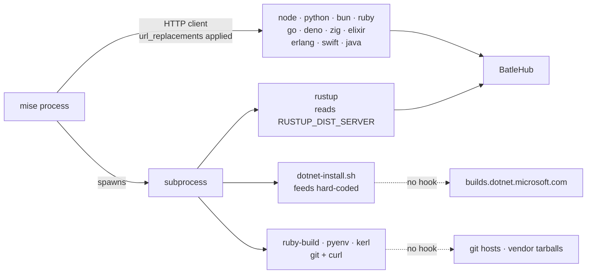
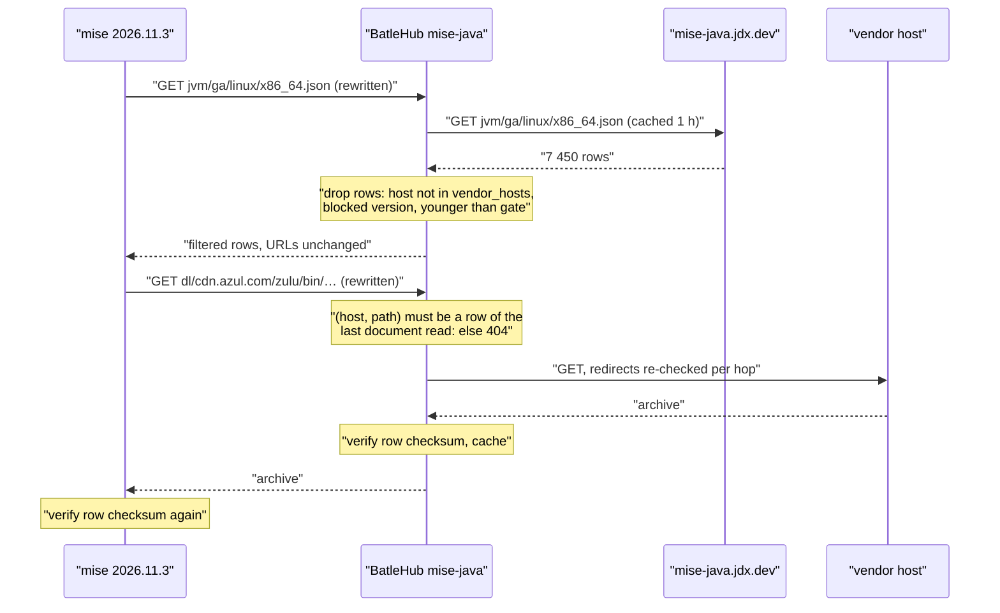
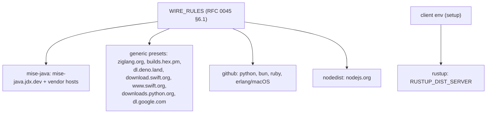
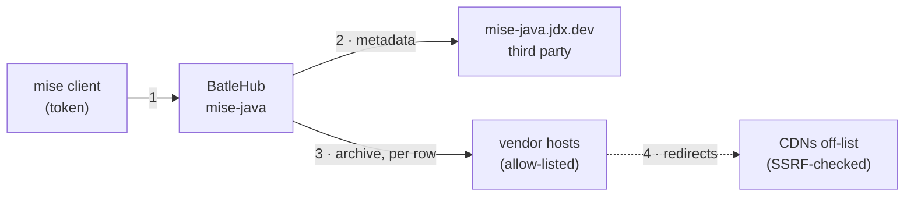

# RFC 0048 — mise core toolchains

| Field       | Value                                                        |
| ----------- | ------------------------------------------------------------ |
| Status      | Draft                                                         |
| Short       | mise core toolchains                                          |
| Settles     | Which route each of mise's fourteen `core:` toolchains takes through BatleHub — a typed kind, a `generic` preset, or a stated refusal — and a `mise-java` kind for the one that has none |
| Author      | Max Batleforc <maxleriche.60@gmail.com>                       |
| Co-author   | Claude Opus 5.5 <noreply@anthropic.com>                       |
| Created     | 2026-11-11                                                    |
| Supersedes  | —                                                             |
| Touches     | `cli`, `crates/core`, `crates/adapters`, `crates/web`, `crates/config`, `server`, `tests/heavy`, docs |
| Risk        | medium (§7)                                                   |

---

## 1. Summary

mise ships fourteen *core* toolchains — the `core:` backend that its registry
names first for `node`, `python`, `java`, `go`, `rust` and nine others. Each
one is a small hand-written client of one vendor's distribution, and each
reaches a different host. BatleHub covers some of them by accident of
history (Node through `nodedist`, Rust through `rustup`, Python, Bun and Ruby
because their bytes happen to live on GitHub) and none of them by design:
`batlehub-cli registry suggest` knows three of the fourteen, and
`mise plan` calls the other eleven supported without checking
(`cli/src/api/suggest.rs:299`).

This RFC gives every core toolchain a stated route, measured against the
mise 2026.11.3 source:

- **Six already route** through an existing kind, and the CLI is taught to
  say so with the *typed* kind rather than a `generic` preset.
- **Six get a `generic` preset**: Deno, Zig, Elixir, Erlang, Swift and Go.
  Cached and counted, no per-version policy — the same bargain `generic` is
  documented to be.
- **Java gets a new `mise-java` kind**, because 7 450 JVM builds from
  nineteen vendors on eleven hosts sit behind one metadata document, and a
  block on a JDK is the control an operator actually asks for.
- **.NET is refused, with its reason**: mise runs Microsoft's install script
  as a subprocess, the script's feed is not configurable from mise, and no
  rewrite rule can reach it.

### Before / after

```toml
# today — `registry suggest --mise` on a project pinning java, zig and go
[settings.url_replacements]
"regex:^https://dl\\.google\\.com/go/(.+)" = "https://hub.example.com/proxy/go-dl/generic/$1"
# java, zig: nothing. `mise plan` lists both as supported; the install goes
# to cdn.azul.com and ziglang.org's community mirrors, or times out air-gapped.
```

```toml
# with this RFC
[settings]
# Zig tries 17 third-party mirrors before ziglang.org; the rewrite is on
# ziglang.org, so the mirrors are turned off.
zig.use_community_mirrors = false

[settings.url_replacements]
"regex:^https://mise-java\\.jdx\\.dev/(.+)" = "https://hub.example.com/proxy/jdk/mise-java/$1"
"regex:^https://(cdn\\.azul\\.com|corretto\\.aws|download\\.bell-sw\\.com|…)/(.+)" = "https://hub.example.com/proxy/jdk/mise-java/dl/$1/$2"
"regex:^https://ziglang\\.org/(.+)" = "https://hub.example.com/proxy/zig-dl/generic/$1"
"regex:^https://dl\\.google\\.com/go/(.+)" = "https://hub.example.com/proxy/go-dl/generic/$1"
```

```text
$ batlehub-cli mise plan
  unsupported: core:dotnet: mise runs dotnet-install.sh, whose feed mise does
  not let you set; no rewrite rule reaches it. Use a .NET SDK image, or
  install it outside mise.
```

---

## 2. Motivation

1. **`mise plan` says "supported" for toolchains it cannot route.**
   `unsupported_backend_reason` returns `None` for every `core:` backend
   (`cli/src/api/suggest.rs:299-304`), on the theory that a fixed host is
   covered "when a registry fronts it". For eleven of the fourteen, no preset
   and no typed host exists, so the plan's *unmirrored hosts* line is the only
   signal — and for `core:dotnet` and compiled Ruby no registry can ever front
   the host, because the request is made by a subprocess. The estate learns at
   install time, on a disconnected workstation, from a connect timeout. That
   is exactly the failure RFC 0008 §2 set out to move to planning time.

2. **The suggester prefers `generic` where a typed kind exists.** `core:node`
   and `core:rust` resolve to the `node-dist` and `rust-dist` presets
   (`cli/src/api/suggest.rs:1070-1072`, presets at `:139` and `:145`), and
   `nodejs.org` / `static.rust-lang.org` are not in `TYPED_HOSTS`
   (`:99-133`). So the generated config caches Node and Rust and enforces
   nothing, a year after RFC 0010 and RFC 0024 built `nodedist` and `rustup`
   precisely so that a block on a Node release or a Rust toolchain would hold.
   `docs/registries/generic.md:63` says so in as many words.

3. **Java is the largest gap and the most asked-for control.** mise resolves
   every Java version through one document per release type, OS and
   architecture — `https://mise-java.jdx.dev/jvm/{type}/{os}/{arch}.json`
   (`src/plugins/core/java.rs:375-395`) — and downloads whatever URL the
   chosen row names (`java.rs:207-234`). The Linux x86_64 GA document is
   3 466 816 bytes and lists 7 450 builds from nineteen vendors across eleven
   hosts (probed 2026-11-11, §6.1). The only JVM path through BatleHub today is
   SDKMAN (RFC 0010), which a mise estate does not run. An operator who can
   block a CVE-bearing Log4j cannot block the JDK under it.

4. **Zig defeats a naive rewrite.** mise downloads Zig from a shuffled list of
   seventeen community mirrors *before* `ziglang.org`
   (`src/plugins/core/zig.rs:151-170`; `zig.use_community_mirrors` defaults
   to `true`). A `url_replacements` rule on `ziglang.org` is therefore reached
   only after every mirror has failed — connected, never; air-gapped, after
   seventeen timeouts.

5. **Six toolchains have no preset at all.** Deno (`dl.deno.land`), Elixir and
   Erlang (`builds.hex.pm`), Swift (`download.swift.org` and
   `www.swift.org`), PyPy (`downloads.python.org`) and Zig have no entry in
   `generic_preset` (`cli/src/api/suggest.rs:137-177`), so `suggest` falls
   back to "no preset for this host" with a `path_allow` of the exact locked
   paths — correct, and stale the next time the pin moves.

---

## 3. Goals / non-goals

**Goals**

- Every `core:` toolchain of mise 2026.11.3 has one stated route — a typed
  kind, a `generic` preset, or a refusal with its reason — and `mise plan`,
  `registry suggest --mise` and `setup` agree on it.
- Where a typed kind exists, the CLI uses it rather than a `generic` preset.
- Java versions can be blocked, age-gated and air-gapped the way Node versions
  can, through a `mise-java` kind.
- The per-tool settings mise needs to reach the rewrite (Zig's mirrors) are
  written by the same command that writes the rules.

**Non-goals**

- **Compiled installs.** `python.compile`, `ruby.compile`, `node.compile` and
  kerl-built Erlang clone build tools over git (`python.rs:1284`,
  `ruby.rs:956-957`, `erlang.rs:109`) and run them as subprocesses. Same answer
  as `asdf:` and `vfox:` in `docs/use/mise.md` §5: unsupported, named in the
  plan.
- **A `godist` kind.** Go releases are 60 MB tarballs on one host with a
  `.sha256` beside each; per-version policy on them is worth an RFC of its own
  (§15 Q3), not a rider on this one.
- **.NET.** No route exists without a change to mise (§2.1, §15 Q4).
- **The non-core backends** (`aqua`, `http`, `conda`, `vfox`, …). RFC 0047.
- **Rewriting vendor URLs inside the Java metadata.** `mise.lock` records the
  URL of the row it installed (`java.rs:229`), and mise matches the lock
  against the metadata by that URL (`java.rs:370`). A rewritten document
  would write the proxy's hostname into every committed lock (§12).
- **Mirroring mise's own versions host.** RFC 0043 owns it; this RFC only
  states, per tool, whether the list comes from there.

---

## 4. User-facing design

### 4.1 Configuration

Two kinds of change, one per route.

**Presets** need no new configuration surface: they are the `generic` kind,
written by `batlehub-cli registry suggest`. The operator copies the block, as
today:

```toml
[[registries]]
name       = "zig-dl"
type       = "generic"
upstreams  = ["https://ziglang.org"]
path_allow = ["download/**", "builds/**"]

[[registries]]
name       = "hex-builds"
type       = "generic"
upstreams  = ["https://builds.hex.pm/builds"]
path_allow = ["elixir/**", "otp/**"]
```

**The `mise-java` kind** is new:

```toml
[[registries]]
name      = "jdk"
type      = "mise-java"
upstreams = ["https://mise-java.jdx.dev"]   # default
# The hosts a download may come from. Default: the eleven measured in §6.1.
# A row naming any other host is dropped from the document served (§4.2 R4).
vendor_hosts = ["github.com", "cdn.azul.com", "corretto.aws", "…"]

  # Optional, as for every kind: an age gate, keyed on the row's `created_at`.
  [[registries.rules]]
  kind = "release_age_gate"
  min_age_secs = 604800
```

| Option | Default | Why this default |
| --- | --- | --- |
| `upstreams` | `["https://mise-java.jdx.dev"]` | the only metadata host mise reads (`java.rs:381`) |
| `vendor_hosts` | the eleven hosts of §6.1 | closed list: a host the operator has not seen is not fetched. Open (`["*"]`) is refused at load (§4.3) |
| `release_age_gate` rule | absent | same as every kind; `created_at` is present on every row |
| `release_types` | `["ga"]` | `ea` builds are opt-in; the URL segment is validated against this list |

### 4.2 Behaviour rules

Per-tool routes, the core of this RFC. "Rewritten" means mise's
`url_replacements` reach the request: mise's shared HTTP client applies them to
every request it sends (`mise-util 2026.11.3 src/http.rs:2482`), so they reach
everything mise fetches itself and nothing a subprocess fetches.

| Tool | Listing (default) | Download and verification | Rewritten? | Route |
| --- | --- | --- | --- | --- |
| node | versions host | `nodejs.org/dist/v{v}/…` + `SHASUMS256.txt` + `.sig`, GPG-verified (`node.rs:397-439`) | yes | **`nodedist`** (typed, RFC 0010) |
| rust | versions host | `rustup` subprocess from `RUSTUP_DIST_SERVER` (`rust.rs:136-146`, `:1255`) | no — env var | **`rustup`** (typed, RFC 0024), via `[env]` |
| python | versions host's `data/python-precompiled-{triple}.gz` (`python.rs:837`) | `github.com/astral-sh/python-build-standalone` + `SHA256SUMS` + attestations (`python.rs:575`, `:1253`) | yes | **`github`** + **`mise-versions`** |
| python (PyPy) | `downloads.python.org/pypy/versions.json` (`python.rs:38`) | same host | yes | **preset `pypy-dl`** |
| bun | versions host | `github.com/oven-sh/bun` + `SHASUMS256.txt` (`bun.rs:52`, `:93`) | yes | **`github`** |
| ruby | versions host | precompiled `github.com/jdx/ruby` releases (setting `ruby.precompiled_url`, `ruby.rs:866-871`) | yes | **`github`** |
| ruby (compiled) | — | ruby-build git clone + `cache.ruby-lang.org` by subprocess | no | **unsupported** |
| erlang | versions host | Linux: `builds.hex.pm/builds/otp/{arch}/{os}/OTP-{v}.tar.gz` + `builds.txt` (`erlang.rs:204-224`); macOS: GitHub release asset (`erlang.rs:283-289`) | yes | **preset `hex-builds`** + `github` |
| elixir | versions host | `builds.hex.pm/builds/elixir/{v}.zip` + `builds.txt` checksum (`elixir.rs:63-76`) | yes | **preset `hex-builds`** |
| go | versions host; fallback `git ls-remote github.com/golang/go` (`go.rs:268`) | `dl.google.com/go/go{v}.{os}-{arch}.tar.gz` + `.sha256` (`go.rs:128`, `:389`) | yes | **preset `go-dl`** (exists) |
| deno | versions host; fallback `deno.com/versions.json` (`deno.rs:139`) | `dl.deno.land/release/v{v}/…zip` + `.sha256sum` (`deno.rs:80`, `:212`) | yes | **preset `deno-dl`** |
| zig | versions host; fallback `ziglang.org/download/index.json` (`zig.rs:378`) | 17 community mirrors, then `ziglang.org`; minisign-verified (`zig.rs:151-238`) | yes, **only with mirrors off** | **preset `zig-dl`** + `zig.use_community_mirrors = false` |
| swift | versions host | `www.swift.org/api/v1/install/releases.json` then `download.swift.org/…` + `.sig`, GPG-verified (`swift.rs:136-144`, `:543`, `:931`) | yes | **presets `swift-dl` + `swift-api`** |
| java | **not** the versions host (`versions_host.rs:21-28` excludes it) — `mise-java.jdx.dev/jvm/{type}/{os}/{arch}.json` | the row's `url`, eleven hosts; checksum from the row (`java.rs:207-234`) | yes | **new kind `mise-java`** |
| dotnet | versions host; `builds.dotnet.microsoft.com/…/releases-index.json` (`dotnet.rs:434`) | `dotnet-install.sh` subprocess, feeds hard-coded (§6.1) | script fetch only | **unsupported** |

The uninteresting cases, stated:

- **R1. Nothing configured.** No core toolchain is wired; `mise` goes direct, as
  today. A preset that is not declared writes no rule.
- **R2. A preset registry exists.** The rule is written; the file is cached on
  first miss and served by path. No version can be blocked: `generic_get`
  builds one synthetic package (`docs/rfc/0010-toolchain-managers.md` §2.2).
- **R3. A `mise-java` registry, nothing blocked.** The metadata document is
  relayed with rows outside `vendor_hosts` dropped, byte-identical otherwise;
  a download is fetched from the row's own URL and cached.
- **R4. A row whose host is not in `vendor_hosts`.** Dropped from the served
  document, counted in `batlehub_mise_java_rows_dropped_total{reason="host"}`
  and listed once per document refresh at `WARN` with the host. mise then
  answers `no metadata found for version …` (`java.rs:806-809`), the same as a
  version that never existed.
- **R5. A blocked Java version.** Its rows are dropped from every metadata
  document the kind serves, and its download route answers `403` with the
  block's reason (§6.P obs. 3).
- **R6. A Java download not in the current metadata** (a URL the client
  invents, or one a lock pins but the vendor has withdrawn). `404`, never an
  upstream fetch: the kind fetches only `(host, path)` pairs it has read from
  its own upstream (§7.3).
- **R7. A version the versions host does not answer for.** mise falls back to
  the tool's own listing (`src/backend/mod.rs:3596-3612`). For `go` that is a
  git `ls-remote` and cannot be routed; for `deno`, `zig` and `swift` it is a
  host the preset may or may not cover (§4.3).

### 4.3 Validation

Hard errors (the server refuses to load):

| Condition | Rationale |
| --- | --- |
| `mise-java` with `vendor_hosts = ["*"]` or empty | an open list makes the kind an open proxy to any host a third party names (§7.1 T1) |
| `mise-java` `vendor_hosts` entry with a scheme, path, port or wildcard | the list is hostnames, compared exactly |
| `mise-java` `release_types` outside `ga`, `ea` | they become a URL segment upstream |

Warnings (load succeeds; seen in `explain-config`, the registry's admin page
and the CLI's `setup` output):

| Condition | Behaviour |
| --- | --- |
| a `zig-dl` preset exists and the generated block omits `zig.use_community_mirrors = false` | `suggest` and `setup` always write the setting; a hand-written block is not checked by the server, and `mise plan` names the tool under `unmirrored_hosts` with "community mirrors first" |
| a `go-dl` preset exists | `mise plan` notes that `go`'s fallback listing is git and does not route; connected, the versions host answers first |
| `core:dotnet`, compiled ruby/python/node/erlang in the lock | `mise plan` lists them under `unsupported` with the reason (§4.5) |

### 4.4 API surface

New routes, all under the `mise-java` kind scope (`kind_scope` in
`crates/web/src/lib.rs:877` for the sibling kind):

| Route | Auth | Answers |
| --- | --- | --- |
| `GET /proxy/{reg}/mise-java/jvm/{type}/{os}/{arch}.json` | read on `{reg}` | the filtered metadata document (`ProtocolDocument`) |
| `GET /proxy/{reg}/mise-java/dl/{host}/{path}` | read on `{reg}`, grant on `java@{version}` | the archive (`ArtifactBytes`) |

No admin API changes. The registry appears in the existing registry list and
package explorer under package `java`, versions as mise spells them
(`temurin-21.0.5+11.0.LTS`).

### 4.5 Mocks

The only visible change is CLI output. `registry suggest --mise` on a lock
naming java, zig, elixir and dotnet:

```text
$ batlehub-cli registry suggest --mise
# Registries this project needs (paste into the server config):

[[registries]]
name = "jdk"
type = "mise-java"            # mise.lock: java (core:java)

[[registries]]
name = "zig-dl"
type = "generic"              # mise.lock: zig (core:zig)
upstreams  = ["https://ziglang.org"]
path_allow = ["download/**", "builds/**"]

[[registries]]
name = "hex-builds"
type = "generic"              # mise.lock: elixir (core:elixir)
upstreams  = ["https://builds.hex.pm/builds"]
path_allow = ["elixir/**", "otp/**"]

# Not routable through BatleHub:
#   dotnet (core:dotnet) — mise runs dotnet-install.sh, whose download feed
#   mise does not let you set; no rewrite rule reaches it.

# mise config (~/.config/mise/config.toml):
[settings]
zig.use_community_mirrors = false   # mirrors are tried before ziglang.org

[settings.url_replacements]
…
```

Decides: the refusal is printed where the operator is already reading, not
only in `mise plan`; the Zig setting travels with its rule.

`mise plan` with the same lock, air-gapped instance:

```text
$ batlehub-cli mise plan
plan: 3 tools, 4 artifacts, 412 MiB
  java   temurin-21.0.5+11.0.LTS  jdk/mise-java/dl/github.com/adoptium/…  198 MiB
  zig    0.15.2                   zig-dl/generic/download/0.15.2/…         51 MiB
  elixir 1.18.4-otp-27            hex-builds/generic/elixir/v1.18.4-otp-27.zip
unsupported:
  core:dotnet: mise runs dotnet-install.sh, whose feed mise does not let you
  set; no rewrite rule reaches it
exit 0
```

Error state — a blocked JDK, as mise prints it (exit 1, mise's own text from
`java.rs:806-809`):

```text
$ mise install java@temurin-21.0.5
mise ERROR no metadata found for version temurin-21.0.5 on linux-x64
```

Decides: the refusal is mise's own "not found", not a new BatleHub message —
mise has no channel for a reason. The reason is in the access log and on the
package's page in the explorer (§10.1).

---

## 5. Architecture

### 5.1 Two shapes of toolchain

The fourteen split by *who makes the request*.



It proves the boundary of this RFC: everything on the left of a subprocess is
routable by one rule; to the right, only a tool that reads an environment
variable (rustup) can be routed, and two cannot be routed at all.

### 5.2 The Java request



The invariant: **because the download route only fetches a `(host, path)` it
has read from its own configured upstream, and only on a host in
`vendor_hosts`, the route cannot be made to fetch anything an operator did not
allow.** The client's URL is a lookup key, never a fetch target.

### 5.3 Where the routes sit



Every route is a row in the table RFC 0045 moves to `crates/core`; this RFC
adds rows, not a mechanism. Before RFC 0045 lands, the same rows live in
`typed_url_replacements` and `generic_preset` in the CLI.

---

## 6. Detailed design

### 6.1 Measurements

Probed 2026-11-11 with `curl -sI` (no redirect following), mise source
2026.11.3 from crates.io (`mise`, `mise-util`).

| URL | First answer | Size | Note |
| --- | --- | --- | --- |
| `mise-java.jdx.dev/jvm/ga/linux/x86_64.json` | 200 `application/json` | 3 466 816 B | 7 450 rows |
| `cdn.azul.com/zulu/bin/…zip` | 200 `application/zip` | 33 MB | |
| `corretto.aws/downloads/resources/…tar.gz` | 200 | 194 MB | |
| `d3pxv6yz143wms.cloudfront.net/…` (Corretto, old) | 200 | 192 MB | |
| `download.bell-sw.com/vm/…tar.gz` | 200 | 475 MB | |
| `download.java.net/java/GA/…` | 200 | 205 MB | |
| `download.oracle.com/graalvm/…` | 200 | 332 MB | |
| `aka.ms/download-jdk/…` | **301** → `download.visualstudio.microsoft.com` | | redirect off-list |
| `cache-redirector.jetbrains.com/intellij-jbr/…` | **307** → `d2xrhe97vsfxuc.cloudfront.net` | | redirect off-list |
| `gds.oracle.com/download/graal/…` | **302** → `objectstorage.uk-london-1.oraclecloud.com` | | redirect off-list |
| `github.com/adoptium/…/releases/download/…` | 302 → `release-assets.githubusercontent.com` | | |
| `github.com/SAP/SapMachine/…10-ea…` | **404** | | stale row |
| `dl.google.com/go/go1.25.4.linux-amd64.tar.gz` | 200 | 59.8 MB | `.sha256`: 64 B |
| `dl.deno.land/release/v2.5.6/…zip` | 200 `application/zip` | chunked | `.sha256sum` 200 |
| `ziglang.org/download/0.15.2/…tar.xz` | 200 | 53.7 MB | `.minisig` 325 B |
| `ziglang.org/download/community-mirrors.txt` | 200 | 466 B | 17 mirrors, 17 hosts |
| `builds.hex.pm/builds/otp/amd64/ubuntu-24.04/OTP-28.3.tar.gz` | 200 | chunked | |
| `builds.hex.pm/builds/elixir/v1.18.4-otp-27.zip` | 200 | chunked | |
| `download.swift.org/…/swift-6.2-RELEASE-ubuntu24.04.tar.gz` | 200 | **1 007 MB** | `.sig` 819 B |
| `www.swift.org/api/v1/install/releases.json` | 200 | 56 KB | |
| `dot.net/v1/dotnet-install.sh` | 301 → `builds.dotnet.microsoft.com/dotnet/scripts/v1/…` | | |

Java rows by download host: `github.com` 3 459, `cdn.azul.com` 1 802,
`cache-redirector.jetbrains.com` 1 330, `corretto.aws` 328,
`download.bell-sw.com` 230, `aka.ms` 117, `download.oracle.com` 96,
`download.java.net` 60, `developers.redhat.com` 12, `gds.oracle.com` 12,
`d3pxv6yz143wms.cloudfront.net` 4. Checksums: `sha256:` 4 183, `sha512:` 1 036,
`sha1:` 33, none 101. No row carries a `checksum_url`.

`dotnet-install.sh` (fetched the same day) hard-codes its feeds —
`https://builds.dotnet.microsoft.com/dotnet` and `https://ci.dot.net/public`
(lines 1343-1345) — and overrides them only from `--azure-feed` /
`--uncached-feed` arguments (lines 1721-1728). mise builds the command with
`--install-dir`, `--version`, `--no-path` and optionally `--runtime`
(`dotnet.rs:389-405`), nothing else.

### 6.2 `cli` — presets, kinds and refusals (phase 1)

`cli/src/api/suggest.rs`:

- `generic_preset` gains `dl.deno.land` (`deno-dl`, upstream
  `https://dl.deno.land`, `path_allow = ["release/**"]`), `ziglang.org`
  (`zig-dl`, `["download/**", "builds/**"]`), `builds.hex.pm` (`hex-builds`,
  upstream `https://builds.hex.pm/builds`, `["elixir/**", "otp/**"]`),
  `download.swift.org` (`swift-dl`, `["swift-*/**"]`), `www.swift.org`
  (`swift-api`, `["api/v1/install/**"]`) and `downloads.python.org`
  (`pypy-dl`, upstream `https://downloads.python.org/pypy`, `["**"]`).
- `TYPED_HOSTS` gains `nodejs.org → nodedist` and
  `static.rust-lang.org → rustup`, placed before the presets are consulted, so
  a lock URL on those hosts suggests the typed kind. The two presets stay for
  an operator who asks for `generic` by name.
- `registry_for_backend`'s `core:` arm becomes a table: `core:node →
  nodedist`, `core:rust → rustup`, `core:go → go-dl`, `core:deno → deno-dl`,
  `core:zig → zig-dl`, `core:elixir → hex-builds`, `core:erlang → hex-builds`
  (plus `github` on macOS locks, which carry the URL), `core:swift → swift-dl`
  and `swift-api`, `core:java → mise-java`. `core:python`, `core:bun` and
  `core:ruby` resolve through their locked GitHub URLs, as today.
- `unsupported_backend_reason` stops returning `None` for every `core:`
  (`:299-304`): `core:dotnet` gets the reason of §4.5; the rest keep `None`.
  Compiled variants are detected from the lock entry carrying no URL for a
  tool whose precompiled install always records one.
- A new `mise_settings_for(registries) -> Vec<(key, value)>` writes
  `zig.use_community_mirrors = false` when `zig-dl` is among them; the
  renderer emits it under `[settings]`, `setup` merges it the same way.

`cli/src/api/client_setup.rs`: `MISE_TYPES` (`:1536`) gains `rustup` and
`mise-java`; `rustup` contributes `RUSTUP_DIST_SERVER` / `RUSTUP_UPDATE_ROOT`
under mise's `[env]` rather than a rule, since rustup is a subprocess.

### 6.3 `crates/core` — the `mise-java` kind (phase 2)

- `RegistryKind::MiseJava` (`"mise-java"`) in `registry_kind.rs`, in `ALL`.
  The compiler then forces the arms listed in `CLAUDE.md` step 5;
  `render_listing` in `services/listing_synthesis.rs` gets its arm explicitly
  (the silent one).
- `services/mise_java.rs`: `filter_document(rows, policy, vendor_hosts) ->
  (Vec<Row>, Dropped)`, pure. A row's coordinate is `java@{vendor}-{version}`,
  exactly the key mise builds (`java_metadata_key`, `java.rs:366-371`).
- `normalise_checksum("sha256:<hex>") -> "<hex>"` — mise's `algo:hex` form is
  unparseable by `integrity::parse_expected`
  (`crates/core/src/services/integrity.rs:75-104`), which would silently skip
  cache-write verification with one `WARN` per download (`CLAUDE.md`, step 1).
  `sha1:` rows are passed through as SHA-1 and flagged (§7.4).
- The download index: `(host, path) → (row coordinate, checksum)`, rebuilt from
  each fetched document, so R5 and R6 are one lookup.

### 6.4 `crates/adapters` and `crates/web`

- `crates/adapters/src/registry/mise_java.rs`: `MiseJavaRegistryClient`, a
  flat file (the DTO is one struct of ten fields). Metadata through the shared
  client with the ordinary listing TTL; downloads through
  `ssrf::fetch_following_redirects` (`crates/adapters/src/registry/ssrf.rs:231`),
  which re-checks every hop against `is_blocked_ip` (`:87`). Redirect targets
  are **not** required to be in `vendor_hosts` — three of the eleven hosts are
  redirectors (§6.1) — but they are SSRF-checked; §15 Q2 asks whether that is
  enough.
- `crates/web/src/handlers/proxy/mise_java.rs`: the two routes of §4.4, both
  `body = …` declared for `openapi_contract.rs`.
- `server/src/builders.rs`: the client arm; `crates/config`: the three options
  and the validation of §4.3.

### 6.5 Air gap

| Route | Disconnected behaviour |
| --- | --- |
| `nodedist`, `rustup`, `github` | as their RFCs (0010, 0024, 0008-bis): listings composed from held files |
| presets | a held file is served by path; no listing to compose (`docs/registries/generic.md:14`). mise's versions-host request answers `404` (RFC 0043), the fallback listing goes to an unwired or sunk host (RFC 0045 `Sink`), so **only a lock-driven install works** — the stance of `docs/use/mise.md` §5 |
| `mise-java` | the metadata document is **composed** from the held archives' rows, recorded at import with their original `url` and checksum; `mise ls-remote java` lists what the bundle carries. Phase 3 |
| dotnet | unchanged: unsupported |

### 6.P Proof against a real client

Suite: `tests/heavy/closed_world.sh`, new phases `mise-core` and `mise-java`,
client mise 2026.11.3 pinned through `heavy_runner_for` as `phase_mise`
(`:1082`) does, egress denied, every request through the tap; assertions on
the wire transcript with `heavy_wire_re_after`, never on mise's exit code
alone. The air-gap half is `tests/heavy/airgap.sh`.

1. `mise install zig@0.15.2` with the generated config — the tap shows
   `GET /proxy/zig-dl/generic/download/0.15.2/zig-x86_64-linux-0.15.2.tar.xz`
   and its `.minisig`, and **no** request to any of the seventeen hosts of
   `community-mirrors.txt`; `mise` exits 0 after its own minisign check.
2. The same with `zig.use_community_mirrors` removed — the transcript shows
   mirror connection attempts first; the phase asserts the generated block
   always carries the setting, so this arm guards the generator.
3. `mise install java@temurin-21.0.5` with `temurin-21.0.5+11.0.LTS` blocked —
   exits non-zero with `no metadata found for version temurin-21.0.5 on
   linux-x64`; the tap shows the metadata `GET` and **no** `dl/` request, so
   the refused bytes were never fetched.
4. `curl` of the blocked row's `dl/github.com/…` path with a valid token —
   `403` with the block's reason in the body; the upstream log has no request
   for it.
5. `curl` of `dl/169.254.169.254/latest/meta-data` — `404`, no upstream
   request: the path is not a row (R6).
6. `mise install java@zulu-21` unblocked — metadata and archive through the
   proxy, the archive's checksum verified twice (the server's cache-write
   verification, then mise), and a second install in a fresh `MISE_DATA_DIR`
   makes no upstream request for the archive.
7. `mise install deno@2.5.6`, `elixir@1.18.4-otp-27`, `swift@6.2` — each one
   artifact `GET` and one checksum or signature `GET` through its preset.
8. `mise install dotnet@9` with the generated config — `mise plan` named it
   unsupported before the run; the install's network attempt is to
   `builds.dotnet.microsoft.com`, refused by the egress block, and the phase
   asserts that the plan's prediction and the transcript agree.
9. Air-gapped, `mise install` from `mise.lock` for java, zig and node — exactly
   one artifact URL per tool, all `200` from held content.

**Deliberately untouched**, so reviewers do not go looking:

- `crates/adapters/src/registry/sdkman/` — SDKMAN stays the JVM path for
  `sdk`; the two kinds share no code because they share no wire format.
- `crates/adapters/src/registry/goproxy.rs` — `golang.org/toolchain` modules
  exist on the module proxy, but mise never asks for them.
- `crates/adapters/src/registry/nuget/` — the .NET SDK is not a NuGet package.

---

## 7. Security

Rating: **medium**. One new kind fetches URLs named by a third-party document;
the presets add no new trust, only new hosts behind the existing `generic`
allowlist.

### 7.1 Threat model



Boundary 2 is new trust: a document BatleHub did not write decides which URLs
boundary 3 fetches.

| # | Threat (STRIDE) | Mitigation | Enforced by | Residual |
| --- | --- | --- | --- | --- |
| T1 | **Tampering / EoP** — a compromised `mise-java.jdx.dev` names an internal URL, turning the kind into an SSRF | rows outside `vendor_hosts` dropped; the download route fetches only indexed `(host, path)`; every hop `is_blocked_ip`-checked | `filter_document`, the download index, `ssrf::fetch_following_redirects` | a vendor host itself compromised — accepted, same as direct; owner: operator |
| T2 | **Tampering** — the same compromise names a malicious archive with a matching checksum | none at this layer: the checksum comes from the same document | — | equal to mise direct; a committed `mise.lock` pins the checksum on first lock and mise re-verifies. Accepted, recorded in §15 Q5 |
| T3 | **Spoofing** — the client requests `dl/{host}/{path}` for a host it chose | the client's URL is a lookup key only (R6) | download index | none |
| T4 | **EoP** — a lock-pinned URL bypasses a block because mise skips the metadata when the lock has the URL (`java.rs:615-634`) | the download route resolves the URL to its row and applies the block there (R5) | download handler | rows on `github.com` routed through the `github` kind instead escape it — §15 Q1 |
| T5 | **Tampering** — a cache-write without verification because of the `sha256:` form | `normalise_checksum` | `services/mise_java.rs` | `sha1:` rows (33) verify with SHA-1 only; flagged in the explorer |
| T6 | **DoS** — 1 GB Swift tarballs and 475 MB JDKs fill storage | existing quotas and `path_allow`; sizes stated in §10.3 | quota rules | operator sizing |
| T7 | **Info disclosure** — the client's token sent to a vendor host | upstream requests carry only the registry's own configured credential, never the client's | `UpstreamHttpOptions` per registry (`crates/adapters/src/registry/http_client.rs:122`) | none |
| T8 | **Tampering** — Zig mirrors bypass the proxy | generated `use_community_mirrors = false`; obs. 2 | `mise_settings_for` | a hand-written config without it goes direct — warned in `mise plan` |

### 7.2 Authentication and authorisation

Both routes are read routes on the registry and go through the auth
middleware (`crates/web/src/middleware/auth.rs`) and the grant check before
any upstream fetch, as `ProxyService::handle` already orders it. The
download route checks the grant on the row's coordinate, which it knows from
the index before fetching. Anonymous access follows the
registry's existing `read` grant to `*`; nothing new is public by default.

### 7.3 Input handling and injection

`{type}`, `{os}`, `{arch}` are matched against fixed lists before they reach
an upstream URL. `{host}` and `{path}` are never fetched as given: they are a
key into the index, compared byte-for-byte after percent-decoding once; a miss
is `404`. The metadata parser is `serde_json` into a fixed struct with a
document size cap (8 MiB, twice the largest probed) — a new parser of
upstream input, so a `fuzz_mise_java_filter` target covers `filter_document`.
Presets change nothing here: `generic`'s `path_allow` is mandatory
(`generic_without_path_allow_is_rejected`, `crates/config/src/lib.rs:1403`).

### 7.4 Secrets and cryptography

No new secret. Checksums: SHA-256/512 from the row, SHA-1 for 33 legacy rows,
none for 101 rows (cached unverified, `WARN` once, shown in the explorer).
End-to-end signatures that survive the cache untouched, because the verifier
is mise and the key ships in mise: Node GPG (`node.rs:417-439`), Swift GPG
(`swift.rs:136-144`), Zig minisign (`zig.rs:238`), Python attestations via
the `github` kind. Go, Deno and Elixir checksums come from the same host as
the artifact, so a poisoned cache entry would be self-consistent; `mise.lock`
is the defence and the docs say so.

### 7.5 Abuse and resource exhaustion

The metadata document is fetched at most once per TTL per `(type, os, arch)`
under the existing single-flight; a client cannot force a refresh. Downloads
are bounded by the row set (≈7 450 per platform document), so the cache
cannot be filled with arbitrary paths, only with real JDKs — which is the
quota's job.

### 7.6 Existing defences that still hold

`path_allow` on every preset, `is_blocked_ip` on every hop, quotas, the grant
check before fetch, `ensure_safe_key` on storage keys.

---

## 8. Supply chain

No new crate, image, action or tool: the kind uses `serde_json`, `reqwest`
and `glob`, already in `Cargo.lock`, and `task security` is unchanged. New
*upstreams*, which are supply chain of a different kind: `mise-java.jdx.dev`
(operated by mise's author; MIT project, the document is generated from vendor
APIs) and the eleven vendor hosts, all already reached by any mise estate
today, directly. The heavy suite pins mise 2026.11.3 as the existing phase
does; no new CI action.

---

## 9. Data and privacy

No new personal data. The kind stores metadata documents (vendor build rows)
and archives, neither personal. The access log records the requesting
identity and the coordinate, as for every kind, under the existing retention.
mise's install beacon is RFC 0043's and is not touched here.

---

## 10. Operability

### 10.1 Observability

- Existing per-registry request, cache and upstream-latency metrics apply to
  both routes and to every preset.
- `batlehub_mise_java_rows_dropped_total{registry, reason}` with `reason` in
  `host | blocked | age | invalid` — bounded labels.
- `batlehub_mise_java_document_rows{registry, type, os, arch}` after
  filtering, so a vendor disappearing from the served document is a step on a
  graph, not a support ticket.
- A blocked download writes the usual audit row with the block's id; the
  explorer shows `java` with each vendor-version and its block state.

### 10.2 Failure modes

| Failure | Direction | Behaviour |
| --- | --- | --- |
| `mise-java.jdx.dev` down | stale-on-error | last good document served if the registry allows stale; else `502`, and mise errors |
| a vendor host down | closed | `502` for that row; other vendors unaffected |
| a stale row (`404` upstream, as SapMachine 10-ea) | closed | `404` relayed, nothing cached |
| a redirect to a blocked IP | closed | `502`, `WARN` with the host |
| checksum mismatch | closed | nothing cached, `502`, `ERROR` with expected and actual |

No new background job; the document cache uses the existing cache store.

### 10.3 Performance and capacity

One metadata document is 3.4 MB raw; filtered per request it costs one pass
over ≈7 450 rows — measured in phase 2 against a 5 ms budget per request.
Storage per artifact: JDK 33–475 MB, Swift ≈1 GB per platform, Go 60 MB,
Zig 54 MB. `docs/guide/caching.md` gains the table.

---

## 11. Other concerns

- **Accessibility**: no UI; the explorer shows the new kind through existing
  components.
- **Internationalisation**: CLI output is English-only, as today; the
  explorer's kind label goes through the existing i18n catalogue, both locales.
- **Compliance**: CRA vulnerability handling — a JDK becomes blockable, which
  is evidence for the existing control; no new control.
- **Licensing**: none of ours. The proxy caches vendor JDKs under their
  licences; Oracle's terms on redistribution are the operator's question, as
  they are for SDKMAN today (`docs/registries/sdkman.md`).
- **Documentation**: `docs/registries/mise-java.md` (new),
  `docs/registries/generic.md` (preset list), `docs/use/mise.md` §5 (core
  table, dotnet, Zig mirrors), `docs/guide/caching.md` (sizes).

---

## 12. Alternatives considered

| Alternative | Why rejected |
| --- | --- |
| **Point mise users at SDKMAN for Java** | Two toolchain managers per workstation; SDKMAN's identifiers (`21.0.5-tem`) differ from mise's (`temurin-21.0.5`), so `.mise.toml` and policy disagree. And `sdkman` covers fewer vendors than the document's nineteen |
| **`generic` presets for the eleven Java hosts** | Caches bytes, enforces nothing — the gap RFC 0010 §2.2 closed for Node. Three hosts are redirectors whose targets are other hosts, so the preset set never stabilises |
| **Rewrite vendor URLs inside the served document** | One rule instead of twelve, but every `mise.lock` then records `hub.example.com`; mise matches locks by URL (`java.rs:370`), so a lock written through the proxy breaks the day the proxy moves, and a lock written direct never matches the proxied document |
| **Ask mise upstream for a `java.metadata_url` setting** | Solves only the first request; downloads still need rules. Worth doing anyway (§15 Q6), not a substitute |
| **Do nothing; document "unsupported"** | The plan would at least stop lying, which phase 1 does. Java would stay unblockable |
| **A `godist` kind now** | Same cost as `nodedist` for a toolchain whose estates are smaller; §15 Q3 |

---

## 13. Rollout and compatibility

Phase 1 changes only CLI output. An existing generated block keeps working:
the `node-dist` and `rust-dist` `generic` registries are not removed, and
`suggest` prints the typed suggestion beside a note that the generic one
remains valid. A config naming `type = "mise-java"` on an older server fails
to load with the existing unknown-kind error. No migration, no default
changes on existing registries.

---

## 14. Test plan

- **Unit (`cli`)**: one test per `core:` backend asserting its route (a table
  test, so a fifteenth core tool is a red test); `core:dotnet` unsupported
  with the reason; `zig.use_community_mirrors = false` present iff `zig-dl`
  is; `nodejs.org` and `static.rust-lang.org` suggest the typed kind.
- **Unit (`core`)**: `filter_document` drops off-list hosts, blocked and gated
  rows; `normalise_checksum` for `sha256:`, `sha512:`, `sha1:`, empty.
- **Integration (`crates/web/tests/mise_java.rs`)**, one negative test per §7
  row: T1 `an_off_list_host_row_is_never_served`, T3/R6
  `a_download_not_in_the_document_is_404_without_upstream`, T4
  `a_blocked_row_download_is_403`, T5
  `a_sha256_prefixed_checksum_is_verified_on_cache_write`, T7
  `no_client_credential_reaches_the_vendor`.
- **Fuzz**: `fuzz_mise_java_filter`.
- **Gates** (`CLAUDE.md` step 9): `authz.sh` live phase for `mise-java`,
  `registry_kind_coverage.rs`, `soak_kind_coverage.rs`, `authz_matrix.rs`,
  the README-extractor check.
- **Heavy**: §6.P, both phases, plus `airgap.sh` obs. 9.

---

## 15. Decisions and open questions

### Resolved

| # | Question | Decision |
| --- | --- | --- |
| R1 | Rewrite URLs in the Java document, or route vendor hosts? | **Route vendor hosts; serve URLs unchanged.** Lock portability (§12). |
| R2 | Should Zig's mirrors be wired too? | **No — turn them off.** Seventeen hosts that change daily cannot be a preset; the setting is one line. |

### Still open

1. **Java rows on `github.com`** (3 459 of 7 450). The `github` kind's rules
   match first, so those downloads bypass `mise-java`'s block when a lock pins
   the URL (T4). Options: order the `mise-java` rule for the known JDK repos
   (`adoptium/*`, `SAP/SapMachine`, …) before the `github` rules; or have the
   `github` kind consult `mise-java` blocks by URL. Recommendation: the first,
   with the repo list derived from the document.
2. **Redirect targets off `vendor_hosts`.** `aka.ms`,
   `cache-redirector.jetbrains.com` and `gds.oracle.com` redirect to hosts not on the list. SSRF-checked, not
   allow-listed. Allow-list the targets too (brittle: CloudFront hosts
   rotate), or accept? Recommendation: accept, log the final host.
3. **A `godist` kind** for per-version policy on Go — now, or when an estate
   asks?
4. **.NET**: contribute a `dotnet.feed` setting to mise that passes
   `--azure-feed`, then route `builds.dotnet.microsoft.com` with a preset? Who
   owns the upstream PR?
5. **Same-document checksums** (T2): is a mise-java compromise an accepted
   residual, or should the kind cross-check a vendor-published checksum where
   one exists (Temurin, Corretto publish them)?
6. **Ask mise for `java.metadata_url`**, so the first request needs no rewrite
   rule?
7. **Erlang on macOS**: confirm the GitHub repository mise reads the
   precompiled asset from — the source names the asset (`erlang.rs:283-289`),
   not verified here which release it reads.

---

## 16. Implementation phases

| Phase | Content | Leaves green |
| --- | --- | --- |
| 1 | CLI: presets, typed suggestions for node/rust, the `core:` route table, dotnet refusal, Zig setting; `docs/use/mise.md` §5; heavy `mise-core` phase (obs. 1, 2, 7, 8) | unit + heavy |
| 2 | `mise-java` kind: core filter, adapter, routes, config validation, metrics, the five gates; heavy `mise-java` phase (obs. 3–6) | unit + integration + gates + heavy |
| 3 | `mise-java` air gap: composed document, bundle import; `airgap.sh` obs. 9 | heavy |

The security controls of §7 (host allowlist, download index, grant before
fetch) land in phase 2 with the routes they protect.
