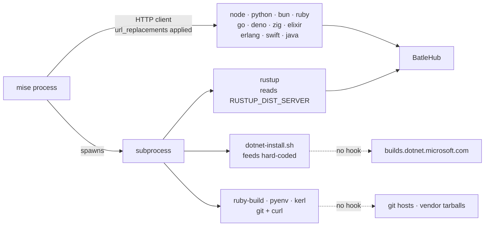
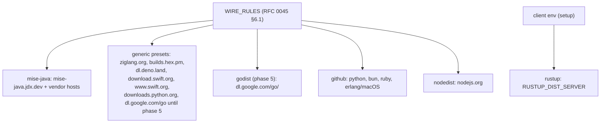
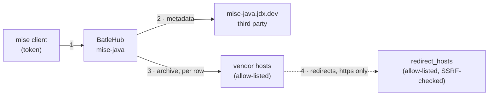

# RFC 0048 — mise core toolchains

| Field       | Value                                                        |
| ----------- | ------------------------------------------------------------ |
| Status      | Draft — phase 5 (`godist`) built ahead of sign-off, 2026-11-13; phases 1–4 not started |
| Short       | mise core toolchains                                          |
| Settles     | Which route each of mise's thirteen `core:` toolchains takes through BatleHub — a typed kind, a `generic` preset, or a stated refusal — with a `mise-java` kind for the one that has none and a `godist` kind for Go |
| Author      | Max Batleforc <maxleriche.60@gmail.com>                       |
| Co-author   | Claude Opus 5.5 <noreply@anthropic.com>                       |
| Created     | 2026-11-11                                                    |
| Supersedes  | —                                                             |
| Touches     | `cli`, `crates/core` (including the proxy cache-fill path, §15 Q9, shared with RFC 0047), `crates/adapters`, `crates/web`, `crates/config`, `server`, `tests/heavy`, docs |
| Risk        | medium (§7)                                                   |

---

## 1. Summary

mise ships thirteen *core* toolchains — the `core:` backend that its registry
names first for `node`, `python`, `java`, `go`, `rust` and eight others
(`mise registry` lists fourteen `core:` rows because `dotnet-core` is an alias
of `core:dotnet`; `src/plugins/core/` has thirteen files). Each
one is a small hand-written client of one vendor's distribution, and each
reaches a different host. BatleHub covers some of them by accident of
history (Node through `nodedist`, Rust through `rustup`, Python, Bun and Ruby
because their bytes happen to live on GitHub) and none of them by design:
`batlehub-cli registry suggest` knows three of the thirteen, and
`mise plan` calls the other ten supported without checking
(`cli/src/api/suggest.rs:299`).

This RFC gives every core toolchain a stated route, measured against the
mise 2026.11.3 source:

- **Five already route** through an existing kind — Node (`nodedist`), Rust
  (`rustup`), Python, Bun and Ruby (`github`) — and the CLI is taught to say so
  with the *typed* kind rather than a `generic` preset.
- **Six get a `generic` preset**: Deno, Zig, Elixir, Erlang and Swift are new;
  Go keeps the `go-dl` preset it has until phase 5. Cached and counted, no
  per-version policy — the same bargain `generic` is documented to be. (PyPy,
  a Python *flavour* rather than a toolchain, gets one too.)
- **Go then gets a `godist` kind** (phase 5), modelled on `nodedist`, so a Go
  release can be blocked the way a Node release can (§15 Q3).
- **Java gets a new `mise-java` kind**, because 7 450 JVM builds from
  nineteen vendors on eleven hosts sit behind one metadata document, and a
  block on a JDK is the control an operator actually asks for.
- **.NET is refused, with its reason**: mise runs Microsoft's install script
  as a subprocess, the script's feed is not configurable from mise, and no
  rewrite rule can reach it. The fix belongs in mise: an issue asking for a
  `dotnet.feed` setting is opened at jdx/mise (§15 Q4); no code here.
- **The proxy's cold path changes for every kind**: a large cold artifact is
  filled once, detached from the request, and streamed to the client while it
  is cached, so mise's 30 s read timeout no longer loses it (phase 1b, §15 Q9,
  shared with RFC 0047).

### Before / after

```toml
# today — `registry suggest --mise` on a project pinning java, zig and go
[settings.url_replacements]
"regex:^https://dl\\.google\\.com/go/(.+)" = "https://hub.example.com/proxy/go-dl/generic/$1"
# java, zig: nothing. `mise plan` lists both as supported; the install goes
# to cdn.azul.com and ziglang.org's community mirrors, or times out air-gapped.
```

```toml
# with this RFC
[settings]
# Zig tries 17 third-party mirrors before ziglang.org; the rewrite is on
# ziglang.org, so the mirrors are turned off.
zig.use_community_mirrors = false

[settings.url_replacements]
# mise-java rules come BEFORE the github rules: mise applies the first match
# (§15 Q1). One rule per vendor_hosts entry, host + path prefix (§4.1).
"regex:^https://mise-java\\.jdx\\.dev/(.+)" = "https://hub.example.com/proxy/jdk/mise-java/$1"
"regex:^https://cdn\\.azul\\.com/zulu/(.+)" = "https://hub.example.com/proxy/jdk/mise-java/dl/cdn.azul.com/zulu/$1"
"regex:^https://github\\.com/adoptium/(.+)" = "https://hub.example.com/proxy/jdk/mise-java/dl/github.com/adoptium/$1"
# … one line per remaining vendor_hosts entry (§6.1 lists the measured set) …
"regex:^https://api\\.github\\.com/repos/(.+)" = "https://hub.example.com/proxy/github/$1"   # github rules after
"regex:^https://ziglang\\.org/(.+)" = "https://hub.example.com/proxy/zig-dl/generic/$1"
"regex:^https://dl\\.google\\.com/go/(.+)" = "https://hub.example.com/proxy/go-dl/generic/$1"
```

```text
$ batlehub-cli mise plan
3 tool(s) · 3 download(s) · 3 registries · 0 host(s) with no mirror configured
  unsupported: core:dotnet: mise runs dotnet-install.sh, whose feed mise does not let you set; no rewrite rule reaches it
```

---

## 2. Motivation

1. **`mise plan` says "supported" for toolchains it cannot route.**
   `unsupported_backend_reason` returns `None` for every `core:` backend
   (`cli/src/api/suggest.rs:299-304`), on the theory that a fixed host is
   covered "when a registry fronts it". For ten of the thirteen, no preset
   and no typed host exists, so the plan's *unmirrored hosts* line is the only
   signal — and for `core:dotnet` and compiled Ruby no registry can ever front
   the host, because the request is made by a subprocess. The estate learns at
   install time, on a disconnected workstation, from a connect timeout. That
   is exactly the failure RFC 0008 §2 set out to move to planning time.

2. **The suggester prefers `generic` where a typed kind exists.** `core:node`
   and `core:rust` resolve to the `node-dist` and `rust-dist` presets
   (`cli/src/api/suggest.rs:1070-1072`, presets at `:139` and `:145`), and
   `nodejs.org` / `static.rust-lang.org` are not in `TYPED_HOSTS`
   (`:99-133`). So the generated config caches Node and Rust and enforces
   nothing, a year after RFC 0010 and RFC 0024 built `nodedist` and `rustup`
   precisely so that a block on a Node release or a Rust toolchain would hold.
   `docs/registries/generic.md:63` says so in as many words.

3. **Java is the largest gap and the most asked-for control.** mise resolves
   every Java version through one document per release type, OS and
   architecture — `https://mise-java.jdx.dev/jvm/{type}/{os}/{arch}.json`
   (`src/plugins/core/java.rs:375-395`) — and downloads whatever URL the
   chosen row names (`java.rs:207-234`). The Linux x86_64 GA document is
   3 466 816 bytes and lists 7 450 builds from nineteen vendors across eleven
   hosts (probed 2026-11-11, §6.1). The only JVM path through BatleHub today is
   SDKMAN (RFC 0010), which a mise estate does not run. An operator who can
   block a CVE-bearing Log4j cannot block the JDK under it.

4. **Zig defeats a naive rewrite.** mise downloads Zig from a shuffled list of
   seventeen community mirrors *before* `ziglang.org`
   (`src/plugins/core/zig.rs:151-170`; `zig.use_community_mirrors` defaults
   to `true`). A `url_replacements` rule on `ziglang.org` is therefore reached
   only after every mirror has failed — connected, never; air-gapped, after
   seventeen timeouts.

5. **Five toolchains have no preset at all**, nor does PyPy, a flavour of
   `core:python`. Deno (`dl.deno.land`), Elixir and Erlang (`builds.hex.pm`),
   Swift (`download.swift.org` and `www.swift.org`), Zig and PyPy
   (`downloads.python.org`) have no entry in
   `generic_preset` (`cli/src/api/suggest.rs:137-177`), so `suggest` falls
   back to "no preset for this host" with a `path_allow` of the exact locked
   paths — correct, and stale the next time the pin moves.

---

## 3. Goals / non-goals

**Goals**

- Every `core:` toolchain of mise 2026.11.3 has one stated route — a typed
  kind, a `generic` preset, or a refusal with its reason — and `mise plan`,
  `registry suggest --mise` and `setup` agree on it.
- Where a typed kind exists, the CLI uses it rather than a `generic` preset.
- Java versions can be blocked, age-gated and air-gapped the way Node versions
  can, through a `mise-java` kind.
- The per-tool settings mise needs to reach the rewrite (Zig's mirrors) are
  written by the same command that writes the rules.
- Go versions can be blocked through a `godist` kind (phase 5).
- A cold artifact of any size the registry admits reaches a mise client
  inside its 30 s read timeout, and is fetched upstream once (phase 1b).

**Non-goals**

- **Compiled installs.** `python.compile`, `ruby.compile`, `node.compile` and
  kerl-built Erlang clone build tools over git (`python.rs:1284`,
  `ruby.rs:956-957`, `erlang.rs:109`) and run them as subprocesses. Same answer
  as `asdf:` and `vfox:` in `docs/use/mise.md` §5: unsupported, named in the
  plan.
- **.NET.** No route exists without a change to mise (§2.1, §15 Q4). This RFC
  opens an upstream issue and documents the refusal; it writes no code for it.
- **The non-core backends** (`aqua`, `http`, `conda`, `vfox`, …). RFC 0047.
- **Rewriting vendor URLs inside the Java metadata.** `mise.lock` records the
  URL of the row it installed (`java.rs:229`), and mise matches the lock
  against the metadata by that URL (`java.rs:370`). A rewritten document
  would write the proxy's hostname into every committed lock (§12).
- **Mirroring mise's own versions host.** RFC 0043 owns it; this RFC only
  states, per tool, whether the list comes from there.

---

## 4. User-facing design

### 4.1 Configuration

Two kinds of change, one per route.

**Presets** need no new configuration surface: they are the `generic` kind,
written by `batlehub-cli registry suggest`. The operator copies the block, as
today:

```toml
[[registries]]
name       = "zig-dl"
type       = "generic"
upstreams  = ["https://ziglang.org"]
path_allow = ["download/**", "builds/**"]

[[registries]]
name       = "hex-builds"
type       = "generic"
upstreams  = ["https://builds.hex.pm/builds"]
path_allow = ["elixir/**", "otp/**"]
# new on `generic` (phase 1b, §15 Q12): paths revalidated on every read,
# served stale if upstream fails; everything else stays cached as today
revalidate = ["elixir/builds.txt", "otp/*/*/builds.txt"]

[[registries]]
name       = "swift-dl"
type       = "generic"
upstreams  = ["https://download.swift.org"]
path_allow = ["swift-6.2-release/**"]
# new on every kind (phase 1b, §15 Q11): overrides [limits] for this one
max_artifact_size_bytes = 1_200_000_000
```

| Option | Default | Why this default |
| --- | --- | --- |
| `revalidate` (`generic`) | absent: nothing revalidated, today's behaviour | a path is mutable only if the operator, or a preset, says so; each entry is a `path_allow`-style glob that must also be admitted by `path_allow` |
| `max_artifact_size_bytes` (any kind) | absent: the instance's `[limits] max_artifact_size_bytes` (500 MiB) applies | a registry is raised on purpose, one at a time; the override may be above or below the instance limit, and it is the limit for that registry |

**The `mise-java` kind** is new:

```toml
[[registries]]
name      = "jdk"
type      = "mise-java"
upstreams = ["https://mise-java.jdx.dev"]   # default
# Where a download may come from: host + path prefix, never a bare
# multi-tenant host (§15 Q8). Default: the set measured in §6.1.
# A row naming anything else is dropped from the document served (§4.2 R4).
vendor_hosts = ["github.com/adoptium/", "github.com/SAP/SapMachine/",
                "cdn.azul.com/zulu/", "corretto.aws/downloads/", "…"]
# Hosts a vendor host may redirect to (§15 Q2). Every hop is https and lands
# on vendor_hosts or redirect_hosts, or the download is a 502.
redirect_hosts = ["download.visualstudio.microsoft.com",
                  "d2xrhe97vsfxuc.cloudfront.net",
                  "objectstorage.uk-london-1.oraclecloud.com",
                  "release-assets.githubusercontent.com"]

  # Optional, as for every kind: an age gate, keyed on the row's `created_at`.
  [[registries.rules]]
  kind = "release_age_gate"
  min_age_secs = 604800
```

| Option | Default | Why this default |
| --- | --- | --- |
| `upstreams` | `["https://mise-java.jdx.dev"]` | the only metadata host mise reads (`java.rs:381`) |
| `vendor_hosts` | the host + prefix set of §6.1, derived from the measured document | closed list: a prefix the operator has not seen is not fetched. Open (`["*"]`), empty, or a bare `github.com` is refused at load (§4.3, §15 Q8) |
| `redirect_hosts` | the four measured redirect targets: `download.visualstudio.microsoft.com` (from `aka.ms`), `d2xrhe97vsfxuc.cloudfront.net` (from `cache-redirector.jetbrains.com`), `objectstorage.uk-london-1.oraclecloud.com` (from `gds.oracle.com`), `release-assets.githubusercontent.com` (from `github.com`) | closed list, hosts only (a redirect target's path is the CDN's, not the vendor's); a hop elsewhere, or over `http://`, is `502` and nothing is cached (§15 Q2) |
| `release_age_gate` rule | absent | same as every kind; `created_at` is present on every row, and `MiseJava` joins the kinds whose gate refuses a missing timestamp (§6.3) |
| `release_types` | `["ga"]` | `ea` builds are opt-in; the URL segment is validated against this list |

Rows with a weak or no checksum (`sha1:`, `md5:`, none) are **kept** in the
served document (§15 Q10): no option drops them. How they are counted and
logged is §6.3 and §10.1; the risk is accepted in §7.1 T5.

**The `godist` kind** (phase 5, §15 Q3):

```toml
[[registries]]
name      = "go"
type      = "godist"
upstreams = ["https://dl.google.com/go"]   # default; archives and .sha256
# The release document read for versions, checksums and blocks; default:
# metadata_url = "https://go.dev/dl/?mode=json&include=all"
```

| Option | Default | Why this default |
| --- | --- | --- |
| `upstreams` | `["https://dl.google.com/go"]` | `go.download_mirror`'s default in mise (`go.rs:389`, `schema/mise.json:2217-2219`) |
| `metadata_url` | `https://go.dev/dl/?mode=json&include=all` | Go's own release document: 371 releases, a `sha256` and `size` per file, 2 279 774 B (probed 2026-11-13) |
| `release_age_gate` rule | refused at load | the document carries no release date; a gate with nothing to read would wave every version through, so it is refused rather than inert |

### 4.2 Behaviour rules

Per-tool routes, the core of this RFC. "Rewritten" means mise's
`url_replacements` reach the request: mise's shared HTTP client applies them to
every request it sends (`mise-util 2026.11.3 src/http.rs:2482`), so they reach
everything mise fetches itself and nothing a subprocess fetches.

| Tool | Listing (default) | Download and verification | Rewritten? | Route |
| --- | --- | --- | --- | --- |
| node | versions host | `nodejs.org/dist/v{v}/…` + `SHASUMS256.txt` + `.sig`, GPG-verified (`node.rs:397-439`) | yes | **`nodedist`** (typed, RFC 0010) |
| rust | versions host | `rustup` subprocess from `RUSTUP_DIST_SERVER` (`rust.rs:136-146`, `:1255`) | no — env var | **`rustup`** (typed, RFC 0024), via `[env]` |
| python | versions host's `data/python-precompiled-{triple}.gz` (`python.rs:837`) | `github.com/astral-sh/python-build-standalone` + `SHA256SUMS` + attestations (`python.rs:575`, `:1253`) | yes | **`github`** + **`mise-versions`** |
| python (PyPy) | `downloads.python.org/pypy/versions.json` (`python.rs:38`) | same host | yes | **preset `pypy-dl`** |
| bun | versions host | `github.com/oven-sh/bun` + `SHASUMS256.txt` (`bun.rs:52`, `:93`) | yes | **`github`** |
| ruby | versions host | precompiled `github.com/jdx/ruby` releases (setting `ruby.precompiled_url`, `ruby.rs:866-871`) | yes | **`github`** |
| ruby (compiled) | — | ruby-build git clone + `cache.ruby-lang.org` by subprocess | no | **unsupported** |
| erlang | versions host | Linux: `builds.hex.pm/builds/otp/{arch}/{os}/OTP-{v}.tar.gz` + `builds.txt` (`erlang.rs:204-224`); macOS: `otp-{arch}-apple-darwin.tar.gz` (`erlang.rs:283-289`) from the GitHub releases of **`erlef/otp_builds`** (`erlang.rs:457`, `:665`, `:774`); Windows: `erlang/otp` (`:520`) | yes | **preset `hex-builds`** + `github` |
| elixir | versions host | `builds.hex.pm/builds/elixir/{v}.zip` + `builds.txt` checksum (`elixir.rs:63-76`) | yes | **preset `hex-builds`** |
| go | versions host; fallback `git ls-remote github.com/golang/go` (`go.rs:268`) | `dl.google.com/go/go{v}.{os}-{arch}.tar.gz` + `.sha256` (`go.rs:128`, `:389`) | yes | **preset `go-dl`** (exists); **`godist`** from phase 5 |
| deno | versions host; fallback `deno.com/versions.json` (`deno.rs:139`) | `dl.deno.land/release/v{v}/…zip` + `.sha256sum` (`deno.rs:80`, `:212`) | yes | **preset `deno-dl`** |
| zig | versions host; fallback `ziglang.org/download/index.json` (`zig.rs:378`) | 17 community mirrors, then `ziglang.org`; minisign-verified (`zig.rs:151-238`) | yes, **only with mirrors off** | **preset `zig-dl`** + `zig.use_community_mirrors = false` |
| swift | versions host | `www.swift.org/api/v1/install/releases.json` then `download.swift.org/…` + `.sig`, GPG-verified (`swift.rs:136-144`, `:543`, `:931`) | yes | **presets `swift-dl` + `swift-api`** |
| java | **not** the versions host (`versions_host.rs:21-28` excludes it) — `mise-java.jdx.dev/jvm/{type}/{os}/{arch}.json` | the row's `url`, eleven hosts; checksum from the row (`java.rs:207-234`) | yes | **new kind `mise-java`** |
| dotnet | versions host; `builds.dotnet.microsoft.com/…/releases-index.json` (`dotnet.rs:434`) | `dotnet-install.sh` subprocess, feeds hard-coded (§6.1) | script fetch only | **unsupported** until mise passes `--azure-feed` (upstream issue, §15 Q4) |

The uninteresting cases, stated:

- **R1. Nothing configured.** No core toolchain is wired; `mise` goes direct, as
  today. A preset that is not declared writes no rule.
- **R2. A preset registry exists.** The rule is written; the file is cached on
  first miss and served by path. No version can be blocked: `generic_get`
  builds one synthetic package (`docs/rfc/0010-toolchain-managers.md` §2.2).
  The preset's mutable documents (`builds.txt`, `releases.json`, zig's
  `download/index.json`, PyPy's `versions.json`) are in its `revalidate`
  list: revalidated on read, served stale on an upstream error (§15 Q12).
- **R3. A `mise-java` registry, nothing blocked.** The metadata document is
  relayed with rows outside `vendor_hosts` dropped, byte-identical otherwise;
  a download is fetched from the row's own URL and cached. A row with a
  `sha1:`, `md5:` or no checksum is kept (§15 Q10); its archive is cached
  verified against SHA-1, or unverified for `md5:` and none, and counted
  (§10.1).
- **R3b. A redirect.** Each hop must be `https://` and land on a
  `vendor_hosts` prefix or a `redirect_hosts` host; otherwise `502`, nothing
  cached, `WARN` with the hop's host (§15 Q2).
- **R4. A row whose host is not in `vendor_hosts`.** Dropped from the served
  document, counted in `batlehub_mise_java_rows_dropped_total{reason="host"}`
  and listed once per document refresh at `WARN` with the host. mise then
  answers `no metadata found for version …` (`java.rs:806-809`), the same as a
  version that never existed.
- **R5. A blocked Java version.** Its rows are dropped from every metadata
  document the kind serves, and its download route answers `403` with the
  block's reason (§6.P obs. 3).
- **R6. A Java download not in the index** (a URL the client invents, or one
  a lock pins but the vendor has withdrawn). The index is the union of every
  cached metadata document, held in the cache store, so it survives a restart
  and is the same on every replica. On a miss the kind first loads the
  platform documents through the existing single-flight; still a miss is
  `404`, never an upstream fetch of the client's URL (§7.3). An archive
  already cached and verified is served even after its row is withdrawn,
  unless it is blocked.
- **R6b. A `godist` registry** (phase 5). `go{v}.{os}-{arch}.{ext}` and its
  `.sha256` are served by path; the version is read from the file name and
  checked against the release document, so a blocked Go version is `403` on
  both files, and a file the document does not list is `404` without an
  upstream fetch. The `.sha256` is answered from the document's `sha256`, and
  the archive is verified against it at cache write.
- **R7. A version the versions host does not answer for.** mise falls back to
  the tool's own listing (`src/backend/mod.rs:3596-3612`). For `go` that is a
  git `ls-remote` and cannot be routed; for `deno`, `zig` and `swift` it is a
  host the preset may or may not cover (§4.3).

### 4.3 Validation

Hard errors (the server refuses to load), in the loader's existing
`registries[{index}].<field>` path form (`crates/config/src/schema/mod.rs:833`):

| Condition | Message (registry at index 3) | Rationale |
| --- | --- | --- |
| `vendor_hosts = ["*"]` or `[]` | `registries[3].vendor_hosts: must list at least one host/prefix; "*" is not allowed` | an open list makes the kind an open proxy to any host a third party names (§7.1 T1) |
| an entry with a scheme, port, wildcard or `..` | `registries[3].vendor_hosts[2]: "https://cdn.azul.com": write host/prefix, without a scheme` | entries are compared exactly |
| a bare multi-tenant host (`github.com`) | `registries[3].vendor_hosts[0]: "github.com" is shared by every GitHub account; name the repository prefix, e.g. "github.com/adoptium/"` | §15 Q8 |
| `release_types` outside `ga`, `ea` | `registries[3].release_types: "nightly" is not one of ga, ea` | they become a URL segment upstream |
| a `redirect_hosts` entry with a scheme, path, port, wildcard, or an IP literal | `registries[3].redirect_hosts[1]: "http://cdn.example": write a host name only` | entries are compared exactly against each hop's host; IPs are never a redirect target |
| `max_artifact_size_bytes = 0` on a registry | `registries[3].max_artifact_size_bytes: must be at least 1` | `0` would refuse every artifact while looking like "no limit" |
| a `raw.max_size_bytes` above the registry's own limit | the existing `validate_raw_ceilings` message, now against the registry's effective limit | the effective limit of a registry is its override if set, else `[limits]` |
| a `revalidate` entry not admitted by `path_allow`, or on a kind other than `generic` | `registries[3].revalidate[0]: "x/**" is outside path_allow` | a revalidated path that can never be served is a typo |
| `release_age_gate` on a `godist` registry | `registries[3]: release_age_gate needs a release date, and the Go release document has none` | a gate with nothing to read would pass everything (§4.1) |

Warnings (load succeeds). These are **CLI-side only**: the server never sees a
mise block, so they are printed by `registry suggest`, `setup` and `mise plan`,
not by `explain-config`:

| Condition | Behaviour |
| --- | --- |
| a `zig-dl` preset exists and the generated block omits `zig.use_community_mirrors = false` | `suggest` and `setup` always write the setting; a hand-written block is not checked by anything, so `mise plan` adds a line to `MisePlan.notes` (the field RFC 0047 §6.3 adds): "zig: community mirrors are tried before ziglang.org" |
| a `go-dl` preset exists | `mise plan` adds a `notes` line: `go`'s fallback listing is git and does not route; connected, the versions host answers first |
| a locked `java` entry whose coordinate is blocked on the instance | `mise plan` asks the registry for the coordinate and prints `blocked: java@temurin-21.0.5+11.0.LTS (CVE-2026-…)` — the reason mise itself cannot show (§4.5) |
| `core:dotnet`, compiled ruby/python/node/erlang in the lock | `mise plan` lists them under `unsupported` with the reason (§4.5) |

### 4.4 API surface

New routes, all under the `mise-java` kind scope (`kind_scope` in
`crates/web/src/lib.rs:877` for the sibling kind):

| Route | Auth | Answers |
| --- | --- | --- |
| `GET /proxy/{reg}/mise-java/jvm/{type}/{os}/{arch}.json` | read on `{reg}` | the filtered metadata document (`ProtocolDocument`) |
| `GET /proxy/{reg}/mise-java/dl/{host}/{path}` | read on `{reg}`, grant on `java@{version}` | the archive (`ArtifactBytes`) |
| `GET /proxy/{reg}/godist/{file}` (phase 5) | read on `{reg}`, grant on `go@{version}` | the archive or its `.sha256` (`ArtifactBytes`) |

No admin API changes. The registry appears in the existing registry list and
package explorer under package `java`. One spelling throughout: the version is
`{vendor}-{version}` exactly as `java_metadata_key` builds it
(`java.rs:767`), e.g. `temurin-21.0.5+11.0.LTS`; a block entry names that
string (`java@temurin-21.0.5+11.0.LTS`), and a glob covers a line
(`java@temurin-21.0.5*`). What the user types to mise (`java@temurin-21.0.5`)
is mise's prefix match, not the coordinate.

`RegistryInfo` (`cli/src/api/registry.rs:7-21`) gains `vendor_hosts` for a
`mise-java` registry, so `setup` can write one rule per entry: the DTO, `task
dump-spec` and `task ui:generate` move with it in phase 2.

### 4.5 Mocks

The only visible change is CLI output, drawn against today's renderers:
`render_toml` (`cli/src/api/suggest.rs:1602`) for `registry suggest` and
`print_summary` (`cli/src/cli/mise.rs:714-735`) for `mise plan`. Two
additions, both stated: a `# Not routable through BatleHub` comment section at
the end of the `suggest` output, and `blocked:` / `note:` lines in the plan
summary, below the existing `no mirror:` and `unsupported:` lines.

`registry suggest --mise` on a lock naming java, zig, elixir, swift and dotnet:

```text
$ batlehub-cli registry suggest --mise
# Generated by `batlehub-cli registry suggest`.
# Review before applying — names are suggestions, and RBAC below is a
# permissive starting point.

# from mise.lock: java
[[registries]]
type       = "mise-java"
name       = "jdk"
# upstreams omitted — the adapter's default upstream applies

[registries.rbac]
anonymous = ["releases:read"]

# from mise.lock: zig
[[registries]]
type       = "generic"
name       = "zig-dl"
upstreams  = ["https://ziglang.org"]
path_allow = [
  "download/**",
  "builds/**",
]
…

# from mise.lock: swift
[[registries]]
type       = "generic"
name       = "swift-dl"
upstreams  = ["https://download.swift.org"]
path_allow = [
  "swift-6.2-release/**",
]
# Swift tarballs reach 1 007 MB; [limits] max_artifact_size_bytes is
# 500 MiB by default. This registry alone is raised (§15 Q11).
max_artifact_size_bytes = 1200000000
…

# Not routable through BatleHub:
#   dotnet (core:dotnet) — mise runs dotnet-install.sh, whose download feed
#   mise does not let you set; no rewrite rule reaches it.

[settings]
zig.use_community_mirrors = false   # mirrors are tried before ziglang.org

[settings.url_replacements]
…
```

Decides: the refusal is printed where the operator is already reading, not
only in `mise plan`; the Zig setting travels with its rule; a size limit is
raised on the one registry that needs it, never instance-wide. Empty case (no
`core:` tool in the lock): no registry block and no `[settings]` line, exactly
today's output.

`mise plan` with the same lock, one JDK blocked:

```text
$ batlehub-cli mise plan
3 tool(s) · 3 download(s) · 3 registries · 0 host(s) with no mirror configured
  unsupported: core:dotnet: mise runs dotnet-install.sh, whose feed mise does not let you set; no rewrite rule reaches it
  blocked: java@temurin-21.0.5+11.0.LTS (CVE-2026-12345, blocked by alice)
  note: zig: community mirrors are tried before ziglang.org; keep zig.use_community_mirrors = false
```

Error state — the same blocked JDK, as mise prints it (exit 1, mise's own text
from `java.rs:806-809`):

```text
$ mise install java@temurin-21.0.5
mise ERROR no metadata found for version temurin-21.0.5 on linux-x64
```

Decides: mise's own message cannot carry a reason, so the reason is printed
by `mise plan` before the install (above), and kept in the access log and on
the package's page in the explorer (§10.1).

Load refusal — a config the server rejects (§4.3), exit 1 at start:

```text
$ batlehub-server --config config.toml
Error: invalid configuration
  registries[3].vendor_hosts[0]: "github.com" is shared by every GitHub account; name the repository prefix, e.g. "github.com/adoptium/"
```

---

## 5. Architecture

### 5.1 Two shapes of toolchain

The thirteen split by *who makes the request*.



It proves the boundary of this RFC: everything on the left of a subprocess is
routable by one rule; to the right, only a tool that reads an environment
variable (rustup) can be routed, and two cannot be routed at all.

### 5.2 The Java request


The invariant: **because the download route only fetches a `(host, path)` it
has read from its own configured upstream, and only on a host in
`vendor_hosts`, the route cannot be made to fetch anything an operator did not
allow.** The client's URL is a lookup key, never a fetch target.

### 5.3 Where the routes sit



Every route is a row in the table RFC 0045 moves to `crates/core`; this RFC
adds rows, not a mechanism. Before RFC 0045 lands, the same rows live in
`typed_url_replacements` and `generic_preset` in the CLI.

---

## 6. Detailed design

### 6.1 Measurements

Probed 2026-11-11 with `curl -sI` (no redirect following), mise source
2026.11.3 from crates.io (`mise`, `mise-util`).

| URL | First answer | Size | Note |
| --- | --- | --- | --- |
| `mise-java.jdx.dev/jvm/ga/linux/x86_64.json` | 200 `application/json` | 3 466 816 B | 7 450 rows |
| `cdn.azul.com/zulu/bin/…zip` | 200 `application/zip` | 33 MB | |
| `corretto.aws/downloads/resources/…tar.gz` | 200 | 194 MB | |
| `d3pxv6yz143wms.cloudfront.net/…` (Corretto, old) | 200 | 192 MB | |
| `download.bell-sw.com/vm/…tar.gz` | 200 | 475 MB | |
| `download.java.net/java/GA/…` | 200 | 205 MB | |
| `download.oracle.com/graalvm/…` | 200 | 332 MB | |
| `aka.ms/download-jdk/…` | **301** → `download.visualstudio.microsoft.com` | | redirect off-list |
| `cache-redirector.jetbrains.com/intellij-jbr/…` | **307** → `d2xrhe97vsfxuc.cloudfront.net` | | redirect off-list |
| `gds.oracle.com/download/graal/…` | **302** → `objectstorage.uk-london-1.oraclecloud.com` | | redirect off-list |
| `github.com/adoptium/…/releases/download/…` | 302 → `release-assets.githubusercontent.com` | | |
| `github.com/SAP/SapMachine/…10-ea…` | **404** | | stale row |
| `dl.google.com/go/go1.25.4.linux-amd64.tar.gz` | 200 | 59.8 MB | `.sha256`: 64 B |
| `dl.deno.land/release/v2.5.6/…zip` | 200 `application/zip` | chunked | `.sha256sum` 200 |
| `ziglang.org/download/0.15.2/…tar.xz` | 200 | 53.7 MB | `.minisig` 325 B |
| `ziglang.org/download/community-mirrors.txt` | 200 | 466 B | 17 mirrors, 17 hosts |
| `builds.hex.pm/builds/otp/amd64/ubuntu-24.04/OTP-28.3.tar.gz` | 200 | chunked | |
| `builds.hex.pm/builds/elixir/v1.18.4-otp-27.zip` | 200 | chunked | |
| `download.swift.org/…/swift-6.2-RELEASE-ubuntu24.04.tar.gz` | 200 | **1 007 MB** | `.sig` 819 B |
| `www.swift.org/api/v1/install/releases.json` | 200 | 56 KB | |
| `dot.net/v1/dotnet-install.sh` | 301 → `builds.dotnet.microsoft.com/dotnet/scripts/v1/…` | | |

Java rows by download host: `github.com` 3 459, `cdn.azul.com` 1 802,
`cache-redirector.jetbrains.com` 1 330, `corretto.aws` 328,
`download.bell-sw.com` 230, `aka.ms` 117, `download.oracle.com` 96,
`download.java.net` 60, `developers.redhat.com` 12, `gds.oracle.com` 12,
`d3pxv6yz143wms.cloudfront.net` 4. Checksums: `sha256:` 4 183, `sha512:` 1 036,
`sha1:` 1 950 (every Liberica row), `md5:` 180, none 101 — so 2 231 rows,
30 %, carry a weak checksum or none; all are kept (§15 Q10). No row carries a
`checksum_url`.

`dotnet-install.sh` (fetched the same day) hard-codes its feeds —
`https://builds.dotnet.microsoft.com/dotnet` and `https://ci.dot.net/public`
(lines 1343-1345) — and overrides them only from `--azure-feed` /
`--uncached-feed` arguments (lines 1721-1728). mise builds the command with
`--install-dir`, `--version`, `--no-path` and optionally `--runtime`
(`dotnet.rs:389-405`), nothing else.

### 6.2 `cli` — presets, kinds and refusals (phase 1)

`cli/src/api/suggest.rs`:

- `generic_preset` gains `dl.deno.land` (`deno-dl`, upstream
  `https://dl.deno.land`, `path_allow = ["release/**"]`), `ziglang.org`
  (`zig-dl`, `["download/**", "builds/**"]`), `builds.hex.pm` (`hex-builds`,
  upstream `https://builds.hex.pm/builds`, `["elixir/**", "otp/**"]`),
  `download.swift.org` (`swift-dl`, `["swift-6.2-release/**", …]`, one literal
  `swift-{v}-release/` prefix per measured release line), `www.swift.org`
  (`swift-api`, `["api/v1/install/**"]`) and `downloads.python.org`
  (`pypy-dl`, upstream `https://downloads.python.org/pypy`,
  `["versions.json", "pypy3.10-v*", "pypy3.11-v*"]` — literal series
  prefixes, never `**`, so RFC 0047's preset corpus test holds; note that
  `*` crosses `/` in `generic` globs, RFC 0047 §15). Every preset is written
  as a literal product prefix for the same reason.
- `TYPED_HOSTS` gains `nodejs.org → nodedist` and
  `static.rust-lang.org → rustup`, placed before the presets are consulted, so
  a lock URL on those hosts suggests the typed kind. The `node-dist` and
  `rust-dist` presets become unreachable (every `generic_preset` call is by
  host, after `TYPED_HOSTS`) and are **deleted**; the test pinning
  `core:rust → rust-dist` (`suggest.rs:1833-1835`) is rewritten to `rustup`, and
  the typed suggestion carries the `RUSTUP_DIST_SERVER` /
  `RUSTUP_UPDATE_ROOT` `client_env` the preset carried (`:145-153`).
- `typed_url_replacements` gains a `nodedist` arm
  (`^https://nodejs\.org/dist/(.+)` → `{proxy}/$1`), without which a typed
  `nodedist` suggestion writes no rule and `proxy_path_for` (`:219`) seeds
  nothing; `render_mise_toml` also writes `node.mirror_url`, which today only
  `setup` does (`client_setup.rs:2086-2089`). `MiseJava` joins the
  path-addressed list of `proxy_base_path` (`:241-261`) so its paths carry the
  `/mise-java` segment.
- `registry_kind_for_host` keeps answering for an estate that already has a
  `node-dist` or `rust-dist` generic registry: `mise plan` accepts either kind
  for `nodejs.org` and `static.rust-lang.org`, so such an estate's bundles do
  not lose Node or Rust (regression test: a `node-dist`-only estate plans
  Node).
- `registry_for_backend`'s `core:` arm becomes a table: `core:node →
  nodedist`, `core:rust → rustup`, `core:go → go-dl`, `core:deno → deno-dl`,
  `core:zig → zig-dl`, `core:elixir → hex-builds`, `core:erlang → hex-builds`
  (plus `github` on macOS locks, which carry the URL), `core:swift → swift-dl`
  and `swift-api`, `core:java → mise-java`. Swift needs two registries, so
  `registry_for_backend` returns `Vec<SuggestedRegistry>` instead of
  `Option` (three call sites, `suggest.rs:957`, `:1111`, `:1116`).
  `core:python`, `core:bun` and
  `core:ruby` resolve through their locked GitHub URLs, as today.
- `unsupported_backend_reason` stops returning `None` for every `core:`
  (`:299-304`): `core:dotnet` gets the reason of §4.5; the rest keep `None`.
  Compiled variants are detected from the lock entry carrying no URL for a
  tool whose precompiled install always records one.
- A new `mise_settings_for(registries) -> Vec<(key, value)>` writes
  `zig.use_community_mirrors = false` when `zig-dl` is among them; the
  renderer emits it under `[settings]`, `setup` merges it the same way. It is
  the **one** settings function: RFC 0047's `dotnet.registry_url` is a row of
  it, not a second mechanism. Landing order: RFC 0047's mise pin bump, then
  RFC 0047 phase 1 (the mise pin bump and `MisePlan.notes`), then this
  RFC's phase 1.

`cli/src/api/client_setup.rs`: `MISE_TYPES` (`:1536`) gains `rustup` and
`mise-java` — `mise-java` **before** `github`, because the classic block is
first-match (§15 Q1); `rustup` contributes `RUSTUP_DIST_SERVER` /
`RUSTUP_UPDATE_ROOT` under mise's `[env]` rather than a rule, since rustup is
a subprocess. rustup reads no netrc and takes Basic auth only from URL
userinfo (`docs/registries/rustup.md:51-61`), so for a registry that is not
anonymously readable `setup` writes the variables to the **user-level**
`~/.config/mise/config.toml` only, never a project `mise.toml`, and warns that
the token is in that file and exported to every subprocess.

### 6.3 `crates/core` — the `mise-java` kind (phase 2)

- `RegistryKind::MiseJava` (`"mise-java"`) in `registry_kind.rs`, in `ALL`.
  The compiler then forces the arms listed in `CLAUDE.md` step 5;
  `render_listing` in `services/listing_synthesis.rs` gets its arm explicitly
  (the silent one).
- `services/mise_java.rs`: `filter_document(rows, policy, vendor_hosts) ->
  (Vec<Row>, Dropped)`, pure. A row's coordinate is `java@{vendor}-{version}`,
  exactly the key mise builds (`java_metadata_key`, `java.rs:366-371`).
- `normalise_checksum("sha256:<hex>") -> "<hex>"` — mise's `algo:hex` form is
  unparseable by `integrity::parse_expected`
  (`crates/core/src/services/integrity.rs:75-104`), which would silently skip
  cache-write verification with one `WARN` per download (`CLAUDE.md`, step 1).
  It handles `sha256:`, `sha512:`, `sha1:`, `md5:` and empty; `parse_expected`
  has no MD5 branch, so `md5:` rows are unverifiable at cache write. All
  three are **kept** (§15 Q10): a `sha1:` row is verified with SHA-1 at
  cache write; an `md5:` or empty row is cached unverified. Each such cache
  write increments `batlehub_mise_java_weak_downloads_total{registry,
  checksum}` (`checksum` in `sha1 | md5 | none`) and logs one `INFO` line
  naming the coordinate and the checksum class; the served document's count
  of such rows is the `weak` series of §10.1. The access-log row of the
  download carries the same `checksum` class.
- The download index: `(host, path) → (row coordinate, checksum)`, built from
  the **union** of the cached metadata documents (one per type, OS and
  architecture) and kept in the cache store, not in process or per-worker
  memory, so a restart, a second replica or an interleaved client cannot turn
  a valid download into a `404`. R5 and R6 are one lookup.
- A fetched document that does not parse, or whose row count is more than
  25 % below the last good one, is rejected: the last good document is kept
  and served, with a `WARN` and `reason="implausible"` on the dropped-rows
  counter.
- `validate_registry_release_age` (`crates/config/src/schema/mod.rs:2880`)
  gains `RegistryKind::MiseJava` beside `Nodedist`, `Sdkman` and `Apk`, so a
  row without `created_at` is refused by a gate rather than waved through.

### 6.4 `crates/adapters` and `crates/web`

- `crates/adapters/src/registry/mise_java.rs`: `MiseJavaRegistryClient`, a
  flat file (the DTO is one struct of ten fields). Metadata through the shared
  client with the ordinary listing TTL; downloads through
  `ssrf::fetch_following_redirects` (`crates/adapters/src/registry/ssrf.rs:231`),
  which re-checks every hop against `is_blocked_ip` (`:87`). Redirect targets
  are **not** in `vendor_hosts` — three of the eleven hosts are redirectors,
  and `github.com` sends release assets to `release-assets.githubusercontent.com`
  (§6.1). So, per §15 Q2: the row URL must be `https://`, and the redirect
  loop refuses any hop that is not `https://` or whose host is in neither
  `vendor_hosts` nor `redirect_hosts` — on top of `is_blocked_ip`, so a
  redirect to `127.0.0.1` is refused twice. A refused hop is `502`, nothing
  cached. `fetch_following_redirects` gains the allowlist and the scheme
  check as arguments; its other callers pass none and keep today's
  behaviour.
- `crates/web/src/handlers/proxy/mise_java.rs`: the two routes of §4.4, both
  `body = …` declared for `openapi_contract.rs`.
- `server/src/builders.rs`: the client arm; `crates/config`: the three options
  and the validation of §4.3.

### 6.5 Air gap

| Route | Disconnected behaviour |
| --- | --- |
| `nodedist`, `rustup`, `github` | as their RFCs (0010, 0024, 0008-bis): listings composed from held files |
| presets | a held file is served by path; no listing to compose (`docs/registries/generic.md:14`). mise's versions-host request answers `404` (RFC 0043), the fallback listing goes to an unwired or sunk host (RFC 0045 `Sink`), so **only a lock-driven install works** — the stance of `docs/use/mise.md` §5 |
| `mise-java` | the metadata document is **composed** from the held archives' rows, recorded at import with their original `url` and checksum; `mise ls-remote java` lists what the bundle carries. Phase 3 |
| `godist` (phase 5) | held archives served by path, their `.sha256` answered from the held rows; a lock-driven install only, as for the presets |
| dotnet | unchanged: unsupported |

### 6.6 Cold fill, `revalidate` and the per-registry limit (phase 1b)

Server changes shared with RFC 0047, which owns none of them and links here
(RFC 0047 §15 Q9, Q10). They land before this RFC's phase 2 and before
RFC 0047's phase 2.

- **Detached single-flight fill, streamed (§15 Q9).** Today the cold-miss
  path stores the whole upstream body before serving a byte
  (`crates/core/src/services/proxy/cache.rs:376-455`). The fill becomes a
  task keyed on the storage key and spawned detached from the request: the
  first miss starts it, every concurrent or retried request for the same key
  joins it and receives the bytes already staged, then the rest as they
  arrive. A client disconnect drops that subscriber, never the fill.
  Integrity verification and promotion from the staging key stay as they
  are; the **final chunk is withheld until the digest is checked**, so a
  client that sees a complete body saw a verified one, and on a mismatch the
  response is reset and nothing is promoted. The size limit stops the
  stream at the limit, as it stops it today. A registry whose policy holds
  an artifact before serving it (quarantine) keeps store-then-serve:
  streaming never hands out bytes the policy would hold.
- **`revalidate` on `generic` (§15 Q12).** A list of globs, matched with
  the same options as `path_allow` (`require_literal_separator`, RFC 0047
  §15 Q7). A cached path that matches is revalidated upstream on each read
  (conditional `GET` on the stored `ETag`/`Last-Modified` where upstream
  sends them, else a full fetch through the single-flight); on an upstream
  error or timeout the cached copy is served stale (`200`) and counted
  (§10.1). Paths that do not match keep today's
  cache-forever behaviour; `artifact_ttl_secs` is unchanged. The CLI's
  presets — this RFC's and RFC 0047's — write their mutable documents into
  it.
- **Per-registry `max_artifact_size_bytes` (§15 Q11).** An optional field on
  `[[registries]]`, carried to `HotConfig` as a per-registry map beside
  `integrity` (`hot.integrity.get(registry_name)`,
  `crates/core/src/services/proxy/handle.rs:145-149`); the limit at
  `handle.rs:150` becomes the registry's entry, else the instance value,
  else 500 MiB. `validate_raw_ceilings` compares `raw.max_size_bytes`
  against that effective limit.

### 6.7 The `godist` kind (phase 5)

Built now rather than on demand (§15 Q3), modelled on `nodedist` (RFC 0010):

- `RegistryKind::Godist` (`"godist"`), in `ALL`, with every compiler-forced
  arm (`CLAUDE.md` step 5) and `render_listing`'s silent arm written
  explicitly.
- `crates/adapters/src/registry/godist.rs`, a flat file: the release document
  (`metadata_url`, §4.1) through the shared client and the listing TTL, the
  files from `{upstream}/{file}`. The document is a new parser of upstream
  input: a fixed `serde` struct, a size cap, and a `fuzz_godist_document`
  target.
- `crates/web/src/handlers/proxy/godist.rs`: the route of §4.4, `body =
  ArtifactBytes` for `openapi_contract.rs`; the file name is validated
  against `go{version}.{os}-{arch}.{tar.gz|zip}[.sha256]` before it reaches a
  storage key.
- The coordinate is `go@{version}` (`1.25.4`, without the `go` prefix, as
  mise spells it), so a block entry reads `go@1.25.4` and a glob
  `go@1.25.*`.
- The CLI: `TYPED_HOSTS` gains the `(dl.google.com, /go/)` prefix → `godist`,
  `typed_url_replacements` a `godist` arm
  (`^https://dl\.google\.com/go/(.+)` → `{proxy}/$1`), and
  `registry_kind_for_host` accepts `go-dl` or `godist` for that prefix, as it
  does for Node and Rust (§13). `android-dl` (RFC 0047 §15 Q3) keeps the
  `/android/` prefix of the same host.
- The five per-kind gates of `CLAUDE.md` step 9 — `authz.sh`'s
  `authz_check_kinds_covered`, `registry_kind_coverage.rs` (live phase and
  air-gap claim), `soak_kind_coverage.rs`, `authz_matrix.rs` (both route
  inventories) and the README-extractor check in `sbom/extractor/mod.rs` —
  plus `profile_route_coverage.rs`, all in phase 5. Air gap: `AirGap::Case`,
  the `.sha256` answered from the held rows, a lock-driven install only, as
  for the presets.
- Closed-world phase `godist` and an `authz.sh` phase (`live:godist`; the
  kind has no local mode).

**The ref list (§15 Q13, built 2026-11-13).** `GET /proxy/{reg}/godist/info/refs`
answers mise's other list, `git ls-remote --tags --refs <go.repo> 'go*'`
(mise 2026.11.3 `go.rs:268-285`; `mise-util`'s `ls_remote` runs the `git`
binary), when `go.repo` / `MISE_GO_REPO` points at the registry. It is the
filtered release document of `index.json` — same funnel, same
`releases:list` grant, same held document when air-gapped — rendered as
git's *dumb* HTTP ref list (`text/plain`, `<id>\trefs/tags/go{version}`),
which git 2.53 accepts whether or not it asked for protocol v2; the smart v0
pkt-line form was not needed. The ids are the SHA-1 of each ref name, not
commits. Nothing else under the repository path is routed: a smart `POST
git-upload-pack` is unmatched, and the `HEAD` git probes next is the file
route's `400`, both with no upstream request. `client setup` writes
`[settings.go] repo` beside the rewrite rule.

### 6.P Proof against a real client

Suite: `tests/heavy/closed_world.sh`, new phases `mise-core`, `mise-java` and
`godist`,
client mise 2026.11.3 or the later 2026.11.x — CI's `MISE_VERSION` pin
(`.github/workflows/test.yaml` lines 1024, 1401, 1550, today `2026.9.5`),
bumped inside RFC 0047's phase 1 (RFC 0047 §15 Q1);
`phase_mise` (`:1082`) itself passes `mise@latest`. Egress denied, every
request through the tap; assertions on the wire transcript with
`heavy_wire_re_after`, never on mise's exit code alone. The air-gap half is
`tests/heavy/airgap.sh`. None of the observations below has been run yet:
they are the predictions the phases will check.

1. `mise install zig@0.15.2` with the generated config — the tap shows
   `GET /proxy/zig-dl/generic/download/0.15.2/zig-x86_64-linux-0.15.2.tar.xz`
   and its `.minisig`, and **no** request to any of the seventeen hosts of
   `community-mirrors.txt`; `mise` exits 0 after its own minisign check.
2. The same with `zig.use_community_mirrors` removed — the transcript shows
   mirror connection attempts first; the phase asserts the generated block
   always carries the setting, so this arm guards the generator.
3. `mise install java@temurin-21.0.5` with `temurin-21.0.5+11.0.LTS` blocked —
   exits non-zero with `no metadata found for version temurin-21.0.5 on
   linux-x64`; the tap shows the metadata `GET` and **no** `dl/` request, so
   the refused bytes were never fetched.
4. `curl` of the blocked row's `dl/github.com/…` path with a valid token —
   `403` with the block's reason in the body; the upstream log has no request
   for it.
5. `curl` of `dl/169.254.169.254/latest/meta-data` — `404`, no upstream
   request: the path is not a row (R6).
6. `mise install java@zulu-21` unblocked — metadata and archive through the
   proxy, the archive's checksum verified twice (the server's cache-write
   verification, then mise), and a second install in a fresh `MISE_DATA_DIR`
   makes no upstream request for the archive.
7. `mise install deno@2.5.6`, `elixir@1.18.4-otp-27`, `swift@6.2` — each one
   artifact `GET` and one checksum or signature `GET` through its preset.
8. `mise install dotnet@9` with the generated config — `mise plan` named it
   unsupported before the run; the install's network attempt is to
   `builds.dotnet.microsoft.com`, refused by the egress block, and the phase
   asserts that the plan's prediction and the transcript agree.
9. Air-gapped, `mise install` from `mise.lock` for java, zig and node — exactly
   one artifact URL per tool, all `200` from held content.
10. `mise install rust@1.98.1` with the generated `[env]` — the tap shows
    `GET /proxy/rust/rustup/dist/channel-rust-1.98.1.toml` and the component
    tarballs under `/proxy/rust/rustup/`, **no** request to
    `static.rust-lang.org`: the typed `rustup` route, not the deleted preset.
11. `mise install node@24.11.0` — `GET /proxy/node/nodedist/v24.11.0/…` and
    its `SHASUMS256.txt`, nothing under `/generic/`.
12. Restart the server between the metadata read and the download of obs. 6
    (and, separately, send the two to different replicas sharing the cache) —
    the download is `200`: the index is cache-backed (R6), not per-process.
13. A throttled vendor link (the tap delays the first byte by 40 s) on a cold
    475 MB bell-sw JDK — run once before phase 1b to record today's failure,
    then as the phase 1b proof (§15 Q9): `mise install` exits 0, the tap
    shows **one** upstream `GET` for the archive whatever mise's retries,
    and a second client started mid-fill joins it rather than fetching again.
14. **Refusal, redirects (§15 Q2).** A fixture vendor host that redirects to
    `http://` and another that redirects to `127.0.0.1` — `curl` of each
    row's `dl/` path gets `502`, the cache holds nothing for either, and the
    tap shows no request to the redirect target.
15. `mise install go@1.25.4` through a `godist` registry (phase 5) — the tap
    shows the archive and `.sha256` under `/proxy/go/godist/`, no request to
    `dl.google.com` from the client; with `go@1.25.4` blocked, mise exits
    non-zero quoting the `403`, and the upstream log has no archive `GET`.

**Deliberately untouched**, so reviewers do not go looking:

- `crates/adapters/src/registry/sdkman/` — SDKMAN stays the JVM path for
  `sdk`; the two kinds share no code because they share no wire format.
- `crates/adapters/src/registry/goproxy.rs` — `golang.org/toolchain` modules
  exist on the module proxy, but mise never asks for them.
- `crates/adapters/src/registry/nuget/` — the .NET SDK is not a NuGet package.

---

## 7. Security

Rating: **medium**. One new kind fetches URLs named by a third-party document;
the presets add no new trust, only new hosts behind the existing `generic`
allowlist.

### 7.1 Threat model



Boundary 2 is new trust: a document BatleHub did not write decides which URLs
boundary 3 fetches.

| # | Threat (STRIDE) | Mitigation | Enforced by | Residual |
| --- | --- | --- | --- | --- |
| T1 | **Tampering / EoP** — a compromised `mise-java.jdx.dev` names an internal URL, or any GitHub user's release asset, turning the kind into an SSRF or a malware relay | rows outside `vendor_hosts` dropped, entries being host + path prefix so `github.com/<anyone>/` is not allowed (§15 Q8); the download route fetches only indexed `(host, path)`; the row and every hop must be `https://` and land on `vendor_hosts` or `redirect_hosts`, and every hop is `is_blocked_ip`-checked (§15 Q2) | `filter_document`, the download index, `ssrf::fetch_following_redirects` with the allowlist; tests `a_row_on_another_github_owner_is_never_served`, `a_redirect_to_http_or_loopback_is_502_and_uncached` | a vendor repository itself compromised — accepted, same as direct; owner: operator. A `redirect_hosts` CDN serving another tenant's object on the same host — accepted, the redirect is chosen by the vendor host, not by the document |
| T2 | **Tampering** — the same compromise names a malicious archive with a matching checksum, or backdates `created_at` past the age gate | none at this layer: checksum and timestamp come from the same document | — | equal to mise direct; a committed `mise.lock` pins the checksum on first lock and mise re-verifies. The age gate can be defeated by a backdated row. **Accepted residual** (§15 Q5): no cross-check against vendor-published checksums; owner: operator, the defence is the committed lock |
| T3 | **Spoofing** — the client requests `dl/{host}/{path}` for a host it chose | the client's URL is a lookup key only (R6) | download index | none |
| T4 | **EoP** — a lock-pinned URL bypasses a block because mise skips the metadata when the lock has the URL (`java.rs:615-634`) | the download route resolves the URL to its row and applies the block there (R5); the `mise-java` rules precede the `github` rules, an acceptance criterion of phase 2 (§15 Q1) | download handler, rule order in `MISE_TYPES` | under RFC 0045's wire the longest prefix wins, so `github.com/adoptium/` beats `github.com/` there too; a hand-written block that puts `github` first escapes the block |
| T5 | **Tampering** — a cache-write without verification because of the `sha256:` form, or a weak algorithm | `normalise_checksum`; SHA-1 verified at cache write | `services/mise_java.rs`; test `a_sha256_prefixed_checksum_is_verified_on_cache_write` | **Accepted residual** (§15 Q10): all rows are kept. 2 231 rows (30 %) are weak or unverified — `sha1:` 1 950 (verified with a broken algorithm), `md5:` 180 (no MD5 in `parse_expected`) and none 101 (both cached unverified). Every such cache write is counted in `batlehub_mise_java_weak_downloads_total{checksum}` and logged at `INFO` with the coordinate; mise's own check against the same row, and the committed lock, are the remaining defence; owner: operator |
| T6 | **DoS** — 1 GB Swift tarballs and 475 MB JDKs fill storage, and a cold miss fans out | existing quotas and `path_allow`; `max_artifact_size_bytes`, now per registry (§15 Q11), so only the registry that needs 1 GB is raised; the detached single-flight fill (§15 Q9) turns N retries of a cold miss into one upstream fetch | quota rules, `proxy/handle.rs:150`, the fill task (§6.6); tests `a_registry_limit_overrides_the_instance_limit`, `concurrent_cold_misses_fetch_upstream_once` | operator sizing |
| T7 | **Info disclosure** — the client's token sent to a vendor host | upstream requests carry only the registry's own configured credential, never the client's | `UpstreamHttpOptions` per registry (`crates/adapters/src/registry/http_client.rs:122`) | none |
| T8 | **Tampering** — Zig mirrors bypass the proxy | generated `use_community_mirrors = false`; obs. 2 | `mise_settings_for` | a hand-written config without it goes direct — warned in `mise plan` |
| T9 | **EoP** — a blocked Go version installed from a lock-pinned URL, or a file the release document does not list | `godist` reads the version from the file name and applies the block on both the archive and its `.sha256`; an unlisted file is `404` without upstream (R6b) | `godist` handler; tests `a_blocked_go_version_download_is_403`, `an_unlisted_go_file_is_404_without_upstream` | a hand-written block routing `dl.google.com/go` to a `generic` registry escapes it, as for Node |
| T10 | **Tampering** — streaming hands a client bytes that later fail verification | the final chunk is withheld until the digest is checked; a mismatch resets the response and promotes nothing; a quarantined kind keeps store-then-serve (§6.6) | the fill task; test `a_streamed_mismatch_resets_and_caches_nothing` | a client that does not check the length may keep a truncated file; mise checks the checksum it already has |

### 7.2 Authentication and authorisation

Both routes are read routes on the registry and go through the auth
middleware (`crates/web/src/middleware/auth.rs`) and the grant check before
any upstream fetch, as `ProxyService::handle` already orders it. The
download route checks the grant on the row's coordinate, which it knows from
the index before fetching. Anonymous access follows the
registry's existing `read` grant to `*`; nothing new is public by default.

### 7.3 Input handling and injection

`{type}`, `{os}`, `{arch}` are matched against fixed lists before they reach
an upstream URL. `{host}` and `{path}` are never fetched as given: they are a
key into the index, compared byte-for-byte after percent-decoding once; a miss
is `404`. The metadata parser is `serde_json` into a fixed struct with a
document size cap (8 MiB, twice the largest probed) — a new parser of
upstream input, so a `fuzz_mise_java_filter` target covers `filter_document`;
`godist`'s release document gets `fuzz_godist_document` the same way, and its
file name is matched against a fixed pattern before any storage key (§6.7).
Presets change nothing here: `generic`'s `path_allow` is mandatory
(`generic_without_path_allow_is_rejected`, `crates/config/src/lib.rs:1403`).

### 7.4 Secrets and cryptography

No new secret in the server; the client-side rustup credential goes to the
user-level mise config only (§6.2). Checksums: SHA-256/512 from the row for
5 219 rows; SHA-1 for 1 950 (every Liberica row), MD5 for 180, none for 101 —
all kept, counted and logged (§15 Q10, T5).
End-to-end signatures that survive the cache untouched, because the verifier
is mise and the key ships in mise: Node GPG (`node.rs:417-439`), Swift GPG
(`swift.rs:136-144`), Zig minisign (`zig.rs:238`), Python attestations via
the `github` kind. Go, Deno and Elixir checksums come from the same host as
the artifact, so a poisoned cache entry would be self-consistent; `mise.lock`
is the defence and the docs say so. `godist` verifies against the release
document from `go.dev`, a different host from the archive's.

### 7.5 Abuse and resource exhaustion

The metadata document is fetched at most once per TTL per `(type, os, arch)`
under the existing single-flight; a client cannot force a refresh. Downloads
are bounded by the row set (≈7 450 per platform document), so the cache
cannot be filled with arbitrary paths, only with real JDKs — which is the
quota's job.

### 7.6 Existing defences that still hold

`path_allow` on every preset, `is_blocked_ip` on every hop, quotas, the grant
check before fetch, `ensure_safe_key` on storage keys.

---

## 8. Supply chain

No new crate, image, action or tool: the kind uses `serde_json`, `reqwest`
and `glob`, already in `Cargo.lock`, and `task security` is unchanged. New
*upstreams*, which are supply chain of a different kind: `mise-java.jdx.dev`
(operated by mise's author; MIT project, the document is generated from vendor
APIs) and the eleven vendor hosts, all already reached by any mise estate
today, directly, plus `go.dev` (Go's release document, Google) for `godist`.
The heavy suites pin mise **2026.9.5** today (`test.yaml` lines 1024, 1401,
1550 and `mise-scan.yaml:98`); RFC 0047's phase 1 bumps it to the current
2026.11.x, a prerequisite of §6.P. No new CI action.

---

## 9. Data and privacy

No new personal data. The kind stores metadata documents (vendor build rows)
and archives, neither personal. The access log records the requesting
identity and the coordinate, as for every kind, under the existing retention.
mise's install beacon is RFC 0043's and is not touched here.

---

## 10. Operability

### 10.1 Observability

- Existing per-registry request, cache and upstream-latency metrics apply to
  both routes and to every preset.
- `batlehub_mise_java_rows_dropped_total{registry, reason}` with `reason` in
  `host | blocked | age | invalid` — bounded labels.
- `batlehub_mise_java_document_rows{registry, type, os, arch}` after
  filtering, so a vendor disappearing from the served document is a step on a
  graph, not a support ticket.
- `batlehub_mise_java_weak_downloads_total{registry, checksum}`, `checksum`
  in `sha1 | md5 | none`: archives cached with a weak or no verification
  (§15 Q10), each also an `INFO` line with the coordinate.
- `batlehub_proxy_fill_joined_total{registry}`: requests that joined a
  running cold fill instead of starting one (§15 Q9); and
  `batlehub_generic_revalidate_total{registry, outcome}`, `outcome` in
  `fresh | updated | stale_served` (§15 Q12), so a vendor outage behind a
  revalidated index is a rising `stale_served`, not a silence.
- `godist` uses the existing per-kind metrics; nothing kind-specific.
- A blocked download writes the usual audit row with the block's id; the
  explorer shows `java` with each vendor-version and its block state.

### 10.2 Failure modes

| Failure | Direction | Behaviour |
| --- | --- | --- |
| `mise-java.jdx.dev` down | stale-on-error | last good document served if the registry allows stale; else `502`, and mise errors |
| a vendor host down | closed | `502` for that row; other vendors unaffected |
| a stale row (`404` upstream, as SapMachine 10-ea) | closed | `404` relayed, nothing cached |
| a redirect to a blocked IP, to `http://`, or to a host outside `vendor_hosts` and `redirect_hosts` | closed | `502`, nothing cached, `WARN` with the host (§15 Q2) |
| checksum mismatch | closed | nothing cached, `502`, `ERROR` with expected and actual |
| the catalogue answers `200` with `[]`, a truncated array, or a row-count drop > 25 % | closed to the bad document | last good document kept and served, `WARN`, `reason="implausible"` (§6.3) |
| restart, second replica, cache eviction of a document | — | the index is rebuilt from the cached documents, or the documents are refetched through the single-flight before any `404` (R6) |
| a cold miss on a large archive slower than mise's 30 s read timeout | — | the detached fill streams bytes as they arrive, so mise's read timer is fed; a retry joins the running fill; a client that gives up does not cancel it, and the next request is served from cache (§6.6, §15 Q9) |
| the fill fails upstream mid-transfer | closed | the response is reset, nothing promoted, every joined client errors; the next request starts a new fill |
| an artifact over its registry's `max_artifact_size_bytes` (or the instance's) | closed | the stream stops at the limit, nothing cached; `suggest` writes the override on the registry that needs it (§4.5, §15 Q11) |
| a mutable index (`builds.txt`, `api/v1/install/releases.json`, `download/index.json`, PyPy `versions.json`) under a preset | stale-on-error | in the preset's `revalidate` list: revalidated on read, served stale and counted when upstream fails (§6.6, §15 Q12) |
| `go.dev`'s release document unreachable (`godist`) | stale-on-error | last good document served; a never-fetched document is `502` |

No new background job; the document cache uses the existing cache store.

### 10.3 Performance and capacity

One metadata document is 3.4 MB raw; filtered per request it costs one pass
over ≈7 450 rows — measured in phase 2 against a 5 ms budget per request.
Storage per artifact: JDK 33–475 MB, Swift ≈1 GB per platform, Go 60 MB,
Zig 54 MB. `docs/guide/caching.md` gains the table. Two limits bind before
storage does: the instance-wide `[limits] max_artifact_size_bytes` (500 MiB
by default, `crates/config/src/schema/mod.rs:539`), which Swift exceeds and
bell-sw's 475 MB nears; and the cold-miss path, which stores the whole body
before serving the first byte
(`crates/core/src/services/proxy/cache.rs:376-455`) against mise's 30 s
`http_timeout` with 3 retries — phase 1b streams it and fills it once
(§6.6, §15 Q9). The limit becomes per registry in the same phase (§15 Q11).

---

## 11. Other concerns

- **Accessibility**: no UI; the explorer shows the new kind through existing
  components.
- **Internationalisation**: CLI output is English-only, as today; the
  explorer's kind label goes through the existing i18n catalogue, both locales.
- **Compliance**: CRA vulnerability handling — a JDK becomes blockable, which
  is evidence for the existing control; no new control.
- **Licensing**: none of ours. The proxy caches vendor JDKs under their
  licences; Oracle's terms on redistribution are the operator's question, as
  they are for SDKMAN today (`docs/registries/sdkman.md`).
- **Documentation**: `docs/registries/mise-java.md` and
  `docs/registries/godist.md` (new), `docs/registries/generic.md` (preset
  list, `revalidate`), `docs/use/mise.md` §5 (core table, the dotnet refusal
  with a link to the upstream issue once opened, Zig mirrors),
  `docs/guide/caching.md` (sizes, streamed cold fill),
  `docs/guide/configuration.md` (per-registry `max_artifact_size_bytes`).

---

## 12. Alternatives considered

| Alternative | Why rejected |
| --- | --- |
| **Point mise users at SDKMAN for Java** | Two toolchain managers per workstation; SDKMAN's identifiers (`21.0.5-tem`) differ from mise's (`temurin-21.0.5`), so `.mise.toml` and policy disagree. And `sdkman` covers fewer vendors than the document's nineteen |
| **`generic` presets for the eleven Java hosts** | Caches bytes, enforces nothing — the gap RFC 0010 §2.2 closed for Node. Three hosts are redirectors whose targets are other hosts, so the preset set never stabilises |
| **Rewrite vendor URLs inside the served document** | One rule instead of twelve, but every `mise.lock` then records `hub.example.com`; mise matches locks by URL (`java.rs:370`), so a lock written through the proxy breaks the day the proxy moves, and a lock written direct never matches the proxied document |
| **Ask mise upstream for a `java.metadata_url` setting** | Solves only the first request; downloads still need rules, and the rewrite rule on `mise-java.jdx.dev` already does it. Not asked (§15 Q6) |
| **Do nothing; document "unsupported"** | The plan would at least stop lying, which phase 1 does. Java would stay unblockable |
| **Wait for an estate to ask before building `godist`** (the draft's recommendation) | Leaves Go the one mainstream toolchain whose versions cannot be blocked while Node, Rust and Java can; the user chose to build it in phase 5 (§15 Q3) |
| **Drop `md5:` and checksum-less Java rows by default** (the draft's recommendation) | Removes 281 rows (`md5:` 180, none 101) some estates may need, and SHA-1 would have taken every Liberica build with it; the user kept every row and accepted the residual with a count (§15 Q10) |
| **Only write `http_timeout` in `setup`** | A larger timeout per client does not stop each retry being a new upstream fetch, nor a disconnect cancelling the fill; it treats one client, not the proxy (§15 Q9) |

---

## 13. Rollout and compatibility

Phase 1 changes CLI output, and what the CLI *suggests* for Node and Rust.
Existing **server** registries are untouched: a `node-dist` or `rust-dist`
`generic` registry an operator already declared keeps working, and three
things keep it working on the client side too — `mise plan` accepts either
kind for `nodejs.org` and `static.rust-lang.org` (so bundles keep Node and
Rust), the existing block keeps its rule, and `setup` refuses to write a
second rule for a prefix a declared registry already claims (RFC 0047 §4.3's
one-claim policy, applied here rather than a silently dead duplicate). The
CLI's own `node-dist` / `rust-dist` presets are deleted (§6.2). A config
naming `type = "mise-java"` or `type = "godist"` on an older server fails
to load with the existing unknown-kind error. No migration, no default
changes on existing registries.

Phase 1b changes the cold path for every kind: bytes now reach the client
while the fill runs, and concurrent misses share one fetch. Nothing changes
for a cached artifact or for a quarantined kind. `max_artifact_size_bytes`
absent on a registry keeps the instance limit, and `revalidate` absent keeps
cache-forever, so an unchanged config behaves as before. Rollback: an older
server **ignores** the two new fields rather than refusing them —
`RegistryConfig` does not deny unknown fields
(`crates/config/src/schema/registry.rs:148-149`) — so it falls back to the
instance limit (Swift refused again: closed) and to cache-forever for the
revalidated paths (stale "latest" again). The release notes say so.

Phase 5 changes what the CLI suggests for Go: `godist` instead of the
`go-dl` preset. An estate's existing `go-dl` registry keeps working —
`mise plan` accepts either kind for `dl.google.com/go/`, and `setup` refuses
a second rule on a prefix one already claims, as for Node and Rust above.

---

## 14. Test plan

- **Unit (`cli`)**: one test per `core:` backend asserting its route (a table
  test, so a fifteenth core tool is a red test); `core:erlang` on a macOS
  lock resolves to `github` for `erlef/otp_builds`; `core:dotnet` unsupported
  with the reason; `zig.use_community_mirrors = false` present iff `zig-dl`
  is; `nodejs.org` and `static.rust-lang.org` suggest the typed kind.
- **Unit (`core`)**: `filter_document` drops off-list hosts, blocked and gated
  rows; `normalise_checksum` for `sha256:`, `sha512:`, `sha1:`, `md5:`, empty;
  a document drop of > 25 % keeps the last good one.
- **Integration (`crates/web/tests/mise_java.rs`)**, one negative test per §7
  row: T1 `an_off_list_host_row_is_never_served`, T3/R6
  `a_download_not_in_the_document_is_404_without_upstream`, T4
  `a_blocked_row_download_is_403`, T5
  `a_sha256_prefixed_checksum_is_verified_on_cache_write`, T7
  `no_client_credential_reaches_the_vendor`.
- **Fuzz**: `fuzz_mise_java_filter`.
- **Unit (`cli`), regressions**: a `node-dist`-only estate still plans Node;
  the `nodedist` arm of `typed_url_replacements`; `mise-java` precedes
  `github` in `MISE_TYPES`; the vendor-host rules of a `mise-java` registry
  come out one per `vendor_hosts` entry.
- **Integration, added**: T1 `a_row_on_another_github_owner_is_never_served`;
  T4 `a_locked_blocked_temurin_via_the_rules_is_403` (the phase-2
  acceptance test of §15 Q1); R6 `the_index_survives_a_restart`;
  `an_implausible_catalogue_keeps_the_last_good_one`; config
  `bare_github_vendor_host_is_rejected`.
- **Gates** (`CLAUDE.md` step 9): `authz.sh` live phase for `mise-java`,
  `registry_kind_coverage.rs` (phase 2 declares `AirGap::Gap` with its
  reason; phase 3 flips it to `AirGap::Case` with a case in
  `crates/web/tests/air_gap.rs`), `soak_kind_coverage.rs`, `authz_matrix.rs`,
  `profile_route_coverage.rs` (the two routes in `perf/profile_routes.txt`),
  the README-extractor check.
- **Phase 1b (`crates/core`, `crates/web/tests`)**:
  `concurrent_cold_misses_fetch_upstream_once`,
  `a_client_disconnect_does_not_cancel_the_fill`,
  `a_streamed_mismatch_resets_and_caches_nothing` (T10),
  `a_quarantined_kind_still_stores_before_serving`,
  `a_revalidated_path_is_served_stale_on_upstream_error`,
  `an_unlisted_path_is_not_revalidated`,
  `a_registry_limit_overrides_the_instance_limit`; config tests for the
  §4.3 rows on `revalidate` and `max_artifact_size_bytes`.
- **`mise-java`, added by the decisions**: T1
  `a_redirect_to_http_or_loopback_is_502_and_uncached` and
  `a_redirect_off_redirect_hosts_is_502`; T5
  `a_md5_row_is_kept_cached_unverified_and_counted`; config
  `redirect_host_with_scheme_is_rejected`.
- **`godist` (phase 5)**: T9 `a_blocked_go_version_download_is_403`,
  `an_unlisted_go_file_is_404_without_upstream`,
  `the_sha256_is_answered_from_the_document`; config
  `godist_age_gate_is_rejected`; fuzz `fuzz_godist_document`; the five
  per-kind gates and `profile_route_coverage.rs`; a `<name>_…traversal…`
  `400` test for a file name with `..`.
- **Heavy**: §6.P, the three phases, plus `airgap.sh` obs. 9.

---

## 15. Decisions and open questions

### Resolved

| # | Question | Decision |
| --- | --- | --- |
| R1 | Rewrite URLs in the Java document, or route vendor hosts? | **Route vendor hosts; serve URLs unchanged.** Lock portability (§12). |
| R2 | Should Zig's mirrors be wired too? | **No — turn them off.** Seventeen hosts that change daily cannot be a preset; the setting is one line. |
| Q1 (2026-11-13) | Java rows on `github.com` (3 459 of 7 450) bypass `mise-java`'s block if the `github` rules match first | **Order the `mise-java` rules for the known JDK repos before the `github` rules**, the repo list derived from the document; an acceptance criterion of phase 2, proved by `a_locked_blocked_temurin_via_the_rules_is_403`. As recommended: the classic block is first-match, and under RFC 0045's wire the longer prefix wins anyway. |
| Q2 (2026-11-13) | Redirect targets off `vendor_hosts` | **https on the row URL and on every hop, plus `redirect_hosts`**, defaulting to the measured targets of the three redirectors (`aka.ms`, `cache-redirector.jetbrains.com`, `gds.oracle.com`); a redirect to `127.0.0.1` or to `http://` is `502` and nothing is cached (§4.1, §6.4, T1). As recommended. One addition from §6.1's own probe: `github.com` redirects release assets to `release-assets.githubusercontent.com`, so the default lists it too, or every GitHub row would be refused. |
| Q3 (2026-11-13) | A `godist` kind: now, or when an estate asks? | **Now**, as phase 5, modelled on `nodedist`, with the five per-kind gates (§6.7). Against the draft, which leaned to waiting (§12): the user wants Go blockable like Node, Rust and Java. |
| Q4 (2026-11-13) | .NET: contribute a `dotnet.feed` setting to mise? | **Open an issue at jdx/mise asking for it; no code here; document the refusal meanwhile** (`docs/use/mise.md` §5, the plan's `unsupported` line). The issue text is drafted for the user to approve before it is opened. When mise ships the setting, a preset on `builds.dotnet.microsoft.com` becomes a follow-up. |
| Q5 (2026-11-13) | Same-document checksums (T2): accept, or cross-check vendor checksums? | **Accepted residual**, documented in §7.1 T2: a committed `mise.lock` is the defence, as for mise direct. No cross-check. |
| Q6 (2026-11-13) | Ask mise for `java.metadata_url`? | **No.** The rewrite rule on `mise-java.jdx.dev` already routes the first request (§12). |
| Q7 (2026-11-13) | Erlang on macOS: which GitHub repository? | **`erlef/otp_builds`.** mise 2026.11.3 resolves the precompiled macOS asset `otp-{arch}-apple-darwin.tar.gz` (`src/plugins/core/erlang.rs:283-289`) with `github::get_release("erlef/otp_builds", &release_tag)` at install (`erlang.rs:457`), lists from `github::list_releases("erlef/otp_builds")` (`:665`) and locks from the same repository (`:774`). Windows reads `erlang/otp` (`:520`). Read from the crate source; a research answer, not a user decision. |
| Q8 (2026-11-13) | `vendor_hosts` as host + path prefix | **Entries are `host/prefix/`, the default derived from the measured document, a bare `github.com` refused at load** (§4.1, §4.3). As recommended. |
| Q9 (2026-11-13) | Cold large downloads versus mise's 30 s timeout — blocker | **A detached single-flight fill plus streaming to the client while caching** (§6.6), proved by §6.P obs. 13. As recommended. **Owned here, phase 1b**; RFC 0047 §15 Q9 links to it. No longer a blocker. |
| Q10 (2026-11-13) | Default for weak and unverified Java rows | **Keep all rows** — `md5:` 180, none 101, `sha1:` 1 950. Against the draft's recommendation to drop `md5:` and empty rows. Recorded as an accepted residual in §7.1 T5: SHA-1 rows are verified with SHA-1, `md5:` and empty rows are cached unverified, and each such cache write is counted in `batlehub_mise_java_weak_downloads_total{checksum}` and logged at `INFO` with the coordinate (§6.3, §10.1). |
| Q11 (2026-11-13) | A per-registry size limit? | **A per-registry `max_artifact_size_bytes` override** (§4.1, §6.6), in phase 1b; `suggest` writes it on `swift-dl`. As the draft's first option. |
| Q12 (2026-11-13) | Mutable index files under a preset | **A per-glob `revalidate` list on `generic`, with stale-on-error** (§4.1, §6.6). As recommended. **Owned here, phase 1b**; RFC 0047 §15 Q10 links to it. |
| Q13 (2026-11-13) | `mise ls-remote go` still lists blocked versions: mise reads them from the versions host, or `git ls-remote` of `MISE_GO_REPO` | **Both routes, by deployment.** With RFC 0045's auto-wiring, the versions host is served by the `mise-versions` kind and lists only allowed versions. Without it, `godist` exposes a git ref list (`/proxy/{reg}/godist/info/refs`) built from the release document minus blocked versions, for `MISE_GO_REPO` / `go.repo` — git's dumb HTTP form, which real `git ls-remote` accepts, rather than v0 pkt-lines. **Built 2026-11-13** (§6.7). |

### Still open

None: every question was decided with the user on 2026-11-13, Q7 by reading
mise's source.

---

## 16. Implementation phases

| Phase | Content | Leaves green |
| --- | --- | --- |
| 0 | prerequisites, not this RFC: RFC 0047 phase 1 (the mise pin bump and `MisePlan.notes`) | — |
| 1 | CLI: presets, typed suggestions for node/rust (presets deleted, `nodedist` rule arm, plan accepts both kinds), the `core:` route table, dotnet refusal, Zig setting, `mise_settings_for`; `docs/use/mise.md` §5; heavy `mise-core` phase (obs. 1, 2, 7, 8, 10, 11) | unit + heavy |
| 1b | Server, shared with RFC 0047: the detached single-flight fill streamed to the client (§15 Q9), `revalidate` on `generic` (§15 Q12), per-registry `max_artifact_size_bytes` (§15 Q11); the CLI then writes each preset's `revalidate` globs and the `swift-dl` override; their tests (§14) and obs. 13; `docs/guide/caching.md`, `docs/guide/configuration.md`. Lands before phase 2 here and before RFC 0047 phase 2 | unit + integration + heavy |
| 2 | `mise-java` kind: core filter, cache-backed index, adapter with the https-only, `redirect_hosts`-checked redirect loop, routes, config validation, `vendor_hosts` and `redirect_hosts` in the registry DTO + `dump-spec` + `ui:generate`, `mise-java` before `github` (acceptance: `a_locked_blocked_temurin_via_the_rules_is_403`), weak-row counting, metrics, the gates with `AirGap::Gap`; heavy `mise-java` phase (obs. 3–6, 12, 14) | unit + integration + gates + heavy |
| 3 | `mise-java` air gap: composed document, bundle import, `AirGap::Case` + `air_gap.rs` case; `airgap.sh` obs. 9 | heavy + gates |
| 4 | move the rows into RFC 0045's `WIRE_RULES` once it lands, as RFC 0047 phase 4 does | unit |
| 5 | `godist` kind (§6.7): core, adapter, route, config, fuzz target, CLI typed host and rule arm, the five per-kind gates and `profile_route_coverage.rs`, `AirGap::Case`; heavy `godist` phase (obs. 15) and its `authz.sh` live phase; `docs/registries/godist.md`. **Built 2026-11-13**, and the ref list of Q13 (`info/refs`, `[settings.go] repo`, the heavy `mise ls-remote go` case) the same day | unit + integration + gates + heavy |

The security controls of §7 (host allowlist, redirect allowlist, download
index, grant before fetch) land in phase 2 with the routes they protect;
`godist`'s block and file-name check land in phase 5 with its route, and
the withheld final chunk (T10) lands in phase 1b with the streaming it
protects.
