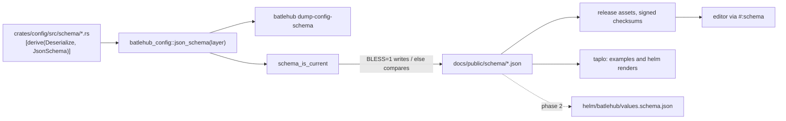
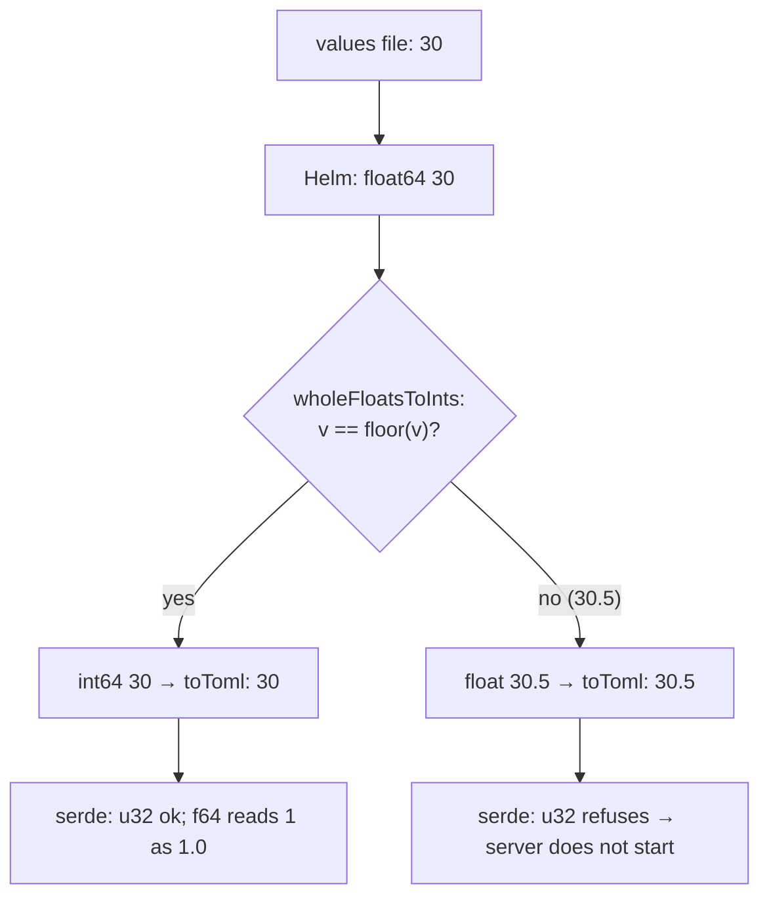
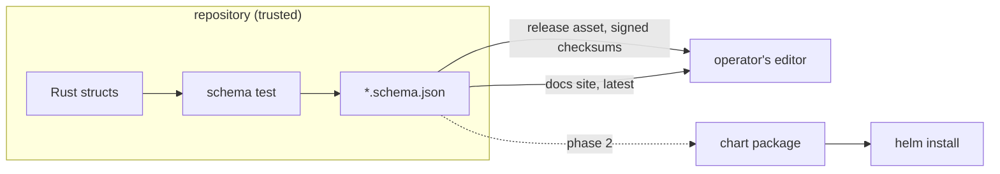

# RFC 0049 — Config JSON Schema

| Field       | Value                                                        |
| ----------- | ------------------------------------------------------------ |
| Status      | Draft                                                         |
| Short       | Config JSON Schema                                            |
| Settles     | How the config schema is published for editors and for Helm, and why the chart needs no list of integer fields |
| Author      | Max Batleforc <maxleriche.60@gmail.com>                       |
| Co-author   | Claude Opus 5.5 <noreply@anthropic.com>                       |
| Created     | 2026-11-14                                                    |
| Supersedes  | —                                                             |
| Touches     | `crates/config` (derive, `json_schema()`, a schema test), `crates/core` (derive on the 17 config types it owns), `server` (`dump-config-schema`), `helm/batlehub` (phase 0 `_helpers.tpl`, `ci/values-integers.yaml`; phase 2 `values.schema.json`), `.tasks/docs.yaml`, `.tasks/helm.yaml`, `.github/workflows` (`test.yaml` path filter, `helm-lint.yaml`, the release workflow's assets), docs (`docs/public/schema/`, `docs/guide/configuration.md` and its `docs/fr/` twin, `docs/guide/install/helm.md`, `docs/contributing/testing.md`), `CLAUDE.md`, `CHANGELOG.md` |
| Risk        | Low                                                           |

---

## 1. Summary

The server derives a JSON Schema from the Rust structs it deserializes its
config into, commits it under `docs/public/schema/`, and attaches it to each
release. An operator adds one `#:schema` line to `config.toml` and the editor
completes keys and flags a mistyped one as they type. Phase 2 embeds the same
schema in the Helm chart's `values.schema.json`, so `helm install` refuses a
mistyped `config:` key before anything is deployed.

This RFC began as a way to generate the chart's list of integer fields from
the schema (§2.1). The review found that list unnecessary: serde reads an
integer into an `f64`, so the chart can turn *every* float with no fractional
part into an integer, with no list at all. That is phase 0, which ships on
its own (§15 question 1).

### Before / after

```text
# today (main)
values.yaml   config.audit.access_retention_days: 30
config.toml   access_retention_days = 30.0     → the server refuses to start

# phase 0 (phase 0)
config.toml   access_retention_days = 30       every whole float, any key
config.toml   access_retention_days = 30.5     left alone; the server refuses it

# phase 1, in the editor
#:schema https://github.com/batlehub/batlehub/releases/download/v1.11.0/config.schema.json
[audit]
acess_retention_days = 30    # flagged before the server ever reads the file
```

---

## 2. Motivation

1. **The chart's integer list fell behind the structs, and the failure was a
   server that does not start.** `batlehub.config` in
   `helm/batlehub/templates/_helpers.tpl` converted 19 field positions; the
   structs in `crates/config/src/schema/` have 77 (a struct reused under
   `registries[]` and `namespaces[]` counted per position). weebo-si carried
   a `--set` workaround in Argo CD for `audit.*`. *Settled by phase 0 without
   the schema* (§15 question 1).
2. **An operator edits `config.toml` blind.** 77 structs and 14 enums in
   `crates/config/src/schema`, plus 17 types from `crates/core`; tagged enums
   (`type = "…"` on auth, scanners, rules, notification channels);
   `deny_unknown_fields` on 10 structs. A typo is found at load, by a server
   that refuses to start or a reload that is refused. No editor can check the
   file beforehand.
3. **A Helm user finds a typo in `config:` only in the pod's log.** The chart
   renders any key it is given; a misspelt key is either refused at startup
   (under `deny_unknown_fields`) or silently ignored (everywhere else).
4. **The docs restate fields by hand.** `config.example*.toml`, the registry
   pages and the chart's values comments each list fields. This RFC checks
   the example files and the chart's rendered examples; the docs pages stay a
   non-goal (§3), so this motivation is only partly addressed.

---

## 3. Goals / non-goals

**Goals**

- A JSON Schema of `AppConfig`, generated from the structs, committed, and
  attached to each release; a second, *layer* variant for files that hold
  part of the config.
- `batlehub dump-config-schema`: the schema of the exact binary.
- A drift gate in `cargo test`, and the shipped examples validated against
  the schema by a real client (taplo).
- Phase 2: `values.schema.json`, so a mistyped `config:` key fails
  `helm install`.

**Non-goals**

- **A schema that proves a config loads.** `AppConfig::validate()` holds
  cross-field rules (RFC 0015 §4.9, the `min_age_secs` floor of RFC 0018 §4.3)
  JSON Schema cannot express, and `required` only holds after the layers
  merge; `explain-config` stays the authority.
- **Catching `30.0` in the editor.** JSON Schema's `integer` accepts a float
  with no fraction (§6.P observation 4); phase 0 is what fixes that defect.
- **Generating the chart's integer list from the schema.** Phase 0 needs no
  list (§15 question 1).
- **Checking the TOML in `docs/registries/*` and the values comments.** A
  docs-wide extractor is its own work; §2.4 stays partly open.
- **Defaults of struct-valued fields in hovers.** schemars writes a
  `default` when the field's type implements `Serialize`: primitives get one
  (`access_retention_days` shows `0`), config structs do not, and deriving
  `Serialize` on every struct for hovers is not worth it.
- **`RELOAD_KEYS`, the CLI's own config, SchemaStore registration.** Other
  readers, other files; `config.toml` is not a name we own.

---

## 4. User-facing design

### 4.1 Configuration

No configuration key is added. The visible surface:

- **`config.schema.json`** — every key, `required` where serde requires it.
  For the first `--config` layer, or a single file.
- **`config-layer.schema.json`** — the same with every `required` removed at
  every depth except an enum's tag. For a credentials layer or any overlay, which is partial by
  design (`load_layered_text` deserializes once, after the merge,
  `crates/config/src/lib.rs:178`).
- Both are committed under `docs/public/schema/`, attached to each GitHub
  release beside the SBOMs and inside its signed `checksums`, and printed by
  `batlehub dump-config-schema [--layer]`.
- The documented `#:schema` URL is the **release asset of the version the
  operator runs**. `https://batlehub.dev/schema/config.schema.json` exists and is
  labelled *latest (main)*: an older binary paired with it accepts keys that
  binary ignores (§10.2).
- `config.example*.toml` gain a `#:schema` line naming the *latest* URL:
  they track `main`, which is that schema.

Absent `#:schema`, nothing changes. The console's config editor and editing
`values.yaml` get no completion from phase 1; phase 2 gives
yaml-language-server users completion under `config:` through
`values.schema.json`.

### 4.2 Behaviour rules

- **The schema follows serde.** `rename_all`, `tag`, `default`,
  `deny_unknown_fields`, `flatten` and `untagged` are what schemars reads; a
  field with `#[serde(default)]` is not `required`.
- **`additionalProperties: false` exactly where the server has
  `deny_unknown_fields`.** Elsewhere the server accepts an unknown key, so
  the schema does too; tightening that is a server change.
- **TOML has no null.** schemars writes `Option<T>` as
  `"type": ["integer","null"]` or `anyOf: [{$ref}, {type: null}]`; a
  post-pass removes the `null` arm. A null cannot be written in TOML, and the
  arm turns a typo's diagnostic into *"not valid under any of the schemas
  listed in the 'anyOf' keyword"* (§6.P observation 5).
- **A `$ref` beside validation keywords becomes an `allOf`.** schemars
  writes a tagged enum's newtype variant as `$ref` plus the tag's
  `properties`; taplo, like every draft-07 validator, ignores keywords beside
  a `$ref`, so the tag vanished and every `oneOf` matched several variants.
  Found by the first `taplo check` of `config.example.toml` (§6.P
  observation 9).
- **The layer variant keeps an enum's tag required.** Every other
  `required` goes; a rule a layer adds must still say which variant it is,
  or serde cannot read it.
- **No `$id`.** Every `$ref` is `#/$defs/…`, local to the document, so a
  downloaded copy never resolves against a remote one.
- **`${VAR}` placeholders.** `expand_env_vars_with` runs on the text before
  the parse (`crates/config/src/lib.rs:44`); a placeholder inside a string
  validates as a string, and an unquoted `${PORT}` was never valid TOML for
  an editor.
- **Phase 0, in the chart.** Every float64 whose value equals its `floor` is
  set to an int64, in maps and lists at any depth, in `config` and
  `credentials.config`. Nothing else is touched.

### 4.3 Validation

| Condition | Caught by | Says |
| --- | --- | --- |
| `docs/public/schema/*.json` differs from `json_schema()` | `schema_is_current` (`cargo test`) | the two file names and `task docs:config-schema` |
| a `config.example*.toml` fails `config.schema.json` | `task docs:config-schema:check` (taplo) | taplo's diagnostic, file and line |
| a `deploy/helm` render fails `config-layer.schema.json` | `task helm:examples` (taplo) | the values file, then taplo's diagnostic |
| phase 2: `values.schema.json` differs from the generated one | `schema_is_current` | the file and the task |

There are no warnings. Only the drift rows are fixed by regenerating; an
example that fails is fixed in the example or in the derive.

### 4.4 API surface

No HTTP route; the schema is a static file and a subcommand, never served by
the server (§7.1).

### 4.5 Mocks

M2 and M3 are **proposed** output; M1 was run (observation 10), M4 and M5
quote taplo 0.10.0.

**M1 — the subcommand.**

```text
$ batlehub dump-config-schema > config.schema.json; echo $?
0
$ batlehub dump-config-schema --layer > config-layer.schema.json; echo $?
0
```

It decides that the output is the bare document on stdout, byte-identical to
the committed file. Output is written with the same serializer as the test
(pretty, trailing newline), and a closed pipe ends it with exit 0, not the
`println!` panic `dump-spec` would give (`server/src/main.rs:141`).

**M2 — drift, a field added without regenerating.**

```text
---- schema_is_current stdout ----
docs/public/schema/config.schema.json and config-layer.schema.json are out of
date with crates/config/src/schema — run `task docs:config-schema` and commit both
test result: FAILED. 0 passed; 1 failed
```

**M3 — an example that no longer validates** (a renamed field):

```text
$ task docs:config-schema:check
config.example-s3.toml: does not validate against config.schema.json
error: Additional properties are not allowed ('max_connections' was unexpected)
  ┌─ config.example-s3.toml:14:1
task: Failed to run task "docs:config-schema:check": exit status 1
```

**M4 — the editor, a typo** (taplo 0.10.0's own text, §6.P observation 3):

```text
error: Additional properties are not allowed ('acess_retention_days' was unexpected)
  ┌─ config.toml:4:24
4 │ acess_retention_days = 3
```

**M5 — the same typo without the null post-pass** (observation 5): `… is not
valid under any of the schemas listed in the 'anyOf' keyword`. It is what
§4.2's rule removes.

**M6 — phase 2, `helm install`** with the typo under `config.audit`: Helm's
schema error naming `/config/audit` and the unexpected key, exit non-zero,
nothing rendered. To be quoted from Helm v4.3.1 and the oldest Helm in §15
question 5 before *In review*.

---

## 5. Architecture

### 5.1 One source, the files it produces



It shows that every published copy comes from the function serde's derive
sits beside, so a field cannot be deserialized without being in the schema.

### 5.2 Phase 0, where the float goes



**Invariant.** Because serde accepts an integer for an `f64` and refuses a
float for an integer type, converting every whole float is correct for every
field the config has or will have, so the chart holds no per-field knowledge
that can fall behind the structs.

---

## 6. Detailed design

### 6.0 Phase 0, `helm/batlehub` (this branch)

`batlehub.wholeFloatsToInts` recurses through maps, rebuilds lists (a
template cannot assign to a list element) and sets every whole float64 to an
int64; `batlehub.config` and `batlehub.credentialsConfig` both call it. The
seven `deploy/helm` examples and the default values render byte-identical to
main; `helm-lint.yaml`'s *Integer fields render as integers* step renders
`ci/values-integers.yaml` (every shape: tables, lists of tables, the
`scanners` map, `trigger_on_status`, the credentials layer) and fails on any
`= N.0`. It fails on main with 51 lines.

### 6.1 `crates/config` and `crates/core`

- `schemars = "1.2"` (feature `chrono04`, for `GrantsShadowConfig::until`,
  `src/schema/registry.rs:40`) and `serde_json` as direct dependencies of
  `batlehub-config`; `#[derive(JsonSchema)]` beside every `Deserialize` under
  `src/schema/`.
- `MiseBackendConfig::Full { options: toml::Table }`
  (`src/schema/mise_auto_wire.rs:84`) takes
  `#[schemars(with = "serde_json::Map<String, serde_json::Value>")]`:
  `toml::Table` has no `JsonSchema`.
- `crates/core` owns 17 embedded types: the auth ports (`OidcAuthConfig`,
  `KubernetesAuthConfig`, `ActionsOidcAuthConfig`, `ActionsGroupRule`,
  `Condition`, `ConditionMatchType`, `RuleMatch`), `S3StorageConfig`,
  `Severity`, `FindingKind`, `InstallHookMode`, `ScannerErrorMode`,
  `SecurityMode`, `Visibility`, `Immutable`, `GalaxyRoleMode`,
  `helm::HybridMerge`, `helm::OciEntries`. They derive through
  `#[cfg_attr(feature = "schema", derive(schemars::JsonSchema))]`; only
  `batlehub-config` enables `schema`. In the main workspace feature
  unification turns it on everywhere config is built (`crates/examples`
  included); what it buys is the separate `fuzz/` workspace, which never
  compiles schemars and whose `Cargo.lock` does not change (checked with
  `cargo metadata --locked`).
- `pub fn json_schema(layer: bool) -> serde_json::Value`: `schema_for!`,
  then the null-arm post-pass (§4.2), then, for `layer`, `required` removed
  recursively. `$id` is never set.

### 6.2 `server`

`Command::DumpConfigSchema { layer: bool }` beside `Command::DumpSpec`
(`server/src/main.rs:117`), writing through the shared serializer and
treating `BrokenPipe` as success (M1). It reads no config and no database;
`run_subcommand` runs before any config is loaded.

### 6.3 `crates/config/tests/config_schema.rs`

`schema_is_current` compares the two committed files with
`json_schema(false)` / `json_schema(true)` as parsed `serde_json::Value`s, so
key order cannot make it flaky whatever `preserve_order` feature unification
brings. `BLESS=1` (the value `1`, not any value, unlike
`reload_keys.rs:482`) rewrites them. Phase 2 adds `values.schema.json`.

### 6.4 `.tasks/docs.yaml`, `.tasks/helm.yaml`, CI

- `docs:config-schema` runs the `BLESS=1` test; `docs:config-schema:check`
  runs `taplo check --schema` on every `config.example*.toml` against
  `config.schema.json` (M3). taplo is pinned in `mise.toml`.
- `helm:examples` adds a taplo check of each rendered `config.toml` against
  `config-layer.schema.json`: a first layer may leave `database.url` to the
  credentials Secret (`deploy/helm/values-external-secrets.yaml`), so only
  types and unknown keys are checked there.
- The taplo check runs as a step of `helm-lint.yaml`'s `lint` job (taplo
  through `jdx/mise-action`, helm already there), whose gate paths gain
  `deploy/helm/**`, `config.example*.toml` and `docs/public/schema/**`: a new
  workflow would be a new required check for the ruleset.
- `test.yaml`'s path filter gains `docs/public/schema/**` (and, in phase 2,
  `helm/batlehub/values.schema.json`), so a hand edit to a generated file
  still runs the drift test (it lists `docs/guide/hot-reload.md` for the same
  reason today).
- The release workflow (`build.yaml`'s `server` job) dumps both files from
  the shipped binary and attaches them; the `checksums` job already hashes
  every asset.
  `version:set` does nothing new: the PR gate keeps the files current.

### 6.5 Phase 2, `helm/batlehub/values.schema.json`

Generated by the same test from `json_schema(true)`: its `$defs` move to the
root of `values.schema.json`, `$schema` is stripped from the embedded copy,
and `properties.config` and `properties.credentials.properties.config` both
`$ref` the one embedded root. Both use the **layer** variant: `required` is a
property of the merged config, and either half may hold any part of it.
Every other value stays unconstrained. Gates before it lands: the default
values, the seven `deploy/helm` files and the documented credentials example
(`values.yaml:337-347`) pass on Helm v4.3.1 and on the oldest Helm the docs
support (§15 question 5).

### 6.6 Docs

`docs/guide/configuration.md` (and `docs/fr/`) gains *Editor support*: the
`#:schema` line with the release URL, which file for which layer, the
subcommand, the `30.0` limit, and that this JSON Schema is unrelated to
`config_version`. `docs/contributing/testing.md` gains the
`task docs:config-schema` line; `CLAUDE.md` one sentence under *Config
loading*; `docs/guide/install/helm.md` the minimum Helm version and the skip
options once phase 2 lands.

### 6.P Proof against a real client

The consumers are taplo 0.10.0 (`mise x taplo@0.10.0 -- taplo check`, the
engine of Even Better TOML), Helm v4.3.1, and the server's `explain-config`.

Run on 2026-11-14 against a **hand-written one-property schema** (`audit`
as a plain object, `access_retention_days` `uint32`,
`additionalProperties: false`), so 1 to 4 prove taplo's behaviour, not
schemars' output:

1. `access_retention_days = 30` — exit 0.
2. `= 30.5` and `= "30"` — exit 1, `30.5 is not of type "integer"`,
   `"30" is not of type "integer"`.
3. **Refusal:** `acess_retention_days = 3` — exit 1, `Additional properties
   are not allowed ('acess_retention_days' was unexpected)` at line 4 (M4).
4. **Limit:** `access_retention_days = 30.0` — exit 0: JSON Schema's
   `integer` admits a whole float.
5. Re-run by review with `audit` as schemars writes an `Option`
   (`anyOf: [$ref, null]`): the typo gives `… is not valid under any of the
   schemas listed in the 'anyOf' keyword` (M5), which §4.2's post-pass exists
   to avoid.

Phase 0, run 2026-11-14 with Helm v4.3.1:

6. `helm template -f ci/values-integers.yaml`: no `= N.0` line in either
   rendered file; the same step against main's chart fails with 51.
7. `access_retention_days: 30.5` renders `30.5`; `outage_ratio: 1.0` renders
   `1`; nested `[[1, 2.5], [3]]` renders unchanged.

Phase 1, run 2026-11-14 on this branch:

8. **Refusal, the generated schema:** `config.example.toml` with
   `acess_retention_days = 3` appended under `[audit]` and a local
   `#:schema ./config.schema.json` — exit 1, `Additional properties are not
   allowed ('acess_retention_days' was unexpected)` at line 1113, the typo's
   line, through `$defs`/`$ref` and the null post-pass; nothing remote is
   named, since the document has no `$id`. A mistyped tag (`type = "tokn"`)
   exits 1 with the generic *valid under more than one of the schemas*.
9. The first `taplo check` of the three `config.example*.toml` refused all
   three: every tagged enum entry was *valid under more than one of the
   schemas listed in the 'oneOf' keyword*, because taplo ignores keywords
   beside a `$ref` (§4.2). After the `allOf` post-pass: all three, the seven
   `deploy/helm` renders and both files of `ci/values-integers.yaml` exit 0
   (`task docs:config-schema:check`). The same run caught two errors in the
   fixture (`type` for the rules' `kind` tag, `name` for a namespace's
   `match`), and the first layer variant, which dropped the tags, refused the
   corrected rules the same way; it now keeps them.
10. `batlehub dump-config-schema` and `--layer` are byte-identical to the
    committed files; `| head -3` exits 0 with no panic.

To produce before phase 2 moves past *Draft*:

11. **Refusal, phase 2 (M6):** the typo under `config.audit` fails
    `helm template` on Helm v4.3.1 and the oldest supported Helm, and the
    default values and the documented credentials layer do **not** fail.

`ci/values-integers.yaml` is not loaded by `explain-config`: its one registry
carries fields of several kinds (`refs` of a forge, `pending_nar_ttl_secs` of
nix), which `validate()` rightly refuses together. The seven `deploy/helm`
files are what `task helm:examples` loads.

### 6.N Heavy coverage

No `tests/heavy` suite applies: no package manager or network client reads
the schema, and the server's behaviour on the wire does not change. The
consumers are an editor and Helm, and §6.P runs both directly. The regression
signal is `schema_is_current`, `task docs:config-schema:check`,
`task helm:examples` and `helm-lint.yaml`.

**Deliberately untouched**, so reviewers do not go looking:

- `AppConfig::validate()` — §3.
- `crates/config/src/reload_keys.rs` — §3.
- `ui/openapi.json` and the generated client — the config editor posts TOML
  text; no DTO changes.

---

## 7. Security

**Rating: Low.** No route, no runtime input, no secret. The new surfaces are
build-time files, a subcommand reading nothing, and documents derived from
public source.

### 7.1 Threat model



| STRIDE | Threat | Mitigation and enforcement | Residual |
| --- | --- | --- | --- |
| Tampering | Hand edit of a generated file in a PR | `schema_is_current`; the path filter of §6.4 makes it run on such a PR; `BLESS` only on `1` | none |
| Tampering | A compromised docs host serves a schema whose descriptions suggest insecure values | documented URL is the release asset, in the signed `checksums`; `dump-config-schema` for offline | the *latest* URL; owner: docs |
| Information disclosure | Doc comments become `description` strings | the source is public (Apache-2.0); review found only placeholder hosts | accepted |
| Denial of service | Phase 2 schema refuses a valid install | layer variant for both halves; gates of §6.5; skip options documented | a key the server accepts and the schema forbids; owner: chart |
| Tampering | Phase 0 changes a value in an opaque map | only whole floats change; `mise` backend `options` is the one opaque table, and a version there must already be quoted or YAML mangles it | accepted |

### 7.2 Authentication and authorisation

None: the subcommand runs as the local user and reads nothing.

### 7.3 Input handling and injection

The generator writes no template text (the walker of the draft is gone), and
the schema is never parsed by the server. Phase 0's helper reads values the
chart already renders verbatim.

### 7.4 Secrets and cryptography

None. schemars emits a `default` only where the field's type implements
`Serialize` (primitives, strings), and every secret-bearing field is an
`Option` without default or a required field (checked by review: `seal_signing_key`, `erasure_key`,
`smtp_password`, `SignedUrlsConfig.secret`, Bearer/Basic credentials).

### 7.5 Abuse and resource exhaustion

None at runtime. Phase 0 recurses over values the operator wrote.

### 7.6 Existing defences that still hold

serde's `deny_unknown_fields` and `AppConfig::validate()` still decide what
loads; the schema adds an earlier check, never replaces one.

---

## 8. Supply chain

| Dependency | Version | Kind | Licence | Status |
| --- | --- | --- | --- | --- |
| `schemars` (+ `schemars_derive` 1.2.3, `serde_derive_internals` 0.30.0, `dyn-clone` 1.0.20, `ref-cast`/`ref-cast-impl` 1.0.27) | 1.2.3 | runtime, `batlehub-config`; optional in `core` | MIT (all six; `ref-cast`, `dyn-clone`, `serde_derive_internals` MIT OR Apache-2.0) | `cargo deny check`: advisories, bans, licenses, sources ok (2026-11-14) |
| taplo | 0.10.0 | dev tool, pinned in `mise.toml` | MIT | used by the tasks of §6.4; no Rust dependency |

The `jsonschema` crate was considered for validating examples and dropped:
its default `resolve-http` would fetch remote `$ref`s and pull a second
`reqwest`, and `deny.toml` has `multiple-versions = "deny"`. taplo is also
the real client, which is what the proof should run. No image changes; the
release workflow gains two assets.

---

## 9. Data and privacy

No new datum: the schema describes field names and types and holds no value
from any deployment.

---

## 10. Operability

### 10.1 Observability

No metric, log or audit event: nothing runs in the server process except
the subcommand, which exits.

### 10.2 Failure modes

| Failure | Detected by | Behaviour | Recovery |
| --- | --- | --- | --- |
| Field added, not regenerated | `schema_is_current` (M2) | PR red | `task docs:config-schema` |
| Example stops validating | `docs:config-schema:check` (M3) | PR red | fix the example or the derive |
| Editor on the *latest* URL, binary older | nothing | a key that binary ignores validates green: **fails open** | the release URL, which the docs give by default |
| Docs site or GitHub down | editor | no validation; the server is unaffected | `dump-config-schema` to a local path |
| Editor cached an older schema | editor | stale diagnostics until the cache expires | *Editor support* says how to refresh |
| Phase 2 refuses existing values | `helm install`, Argo CD | install refused; in Argo a ComparisonError, auto-sync stops, running pods unaffected | the skip option (§15 question 5) or the previous chart |
| Phase 0 regresses | `helm-lint.yaml` step | the server refuses `N.0`: fails closed | — |

### 10.3 Performance and capacity

The schema size and the derive's compile-time cost are measured in the
phase 1 PR (CI timing against main). Phase 0 adds one walk over the values at
render time.

---

## 11. Other concerns

- **Accessibility**: no UI; diagnostics are the editor's.
- **Internationalisation**: field names are the config's own; *Editor
  support* has its `docs/fr` twin.
- **Compliance**: a published, machine-checked schema is evidence for RFC
  0036's secure-configuration line (CRA); that matrix gains the reference.
- **Licensing**: schemars and taplo are MIT, in policy; the published schema
  is Apache-2.0 like its source.
- **Documentation**: §6.6, the CHANGELOG.
- **Deprecation**: none; phase 2 is the first point a `helm install` can
  refuse a values file that installs today, and its CHANGELOG entry says so
  with the skip options.

---

## 12. Alternatives considered

| Alternative | Why rejected |
| --- | --- |
| Keep a hand list of integer fields (the first fix) | it is the state that missed 58 of 77; phase 0 needs none |
| Generate the integer list from the schema (this RFC's draft) | correct but a walker over every schemars shape (type arrays, `allOf` from `flatten`, `$ref` with siblings) to compute what one `floor` comparison decides |
| Accept a whole float for an integer in the server's loader | fixes every templater, but makes the server accept `port = 8080.0` from a hand-written file; the float is Helm's doing, so the fix sits in the chart |
| Config as a raw TOML string in values (`externalManifest`) | already possible, and loses per-key overrides, which is how weebo-si sets values |
| Generate at release time only | a field added mid-cycle is wrong on main until the release; the PR gate is earlier |
| Write the schema by hand | a third copy of the structs |
| Serve the schema from the server | a route on every instance for a build-time artifact |
| `utoipa` instead of `schemars` | already a dependency (no new crates), but measured worse on the config's shapes; §15 question 4 |

---

## 13. Rollout and compatibility

- **Default behaviour**: phase 0 renders byte-identical output for every
  value it did not already break; phases 1 and 2 are opt-in or validation
  only.
- **Config migration**: none; `CURRENT_CONFIG_VERSION` does not move.
- **Operator prerequisites**: an editor with taplo support; for phase 2, the
  minimum Helm version of §15 question 5.
- **Rollback**: revert; nothing is persisted. Phase 2 reverts alone, and a
  consumer can skip schema validation per install.

---

## 14. Test plan

- **Unit**: `json_schema` post-pass (no `null` arm left; `layer` has no
  `required` at any depth; no `$id`).
- **Integration**: `schema_is_current` (§6.3).
- **Real client**: `docs:config-schema:check` and `helm:examples` (taplo),
  `helm-lint.yaml` (phase 0, and in phase 2 the documented credentials layer
  and default values must render).
- **Negative, per §7.1 row**: a hand-edited generated file is red (row 1);
  the release asset is in `checksums` (row 2, the release workflow's own
  check); the layer-variant renders of §6.5 (row 4); observation 7 (row 5).
- **Heavy**: none, §6.N.
- **Existing suites** unchanged: `task helm:examples`, `helm-lint.yaml`,
  `cargo test --workspace`, `task helm:docs:check`, `task fuzz:check`.

---

## 15. Decisions and open questions

### Resolved

| # | Question | Decision |
| --- | --- | --- |
| 1 | Does the chart need a list of integer fields? | **No: every whole float becomes an int64 (phase 0).** The draft, and the brief that asked for this RFC, assumed a generic pass would break the `f64` fields; probed with toml 1.2.0, serde reads `r = 1` into an `f64` and refuses `n = 30.0` for a `u32`. Decided by the user against the draft's design. |
| 2 | Where does the drift gate run? | **On every PR, in `cargo test`, with the path filter widened.** A release gate is too late for deploys from main. |
| 3 | Which URL do the docs give? | **The release asset of the running version.** The *latest* URL fails open on version skew (§10.2). |
| 6 | Validate examples with the `jsonschema` crate or taplo? | **taplo.** The real client; the crate would pull a second `reqwest` past `multiple-versions = "deny"`. |
| 7 | Which schema does Helm validate `config` and `credentials.config` against? | **The layer variant, for both.** `required` holds only after the merge; the full schema refused the chart's default `credentials.config: {}`. |
| 8 | Should `version:set` regenerate? | **No.** The PR gate keeps the files current; a release cut should not rewrite them. |
| 4 | `schemars` or `utoipa`? | **schemars.** Spiked on the config's own shapes (2026-11-14): utoipa 6 writes an `untagged` enum as `oneOf` (wrong when two variants accept one value), a `u16` as `int32` with no maximum, and references into `#/components/schemas` to be reassembled by hand; schemars writes `anyOf`, `uint16` with `maximum`, and a self-contained `$defs` document. |

### Still open

5. **Minimum Helm version and the Argo CD escape for phase 2.** Helm v4.3.1
   is the only version probed; the docs say "Helm 3+", the validator
   changed across Helm 3 minors, and `--skip-schema-validation` is a CLI
   flag. Recommendation: probe the oldest Helm 3 still supported and the Helm
   bundled by weebo-si's Argo CD, state the minimum in `Chart.yaml`, and name
   the Application field that skips validation, or say none exists, before
   phase 2 moves past *Draft*.

---

## 16. Implementation phases

| Phase | Content |
| --- | --- |
| 0 | phase 0: `batlehub.wholeFloatsToInts`, the `helm-lint.yaml` step, the `audit` block in `values.yaml`. Ships alone. |
| 1 | The derive, `json_schema(layer)`, `dump-config-schema`, the two committed files, `schema_is_current`, the taplo tasks, the path filter, the release assets, *Editor support*. Useful alone. |
| 2 | `values.schema.json` with the layer variant, after question 5. |
