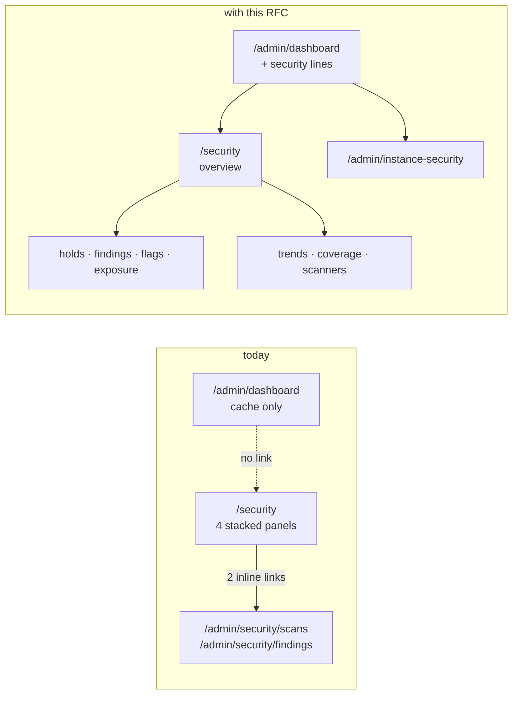
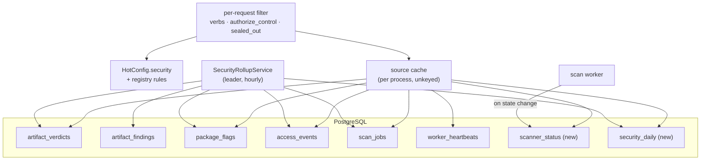
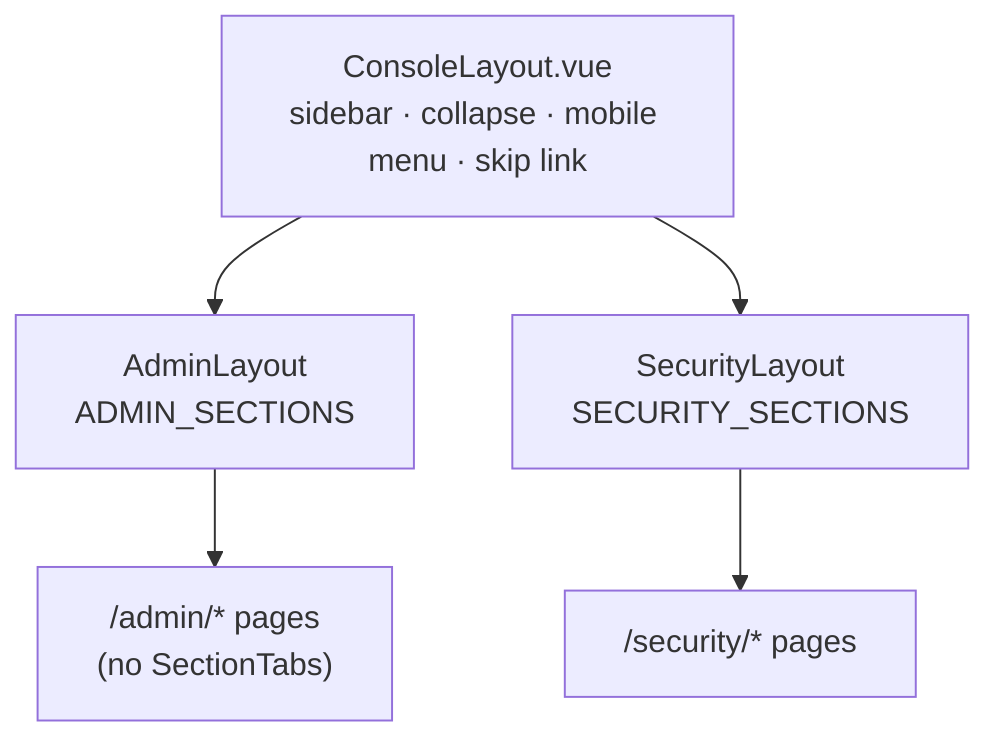
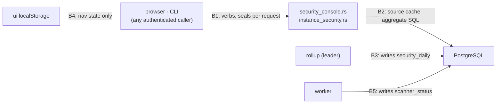

# RFC 0050 — Security console completion and admin navigation

| Field       | Value                                                        |
| ----------- | ------------------------------------------------------------ |
| Status      | Accepted                                                      |
| Short       | Security console and admin nav                                |
| Settles     | What the security console shows beyond today's four panels — summary, trends, coverage, scanner and worker health — where it lives, how instance security reaches the admin, and how the admin shell navigates |
| Author      | Max Batleforc <maxleriche.60@gmail.com>                       |
| Co-author   | Claude Opus 5.5 <noreply@anthropic.com>                       |
| Created     | 2026-11-16                                                    |
| Supersedes  | —                                                             |
| Touches     | `crates/core` (`services/security_overview.rs` new, `services/security_rollup.rs` new, `ports/security_daily.rs` new, `ports/security.rs` `ScannerStatusRepository` + `ScanQueue::workers` with a default body, `services/scan_worker.rs`), `crates/adapters` (`migrations/070_scanner_status.sql`, `071_security_daily.sql`, `migrations.rs`, `db/security.rs`, `db/security_daily.rs` new, `in_memory/security_daily.rs` new, `in_memory/scanner_status.rs` new, `vulnerability/osv.rs`), `crates/config` (`schema/mod.rs` `StatsConfig`, `schema/server.rs` `read_cache` doc, `schema/warnings.rs`), `crates/web` (`handlers/security_console.rs` new, `handlers/back_office/instance_security.rs` new, `lib.rs`, `tests/security_console.rs` new, `tests/common/mod.rs`), `server/src` (`main.rs`, `watcher.rs`), `cli` (`cli/security.rs` new, `api/security.rs`), `ui` (`layouts/ConsoleLayout.vue` new, `layouts/AdminLayout.vue`, `layouts/SecurityLayout.vue` new, `components/admin/SectionTabs.vue` removed with its 20 page call sites and 23 test files, `components/admin/RegistryScopedList.vue`, `config/adminSections.ts`, `config/securitySections.ts` new, `config/navigation.ts`, `config/redPaths.ts`, `config/verdict.ts`, `lib/palette.ts`, `router/index.ts`, `composables/usePoll.ts`, `pages/security/*` new, `pages/Admin*.vue`, `components/admin/*Panel.vue`, `components/admin/StatsTrendChart.vue`, `build/design-routes.mjs`, `locales/{en,fr}.json`, `openapi.json`, `client/`), `helm/batlehub/values.schema.json`, `ci/values-integers.yaml`, `docs/public/schema/config*.schema.json`, `perf/profile_routes.txt`, `tests/heavy/{authz.sh,console_fetch.sh,console_security.mjs}`, `PRODUCT.md`, docs (`guide/security-gates.md`, `guide/administration.md`, `guide/admin-access.md`, French twins) |
| Risk        | medium — §7 (new aggregate reads over security data and IP addresses, delegated to non-admin groups) |

---

## 1. Summary

The security console of RFC 0042 is one page, `/security`, outside the admin
shell, with four stacked panels and two links into `/admin/security/*`. It
shows the present and nothing else: no history, no view of which registries are
protected at all, no sign of whether the scanners and the worker are running,
and nothing at its top that says whether anything is wrong. The admin shell,
meanwhile, repeats its sidebar as tabs on twenty pages, never collapses, and its
dashboard reports *"All 3 registries are answering"* while versions are held
for malware.

This RFC turns `/security` into a **space of its own** — a sidebar with an
overview and seven pages — opened on a **summary**, and adds **trends** (a daily
rollup), a **coverage** view (summary and per registry), and **scanner and
worker health** with the remaining scan queue. Security of the *instance*
(failed sign-ins, IP bans, tokens seen from a new source, plain-text static
tokens, expiring exemptions, the security config warnings) becomes an **admin
section**. The admin shell loses its top tabs, its sidebar groups collapse and
remember their state, and every admin and security page goes through the
Impeccable verdicts of §6.7.

### Before / after

```text
# today
/security                 one page: Holds · Findings (drawer) · Flags · Exposure
/admin/security/scans     Scans + tabs [Scans | Findings]   ← tabs repeat the sidebar
/admin/security/findings  Findings + the same tabs
/admin/dashboard          "All 3 registries are answering."  (13 versions held)

# with this RFC
/security                 Overview: status strip + "needs a decision"
/security/holds  /security/findings  /security/flags  /security/exposure
/security/trends  /security/coverage[/:registry]  /security/scanners
/admin/instance-security  failed sign-ins · bans · token sources · warnings
/admin/*                  no tabs; sidebar groups collapse, state remembered
/admin/dashboard          + security lines (holds, flags, scanners, config)
```



The diagram shows the one thing that changes for a reader arriving with a
question: every security fact is one click from a page that says whether
something is wrong, and nothing is reached only by scrolling to the bottom of
another page.

---

## 2. Motivation

1. **Nothing says whether anything is wrong.** `AdminDashboard.vue` reads only
   `adminStats` and `registryHealth`. With the demo seed used for the critique
   (30 versions over three registries; the counts below are that seed's, not a
   fixture's) its first line is *"All 3 registries are answering."* while `GET
   /api/v1/admin/verdicts/summary` reports 5 denied and 3 quarantined versions
   on `npm-public` alone, 13 held across the three. On `/security`, the fact
   *"CVE scan never ran"* is the last line of the Exposure panel's coverage
   block (`ExposurePanel.vue`), below four tables. PRODUCT.md principle 1 —
   *"the UI is for the moments it isn't [boring]"* — fails on both landing pages.
2. **No history.** `artifact_verdicts` and `artifact_findings` are overwritten
   per version (`db/security.rs:168-176`, `:197`); `batlehub_verdict_transitions_total`
   is a counter only (`services/verdict.rs:481`). The only persisted rollup,
   `stats_history` (migration `031`), carries cache hits and bytes and, by its
   own port's comment, *"no principal and no coordinate"*
   (`ports/stats_history.rs:18-34`). An operator cannot say whether holds are
   rising, or whether last week's refusals stopped.
3. **No view of coverage.** A registry without `[security]` is simply absent
   from `HotConfig.security` (`services/hot_config.rs:503`). The only place that
   counts it is `ExposureCoverage.security_profiles` (`back_office/exposure.rs:117-140`),
   a number, not the names. There is no list of registries with their mode,
   scanners, `cve_gate`/`license_gate` rules and scan progress.
4. **Scanner and worker health is invisible to the console.** `ScanQueue::queued()`
   (`db/security.rs:923-948`) and `worker_heartbeats` (`052`) feed gauges only
   (`scan_worker.rs:167-182`, `server/src/main.rs:464-467`); the OSV breaker
   (`vulnerability/osv.rs:23-88`) is an in-memory value per scanner instance and
   emits nothing. `GET /api/v1/admin/scans` lists jobs, not whether a worker is
   alive or a scanner failing. The startup log line *"no worker has sent a
   heartbeat in the last two minutes"* is the only place an operator learns that
   every new version will stay held.
5. **Instance security has no home.** Failed sign-ins exist as
   `credential_rejected`/`sign_in_failed` audit rows (`access_log.rs:230-288`)
   and as `batlehub_auth_failures_total`; auto-bans as `block_ip` rows; a token
   used from a new address as `token_new_source` (`auth/user_token.rs:169-182`).
   No page reads any of them except the raw audit log. Eighteen config warnings
   are security warnings (listed in §6.4), shown only under System →
   Configuration. A plain-text static token is accepted with **no signal at
   all** (`auth/token.rs:58-80`; no warning code).
6. **The admin shell repeats itself.** `SectionTabs.vue` renders, from the same
   `ADMIN_SECTIONS` table (`config/adminSections.ts:163-172`), the links the
   sidebar already shows two hundred pixels to the left; twenty pages place it
   by hand (`AdminHealth.vue:164`, `AdminScans.vue:244`, …) and two more through
   `RegistryScopedList.vue:70`. The sidebar's 23 links in six groups are always
   expanded (`AdminLayout.vue:115-158`); a keyboard user tabs through all of
   them and then the tabs before reaching content.
7. **One visible defect hides behind a cast.** `AuthzDenialsPanel.vue:37`
   queries the audit log with `{ result: "denied" }` and reads `data.events`;
   the endpoint takes `denied_only` and answers `items`, whose rows carry a
   `PackageId` object and the reason inside `result`
   (`back_office/audit.rs:18-37`, `:73`). The `as never` cast silences the type
   error, so *Recent denials* always reads *"Nothing refused recently"*. The fix
   is pull request #383, opened ahead of this RFC (§15 decision 22); §6.P
   observation 11 keeps proving it once merged.

---

## 3. Goals / non-goals

**Goals**

- `/security` is a space with its own sidebar, opened on an overview whose first
  block says, per domain, whether something needs attention.
- Daily trends of holds, findings, refusals served, flags and scan throughput,
  per registry, kept 90 days by default, drawn without a new dependency.
- A coverage summary (every registry the viewer may see, protected or not, and
  how) and a coverage detail per registry.
- Scanner and worker health: live workers, the remaining queue (queued,
  deferred, failed), each scanner's last success and last error class, the OSV
  breaker.
- An admin section for the security of the instance itself.
- The admin shell without tabs, with collapsible, remembered sidebar groups, and
  every admin and security page aligned with the verdicts of §6.7.

**Non-goals**

- **Alerting.** Trends are read on a page; paging someone stays Prometheus's
  job (`deploy/grafana/`), and §10.1 adds the metrics it needs.
- **New verbs.** Every new read reuses existing verbs (§15 decision 6); a
  `security:read` umbrella would be a grant migration for no new capability.
- **Bulk triage** (select twenty holds, rescan or exempt them). Raised by the
  critique (§6.7), it changes what a delegated group can *do*, not see, and
  deserves its own argument: a future RFC, recorded in `ROADMAP.md` (§15
  decision 19).
- **Exporting trends.** Exposure already exports CSV; Prometheus serves
  operations (§15 decision 14).
- **A CLI command per new endpoint.** RFC 0040 closes journeys, not endpoints;
  only `batlehub-cli security status` is added, for on-call scripts (§15
  decision 17).
- **Per-version history.** The rollup is per registry and day; *"when did this
  version flip"* stays the audit log's and the transitions metric's.
- **A charting library, for now.** `StatsTrendChart.vue` grows instead; the
  choice is provisional and §12 names what switches it (§15 decision 4).
- **Rewriting the scan worker.** RFC 0018-bis owns how the worker works; this
  RFC only reads what it already records, plus one status row per scanner.
- **Sessions.** BatleHub keeps no session table (`oidc_login_states` holds only
  in-flight logins); listing signed-in users would be a new store.

---

## 4. User-facing design

### 4.1 Configuration

```toml
[stats]
# Daily security rollup behind /security/trends (§5.2). Absent = 90.
# 0 keeps every day; the rollup itself is off only with history_enabled = false.
security_history_retention_days = 90
```

- The rollup follows `[stats] history_enabled` (default `true`): one switch
  turns off every persisted history, as it does today for `stats_history`.
- No other new key. Coverage, health and instance security read what the
  instance already has.
- **The source cache follows `[database] read_cache`** (`schema/server.rs:206`,
  default `true`), the switch every in-process read cache already obeys. With
  `read_cache = false`, every request reads its sources from the database —
  answers are fresh, nothing is kept between requests; concurrent identical
  reads still share the one query in flight, and the 2 s timeout per source
  still applies (§15 decision 37). The daily rollup is history, not a cache,
  and is governed by `[stats] history_enabled` alone.
- **New warnings** `auth.plain-static-token` and `stats.security-history-long`
  (§4.3): not settings, signals.
- `StatsConfig` is `deny_unknown_fields` (`schema/mod.rs:278`): the key is
  refused by a release older than this one (§13, rollback).

### 4.2 Behaviour rules

- **A page appears only when its verb is held** (PRODUCT.md principle 4, as
  `SecurityDashboard.vue:12-17` does today). The verb of each page and block is
  the table below; nothing else decides it.

  | Page / block | Verb (instance tier) |
  | --- | --- |
  | Overview — *Holds* line, *Needs a decision* holds and failed jobs | `quarantine:read` |
  | Overview — *Flags* line, flag items | `flags:read` |
  | Overview — *Scanners & worker* line | `quarantine:read` |
  | Overview — *Coverage* line | `quarantine:read` |
  | Overview — expiring exemptions | `quarantine:read` (coordinates filtered by `sealed_out`) |
  | Holds | `quarantine:read` |
  | Findings | `findings:read` |
  | Flags | `flags:read` |
  | Exposure | `audit:read` |
  | Trends | `quarantine:read`; the flag series with `flags:read` |
  | Coverage, coverage detail | `quarantine:read`; scanner names with `config:read` |
  | Scanners & worker | `quarantine:read`; error class with `findings:read` |
  | Instance security (admin) | `system:read`; IPs and user ids with `audit:read`; bans with `blocks:read`; warnings with `config:read`; exemptions with `quarantine:read` |

- **The space opens on the first page the viewer may read**, in sidebar order:
  the overview for `quarantine:read` or `flags:read`, else *Findings* for
  `findings:read` alone, else *Exposure* for `audit:read` alone. A viewer never
  lands on an empty overview (§15 decision 25).
- **A sub-page whose verb is not held** sends a signed-in viewer to the first
  page they may read, as the admin guard does today (`router/index.ts:168-177`);
  a viewer with no security verb goes to `/`, as RFC 0042 does.
- **The overview's status strip** has one line per domain — *Holds*, *Flags*,
  *Scanners & worker*, *Coverage* — each with a state glyph and word (`OK`,
  `ATTENTION`, `UNKNOWN`) and a link. **`UNKNOWN` is never drawn as `OK`**: a
  domain whose source failed or timed out (2 s per source) reads *"could not be
  read"*, not green.
- **Rules of each line**:
  - *Holds*: `ATTENTION` when a version is `denied`, or `quarantined` for a
    reason other than `MIN_AGE_NOT_MET`, or `SCAN_PENDING` for more than one
    hour.
  - *Flags*: `ATTENTION` when a live flag blocks downloads (`gate` or
    `hard_block`).
  - *Scanners & worker*: `ATTENTION` when no live worker covers a registry that
    has `[security]` (a worker covers the registries its heartbeat lists;
    *live* means a heartbeat younger than `job_timeout_secs` + 120 s, 720 s by
    default, since a heartbeat is written once per pass); when a scanner's last
    error is newer than its last success; when a scanner has **never run**
    (no status row); when the OSV breaker is open; or when a job has been
    deferred for more than 24 h.
  - *Coverage*: `ATTENTION` when a registry serving `proxy` or `hybrid` traffic
    has no `[security]` profile and no `cve_gate`.
- **"Needs a decision"** below the strip lists at most ten items, newest first,
  with the total and a link to the full list: holds on a live `hard_block`,
  flags whose version was downloaded after the flag (`pulls_before < pulls`),
  exemptions expiring within 7 days, and failed scan jobs. Each item links to
  the page that acts on it, and each coordinate passes the same `sealed_out`
  filter as `GET /admin/verdicts` (`security.rs:964-990`).
- **Trends** default to 30 days and offer 7/30/90; an unknown `window` falls
  back to 30 days, as `stats_history`'s endpoint does on purpose
  (`back_office/stats_history.rs:25-28`). Days are UTC days, and the charts say
  so. A day without a value is a **gap**, never a zero (as `StatsTrendChart.vue:37`
  draws `null`). History before the upgrade: each **event** column is
  backfilled only as far back as its source still holds rows — flags from
  `package_flags` (kept), refusals from `access_events` (its
  `access_retention_days`, and nothing past a purge), jobs from `scan_jobs`
  (completed rows are pruned after 7 days, `db/housekeeping.rs:26`) — and is
  `NULL` beyond. **State** columns start on the upgrade day: past states were
  never kept.
- **The overview refreshes itself** every 30 s through `usePoll`, which gains
  an `interval` parameter (default 5 s, unchanged elsewhere; §15 decision 33),
  while the tab is visible; it stops after 10 minutes as `usePoll` does, and
  then shows *"updated 10 min ago"* with a refresh button.
- **The admin dashboard** gains one line per security domain the viewer may
  read: *Holds* and *Flags* (as on the overview), *Scanners & worker*, and
  *Config* — the security warnings, with `config:read` (§15 decisions 11, 35).
  Each line links to its page.
- **Instance security** is an admin section, read with `system:read`; the
  delegated security group of RFC 0042 does not see it unless granted that verb.
- **Coverage** lists every registry **the viewer may see**, protected or not; a
  registry sealed for the caller is treated exactly like an unknown one — absent
  from lists, `404` on its detail and on `?registry=` (§15 decision 27).
  Uninteresting case: an instance with no `[security]` anywhere shows every
  registry as *Not protected* and the overview's *Coverage* line as
  `ATTENTION`, with a link to `guide/security-gates.md`.
- **The admin and security sidebars**: the group holding the current page is
  always open; the open/closed state of the others is kept in `localStorage`
  (`batlehub.nav.admin`, `batlehub.nav.security`), per browser; an unreadable
  store (private window) falls back to "current group open, others closed".
  Below `md` the menu button lists **sections and their pages**, not sections
  alone (`AdminLayout.vue:174-215` today), so removing the tabs removes no path.
- **Moved URLs redirect**, query string and hash kept, with no chain: the full
  list of entries added, retargeted and removed is §6.6.
- **Reason codes, effects and audit actions** are drawn as translated labels
  with the raw code beside them in mono (`SOC_VERDICT` → *"SOC verdict"*
  `SOC_VERDICT`), extending `HOLD_LABEL_KEYS` (`config/verdict.ts:14`).
  Effects read as their consequence: `hard_block` → *"blocks downloads"*,
  `warn` → *"warns on download"*, `inform` → *"informs only"*.
- **Both locales.** Every label, state word (`OK` → *OK*, `ATTENTION` →
  *ATTENTION*, `UNKNOWN` → *INCONNU*), group name (*Triage* → *Tri*,
  *Follow-up* → *Suivi*) and chart text exists in `en` and `fr`. The CLI's
  output stays English, as the whole CLI is.

### 4.3 Validation

Rejected at startup / on input:

| Condition | Rationale |
| --- | --- |
| `security_history_retention_days` negative or not an integer | the same rule as `history_retention_days`; serde already refuses it |

Accepted with a fallback, not refused: an unknown `window` on `/trends` reads as
`30d` (house style, §4.2); an unknown or sealed `registry` is `404`.

Warnings, and where the operator actually sees them:

| Condition | Behaviour | Surfaced in |
| --- | --- | --- |
| a `[[auth.tokens]]` value without an `$argon2` prefix | accepted, as today | startup log, `GET /api/v1/admin/config/warnings` and `/admin/instance-security` — the **count and config paths** only (`auth[0].tokens[2]`), never the value; user ids only on the instance-security page, with `audit:read` |
| `security_history_retention_days` > 365, or `0` (keep forever) | accepted | the same warnings list (`stats.security-history-long`): a year of rows per registry is small, but longer than the audit retention it summarises |
| no worker heartbeat while a registry has `[security]` | already logged at startup | now also the overview's *Scanners & worker* line, live |

### 4.4 API surface

All `GET`, JSON, authenticated, read-only, under the existing `/api/v1/admin`
prefix; each declares its `body = T` (`openapi_contract.rs`) and a `///`
summary (Spectral `operation-summary`). A refusal is the existing `ErrorBody`,
`403 {"error":"Forbidden","message":"this endpoint requires the 'quarantine:read' permission"}`;
no new error field.

| Method | Path | Auth | Who may call | Cache |
| --- | --- | --- | --- | --- |
| GET | `/api/v1/admin/security/overview` | token / session | any of `quarantine:read`, `flags:read` at the instance tier; each block per §4.2's table | shared source cache, 30 s |
| GET | `/api/v1/admin/security/trends?window=&registry=` | as above | `quarantine:read`; `flags:read` adds the flag series | shared source cache, 30 s |
| GET | `/api/v1/admin/security/coverage` | as above | `quarantine:read`; scanner names need `config:read` | shared source cache, 30 s |
| GET | `/api/v1/admin/security/coverage/{registry}` | as above | `quarantine:read`; scanner names need `config:read` | shared source cache, 30 s |
| GET | `/api/v1/admin/security/scanners` | as above | `quarantine:read`; error class needs `findings:read` | shared source cache, 5 s |
| GET | `/api/v1/admin/instance-security?window=` | token / session | `system:read`; additions per §4.2's table | shared source cache, 30 s |

**Caching.** What is cached is the **identity-independent source data** —
verdict counts per registry and state, heartbeats, scanner rows, the day rows,
the audit counts — once per process, with no key per caller. Every request then
applies its own filters: the verb table of §4.2, `authorize_control` per
registry (`security.rs:1479-1488`), `sealed_out` per coordinate. A cache miss
is single-flight per source, and each source has a 2 s timeout that turns into
`UNKNOWN` (§15 decision 24). With `[database] read_cache = false` there is no
cache at all: each request reads its sources (§4.1, decision 37). The coverage detail is a new endpoint rather than
`GET /admin/registries/{name}`, which requires `system:read`
(`registries.rs:286`) — the verb a delegated security group does not hold
(§15 decision 26).

### 4.5 Mocks

Wireframes at 1440 px unless stated; the Monofolio rules of `DESIGN.md` apply
(Silkscreen titles, glyph + word for state, crimson selection edge, numbers
right-aligned and tabular). Counts are illustrative, from the critique's demo
seed. Viewer: *secops*, holding RFC 0042's `quarantine:read`, `findings:read`,
`flags:read`, `audit:read` and `scans:run`.

**`/security` — overview, nominal**

```text
┌ SECURITY ─────────────┐  SECURITY
│ ▸ Overview          ▌ │  What the supply-chain layer holds, what the flag
│ TRIAGE              ▾ │  sources said, and whether the scanners are running.
│   Holds               │
│   Findings            │  STATUS                                       updated 12 s ago
│   Flags               │  ▲ ATTENTION  Holds      13 versions held, 4 for malware      → Holds
│   Exposure            │  ▲ ATTENTION  Flags      3 flags block downloads; 2 were
│ FOLLOW-UP           ▾ │                          downloaded after they were flagged    → Flags
│   Trends              │  ● OK         Scanners   1 worker running · queue empty ·
│   Coverage            │                          OSV answering                         → Scanners
│   Scanners & worker   │  ▲ ATTENTION  Coverage   1 of 4 registries not protected       → Coverage
└───────────────────────┘
                           NEEDS A DECISION                                   4 of 4
                           ✖ event-stream@3.3.6  npm-public   SOC verdict  SOC_VERDICT
                             downloaded 6× after it was flagged
                           ✖ ctx@0.2.6  pypi-public   SOC verdict  SOC_VERDICT
                             downloaded 3× after it was flagged
                           ⧗ exemption from the CVE gate on lodash@4.17.20 ends in 2 days
                           ✖ torch@2.9.0 could not be scanned: OSV did not answer (3 attempts)
```

Decides the order (state before lists), that each line is one sentence saying
what happened to a request, with a count and a link, and that raw codes ride
beside their label in mono.

**`/security` — overview, refresh stopped**

```text
  STATUS                       updated 10 min ago — no longer refreshing  [ Refresh ]
```

**`/security` — empty (no registry has `[security]`)**

```text
  STATUS
  ▲ ATTENTION  Coverage   No registry is protected — nothing is scanned.
                          → How to protect a registry (guide/security-gates)
  ● OK         Flags      No flag blocks a download.
  Holds, findings, trends and scanners appear once one registry is protected.
```

Decides that an unprotected instance is a finding, not a blank page; *Flags*
stays, since a flag can block a registry that has no `[security]`.

**`/security` — error (the verdict store did not answer within 2 s)**

```text
  STATUS
  ? UNKNOWN    Holds      Could not be read: the verdict store did not answer. [ Retry ]
  ● OK         Flags      No flag blocks a download.
```

Decides that one failed source greys its own line only and is never shown OK.

**`/security` — refusal**

```text
  Viewer with flags:read only, opening a bookmark to /security/holds:
    → lands on /security/flags; the sidebar shows Flags alone.
  Viewer with no security verb opening /security:
    → lands on "/", as RFC 0042 does today.
  GET /api/v1/admin/security/overview with no security verb:
    403 {"error":"Forbidden","message":"this endpoint requires the 'quarantine:read' permission"}
```

**`/security/trends` — nominal, the first week, empty, error**

```text
  TRENDS            [ 7d | 30d | 90d ]   Registry [ all ▾ ]          days in UTC
                                                                   [ Show as table ]
  Versions held          ▁▂▂▃▃▅▆▆▇▇▇█  13    9 refused · 4 waiting
  Downloads refused/day  ▁▁▁▂▁▃▂▅▃▂▁▁  41    most: vulnerability, SOC verdict
  Flags opened / revoked ▁·▁·▂▁·▁▃··▁   +7 / −1
  Scans done / failed    ▅▆▅▇▆▅▆▇▅▆▆▅  212 / 3
  · = no data for that day
```

```text
  Two days after the upgrade (30d):
  Versions held          ░░░░░░░░░░░░░░░░░░░░░░░░░░░░▆▇   history starts 2026-11-17
  Downloads refused/day  ▁▁▂▁▃▂▅▃▂▁▁▁▂▁▃▂▅▃▂▁▁▁▂▁▃▂▅▃▂▁   from the audit log
  Scans done / failed    ░░░░░░░░░░░░░░░░░░░░░░░▅▆▅▇▆▅▆   completed scans are kept 7 days
```

```text
  No history yet: the first daily summary is written within the hour.
  History is off ([stats] history_enabled = false) — nothing is recorded.
  ? Could not be read: the history store did not answer. [ Retry ]
```

Decides one row per series with its last value and a one-line reading, the
*Show as table* toggle of §11, and that a day before a source's retention reads
as *no data*, never as zero.

**`/security/coverage` — summary, and detail of a protected and an unprotected registry**

```text
  COVERAGE  4 registries · 3 protected · 1 not protected
  REGISTRY      MODE   PROTECTION                     SCANNERS        GATES     SCANNED
  npm-public    proxy  ● refuses high and above        osv (required)  —         14 / 15
  pypi-public   proxy  ◐ warns, refuses critical only  osv (required)  —          8 / 8
  crates-io     proxy  ● refuses high and above        osv (required)  CVE gate   7 / 7
  go-public     proxy  ○ not protected                 —               —          —
```

```text
  npm-public — protection
  Refuses versions with a high or critical finding · holds new versions 1 day,
  serves unscanned ones after 7 days · an unrated finding counts as high
  Scanners  osv (required)     Rescans every 24 h     Who pulled: 30 days
  Scans     14 scanned · 1 waiting · 0 failed       Last scan 12 min ago
  ▲ No rescan interval is set (from scan_status.rs)
```

```text
  go-public — not protected
  No [security] profile and no CVE gate: every version is served unscanned.
  → How to protect a registry (guide/security-gates)
```

**`/security/coverage` at 390 px** — rows stack:

```text
  npm-public · proxy
  ● refuses high and above
  osv (required) · 14 / 15 scanned
  ───────────────
  go-public · proxy
  ○ not protected
```

**`/security/scanners` — nominal, worker down, no scanner**

```text
  SCANNERS & WORKER
  Workers   ● 1 running   worker-7f2c   last seen 4 s ago   covers every registry
  Queue     empty · 0 deferred · 1 failed                      → Failed scans
  SCANNER   LAST SUCCESS   LAST ERROR                       STATE
  osv       2 min ago      18 min ago  HTTP 503             ● OK
  guarddog  1 h ago        —                                ● OK
  yara      never          —                                ▲ never ran
```

```text
  Workers   ▲ none running   last seen 3 h ago — new versions stay held until one runs
            → Start a worker (guide/security-gates#worker)
```

```text
  No scanner is configured: protected registries hold every new version.
  → Configure a scanner (guide/security-gates#scanners)
```

**`/admin/instance-security` — with `audit:read`, without it, all quiet, error**

```text
  INSTANCE SECURITY       last [ 24 h | 7 d ]
  Sign-ins        ▲ 214 rejected credentials from 9 addresses (single sign-on 3, token 211)
  Bans            2 addresses banned (1 automatically)                        → Blocks
  Token sources   3 tokens used from a new address                            → Audit log
  Static tokens   ▲ 2 static tokens stored in clear: ci-bot, alice-admin
                    → Hash them with batlehub hash-token (guide/admin-access#static-tokens)
  Exemptions      1 ends within 7 days · 0 approved by their own requester    → Authorization
  Config          ▲ 3 security warnings: cors.any-origin, …                   → Configuration
```

```text
  (without audit:read)
  Sign-ins        ▲ 214 rejected credentials
  Static tokens   ▲ 2 static tokens stored in clear (auth[0].tokens[1], auth[0].tokens[3])
```

```text
  ● Nothing to report over the last 24 h.
  ? Could not be read: the audit log did not answer. [ Retry ]
```

Decides that IPs and user ids appear only with `audit:read`, that every line
names a consequence and the page that acts on it.

**`batlehub-cli security status`**

```text
$ batlehub-cli security status
HOLDS      ATTENTION  13 versions held, 4 for malware          /security/holds
FLAGS      ATTENTION  3 flags block downloads                  /security/flags
SCANNERS   OK         1 worker running, queue empty            /security/scanners
COVERAGE   ATTENTION  1 of 4 registries not protected          /security/coverage
$ echo $?
1
$ batlehub-cli security status        # a token holding flags:read only
FLAGS      OK         no flag blocks a download                /security/flags
not shown: HOLDS, SCANNERS, COVERAGE (this token cannot read them)
$ echo $?
7
$ batlehub-cli security status        # the verdict store did not answer
HOLDS      UNKNOWN    could not be read
$ echo $?
7
$ batlehub-cli security status        # a token without a security verb
error: refused (403): this endpoint requires the 'quarantine:read' permission
$ echo $?
4
```

Decides the exit codes from RFC 0040's one table (`cli/src/exit.rs`): `0` all
OK, `1` (Failure, output already printed) on any ATTENTION, `7` (Partial) when
no line is ATTENTION but one is UNKNOWN **or not shown**, `4` on `403`.
ATTENTION wins. `1` is also a transport failure's code; a script that must tell
*"malware held"* from *"server down"* reads `--json`, which prints the body of
`GET /admin/security/overview` as the one document (§15 decision 30).

**Admin sidebar — collapsed groups (1440), and the mobile menu (390)**

```text
  ┌ ADMIN ──────────────────┐        ☰ Admin › Packages › All packages
  │   Dashboard             │        ┌────────────────────────────┐
  │ ▸ Registries            │        │ Dashboard                  │
  │ ▾ Packages              │        │ Registries               ▸ │
  │   All packages        ▌ │        │ Packages                 ▾ │
  │   Block in bulk         │        │   All packages             │
  │   SBOM export           │        │   Block in bulk            │
  │ ▸ Access                │        │   SBOM export              │
  │ ▸ Instance security     │        │ Access                   ▸ │
  │ ▸ System                │        │ Instance security        ▸ │
  └─────────────────────────┘        │ System                   ▸ │
                                     └────────────────────────────┘
```

**Security sidebar at 390 px**

```text
  ☰ Security › Holds
  ┌────────────────────────────┐
  │ Overview                   │
  │ Triage                   ▾ │
  │   Holds                    │
  │   Findings  Flags  Exposure│
  │ Follow-up                ▸ │
  └────────────────────────────┘
```

Decides that a group header is a `<button aria-expanded>` and that the mobile
menu reaches every page in two taps.

**`/admin/dashboard` — the added lines, attention, quiet, unknown**

```text
  All 3 registries are answering.  Hit rate 87 % over 30 days, up 2 points.
  ▲ Holds      13 versions held, 4 for malware                     → Security
  ▲ Flags      3 flags block downloads                             → Security › Flags
  ● Scanners   1 worker running, queue empty                       → Security › Scanners
  ▲ Config     3 security warnings                                 → Instance security
```

```text
  ● Security   nothing held, no flag blocks a download, scanners running.
  ? Security   could not be read. [ Retry ]
```

**French, one line** — `▲ ATTENTION  Retenues   13 versions retenues, dont 4 pour malware   → Retenues`.

---

## 5. Architecture

### 5.1 Where each number comes from



Proves that only two tables are new, that the rollup is the one writer of
`security_daily` and the worker the one writer of `scanner_status`, that the
cache holds nothing identity-dependent, and that coverage needs no new store —
`HotConfig` is the source of truth for what is configured, the database for
what was done.

### 5.2 The daily rollup

`SecurityRollupService` runs at startup and then hourly on every process with
the `proxy` or `worker` role, and does work only under a PostgreSQL advisory
lock with a key of its own, `SECURITY_ROLLUP_LEADER_KEY` (the pattern of
`RESCAN_LEADER_KEY` in `services/rescan.rs` and of `LeaderLock::try_lead` in
`crates/core/src/services/audit_trail.rs:228`). Each run:

1. **Today and yesterday.** Writes the event columns of both days; writes the
   state columns of **today only**.
2. **The gaps.** Fills at most 14 missing `(registry, day)` rows of the retention
   window, oldest first, event columns only, each column only within its
   source's retention (§4.2) and `NULL` beyond. A restart resumes where the last
   run stopped; a registry added later is filled the same way.
3. **Pruning.** Deletes days older than `security_history_retention_days`
   (`prune_before`, as `StatsHistoryRepository` does).

Every statement runs under `SET LOCAL statement_timeout = '30s'`.

| Column | Source | Kind |
| --- | --- | --- |
| `allowed`, `warned`, `quarantined`, `denied` | `COUNT(*) GROUP BY state` on `artifact_verdicts`, at run time | state |
| `findings_critical` … `findings_low`, `findings_unknown` | `artifact_findings` joined to non-`allowed` verdicts, at run time | state |
| `refusals`, `refusals_by_code JSONB` | `access_events` with `outcome = 'denied'` and a `reason_code`, `created_at` in the day | event |
| `flags_opened`, `flags_revoked` | `package_flags.first_seen` / `revoked_at` in the day | event |
| `jobs_done`, `jobs_failed` | `scan_jobs.completed_at` in the day, failed by `EXHAUSTED_PREFIX` | event |

**Invariant:** because state columns are written only for the current day, a
past day's state counts are never recomputed from today's rows — history does
not drift. Because event columns are recomputed for yesterday too, a late
`access_batch.rs` write is counted; after a purge of `access_events` the stored
row keeps its number, and a day the source no longer holds stays `NULL`
rather than being rewritten as zero.

### 5.3 Two shells, one layout



`AdminLayout.vue`'s sidebar logic (verb filtering `:24-29`, single-page section
as a link `:32-34`, mobile toggle `:174-215`) moves into `ConsoleLayout.vue`,
fed by a sections table. `HubLayout.vue` (with `AccountLayout`/`ToolsLayout`)
is the existing thin-wrapper precedent, but it is a *tab* hub; a sidebar shell
is what this RFC keeps, so `ConsoleLayout` is a sibling, not a variant.
`/security` keeps its own route meta (`securityArea`,
`router/index.ts:340-342`), so a delegated group still reaches it without any
admin verb — the property RFC 0042 was written for — and its guard gains the
per-route verb check of §4.2.

---

## 6. Detailed design

### 6.1 `crates/core`

- `services/security_overview.rs` (new): `SecurityOverviewService::overview(identity)`
  returns `SecurityOverview { holds: Option<Block<HoldsLine>>, flags: Option<…>,
  scanners: Option<…>, coverage: Option<…>, decisions: Vec<DecisionItem>,
  computed_at }`. `None` is "verb not held"; `Block::Unknown { reason }` is
  "source failed or timed out" — two different absences. The service reads the
  shared source cache and filters per call.
- `services/security_rollup.rs` (new): §5.2, `run_once(now)`, idempotent on
  `(registry, day)`.
- `ports/security_daily.rs` (new, as `ports/stats_history.rs`):
  `SecurityDailyRepository { upsert_events, upsert_state, missing_days, range,
  prune_before }`.
- `ports/security.rs`: `ScannerStatusRepository { record, list }`, and
  `ScanQueue::workers()` returning heartbeats with their registries, **with a
  default body** returning an empty list, so the five test fakes
  (`services/rescan.rs:177`, `rules/verdict_gate.rs:164`,
  `services/verdict.rs:1474`, `services/upstream_audit/tests.rs:328`,
  `web/tests/scan_visibility.rs:57`) do not change.
- `services/scan_worker.rs`: after each scanner call (`:522-555`), record an
  outcome on `ScannerStatusRepository` **only when the state changes**, or at
  most once every 30 s per scanner per process; the write is spawned with a 2 s
  timeout and never delays or fails the job. What is recorded is an **error
  class** (`timeout`, `http_<status>`, `parse`, `sandbox`, `other`), never the
  error text, and the OSV breaker's `unavailable_until` (§15 decision 28).

### 6.2 `crates/adapters`

- `migrations/070_scanner_status.sql` (phase 3): `scanner_status(scanner TEXT
  PRIMARY KEY, last_ok_at TIMESTAMPTZ, last_error_at TIMESTAMPTZ, last_error_class
  TEXT, unavailable_until TIMESTAMPTZ)`. Upserts use
  `GREATEST(scanner_status.last_ok_at, EXCLUDED.last_ok_at)` (and likewise), so
  two workers writing out of order never move a timestamp backwards.
- `migrations/071_security_daily.sql` (phase 4): `security_daily(registry TEXT,
  day DATE, … counts, nullable …, refusals_by_code JSONB, PRIMARY KEY
  (registry, day))`. Both added to `embedded_migrator()` in the order they land,
  so `embedded_migrator_is_contiguous_and_complete` (`migrations.rs:298-310`)
  stays green at every phase.
- `db/security.rs`: `ScannerStatusRepository`, `workers()` over
  `worker_heartbeats` (with `registries`), the summary's `GROUP BY` reused.
- `db/security_daily.rs` (new); `in_memory/security_daily.rs` and
  `in_memory/scanner_status.rs` (new), and `InMemoryScanQueue::workers`, so
  `crates/web/tests` can build these apps (precedent: `in_memory/stats_history.rs`
  and `make_app_with_stats_history` in `tests/common/mod.rs`).
- `vulnerability/osv.rs`: the breaker reports its `unavailable_until` to the
  worker's status write; `batlehub_osv_breaker_open{scanner}` (gauge, per
  configured scanner name) for Grafana. The console never reads the in-memory
  breaker, which lives in the worker process (`server/src/setup.rs:536`, `:682`).

### 6.3 `crates/config`

- `StatsConfig.security_history_retention_days: u32` (default 90); the config
  schema regenerated (`task docs:config-schema` →
  `docs/public/schema/config*.schema.json`) and so the Helm values schema
  (`helm/batlehub/values.schema.json:3053-3072`, `additionalProperties: false`,
  checked by `crates/config/tests/config_schema.rs:27`), with the key added to
  `ci/values-integers.yaml`.
- `schema/warnings.rs`: `auth.plain-static-token` (code, path
  `auth[i].tokens[j]`, message naming `batlehub hash-token`, no user id) and
  `stats.security-history-long`.

### 6.4 `crates/web`

- `handlers/security_console.rs` (new): the five `/admin/security/*` handlers
  of §4.4. Each checks its admission verb **before** any query (as
  `security.rs:1458` does), reads the process-wide **source cache** — one entry
  per source, no caller key, filled single-flight (a shared future per entry),
  each source under a 2 s timeout that yields `Block::Unknown` — then filters
  per request: §4.2's verb table, `authorize_control` per registry, `sealed_out`
  per coordinate. A sealed registry is answered as an unknown one.
- `handlers/back_office/instance_security.rs` (new): audit counts by `action` in
  the window; active `ip_blocks` (with `blocks:read`); IPs and user ids only with
  `audit:read`; expiring exemptions with `quarantine:read`, through `sealed_out`;
  and the security warnings, a **named set** with a test that every listed code
  exists: `audit.full-ips-kept`, `audit.no-retention`,
  `audit.sealing-without-stream`, `auth.plain-static-token`, `cors.any-origin`,
  `flag-source.can-hard-block`, `grants.shadow-active`,
  `proxy-trust.deprecated-key-only`, `proxy-trust.invalid-deprecated-entry`,
  `proxy-trust.shadowed-deprecated-key`, `proxy-trust.unconfigured`,
  `security.enrichment-required`, `security.rule-settings-ignored`,
  `security.scanner-error-open`, `security.timestamp-hold-unavailable`,
  `security.unknown-served`, `security.unprotected`,
  `signed-urls.anonymous-still-granted`, `signed-urls.unused`. Licence, air-gap
  and visibility warnings stay on the Configuration page: they are about what
  is served, not about the instance's own exposure.
- `lib.rs`: routes and the `utoipa` tags; `ui/openapi.json` and `ui/src/client`
  regenerated; `perf/profile_routes.txt` gains `profiled` for overview and
  trends and `skip: <reason>` for the other four.

### 6.5 `server`

- `main.rs`: `spawn_security_rollup_if_enabled` beside
  `spawn_stats_rollup_if_enabled` (`main.rs:304-328`), on the `proxy` and
  `worker` roles.
- `watcher.rs`: the startup run and the hourly tick.

### 6.6 `ui`

- `layouts/ConsoleLayout.vue` (new) carries the sidebar, collapse
  (`<button aria-expanded aria-controls>` per group), the persisted state, and
  the mobile menu listing pages. `AdminLayout.vue` and a new
  `SecurityLayout.vue` are thin wrappers.
- `config/securitySections.ts` (new), shaped like `adminSections.ts`, with each
  page's verb. **Each phase lists only the pages it ships**: phase 2 *Overview*
  (today's `SecurityDashboard.vue` content) and *Triage* (Holds, Findings,
  Flags, Exposure) plus *Scanners & worker* (today's `AdminScans.vue`); phase 3
  adds *Coverage* and the health block; phase 4 adds *Trends*.
- `router/index.ts`: the `securityArea` branch (`:163-167`) gains the per-route
  check — `meta.verb`, refused when missing, redirect to the first readable
  security page (§4.2). `handleLegacyPath` (`:190-195`) learns to split a hash
  out of a redirect target, with a router test (§15 decision 34).
- `composables/usePoll.ts`: an `interval` option, 5 s by default.
- `components/admin/SectionTabs.vue` and its five `*_TABS` exports are deleted;
  the 20 pages that place it, `RegistryScopedList.vue:70`, and the 23 test files
  that reference it are updated in phase 1.
- `pages/security/`: `SecurityOverview.vue`, `SecurityHolds.vue` (HoldsPanel,
  whose registry row now links to `/security/findings?registry=` — the inline
  drawer is removed), `SecurityFindings.vue` (today's `AdminFindings.vue`,
  moved), `SecurityFlags.vue`, `SecurityExposure.vue`, `SecurityTrends.vue`,
  `SecurityCoverage.vue`, `SecurityCoverageRegistry.vue`, `SecurityScanners.vue`
  (today's `AdminScans.vue`, moved, keeping its `?tab=failures` contract, with
  the health block on top).
- `components/admin/StatsTrendChart.vue` gains several series on one x-axis,
  markers per series, a gap glyph and the *Show as table* toggle; still no
  dependency.
- Admin: a new *Instance security* section (`/admin/instance-security`, the
  summary; `/admin/instance-security/blocks`, today's `AdminBlocks.vue`).
- **Redirects** (`config/navigation.ts`), every entry pointing at its final page
  so `navigation.test.ts:99-127` (no chain, reverse map inert and consistent)
  stays green:

  | Old path | New target |
  | --- | --- |
  | `/admin/security/scans` | `/security/scanners` |
  | `/admin/security/findings` | `/security/findings` |
  | `/admin/access/blocks` | `/admin/instance-security/blocks` |
  | `/admin/access/check` | `/admin/access/authorization#explain` |
  | `/admin/users`, `/admin/ip-blocks`, `/admin/security/users`, `/admin/security/ip-blocks`, `/admin/security/blocks` (`:114-117`, `:143`) | `/admin/instance-security/blocks` (retargeted) |
  | `/admin/access-check`, `/admin/security/access-check` (`:118`, `:141`) | `/admin/access/authorization#explain` (retargeted) |
  | `REVERSE_REDIRECTS` `/admin/access/check`, `/admin/access/blocks` (`:175`, `:177`) | removed (the paths are no longer pages) |
  | `SECTION_INDEXES` `/admin/security` (`:204`) | `/security` |
  | `SECTION_INDEXES` `/admin/access` (`:205`) | `/admin/access/authorization` |

- **Palette** (`config/redPaths.ts`): RP-1, RP-4, RP-5 and RP-8
  (`:30`, `:57`, `:66`, `:95`) are retargeted to their new pages, and
  `lib/palette.ts:97-98` reads a `/security/*` target's verb from
  `SECURITY_PAGE_VERBS` — today a target missing from `ADMIN_PAGE_VERBS` is
  dropped silently, which would have erased *cve*, *rescan*, *token* and
  *refused* from the palette. A test asserts every red path resolves a verb.
- **Route inventories extended to `/security/*`.** `adminSections.test.ts`
  filters `path.startsWith("/admin/")` (`:15`), so today a `/security` route
  escapes the verb test, the rendered design list (`build/design-routes.mjs:140`)
  and its floor (`EXPECTED_COMBINATIONS`, `:279`). The tests read
  `SECURITY_SECTIONS` too, every `/security/*` route carries a `meta.verb`, is
  listed for the rendered gate, and the floor is raised in the same commit.
- Links to old paths in code (`AdminRegistry.vue:180,196`,
  `AdminAccessCheck.vue:295,303`) and docs are rewritten; the existing
  `adminSections.files.test.ts` refuses any left behind.

### 6.6-bis `cli`

- `batlehub-cli security status [--json]`: one call to `GET
  /admin/security/overview`, rendered as §4.5 draws it, exit codes from
  `cli/src/exit.rs` (RFC 0040 §4.6) as §4.5 decides. No other command: RFC
  0040 counts journeys, not endpoints.

### 6.7 Page-by-page verdicts (the Impeccable pass)

The critique of 2026-11-16 (`.impeccable/critique/2026-11-16T22-51-39Z__ui-src-pages.md`,
24/40: two agents, one design review over 24 screenshots at 1440 and 390 px,
one detector run — CLI clean, 11 overlay findings of which the line-length one
is real) gives one verdict per page. This RFC adopts them as follows.

| Page | Verdict | Change |
| --- | --- | --- |
| `/admin/dashboard` | update | the security lines of §4.5 (holds, flags, scanners, config — the critique's P0 in full); the opening sentence no longer reads *"— of 0 artifact downloads"* when there were none |
| `/security` | split | overview + seven pages (§6.6) |
| HoldsPanel | keep | translated reason codes; stacked rows below `md` |
| FlagsPanel | keep | effects as consequences; stacked rows below `md` |
| FindingsPanel (drawer) | merge | into `/security/findings?registry=` |
| FlagsPanel on `AdminSbom.vue:7` | remove | a link to `/security/flags` instead: one home per table |
| ExposurePanel on `AuditLog.vue:12` | remove | a link to `/security/exposure` |
| `/admin/security/scans` | move + update | becomes `/security/scanners`; "verdicts by state" removed (the overview has it); the state filter hidden on an empty queue |
| `/admin/security/findings` | move + update | becomes `/security/findings`; the ACTIONS column only when a row can be exempted; coordinates underlined at rest |
| `/admin/access/blocks` | move | to *Instance security* |
| `/admin/access/check` | merge | into Authorization's *Explain*; `batlehub-cli authz check` is unchanged, its docs link the new anchor (§15 decision 7) |
| `/admin/access/authorization` | update | *Recent denials* (PR #383) renamed *Refused requests* to stop "denied" meaning three things |
| `/admin/system/configuration` | update | warnings drawn once; h1 = nav label *Configuration* |
| `/admin/system/health` | update | h1 = *Health & cache*; *Delete cached artifact* moves to the registry's page |
| `/admin/system/audit-log` | update | Exposure removed; Retention behind a disclosure |
| `/admin/registries/upstream` | update | h1 = nav label |
| every admin and security page | update | intro paragraphs capped at 70 ch (detector `line-length`); one date format (`2026-11-16 17:44`, relative in a `title`); sentence case for titles |
| `PRODUCT.md` | update | the surface-size paragraph (`:90-96`) restated: 6 → 7 admin sections, the security space, vue-i18n exists |

### 6.P Proof against a real client

The clients are a browser, `curl` and `batlehub-cli`, against a real BatleHub
with PostgreSQL. `tests/heavy/console_fetch.sh` drives the built SPA from the
same process (`static_dir`) with a pinned Playwright Chromium;
`tests/heavy/console_security.mjs` is its security case; `tests/heavy/authz.sh`
section 13-bis (*the security console*, RFC 0042) holds the verb cases. The data
comes from `tests/heavy/quarantine.sh`'s replayed OSV fixtures (a denied, a
quarantined and a flagged version). **Each observation lands in the phase that
ships its surface** (§16), never later.

1. *(phase 3)* `curl -H "Authorization: Bearer $SECOPS_TOKEN" /api/v1/admin/security/overview`
   (`$SECOPS_TOKEN` is `authz.sh`'s `T_SECOPS`)
   — `200`; `holds.state == "attention"`, `flags`, `scanners`, `coverage`
   present; `decisions[0].coordinate` is the flagged version.
2. *(phase 3)* The same call with a token whose group holds only `flags:read` —
   `200`; `holds`, `scanners`, `coverage` are **absent** from the body, `flags`
   present.
3. *(phase 3)* The same call as a plain `role:user` — `403` with the existing
   `ErrorBody`; the server log shows no query on `artifact_verdicts` for that
   request (the check runs first).
4. *(phase 3)* Two tokens with the same verbs, one under a seal on a registry:
   within the same 30 s, the sealed caller's overview, coverage and trends never
   name that registry, and its coverage detail answers `404`. Run again with
   `[database] read_cache = false`: the same answers, and a flag pushed between
   two calls shows on the second.
5. *(phase 3)* Stop the worker process; within `job_timeout_secs + 120 s + 30 s`
   (the cache) the overview's `scanners.state` is `attention` and no worker is
   listed; restart it, back to `ok` within one pass.
6. *(phase 3)* Point the `osv` scanner at a closed port; after the breaker's
   threshold, `GET /admin/security/scanners` — served by a **proxy** replica —
   shows `osv.unavailable_until` in the future, and `/metrics` of the worker
   carries `batlehub_osv_breaker_open{scanner="osv"} 1`.
7. *(phase 3)* `batlehub-cli security status` with secops's token exits `1`;
   with the `flags:read`-only token exits `7` and names the blocks not shown;
   with a `role:user` token exits `4`.
8. *(phase 4)* After the startup run, `GET /admin/security/trends?window=7d` has
   today's row with the denied count of observation 1;
   `?window=14d` answers the 30-day window.
9. *(phase 5)* A config with one plain `[[auth.tokens]]` value — startup log
   carries `auth.plain-static-token` with its config path; `GET
   /admin/instance-security` lists the `user_id` with `audit:read`, the paths
   only without it; the token value appears nowhere in either body (asserted by
   grepping the responses for it); the same call with a token lacking
   `system:read` is `403`.
10. *(phases 1–2)* Browser: secops signs in with its static token and opens
    `/security`; the status strip shows `ATTENTION` lines; clicking *Holds*
    lands on `/security/holds`; a `flags:read`-only viewer opening
    `/security/holds` lands on `/security/flags`.
11. *(phases 1–2)* Browser: admin opens `/admin/system/health` — no tab strip in
    the DOM (`[data-testid=section-tabs]` count 0); collapses *Access*, reloads,
    *Access* is still collapsed; `/admin/security/scans?tab=failures` lands on
    `/security/scanners?tab=failures`; `/admin/access/check` lands on the
    *Explain* panel of Authorization; the palette's *rescan* entry opens
    `/security/scanners`.
12. *(PR #383, then every phase)* Browser: the *Refused requests* panel of
    Authorization lists the denied download of observation 1.

The existing heavy cases that the moves change are rewritten in the phase that
moves them: `console_fetch.sh:240,254-255` (the palette's
`/admin/security/scans?tab=failures` and the three panels on `/security`) and
`console_security.mjs:73-74,119-121,256` (panels on `/security`, the bookmarks
to `/admin/access/*`, the count of 17 bookmarks).

**Deliberately untouched**, so reviewers do not go looking:

- `crates/web/src/handlers/security.rs` — the existing verdict, scan and finding
  endpoints keep their paths and verbs; the moved pages call them unchanged.
- `services/verdict.rs` — the rollup reads verdicts, never evaluates them.
- RFC 0018-bis's worker design — `scanner_status` is one write per state change,
  not a change to how jobs are leased.
- `TokensPage.vue` — self-service tokens are not an admin view (§3 non-goals).
- Server-built console links (`console_url`) — they name package pages only,
  none of the moved routes.

---

## 7. Security

**Rating:** medium — no new write, but new aggregate reads over security data
and IP addresses, delegated to groups that are not administrators.

### 7.1 Threat model

Assets: what is held and why (an attacker learns which malicious versions an
estate blocked), who pulled flagged versions, IP addresses of failed sign-ins,
the existence and location of plain-text tokens, which registries exist under a
seal, and the availability of the database under aggregate queries.



| # | Threat (STRIDE) | Where | Mitigation | Residual risk |
| --- | --- | --- | --- | --- |
| T1 | Information disclosure — a holder of one verb reads another verb's block | B1 | each block computed per request from §4.2's verb table in `SecurityOverviewService::overview`; the cache holds only identity-independent sources | none expected; observation 2 |
| T2 | Information disclosure — a registry or coordinate under a seal reaches a caller it is sealed from, through a count, coverage, trends, `decisions` or the cache | B1, B2 | `authorize_control` per registry and `sealed_out` per coordinate on every request, after the cache read; a sealed registry answers as an unknown one (`404`) | a visible registry's counts include versions under a sealed *namespace* inside it — the existing `shortcut` of `security.rs:1475-1477`, accepted as in RFC 0044, by the maintainer |
| T3 | Information disclosure — IPs and user ids to a reader without `audit:read` | B1 | `instance_security.rs` drops `ip`/`user_id` fields unless `audit:read` is held | none |
| T4 | Information disclosure — a static token's value, or whose token is in clear, in a response, warning or log | B1 | the warning carries the config path only; user ids only on the instance page with `audit:read`; the value is never copied into `ConfigWarning` | none; observation 9 greps for it |
| T5 | Information disclosure — an error text naming a sealed path, through `scanner_status` | B5 | only an error class is stored, never text (`redact_text_urls` keeps paths, `http_client.rs:249-271`) | none |
| T6 | Information disclosure — exemptions to a `system:read`-only admin | B1 | exemptions need `quarantine:read` and pass `sealed_out` | none |
| T7 | Denial of service — repeated or concurrent overview/trends calls run full scans | B2 | verb check before any query; one process-wide entry per source, single-flight, 2 s timeout; trends read `security_daily` (≤ registries × 90 rows); `window` limited to three values | each replica runs one aggregate per source per 30 s while someone looks (§10.3) — accepted |
| T8 | Tampering — two replicas write different snapshots for one day | B3 | dedicated advisory lock; upsert on `(registry, day)`; state columns only for today | a lock lost mid-run leaves a provisional row overwritten next hour |
| T9 | Elevation — a `/security/*` route reachable without its verb, or added without one | B1 | the `securityArea` guard checks `meta.verb` per route and refuses a route without it; the inventory tests read `SECURITY_SECTIONS`; the API checks again | none; observation 10 and a router test per route |
| T10 | Spoofing — `localStorage` nav state crafted to open a hidden group | B4 | the state names groups only; groups are built from verbs before the state is applied | none: a hidden group is not rendered |
| T11 | Repudiation / fail-open — `security status` exits `0` while blocks it cannot read are on ATTENTION | B1 | a block not shown is exit `7`, named on the output | none; observation 7 |

### 7.2 Authentication and authorisation

Every new endpoint is authenticated and default-deny; no new verb (§15
decision 6). A bypassed check on the overview gains what the existing
endpoints already give to the same verbs, nothing more: the overview is a
digest of `verdicts/summary`, `flags`, `scans` and `exposure`, filtered the same
way. The instance security view gains IPs only with `audit:read`, which already
reads them in the audit log.

### 7.3 Input handling and injection

Inputs: `window` (three values, anything else read as `30d`), `registry`
(matched against the caller's visible keys of `HotConfig.security`, else
`404`), nothing else. All SQL is bound parameters; no new parser.

### 7.4 Secrets and cryptography

No new secret. The static-token warning reads the configured value only to
test the `$argon2` prefix, in `crates/config`, and never stores or prints it.

### 7.5 Abuse and resource exhaustion

T7 above. The rollup is one run per hour per instance under its lock, each
statement under a 30 s timeout, the gap fill bounded to 14 rows per run.
`refusals` needs `outcome = 'denied'` over one day: on `created_at` only,
since `060` dropped the `outcome` index — measured in §10.3 before phase 4
lands, together with the gap fill's 14-day worst case.

### 7.6 Existing defences that still hold

RFC 0042's per-verb sections, RFC 0044's error text gated on `findings:read`,
the `sealed_out` filter on coordinates, the router's fail-closed admin guard,
the CORS allow-list (no new origin).

---

## 8. Supply chain

No new dependency, image, action or tool: charts extend `StatsTrendChart.vue`
(CSS/SVG), the source cache is a `HashMap` of shared futures behind a `tokio`
lock (`std` and `tokio` only), and `task security` is unchanged.

---

## 9. Data and privacy

| Data | Personal? | Where stored | Retention | Who can read it | Leaves the instance? |
| --- | --- | --- | --- | --- | --- |
| `security_daily` rows | no — registry, day, counts, reason codes | PostgreSQL | `security_history_retention_days`, default 90 | `quarantine:read` (`flags:read` for the flag series), per §4.2 | no |
| `scanner_status` rows | no — scanner name, times, an error class, `unavailable_until` | PostgreSQL | one row per scanner, overwritten | `quarantine:read`; the class with `findings:read` | no |
| IPs, user ids in `/admin/instance-security` | yes — read from `access_events`/`ip_blocks`, not copied | already stored | the audit retention, unchanged | `audit:read` | no |
| sidebar open/closed groups | no | the browser's `localStorage` | until cleared | that browser | no |

No new personal data is collected: the instance-security view reads rows the
audit log already holds, under the verb that already reads them, and stores
nothing. The source cache holds the same rows in process memory for at most
30 s and is never written out.

---

## 10. Operability

### 10.1 Observability

- **Metrics**: `batlehub_security_rollup_runs_total{outcome="ok|error|skipped_not_leader"}`,
  `batlehub_security_rollup_duration_seconds`,
  `batlehub_osv_breaker_open{scanner}` (gauge, 0/1, one series per configured
  scanner). No label beyond `registry` and `scanner`, both bounded by config.
- **Logs and audit trail**: the rollup logs `INFO` once per run with rows
  written, `WARN` on failure. Every new endpoint is a read; reads of security
  data are not audited today (`GET /admin/verdicts` is not), and instance
  security keeps that (§15 decision 10).
- **Alerts**: none new in the Helm chart; `deploy/grafana/batlehub-production.json`
  gains the breaker and rollup panels. The overview *is* the human alert.

### 10.2 Failure modes

| Failure | Detected by | Behaviour (fail open / closed) | Recovery |
| --- | --- | --- | --- |
| a source query fails or exceeds 2 s | handler timeout | that block is `UNKNOWN`, never `OK` (closed: an unknown state does not reassure) | the next request after the entry expires |
| many concurrent misses | — | single-flight: one query per source, the others wait on it | — |
| an operator needs fresh answers | — | `[database] read_cache = false`: no cache, every request reads the database | — |
| rollup fails or no leader for a day | `…_runs_total{outcome="error"}` | the day is a gap on the chart, labelled | the next run rewrites yesterday and today; the gap fill retries older days |
| restart during the gap fill | — | nothing lost; the next run fills the remaining missing days | automatic |
| `scanner_status` write fails or is slow | `WARN` | the job is unaffected (the write is spawned, 2 s timeout); the scanner shows its previous state | the next state change |
| two workers report one scanner out of order | — | `GREATEST` keeps each timestamp monotonic; a state change is written at most every 30 s per process, so the line does not flap faster than the cache | — |
| `worker_heartbeats` unreadable | handler error | *Scanners & worker* `UNKNOWN` | — |
| replicas cache at different moments | `computed_at` in the body, shown as *updated N s ago* | two replicas may disagree for up to 30 s — accepted | — |
| `localStorage` unavailable | `try/catch` | current group open, others closed | — |

### 10.3 Performance and capacity

- `security_daily`: one row per protected registry per day — 50 registries ×
  90 days = 4 500 rows; the JSONB column makes it some hundreds of bytes per
  row (to measure with the phase 4 test data, not assumed).
- `scanner_status`: one row per configured scanner; writes bounded by state
  changes, at most one per 30 s per scanner per process.
- Overview: the existing summary `GROUP BY` (a full scan of
  `artifact_verdicts`, `db/security.rs:440`) plus four small queries, at most
  once per 30 s **per replica**, and only while someone has a page open (the
  poll stops after 10 minutes). With `read_cache = false` it is once per request
  per open tab — the operator's chosen trade, the same as for the other read
  caches. **To measure before phase 3 lands**: the
  summary on 1 M verdict rows on the sidecar database; if over 200 ms, the
  overview's *Holds* line reads today's `security_daily` row instead.
- The rollup's `refusals` query on one day of `access_events`, and the gap
  fill's worst case (14 days), measured the same way before phase 4; an index
  on `(created_at) WHERE outcome = 'denied'` is the fallback.

---

## 11. Other concerns

- **Accessibility of the charts** — six criteria, each checked by the rendered
  gate's axe run and a Vitest case; failing **any one** is the trigger to move
  to a charting library (§12, §15 decision 4): (1) a text alternative per
  chart — min, max and last value (`StatsTrendChart.vue:24-28`, extended);
  (2) a *Show as table* toggle giving the same data as a `<table>`, reachable
  by keyboard; (3) series never told apart by colour alone — a marker or
  pattern each, and a text legend; (4) strokes and markers at 3:1 against the
  background in both themes (WCAG 1.4.11); (5) no motion under
  `prefers-reduced-motion`; (6) a day without data announced as *no data*,
  never as zero.
- **Accessibility of the shells**: group headers are
  `<button aria-expanded aria-controls>`; removing the tabs cuts the tab-stop
  count before content by 2–6 per page; states keep glyph + word (never colour
  alone); the status strip is a `<ul>` read in order; focus returns to the
  group header on collapse. Verified by the rendered design gate at
  390/768/1024/1440 (four viewports), `/security/*` included (§6.6).
- **Internationalisation**: every new label in `en.json` and `fr.json` (§4.2,
  *Both locales*); reason codes, effects and audit actions gain keys;
  `catalogues.test.ts` keeps both sets identical and the French within +60 %.
- **Compliance**: RFC 0036's ISO 27001 A.8.16 (monitoring) and A.5.25
  (assessment of security events) evidence gains a page; no control changes.
- **Licensing**: unchanged.
- **Documentation**: `guide/security-gates.md` (the console, the trends
  retention, `#worker`, `#scanners`), `guide/administration.md` and
  `guide/admin-access.md` (the new section, the moved Blocks, `#static-tokens`,
  instance-security reads not audited), `guide/configuration.md`'s
  `read_cache` entry and the doc comment of `schema/server.rs:202-206` (the
  security console joins the list of caches it governs), their French twins, the CLI reference
  for `security status` (`task docs:cli-commands`), and `CHANGELOG.md`.

---

## 12. Alternatives considered

| Alternative | Why rejected |
| --- | --- |
| Security as an admin section (`/admin/security/*`), `/security` redirecting | a delegated security group would enter "the admin" and see its shell; RFC 0042 was written precisely so it does not (maintainer, §15 decision 1) |
| A charting library (uPlot, Chart.js), now | a new dependency to audit and theme for four series; `StatsTrendChart.vue` already draws bars with gaps and an accessible summary. **Provisional** (§15 decision 4): the move happens as soon as one need appears that the SVG cannot meet — a tooltip per point with its values, more than four overlaid series, zoom or range selection, stacked areas, date axes read on hover — or as soon as one of the six accessibility criteria of §11 fails. The library then goes through §8 (audit, licence, maintenance) in that change |
| The overview assembled in the browser from the four existing endpoints (`verdicts/summary`, `flags`, `scans`, `exposure`), no new endpoint | no new server code, but four round trips per poll per tab, no worker health or coverage at all (no endpoint exposes them), and `security status` would have to repeat the assembly in Rust — two implementations of the status rules that can disagree |
| Trends computed on the fly from `access_events` and `package_flags` | no history of verdict states at all (rows are overwritten), and every purge of `access_events` rewrites the past |
| Trends read from Prometheus | the console would need a Prometheus URL and credentials; air-gapped and single-binary installs often have none |
| A per-caller cache (keyed by verbs or identity) | keyed by verbs it leaks across seals (two callers with the same verbs see different registries); keyed by identity it is one aggregate per user, no saving |
| Do nothing | motivation 1 stays: the landing page reassures while malware is held |

---

## 13. Rollout and compatibility

- **Default behaviour**: with `history_enabled = true` (the default) the
  rollup starts on upgrade. State columns start that day; event columns are
  filled backwards as far as their sources still hold rows (§4.2), 14 days per
  run; before that, and beyond the sources, days are gaps.
- **Migration**: two new tables (`070` in phase 3, `071` in phase 4), additive.
- **URLs**: every old path of §6.6 redirects to its final page, query string
  and hash kept; bookmarks keep working. The API paths of RFC 0042/0044 are
  unchanged.
- **Operator prerequisites**: none.
- **Rollback**: a release older than the one carrying `070` refuses to boot on
  this database — sqlx reports `VersionMissing` for the applied migration (no
  `ignore_missing`, `db/packages/mod.rs:359-365`), the same property RFC 0041
  relies on (`065_rfc0041_release_marker.sql`). And `StatsConfig` refuses an
  unknown key, so `security_history_retention_days` must be removed from the
  config before starting an older release. Rolling back means restoring the
  database from before the upgrade (§15 decision 32). Nothing in §7 reopens.
- **Feature flag**: none; phases (§16) land in order.

---

## 14. Test plan

- **Unit** (`crates/core/src/services/security_overview.rs`,
  `security_rollup.rs`): each status rule of §4.2 at its boundary, including a
  scanner that never ran and a worker covering another registry; a failed or
  slow source → `Unknown`; rollup idempotence (two runs, same rows); a past
  day's state columns not rewritten by the run just after midnight; the gap
  fill writing `NULL` beyond a source's retention, never zero; resume after an
  interrupted fill.
- **Integration** (`crates/web/tests/security_console.rs`, new, on the in-memory
  repositories of §6.2): each endpoint per verb; an unknown `window` answering
  the 30-day window; an unknown or sealed registry → `404`; two callers with the
  same verbs and different seals within one cache lifetime see only their own
  registries and coordinates; scanner names absent without `config:read`, the
  error class absent without `findings:read`; with `read_cache = false`, two
  successive calls run the source queries twice (query counter) and the
  two-caller seal case still holds.
- **Adapters** (`crates/adapters/tests/pg_security_daily.rs`,
  `pg_scanner_status.rs`): the rollup SQL against PostgreSQL by calling
  `run_once` directly, run twice; `GREATEST` keeping timestamps monotonic;
  `DATABASE_URL` set and checked — the suites skip silently otherwise.
- **UI** (Vitest): `ConsoleLayout` collapse and persistence; the mobile menu
  listing pages; no `SectionTabs` import left; every row of §6.6's redirect
  table, hash included; the `securityArea` guard per route; the space opening on
  the first readable page; every red path resolving a verb; reason-code and
  effect labels in both locales; the six chart criteria of §11.
- **Proof**: §6.P, observations 1–12, each in its phase.
- **Security** (one negative per T-row): T1 observation 2; T2 observation 4 and
  the two-caller integration case; T3 instance security without `audit:read`
  has no `ip` or `user_id` key; T4 the token-value grep and the warning
  without user ids; T5 `scanner_status` holds no free text (schema test); T6
  exemptions absent without `quarantine:read`; T7 concurrent misses run one
  query (query counter); T8 two rollups in parallel, one row; T9 a router test
  per route and a route without `meta.verb` refused; T10 a crafted
  `localStorage` naming a hidden group renders nothing; T11 observation 7.
- **Audit**: `task security` unchanged.
- **Gates the new routes meet** (none fails silently once §6.6 extends the UI
  inventories): `openapi_contract.rs` (a `body = T` on each `200`, the committed
  spec), Spectral's `operation-summary` (a `///` summary per handler),
  `perf/profile_routes.txt` — `profiled` for the overview and trends (the two
  queries §10.3 measures), `skip: <reason>` for the other four;
  `LEGACY_REDIRECTS` and its tests for every moved route; the config and Helm
  schema gates for the new key; `embedded_migrator_is_contiguous_and_complete`
  at each phase. `authz_matrix.rs`'s two inventories cover `/proxy/` routes
  only and need nothing.
- **Existing suites** that must pass, updated where §6.P lists them:
  `openapi_contract.rs`, `design/system-rules.test.ts`, `catalogues.test.ts`,
  `profile_route_coverage`, the rendered design gate, `navigation.test.ts`,
  `adminSections*.test.ts`, `router/index.test.ts`, `CommandPalette.test.ts`,
  `AdminLayout.test.ts`, `SecurityDashboard.test.ts`, `console_fetch.sh`,
  `console_security.mjs`, `authz.sh`.

---

## 15. Decisions and open questions

### Resolved

| # | Question | Decision |
| --- | --- | --- |
| 1 | Where the split security console lives | **A space of its own, `/security/*`, with its own sidebar; Scans and Findings leave `/admin`.** Keeps RFC 0042's delegation: a security group is not sent into the admin shell. (Maintainer, 2026-11-16.) |
| 2 | The form of instance security | **A dedicated admin section, with Blocks moved into it.** It is an administrator's concern about this server, not about the packages it serves. (Maintainer.) |
| 3 | Sidebar behaviour | **The current group always open; the others' state remembered per browser.** The tabs go; the mobile menu lists pages. (Maintainer.) |
| 4 | How trends are drawn and stored | **`StatsTrendChart.vue` extended, no dependency; a daily `security_daily` rollup, 90 days by default.** Provisional by design: a charting library replaces it as soon as a need of §12's list appears or an accessibility criterion of §11 fails. (Maintainer.) |
| 5 | Scope | **All nine requests of 2026-11-16 in one RFC** — trends; a coverage summary and detail; scanner and worker health with the remaining queue; instance security on the admin side; a summary at the top; `/security` split into sub-pages; the admin tabs removed; collapsible sidebar groups; a review of admin and security by Impeccable — phased (§16) so each phase is useful alone. |
| 6 | New verbs | **None.** Every read maps to an existing verb (§4.2's table). |
| 7 | Merge Access check into Authorization's *Explain*? | **Yes.** Two simulators answered one question; the old path redirects to `#explain`, `batlehub-cli authz check` is unchanged. |
| 8 | Per-scanner status: a table, or derived from `scan_jobs`? | **The `scanner_status` table.** A job runs several scanners; `last_error` cannot say which one failed. |
| 9 | Plain static tokens: warn or refuse? | **Warn** (`auth.plain-static-token`): refusing breaks every development config, `config.example.toml` included. |
| 10 | Audit reads of `/admin/instance-security`? | **No**, as the audit log's own reads are not; `guide/admin-access.md` says so. |
| 11 | The dashboard's security lines for an admin without the verb | **Hidden, line by line** (PRODUCT.md principle 4). |
| 12 | Size of "needs a decision" | **Ten**, with the total and a link to the full list. |
| 13 | Refresh of the overview | **Every 30 s via `usePoll`** while visible, stopping after 10 minutes, then a refresh button. |
| 14 | Export of trends | **None** in this RFC: Exposure exports already, Prometheus serves operations. |
| 15 | Day boundary of the rollup | **UTC**, labelled on the charts: the server's zone is ambiguous across replicas and at DST changes. |
| 16 | History on the first run | **Event columns backfilled, state columns start on the upgrade day.** Amended by decision 31: within each source's retention, gaps beyond. |
| 17 | CLI | **Only `batlehub-cli security status`**, for on-call scripts; `--json` is the overview body. Exit codes amended by decision 30. |
| 18 | Who sees instance security | **Admins** (`system:read`); the delegated security group does not, unless granted. |
| 19 | Bulk triage | **Out of scope; a future RFC**, recorded in `ROADMAP.md`. |
| 20 | Delivery | **One pull request per phase of §16**, each green and useful alone. |
| 21 | UI inventories and `/security/*` | **Extended** (§6.6): every `/security/*` route carries a verb and is measured by the rendered gate (threat T9). |
| 22 | The `AuthzDenialsPanel` defect | **Fixed ahead, in pull request #383**, before phase 1. |
| 23 | Profiling of the new endpoints | **`profiled`** for overview and trends, **`skip:`** with a reason for the other four. |
| 24 | The cache (review: it leaked across seals) | **An unkeyed cache of identity-independent sources, filtered per request; single-flight; 2 s per source, else `UNKNOWN`.** A verb-set key let two callers with the same verbs and different seals share one body. |
| 25 | Access to `/security` sub-pages (review: the guard read no `meta.verb`) | **Per-route verb check, refused without one; a refused viewer goes to the first readable page; the space opens on it.** |
| 26 | The coverage detail (review: it required `system:read`) | **A dedicated `GET /admin/security/coverage/{registry}` under `quarantine:read`.** |
| 27 | Seals in coverage and trends | **A sealed registry is answered as an unknown one**; a visible registry's counts keep including sealed namespaces, as RFC 0044 accepted. |
| 28 | `scanner_status` robustness | **An error class, not text; writes on state change or every 30 s at most, `GREATEST` timestamps, spawned with a 2 s timeout; the breaker persisted as `unavailable_until`; a worker counts only for the registries it lists, live within `job_timeout_secs` + 120 s; a scanner with no row is *never ran*, ATTENTION.** |
| 29 | Instance security per verb | **Exemptions with `quarantine:read` and `sealed_out`; user ids only with `audit:read`; the config warning gives count and paths, never user ids.** |
| 30 | `security status` exit codes | **`0` OK, `1` ATTENTION, `7` UNKNOWN or a block not shown (named on the output), `4` refused.** That `1` is also a transport failure is written in the docs, with `--json` as the way to tell them apart. |
| 31 | The backfill (review: zeros past retention, no resume) | **Each run fills at most 14 missing `(registry, day)` rows, event columns only, each within its source's retention and `NULL` beyond; a dedicated leader key; a 30 s statement timeout; the rollup runs at startup, so no hidden flag.** |
| 32 | Rollback | **Documented as a boot failure below this release**, as RFC 0041; the new key removed before starting an older release; restore the database to go back. |
| 33 | Polling at 30 s | **`usePoll` gains an `interval` option**, 5 s by default. |
| 34 | A redirect to an anchor | **`handleLegacyPath` splits the hash out of the target**, with a router test. |
| 35 | The critique's P0 in full | **The admin dashboard gains *Scanners* and *Config* lines**; the `/security` overview keeps four lines, config warnings being an admin concern covered by instance security. |
| 36 | An unknown trends `window` | **Read as `30d`**, as `stats_history`'s endpoint does on purpose; the window stays bounded. |
| 37 | Can the source cache be turned off for fresh answers? | **Yes, by `[database] read_cache = false`**, the switch every in-process read cache already follows: no cache, every request reads the database, single-flight and the 2 s timeout kept. No new key; the rollup is history, not cache. (Maintainer.) |

### Still open

None. Every question raised in drafting, in the grilling and in the review
panel of 2026-11-16 is resolved above.

---

## 16. Implementation phases

Each phase is one pull request (decision 20), leaves the tree green, and carries
its own §6.P observations and §14 negatives — a control and its proof never
land later than the surface they protect.

| Phase | Content | Proof |
| --- | --- | --- |
| 0 | **Done ahead:** the `AuthzDenialsPanel` fix, PR #383 (decision 22). | obs. 12 |
| 1 | **Navigation.** `ConsoleLayout.vue`; collapsible, remembered groups; the mobile menu with pages; `SectionTabs.vue` deleted from its 20 pages, `RegistryScopedList` and 23 test files; h1 = nav label; intro width; one date format; `usePoll`'s `interval`. UI only — useful alone. | obs. 11 (tabs, collapse) |
| 2 | **The `/security` space.** `SecurityLayout`, the guard per route, the sub-pages from today's panels and the two moved admin pages (`securitySections.ts` listing only those), the redirect table of §6.6 with the hash split, the red paths, copies removed from SBOM and the audit log, translated reason codes, the UI inventories extended to `/security/*`, the heavy cases of `console_fetch.sh`/`console_security.mjs` updated. No backend change. | obs. 10, 11 (redirects, palette); T9, T10 |
| 3 | **Overview, coverage, scanners.** `070_scanner_status`, the worker's status write, the breaker persisted and its gauge, `security_overview.rs` and the source cache, the four endpoints, the overview, coverage and scanners pages (sections added with their verbs and the design floor raised), the admin dashboard lines, `batlehub-cli security status`. §10.3's summary measurement first. | obs. 1–7; T1, T2, T5, T7, T11 |
| 4 | **Trends.** `071_security_daily`, the rollup under its lock with the gap fill, the trends endpoint and page, the retention key, its warning, the config and Helm schemas. §10.3's refusals and gap-fill measurements first. | obs. 8; T8 |
| 5 | **Instance security.** The endpoint, the admin section, Blocks moved, `auth.plain-static-token`. | obs. 9; T3, T4, T6 |
| 6 | **The remaining verdicts of §6.7** (Access check merged, Configuration, Health, Audit log, Findings column, stacked rows on mobile), `PRODUCT.md`, docs. | the rendered design gate |
