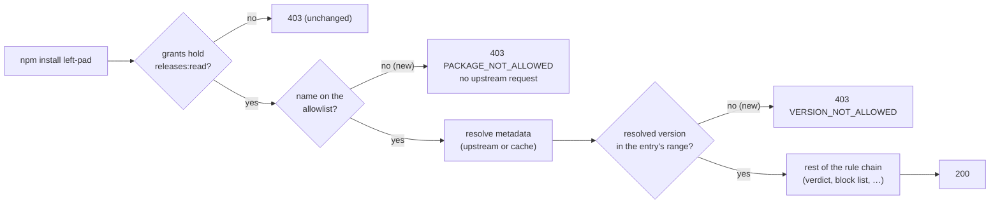
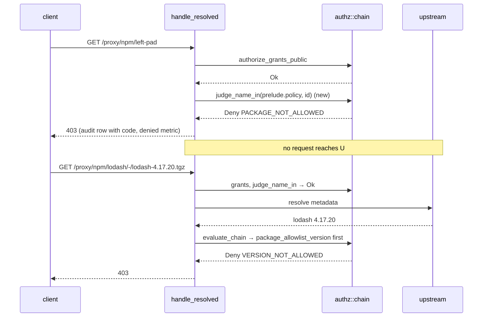
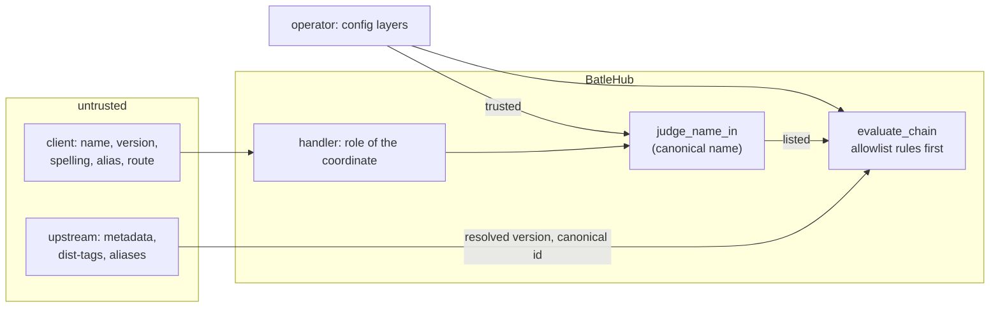

# RFC 0051 — Package allowlist

| Field       | Value                                                        |
| ----------- | ------------------------------------------------------------ |
| Status      | Accepted — phase 1 implemented on PR #432 (§17); phase 2, the heavy proof, pending |
| Short       | Package allowlist                                             |
| Settles     | How a registry serves only the packages an operator listed, each optionally pinned to a version range |
| Author      | Max Batleforc <maxleriche.60@gmail.com>                       |
| Co-author   | Claude Opus 5.5 <noreply@anthropic.com>                       |
| Created     | 2026-11-27                                                    |
| Supersedes  | —                                                             |
| Touches     | `crates/config` (`schema/rules.rs`, `schema/mod.rs` validation, `lib.rs` layer check), `crates/core` (`rules/package_allowlist.rs` new, `rules/version_match.rs` new, `rules/version_gate.rs` and `rules/trusted_publisher.rs` for the moved `VersionMatcher` and `gate()`, `rules/mod.rs`, `entities/package.rs` coordinate role, `entities/registry_kind.rs` `has_package_names`, `services/authz/chain.rs`, `services/proxy/{handle,discovery}.rs`, `services/local_registry/read.rs`, `services/pullability.rs`), `crates/web` (the handlers that build placeholder coordinates — `proxy/{pypi/simple,common,conda,nuget/*,maven/proxy,rubygems/download,goproxy/read,vsx/source,galaxy/roles,forge_api,jetbrains_marketplace/files}.rs` among them — `front_office/explore/detail.rs`, `back_office/authz_explain.rs`, `services/reload/applier.rs`, `tests/package_allowlist.rs` new, `tests/air_gap.rs`, `tests/common/mod.rs`), `server/src/builders.rs`, `docs/public/schema/config*.schema.json`, `helm/batlehub/values.schema.json`, `tests/heavy/{authz.sh,closed_world.sh,config.closed-world.toml}`, `.github/workflows/test.yaml`, docs (`guide/security-gates.md`, `guide/configuration.md`, `use/refused-downloads.md`, `use/publishing.md`, `use/cli.md`, French twins) |
| Risk        | medium — §7 (a new authorization control whose whole value is that no funnel, no spelling and no placeholder coordinate slips past it) |

---

## 1. Summary

A registry can today refuse a package by name only after the fact: an
administrator blocks it in the database (`block_list`). There is no way to say
the opposite, which is what a regulated estate asks for first: *only these
packages are served from here, and anything else is refused*. This RFC adds one
rule kind, `package_allowlist`, that lists the package names a registry serves,
each optionally restricted to a version range. A name that is not listed is
refused before the instance dials the upstream, on every read path including
`why` and the console. A listed name is refused when the version it resolves to
is outside its range.

### Before / after

```toml
# today: version_gate applies one range to every package in the registry,
# and nothing restricts which packages may be pulled at all
[[registries.rules]]
kind  = "version_gate"
allow = [">=4.17.21, <5"]        # also applied to react, left-pad, …

# with this RFC
[[registries.rules]]
kind = "package_allowlist"
packages = [
  "react",                                         # any version
  { name = "lodash", versions = [">=4.17.21, <5"] },
  "@acme/*",                                       # everything in the scope
]
bypass_roles = ["admin"]
```

```text
$ npm install left-pad
npm error code E403
npm error 403 Forbidden - GET http://batlehub:8080/proxy/npm/left-pad
npm error 403 package allowlist: 'left-pad' is not listed for registry 'npm' (bypass requires role 'admin' or higher, you have 'user')
```



The diagram shows the two new refusals. The name refusal sits before the first
line that can dial upstream. The range refusal sits after the resolve, because
`latest` or `^4` names a version only once resolved, and before the rest of
the chain, so a refused version never reaches the verdict gate's scan queue.

## 2. Motivation

1. **There is no positive list.** `RuleConfig`
   (`crates/config/src/schema/rules.rs:61`) has seven kinds. Three carry an
   `allow` field (`license_gate`, `version_gate`, `trusted_publisher`), and
   none of the three is about the package's name. `block_list`
   (`crates/core/src/rules/block_list.rs`) is the only name-keyed control and
   it can only deny. An estate that must serve only approved packages would
   have to block every other name one by one, which cannot be done for a
   public upstream.
2. **`version_gate` is registry-wide.** `VersionGateRule::evaluate`
   (`crates/core/src/rules/version_gate.rs:102`) matches
   `ctx.package.id.version` against one list, whatever the package. "lodash at
   4.17.21 or later" also refuses `react@18.3.1`. A namespace override
   (RFC 0015 §4.1, `NamespaceConfig::rules`) can scope a range to a prefix,
   but it is one `[[registries.namespaces]]` block per package, and it still
   refuses no name at all: everything not overridden is served.
3. **`trusted_publisher` is no substitute.** It derives a publisher from
   metadata, it supports six kinds, and on any other it "denies every request"
   (`TrustedPublisherConfig` doc). It answers *who published this*, not *have
   we approved this*.
4. **Typosquats reach the upstream today.** Every name a caller holding
   `releases:read` asks for is resolved upstream and its metadata cached,
   `reqeusts` and `lodahs` included. So is every name a `catalogue:browse`
   holder opens in the console, and every name `why` is asked about
   (`pullability.rs:306`, `explain_inputs`). An allowlist that refuses those
   names before any resolve closes that path for the registries that use it.

## 3. Goals / non-goals

**Goals**

- A registry, or a namespace, can list the package names it serves. Every read
  of an unlisted name's packages is refused: download, per-package listing,
  local read, hybrid fall-through, `why`, the Access Check page, the access
  simulator, the console's package page.
- Each entry can restrict versions with the same matcher `version_gate` uses.
- An unlisted name is refused without any upstream request, on every path that
  could otherwise make one. The exceptions are the two residuals T5 names
  (warming, the Go checksum relay) and one alias lookup per aliased request
  (T13).
- One spelling rule: an entry matches every spelling the instance itself treats
  as the same package (`canonical_package_name`).
- Whole-registry documents keep working on a registry with an allowlist.
- The safe side is the default: no rule means no change, and a configured rule
  refuses everything it does not list.

**Non-goals**

- **An allowlist kept in the database and edited from the console.** The list
  is policy and goes in the config file with every other rule: reviewed,
  versioned, applied through the config reload. `block_list` stays the
  database-backed control.
- **Filtering whole-registry documents.** Search results, conda
  `repodata.json`, a deb `Packages`, the PyPI simple root, Composer
  `packages.json` and a Helm `index.yaml` still name packages that are not
  listed. On a proxy registry those names are public upstream. On a local or
  hybrid registry they are the estate's own published names, which grants
  already govern (RFC 0015 §6.3). The allowlist adds no second filter there.
  Every per-package read of an unlisted name is refused either way.
- **Removing out-of-range versions from a package's version list.** A packument
  still shows `lodash@5.0.0` when the range stops at 5; npm picks it for
  `latest` and gets a `403`, as with `version_gate` today. Deferred to a bis
  (§15 decision 3).
- **Dependency closure.** Listing `react` does not list `loose-envify`.
  Deriving it means trusting the upstream's dependency graph, which an
  allowlist exists not to trust. §13 gives the recipe that builds the list
  today.
- **Gating publish.** The rule judges reads. Who may publish is a grant
  (`releases:publish`).
- **Stored metadata the instance already holds.** For example an SBOM, or the
  console's held versions of a package served before its name was removed.
  Those reads stay governed by grants, as today. The rule stops new pulls; it
  does not erase history.
- **Changing `version_gate`.** It keeps its meaning and its matcher; only the
  matcher's file moves.

## 4. User-facing design

### 4.1 Configuration

```toml
[[registries.rules]]
kind = "package_allowlist"
# Each entry is a name, or a table with a name and optional versions.
packages = [
  "react",
  { name = "lodash", versions = [">=4.17.21, <5"] },
  { name = "left-pad", versions = ["1.3.0"] },     # exactly one version
  "@acme/*",                                       # everything under the scope
  { name = "@acme/billing", versions = ["^2"] },   # one package inside it, pinned
]
bypass_roles = []    # default: nobody bypasses
```

- `packages` is required and must not be empty (§4.3).
- An entry is a bare string or a table `{ name, versions }`. Both shapes exist
  because most lists are long lists of names. The table accepts no other key:
  `{ name = "lodash", version = [...] }` is an error, not "any version" (§4.3).
- `name` is written in the ecosystem's own spelling and brought to the
  instance's canonical form at load (`RegistryKind::canonical_package_name`,
  `registry_kind.rs:1303`): PEP 503 for PyPI, lower case for NuGet,
  `!`-escaped for Go modules, verbatim for every other kind.
- `name` may end with the kind's namespace separator followed by `*`
  (`@acme/*` on npm, `com.acme:*` on Maven, `Acme.*` on NuGet). That entry
  matches the names **under** the prefix, separator required
  (`namespace_matches`, `grant.rs:757`), and **not** the bare prefix itself.
  - On NuGet the id `Acme` may belong to someone other than the owner of
    `Acme.*`, so it needs its own entry.
  - On Maven the separator is `:`, so `com.acme:*` covers `com.acme:widget`
    and not the subgroup `com.acme.sub:widget`.
  - A prefix entry may carry `versions`.
- `versions` is the list `version_gate.allow` takes: each element an exact
  version, or a semver range when it contains `< > = ^ ~ * ,`. A version
  matching **any** element is allowed.
- `bypass_roles` works as on every sibling gate: the least privileged listed
  role is the floor. It defaults to empty, the closed side.

**Namespaces.** A `[[registries.namespaces]]` block may carry its own
`package_allowlist` in `rules`. The namespace chain is the registry's rules
with that namespace's overrides replacing them **per rule kind**
(`builders.rs` `effective_rules`). For a package under several namespaces, the
**last matching namespace that declares `rules`**, in config order, is used
(`chain.rs:74` `policy_in`; namespaces without `rules` are skipped,
`builders.rs:784`). Overrides do not stack across nested namespaces. So a
namespace list replaces the registry list for the packages under it, and can
admit a name the registry list does not. §7.1 T9 records it.

**Layered config files.** `load_layered` merges arrays of tables on `name`
then `type` (`crates/config/src/lib.rs:77`). A `[[registries.rules]]` entry has
neither, so an overlay that writes any `rules` for a registry or namespace
**replaces** that whole rule list, the allowlist included. Two layers'
`packages` arrays therefore never merge: the later layer's rule list wins
whole. That is how every gate behaves today. A replacement that drops an
allowlist an earlier layer declared is a hard error (§15 decision 10, §4.3):
to remove the rule, remove it from the layer that declares it.

### 4.2 Behaviour rules

- **No `package_allowlist` rule:** nothing changes on any path. This is every
  registry on upgrade. The coordinate role (§15 decision 8) and the hoists do nothing when
  no policy carries the rule.
- **Name listed, no `versions`:** every version passes this rule. The rest of
  the chain still judges it.
- **Name listed with `versions`:** the version the request resolved to must
  match one element. `latest`, a dist-tag or a range in the request is
  resolved first, then judged.
- **Two entries match:** an exact entry wins over any prefix entry, and among
  prefix entries the longest prefix wins, whatever the order. Two exact
  entries with the same canonical name are an error (§4.3).
- **Name not listed:** `403` before any metadata resolve, on every read path
  (§5.1). No upstream request, no cache write. It is `403`, not `404`, like
  every sibling gate (§15 decision 9).
- **Version that does not parse** while the entry has a range: no match, so
  refused (fail closed). Lenient parsing is deferred (§15 decision 2).
- **A per-package listing** (packument, simple page, version index, NuGet
  registration, `maven-metadata.xml`) of an unlisted name is refused like a
  download. A listing of a listed name is served whole, out-of-range versions
  included. Its range half is not applied, because a listing carries a
  placeholder version (`__index__`, `info`, `latest`), not a resolved one.
- **Whole-registry documents** (search, indexes, `packages.json`, cargo
  `config.json`, conda shards) are not judged by this rule: they name no
  single package.
- **How the rule tells those three cases apart** — a package, a listing of one
  package, a whole-registry document — is a role on `PackageId`, set by the
  handler that builds the coordinate (§15 decision 8): `Package` (the
  default, both halves judged), `PackageListing` (name judged, range
  skipped), `RegistryDocument` (neither). The rule never reads a name or a
  version string to decide. A handler that does not set a role gets
  `Package`, which fails closed.
- **Read actions only:** the rule judges `ReleasesRead`, `ReleasesList`,
  `SourceRead` and, for the console's package page, `CatalogueBrowse`. Any
  other action passes it.
- **Order of checks, in every funnel:** grants, then visibility where it
  applies (local rows), then the name. So a local package the caller may not
  see answers `404` whether or not it is listed, in the download and in `why`
  alike (§15 decision 9).
- **Local and hybrid registries:** the rule judges every read, local rows
  included (§15 decision 1), so a locally published package must be listed,
  typically by its scope. A publish of an unlisted name still succeeds (`201`,
  publish is a grant); every read of it then answers `403`.
  `use/publishing.md` says so.
- **Position in the chain:** both halves run **first**, before the verdict
  gate or the block list (`builders.rs:944`). A refused version therefore
  never creates a verdict, queues a scan job, or makes the scan worker fetch
  the artifact. This changes RFC 0018 §5.1's "the verdict gate is first", and
  the comment at `builders.rs:941` changes with it.
- **`[security]` registries:** the rule stays a rule. It never produces a
  quarantine verdict: "not on the list" does not lift with time.
- **Exemptions** (RFC 0015 §4.5) do not silence it: `package_allowlist` is not
  in `EXEMPTIBLE_GATES` (`policy.rs:480`). To serve a package, list it.
- **Air-gapped instances:** an unlisted name is refused before the offline
  client is asked, so it gets `403` and leaves no miss row. A listed name at
  an explicitly requested out-of-range version is judged in `record_miss` too
  (`handle.rs:536`, beside `blocked_reason`). So it answers
  `VERSION_NOT_ALLOWED` rather than `503`, and is never proposed for the next
  bundle.
- **Config changes take effect on apply.** A file edit stages a pending reload
  (`server/src/watcher.rs:853`). An admin applies it
  (`POST /api/v1/admin/config/pending/apply`), and the other replicas follow
  it within the sync window (`services/reload/sync.rs`). Until then, the
  previous list is in force. An unapplied reload expires after ten minutes
  (`PENDING_TTL_SECS`). So removing a package from the list closes it only
  once applied.
- **One snapshot per request** holds on the two proxy funnels, which judge the
  name against `prelude.policy`. Every other site calls `policy_in` once
  itself. A request that straddles an apply there is still refused correctly,
  because the rule is also in the chain (§5.1).

### 4.3 Validation

Hard errors refuse the load, and on reload keep the previous config serving.

| Condition | Where | Rationale |
| --- | --- | --- |
| `packages` absent or empty | `AppConfig::validate` (`schema/mod.rs:2652`) | An empty allowlist refuses everything; a registry meant to serve nothing is better removed. |
| An unknown key in a table entry (`version`, `range`, …) | a hand-written `Deserialize` for `AllowlistEntry` | Otherwise a typo loads as "no `versions`" and allows every version: fail open. Written by hand, not `#[serde(untagged)]`, so the error names the key and the entry instead of "did not match any variant". |
| `versions = []` on an entry | `validate` | Ambiguous between "none" and "any". Leaving it out already means "any". |
| A `versions` element that contains range characters but does not parse as a range (`"=> 4.17"`) | `validate`, through `batlehub_core::rules::version_match::is_malformed_range` (a `pub fn`) | `VersionMatcher::parse` would fall back to an exact match that never matches, refusing every version with no message. |
| A name with whitespace, a control character, `< > = ~ ^ !`, `@` anywhere but position 0, or `*` anywhere but a final `<separator>*` | `validate`, a check written for this rule | A version spec in a name (`lodash@^4`, `requests>=2`) never matches anything. `validate_package_name` is only a path-safety check (`local_registry/mod.rs:302`) and accepts all of these. |
| Two exact entries with the same canonical name | `validate` | Which `versions` applies would depend on order. `Requests` and `requests` on PyPI collide; the error names both spellings. |
| Two `package_allowlist` blocks in one rule list | `validate` | Both would run, so a name would have to be on both lists; and `effective_rules` replaces every base block with the first override (`builders.rs:818`). |
| `versions` on a forge kind (`github`, `forgejo`, `gitlab`) | `validate` | A forge archive or raw coordinate is rewritten onto the commit SHA before the chain (`handle.rs:725`), so a range never matches and would refuse every download. |
| The rule on a kind whose coordinates carry no package name | `validate`, through `RegistryKind::has_package_names()` | See below. The error names the kind's own control where one exists (`path_allow` for `generic`). |
| A later config layer's `rules` for a registry or namespace drops a `package_allowlist` an earlier layer declared | a check over the raw layers in `crates/config/src/lib.rs`, at load and at apply | A dropped allowlist opens the registry silently. A warning can be dismissed, so it would be the only thing between an overlay and an open registry (§15 decision 10). |
| Unknown role in `bypass_roles` | `parse_bypass_roles` (`server/src/builders.rs`), at policy build | The same check as the sibling gates. It runs at build rather than in `validate`; a reload treats its error the same way. |

`RegistryKind::has_package_names()` is a new exhaustive match, so a new kind
must answer it. It answers `false` where the request coordinate is a constant
or a content address rather than a package name:

- the path-addressed kinds (`is_path_addressed`, `registry_kind.rs:445`: deb,
  rpm, pacman, apk, jetbrains, generic), whose coordinates are
  `PackageId::new(registry, "repo", "_")` (`repo/mod.rs:143`, `generic.rs:73`);
- nix, whose coordinates are store hashes;
- godist, which serves only `GO_PACKAGE = "go"` (`services/godist.rs:22`);
- mise-java, which serves only `JAVA_PACKAGE = "java"`
  (`services/mise_java.rs:24`).

rustup keeps `true`: it serves two products, `rust` and `rustup`
(`services/rustup.rs:27,31`), and an estate may list one of them.

Warnings, as `ConfigWarning` (`crates/config/src/schema/warnings.rs`), logged
at startup and on every reload and served by
`GET /api/v1/admin/config/warnings` for the admin UI:

| Condition | Behaviour | Code |
| --- | --- | --- |
| A `versions` range on a kind whose versions are mostly not semver (`pypi`, `maven`, `nuget`, `rubygems`) | Loads; versions that do not parse are refused. | `allowlist.range-on-non-semver-kind` |
| A `versions` element with an `x`/`X` wildcard (`4.x`) | Loads as the exact string `4.x`, which matches nothing. | `allowlist.literal-wildcard` |
| A `package_allowlist` and a `version_gate` with `allow` on the same registry | Both run; a version must pass both. | `allowlist.overlaps-version-gate` |
| A `cache.warm_packages` entry not on the list, or outside its range | Warming fetches it (warming calls the client directly, `warming/run.rs:77`); serving it is refused. | `allowlist.warms-unlisted` |

### 4.4 API surface

No new endpoint and no change to the `ReasonCode` enum. `ReasonCode` is the
closed list of codes a *verdict* carries (`entities/security.rs`). `why`'s
`Cause.reason_code` and the access log's `reason_code` are already plain
strings (`pullability.rs:73`), and `version_gate` emits none. The two new
codes, `PACKAGE_NOT_ALLOWED` and `VERSION_NOT_ALLOWED`, are such strings. So
the OpenAPI spec and the generated client do not change, and an older CLI
prints them as it prints any code.

### 4.5 Mocks

**The message.** The `403` body is the rule's `Deny` reason, which every
client sees and which `why` repeats as the cause detail (`rule_cause`,
`detail: reason.clone()`).
- It starts with `package allowlist:`. The plain-message table of
  `use/refused-downloads.md` is keyed on how a message starts, so it can tell
  this one from `version_gate`'s "is not in the approved allowlist".
- It names the requested package and the registry, never the list and never a
  range.
- The requested name is stripped of control characters before it is
  interpolated.
- `gate()` appends the bypass hint whenever `bypass_roles` is non-empty, as on
  every sibling gate. The §1 example sets `bypass_roles = ["admin"]`, so the
  mocks show it.

**Client refusal, name not listed** (npm, exit code 1). The second line is the
reason npm relays from the body, in the form `use/refused-downloads.md`
records. Not yet captured from a run: §6.P captures it.

```text
$ npm install left-pad
npm error code E403
npm error 403 Forbidden - GET http://batlehub:8080/proxy/npm/left-pad
npm error 403 package allowlist: 'left-pad' is not listed for registry 'npm' (bypass requires role 'admin' or higher, you have 'user')
```

**Client refusal, version outside the range.** The packument is served and the
tarball is refused.

```text
$ npm install lodash@4.17.20
npm error code E403
npm error 403 Forbidden - GET http://batlehub:8080/proxy/npm/lodash/-/lodash-4.17.20.tgz
npm error 403 package allowlist: version '4.17.20' of 'lodash' is not allowed for registry 'npm' (bypass requires role 'admin' or higher, you have 'user')
```

**pip.** pip prints the status but not the body, so its user does not see the
reason. Its exact line is captured by §6.P 7. The way to the reason is
`batlehub-cli why --last`, which lists the caller's refusals with their code,
and `use/refused-downloads.md` says so under pip.

**`batlehub-cli why`, name not listed** (exit code 4). The name check runs right
after the access step, so nothing after it is evaluated. The causes are
printed in `finish`'s order (`pullability.rs:546`: access, block, lifecycle,
policy, verdict, upstream), with `render`'s spacing (`cli/src/cli/why.rs:139`):

```text
⛔ npm/left-pad@1.3.0 — not pullable

  ✅ pass  access      you may read npm
  ⛔ refuse policy      PACKAGE_NOT_ALLOWED: package allowlist: 'left-pad' is not listed for registry 'npm' (bypass requires role 'admin' or higher, you have 'user')
                      https://batlehub.dev/use/refused-downloads#package-not-allowed

next: ask an administrator to add it to the registry's package allowlist
```

The same answer comes back for a typosquat that does not exist upstream, so
`why` cannot be used to probe the upstream through a refused name.

**`batlehub-cli why`, version outside the range** (exit code 4):

```text
⛔ npm/lodash@4.17.20 — not pullable

  ✅ pass  access      you may read npm
  ✅ pass  block       not blocked
  ⛔ refuse policy      VERSION_NOT_ALLOWED: package allowlist: version '4.17.20' of 'lodash' is not allowed for registry 'npm' (bypass requires role 'admin' or higher, you have 'user')
                      https://batlehub.dev/use/refused-downloads#version-not-allowed
  ✅ pass  upstream    metadata resolved

next: pin a version the package allowlist accepts
```

`evaluate_chain_all` still runs the rules after a refusal, so on a
`[security]` registry a verdict line may follow the policy line. That is what
`why` shows for every refusal today.

**`batlehub-cli why npm/lodash`, no version**, under a range `<4.17.21`. The
resolution answer names the newest *allowed* version. A policy refusal prints
as `denied` (`why.rs:256`), in `comfy_table`'s bordered table. npm itself takes
`latest` and is refused, which is the listing non-goal; `use/cli.md`'s `why`
section says so in one sentence. No new output line is added.

```text
npm/lodash resolves to 4.17.20 — 4.17.21 is denied (VERSION_NOT_ALLOWED)

+---------+---------+-------+---------------------+
| VERSION | STATE   | UNTIL | CODE                |
+=========+=========+=======+=====================+
| 4.17.21 | denied  | —     | VERSION_NOT_ALLOWED |
| 4.17.20 | allowed | —     | —                   |
+---------+---------+-------+---------------------+
```

**`batlehub-cli why npm/left-pad`, no version, name not listed** (exit code 4).
The name check in `explain_resolution` answers before any version is listed:

```text
⛔ npm/left-pad — not pullable: PACKAGE_NOT_ALLOWED: package allowlist: 'left-pad' is not listed for registry 'npm'
next: ask an administrator to add it to the registry's package allowlist
```

**`batlehub-cli check`**: a refused pin is one row like any other refusal, with
the code in its CODE column. No layout change.

**`batlehub-cli why`, listed and allowed:** no new line. A rule that passes is
not a cause, as `version_gate` passing is not one today.

**Access Check page** (`/tools/access-check`, `ui/src/pages/AccessCheck.vue`).
No layout change. It renders the server's causes in order: each with its
`Resolution` matrix and lowercase state word, then the code raw in a `<code>`
(`AccessCheck.vue:253`), then the detail. The detail and the next step are the
server's English text in every locale, as for every rule today. Refusal state
(`▦` stands for the matrix):

```text
┌ Access check ──────────────────────────────────────────┐
│ Registry                                               │
│ [npm                                              ▾]   │
│ Package                                                │
│ [left-pad                                          ]   │
│ Version                                                │
│ [1.3.0                                             ]   │
│ Artifact (optional)                                    │
│ [                                                  ]   │
│ [               Check access                       ]   │
├────────────────────────────────────────────────────────┤
│ [▦ Not pullable]  1.3.0                                │
│  ▦ pass    access   you may read npm                   │
│  ▦ refuse  policy   PACKAGE_NOT_ALLOWED package        │
│                     allowlist: 'left-pad' is not       │
│                     listed for registry 'npm'          │
│ Next: ask an administrator to add it to the registry's │
│ package allowlist                                      │
└────────────────────────────────────────────────────────┘
```

Not-found state: unchanged (`notFoundNext`). An unlisted name no longer reaches
it, because the refusal comes first. It now appears only for a listed name the
upstream does not know, or for a local package the caller may not see.

**Admin warnings panel** (`ConfigWarningList.vue`). The empty state is
unchanged. A warning row, in the panel's own layout:

```text
▲ ATTENTION  Registry 'pypi' gives version ranges to its package allowlist,
             but most PyPI versions are not semver.
             registries[2].rules[0]   [allowlist.range-on-non-semver-kind]
             ▸ How to fix
                                                          [ Dismiss ]
```

**Load error** (the server refuses to start, or the apply is refused). This is
anyhow's chain (`server/src/main.rs:621`), with each validator's own wording:

```text
Error: loading config from config.toml

Caused by:
    registry 'pypi': package_allowlist: 'Requests' and 'requests' are the same PyPI package (both read as 'requests'); keep one entry
```

```text
Error: loading config from config.toml

Caused by:
    registry 'npm': package_allowlist: entry 'lodash': unknown key 'version'; expected 'name' or 'versions'
```

```text
Error: loading config from config.toml

Caused by:
    registry 'files': package_allowlist does not apply to a 'generic' registry, whose requests name a path, not a package; use path_allow
```

A namespace's error reads `registry 'npm' namespace '@acme': …`.

## 5. Architecture

### 5.1 One rule, judged early wherever a fetch could follow

The config block builds **two** `Rule` objects:

- `package_allowlist`, which judges the name;
- `package_allowlist_version`, which judges the version of a listed name.

Both go in the chain, so every funnel that runs the chain already enforces
them: `ProxyService::handle_resolved`, `authorize_read` and
`authorize_unheld_read` for local and hybrid reads, the pullability answer,
the access simulator. RFC 0015 fixed the "convention, not control" defect
class by running the chain *inside* the funnels (`chain.rs`, module comment),
and a new rule inherits that fix.

Two names rather than one because `rule_cause` and `reason_code_for`
(`pullability.rs:587`, `:695`) key on the rule's name, and the proxy's access
log records only the refusing rule's name (`handle.rs:853`).

The chain alone leaves gaps, all visible in the code. Each is a path that
resolves or fetches **before** the chain runs, or that runs no rule:

| Path | Today | Evidence |
| --- | --- | --- |
| proxy download | chain after the resolve | `handle.rs:768`, "The rule chain stays below the resolve" |
| proxy metadata for a route | chain after the resolve | `handle.rs:351` `resolve_metadata_for_inner` |
| per-package listing (proxy) | no rule at all | `handle.rs:1267` `version_document_inner` → `authorize_listing` (`chain.rs:1176`) |
| per-package listing (local) | no rule at all | `local_registry/read.rs:1137` `check_read_access` → `authorize_listing` |
| forge ref resolution | authenticated forge call after grants only | `handle.rs` `resolve_forge_ref` |
| forge API reads (tags, commits, branches) | upstream call after grants only | `proxy/forge_api.rs:127` |
| alias resolution (Galaxy role ids, JetBrains numeric ids, mise-java) | upstream call before any rule | `handle.rs:1837` `canonical_coordinate` |
| `why` / Access Check / simulator | upstream resolve before the chain | `pullability.rs:306` `explain_inputs`; `explain_resolution` → `upstream_detail` |
| console package page and README | upstream fetch, no rule | `discovery.rs:56` `upstream_detail`, `:213` `upstream_version_readme` |

The name decision needs no version and no metadata, so it gets a second entry
point. `Rule` gains a default method, beside the existing default
`listing_age_gate`:

```rust
/// Judge from the package name alone, before anything is fetched.
/// `None` means this rule needs the resolved metadata, which is every rule
/// but `package_allowlist`.
fn judge_name(&self, _name: &str, _identity: &Identity) -> Option<RuleDecision> {
    None
}
```

`chain.rs` gains `judge_name_in(policy, package_id, identity, action)`. It
takes the whole `PackageId`, so it can honour the coordinate's role (§15 decision 8): a
whole-registry document is never judged. It answers the first `judge_name`
refusal for a read action. It is called at each row of the table, before the
line that resolves, fetches or answers:

1. `handle_resolved`, after the grant check, with `prelude.policy`. A refusal
   takes the same `Denied` exit as a grant refusal: audit row, `denied`
   metric, and now `.with_reason_code("PACKAGE_NOT_ALLOWED")`, which the grant
   exit does not set today. This site sees the PyPI simple root and the
   RubyGems specs index, which reach `handle` through `proxy_stream`. That is
   why the role check is inside `judge_name_in` rather than left to callers.
2. `resolve_metadata_for_inner`, after its grant check, with `prelude.policy`.
3. `version_document_inner` and `check_read_access`, for the per-package
   listings. **Not** inside `authorize_listing`, which also serves
   whole-registry documents (search, Composer `packages.json`, Helm
   `index.yaml`, cargo `config.json`). Both listing exits record the code:
   `denied_metadata` at `handle.rs:1159`, `listing_denied` in the metric.
4. `resolve_forge_ref` and the forge API routes, beside their grant checks.
5. After `canonical_coordinate`, on the alias routes. The listed name is the
   canonical one, so it can only be judged once the alias is resolved: one
   upstream lookup per aliased request remains (T13).
6. `explain_inner`, right after the visibility step, pushing a `policy` /
   `Refuse` cause and returning. Also `explain_resolution`, before
   `upstream_detail`.
7. `upstream_detail` and `upstream_version_readme` return `Ok(None)`, "not
   attempted", for a refused name. `explore/detail.rs` then shows what the
   instance holds and fetches nothing.

Sites 1 and 2 use the policy the prelude already took. The others call
`policy_in` once, under their own read lock.



The sequence shows that the name refusal leaves before the only arrow to the
upstream, and the range refusal leaves before the verdict gate.

**What enforces what.** Two different guarantees:

- **On downloads and metadata routes**, `package_allowlist` is in the chain as
  well as hoisted. A missed hoist there costs only the "no upstream request"
  property, never the refusal.
- **On per-package listings and console reads**, no chain runs, so **the hoist
  is the only control**. A missed hoist there serves the unlisted name's
  document.

So the tests do not rely on the chain for the second group. The in-process
suite names every listing funnel and console read explicitly and expects a
refusal from each (§14, T4).

The "no upstream request" property has its own gate, T5's:
- The route rows of `crates/web/tests/authz_matrix.rs` move to
  `tests/common/mod.rs`, so a second suite can read them.
- That suite runs them in proxy mode against an allowlisted registry, for an
  unlisted name, with a client that counts every upstream-facing call:
  resolve, fetch, `forge()`, `canonical_coordinate`. It asserts zero calls.
  It uses a counter rather than a panic, because some client calls run in
  detached tasks where a panic is swallowed (`proxy/resolve.rs:274`).
- The rows of whole-registry documents and of kinds without package names are
  filtered out by the same predicates the rule uses (the coordinate role,
  `has_package_names`), not by a hand-kept list.
- A route marked `NoRow` on a kind with package names fails the suite, so a
  new route has to be classified before it can ship.

### 5.2 Matching

At build, each entry is canonicalised and split into a `HashMap<String,
Option<Vec<VersionMatcher>>>` for exact names and a list of prefix entries
sorted longest first. A request's name is canonicalised once. The exact map is
looked up first, then the prefixes are scanned with `namespace_matches` minus
the equality case: one hash lookup plus a scan over the handful of prefixes an
operator wrote.

Two helpers move rather than being copied:
- `VersionMatcher` moves from `version_gate.rs` to `rules/version_match.rs`
  as `pub(crate)`, unchanged, with one `pub fn is_malformed_range` for
  `crates/config`.
- `gate()`, already copied once in `trusted_publisher.rs:94`, moves to
  `rules/mod.rs` rather than being copied a third time.

## 6. Detailed design

### 6.1 `crates/config`

```rust
#[derive(Debug, Serialize, Deserialize, schemars::JsonSchema)]
pub struct PackageAllowlistConfig {
    pub packages: Vec<AllowlistEntry>,
    #[serde(default)]
    pub bypass_roles: Vec<String>,
}

/// A name, or `{ name, versions }`. `Deserialize` is written by hand (a
/// string visitor and a map visitor that refuses unknown keys by name), so
/// a misspelled key is an error that names it, not a silent "any version".
#[derive(Debug, Clone, Serialize, schemars::JsonSchema)]
pub enum AllowlistEntry {
    Name(String),
    Pinned { name: String, versions: Option<Vec<String>> },
}
```

`Serialize` is needed because namespace merging round-trips each rule through
`serde_json` (`builders.rs` `effective_rules`). After the change:
- `task docs:config-schema` regenerates
  `docs/public/schema/config*.schema.json`;
- `helm/batlehub/values.schema.json` follows, gated by
  `crates/config/tests/config_schema.rs`.

`crates/config` already depends on `batlehub-core`, so `validate` can call
`canonical_package_name`, `has_package_names` and `is_malformed_range`.

The check of §15 decision 10 runs over the raw layers, before the merge. It lives in
`crates/config/src/lib.rs` beside `load_layered_text`. The reload path's
`load_layers` (`services/reload/applier.rs:57`) calls the same function, as do
the preview and `explain-config`.

`server/src/builders.rs` scans `rule_configs` for `PackageAllowlist`, the way
`push_flags_rule` does, and pushes both rules **before** the verdict gate or
block list (`:944`). The exhaustive `match rule_cfg` loop that follows gets a
no-op arm, so the rules are not pushed twice.

`build_namespace_policies` canonicalises each namespace's `match` with
`canonical_prefix`, the function grants already use (`server/src/grants.rs:259`),
instead of pushing `ns.match_prefix.clone()` as written (`builders.rs:789`).
That is §15 decision 16.

### 6.2 `crates/core`

- `rules/package_allowlist.rs`: `PackageAllowlistRule` (name) and
  `PackageAllowlistVersionRule` (version), sharing one `Arc<Allowlist>` built
  once.
  - The name rule's `evaluate` and `judge_name` refuse an unlisted name.
  - The version rule's `evaluate` passes an unlisted name, which the name
    rule owns, and judges `ctx.package.id.version` for a listed name with
    `versions`.
  - Both pass any non-read action and any coordinate whose role exempts it
    (§15 decision 8), and both go through `gate()`.
- `rules/mod.rs`: `judge_name`, and `gate()` moved here.
- `entities/registry_kind.rs`: `has_package_names()`.
- `services/authz/chain.rs`: `judge_name_in`.
- `services/proxy/handle.rs`, `services/proxy/discovery.rs`,
  `services/local_registry/read.rs`, `services/pullability.rs`: the call sites
  of §5.1, and `record_miss`'s version check (§4.2).
- `services/pullability.rs`: two `rule_cause` arms, kind `policy`, state
  `Refuse`, with the codes as strings. `reason_code_for` then answers per rule
  name.
- `crates/web/src/handlers/back_office/authz_explain.rs:190`: `NOT_COVERED`
  names `package_allowlist`, so `explain` does not answer "allow" without
  mentioning it.

### 6.P Proof against a real client

The consumers are **npm**, as shipped with the Node 26 that `mise.toml` pins,
and **pip**, from its `python = "latest"`. Neither is pinned to a patch
release, so each run logs both versions. The proof has two halves:

- **`allowlist` in `tests/heavy/authz.sh`:** hermetic, per PR, with a new row
  in the `heavy-authz` matrix of `.github/workflows/test.yaml`. The proxy
  registries point at `example.invalid`, the `reads` phase's technique: a
  `403` is only possible if the refusal came before the resolve. The allowed
  arms use a **hybrid** registry with a fixture published locally.
- **`allowlist` in `tests/heavy/closed_world.sh`:** the live suite, against
  the real npm and PyPI. It gets its `PHASES` entry, its `[[registries]]`
  blocks in `tests/heavy/config.closed-world.toml` and its
  `heavy-closed-world` matrix row. The `live:<kind>` targets of `authz.sh`
  are not used: they exist for kinds without a local mode.

Observations:

1. *(hermetic)* On a hybrid npm registry with `packages = ["@acme/*"]`,
   `npm install @acme/widget` (published by the phase) exits 0.
   `npm install @other/thing`, also published locally, exits 1 with
   `PACKAGE_NOT_ALLOWED` in its output. This proves §15 decision 1: local rows
   are judged too.
2. *(hermetic)* On a proxy npm registry pointed at `example.invalid` with an
   allowlist, `npm install left-pad` exits 1 and its output carries the §4.5
   reason. The sample count of
   `batlehub_upstream_request_duration_seconds{registry=…}`
   (`proxy/mod.rs:322`) is unchanged before and after. For contrast, the phase
   records what a **listed** name on the same registry answers, which is not a
   `403`.
3. *(hermetic)* On allowlisted registries, these whole-registry documents all
   answer `200`: the PyPI simple root, `GET /api/v1/search`, the Composer
   `packages.json`, the Helm `index.yaml`, the cargo `config.json`, a RubyGems
   specs index and a conda shard.
4. *(hermetic)* `batlehub-cli why npm-x/left-pad@1.3.0` on the
   `example.invalid` registry exits 4 and prints the §4.5
   `PACKAGE_NOT_ALLOWED` line, with no upstream line and no new upstream
   sample.
5. *(live)* With `packages = [{ name = "lodash", versions = [">=4.17.21, <5"]
   }]`, `npm install lodash@4.17.21` exits 0, and `npm install lodash@4.17.20`
   exits 1.
   - The transcript (`heavy_wire_re_after`) shows the packument `GET` at `200`
     and the tarball `GET` at `403` with the version message.
   - The artifact-fetch samples of `batlehub_upstream_request_duration_seconds`
     do not move across the refused install: the refused tarball was never
     fetched.
6. *(live)* With the range `<4.17.21`, `npm install lodash` takes `latest`
   from the packument and gets `403` on its tarball. This records the listing
   non-goal as observed, so the later bis (§15 decision 3) has a row to turn
   green.
7. *(live)* On a pypi registry listing `python-dateutil`, the server matches
   every spelling.
   - It is proved with raw requests, because pip normalises before it asks:
     `curl /simple/Python.Dateutil/` and `curl /simple/python_dateutil/` both
     answer `200` with the same page.
   - `pip download python-dateutil` exits 0.
   - `pip download reqeusts` exits non-zero. The phase records pip's exact
     output, which §4.5 then quotes.
8. *(live)* A token whose role is in `bypass_roles` runs `npm install
   left-pad` and exits 0. The access log row records that identity.

Both phases assert through a new local `said()` helper that fails on no match,
not through `heavy_client_said`, which only prints (`lib.sh:82`). They make no
`heavy_wire_not` claim about an upstream host, because the tap cannot see a
request sent there. Observations 2, 4 and 5 rely on `example.invalid` and the
upstream histogram instead.

## 7. Security

**Rating: medium.** This is an authorization control. It adds no new input
surface: the names and versions it reads already reach the funnels. Its risk
is entirely in being bypassed — a spelling, a path, a placeholder coordinate,
an alias or a version form that gets past it — or in over-refusing, which
takes a registry down.



The diagram shows two untrusted inputs:
- **The client** chooses the spelling, the route, the alias and, on some
  routes, a placeholder-shaped name (T1, T2, T4, T11, T13).
- **The upstream** chooses what `latest` resolves to and what an alias names
  (T3, T13).

The list comes from the operator, who is trusted, but through layered files
that can drop it (T12).

### 7.1 Threat model

| # | Threat (STRIDE) | Where | Mitigation | Residual risk |
| --- | --- | --- | --- | --- |
| T1 | Elevation: an alternate spelling (`Requests`, `python_dateutil`, Go `!`-escaped case) judged differently from the stored one | name match | Both sides go through `canonical_package_name`, the function the read paths store under: the class of fix #424 applied to the PyPI JSON route. Test: `allowlist_spelling_variants_match_one_entry` for pypi, nuget, goproxy. | Kinds with spellings `canonical_package_name` does not fold (GitHub `owner/repo` case, Composer case) fail closed: a listed name requested in another case is refused. Accepted; such a kind gains an arm there when a client is found to send it. |
| T2 | Elevation: a prefix entry matches too much (`@acme/*` admits `@acme-evil/x`, or `Acme.*` admits the bare `Acme`) | prefix match | `namespace_matches` requires the separator, and equality is excluded. Tests: `allowlist_prefix_needs_separator`, `allowlist_prefix_excludes_bare_prefix`. | none |
| T3 | Elevation: `latest`, a dist-tag or a range judged on its literal text, or the upstream moves `latest` | version match | The range is judged on `ctx.package.id.version` after the resolve. `judge_name` never sees a version. A placeholder version is skipped only when the coordinate's role says it is a listing (§15 decision 8), never on its string. Tests: `allowlist_latest_resolving_out_of_range_is_denied`, `allowlist_literal_latest_on_a_package_coordinate_is_judged`. | none |
| T4 | Elevation: a read path that skips the chain serves an unlisted name | listings and console reads | The hoists of §5.1, which are the only control there. Test: `crates/web/tests/package_allowlist.rs` names every such path for one unlisted name and expects a refusal from each. That covers the proxy and local per-package listings of each kind with one, the metadata route, a forge archive, the forge API, an alias route, `/api/v1/packages/access` with and without a version, `/api/v1/admin/access-check`, and the console detail and README. Downloads, local reads and hybrid fall-through are covered as well. | A new listing route that runs neither a hoist nor the chain. The T5 suite's `NoRow` rule forces it to be classified; classified wrongly, only review catches it. |
| T5 | Denial of service: callers make the instance resolve and cache arbitrary unlisted names, spending the upstream's rate limit | every pre-chain fetch (§5.1 table) | The name is judged before each of them. Test: the counting-client suite of §5.1. Heavy: §6.P 2 and 4. | Two paths stay: warming (admin-configured; `allowlist.warms-unlisted` warns), and the goproxy `sumdb/` relay (`goproxy/vuln.rs:218`), which looks up checksums, not packages. Accepted by the author; reviewed at sign-off. |
| T6 | Tampering: a version string the matcher cannot parse slips through | version match | An unparseable version matches no range and is refused. Test: `allowlist_unparseable_version_is_refused`. | Over-refusal on non-semver kinds, surfaced by `allowlist.range-on-non-semver-kind`. |
| T7 | Information disclosure: the refusal reveals the list or its ranges | `403` body, `why` | The body names only the requested package and the registry; no range anywhere. Test: `allowlist_refusal_body_names_no_range`, which asserts on the HTTP body. | A caller with `releases:read` can probe which public names are listed. Accepted (§15 decision 9): on a proxy registry that reveals policy, not data. A hidden local package answers `404` before the name is judged, so the probe reveals nothing about it. |
| T8 | Elevation: the bypass role floor misread | `gate()` | The shared `gate()`. Test: `bypass_role_resolves_*`, as in `version_gate.rs`. | none |
| T9 | Elevation: a namespace list admits what the registry list refuses | namespace override | By design (§4.1): the operator who writes the namespace block decides for it. Test: `namespace_allowlist_replaces_registry_allowlist`. | Accepted: config review is the control. |
| T10 | Elevation: the namespace chain is selected on a spelling the rule does not use, so a spelling picks a wider list | `policy_in` | Namespace prefixes are canonicalised at build, as grants' are (`canonical_prefix`, `grants.rs:259`), so the rule and the namespace selection see one spelling (§15 decision 16). Test: `allowlist_namespace_override_alternate_spelling` (goproxy, nuget), and `mixed_case_nuget_namespace_gate_applies`. | none |
| T11 | Denial of service / elevation: a placeholder coordinate (`__simple__`, `_index`, a conda shard) is judged as a package and a whole-registry document is refused; or an exemption keyed on a placeholder string lets a real package by that name through (`__shards__` and `_search` are legal conda names, `index.yaml` a legal chart name) | rule input | The rule passes a coordinate only by its role, never by its name (§15 decision 8). Hoists sit only where a package is named (§5.1). Kinds with no package names are refused at load (§4.3). Tests: §6.P 3; one in-process case per document; `unmarked_document_is_refused` (a coordinate built with `PackageId::new` is judged as a `Package`). | A handler that builds a document without its role: that document is refused (fails closed) and its in-process case goes red. |
| T12 | Elevation: a later config layer that writes `rules` drops the allowlist, and the registry silently opens | layered load | A hard error, at load and at apply, when a later layer's `rules` drops a `package_allowlist` an earlier layer declared (§15 decision 10). Computed over the raw layers in `crates/config/src/lib.rs` and called from startup, apply, preview and `explain-config`. Test: `layer_dropping_allowlist_is_refused`, on each of the four paths. | none |
| T13 | Elevation / DoS: an alias (JetBrains numeric id, Galaxy role id) is judged under the alias, refusing a listed package; or the alias lookup itself reaches upstream for an unlisted package | alias routes | The name is judged after `canonical_coordinate` (§5.1 point 5). Test: `allowlist_judges_the_canonical_name_of_an_alias`. | One upstream lookup per aliased request, listed or not. Accepted: the alternative refuses every aliased request. |

### 7.2 Authentication and authorisation

The rule reads the caller's `Identity` only for `bypass_roles`. It runs after
the grant check and the visibility check, and never widens either. No rule
means today's behaviour. A configured rule refuses whatever it does not list.

### 7.3 Input handling and injection

No new parser of untrusted input. The requested name is canonicalised and
looked up in a map, which no input shape can turn into anything else.

Before the name is interpolated into the `403` body and the `why` detail, it
is stripped of control characters. On the funnels that skip
`validate_coordinate` (per-package listings, `why`), the only character filter
today is NUL. Without the strip, ANSI escapes would reach npm's and the CLI's
terminals.

The config entries are operator input, checked by §4.3.

### 7.4 Secrets and cryptography

No secret, key or credential is read, stored or compared. The rule is pure
config and string matching.

### 7.5 Abuse and resource exhaustion

The per-request cost is one canonicalisation, one hash lookup and a scan over
the prefix entries, with no I/O (§10.3). A list of 10 000 names is a few
hundred kilobytes of config, read once per load. Refusing unlisted names
before any resolve *reduces* upstream load (T5).

### 7.6 Existing defences that still hold

- Grants and visibility still run first.
- `block_list` still refuses a listed name an admin has blocked.
- `validate_coordinate` and `ensure_safe_key` are untouched.
- On a `[security]` registry the verdict still judges what the allowlist lets
  through.
- An artifact cached before its name was removed from the list is not served
  on the download path, because the cache hit is below the chain in
  `handle_resolved`.

## 8. Supply chain

No new dependency, image, action or tool. The rule uses `semver`, already a
dependency of `crates/core` through `version_gate.rs`, and the standard
library. `task audit` is unchanged.

## 9. Data and privacy

No new datum about a person. The access log's existing denial rows gain a
reason-code value (`PACKAGE_NOT_ALLOWED`, `VERSION_NOT_ALLOWED`) in a column
that already exists, under the retention and readership it already has.

## 10. Operability

### 10.1 Observability

- Refusals go through the existing exits: downloads under
  `batlehub_requests_total{outcome="denied"}`, listings under
  `outcome="listing_denied"` (`handle.rs:1222`). Both now record the reason
  code in the access log, so `why --last` and the refused-downloads views can
  tell the two halves apart.
- No new metric. A per-name label would grow without bound; the access log
  answers "which names are people asking for that we do not serve".
- The list's own audit trail is the config file's history, plus the
  `config_changes` rows the reload already writes, including rejected applies
  (`applier.rs:144`).

### 10.2 Failure modes

| Failure | Detected by | Behaviour (fail open / closed) | Recovery |
| --- | --- | --- | --- |
| Invalid list on apply | `validate` | The apply is refused and recorded as `rejected`; the previous config keeps serving. | Fix the file; the error names the registry and the entry. |
| An edit that adds or narrows the list is never applied | the pending reload in the admin console | **Open** until applied: the previous list is in force, and the pending reload expires after ten minutes. | Apply it (`POST /api/v1/admin/config/pending/apply`). `guide/security-gates.md` says a list change is in force only once applied. |
| An apply that adds a list is refused on one replica | `config.replica-drift` (`warnings.rs:122`, `reload/drift.rs`) | **Open** on that replica, which keeps the previous config. Pre-existing for every gate. | Fix the replica. Only a reload-failure *metric* is missing, and that is a separate change. |
| A later layer drops the allowlist | the load or apply error | **Closed**: the config is refused, and the previous one keeps serving on an apply. | Restore the rule in the overriding layer, or remove it from the layer that declares it. |
| A needed package is missing from the list | users' `403`, `why`, the access log | Closed: refused. That is the control working. | Add it and apply. |
| A version that does not parse, with a range set | `why` shows `VERSION_NOT_ALLOWED` | Closed (T6). | Exact versions, or no range. |

There is no external dependency: the rule cannot be down or slow. It is
exactly as fresh as the last applied config.

### 10.3 Performance and capacity

On the two proxy funnels, `judge_name_in` works on the policy the prelude
already holds. Elsewhere it takes one read lock, as the sibling grant check
does. Its cost is one `HashMap` lookup on a canonicalised string. With no
allowlist configured, it is one pass over the rule list that finds nothing.
Memory is the list, built once per load. No database query, no I/O. The soak
suite needs no new arm: the rule adds no state that grows.

## 11. Other concerns

- **Accessibility:** the Access Check page renders the new causes through its
  existing `<ol>` in server order, inside the existing `aria-live` region,
  each state carrying its word with its matrix. No new component, so focus
  order and contrast are unchanged.
- **i18n:**
  - The server's reason text is English, like every rule's, and the Access
    Check page shows it as is in every locale, as for every rule today.
  - The page renders the code raw, so no UI label is added. Labels would
    belong to a change that makes Access Check use `CodeLabel` for every code.
  - The two `refused-downloads` sections get French twins.
- **Compliance:** none claimed. The rule gives an estate a mechanism to
  enforce its own approved-package list. No standard this project tracks
  (RFC 0036) requires one.
- **Licensing:** no code from elsewhere.
- **Docs:**
  - `guide/security-gates.md`: a `package_allowlist` section beside
    `version_gate`, including "in force once applied".
  - `guide/configuration.md`: a row in the rules reference table.
  - `use/refused-downloads.md`: the two codes, two rows in its plain-message
    table, and the pip note.
  - `use/publishing.md`: one sentence on unlisted local names.
  - `use/cli.md`: one sentence in `why` on the resolution headline under a
    range.
  - Each page has its French twin.

## 12. Alternatives considered

| Alternative | Why rejected |
| --- | --- |
| Do nothing: a namespace per package with a `version_gate` override | One `[[registries.namespaces]]` block per package, and unlisted names are not refused at all (motivation 2). |
| Package-tier grants (RFC 0015): grant `releases:read` only below the registry tier | It is already checked before the resolve. But the package tier cannot be written in config: package and version nodes are stored rows (`chain.rs`, "the two tiers a config file cannot express"). It is per subject, so every group needs a grant on every package. It cannot express a version range. And a grant refusal reads as `404` in `why` (`pullability.rs:241`), which hides the reason. |
| A registry-level field like `path_allow`, read in `request_prelude` | It needs no trait method. But it loses namespace overrides, and every funnel that runs the chain without the prelude (local reads, `why`, the simulator) would need its own call. It would also go on `RegistryPolicy` (53 exhaustive literals) or `HotConfig`. |
| Add `packages` to `version_gate` | It changes the meaning of a rule estates already run. An absent `packages` must keep meaning "every package", so the new field becomes a mode switch. |
| A database-backed allowlist beside `block_list` | It needs a migration, an admin API and a UI, and a decision for a database outage. `block_list` fails open there, and an allowlist that fails open is not one. |
| A single rule, without `judge_name` | Every unlisted name would still be resolved and cached by the pre-chain paths (T5), and per-package listings would be served (§5.1 table). |
| Fold the name check into `authorize_grants` | It reaches every funnel with no new call site. But it also reaches `authorize_listing`'s whole-registry callers (T11). Pullability turns a grant refusal into `404` (`pullability.rs:241`), and the audit log would file an allowlist refusal as an access problem. |
| Glob or regex names | A new matcher and new spelling questions (does `*` cross `/`? RFC 0047 §15 Q7 had to answer that for `path_allow`). The exact and prefix forms cover the requests seen so far. |

## 13. Rollout and compatibility

No migration. No default changes. A registry without the rule behaves as
today on every path, with one exception: §15 decision 16 canonicalises
namespace prefixes on nuget, pypi and goproxy. A namespace gate written in
non-canonical form there (`Acme.` on NuGet) starts applying to the requests
it was meant for, which arrive canonical. This change gets its own
changelog entry. The rule is opt-in per
registry or namespace, and is in force once the config is applied.
`VersionMatcher` and `gate()` change files, not behaviour, and their tests
move with them. The OpenAPI spec does not change (§4.4).

**Upgrade order.** Roll out the new binary to every replica first, then add the
rule. An old replica refuses a config it cannot parse. During a rolling update
it would refuse the apply and keep serving with no list, and
`config.replica-drift` would say so. Check a new list before applying it with
the dry run (`validate_content`, `applier.rs:161`) or `explain-config`.

**Building the list.** No tool emits one, so build it **before** turning the
rule on; once the rule is on, the same tools report every unlisted name as
refused. Two ways work today:

- take the distinct names of the registry's served pulls over a representative
  window from the pulls audit (`GET /api/v1/audit/pulls`,
  `back_office/audit.rs:347`);
- or run `batlehub-cli check --lock <lockfile> --format json` and turn its pins
  into a TOML array with `jq`.

`guide/security-gates.md` carries both as copyable commands. Try the result on
a namespace or a new registry first, and watch `PACKAGE_NOT_ALLOWED` in the
access log before switching the main registry.

**Rollback.** Remove the block and apply. A binary older than this RFC does not
know `kind = "package_allowlist"` and refuses the whole config. So remove it
from every config layer and from the Helm values **before** downgrading, or
the downgraded pods crash-loop.

## 14. Test plan

- **Unit** (`rules/package_allowlist.rs`):
  - the T1, T2, T3, T6, T7 and T8 tests of §7.1;
  - exact over prefix, and longest prefix first;
  - no `versions` allows all;
  - non-read actions pass;
  - the version rule passes an unlisted name, so the name rule owns it;
  - each coordinate role (§15 decision 8) is passed or judged as specified.
- **Config** (`crates/config/src/schema/tests.rs`):
  - one test per §4.3 hard error, including the misspelled `version` key (its
    message) and the PyPI collision;
  - one test per warning;
  - a test that an overlay's `rules` replaces the base list whole;
  - decision 10's check on startup, apply, preview and `explain-config`.
- **Builder** (`server/src/builders.rs` tests): both allowlist rules come
  before `verdict_gate` and `block_list`, and are pushed once.
- **In-process** (`crates/web/tests/package_allowlist.rs`, new):
  - T4's list of paths;
  - T5's counting-client suite over the shared route rows;
  - each whole-registry document of §6.P 3 still `200`;
  - T9, T10, T13, and a mixed-case NuGet namespace gate that applies with no
    allowlist configured (decision 16);
  - a `[security]` registry where an out-of-range version is refused with no
    verdict row and no scan job;
  - the access-log code on both the download and the listing exits;
  - a hidden, unlisted local package answering `404` on the download and in
    `why`.
- **Air gap** (`crates/web/tests/air_gap.rs`): an out-of-range version answers
  `VERSION_NOT_ALLOWED` and leaves no miss row.
- **Heavy**: `allowlist` in `authz.sh` (hermetic, per PR) and in
  `closed_world.sh` (live), as in §6.P. `authz_check_kinds_covered` and the
  registry-kind coverage gates are unaffected: no kind is added.
- **Mutation**: the new file is on tier 1 with no change, through the
  `crates/core/src/rules/**/*.rs` glob of `.cargo/mutants.toml`, and under the
  `crates/core/src/rules` coverage floor.
- **Fuzz**: no target. The rule parses no untrusted input (§7.3).

## 15. Decisions and open questions

### Resolved

| # | Question | Decision |
| --- | --- | --- |
| 1 | Should locally published packages be exempt? | **No: the rule judges every read**, local rows included, so a hybrid registry lists its own scope (`"@acme/*"`). Exempting local rows would save a line of config, but the answer would then depend on database state and `why` would have two cases. Decided 2026-11-27, as the draft recommended. |
| 2 | Lenient version parsing for ranges? | **Not in this RFC.** It ships with the strict `VersionMatcher` and the `allowlist.range-on-non-semver-kind` warning. The lenient parse of `services/version_order.rs` (`v1.2`, `2.10`, `1.0.0.10`) comes later, in a separate change that switches `package_allowlist` and `version_gate` together, so the two rules never disagree on the same string. That change alters existing `version_gate` estates, so it gets its own changelog entry. Decided 2026-11-27, as recommended. |
| 3 | Hide out-of-range versions from listings? | **Not in this RFC: a later bis**, measured first on npm and PyPI. `listing_synthesis.rs` can rewrite a document, but doing so for every kind is the size of RFC 0008-bis. Until then §6.P 6 records the behaviour, and `use/cli.md` says it. Decided 2026-11-27, as recommended. |
| 4 | Config file or database? | **Config file.** It fails closed, is reviewed and versioned, and needs no migration (§12). |
| 5 | A rule only, or a pre-resolve check too? | **Both.** On downloads the chain guarantees the refusal and the hoist saves the fetch. On listings and console reads the hoist is the only control, and the T4 suite names each of them (§5.1, "What enforces what"). Refined by the second last review: the draft claimed the chain covered every path. |
| 6 | Bare strings, tables, or both? | **Both.** The table refuses unknown keys, with a hand-written `Deserialize` so the error names the key; refined by the second last review, because `#[serde(untagged)]` loses the message. Long lists are names, and a few entries carry ranges. |
| 7 | Exemptible under RFC 0015 §4.5? | **No.** Like `version_gate`: to serve a package, list it. |
| 9 | `403` or `404` for an unlisted name? | **`403`**, like every sibling gate, because it names the reason and is what makes `why` useful. The residual probe (T7) reveals policy, not data, on a proxy registry. Decided 2026-11-27, as recommended. Refined by the second last review: the order is grants, then visibility, then the name, in every funnel, so a hidden local package answers `404` in the download and in `why` alike. |
| 8 | How does the rule tell a package, a listing of one package and a whole-registry document apart? | **A role on `PackageId`, set by the handler through new constructors:** `Package` (the default from `PackageId::new`, both halves judged), `PackageListing` (name judged, range skipped), `RegistryDocument` (neither). Core never reads a name or version string to decide, and a forgotten role fails closed. Phase 1 starts by mapping where `PackageId` is serialised or compared. First decided 2026-11-27 as a per-kind table of placeholder coordinates. Reopened by the second last review: no per-kind name validator exists to prove a placeholder illegal, `__shards__`, `_search` and `index.yaml` are legal names, and many per-package routes carry placeholder versions. Decided again 2026-11-27, as recommended. |
| 10 | A layer that drops the allowlist? | **A hard error at load and at apply**, computed over the raw layers, from startup, apply, preview and `explain-config` alike. To remove the rule, remove it from the layer that declares it. First decided 2026-11-27 as a warning plus a replacement rule for `packages`. Reopened by the second last review: the replacement rule is a no-op, since the rule list is already replaced whole; no warning can see the layers today; and a warning can be dismissed, which is fail-open. Decided again 2026-11-27, as recommended. |
| 11 | One rule or two? | **Two rules from one block** (`package_allowlist`, `package_allowlist_version`). `rule_cause`, `reason_code_for` and the access log key on the rule name, and one name cannot carry two codes (§5.1). Changed during the first last review; the draft had one rule. |
| 12 | Where in the chain? | **First**, before the verdict gate and the block list. Otherwise an out-of-range version creates a verdict and queues a scan job before it is refused (`verdict.rs:455`). Changed during the first last review. |
| 13 | New `ReasonCode` variants, or strings? | **Strings.** `ReasonCode` is the verdict vocabulary; `Cause.reason_code` and the access log already take strings, so the OpenAPI enum and the held-versions filter stay unchanged. Changed during the first last review. |
| 14 | Show the range to admins in `why`? | **No, to nobody.** The `403` body is the rule's reason, the same string every client sees, so an admin-only range would need a second path. An admin can read the config. Changed during the first last review. |
| 15 | Where does the listing hoist go? | **At the per-package sites** (`version_document_inner`, `check_read_access`), **not in `authorize_listing`**, which also serves whole-registry documents under placeholder names. Changed during the first last review. |
| 16 | Canonicalise namespace prefixes? | **Yes, at build**, as grants already do (`canonical_prefix`, `grants.rs:259`), so a spelling cannot select a wider list (T10). It changes behaviour for namespace gates on nuget, pypi and goproxy written in non-canonical form, with or without an allowlist, so it gets its own changelog entry and the test `mixed_case_nuget_namespace_gate_applies`. Raised by the second last review; decided 2026-11-27, as recommended. |
| 17 | `versions` on forge kinds? | **Refused at load.** A forge coordinate is rewritten onto the commit SHA before the chain (`handle.rs:725`), so a range never matches. Decided during the second last review. |
| 18 | Does a prefix entry match the bare prefix? | **No.** `Acme.*` does not admit the NuGet id `Acme`, which may have another owner; list it separately. Decided during the second last review. |
| 19 | Two `package_allowlist` blocks in one rule list? | **Refused at load.** Both would run, and `effective_rules` replaces every base block with the first override (`builders.rs:818`). Decided during the second last review. |
| 20 | UI labels for the two codes? | **None.** Access Check renders codes raw (`AccessCheck.vue:253`), and the label table is read only by verdict views, which never carry these codes. Decided during the second last review; the first revision had added labels nobody would see. |
| 21 | Air-gapped out-of-range versions? | **Judged in `record_miss`**, beside `blocked_reason`, so they answer `VERSION_NOT_ALLOWED` and are not proposed for the next bundle. Decided during the second last review. |

### Still open

None.

## 16. Implementation phases

| Phase | Content |
| --- | --- |
| 1 | Step one: map where `PackageId` is serialised or compared (§15 decision 8). Then everything in the code: `PackageAllowlistConfig` with its hand-written entry `Deserialize`, validation and warnings, the schema regeneration (config and Helm values), `has_package_names`, the coordinate role and the handler constructors, the `VersionMatcher` and `gate()` moves, both rules at the head of the chain, `judge_name` and every §5.1 call site, the `record_miss` version check, the layer check of decision 10, the namespace-prefix canonicalisation of decision 16, the `pullability` arms and the access-log codes, `NOT_COVERED`, the docs pages (EN and FR), and the unit, config, builder, in-process and air-gap tests. The control is whole at the end of this phase, listings and `why` included. |
| 2 | The heavy proof: the `allowlist` phases of `authz.sh` and `closed_world.sh` with their matrix rows, and the mocks of §4.5 checked against what the phases capture. |

Phase 1 is one change, because each piece it holds is either the control or
the docs the codes need in order to be read. Each phase leaves `cargo test
--workspace`, clippy, `ui:lint` and the docs gates green.

## 17. Revision against the tree (2026-11-28)

Phase 1 is in the tree on PR #432. Phase 2 (the heavy phases of §6.P) is not:
no observation of §6.P has been made yet, so the client output in §4.5 is
still the mock, not a capture.

**What shipped as written.** Both rules at the head of the chain
(`push_package_allowlist_rules`, `server/src/builders.rs`), the coordinate role
(`CoordinateRole` on `PackageId`, `#[serde(skip)]`, left out of `Eq`/`Hash`),
`has_package_names`, the hand-written `AllowlistEntry` deserializer, every
§4.3 hard error and warning (`crates/config/src/schema/allowlist.rs`), the
layer check (`merge_checked`, `crates/config/src/lib.rs`), canonical namespace
prefixes, the `pullability` arms and the access-log codes, `NOT_COVERED`, and
the docs pages in both languages.

**Where it differs from the text, and why.**

1. **`judge_name` takes the `PackageId`, not the name.** It needs the
   coordinate's role and the registry name for its message; §5.1 drew it with
   the name alone.
2. **The role reaches the chain by copying, not by a `RuleContext` field.**
   After the resolve, `handle_resolved` and `resolve_metadata_for_inner` set
   `metadata.id.role` from the request: the adapter builds `metadata.id`
   without knowing it. A site that forgets falls back to `Package`, which
   fails closed. A new `RuleContext` field would have touched every literal of
   it for the same effect.
3. **`policy_in` canonicalises the request name** as well as the prefixes
   being canonical at build, so the namespace selection and the rule see one
   spelling from either side (§15 decision 16).
4. **The air-gap version check is in `handle`'s error arm**, not inside
   `record_miss`: `record_miss` has no identity, so it could neither honour
   `bypass_roles` nor word the refusal. It runs only for `ContentUnavailable`.
5. **Local per-package listings judge the name in `check_read_access`**,
   after grants and visibility (§15 decision 9). The whole-registry inventory
   that asks per name calls `check_read_access_unjudged`, so whole-registry
   documents stay unfiltered (§3).
6. **Alias routes needed no new call site.** The canonical coordinate goes
   back through `handle`, whose name check judges it (T13 as designed).
7. **`why <registry>/<name>` with no version, for an unlisted name,** fetches
   nothing (`upstream_detail` answers "not attempted"), but it answers as not
   found rather than with the §4.5 `PACKAGE_NOT_ALLOWED` headline. `Resolution`
   has no refusal field, and adding one changes the OpenAPI spec, which §4.4
   rules out. The versioned form shows the refusal as mocked.
8. **The npm tarball route in the §4.5 mocks is wrong:** this server serves
   `/proxy/{registry}/{package}/{version}/tarball`, not `-/{package}-{v}.tgz`.
   The mocks stay as written; §6.P captures the real lines.
9. **The layer error names the layer by position** ("config layer 2"): the
   reload path holds layer texts, not paths.
10. **The T5 gate is narrower than §5.1 describes.**
    `crates/web/tests/package_allowlist.rs` (10 cases) asserts zero upstream
    calls with a counting client for an unlisted download, packument and
    `why`. It also covers the out-of-range refusal, the bypass, the local
    rows, the cargo `config.json`, the PyPI simple root and the PyPI
    spellings. The sweep over the shared route rows of `authz_matrix.rs` is
    not built yet, so a new route is not yet forced to be classified. That is
    owed before `Implemented`.
11. **`task fuzz:check` was not run locally:** the environment's `c++` shim has
    no version set. No fuzz target names a changed type (`PackageId` is built
    there through `PackageId::new`, whose signature is unchanged); the CI job
    is the check.

**Tests that now prove the threat rows:** T1, T2, T3, T6, T7 and T8 in
`crates/core/src/rules/package_allowlist.rs`. T4 and T5 (partly, item 10) in
`crates/web/tests/package_allowlist.rs`. T10 through
`namespace_prefixes_are_canonicalised` (`server/src/builders.rs`). T11 through
`unmarked_document_is_refused` and `a_registry_document_is_never_judged`. T12
through `layer_dropping_allowlist_is_refused`. T9 and T13 have no dedicated
test yet.

**Supply chain:** unchanged, as §8 said. No dependency was added; `semver` was
already in `crates/core`.

