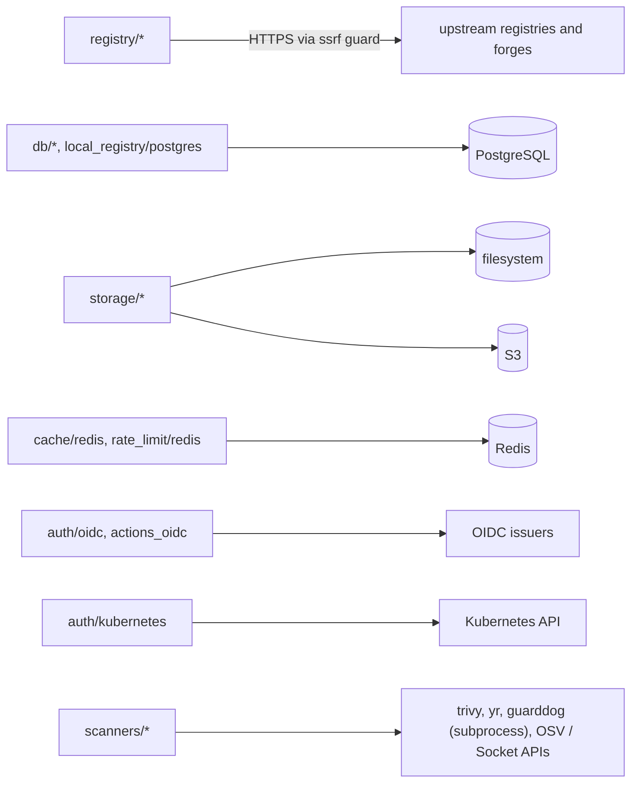
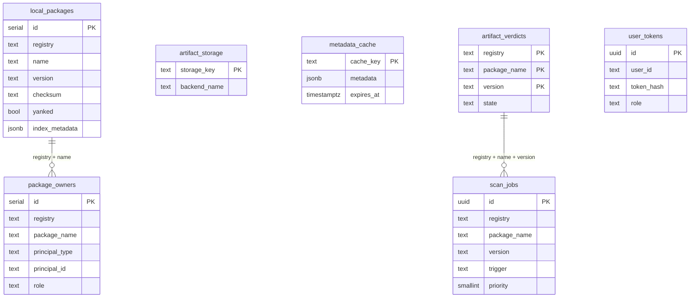

<!-- techdoc:begin components/adapters#notice -->
> Sections between `techdoc` markers are regenerated; write your own notes outside them.
<!-- techdoc:end -->

<!-- techdoc:begin components/adapters#role -->
## Role

`crates/adapters` (crate `batlehub-adapters`) implements the traits of [core](core). Used by [web](web) and [server](server). Registry clients are gated by `registry-*` cargo features (all in `default`), declared in `crates/adapters/Cargo.toml` and `crates/adapters/src/registry/mod.rs`.
<!-- techdoc:end -->

<!-- techdoc:begin components/adapters#interfaces -->
## Interfaces

| Module | Provides |
| --- | --- |
| `registry/` | One `RegistryClient` per kind (`npm.rs`, `cargo.rs`, `nuget/`, `maven/`, `pypi/`, `devfile.rs`, `nix/`, ...), plus `http_client.rs`, `ssrf.rs` (upstream SSRF guard), `offline.rs` (air-gap client), `fanout.rs`, `path_proxy.rs` |
| `local_registry/` | `LocalRegistryBackend`: `postgres.rs` `PostgresLocalRegistry`, `in_memory.rs` |
| `db/` | Postgres repositories (packages, governance, auth, ops, storage, sbom, advisory, air_gap, housekeeping, ...) |
| `migrations.rs` | Embedded sqlx migrator over `crates/adapters/migrations/001..062` |
| `storage/` | `filesystem.rs`, `s3/`, `router/` (routes keys across named backends, tracks them in `artifact_storage`) |
| `cache/` | `CacheStore`: `in_memory.rs`, `postgres.rs`, `redis.rs`; banner caches; `warm_coordinator.rs` |
| `rate_limit/` | Rate-limit and IP-block stores: in-memory, Postgres, Redis |
| `auth/` | `token.rs` (static Argon2 tokens), `user_token.rs` (PATs), `oidc.rs`, `kubernetes.rs`, `actions_oidc/` |
| `scanners/` | `trivy.rs`, `osv.rs`, `yara.rs`, `guarddog.rs`, `socket.rs`, `sigstore.rs`, `postmortem.rs`, `mlab.rs`, `subprocess.rs` |
| `vulnerability/`, `sbom/` | OSV scanning, SBOM extractors and upstream fetcher |
| `repo/` | Signed repository indexes: `deb.rs`, `rpm.rs`, `pacman.rs`, `apk.rs`, `openpgp.rs`, `apk_signer.rs` |
| `notification/` | Notification sinks (memory, Postgres) |
<!-- techdoc:end -->

<!-- techdoc:begin components/adapters#resources -->
## Resources

External systems the adapters reach.

<!-- techdoc:end -->

<!-- techdoc:begin components/adapters#config -->
## Configuration

Instances are built by [server](server) from `[database]`, `[storage]` (`type = "filesystem"` or `"s3"`, `crates/config/src/schema/storage.rs` `enum StorageBackendConfig`), `[cache]`, `[[auth]]` (`token`, `oidc`, `kubernetes`, `actions-oidc`), `[scanners.*]`, `[proxy]` and each `[[registries]]` block.
<!-- techdoc:end -->

<!-- techdoc:begin components/adapters#data-model -->
## Data model

A subset of the 40+ tables created by the migrations (`crates/adapters/migrations/`), the ones on the main read/publish/scan paths.

Other tables include `grants`, `policy`, `audit_seals`, `access_events`, `artifact_sboms`, `artifact_vulnerabilities`, `artifact_findings`, `team_namespaces`, `quota_usage`, `rate_limit_counters`, `ip_blocks`, `missing_content`, `bundle_imports`, `release_import_runs`, `worker_heartbeats`, `config_changes`. The relations drawn are logical (shared keys), not foreign-key constraints confirmed in the SQL.
<!-- techdoc:end -->
