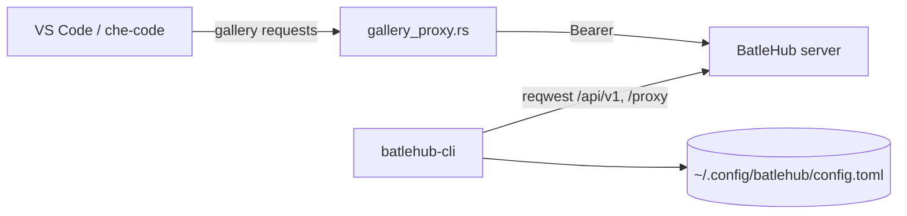

<!-- techdoc:begin components/cli#notice -->
> Sections between `techdoc` markers are regenerated; write your own notes outside them.
<!-- techdoc:end -->

<!-- techdoc:begin components/cli#role -->
## Role

`cli/` (crate and binary `batlehub-cli`) talks to the server's `/api/v1` and `/proxy` routes. `cli/src/cli/` holds the clap commands, `cli/src/api/` the reqwest client per area, `cli/src/tui/` the ratatui screens, `cli/src/gallery_proxy.rs` the local editor gallery proxy, `cli/src/contract*` the editor credential contract file. Built for several targets by `.github/workflows/build.yaml` and served by `GET /api/v1/cli/download`.
<!-- techdoc:end -->

<!-- techdoc:begin components/cli#interfaces -->
## Interfaces

Subcommands (`cli/src/cli/mod.rs`): `registry`, `package`, `version` (yank/delete/pin), `owners`, `mise` (air-gap plan from `mise.lock`, `registry suggest`), `proxy` (local gallery proxy), `vsx` (VSIX signature), `publish`, `download`, `auth` (tokens, whoami), `authz` (explain, shadow mode), `admin` (quota, ip-block, config, cache, banner, audit), `config`, `setup`, `why`, `wait`, `audit`, `verdicts`, `java` (Java engine over a language server), `tui`, `completion`.

Global flags: `--profile`/`BATLEHUB_PROFILE`, `--server`/`BATLEHUB_SERVER`, `--token`/`BATLEHUB_TOKEN`, `--registry`/`BATLEHUB_REGISTRY`, JSON output. Profiles live in `~/.config/batlehub/config.toml` (`cli/src/config.rs`).
<!-- techdoc:end -->

<!-- techdoc:begin components/cli#resources -->
## Resources

<!-- techdoc:end -->

<!-- techdoc:begin components/cli#config -->
## Configuration

`BATLEHUB_PROFILE`, `BATLEHUB_SERVER`, `BATLEHUB_TOKEN`, `BATLEHUB_REGISTRY`, `VSX_REGISTRY_AUTH_TOKEN_FILE`, `BATLEHUB_HOME`, `BATLEHUB_JAVA_ENGINE` (read in `cli/src`). Tests: `task test:cli`, `cargo test -p batlehub-cli --test integration`.
<!-- techdoc:end -->
