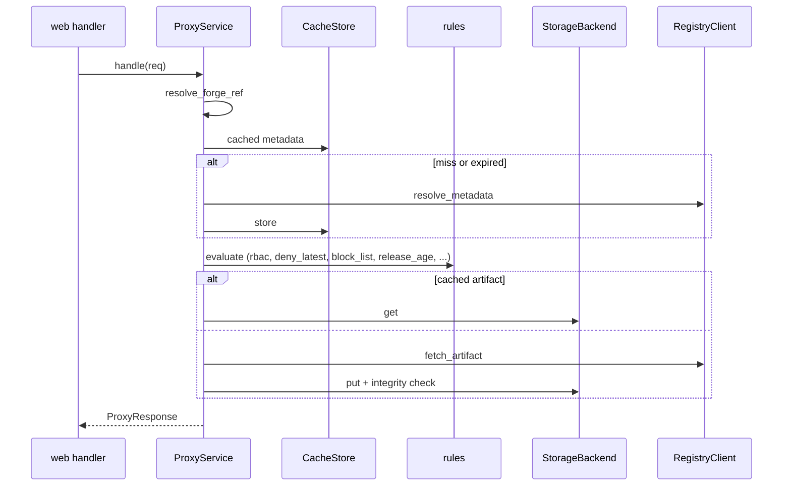

<!-- techdoc:begin components/core#notice -->
> Sections between `techdoc` markers are regenerated; write your own notes outside them.
<!-- techdoc:end -->

<!-- techdoc:begin components/core#role -->
## Role

`crates/core` (crate `batlehub-core`) is the bottom of the dependency graph: [adapters](adapters), [web](web) and [server](server) depend on it. Modules: `entities/` (e.g. `registry_kind.rs`, `package.rs`, `identity.rs`, `grant.rs`, `policy.rs`, `sbom.rs`, `security.rs`, `audit_seal.rs`), `ports/` (traits), `rules/` (policy rules), `services/` (orchestration).
<!-- techdoc:end -->

<!-- techdoc:begin components/core#interfaces -->
## Interfaces

Ports implemented by [adapters](adapters) (`crates/core/src/ports/`):

| Area | Traits |
| --- | --- |
| registry | `RegistryClient`, `LocalRegistryBackend`, `PackageRepository`, `ArtifactMetaRepository`, `ForgeReleaseSource` |
| storage | `StorageBackend`, `CacheStore`, `StorageAdminRepository` |
| auth | `AuthProvider`, `UserTokenRepository`, `LoginStateStore` |
| governance | `GrantRepository`, `OwnershipPort`, `PolicyRepository`, `SigningKeyPort`, `TeamNamespacePort`, `UserBlockRepository`, `BetaChannelPort` |
| ops | `RateLimitStore`, `IpBlockStore`, `QuotaRepository`, `UpstreamStatusPort`, `WarmCoordinator` |
| security | `VerdictRepository`, `ScanQueue`, `WorkerRegistry`, `ArtifactScanner`, `FindingEnricher`, `VulnerabilityRepository`, `VulnerabilityScanner`, `AdvisoryRepository`, `SbomRepository`, `SbomExtractor`, `UpstreamSbomFetcher` |
| other | `AuditTrailStore`, `LeaderLock`, `MissRecorder`, `BundleHistory`, `ReadmeRepository`, `NotificationPort`, `BannerPort`, `ConfigChangeRepository`, `StatsHistoryRepository`, `ImportHistory` |

Rules (`crates/core/src/rules/`): `rbac`, `deny_latest`, `block_list`, `release_age`, `cve_gate`, `license_gate`, `verdict_gate`, `version_gate`, `signed_release`, `trusted_publisher`, `forge_ref`, `flags`, `raw_policy`.

Main services (`crates/core/src/services/`): `proxy::ProxyService` (`handle`, `authorize_read`, `authorize_listing`), `local_registry` (`publish.rs`, `read.rs`, `lifecycle.rs`, `eco_*.rs` per ecosystem), `scan_worker::ScanWorker`, `authz`, `blocking`, `eviction`, `listing_synthesis` (`render_listing`), `integrity`, `bundle`, `audit_trail`, `quota`, `readme`, `hot_config`.
<!-- techdoc:end -->

<!-- techdoc:begin components/core#resources -->
## Resources

None directly: every external effect goes through a port trait.
<!-- techdoc:end -->

<!-- techdoc:begin components/core#flows -->
## Main flows

`ProxyService::handle` (`services/proxy/handle.rs`): forge refs are resolved to a commit first, then metadata is resolved cache-first, rules are evaluated, and the artifact is served from storage or streamed from upstream; an offline refusal is recorded through `MissRecorder` for air-gap bundles.

<!-- techdoc:end -->
