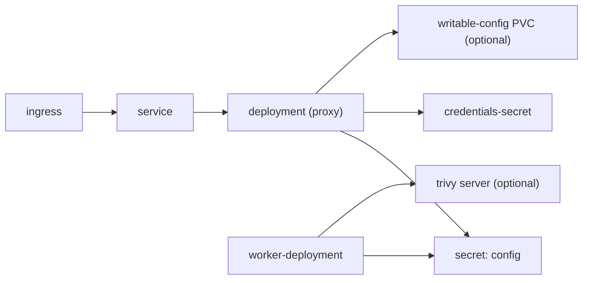

<!-- techdoc:begin components/helm#notice -->
> Sections between `techdoc` markers are regenerated; write your own notes outside them.
<!-- techdoc:end -->

<!-- techdoc:begin components/helm#role -->
## Role

`helm/batlehub` (chart and app version 1.7.0) deploys the server image. Optional dependency: `trivy` 0.26.0 from aquasecurity (`trivy.enabled`). README generated by `task helm:docs` from `README.md.gotmpl`; example values in `deploy/helm/`.
<!-- techdoc:end -->

<!-- techdoc:begin components/helm#interfaces -->
## Interfaces

Templates (`helm/batlehub/templates/`): `deployment.yaml`, `worker-deployment.yaml`, `worker-hpa.yaml`, `service.yaml`, `ingress.yaml`, `secret.yaml` (config), `credentials-secret.yaml` (credentials layer), `pvc.yaml`, `pdb.yaml`, `networkpolicy.yaml`, `serviceaccount.yaml`, `clusterrole.yaml`, `extra-manifests.yaml`.

Main values (`values.yaml`): `image`, `config`, `credentials`, `writableConfig`, `worker`, `trivy`, `networkPolicy`, `persistence`, `ingress`, `podDisruptionBudget`, `externalManifest`.
<!-- techdoc:end -->

<!-- techdoc:begin components/helm#resources -->
## Resources

`writableConfig` (added in 1.7.0, `enabled: false` by default) puts the first config layer on a writable claim, seeded by a `seed-config` init container (busybox, since the distroless server image has no `sh`); policy `IfNotPresent` keeps what the config editor wrote across restarts. The credentials layer and the worker keep a read-only config.

<!-- techdoc:end -->
