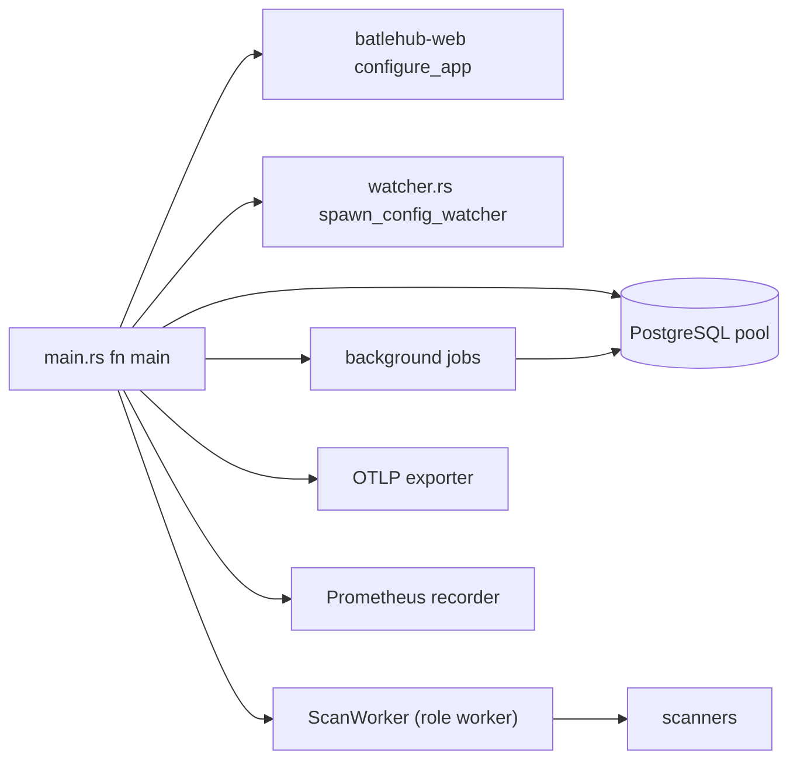
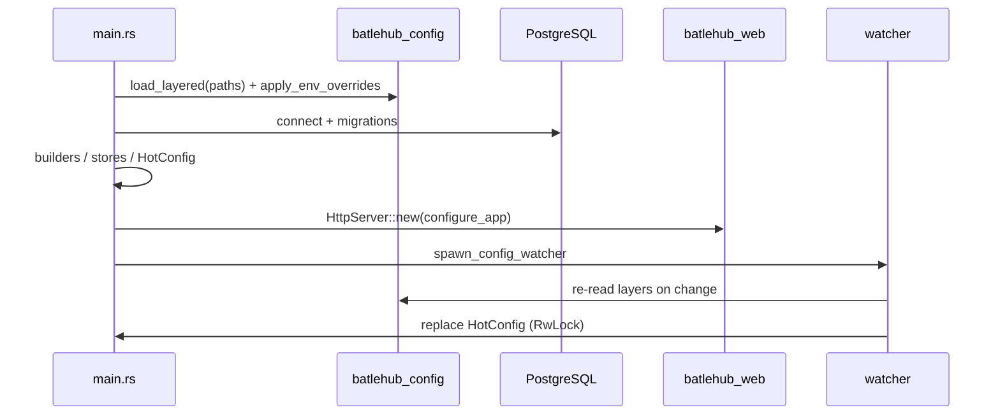

<!-- techdoc:begin components/server#notice -->
> Sections between `techdoc` markers are regenerated; write your own notes outside them.
<!-- techdoc:end -->

<!-- techdoc:begin components/server#role -->
## Role

`server/` (crate `batlehub-server`, binary `batlehub`) wires everything together and holds no domain logic. `server/src/main.rs` `fn main` loads the layered config, opens the Postgres pool, runs migrations, builds registry clients (`server/src/builders.rs`), stores (`server/src/stores.rs`), the hot config (`server/src/hot_config.rs`) and the HTTP server (`server/src/server_factory.rs`), then spawns background jobs. Extra binaries: `server/src/bin/listing_coverage.rs`, `server/src/bin/readme_coverage.rs` (doc-table generators used by `task docs:*-coverage`).
<!-- techdoc:end -->

<!-- techdoc:begin components/server#interfaces -->
## Interfaces

CLI (`server/src/main.rs` `struct Cli`, `enum Command`):

| Command / flag | Effect |
| --- | --- |
| `--config <path>` (repeatable) | Config layers, later wins; falls back to `BATLEHUB_CONFIG` then `config.toml` |
| `--roles proxy,worker` | Overrides `[server].roles` |
| `dump-spec` | Print the OpenAPI JSON (`batlehub_web::openapi_spec`) |
| `hash-token <token>` | Argon2id hash for static tokens |
| `explain-config [path]` | Print each subject's expanded permissions per registry |

HTTP is served by [web](web).
<!-- techdoc:end -->

<!-- techdoc:begin components/server#resources -->
## Resources

What the binary starts and talks to.

Background jobs spawned from `fn main`: `stores::spawn_db_pool_gauge_sampler`, `stores::spawn_db_housekeeping`, `allocator::spawn_allocator_gauge_sampler`, `setup::spawn_login_state_prune`, `stores::spawn_pending_publish_cleanup`, `stores::spawn_quota_gauge_sampler`, `watcher::spawn_config_watcher`, `watcher::spawn_startup_warming`, `watcher::spawn_release_imports`, `watcher::spawn_stats_rollup`, `watcher::spawn_periodic_vuln_scan`, `watcher::spawn_audit_trail_jobs`, `watcher::spawn_upstream_audit`, `watcher::spawn_periodic_coherence_sweep`, `watcher::spawn_rescan_scheduler`; `fn start_scan_worker` runs `ScanWorker::run` when the `worker` role is active.
<!-- techdoc:end -->

<!-- techdoc:begin components/server#config -->
## Configuration

Reads the whole `AppConfig` (see [config](config)), plus `BATLEHUB_CONFIG` and `BATLEHUB_DISABLE_HOT_RELOAD`. Cargo feature `profiling` (`server/src/profiling.rs`) enables CPU profiling.
<!-- techdoc:end -->

<!-- techdoc:begin components/server#flows -->
## Main flows

Startup and hot reload: every config layer's directory is watched (`server/src/watcher.rs` `fn spawn_config_watcher`, filtered by `is_relevant`); a reload rebuilds `HotConfig` and swaps it atomically, so in-flight requests finish with their snapshot.

<!-- techdoc:end -->
