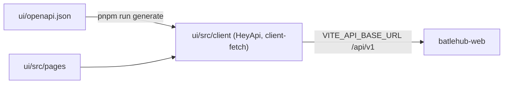

<!-- techdoc:begin components/ui#notice -->
> Sections between `techdoc` markers are regenerated; write your own notes outside them.
<!-- techdoc:end -->

<!-- techdoc:begin components/ui#role -->
## Role

`ui/` (`batlehub-ui`, Vue 3 + Vite + Tailwind + radix-vue, vue-i18n) is built into static files served by [web](web) from `[server] static_dir` (`crates/web/src/spa.rs`). Pages are in `ui/src/pages/`, routes in `ui/src/router/index.ts`, registry setup snippets in `ui/src/config/registryTypes.ts`.
<!-- techdoc:end -->

<!-- techdoc:begin components/ui#interfaces -->
## Interfaces

| Route | Page |
| --- | --- |
| `/`, `/login` | `HomePage.vue`, `LoginPage.vue` |
| `/packages`, `/packages/:registry/:name` | `PackageCatalog.vue`, `PackageDetailPage.vue` |
| `/setup` | `SetupGuide.vue` |
| `/me/profile`, `/me/tokens`, `/me/namespace`, `/me/cli` | `MyProfile.vue`, `TokensPage.vue`, `MyNamespace.vue`, `CliDownload.vue` |
| `/tools/access-check`, `/tools/url-mapper` | `AccessCheck.vue`, `PathMapper.vue` |
| `/admin/...` | `AdminDashboard`, `AdminPackages`, `AdminBulk`, `AdminBlocks`, `AdminAccessCheck`, `AdminAuthorization`, `AdminTeamNamespaces`, `AdminBetaChannel`, `AdminConfigReload`, `AdminWarming`, `AdminImports`, `AdminHealth`, `AdminUpstream`, `AdminSbom`, `AdminAirGap`, `AdminInboundEvents`, `AdminNotificationSubscriptions`, `AuditLog` |

Scripts (`ui/package.json`): `dev`, `build`, `generate` (HeyApi), `lint` (oxlint), `lint:eslint`, `format:check` (oxfmt), `i18n:check`, `test` (vitest), `coverage`.
<!-- techdoc:end -->

<!-- techdoc:begin components/ui#resources -->
## Resources

`ui/src/client` is generated (git-ignored) by `ui/openapi-ts.config.ts` with the `@hey-api/typescript`, `@hey-api/sdk` and `@hey-api/client-fetch` plugins.
<!-- techdoc:end -->

<!-- techdoc:begin components/ui#config -->
## Configuration

`VITE_API_BASE_URL` (no dev proxy: each dev server calls it directly), `OPENAPI_SPEC` (optional spec URL for `generate`).
<!-- techdoc:end -->
