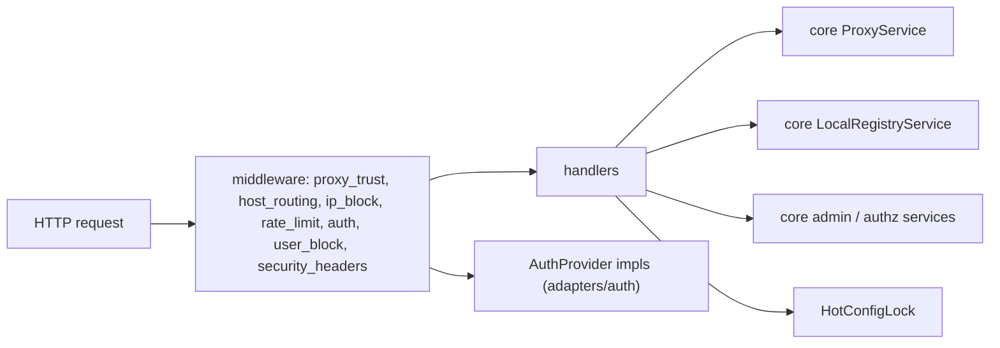
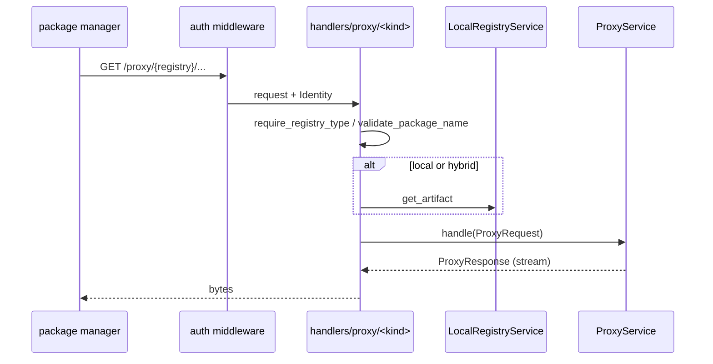

<!-- techdoc:begin components/web#notice -->
> Sections between `techdoc` markers are regenerated; write your own notes outside them.
<!-- techdoc:end -->

<!-- techdoc:begin components/web#role -->
## Role

`crates/web` (crate `batlehub-web`) turns HTTP into calls on [core](core) services and [adapters](adapters). `crates/web/src/lib.rs` `fn configure_app` builds the app, `fn collect_routes` registers every route with utoipa, `fn openapi_spec` produces the spec (dumped to `ui/openapi.json`, 336 paths at this commit), `fn scalar` serves the Scalar API UI. Used by [server](server); the [ui](ui) and [cli](cli) are its API clients.
<!-- techdoc:end -->

<!-- techdoc:begin components/web#interfaces -->
## Interfaces

Route families (from `ui/openapi.json` and `crates/web/src/handlers/`):

| Prefix | Handlers | Purpose |
| --- | --- | --- |
| `/proxy/{registry}/...` | `handlers/proxy/<kind>` | Native protocol of each registry kind (npm, cargo sparse index, PyPI simple, Maven, OCI-like devfile, Nix, apt/dnf/pacman/apk repos, ...) |
| `/api/v1/auth/oidc/{providers,login,callback,refresh}`, `/api/v1/auth/tokens` | `handlers/auth/oidc`, `handlers/auth/tokens.rs` | OIDC login, personal access tokens |
| `/api/v1/explore/...` | `handlers/front_office/explore` | Catalogue, package detail, README, forge refs, fetch-on-demand |
| `/api/v1/me/...` | `handlers/front_office/me` | Caller-scoped quota, downloads, advisories, namespaces |
| `/api/v1/packages`, `/api/v1/registries`, `/api/v1/banner`, `/api/v1/cli/download` | `handlers/front_office` | Listings, banner, CLI binaries |
| `/api/v1/verdicts/...`, `/api/v1/sbom/...` | `handlers/security.rs`, back-office `sbom.rs` | Scan verdicts, rescans, pullers, SBOM |
| `/api/v1/flags/{source}`, `/api/v1/webhooks/inbound/{name}` | `handlers/flags.rs`, `handlers/inbound_webhook.rs` | Pushed flags, inbound webhooks |
| `/api/v1/audit/...` | back-office `audit.rs` | Audit log, pulls |
| `/api/v1/admin/...` (90 paths) | `handlers/back_office/*` | Governance (grants, ownership, policy, signing keys, team namespaces, user blocks, beta channel), ops (eviction, IP blocks, quota, release import, upstream, warming), health, packages, bulk, config editor/reload, GDPR, retention, tombstones, stats, exposure, air-gap bundles |
| `/_air-gap/unmirrored/{tail}` | `handlers/air_gap.rs` `unmirrored_sink` | Sink for hosts the air gap does not rewrite |
| `/healthz`, `/livez`, `/metrics`, `/scalar` | `handlers/healthz.rs`, `handlers/metrics.rs`, `lib.rs` `fn scalar` | Probes, Prometheus, API UI |

Non-API paths are served by the SPA fallback (`crates/web/src/spa.rs` `configure_spa`).
<!-- techdoc:end -->

<!-- techdoc:begin components/web#resources -->
## Resources

Middleware in `crates/web/src/middleware/` and what handlers call.

`middleware/auth.rs` iterates `Vec<Arc<dyn AuthProvider>>`, stores the `Identity` in request extensions; `extractors.rs` `raw_auth_from_request` normalises non-Bearer credentials (`X-NuGet-ApiKey`, cargo bare token, `ovsx` `?token=`, galaxy `Token`).
<!-- techdoc:end -->

<!-- techdoc:begin components/web#config -->
## Configuration

Reads `[server]` (static_dir, trusted_proxies, roles), `[subdomain_routing]`, `[limits]`, `[ip_blocking]`, `[auth]` and per-registry settings through `HotConfig`; `config` crate types are imported directly.
<!-- techdoc:end -->

<!-- techdoc:begin components/web#flows -->
## Main flows

A registry read in proxy or hybrid mode (`CLAUDE.md` § Request lifecycle).

<!-- techdoc:end -->
