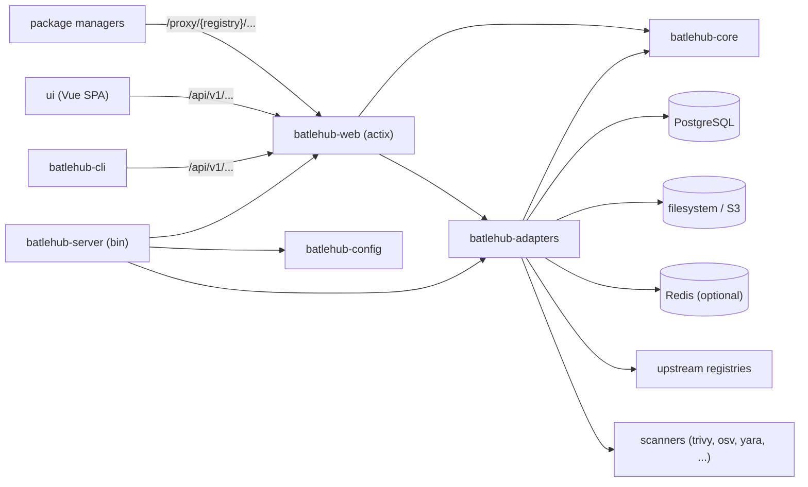

<!-- techdoc:begin index#notice -->
> Sections between `techdoc` markers are regenerated; write your own notes outside them.
<!-- techdoc:end -->

<!-- techdoc:begin index#purpose -->
## Purpose

BatleHub (`batlehub`, workspace version 1.7.0 in `Cargo.toml`) sits between package managers and their upstream registries. Each configured `[[registries]]` entry runs in `proxy`, `local` or `hybrid` mode (`crates/config/src/schema/registry.rs` `enum RegistryMode`): it caches upstream metadata and artifacts, hosts locally published packages, and evaluates policy rules (RBAC, deny-latest, block lists, release-age gate, CVE/licence/verdict gates) before serving a byte. It also runs security scanners, SBOM extraction, an audit trail and air-gap bundle import/export. It runs as a container or a Helm release (`helm/batlehub`) backed by PostgreSQL, with filesystem or S3 storage and optional Redis.

Supported kinds (`crates/core/src/entities/registry_kind.rs` `enum RegistryKind`): github, forgejo, gitlab, cargo, npm, openvsx, goproxy, pypi, conda, composer, vscode-marketplace, maven, terraform, rubygems, nuget, deb, rpm, pacman, apk, jetbrains, jetbrains-marketplace, generic, nodedist, sdkman, rustup, galaxy, nix, devfile.
<!-- techdoc:end -->

<!-- techdoc:begin index#stack -->
## Stack

| Layer | Technology | Where |
| --- | --- | --- |
| HTTP server | Rust 2021, actix-web 4 (no `http2` feature), tokio | `server/`, `crates/web/` |
| OpenAPI | utoipa 6 + utoipa-scalar (UI at `/scalar`) | `crates/web/src/lib.rs` `fn openapi_spec` |
| Database | PostgreSQL via sqlx 0.9 (embedded migrations 001–062) | `crates/adapters/src/migrations.rs`, `crates/adapters/migrations/` |
| Storage | Filesystem or S3 (aws-sdk-s3), routed per backend | `crates/adapters/src/storage/` |
| Cache / rate limit | In-memory, PostgreSQL or Redis | `crates/adapters/src/cache/`, `crates/adapters/src/rate_limit/` |
| Observability | Prometheus (`/metrics`), OpenTelemetry OTLP, tracing | `crates/web/src/handlers/metrics.rs`, `server/src/db_metrics.rs` |
| CLI / TUI | clap 4, reqwest, ratatui | `cli/` |
| Console | Vue 3, Vite, Tailwind, HeyApi client, vitest | `ui/` |
| Docs site | VitePress (own pnpm project) | `docs/` |
| Deploy | Containerfiles (distroless, hardened, worker), Helm chart | `Containerfile*`, `helm/batlehub/` |
| Tooling | mise, Taskfile, cocogitto, cargo-deny, cargo-audit, trivy, gitleaks, semgrep | `mise.toml`, `Taskfile.yml`, `.tasks/` |
<!-- techdoc:end -->

<!-- techdoc:begin index#architecture -->
## Architecture

Crates and runtime dependencies; arrows point from caller to callee.

The dependency direction is strict: `core` ← `adapters` ← `web` ← `server`; `config` is read by `server` and `web` (`CLAUDE.md`). `core` holds entities, ports (traits) and rules with no I/O; `adapters` implements the ports; `web` exposes HTTP; `server` wires everything and runs background jobs. The same binary runs as `proxy`, `worker` or both (`--roles`).
<!-- techdoc:end -->

<!-- techdoc:begin index#components -->
## Components

| Component | Role | Page |
| --- | --- | --- |
| server | `batlehub` binary: config loading, wiring, background jobs, hot reload | [server](components/server) |
| web | actix-web handlers, middleware, OpenAPI spec | [web](components/web) |
| core | Domain entities, ports, rules and services (no I/O) | [core](components/core) |
| adapters | Registry clients, Postgres, storage, cache, auth, scanners | [adapters](components/adapters) |
| config | TOML schema, layered loader, env overrides | [config](components/config) |
| cli | `batlehub-cli`: commands, API client, TUI | [cli](components/cli) |
| ui | Vue 3 admin/user console | [ui](components/ui) |
| helm | Kubernetes chart `batlehub` | [helm](components/helm) |
| examples | Integration test helpers and smoke binaries | [examples](components/examples) |
<!-- techdoc:end -->
